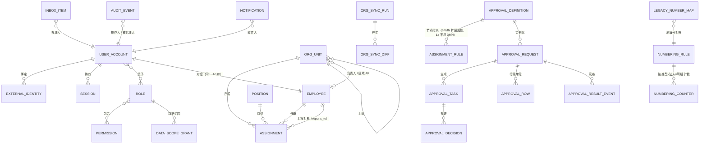

# AI_NATIVE_SPEC — FORCITIS one · Phase 1a 平台桥接（试点）

日期：2026-10-14 · 会话：psa-1a-platform-bridge-reimagine · 命令：`/code-modernization:modernize-reimagine`
范围：brief §3「Phase 1a — 平台桥接」所列 Modules（身份、组织、审批、企业微信通知、平台可靠投递、PC/H5 登录与审批页面、布局与路由）。brief 对本规格有约束力，本规格不改写 brief 的任何条件。

**输入**：`BUSINESS_RULES.md`（审批域 RULE-248..315）、`docs/business/rules/identity-org-rules.md`（本会话补抽 RULE-316..376，**待评审**）、`RULE_REVIEWS.json`（审批域 28 条已评审）、`DATA_OBJECTS.md`、`topology.json`、`ASSESSMENT.md`、`docs/legacy/psa-external-interfaces.md`（本会话：187 个接口）、`docs/data/column-ownership.md`（本会话：14 张表、217 列）、`runtime/`（生产只读采集，访问日志窗口约 180 天）、ADR-0001..0020。

凭据一律以环境变量名出现（如 `${WECOM_CORP_SECRET}`），本文件不含任何原值。

---

## 1. Capabilities（必须具备的能力）

编号 `C1a-xx`；「来源」指规则或接口编号；「ADR」为已采纳决定。P0 / 舍弃由**检查点 1**由用户确认（§7）。

| # | 能力 | 来源 | ADR / 已定 | 建议 |
|---|---|---|---|---|
| C1a-01 | **企业微信 OAuth2 登录**（H5 内嵌静默授权；PC 扫码；小程序——RULE-323 评审「保留」），按 `we_com_id` 精确映射，只放行「启用且在职」 | W3/W5/W13；RULE-322/323/324/326/327 | ADR-0009 §3 | P0 |
| C1a-02 | **致远 SSO 登录**：服务端验票、票据一次性、只放行启用用户 | A2/A3；RULE-320/321 | ADR-0009 §3 | P0 |
| C1a-03 | **外部系统签名一次性票据**替代免密端点：YD 门户、A8 门户、BI 等外部系统进入新系统是入站签名票据；KM 是老系统→KM 的出站跳转（须已登录，KM 身份取自会话；签名票据、HTTPS，密钥进配置并轮换，RULE-329） | X1/X2/A1/A4/K1/K2；RULE-318/319/329/335；SEC-001/002/019 | ADR-0009 §3 | P0（各调用方改造需协调） |
| C1a-04 | **管理员应急账号**（强口令 + MFA + 锁定）；员工不再口令登录 | U1；RULE-316/317；SEC-011 | ADR-0009 §3 | P0 |
| C1a-05 | **服务端会话**（Spring Session JDBC、HttpOnly + SameSite Cookie、CSRF）；空闲超时 + 绝对上限；登出；状态变更（停用、离职、角色变更）即时吊销 | U2/U3；RULE-331..334/338/339 | ADR-0009 §2 | P0 |
| C1a-06 | ~~**身份桥接**：只读校验老系统令牌，换发新会话~~ **已删除**（检查点 2 Q-1，用户：「1a 删除桥接」；ADR-0009 §6 已修订） | — | ADR-0009 §6（修订） | — |
| C1a-07 | **默认拒绝**：所有接口需认证；方法级 `@PreAuthorize` 或带理由的 `@PublicEndpoint`；匿名遍历全部接口返回 401 | RULE-336/337；SEC-020/021 | ADR-0009 §1，G28/G33 | P0（出口条件） |
| C1a-08 | **功能权限（RBAC）与导航**：类型化 `Permission`；角色—菜单；变更即时生效（缓存 ≤ 60 秒）；无隐式默认角色；`super_admin` 改为会话级管理模式（只含角色定义、账号授权、强制下线）；应急账号绑超管、明确离职拒绝；离职删除角色授予；组织数据管理员、业务管理员、安全审计员三个系统角色；编号模板四眼确认；拆出 `account-role:update`；不能改自己的角色与自己持有角色的定义、不能改自己的法人归属；敏感权限（含审计查询与导出、编号确认）双人确认；员工可查自己的登录记录 | RULE-340..348 | ADR-0009 §4；ADR-0026 第 5、6 项；ADR-0027 | P0 |
| C1a-09 | **数据范围 `AccessScope`**：法人 × 部门 × 项目角色，显式传入仓储，按权限计算，空范围 = 无行（fail-closed）；数据访问注册表；部门浏览与人员详情接入；法人归属生效区间表 | RULE-349..353；SEC-009 | ADR-0009 §4；ADR-0026 第 1、2 项 | P0（1a 按 ADR-0026「1a 交付范围」；法人限定与审批参与访问 1b） |
| C1a-10 | **组织快照（只读）**：从 A8 同步部门、人员、岗位、汇报线、部门负责人 / 区域 AR / 类别 / 交付标识；源缩水保护；与 A8 对账零差异 | A5..A8；RULE-354..367/371/372；所有权矩阵 §1–2 | ADR-0011；出口条件 | P0 |
| C1a-11 | **组织变更事件**（模块内，事件发布登记表保证至少一次） | M6；RULE-373 | ADR-0016 / Modulith | P1 |
| C1a-12 | **审批引擎 `platform.approval`**：Flowable 8 BPMN（1a 不引入 DMN：指派写在 BPMN 扩展属性，由 AssigneeResolver 计算；出现真正的多维决策表时在该阶段引入）；单人 / 候选组认领、会签 / 或签、行级审批、加签（建议性）、转交、退回发起人 / 指定节点、撤回、撤销（不删历史）、截止点、BEFORE 钩子、幂等发起、轮次、类型化结果事件 | RULE-248..315（28 条已评审） | ADR-0007；RULE_REVIEWS | P0（引擎与契约；1a 无业务单据接入）；会签 / 或签、行级审批等引擎能力随第一个使用者交付（Q-3 收窄） |
| C1a-13 | **TIMESHEET 审批人序列回放**：读取老系统导出的实例与分配规则，在新引擎上解析审批人序列并比对，差异逐条入档 | `bpm_task_assign_rule`、`prod_bpm*.tsv` | 出口条件 | P0 |
| C1a-14 | **合并待办收件箱**：新引擎待办 + 老系统待办（只读），同一用户计数一致；点击老待办跳回老系统 | P8/P11；`bpm_task_ext` 只读；RULE-261/299 | 风险二缓解；出口条件 | P0 |
| C1a-15 | **企业微信通知**：待办 / 完成 / 知会卡片；按 `we_com_id` 精确投递（不再 `@all`）；access_token 缓存；超时与重试；卡片按钮回调以 `FromUserName` 定人并校验为处理人 | W8..W12；M5；RULE-374..376；SEC-006 | ADR-0009；短信不迁移 | P0（通知）／P1（卡片按钮操作） |
| C1a-16 | **业务编号 `platform.numbering`** + 编号规则页；统一新格式；老编号作「原编号」可检索、对照可查 | ADR-0010 | ADR-0010 | P0（出口条件） |
| C1a-17 | **审计 `platform.audit`**：登录成功 / 失败、会话吊销、代理操作（记录操作人与被代理人）、权限变更 | RULE-330；RULE-270 修正 | ADR-0009 | P0 |
| C1a-18 | **可观测性四类告警**：同步延迟、未完成事件发布、作业失败、登录失败率（dev 演练触发） | — | 出口条件；ARMS / SLS | P0 |
| C1a-19 | **前端外壳**：PC（React 19 + AntD 5）登录页、布局、路由守卫、合并待办收件箱、权限不足 / 会话过期页；H5（Taro 4）企业微信静默登录与待办；共用 OpenAPI 客户端、Zod、令牌 CSS | F1..F12 | ADR-0013；DS_GAPS | P0 |
| C1a-20 | **切换与回滚**：nginx 按路径分流到 one.forcitis.com；撤销路由后老系统登录与审批不受影响 | — | ADR-0011；出口条件 | P0 |

**建议舍弃（不迁移）**，待检查点 1 确认：

| # | 老能力 | 理由 |
|---|---|---|
| D-01 | 短信验证码登录与发送（U7/U8；验证码固定 9999） | 用户已定「短信不迁移」；且现状等同免密 |
| D-02 | 员工账号口令登录、图片验证码、「记住我」（U1/U9/F5） | ADR-0009：员工走企业微信 / 致远 SSO；仅保留管理员应急账号 |
| D-03 | yudao OAuth2 开放授权（O1..O5）与社交账号绑定（W1/W2） | 无在用调用方证据（social-auth-redirect 3 个用户、423 次）；外部系统改用签名票据 |
| D-04 | 免密端点 `customization-login`、`/id`、`a8-login`、`YD-get`、`login/KM` | SEC-001/002；由 C1a-03 替代（调用方必须改造） |
| D-05 | 流程模型 / 表单设计器 UI、`bpm_form`、`bpm_user_group`、`bpm_oa_leave` 样例、`bpm_process_instance_copy` | ADR-0019（不迁移设计器）；后三者无生产使用；BPMN 以文件进版本库 |
| D-06 | 手工维护部门、人员、Excel 导入用户（W-D-ADM / W-U-ADM） | A8 为组织主数据源；手工改动会被同步覆盖（所有权矩阵冲突 1–5） |
| D-07 | 批量代审他人待办（P10，RULE-270） | 已评审为错误：只能批量处理本人待办，代理须显式 |
| D-08 | 按表名拼 SQL 的结果回写（RULE-308）、引擎记录反推补发（RULE-304）、`psa_reliable_delivery_task` | 已评审为错误；由 Modulith 事件发布登记表承担 |
| D-09 | `weiXinLogin` BI 分支（死代码）、多租户 `tenant_id` | 无调用方；ADR-0019 |

---

## 2. Domain Model（Phase 1a）

模块（子域.BC）：`platform.identity`、`organization.workforce`、`platform.approval`、`platform.integration`（共用企业微信客户端与出站投递；A8 防腐层归 `organization.workforce`，致远验票归 `platform.identity`，见 REIMAGINED_ARCHITECTURE §2，检查点 2 已批准）、`platform.numbering`、`platform.audit`。schema 按 `<子域>_<BC>`（NAMING_STANDARD）。



要点：
- `USER_ACCOUNT.id` 与 `EMPLOYEE.id` 沿用 A8 `ORG_MEMBER.ID`（有符号 bigint，生产存在负数）；`ORG_UNIT.id` 沿用 `ORG_UNIT.ID`。ID 沿用只为身份连续性；新系统不向 A8 写任何业务数据，也不为老 OA 存储过程（`oa-quotation-sync`、`oa-cuvalue-sync` 等，把权责事实写进 A8）供数，它们随所服务的 OA 流程按阶段下线（§9a，`docs/legacy/seeyon-oa/access-register.md`）。
- `APPROVAL_REQUEST` 唯一键（流程类型, 单据 ID）+（流程类型, 单据 ID, 轮次）（RULE-266/278 修正）。
- `INBOX_ITEM` 是读模型：新引擎任务 + 老系统 `bpm_task_ext` 只读投影，带来源标记。
- 内核值对象（ADR-0016）：`Money`、`AccountingPeriod`、`ProjectCoordinate`、`LegalEntityId`；1a 实际使用 `LegalEntityId`（编号、数据范围）。`ProjectCoordinate` 先用最小形态「项目 + 可选 WBS 节点」，Phase 2 由业务确认是否增加维度（用户 2026-10-14：「先用最小形态，Phase 2 再定 (Recommended)」）。法人代码由 `organization.workforce.legal_entities` 维护（用户：「新系统维护法人小表 (Recommended)」）。

---

## 3. Interface Contracts

### 3.1 老系统现状
全部 187 个接口（含 26 个匿名端点、8 个 RocketMQ 主题、10 个定时任务）及其 OpenAPI / AsyncAPI 片段见 `docs/legacy/psa-external-interfaces.md` §11。

### 3.2 新系统（目标，`/api/v1`，ADR-0008）

```yaml
openapi: 3.1.0
info: { title: FORCITIS one — Phase 1a platform, version: v1 }
servers: [ { url: "https://one.forcitis.com/api/v1" } ]
components:
  securitySchemes:
    session: { type: apiKey, in: cookie, name: SESSION }
paths:
  # 登录由前端落地页接收回跳（企业微信 code+state、致远 ticket、外部系统签名票据）后 POST 给后端，成功返回 JSON；
  # 一次性凭证不出现在服务端访问日志的 GET 参数中。以 SessionController 为准。
  /platform/login-states:
    post:
      security: []          # @PublicEndpoint: 发起企业微信登录，返回一次性 state（防 CSRF），不建会话
      requestBody: { content: { application/json: { schema: { properties: { entry: {} } } } } }
  /platform/sessions:wecom-login:
    post:
      security: []          # @PublicEndpoint: body {code, state, entry}；code → userid → 启用且在职 → 建会话
      responses: { "200": { description: "JSON {userId, absoluteExpiresAt}；Set-Cookie SESSION (HttpOnly, SameSite=Lax)；不在 URL 带令牌" } }
  /platform/sessions:sso-login:
    post:
      security: []          # @PublicEndpoint: body {ticket}；服务端向 ${SEEYON_OA_BASE_URL} 验票，一次性
      responses: { "200": { description: "同上" }, "401": { description: invalid/replayed ticket } }
  /platform/sessions:ticket-login:
    post:
      security: []          # @PublicEndpoint: 入站外部系统签名一次性票据（A8 门户/YD/BI 等；需前端落地页）；body {ticket}
      description: "HMAC(${SSO_TICKET_SIGNING_KEY}) 签名、≤60s、nonce 一次性"
      responses: { "200": { description: "同上" }, "401": {} }
  /platform/sessions:emergency-login:
    post: { security: [], description: "应急管理员：口令 + TOTP，仅内网" }
  /platform/sessions:logout: { post: { responses: { "204": { description: logout } } } }
  /platform/sessions:current:
    get:
      responses:
        "200":
          content:
            application/json:
              schema:
                type: object
                properties:
                  userId: { type: string, description: "bigint as string" }
                  displayName: { type: string }
                  orgUnit: { type: object }
                  permissions: { type: array, items: { type: string, example: "platform.approval:task:approve" } }
                  navigation: { type: array, items: { $ref: "#/components/schemas/NavItem" } }
  /organization/workforce/org-units: { get: { description: "组织树（只读快照）" } }
  /organization/workforce/employees/{id}: { get: {} }
  /organization/workforce/sync-runs: { get: { description: "同步记录与差异（管理员）" } }
  /platform/approval-tasks:
    get:
      description: "合并待办（新旧）；权限 platform.approval:task:read；调用人恒为会话用户，请求不带身份"
  /platform/approval-tasks/{taskId}:
    get: { description: "任务详情（含 canAct）；权限 platform.approval:task:read" }
  /platform/approval-tasks/{taskId}:claim: { post: { description: "权限 platform.approval:task:approve" } }
  /platform/approval-tasks/{taskId}:decide:
    post:
      description: "权限 platform.approval:task:approve；待实现：rows[]（行级审批，随第一个使用者交付）、批量办理"
      requestBody:
        content:
          application/json:
            schema:
              type: object
              required: [outcome]
              properties:
                outcome: { enum: [APPROVE, REJECT] }
                reason: { type: string }
  /platform/approval-tasks/{taskId}:return:
    post: { description: "退回发起人，结束本轮（outcome=RETURNED）；body 只带 reason；权限 platform.approval:task:approve" }
  # 待实现（随功能交付补路径）：转交、加签、撤回、撤销；发起无 HTTP 入口（I-5，由业务模块经 api 发起）
  /platform/numbering/numbering-rules/{documentType}:
    put: { description: "权限 platform.numbering:numbering-rule:update（ADR-0010）" }
  /platform/legacy-numbers: { get: { description: "原编号检索与对照；权限 platform.numbering:legacy-number:read（实际路径 /api/v1/platform/legacy-numbers，G41）" } }
```

```yaml
asyncapi: 3.0.0
info: { title: FORCITIS one — Phase 1a module events (in-process, Modulith event publication registry), version: v1 }
channels:
  platform.approval.ApprovalCompleted:
    messages: { m: { payload: { type: object, properties: { requestId: {}, processType: {}, businessId: {}, round: {}, outcome: { enum: [APPROVED, REJECTED, RETURNED, CANCELLED], description: "RETURNED：退回即结束本轮，重提开新一轮" }, reason: {} } } } }
  platform.approval.TaskHandled:
    messages: { m: { payload: { type: object, properties: { requestId: {}, taskId: {}, nodeKey: {}, assigneeId: {}, outcome: {}, advisory: { type: boolean }, rowIds: { type: array, description: "待实现：用户已决定要带，代码尚无" } } } } }
  platform.approval.TaskAssigned:
    messages: { m: { payload: { type: object, properties: { taskId: {}, candidateIds: { type: array }, notifyKind: { enum: [TODO, DONE, CC] } } } } }
  organization.workforce.OrgChanged:
    messages: { m: { payload: { type: object, properties: { syncRunId: {}, items: { type: array } } } } }
  platform.approval.TaskClaimed:
    messages: { m: { payload: { type: object, properties: { taskId: {}, claimedBy: {} } } } }   # 认领时发出，通知用于更新卡片；转交、加签、知会事件随功能交付时补
  # 账号停用不发 platform.identity.AccountStatusChanged：停用时同步吊销会话；有订阅方时再加（D-1a-57）
```

### 3.3 防腐层出站

| 对端 | 调用 | 约束 |
|---|---|---|
| 企业微信 | `gettoken`（缓存至过期前 5 分钟）、`auth/getuserinfo`、`message/send`（`touser` 精确，**不带 `@all`**）、`update_template_card` | 连接 / 读超时 5 s；失败按事件发布登记表重试；凭据 `${WECOM_CORP_ID}` `${WECOM_CORP_SECRET}` `${WECOM_AGENT_ID}` `${WECOM_CB_TOKEN}` `${WECOM_CB_AES_KEY}` |
| 致远 A8 | SSO 验票 `${SEEYON_OA_BASE_URL}`；组织数据只读（`${A8_DB_URL}`，只读账号） | 验票超时 5 s；同步缩水保护 80 % |
| 老系统 | **不写、不校验令牌表，应用代码不引用**（Q-1、I-1、ADR-0037）；`bpm_task_ext` / `bpm_process_instance_ext` / `bpm_oa_customized` 只读（合并待办） | 只读账号 `${LEGACY_DB_RO_URL}`；不写任何老表（所有权矩阵：1a 无反向同步） |

---

## 4. Non-functional requirements（由老系统推断）

| 项 | 依据 | 要求 |
|---|---|---|
| 用户规模 | 1,258 个账号；近 180 天活跃 / 登录 335 人，登录 55,790 次 | 设计容量 ≥ 2,000 账号 |
| 读热点 | 180 天：权限信息 155,244 次、H5 待办 97,591、H5 令牌校验 49,536、我的流程 81,013、菜单 22,571 | `/me` 与收件箱 p95 < 300 ms；收件箱老系统部分缓存 ≤ 30 s |
| 写热点 | 审批 decide 3,779 次 / 180 天；发起 2,964 次 | 单任务办理 p95 < 500 ms（含钩子） |
| 登录入口 | 企业微信 H5 25,112、小程序 7,828、YD 门户 15,281、免密 3,768、a8-login 1,425、seeyon-sso 1,079、口令 1,198 | 外部调用方切换到签名票据前不能关停老端点（顺序见 SEC 止血） |
| 数据量 | `bpm_task_ext` 166,037；`bpm_process_instance_ext` 132,304；`bpm_oa_customized` 131,142；部门 367 | 老审批数据只读归档，不迁移 |
| 外部依赖超时 | 企业微信、致远验票 5 s | 防腐层统一超时 + 熔断；登录失败率告警 |
| 同步时效 | A8 同步 cron 在 XXL-JOB 调度库，仓库不可见 | 新同步每 5 分钟一次（`organization_workforce.properties`）；同步延迟告警为「距上次成功超过 2 个周期（10 分钟）或被拦下」 |
| 部署 | 杭州独立 ECS 4 核 16G；RDS PG 18 高可用 | 单体 + 单库；ShedLock 保证作业单实例 |
| 安全 | SEC-001..021 | 默认拒绝；会话 Cookie；CSRF；不在 URL 携带令牌；凭据走 KMS / 环境变量 |

---

## 5. Behavior Contract（验收测试）

### 5.1 审批（platform.approval）——已评审，作为验收基准
- **已定（不需评审）**：RULE-251、262、263、264、268、271、272、273、274、275、277、287、290、294、301、305、306、309、310、312（brief §5）。
- **已评审「正确」（含「正确+修」，按备注实现修正行为）**：RULE-248、250、252、253、266、267、269、276、278、279、280、289、291、292、293、300、302、303、307。
- **已评审「错误」（不复刻，按新做法实现）**：RULE-249（候选组认领）、254（取不到人转流程管理员并告警）、265（发起人只取当前用户）、270（只批量处理本人待办，代理显式）、288（撤销不删历史）、295/304（事件发布登记表）、308（类型化结果事件）、311（钩子与处理都执行、顺序固定）。
- **其余审批规则**（RULE-255..261、281..286、296..299、313..315）：作为普通行为契约；RULE-313/314 与 291/278 重复，合并实现；RULE-315（`psa_process_to_be_sent`）属 Phase 2，1a 不实现。
- 规则卡与 Given/When/Then 见 `BUSINESS_RULES.md`「审批」一节；评审备注见 `RULE_REVIEWS.md`。

### 5.2 身份与组织——**已评审**（2026-10-14，psa-review-identity-org；brief Phase 1a 入口条件已勾选）
- 61 条，RULE-316..376，见 `docs/business/rules/identity-org-rules.md`：identity 41、org 20；P0 37 条；标记需评审的 45 条（其中 P0 31 条）已全部有用户确认的结论，记录在 `RULE_REVIEWS.json` / `RULE_REVIEWS.md`（第三批）。未标记的 16 条（320、321、330、334、339–343、346–348、353、354、358、371）按老行为复刻。
- 结论：**正确+修 16 条**——316、322、323、345、349、355、356、357、360、362、363、364、372、373、374、375；**错误（不复刻）29 条**——317、318、319、324–329、331、332、333、335–338、344、350、351、352、359、361、365–370、376。验收测试以规则 ID 命名，按备注中的修正行为断言；原先的 expected-failure 占位改为启用。
- 用户逐条作答（原话见 INTENT.md）：
  - RULE-323 小程序登录「保留」——与 H5 共用 `we_com_id` 精确映射与「启用且在职」校验（C1a-01 范围含小程序）。
  - RULE-331/332 会话时长「空闲 10h + 上限 24h」——服务端会话 10 小时无活动过期、登录 24 小时绝对上限，均为配置项（C1a-05）。
  - RULE-349「本人及下属」「只算直接下属」，与老系统一致（C1a-09）。
- 其余条目整批同意评审建议，与 1a 会话的预判一致：免密与令牌进 URL（318/319/329/335）、员工口令登录（317、370；316 只保留应急账号）、滑动无上限与刷新不轮换（332/333）、信任请求头与网关不鉴权（336/337）、隐式默认角色与空范围放行（344/351；345 改为新角色默认 SELF）、卡片回调取人（376）均不复刻；组织数据只读、以 A8 为源（359、368、369 不迁移；357/361/365/366/367 按修正同步）；离职、停用、角色变更即时吊销会话（338、363、366）。

### 5.3 出口条件对应的验收测试
| 出口条件 | 测试 |
|---|---|
| 匿名全部 401 | `AnonymousAccessIT`：遍历 OpenAPI 全部操作 |
| 企业微信 / 致远登录 | `WecomLoginIT`、`SeeyonSsoIT`（WireMock 模拟对端） |
| 组织零差异 | `OrgReconciliationIT`：人员数、部门数、上级关系 |
| TIMESHEET 回放 | `TimesheetApproverReplayIT`：生产导出样本 → 审批人序列比对 |
| 待办数一致 | `MergedInboxIT`：同一用户新旧待办计数 |
| 编号 | `NumberingIT`（已在守护模板中实现 7 项） |
| 告警 | dev 演练记录 |
| 回滚 | 演练记录 |
| **授权模型**（ADR-0026，用户 2026-10-14 批准） | `DataAccessRegistryTest`；ArchUnit `onlyRegisteredPersistenceTouchesTheDatabase`、`onlyIdentityBuildsAccessScope`；`ScopedRepositoryContract`（部门浏览、人员详情）；`ScopePerPermissionTest`；`AdminModeBoundaryTest`；`SelfGrantForbiddenIT`；`SensitiveGrantTwoPersonIT`；`AccessDeniedAuditIT`；`LegalEntityAttributionTest`（部门默认、员工单独指定、按日期取值、区间不重叠）；`PendingIdentityRulesTest` 中 RULE-350/352、353 启用 |
| **身份与授权修订**（ADR-0027，用户 2026-10-14 批准） | `EmergencyLoginIT`、`SeparationRevokesRolesIT`、`SyncLockoutGuardIT`、`EmergencyAccountDailyCheckTest`、`OrgDataAdminRoleTest`、`SelfLegalEntityEditForbiddenIT`、`NumberingRuleFourEyesIT`、`OwnLoginRecordsIT`、`ForcedLogoutIT`；`AdminModeBoundaryTest` 清单改为三项；`NumberingPatternTest` 占位符集合 |
| **安全不变量**（`docs/ops/security-invariants.md`，用户：「老系统先不管，确保新系统没有这些缺陷」） | I-1 `LegacyTokenIsolationTest`（ArchUnit + 启动时权限校验）；I-2 `TicketIssuerAllowlistTest`；I-3 `AnonymousAccessIT` + 公开端点白名单快照；I-4 白名单无验证码端点 + `ProductionConfigSanityTest`；I-5 `ApprovalStartOwnershipIT`（1a 验证发起人只取当前用户、无「客户端传单据 ID」的 HTTP 发起接口、退回后重提只能由发起人办理；单据归属部分 1b 启用）；I-6 `WecomMessagePayloadTest`（ArchUnit 限定请求体构造入口）；I-7 `TaskActorAuthorizationIT`（认领、办理、退回；转交 / 加签随 1b，资源任务随 Phase 2）；I-8 `WecomCallbackActorIT`（随卡片按钮回调上线，1a 推迟）；I-9 `OneTimeCredentialConcurrencyIT` |
| **§9a 证明**（brief 出口 Proposed revision） | `A8ViewColumnWhitelistIT`（列集合完全相等）、`A8ReadOnlyIT`（写被拒绝）、`A8SourceScanTest`（禁止 `formmain_`、`formson_`、`a8_db` 等） |

---

## 6. 本规格的已知缺口
- XXL-JOB cron、Nacos 生产覆盖值（`seeyon-sso.enabled`、短信验证码、令牌有效期）未取到。
- BI、KM、IT 服务门户对 `system_users` / `system_dept` / `bpm_*` 的读取列未知。
- YD 门户是什么系统、`customization-login` 的真实调用方未知（INTERFACES §13）。
- 生产 `psa_process_to_be_sent` 中 7 行的状态未采集。

## 7. 检查点 1（用户决定）

问题：「上面哪些能力是 Phase 1a 的 P0？是否有应主动舍弃的？」

用户决定（2026-10-14）：「按建议批准」。即：C1a-01..10、12..14、16..20 为 P0；C1a-11 组织变更事件、C1a-15 中的卡片按钮操作为 P1；D-01..D-09 全部舍弃。
