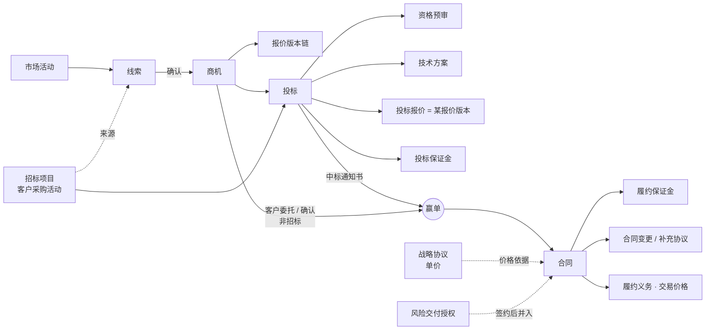

# AEC 项目制专业服务公司的业务对象（售前到签约为重点）

状态：历史记录｜2026-10-15｜负责：one-architecture

状态：研究提议，待用户裁定 · 日期：2026-10-15 · 作者：one-architecture 子代理

依据：用户原话「生产数据只能是参考，因为我们旧系统是一个不完整的系统，必须要思考 AEC 行业项目制专业服务公司的总体情况」（intent `2026-10-15-202634`）；用户在售前业务对象问题页给出的业务事实（intent `2026-10-15-202939`，下称「用户事实」）。行业通行做法与法规准则为主要依据，老系统只作参考。

## 0. 来源与缩写

按权威性排序。凡标「未核实」的，不作硬依据。

| 缩写 | 来源 | 本次怎么取得 |
|---|---|---|
| 〔法〕 | 《中华人民共和国招标投标法》 https://www.ccgp.gov.cn/zcfg/gjfg/201311/t20131113_3591998.shtml | 联网读取条文，按条号概括 |
| 〔条例〕 | 《招标投标法实施条例》（国务院令第 613 号）https://www.gov.cn/zwgk/2011-12/29/content_2033184.htm | 联网读取 2011 年公布文本并核对条号；此后的修订（国务院公报 2019 增刊 https://www.gov.cn/gongbao/content/2019/content_5468831.htm）是否改动下文所引条号：**未核实** |
| 〔GF0209〕 | 《建设工程设计合同示范文本（房屋建筑工程）》GF-2015-0209；印发通知建市〔2015〕44 号（转载页 https://jhs.moa.gov.cn/tzgg/201904/t20190418_6180981.htm ） | 本地抽取地方政府转载 PDF 全文（https://hebi.zfcg.henan.gov.cn/webfile/hebi/rootfiles/2025/06/04/1746604904828872-1748910942441871.pdf ），按条号概括。GF-2015-0210（专业建设工程）**未读全文**，只知与 0209 同批印发 |
| 〔收费〕 | 发改价格〔2015〕299 号：工程勘察设计费等 5 项改为市场调节价（国家发改委答复 https://www.ndrc.gov.cn/xxgk/jianyitianfuwen/qgrddbjyfwgk/202511/t20251120_1401781.html ；广东价格公报转载） | 联网检索摘要 |
| 〔CAS14〕 | 《企业会计准则第 14 号——收入》（财会〔2017〕22 号）https://kjs.mof.gov.cn/zt/kjzzss/kuaijizhunzeshishi/201709/t20170907_2694006.htm | 联网读取并核对条号 |
| 〔IFRS15〕 | IFRS 15 官方概览 https://www.ifrs.org/issued-standards/list-of-standards/ifrs-15-revenue-from-contracts-with-customers/ | 只读到五步法概览；**段落号未核实**，下文不引 IFRS 段号，以 CAS 14 条号为准 |
| 〔FIDIC〕 | FIDIC Client/Consultant Model Services Agreement（White Book）第 5 版 2017：https://fidic.org/node/12811 ；同期 Sub-Consultancy Agreement 第 2 版 | 官方页只给适用范围；通用条件章名（1 一般规定、2 客户、3 咨询工程师、4 开工与完成、5 服务变更…）来自出版方经销页（SAICE 书店）与律所评述，属二手，**条款内容未核实** |
| 〔AIA〕 | AIA B101–2017 官方摘要 https://help.aiacontracts.com/hc/en-us/articles/1500010280541 | 官方摘要：基本服务五阶段（方案设计、扩初设计、施工文件、采购、施工），服务分基本 / 补充 / 附加 |
| 〔RIBA〕 | RIBA Plan of Work 2020 Overview https://www.riba.org/media/syneeeto/2020ribaplanofworkoverviewpdf.pdf | 经检索摘要取得阶段 0–7 名称；原 PDF 未逐页读 |
| 〔BIZ〕 | BIZBOK Guide v11 本地文本 `/Users/yeliang/Projects/YeliangDu/standards/bizbok-v11/_text/BIZBOK-v11.txt` | 第 2 部分 2.5 节（页 185–203）；8.6 通用参考模型（页 650–652） |
| 〔G211〕 | TOGAF Series Guide *Business Capabilities, Version 2*（G211）本地文本 `.../togaf10-2025-05/_text/G211.txt` | §2.1 业务对象、§2.2.3 信息 |
| 〔VP-DD〕 | Deltek Vantagepoint 2026.4 数据字典 `/Users/yeliang/Projects/YeliangDu/VP/corpus/raw/vendor-docs/Vantagepoint_2026.4_DataDictionary/Content/`（表名即页标题） | 本地解析全部 1351 张表 |
| 〔VP-H〕 | Deltek Vantagepoint 帮助镜像 `.../Learning_Mirror/learning.deltek.com/bundle/Vantagepoint/page/<文件名>` | 本地读取 |
| 〔SPI〕 | SPI Research《2023 Professional Services Maturity Benchmark》本地 PDF（`/Users/yeliang/My Drive/04_Forcitis/02_Organization/2023/`） | 第 1 页五大支柱；Client Relationships 支柱指标 |
| 〔APQC〕 | APQC PCF 官方页 https://www.apqc.org/process-frameworks 、2016 版一页纸 | 检索官方站：行业版清单中**没有**专业服务或工程类 PCF；当前目录是否新增：**未核实** |
| 〔词表〕 | `docs/glossary/terms.yaml`（580 条） | 本地 |
| 〔事实〕 | 用户事实（intent `2026-10-15-202939`） | — |

产品证据（Deltek、SPI）只说明「行业成熟产品这样建模」，不是权威；与法规、准则冲突时以法规、准则为准。

## 1. 汇总表

「现状」列：✅ 已有且分类合适；⚠️ 已有但分类或定义可能需调整；❌ 缺失。

### 1.1 售前到签约

| 对象 | 一句话定义 | 关键状态 | 主要关系 | 来源 | terms.yaml 现状 |
|---|---|---|---|---|---|
| 线索 Lead | 尚未确认值得跟进的潜在业务信息（某客户某项目可能需要我们的服务） | 新建 → 跟进中 → 已确认（转商机）/ 已否决（必填原因） | 1 线索 → 0..1 商机（用户事实：确认后才建商机）；N 线索 → 1 客户（可暂无）；线索 → 来源（招标公告、老客户再委托、介绍、主动开发、市场活动、内部推荐） | 〔事实〕；〔VP-H〕`crm_cont_add_new_lead.html.md`（New Lead / Qualify / Disqualify + 原因）；〔VP-DD〕`CFGLeadStatusData`、`CFGLeadStatusReasonData`、`MktCampaignLeads` | ❌ 只有指标 `lead_conversion_rate` |
| 市场活动 Campaign | 面向一批客户或潜在客户的推广活动，可产生线索 | 计划 → 进行中 → 结束 | 1 活动 → N 线索 | 〔事实〕（来源含市场活动）；〔BIZ〕8.6 图 8.6.2 Campaign Management；〔VP-DD〕`MktCampaign` | ❌ |
| 商机 Opportunity（pursuit） | 已确认要争取的、针对特定客户特定项目的销售机会，是售前的主对象 | 跟进中（可分若干阶段）→ 赢单 / 丢单（必填原因）/ 放弃 | 1 商机 → 1 客户；1 商机 → N 报价版本；1 商机 → 0..N 投标；1 商机 → 0..1 合同（赢单后）；负责人 = 销售 | 〔事实〕；〔VP-H〕`crmp_opportunity_tracking.html.md`、`dvp_rept_projectreports_projecthitrate_columnsfor.html.md`（In Pursuit / Won / Lost / Do Not Pursue）；〔VP-DD〕`PR.Stage`、`ClosedReason`、`LostTo` | ✅ `opportunity`（presales.quoting）；丢单原因未建模 |
| 招标项目（客户的采购活动）Solicitation | 客户发起的一次采购，以招标公告或投标邀请书公开，含招标文件、截止时间、标段 | 外部对象：公告 → 截止 → 开标 → 公示 → 结果；或终止 / 重新招标 | 1 招标项目 → N 标段；1 招标项目 → 我方 0..1 投标 / 每标段；常是线索来源 | 〔法〕第 10、16、17、19 条；〔条例〕第 15、44 条（投标人少于 3 个须重新招标）；〔VP-DD〕`PR.Solicitation`、`SolicitationNum` | ❌ |
| 投标 Bid / Tender response | 我方响应一次采购的完整过程与承诺：资格预审、技术方案、商务报价、递交、开标、结果 | 准备中 → （资格预审已提交 → 预审通过 / 未通过）→ 已递交 → 已开标 → 中标候选人公示 → 中标 / 未中标 / 废标；可撤回（截止前）、放弃 | N 投标 → 1 商机；1 投标 → 1 招标项目（标段）；1 投标 → 1 投标报价（报价版本）；1 投标 → 0..1 投标保证金；1 投标 → 0..1 技术方案 | 〔事实〕（大部分项目要投标；投标是独立过程，报价只是其中一部分）；〔法〕第 18、27、28、31、34–37、45 条；〔条例〕第 18–20、25、26、30、35、37、53–55 条 | ❌（`win_rate` 只有指标） |
| 资格预审 Prequalification | 投标前对投标人资格的审查及结果 | 已提交 → 通过 / 未通过 | 投标的组成部分（次级概念） | 〔条例〕第 15、16、18、19 条（未通过者不得投标） | ❌ |
| 技术方案（建议书）Technical Proposal | 交付团队与方案团队编制的服务方案，是投标文件或报价的一部分 | 编制中 → 内审通过 → 已提交 | 投标 / 商机的组成部分；作者 = 交付团队、方案团队（用户事实） | 〔事实〕；〔AIA〕〔RIBA〕（服务范围按阶段组织）；〔VP-DD〕`CustomProposal*`（营销型建议书文档） | ❌ |
| 报价 Quote（Fee Proposal） | 对一份服务范围给出的价格与成本测算，带版本链 | 草拟 → 提交 → 审定 → 生效；被新版本取代 / 作废 | N 报价版本 → 1 商机（用户事实：经常多轮）；投标报价 = 某一生效版本；签约时 → 合同的交易价格依据 | 〔事实〕；〔收费〕（设计费市场调节价、协商确定）；〔GF0209〕第 10.1、10.2 条（价款组成与单价 / 总价 / 其他价格形式）；〔VP-DD〕`PRFEPhases` 等 Fee Estimate 表 | ⚠️ `quote` 标 `kind: document`，但定义是有状态、有版本的聚合 |
| 投标保证金 Bid Security | 投标时按招标文件交存的现金或保函，有效期同投标有效期 | 待缴 → 已缴 → 已退还 / 被没收（截止后撤销投标等） | 1 投标 → 0..1 投标保证金 | 〔条例〕第 26 条（上限为估算价 2%）、第 35 条、第 57 条（签约后 5 日内退还） | ❌ |
| 中标 / 赢单 Award | 客户确定由我方承接的事实 | 事件，不是对象 | 证据：中标通知书（招标）或客户委托 / 确认（非招标）；触发：商机赢单、30 日内订立合同 | 〔法〕第 45、46 条；〔条例〕第 57 条 | ⚠️ 词表无「赢单」事件；`proposal_commitment_snapshot` 引用 ProposalCommitted |
| 竞争对手 Competitor | 同一商机或投标中的其他投标人 | 无独立状态 | N 竞争对手 ↔ N 商机；丢单时记「输给谁」 | 〔VP-DD〕`PRCompetitionAssoc`、`PR.LostTo`；〔VP-H〕hit rate 报表「Lost To Name」 | ❌ |
| 客户 Customer | 能独立签约和付款的法律主体 | 潜在 → 有效 → 停用；可合并 | 1 客户 → 0..1 客户集团；1 客户 → N 联系人、商机、合同 | 〔BIZ〕8.6 Customer Management；〔VP-DD〕`Clendor`（客户与供应商同表，以 `ClientInd`/`VendorInd` 标记）、`Clendor.ParentID`（层级） | ✅ `customer`、`customer_group`、`customer_tier` |
| 联系人 Contact | 客户或分包方一方的具体人员，及其决策角色 | 有效 / 停用 | N 联系人 → 1 相对方 | 〔VP-DD〕`Contacts`（Type = Client / Vendor）；〔词表〕presales.customer 职责含「联系人与决策关系」 | ❌ 无词条 |
| 战略协议（价格协议）| 与战略客户约定单价的协议；本身不承诺具体工作，具体项目另签合同并采用协议价 | 生效 → 到期 / 终止 | 1 客户 → 0..N 战略协议；1 战略协议 → N 项目合同（引用其单价） | 〔事实〕（约 40% 客户为战略客户）；〔CAS14〕第五条（合同须有可执行的权利义务——仅约定单价是否构成收入合同须财务判定） | ⚠️ 词表有 `framework_agreement` + `task_order`（限额框架）与 `rate_card` / `bill_rate_card`，没有「只定价、项目另签」这一形态 |
| 合同 Contract | 与客户订立、具有法律约束力的服务合同，是收入核算的计量起点 | 草案 → 审批中 → 待签 → 已签署生效 → 履行中 → 完成 / 终止 | 1 合同 → 1 客户；1 合同 ← 0..1 商机；1 合同 → N 履约义务；1 合同 → N 变更；合同类型：独立、框架、任务订单、内部结算 | 〔CAS14〕第五条（识别合同五条件）、第七条（合并）；〔GF0209〕第一部分「六、合同文件构成」、通用条款 1.5（文件优先顺序）；〔VP-DD〕`Contracts.ContractStatus`（Negotiation / Pending / Sent for signature / Approved & signed / Rejected） | ✅ `contract` 等（contract.baseline） |
| 合同变更 / 补充协议 Change Order | 经双方批准的范围、价格或工期修改 | 识别 → 影响评估 → 审批 → 签署（补充协议）→ 生效；或驳回 | N 变更 → 1 合同；会计口径三种处理 | 〔CAS14〕第八条；〔GF0209〕第 11 条（工程设计变更与索赔）；〔FIDIC〕第 5 条 Variation（二手，未核实）；〔VP-DD〕`Contracts.ContractType`（Original / Change Order / Additional Service / Letter of Agreement） | ✅ `change_order`、`supplemental_agreement`、`contract_modification` |
| 履约保证金 / 保函 Performance Security | 中标后按招标文件提交的履约担保 | 待交 → 已交 → 已退还 / 被扣 | 1 合同 → 0..1 履约保证金 | 〔法〕第 46 条；〔条例〕第 58 条（不超过中标合同金额 10%） | ❌ |
| 风险交付（签约前先行投入）授权 | 未签合同或超范围先开工的授权与额度 | 申请 → 批准 → 关闭（转合同 / 止损） | 1 商机 / 客户 → 0..N 授权；签约后并入合同 | 〔事实〕（常见）；〔GF0209〕第 10.1 条第（3）项（签约前发包人已同意或使用的工作费用可计入合同价款） | ✅ `risk_delivery_authorization`（contract.riskdelivery） |
| 售前投入归集 Pursuit Cost | 为争取商机、投标发生的人工与费用的归集对象 | 开放 → 关闭（随商机结束） | 1 商机 → 0..1 归集对象；工时、费用可记到它 | 〔VP-DD〕`PR.ChargeType`（P = Promotional）、`PR.SiblingWBS1`（推广项目与正式项目配对）；〔CAS14〕第二十八条（合同取得成本只认增量成本） | ❌ |

### 1.2 签约后（轮廓）

| 对象 | 一句话定义 | 关键状态 | 主要关系 | 来源 | 现状 |
|---|---|---|---|---|---|
| 项目 Project | 为履行一份或多份合同而组织的交付单元 | 筹备 → 执行 → 收尾 → 关闭 | N 合同 ↔ N 项目（Deltek：同一合同号可跨项目）；1 项目 → WBS | 〔VP-DD〕`PR`（WBS1/2/3）；〔VP-H〕合同管理页（合同号可在多个项目重复） | ✅ `project` |
| 阶段 / WBS Phase | 按设计阶段或工作分解组织的子单元 | 计划 → 进行 → 完成 | 项目的组成部分；合同金额可分摊到阶段（`ContractDetails`） | 〔RIBA〕阶段 0–7；〔AIA〕五阶段；〔GF0209〕协议书「工程设计阶段」；〔VP-DD〕`ContractDetails` | ✅ `wbs_node`、`work_package` |
| 交付物 Deliverable | 交给客户的工程设计文件等成果 | 编制 → 交付 → 审查 / 验收通过 / 退回 | N 交付物 → 1 阶段；验收单为证据 | 〔GF0209〕第 7 条（文件交付）、第 8 条（文件审查） | ✅ `deliverable`、`acceptance_record` |
| 工时 TimeEntry / 工时单 | 员工在某日对某项目（或售前归集对象）投入的小时 | 草稿 → 提交 → 审批 → 锁定；可更正 | N 工时 → 1 工时单；工时 → 项目 / WBS | 〔VP-DD〕`tkMaster`、`tkDetail`、`LD`；〔SPI〕Service Execution 支柱（time and expense capture） | ✅ |
| 费用 Expense | 员工代垫或公司直付、归属项目的费用 | 草稿 → 提交 → 审批 → 支付 | 报销单 → 明细 → 项目 | 〔VP-DD〕`ekMaster`、`ekDetail` | ✅ `expense_claim` |
| 分包方 / 供应商 Subconsultant / Vendor | 承接我方部分工作的外部单位 | 准入 → 合格 → 暂停 / 淘汰 | 与客户可为同一法人（Deltek 同表）；1 分包方 → N 分包合同 | 〔FIDIC〕Sub-Consultancy Agreement；〔GF0209〕1.1.2.4「分包人」；〔VP-DD〕`Clendor.VendorInd`、`PRConsultant`；〔事实〕（分包合同要在新系统管） | ❌（procurement.subcontracting 职责里有「供应商」） |
| 分包合同 Subcontract | 我方与分包方订立的合同（成本侧，不是收入合同） | 草案 → 签署 → 履行 → 结算 → 关闭 | N 分包合同 → 1 项目（或主合同）；分包付款 → 应付 | 〔法〕第 48 条、〔条例〕第 59 条（非主体非关键工作经同意可分包，不得再分包）；〔GF0209〕3.4.4（分包工程设计费由设计人与分包人结算）；〔VP-DD〕`POMaster` 等采购表 | ❌（只有指标 `subcontract_cost`） |
| 分包结算 / 应付 / 付款 | 对分包已完成工作的确认、应付与付款 | 确认 → 应付 → 已付 | 1 分包合同 → N 结算 → N 付款 | 〔VP-DD〕`apMaster`、`POVoucherMaster` | ⚠️ 只有指标 `expense_payment`（payables.payment） |
| 履约义务 / 交易价格 | 合同中可明确区分的服务承诺；预期有权收取的对价 | 未履行 → 履行中 → 已履行 | 合同的组成部分 | 〔CAS14〕第九、十、十四至十七条 | ✅ |
| 收入确认 | 按履约进度确认收入的事实 | 拟定 → 审批 → 已确认；冲销 | 履约义务 → 进度认定 → 收入确认 | 〔CAS14〕第十一、十二条；仓库 ACC-R01（产出法 · 客户价值确认） | ✅ `revenue_recognition`、`progress_assessment` |
| 合同资产 / 合同负债 | 有条件收款权 / 已收未履行义务，按合同净额列示 | 余额，无生命周期 | 每合同一个净额 | 〔CAS14〕第四十一条 | ✅（是余额，不是对象，见 §4） |
| 开票申请 / 账单 | 向客户请款的内部流程载体 | 申请 → 准入检查 → 开具 → 移交应收 | 合同 / 付款条件 → 开票申请 → 发票 | 〔VP-DD〕`ARPreInvoice`、`InvoiceApproval`、`BT`（计费条款） | ✅ `billing_request` |
| 发票 Invoice | 已开具给客户的发票（中国语境下为增值税发票，有开具、红冲等独立生命周期） | 已开具 → 红冲 / 作废 | 1 发票 → 1 应收 | 〔VP-DD〕`AR`（Invoice Master） | ⚠️ 只有事件 `invoice_issued`；没有发票对象 |
| 应收 / 回款 / 回款分配 | 无条件收款权；一笔到账及其核销 | 未收 → 部分收 → 已收；争议 | 1 发票 → 1 应收；N 回款分配 ↔ N 应收 | 〔CAS14〕第四十一条；〔VP-DD〕`AR` | ✅ |
| 质量保证金 Retention | 按合同扣留、到期返还的部分价款 | 扣留 → 到期 → 返还 / 扣减 | 合同付款条件 → 质保金 | 〔VP-DD〕`BT.Retainage`、`AR.RetainageDate`；〔词表〕note：未到期质保金准则上通常属合同资产（待财务确认） | ✅ `retention_money` |
| 竣工结算 / 最终结算 | 完工后对最终价款的确认 | 编制 → 双方确认 → 结清 | 1 合同 → 0..1 | 〔GF0209〕第 10.5 条（结算与支付） | ✅ `final_account` |

## 2. 售前到签约详述

### 2.1 总体结构

行业证据的一致点：
- **线索与商机分开**。Deltek 的线索是一种「未确认的联系人」，确认时才建立客户与在追项目；否决须填原因（〔VP-H〕`crm_cont_add_new_lead.html.md`）。与用户事实一致。
- **商机有终态与原因**。Deltek 把阶段归为 In Pursuit / Won / Lost / Do Not Pursue 四类，记录胜负日期、原因、说明、输给谁（〔VP-H〕hit rate 报表列说明）。
- **Deltek 没有独立的「投标」对象**：投标信息是在追项目上的字段（`BidDate`、`Solicitation`、`ProposalManager`），2026.4 字典中的 `PRProposals` 已标「Marked for removal」，`CustomProposal*` 是营销建议书文档（〔VP-DD〕）。这是北美市场习惯（以资格建议书 SF330 为主），**不适用于中国招标语境**：用户事实与〔法〕〔条例〕都表明投标是有独立步骤、期限、保证金和法律后果的过程，应为独立对象。
- **Deltek 把商机与项目合并**：在追的商机就是一个处于 In Pursuit 阶段的项目，赢单后改阶段即成正式项目（〔VP-H〕`crmp_opportunity_tracking.html.md`）；售前投入记在配对的推广项目（ChargeType = P）。仓库现行设计把商机放在 presales、项目放在 delivery，二者分开；分开更利于「权责事实」与「售前漏斗」各自的不变量，但需要一个**售前投入归集对象**（见 2.11）来承接 Deltek 用推广项目解决的问题。

### 2.2 线索 Lead

- **定义**：尚未确认值得跟进的潜在业务信息。不要求已有客户档案。
- **状态机**：新建 → 跟进中 → 已确认（生成商机）| 已否决（原因必填，原因取值由管理员维护）。已确认、已否决为终态。
- **关系**：线索 → 来源（枚举：招标公告、老客户再委托、合作方或熟人介绍、主动开发、市场活动、内部推荐——用户事实）；线索 → 市场活动（0..1）；线索 → 客户（0..1，可以只是文字）；1 线索 → 0..1 商机。
- **规则**：确认时必须落到一个客户（新建或引用）；否决必须有原因；同一来源公告重复登记要提示（查重）。
- **负责人**：销售（用户事实）。
- **中国语境**：招标公告是最常见来源，公开招标的公告依法在指定媒介发布（〔法〕第 16 条；〔条例〕第 15 条），因此线索常带「招标项目」引用。
- **对象判据**：名词、持久、有状态、有规则（否决须原因）、有类型（来源）→ 一级信息概念（〔BIZ〕页 186、197–198）。

### 2.3 商机 Opportunity

- **定义**：已确认、针对特定客户特定项目要争取的销售机会。
- **状态机**：跟进中（内部可分阶段，阶段名由业务定义）→ 赢单 | 丢单（原因必填、可记竞争对手）| 放弃（原因必填）。
- **关系**：1 商机 → 1 客户（签约主体可能在赢单时才确定，需允许变更）；1 商机 → N 报价版本（用户事实：经常多轮）；1 商机 → 0..N 投标（流标重招、分标段时会有多次，见 §6 问题）；1 商机 → 0..1 合同。
- **规则**：赢单须有证据（中标通知书或客户委托）；终态后不得再报价或投标；赢单与合同订立的时限关联（招标项目 30 日内订立，〔法〕第 46 条）。
- **负责人**：销售；交付团队、方案团队提交方案并辅助投标；商务谈判有公司管理层参与（用户事实）——这是**角色与参与**，不是新对象，在商机上记团队成员与角色即可（Deltek 在追项目也有「项目团队成员及角色」，〔VP-H〕`crmp_opportunity_tracking.html.md`）。
- **派生度量**：赢单率、加权金额（金额 × 概率，〔VP-DD〕`PR.WeightedRevenue`、`CFGProbabilityData`）、在追周期——这些是度量，不是对象（〔BIZ〕页 198–199：估值、评级属于属性）。〔SPI〕在 Client Relationships 支柱下以 bid-to-win ratio、deal pipeline 衡量。

### 2.4 招标项目（客户的采购活动）

- **定义**：客户发起的一次采购。它是**外部对象**：生命周期由招标人控制，我方只记录与引用。
- **组成**：招标公告或投标邀请书（〔法〕第 16、17 条）、资格预审公告与文件（〔条例〕第 15、16 条）、招标文件（〔法〕第 19 条；澄清修改须书面通知并可能顺延截止，〔条例〕第 21 条）、投标截止与开标时间（〔法〕第 34 条）、标段。
- **状态（外部）**：已公告 → 截止 → 已开标 → 中标候选人公示（收到评标报告 3 日内公示、不少于 3 日，〔条例〕第 54 条）→ 已定标；或因投标人不足 3 个重新招标（〔条例〕第 19、44 条）。
- **判据**：公告、招标文件本身是「单据 / 证据」，不是信息概念（〔BIZ〕页 197：文件只是对象的呈现形式）；真正的概念是「采购活动」。建议作为投标的引用对象（次级），不单独建深模型。

### 2.5 投标 Bid

- **定义**：我方响应一次采购（或一个标段）的完整过程与承诺。
- **状态机（按法规步骤推导，非法定状态名）**：
  1. 准备中（决定参与）→ 可「放弃」；
  2. 资格预审已提交 → 通过 | 未通过（未通过不得投标，〔条例〕第 19 条）；资格后审则在开标后由评标委员会进行（〔条例〕第 20 条）；
  3. 已递交（截止前；截止前可书面撤回，保证金 5 日内退还；截止后撤销的，保证金可不退，〔条例〕第 35 条）；
  4. 已开标（〔法〕第 34–36 条）；
  5. 中标候选人公示中（〔条例〕第 54 条；可提出异议）；
  6. 中标 | 未中标 | 废标 / 流标。
- **组成部分**：资格预审（结果）、技术方案、投标报价（引用某报价版本）、投标保证金、投标有效期（〔条例〕第 25 条）、联合体信息（〔法〕第 31 条：联合体各方承担连带责任；〔条例〕第 37 条）。
- **两阶段招标**：第一阶段只交技术建议、第二阶段才交报价与保证金（〔条例〕第 30 条）——说明「报价只是投标的一部分」在法规上也成立，与用户事实一致。
- **关系**：N 投标 → 1 商机；1 投标 → 1 招标项目（标段）；1 投标 → 1 投标报价。
- **中国语境**：依法必须招标的项目有法定期限与公示；非必须招标的客户也常用比选、竞争性谈判等方式——这些是否归入同一「投标」对象见 §6。政府采购法下的采购方式（竞争性磋商等）**未核实**。

### 2.6 报价 Quote（Fee Proposal）

- **定义**：对一份服务范围给出的价格与成本测算。设计、勘察收费已于 2015 年改为市场调节价，由委托双方协商（〔收费〕），因此报价是企业自己的测算对象，不再套政府指导价。
- **状态机**：草拟 → 提交 → 审定 → 生效；被新版本取代（SUPERSEDED）、作废（VOIDED）——词表 `quote` 已定义版本链，与用户事实「多轮报价」相符。
- **价格形式**：单价（如每平方米或投资比例）、总价、其他（〔GF0209〕第 10.2 条）；价款组成含基本服务费、其他服务费，以及**签约前已被发包人接受的工作费用**（〔GF0209〕第 10.1 条）。
- **关系**：N 报价版本 → 1 商机；投标报价引用其中一个生效版本；签约时作为合同交易价格依据（词表 `proposal_commitment_snapshot` 已是承诺比对基准）。战略客户报价须引用战略协议单价（用户事实）。
- **分类问题**：词表把 `quote` 标为 `kind: document`，但它有状态、版本、审批，是聚合；按〔BIZ〕页 197，「报价单」这张纸是单据，「报价」才是概念。建议改为 `entity`（见 §5）。

### 2.7 投标保证金与履约保证金

- 投标保证金：上限为估算价 2%，有效期同投标有效期，招标人不得挪用（〔条例〕第 26 条）；签约后 5 日内退还（〔条例〕第 57 条）。
- 履约保证金：招标文件要求时提交（〔法〕第 46 条），不超过中标合同金额 10%（〔条例〕第 58 条）。
- 两者都是有金额、有期限、有状态（已缴、已退、被没收 / 扣减）的**资金占用对象**，与质量保证金（`retention_money`）同类。形式可为现金或保函。归属 BC（售前、合同、还是资金）待定。

### 2.8 中标 / 赢单

- 是**事件**，不是对象：「中标通知书」是证据单据（〔法〕第 45 条：对双方有法律效力，改变结果或放弃中标须承担法律责任）。
- 后续规则：30 日内按招标文件与投标文件订立书面合同，不得另立背离实质内容的协议（〔法〕第 46 条；〔条例〕第 57 条）——这是「合同须与投标承诺一致」的法定依据，支撑词表的承诺差异（`commitment_deviation`）。

### 2.9 合同 Contract 与战略协议

- **合同**：按〔CAS14〕第五条识别（双方批准并承诺履行、权利义务明确、支付条款明确、有商业实质、对价很可能收回）；同一客户相近时间订立的合同满足条件时合并（第七条）。合同文件组成与优先顺序以〔GF0209〕协议书第六项、通用条款 1.5 为参照：协议书 → 专用条款 → 通用条款 → 中标 / 成交通知书 → 投标函 → 发包人要求 → 技术标准 → 上一阶段图纸 → 其他。
- **合同状态**：Deltek 用 Negotiation / Pending / Sent for signature / Approved & signed / Rejected（〔VP-DD〕`Contracts.ContractStatus`）；词表用合同草案 → 基线版本。二者一致：签署生效前是「草案」，生效后进入不可变的基线演进。
- **合同类型**：词表四形态（独立合同、框架协议、任务订单、内部结算协议）。Deltek 的合同类型维度不同（Original / Change Order / Additional Service / Letter of Agreement）——说明「原合同与变更」也可以看成同一合同对象下的一系列合同记录。
- **战略协议（用户事实）**：约 40% 客户为战略客户，战略协议只约定单价，具体项目**另签合同**并采用协议价。这与词表 `framework_agreement` 的定义「挂靠任务订单的框架合同（限额按合同约定）」不同：
  - 框架协议 + 任务订单：任务订单挂靠框架、占用限额，订单本身是合同；
  - 战略协议：不挂靠、不占限额，只给价格依据；若它不约定可执行的服务转让义务，按〔CAS14〕第五条可能**不是收入合同**，更像客户的协议价目（`rate_card` / `bill_rate_card` 的一个来源）。须财务与用户确认（§6 问题 1）。
- **框架协议 + 任务订单**（用户事实：偶尔用）：保留现有建模。

### 2.10 合同变更 / 补充协议

- 业务口径：范围、价格、工期修改；增补协议是落地形式之一（词表）。〔GF0209〕第 11 条把设计变更与索赔放在同一章；〔FIDIC〕2017 版扩充了变更情形、程序及对进度与报酬的影响（二手评述，条文未核实）。
- 会计口径：〔CAS14〕第八条三种处理（作为单独合同；原合同终止并新立；作为原合同组成部分并调整当期收入）。词表 `contract_modification` 已对应。

### 2.11 风险交付与售前投入

- **风险交付**（用户事实：常见）：已有 `contract.riskdelivery`。法规参照：〔GF0209〕第 10.1 条第（3）项允许把签约前已被接受的工作费用计入合同价款——说明「签约后并入合同」是行业通行做法。收入方面，没有合同就不能确认收入（〔CAS14〕第五条）；签约前成本若与预期合同直接相关、能增加未来履约资源并预期收回，可作为合同履约成本（〔CAS14〕第二十六条）——具体口径须财务定。
- **售前投入归集**：投标、编方案发生的人工和费用需要一个归集对象。Deltek 用推广项目承接并与正式项目配对（〔VP-DD〕`PR.ChargeType`、`SiblingWBS1`）。会计上，只有「为取得合同发生的增量成本」可作为合同取得成本，投标费用等无论是否中标都会发生的通常计入当期损益（〔CAS14〕第二十八条）。建议：商机（或投标）可作为工时与费用的归集目标；是否在赢单后转入项目由财务定（§6 问题 5）。

## 3. 全生命周期其余段轮廓

| 段 | 一级对象 | 次级对象 / 组成 | 事件（不是对象） | 单据 / 证据 | 主要来源 |
|---|---|---|---|---|---|
| 交付 | 项目 | 阶段 / WBS、工作包、里程碑、交付物、计划基线 | 交付物已交付、已验收 | 交付确认单、验收单、设计文件审查意见 | 〔RIBA〕〔AIA〕〔GF0209〕第 6–9 条；〔VP-DD〕`PR`、`RPPlan`、`PNTask` |
| 工时 | 工时（条目） | 工时单（周期汇总） | 已提交、已审批、已更正 | — | 〔VP-DD〕`tkMaster`、`tkDetail`、`LD` |
| 费用 | 费用 | 报销单明细 | 已审批、已支付 | 发票、行程单 | 〔VP-DD〕`ekMaster`、`ekDetail` |
| 分包 | 分包方（相对方的一种角色）、分包合同 | 分包范围、分包付款条件 | 分包工作已确认、已付款 | 分包结算单 | 〔法〕第 48 条；〔条例〕第 59 条；〔GF0209〕3.4.4；〔FIDIC〕Sub-Consultancy Agreement；〔VP-DD〕`PRConsultant`、`POMaster`、`apMaster` |
| 收入确认 | 履约义务（合同组成部分） | 履约进度认定 | 收入已确认、已冲销 | 收入确认单（客户确认证据） | 〔CAS14〕第九至十二条；ACC-R01 |
| 开票 | 发票 | 开票申请 | 已开具、已红冲 | 增值税发票 | 〔VP-DD〕`AR`、`ARPreInvoice`、`InvoiceApproval` |
| 应收与回款 | 应收、回款 | 回款分配、质量保证金 | 已到账、已核销 | 银行回单、承兑汇票 | 〔CAS14〕第四十一条；〔VP-DD〕`AR`、`BT.Retainage` |
| 结算 | 竣工结算（可视为合同的最终状态）| — | 已结清 | 结算书 | 〔GF0209〕第 10.5 条 |

与 BIZBOK 通用参考模型（〔BIZ〕8.6 图 8.6.2）的一级对象对照：Agreement（合同、战略协议、分包合同）、Customer（客户）、Partner（分包方、联合体伙伴、竞争对手）、Campaign（市场活动）、Market（线索的上游，暂不建模）、Plan（项目计划）、Finance（发票、应收、回款，聚合型概念）、Human Resource（员工）、Time（工时的时间维度）。通用参考模型**没有**「Opportunity / Bid」一级对象，BIZBOK v11 第 8 部分也**没有**专业服务或工程行业参考模型（目录页列出的 8.1–8.9 均为其他行业）。APQC 官方行业版 PCF 清单中同样**没有**专业服务或工程类（〔APQC〕）。因此商机、投标的对象划分只能以法规、合同范本、行业产品与用户事实为据。

## 4. 对象判据（问题 C）

依〔BIZ〕§2.5：业务对象是名词、持久、有定义、类型、状态与关系（页 185–186）；不依附其他对象存在的是一级概念，依附的是次级概念（页 198）；估值、评级、价格等是属性，不是概念（页 198–199）；发票、文件等是单据，是对象的呈现形式，不是概念（页 197）。〔G211〕§2.1 也把业务对象界定为业务关心的有形或无形事物，§2.2.3 把信息与 IT 数据实体区分开。

| 类别 | 判据 | 归入的对象 |
|---|---|---|
| 一级对象 | 独立存在、有生命周期与规则 | 线索、商机、投标、客户、分包方、合同、战略协议、分包合同、项目、员工、发票、应收、回款 |
| 对象类型（type，不是新对象） | 同一对象的现实分类 | 线索来源；商机阶段；投标方式（公开招标 / 邀请招标 / 比选 / 竞争性谈判）；合同形态（独立 / 框架 / 任务订单 / 内部结算）；合同价格形式（单价 / 总价 / 其他）；客户分级；保证金形式（现金 / 保函） |
| 对象的组成部分（次级） | 离开主对象没有意义 | 资格预审、技术方案、投标报价（对报价版本的引用）、联合体成员（属投标）；履约义务、付款条件项、合同条款、范围条目（属合同）；阶段 / WBS、交付物（属项目）；回款分配（属回款） |
| 有独立生命周期的次级对象 | 依附主对象但有自己的状态与规则 | 报价版本（依附商机）、合同变更（依附合同）、投标保证金（依附投标）、履约保证金（依附合同）、质量保证金（依附合同 / 应收）、风险交付授权 |
| 事件 | 发生一次、只追加 | 线索已确认、赢单、丢单、中标、合同已签署、变更已生效、收入已确认、发票已开具、回款已到账 |
| 派生度量 | 由对象计算 | 赢单率、线索转化率、加权商机金额、在追周期、毛利、利用率、DSO、分包成本、合同资产 / 合同负债余额 |
| 单据 / 证据 | 对象或事件的呈现形式 | 招标公告、招标文件、资格预审文件、投标文件、中标通知书、合同文本、补充协议文本、验收单、收入确认单、发票票面、银行回单 |

注：合同资产、合同负债是按合同净额列示的**余额**（〔CAS14〕第四十一条），在信息图上是合同的度量，不是独立生命周期对象；词表把它们标为 `entity`，作为过账结果的承载体可以保留，但不宜当作有状态机的聚合。

## 5. 与仓库现状对照（问题 D）

### 5.1 已有且合适

`customer`、`customer_group`、`customer_tier`、`opportunity`、`contract` 及 contract.baseline 组件（`performance_obligation`、`transaction_price`、`payment_term_item`、`scope_item`）、`framework_agreement`、`task_order`、`change_order`、`supplemental_agreement`、`contract_modification`、`risk_delivery_authorization`、`project`、`wbs_node`、`deliverable`、`acceptance_record`、`time_entry`、`timesheet`、`expense_claim`、`revenue_recognition`、`progress_assessment`、`billing_request`、`ar_item`、`cash_receipt`、`receipt_allocation`、`retention_money`、`final_account`。

### 5.2 缺失（建议登记提议术语，经 one-glossary 查重）

| 建议对象 | 依据 | 可能归属 |
|---|---|---|
| 线索 | 用户事实；〔VP-H〕 | presales.customer 或 presales.quoting |
| 市场活动 | 用户事实（来源之一）；〔BIZ〕8.6 | presales.customer（可薄 CRUD） |
| 投标 | 用户事实；〔法〕〔条例〕 | presales.quoting 或新 BC（见 §6 问题 2） |
| 招标项目（采购活动，外部引用） | 〔法〕第 16–19 条 | 同投标 |
| 资格预审、技术方案（投标组成） | 〔条例〕第 15–20、30 条；用户事实 | 同投标 |
| 投标保证金、履约保证金（保函） | 〔条例〕第 26、57、58 条 | 待定 |
| 竞争对手 / 丢单原因 | 用户事实（丢单要记原因）；〔VP-DD〕`PRCompetitionAssoc`、`ClosedReason` | presales |
| 联系人 | 〔VP-DD〕`Contacts`；presales.customer 职责已列 | presales.customer |
| 战略协议（价格协议） | 用户事实 | contract.baseline 或 presales.customer（§6 问题 1） |
| 售前投入归集对象 | 〔VP-DD〕推广项目；〔CAS14〕第二十八条 | presales / cost |
| 分包方（供应商）、分包合同、分包结算 | 用户事实；〔法〕第 48 条；〔条例〕第 59 条；〔GF0209〕3.4.4 | procurement.subcontracting（contexts.yaml 已规划） |
| 发票（增值税发票对象） | 〔VP-DD〕`AR`；中国发票红冲作废的独立生命周期 | receivables 或 accounting.tax |
| 赢单 / 丢单 / 中标事件 | 〔法〕第 45 条 | presales |

### 5.3 分类可能有误

| 词条 | 现状 | 问题 | 建议 |
|---|---|---|---|
| `quote` | `kind: document` | 定义是有状态、版本、审批的聚合；〔BIZ〕页 197：单据不是概念 | 改为 `entity`，「报价单」作为单据别名 |
| `change_order`、`supplemental_agreement` | `document` | 变更有识别 → 评估 → 审批 → 生效的生命周期 | `change_order` 改 `entity`；`supplemental_agreement` 保留为单据（变更的落地文本） |
| `revenue_recognition` | `document`，zh「收入确认单」 | 概念是「收入确认」（事实），单是证据 | 区分概念与单据；与 `RevenueRecognized` 事件一并梳理 |
| `framework_agreement` | 「挂靠任务订单的框架合同」 | 不覆盖用户事实中的战略协议（只定价、项目另签） | 新增战略协议或扩充定义（§6 问题 1） |
| `invoice_issued` | 只有事件，无发票对象 | 中国增值税发票有红冲、作废，需对象承载 | 新增发票对象 |
| `contract_asset`、`contract_liability` | `entity` | 准则上是按合同净额列示的余额 | 标为度量 / 余额，或在定义里写明不是有状态聚合 |
| `subcontract_cost` | `metric` | 只有度量没有对象；用户事实要求管分包合同 | 补分包方、分包合同对象 |
| `opportunity` 定义 | 「评估→报价→承诺→转化」 | 未含投标与丢单原因 | 定义补「投标（0..N）」「终态：赢单 / 丢单 / 放弃，原因必填」 |
| `lead_conversion_rate`（presales.customer）与 `win_rate`（presales.quoting） | 度量分属两个 BC | 线索与商机若同 BC 更顺 | 随 §6 问题 2 一并定 |

## 6. 需要用户定的问题

用户事实已回答：线索单独登记、来源六类、大部分项目要投标、投标独立于报价、多轮报价、丢单记原因、框架协议偶尔用、战略协议定单价、风险交付常见、分包合同要管、按客户集团汇总、负责人与参与团队。剩下的问题：

1. **战略协议是不是独立对象？** 战略协议只定单价、项目另签合同。是否另有承诺量、限额、有效期、折扣阶梯？如果只是价格，建议建「战略协议（价格协议）」对象挂在客户上，为报价和合同提供单价，不作收入合同；如果约定了必须履行的服务，则按框架协议处理。是否作为收入合同须财务确认（〔CAS14〕第五条）。
2. **投标放在哪个 BC？** 选项：(a) 并入 presales.quoting（商机、投标、报价同一 BC）；(b) 新建投标 BC。投标有法定期限、保证金、公示异议等独立规则，(b) 边界清楚，(a) 改动小。
3. **非招标的竞争（比选、竞争性谈判、询价、直接委托）是否也用「投标」对象？** 还是只有依法招标的才建投标，其他直接报价？
4. **一个商机对应几次投标？** 流标重招、两阶段招标、分标段时，一个商机是否允许多个投标；一个投标是否可能覆盖多个标段？我方是否做联合体投标（牵头或成员）？
5. **售前投入怎么归集？** 投标、编方案的工时与费用是否记到商机或投标上？赢单后是否转入项目？会计口径（当期费用或合同取得成本，〔CAS14〕第二十八条）须财务定。
6. **投标保证金、履约保证金（保函）要不要在新系统管？** 要的话，归售前、合同还是资金管理？
7. **客户与分包方是否同一份「相对方」主数据？** 同一单位既是客户又是分包方时，是否共用一个档案（Deltek 做法）还是分开登记？
8. **丢单是否要结构化记录竞争对手（中标单位、中标价）？**
9. **签约前先行投入的工作量，签约时是否一律计入合同价款？** 〔GF0209〕第 10.1 条允许；收入不得早于合同确认，签约前成本的口径须财务定。
10. **发票对象归哪个 BC？** receivables（与开票同一致性边界，ADR-0016）还是 accounting.tax？

## 7. 未核实清单

- IFRS 15 的段落号：本次只读到官方概览，文中不引段号，以 CAS 14 条号为准。
- 〔条例〕2019 年修订后所引条号（第 15–21、25、26、30、35、37、44、53–55、57–59 条）是否变化。
- FIDIC White Book 2017 的条款内容与附录名称：只有二手来源（经销商目录、律所评述）给出第 5 条为服务变更；附录名称只在 Sub-Consultancy Agreement 的二手列表中看到。
- AIA B101 采购阶段的条文、B101 的条款号：只读官方摘要。
- RIBA Plan of Work 2020 原 PDF 未逐页读，阶段名来自官方页检索摘要。
- GF-2015-0210（专业建设工程）全文未读；GF-2015-0209 用的是地方政府转载 PDF，未与住建部原件比对（住建部原链接返回 404）。
- 计价格〔2002〕10 号《工程勘察设计收费管理规定》的文号与废止令（发改委令第 31 号）：只见检索摘要。
- 政府采购法下的采购方式（竞争性磋商、单一来源等）对投标对象的影响。
- APQC 当前目录是否新增专业服务或工程类 PCF；跨行业 PCF 的类目号本次未引用。
- Deltek 阶段（Stage）的出厂默认取值：字典只给 `CFGProjectStageData` 结构，四类阶段（In Pursuit / Won / Lost / Do Not Pursue）来自报表说明页，具体阶段名由客户配置。
- SPI 报告只用了五大支柱与 Client Relationships 支柱的指标名，未逐章核对其过程划分。
- 老系统、OA 中的投标与线索实际用法：未取证（本文按用户要求以行业为主，生产数据只作参考，取证另行登记）。
