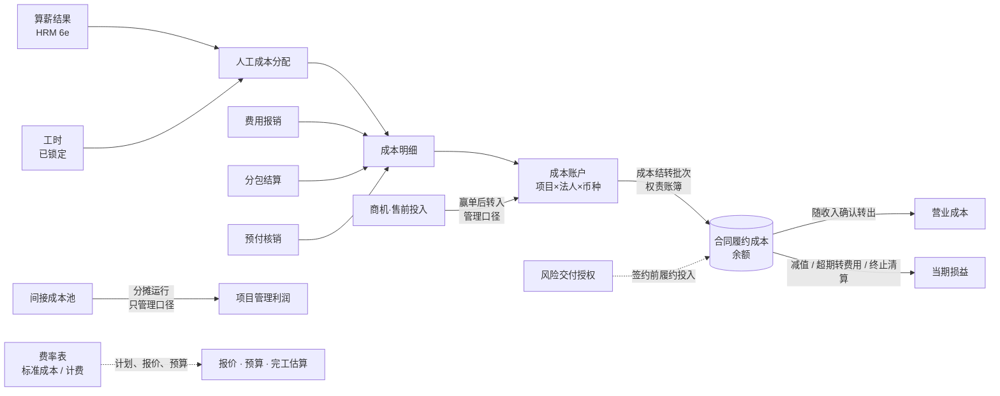
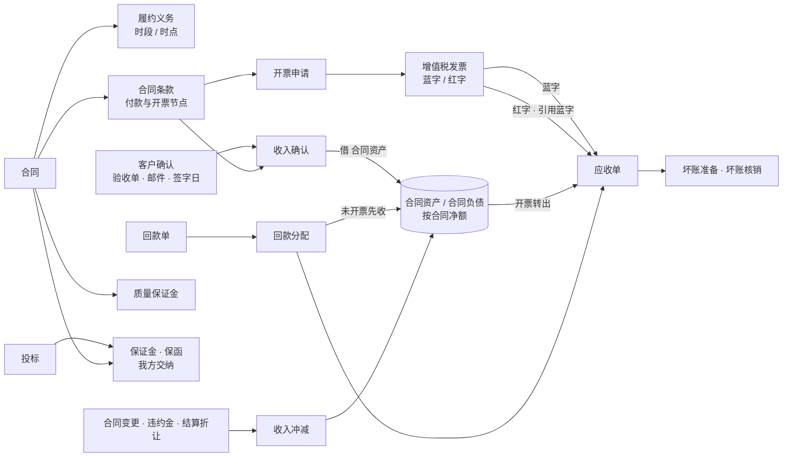

# AEC 项目制专业服务公司的业务对象：成本、收入与回款

状态：历史记录｜2026-10-15｜负责：one-architecture

状态：研究提议，待用户裁定 · 日期：2026-10-15 · 作者：one-architecture 子代理

依据：用户原则「生产数据只能是参考……必须要思考 AEC 行业项目制专业服务公司的总体情况」（intent `2026-10-15-202634`）、「架构选择必须深入研究」（intent `2026-10-15-193135`）。本段的用户事实：三套费率（intent `2026-10-15-211139`）；费率放主数据作为候选、对象识别完再定 BC（intent `2026-10-15-211634`）；售前投入「赢单后转入项目」、保证金「在应收里管、6b 前先做登记」（intent `2026-10-15-205406`、`2026-10-15-210513`）；「新系统要自建整个 hrm，算薪要迁入」（INTENT.md H-3）；总账进新系统、两本账（ADR-0022）；权责发生制主干（ADR-0016、GUIDING_PRINCIPLES §9a）。本次未取生产数据。

格式、判据、来源缩写沿用 `AEC_BUSINESS_OBJECTS.md`（售前段）。

## 0. 来源与缩写

按权威性排序。凡标「未核实」的，不作硬依据。

| 缩写 | 来源 | 本次怎么取得 |
|---|---|---|
| 〔CAS14〕 | 《企业会计准则第 14 号——收入》（财会〔2017〕22 号）https://kjs.mof.gov.cn/zt/kjzzss/kuaijizhunzeshishi/201709/t20170907_2694006.htm | 本次联网复读，核对第十一、十二、十三、十五、二十六至三十、三十三、三十四、四十一条 |
| 〔增值税法〕 | 《中华人民共和国增值税法》（2024-12-25 通过，2026-01-01 施行）国家税务总局法规库 https://fgk.chinatax.gov.cn/zcfgk/c100009/c5237365/content.html | 联网读取；核对第七、十、二十八、三十四条 |
| 〔数电公告〕 | 国家税务总局公告 2024 年第 11 号《关于推广应用全面数字化电子发票的公告》https://fgk.chinatax.gov.cn/zcfgk/c100012/c5236067/content.html | 联网读取；核对第二、八、十二条 |
| 〔质保金办法〕 | 《建设工程质量保证金管理办法》（建质〔2017〕138 号） | 住建部原链接 404；第二、七、八条内容来自地方政府转载文件与检索摘要（如 https://zjt.xinjiang.gov.cn/ 转载 PDF），**原件未读** |
| 〔民法典〕 | 《中华人民共和国民法典》第五百八十五条（违约金） | 未联网复读，条号取自词表 `liquidated_damages` 注 |
| 〔GLD〕 | `rules/GL_FINANCE_DECISIONS.md`（财务评审定案 D17-0..12、GL-026 等，含用户 2026-10-15 作答 A1–A13） | 本地 |
| 〔FD〕 | `r0/FINANCE_DECISIONS.md`（财务口径决策单 FD-01..46、待核实 F-01..09，未作答）；其外部来源 1–4（上市设计院年报、证监会 2023 年报监管报告）为该文件转引，本次未复读 | 本地 |
| 〔ADR〕 | ADR-0016、0021、0022、0023、0024、0031（`adr/src/`） | 本地 |
| 〔规则〕 | `BUSINESS_RULES.md` 中老系统规则卡（RULE-066..098、181..199） | 本地；只作证据，不复刻 |
| 〔条例〕 | 《招标投标法实施条例》，同售前段 | 转引售前段已核对的第 26、35、57、58 条 |
| 〔事实〕 | 本段开头列出的用户事实（intent 片段） | 本地 |
| 〔GF0209〕〔FIDIC〕〔AIA〕 | 同售前段 | 本段只转引售前段已核对的条号；付款、结算条款本次**未复读** |
| 〔BIZ〕 | BIZBOK Guide v11 本地文本 | §2.5 页 195–199（主次信息概念、聚合型概念 Finance） |
| 〔VP-DD〕 | Deltek Vantagepoint 2026.4 数据字典（本地，表名即页标题） | 本次读 `LD`、`BT`、`PR`、`CFGOHMain`、`CostRT`、`AR`、`ARCreditMemo`、`InvoiceVoid`、`CancelledInvoices`、`billRetDetail` 等 |
| 〔VP-H〕 | Deltek Vantagepoint 帮助镜像（本地） | `rev_concept_standard_revenue_methods.html.md`、`asjc_adjust_salaried_job_costing.html.md`、`asjc_benefits_and_considerations_for_using_adjust_salaried_job_costing.html.md` |
| 〔SPI〕 | SPI Research《2023 Professional Services Maturity Benchmark》本地 PDF | Finance and Operations 支柱定义；表 35 指标名 |
| 〔词表〕 | `glossary/terms.yaml`（580 条） | 本地 |

产品证据（Deltek、SPI）只说明「行业成熟产品这样建模」，不是权威；与法规、准则、已采纳 ADR 冲突时以后者为准。

## 1. 汇总表

「现状」列：✅ 已有且分类合适；⚠️ 已有但分类、定义或口径可能需调整；❌ 缺失。「类」列：主 = 一级对象；次 = 依附对象但有自己的生命周期；组 = 组成部分；型 = 对象类型；余 = 余额 / 派生度量；事 = 事件；单 = 单据 / 证据（判据见 §4）。

### 1.1 成本

| 对象 | 类 | 一句话定义 | 关键状态 | 主要关系 | 来源 | terms.yaml 现状 |
|---|---|---|---|---|---|---|
| 成本明细 | 主（事实） | 只追加、带来源事实引用与归属维度的一条成本记录；分人工、费用、分包、外包、预付核销等类型 | 无可变状态；已过账后只能冲销（冲销单 / 修正单） | N → 1 成本账户；← 1 来源事实（工时、报销、分包结算、人工成本分配、预付核销） | 〔ADR〕0016 第 1、2 条；0031；〔CAS14〕第二十六条；〔VP-DD〕`LD`、`LedgerEX`、`LedgerAP` | ✅ `cost_entry` |
| 费率表（三种类型） | 主 | 按适用范围给出单位人工价格的版本化清单；类型：标准成本费率、计费费率、实际成本费率 | 版本：草稿 → 已批准 → 生效 → 被取代；被引用不可改 | 1 费率表 → N 费率版本 → N 费率条目（职级 / 岗位 × 范围）；计费费率版本 → 引用 1 标准成本费率版本 + 系数 | 〔事实〕三套费率；〔VP-DD〕`CostRT.RateType`（cost / pay / both）、`BT.LabMeth`（1 = 费率 × 系数，2 = 费率表…）、`BTRRT`、`BTRCT`；`LD.Rate` / `LD.Payrate` / `LD.BillExt` 同一工时行并存三种金额 | ⚠️ `standard_cost_rate_card`「标准费率」、`bill_rate_card`、`rate_card`、`rate_card_item` 四词层级不清，已登记用语问题 4 条；「实际成本费率」缺 |
| 实际成本费率 | 余（派生） | 某人某期间的实际人工成本（工资、社保、公积金等）除以当期折算工作量得出的单价 | 随期间算薪结果生成，不维护 | 1 人 × 1 期间 → 1 值；来源 = HRM 算薪（6e） | 〔事实〕；〔FD〕FD-09（人天 × 日薪，归集守恒）；〔VP-H〕Adjust Salaried Job Cost；〔规则〕RULE-075、076（老系统按薪酬三要素落项目） | ❌ |
| 人工成本分配 | 次 | 按期间把员工实际人工成本按工时分到项目与非项目的一次运行及其结果 | 试算 → 确认 → 已过账；可冲销重做 | 1 期间 × 1 法人 → N 分配行 → 生成人工类成本明细；读工时（已锁定）与算薪结果 | 〔FD〕FD-09、FD-10；〔ADR〕0021（算薪迁入）；〔规则〕RULE-076、087（老系统人工重分类与尾差） | ❌（OA 盘点列为 6e 待新增「人工成本」） |
| 成本账户 | 主 | 项目 × 承担法人 × 币种的成本归集与期间封闭载体 | 开放 → 期间封闭（随 `accounting.period`）→ 关闭（项目关闭） | 1 项目 → N 成本账户；1 成本账户 → N 成本明细 | 〔词表〕 | ✅ `project_cost_account` |
| 项目成本 | 余 | 成本账户内成本明细的汇总（直接人工 + 直接费用 + 分包 + 外包） | — | 按项目、WBS、条款、期间汇总 | 〔词表〕；〔SPI〕Project margin | ✅ `project_cost`（metric） |
| 合同履约成本 | 余 | 权责账簿中为履行合同已发生、待随收入确认转出的成本余额，按合同 / 项目计，阶段为辅助维度 | 余额；增加（结转入）、减少（随收入转出、减值、终止清算、超期转费用） | 1 合同（项目）→ 1 余额；← 成本结转；→ 营业成本 | 〔CAS14〕第二十六、二十七、二十九、三十条；〔GLD〕D17-1、D17-2、D17-3、GL-026（A1、A7） | ⚠️ `contract_fulfilment_cost` 标 `entity`，实为余额 |
| 合同取得成本 | 余 | 为取得合同发生、预期可收回的增量成本形成的资产（如按合同签订触发的居间费） | 余额；随收入摊销 | 1 合同 → 0..1 | 〔CAS14〕第二十八、二十九条；〔FD〕FD-17 | ⚠️ `costs_to_obtain_contract` 标 `metric`，定义却是资产 |
| 售前投入 | 次 | 为争取商机、投标、编方案发生的工时与费用的归集 | 开放 → 关闭（商机终态）；赢单后转入项目（管理口径） | 1 商机 → 0..1；赢单后 → 1..N 项目（多合同按合同额分摊） | 〔事实〕赢单后转入；〔CAS14〕第二十八条（无论是否中标都会发生的支出计当期损益）；〔VP-DD〕`PR.ChargeType = P`、`LD.ChargeType` | ❌（`pre_sales_hours` 只是工时类别取值） |
| 签约前履约投入 | 余（派生） | 已决定承接（风险交付授权内）、合同尚未签署时为履约发生的成本 | 挂合同履约成本 → 签约后随合同 / 超 N 个月未签约转当期费用 | ← 风险交付授权；→ 合同履约成本 | 〔GLD〕GL-026 A7；〔FD〕FD-11；〔CAS14〕第二十六条 | ❌（`uncontracted_wip` 是收入侧度量，不覆盖成本侧） |
| 间接成本池 | 主 | 不能直接归属项目、按职能（总部、支持、销售、居间、研发等）汇集待分摊的成本 | 每期间：归集中 → 已分摊 / 结转下期（基数为零时） | 1 池 × 1 期间 → N 分摊结果行 | 〔规则〕RULE-066、068、069；〔VP-DD〕`CFGOHMain`（分摊范围：全公司 / 利润中心；方式：按预算费率 / 按实际比例；基数：直接人工 / 收入；未分摊差额记差异项目） | ✅ `indirect_cost_pool` |
| 分摊规则版本 | 次 | 某期间起生效的分摊基数、档位与费率 | 草稿 → 已批准 → 生效 → 被取代 | 1 版本 → N 池的规则；被分摊运行引用 | 〔FD〕FD-44（首版沿用四档费率，按版本生效）；〔VP-DD〕`CFGOHMain.OHRate`、`OHProvisionalRate` | ❌（只有 `policy_parameter` 泛指） |
| 分摊运行 / 分摊结果 | 次 | 一次按规则把池摊到项目的执行及其结果 | 试算 → 生效；每期间只一次有效全量运行；冲销按原比例 | 1 运行 → N 结果行（项目 × 池） | 〔规则〕RULE-070、092；COST-R42（只管理口径、不过账） | ✅ `allocation_result`、`allocate_indirect_cost` |
| 成本结转批次 | 次 | 把已过账成本从生产成本转入合同履约成本、或随收入确认转出到营业成本的一次批量执行 | 草稿 → 已确认 → 已过账；冲销 | 1 批次 → N 结转行 → N 过账事实 | 〔GLD〕D17-1、D17-3、D17-4；〔规则〕RULE-093、094（老系统结转门槛） | ✅ `cost_transfer_batch` |
| 合同履约成本减值 / 亏损合同 | 事 / 型 | 合同履约成本账面高于剩余对价减估计成本的差额计提；履约成本不可避免地超过经济利益的合同 | 计提、转回（不超过原值）；亏损合同是合同的状态 | → 合同履约成本余额；← 完工估算 | 〔CAS14〕第三十条；〔GLD〕D17-3（终止项目清算）；〔词表〕`onerous_contract`（CAS 13，本次未复读） | ⚠️ 有 `impairment_booked`（泛）、`onerous_contract`（state），无合同履约成本减值事件 |
| 成本调整 | 单 | 封期后引用原明细的当期更正 | 按 ADR-0031 冲销单 / 修正单 | → 原成本明细 | 〔ADR〕0031 | ✅ `cost_adjustment`（宜并入 kernel 冲销单、修正单，见 §6） |

### 1.2 收入与回款

| 对象 | 类 | 一句话定义 | 关键状态 | 主要关系 | 来源 | terms.yaml 现状 |
|---|---|---|---|---|---|---|
| 履约义务 | 组 | 合同中向客户转让可明确区分服务的承诺，收入的计量单元；带「时段 / 时点」类型 | 未履行 → 部分履行 → 已履行 | 合同的组成部分；1 履约义务 ↔ N 合同条款（关系未定，G-21） | 〔CAS14〕第九、十、十一、十三条；〔GLD〕GL-026 A1 | ✅ `performance_obligation`；与 `contract_clause` 的关系待定 |
| 交易价格 / 可变对价 | 组（值） | 预期有权收取的对价；含违约金、结算折让、奖励等可变部分 | 随变更、结算重估 | 合同 → 交易价格 → 分摊到履约义务 | 〔CAS14〕第十四、十五条 | ✅ `transaction_price`、`variable_consideration` |
| 合同条款（付款与开票节点） | 组 | 合同的结算条款，收入、成本、开票、回款的挂接锚点 | PENDING → ACTIVE → SETTLEABLE → SUPERSEDED / VOIDED | 合同组成部分；N 收入确认、N 开票申请挂条款 | 〔词表〕；〔GF0209〕第 10.2 条（价格形式，转引） | ✅ `contract_clause`（注明待 G-21） |
| 履约进度 | 余 | 时段履约义务的完成程度（0–1），按产出法或投入法计量 | — | 只对「时段」类履约义务有意义 | 〔CAS14〕第十二条 | ⚠️ `measure_of_progress`、`input_method`、`progress_assessment`：与 ACC-R01、A1「时点履行」冲突，见发现 1 |
| 收入确认 | 主（单据化事实） | 凭客户确认（验收单、邮件确认、签字日）按条款确认收入的业务事实及其单据 | 草稿 → 审批中 → 已确认（锁定）/ 驳回；更正走冲销单、修正单；客户退回走冲销 | N → 1 合同条款；→ 合同资产（或应收）；→ 派生冲销（配对成本） | 〔ADR〕0016 第 4 条、0024、0031；〔CAS14〕第十三条（客户已接受）；〔GLD〕D17-5 | ⚠️ `revenue_recognition` 标 `document`，但有生命周期与规则 |
| 收入冲减 | 事 | 可变对价（结算折让、违约金、扣款）导致的已确认收入减少 | 只追加 | → 合同资产 / 应收；区别于信用损失、冲销 | 〔GLD〕D17-8 ①；〔CAS14〕第十五条 | ✅ `revenue_reduction` |
| 合同资产 / 合同负债 | 余 | 按合同净额列示的有条件收款权 / 已收或应收未履约义务 | 余额 | 每合同一个净额；收入确认 ↑ 资产，开票 ↓ 资产（转应收），预收 ↑ 负债 | 〔CAS14〕第四十一条；〔GLD〕GL-024、GL-027、D17-6、D17-7 | ⚠️ 两词标 `entity`，应为余额 |
| 未开票在制 | 余 | 管理口径：累计已确认收入 − 累计已开票，按项目 × 条款，含无合同部分 | — | 与合同资产差异 = 无合同部分 + 合同负债抵消 + 减值 | 〔词表〕；〔VP-H〕收入方法 W（已开票 + 未开票在制） | ✅ `unbilled_wip` |
| 开票申请 | 次 | 向客户请款、要求开具发票的内部申请，含准入检查 | 草稿 → 审批中 → 准入通过 → 已开票 / 驳回 / 撤回 / 作废（未开票前） | N → 1 合同（条款）；1 开票申请 → 1..N 发票 | 〔词表〕；〔VP-DD〕`ARPreInvoice`、`InvoiceApproval`、`InvoiceVoid`、`CancelledInvoices`（只作废草稿发票） | ⚠️ `billing_request` 标 `document`，有生命周期 |
| 增值税发票 | 主（外部权威） | 税务平台开具、以平台结果为准的发票；蓝字或红字 | 蓝字：已开具 → 部分红冲 → 全额红冲；红字：已开具（引用蓝字）；数电票没有作废状态 | 1 开票申请 → N 发票；1 蓝字发票 → 1 应收单；1 红字发票 → 1 蓝字发票；← 红字发票信息确认单 | 〔增值税法〕第七、二十八、三十四条；〔数电公告〕第二、八条；〔ADR〕0016 第 5 条、0031 第 1.2 条 | ❌ 只有事件 `invoice_issued` |
| 红字发票信息确认单 | 单 | 已用途确认或入账确认的蓝字数电票红冲前，由一方发起、对方确认的单据 | 已发起 → 已确认 / 72 小时未确认自动作废 | → 1 蓝字发票 → 红字发票 | 〔数电公告〕第八条 | ❌ |
| 应收单 | 主 | 一张蓝字发票形成的无条件收款权 | 未收 → 部分收 → 已收；争议；已核销（坏账）；红冲减少 | 1 蓝字发票 → 1 应收单；N 回款分配 → 1 应收单 | 〔CAS14〕第四十一条；〔FD〕FD-15 | ✅ `ar_item` |
| 回款单 / 回款分配 / 核销 | 主 / 组 / 事 | 一笔到账的认领与分配；分配到应收、合同负债（预收）或其他 | 待认领 → 已认领 → 已分配（合计 = 到账）；退款 | 1 回款单 → N 分配 → 应收单 / 合同 | 〔词表〕；〔GLD〕D17-7；〔VP-DD〕`crMaster`、`crDetail` | ✅ `cash_receipt`、`receipt_allocation`、`cash_application`；「退款」❌ |
| 回款方式 | 型 | 现金、商业承兑汇票、以资产清偿（形成抵债资产）、无追索权保理；有追索权保理单列不计回款 | — | 回款单的类型 | 〔GLD〕A11；〔FD〕FD-40 | ✅ `settlement_method`、`commercial_acceptance_bill`、`debt_settlement_asset` |
| 质量保证金（客户扣留） | 次 | 按合同扣留、缺陷责任期满或条件成就后返还的部分价款 | 扣留 → 到期可收 → 已收 / 被扣减 | 合同付款条件 → 质保金；到期 → 应收 | 〔质保金办法〕第二、七、八条（转引）；〔CAS14〕第四十一条；〔GLD〕A6 | ✅ `retention_money`（合同资产还是应收待财务，F-03） |
| 保证金（我方交纳：投标、履约）/ 保函 | 次 | 我方为投标或履约向客户、招标人交纳的现金保证金，或开立的保函 | 现金：待缴 → 已缴 → 已退 / 被没收（部分扣减）；保函：已开立 → 到期 / 被索赔 | 1 投标 → 0..1；1 合同 → 0..1；现金保证金是受限资金 | 〔条例〕第 26、35、57、58 条（售前段已核）；〔GLD〕A6、GL-051；〔事实〕放应收管、6b 前先登记 | ❌ |
| 坏账准备 / 减值计提 | 余 / 事 | 按预期信用损失模型对应收账款、应收票据、合同资产计提的损失准备 | 每期计提、转回 | → 应收单、合同资产 | 〔GLD〕D17-8 ②③；〔FD〕FD-36、FD-37（CAS 22 第六十三条为转引） | ✅ `allowance_for_bad_debts`、`impairment_booked`、`ecl_alert` |
| 坏账核销 | 事 | 有减值依据的应收终态处理 | 只追加；核销后收回另记 | → 应收单（终态） | 〔词表〕 | ✅ `ar_written_off` |
| 违约金 | 型（值） | 客户依合同主张的扣罚 | 认定在合同变更 BC，执行为收入冲减或回款少付 | → 可变对价 → 收入冲减 | 〔民法典〕第五百八十五条；〔词表〕Q19 | ✅ `liquidated_damages` |
| 竣工结算 | 次 | 完工后对最终交易价格的双方确认 | 编制 → 双方确认 → 结清；结算折让留痕 | 1 合同 → 0..1 | 〔GF0209〕第 10.5 条（转引）；〔词表〕 | ⚠️ `final_account` 标 `document`，有生命周期 |

## 2. 成本段详述

### 2.1 总体结构

行业证据的一致点：
- **同一工时行上并存三种金额**。Deltek 的工时明细 `LD` 同时记员工的成本费率 `Rate`、薪酬费率 `Payrate` 与计费金额 `BillExt`；成本 / 薪酬费率表 `CostRT.RateType` 取 cost、pay 或 both（〔VP-DD〕）。这与用户的三套费率同构：标准成本费率 ≈ 成本费率（job cost rate），实际成本费率 ≈ 薪酬实际成本（pay），计费费率 ≈ 计费金额的单价。
- **计费 = 成本费率 × 系数是行业标准做法之一**。Deltek 计费条款 `BT.LabMeth` 的取值有「1 = 费率 × 系数」「2 = 费率表」「3 = 按类别」「4 = 按工种」，系数可分档（`Mult1..3`）（〔VP-DD〕）。用户的「计费费率 = 标准成本费率 × 系数」就是第 1 种；战略客户协议价目相当于第 2 种（售前段已定）。
- **标准与实际之间有差异，需要一个去处**。Deltek 默认按标准成本费率记项目人工；对受监管项目可运行「Adjust Salaried Job Cost」把项目人工按实际薪酬重算，否则差额进「Job Cost Variance」科目；其帮助页列出的代价是成本费率逐期波动、预算更难（〔VP-H〕`asjc_*`）。
- **间接费分摊是管理会计做法，可选全公司或利润中心、按直接人工或收入、按预算费率或实际比例**；未分摊完的差额记到指定的差异项目（〔VP-DD〕`CFGOHMain`）。

### 2.2 三套费率：哪两个是主数据，哪一个是计算结果

- **标准成本费率**（用户：签约后交付使用）：财务维护、按版本生效、对薪酬脱敏的政策费率（词表 `standard_cost_rate_card`）。用途是交付预算、完工估算、项目经理看到的个人行人工成本（用户 2026-10-14：「按职级标准费率看到个人行」）。
- **计费费率**（用户：售前使用，= 标准成本费率 × 系数）：是**派生版本**，不是独立录入的价格。它的版本须记录「所依据的标准成本费率版本 + 系数版本」，否则标准费率调整后无法复算历史报价。报价记所用版本（售前段已定，RULE-147 费率「提交时锁定」）。
- **实际成本费率**（用户：核算使用）：不是维护出来的费率，而是**算薪结果除以工作量的期间计算值**（人 × 期间）。财务决策单的推荐口径是「人天 × 日薪」：当天成本 = 日薪，按工时占比分到项目，使项目成本合计等于实际薪酬（〔FD〕FD-09，未作答）。CAS 14 第二十六条要求合同履约成本是实际发生的成本；所以**进权责账簿的项目人工应取实际成本**，标准成本只用于计划与管理视图。
- **建模建议**：「费率表」一个对象、三种类型；标准成本与计费两类为版本化主数据（适用范围：职级 / 岗位 × 法人 × 业务单元 × 生效期，具体维度待用户定，§7 问题 1）；实际成本费率不进费率表，作为「人工成本分配」的派生结果，敏感（个人薪酬），只在项目合计层可见（用户 2026-10-14 决定）。
- **规则**：拒绝——费率版本生效期不重叠；被引用的版本不可改；计费版本必须引用一个已生效的标准成本版本与一个系数；缺费率的工时不得计成本（失败告警，不按 0 计）。预警——标准与实际差异超阈值。
- **中国语境**：实际人工成本含工资、社会保险与住房公积金单位部分（老系统按「工资、社保、公积金」三要素落项目，〔规则〕RULE-075）；具体构成须随 6e 算薪定义。标准日 7.5 小时是公司制度（〔FD〕FD-10）。
- **负责人**：标准成本费率、系数——财务（批准）；实际成本——HRM 算薪（6e 之前为薪酬汇总导入，ADR-0022 第 6 条）。

### 2.3 成本明细与人工成本分配

- **成本明细**：只追加、必带来源事实引用（ADR-0016 第 1、2 条）。类型（对象类型，不是新对象）：直接人工、直接费用、分包、外包、预付核销（D17-9：预付核销只由应付与付款生成一次）。分包与外包在用户定稿中区分（词表 `outsourcing_cost`、`subcontract_cost`）。
- **人工成本分配**是本段最缺的一个对象：它把「谁在哪个项目花了多少时间」（工时，已锁定）与「这个人这个月实际花了公司多少钱」（算薪）连起来。老系统用人工重分类按部门比对 U8C 贷方与落地成本、容差内过账（〔规则〕RULE-076、087）；新系统算薪迁入后，应改为按人 × 期间一次分配、守恒（分配合计 = 应付职工薪酬中的人工成本），不足标准日的剩余进闲置产能（〔FD〕FD-09）。
- **规则（拒绝）**：只分配已锁定工时；分配合计 = 该人该期间实际人工成本（零容差，按权重拆分原语）；关账后更正走冲销重做。**预警**：有工时无薪酬、有薪酬无工时。
- **生命周期**：试算 → 确认 → 已过账；整批冲销重做（ADR-0031）。

### 2.4 合同履约成本、成本结转与签约前投入

- **两步过账**（已定，〔GLD〕D17-1、D17-3、D17-4）：成本发生时两本账都记生产成本—项目；权责账簿由成本结转转入合同履约成本，随收入确认转出到营业成本；收付账簿月末全额转营业成本。合同履约成本因此是**余额**，在信息图上是合同（项目）的度量，不是有状态机的对象；「阶段」是辅助维度（D17-2）。
- **不得进入合同履约成本**的支出：管理费用、非正常消耗、与已履行部分相关的支出、无法区分的支出（〔CAS14〕第二十七条）。这是间接费分摊只能停留在管理口径的准则依据（COST-R42）。
- **减值**：账面高于剩余对价减估计成本的差额计提，可转回但不超过原值（〔CAS14〕第三十条）；终止项目可收回部分以外转营业成本（D17-3）。
- **签约前履约投入**：用户已定「先挂合同履约成本，超 N 个月未签约自动转费用」（A7；N 见 FD-11，推荐 6 个月，未作答）。这一类成本的「合同」是预期合同，须满足第二十六条三个条件，因此应依附**风险交付授权**（售前段对象）——没有授权的签约前工时不应挂合同履约成本。

### 2.5 售前投入：两种口径必须分开

- 用户已定：投标与编方案的工时费用记到商机，赢单后转入项目（intent `2026-10-15-205406`）。
- 准则：无论是否取得合同都会发生的支出（投标费用、差旅等）计入当期损益；只有增量成本（如中标才支付的居间费）可作为合同取得成本（〔CAS14〕第二十八条；〔GLD〕GL-026）。
- 因此「转入项目」只能是**管理口径的再归属**（项目毛利、贡献毛利里看得到售前投入），不能把已费用化的投标成本在权责账簿转回合同履约成本。售前聚合稿 §5 已按「冲销 + 新事实、不改原归集」设计，财务口径待定。
- 与 §2.4 的边界：**售前投入**是赢单前为争取合同发生的；**签约前履约投入**是决定承接后、签约前为履约发生的。同一员工同一天的工时只能记其一，分界点是「赢单（或风险交付授权）」事件（§7 问题 3）。
- 老系统做法（只作证据）：丢单商机费用入间接成本池，赢单且项目存在时挂项目，否则在途（〔规则〕RULE-074 第 6 步）；按条款合同额或平均分摊两种公式并存（RULE-084，疑似缺陷）。

### 2.6 间接成本分摊

- **对象**：间接成本池（按职能：总部、支持、销售、居间、研发等，〔词表〕`indirect_cost`）、分摊规则版本（基数、档位、费率）、分摊运行与结果。
- **口径**：只管理口径、不过账（COST-R42）；准则依据见 §2.4。首版沿用现行四档费率并版本化，G1 后按动因复核（〔FD〕FD-44，未作答）。老系统按直接人工成本占比分摊、余数记最大行、第 13 期用全年基数（〔规则〕RULE-066、069）；用户已定分摊余数归属提前到 1b（intent `2026-10-15-214100` XD-09）。
- **用途**：三级利润（毛利、业务单元利润、全口径利润，〔规则〕RULE-067）与经营利润（〔词表〕`management_operating_profit`）。
- **规则**：拒绝——每期间一次有效全量运行、不并发（RULE-092）；分摊合计 = 池金额。预警——基数为零时结转下期（RULE-068）。

## 3. 收入与回款段详述

### 3.1 总体结构

### 3.2 履约义务、履约进度与收入确认——最需要澄清的一处

- **已定口径**：收入确认统一为「产出法 · 客户价值确认」，收到客户确认是确认收入的唯一触发点（ACC-R01，ADR-0016 第 4 条）；设计服务按「某一时点履行」处理，各阶段成果经客户确认时确认收入，**须审计师书面确认**（〔GLD〕GL-026 A1）。
- **准则结构**：时段履约须满足三条件之一（〔CAS14〕第十一条），按履约进度确认，进度用产出法或投入法（第十二条）；不满足的为时点履约，在客户取得控制权时确认，「客户已接受」是迹象之一（第十三条）。**产出法是时段履约的进度计量方法，不是时点履约的确认方式**。
- **矛盾**：「产出法」与「时点履行」同时写在已定口径里，词表又登记了 `measure_of_progress`、`input_method`、`progress_assessment`、`eac_assessment`（「投入法 POC 分母」）。按 A1，履约进度对收入确认不起作用，这些词条只剩管理用途（交付进度、挣值）。
- **行业证据相反**：财务决策单转引的两家上市设计院年报都把设计、咨询作为**时段**履约（以阶段成果确认或以工时校准的节点比例计量进度）；证监会 2023 年报监管报告又指出，按里程碑付款加解约补偿不一定构成「有权就累计已完成部分收款」（〔FD〕外部来源 1–3，本次未复读）。审计师判断的关键事实是 F-07（客户中途解约时是否须按已完成工作付款）。
- **对信息图的影响**：无论结论如何，「收入确认（凭客户确认）」这个对象都成立；变的是「履约义务」上的类型（时段 / 时点）与是否需要「履约进度」。建议：履约义务带「履约时点类型」；履约进度只对时段类适用；收入确认单在两种情况下都是证据载体（时点类：控制权转移的证据；时段类：产出法进度的证据）。把 `output_method` 从「收入确认方式」改为「时段履约的进度计量方法」，把 ACC-R01 的名称交 one-glossary 复核（不自行裁定）。
- **履约义务与合同条款**：词表 `contract_clause` 自称「语义接近履约义务，又兼作付款节点」，待财务确认（G-21）。行业与准则把二者分开：履约义务决定**何时确认收入**，付款条款决定**何时有权开票收款**（〔CAS14〕第四十一条正是靠二者的时间差产生合同资产、合同负债）。在 98% 为固定总价阶段款的现状下，二者常一一对应，但首付款、质保金条款就不是履约义务。建议分开建模、允许 1:1 映射（§7 问题 4）。
- **收入确认的规则**：拒绝——金额 > 0；同一条款累计确认不超过条款金额（提交与审批各查一次）；须有客户确认证据与签字日；合同须已回签；期间取签字日所在月，已关账则落开放期间并标原期间（ADR-0016、ADR-0024、〔规则〕RULE-184、185）；无交付验收的预付款条款确认收入的老做法不迁移（〔FD〕已定口径 FQ-21）。冲销后派生冲销配对成本（词表 `derived_reversal`）。

### 3.3 合同资产、合同负债与未开票在制

- 都是**余额**：合同资产 = 已确认未开票（收款还取决于时间流逝以外的因素），合同负债 = 已收或应收未履约，按合同净额列示（〔CAS14〕第四十一条；〔GLD〕GL-024、GL-027）。确认即可付款、只取决于时间流逝的直接记应收账款，付款条件在合同主档标注、系统自动选科目（GL-024）。
- 首付款开票按合同条款分流（〔GLD〕D17-6 A5）：到期且不可撤销的全额记应收与合同负债；否则只记税额。合同未标注时的默认分支待定（〔FD〕FD-12）。这要求**合同条款上有「首付款是否到期不可撤销」的标注**——它是合同对象的属性，不是开票对象的属性。
- 未开票在制是管理口径（含无合同部分），与合同资产的差异由词表 `unbilled_wip` 注明。Deltek 收入方法 W（已开票 + 未开票在制）、B（按开票）、P（完工百分比 × 估计收费）、M（直接人工 × 系数）、R（按回款）说明行业产品把「收入方法」做成项目级选项（〔VP-H〕）；新系统已定不提供方法选择（ADR-0016 第 4 条），这是有意偏离。

### 3.4 开票申请与增值税发票

- **开票申请**是我方内部对象：草稿 → 审批 → 准入检查（按计价模式矩阵，〔词表〕`invoice_eligibility_confirmed`）→ 已开票 / 驳回 / 撤回；**作废只发生在开票申请或草稿上**。Deltek 同样只对草稿发票作废（`InvoiceVoid`、`CancelledInvoices`「Draft Invoice Cancellations」），已开具的发票用贷项通知单（`ARCreditMemo`）冲减（〔VP-DD〕）。
- **增值税发票**是外部权威对象（ADR-0031 第 1.2 条：以税务系统开具结果为准）：
  - 纳税义务发生时间为收讫款项或取得索取凭据之日，**先开具发票的为开票之日**（〔增值税法〕第二十八条）——这是首付款开票、预开票即产生销项的法律依据；税额须单独列明（第七条）；电子发票与纸质发票同等效力（第三十四条）；设计、咨询等服务一般适用第十条第（三）项税率（法条未用「现代服务」一词）。
  - 数电票蓝字开具后，发生销售退回、开票有误、服务中止、销售折让的，开具**红字数电票**；未经用途确认或入账确认的由开票方直接红冲；已确认的须经对方确认《红字发票信息确认单》，72 小时内未确认自动作废（〔数电公告〕第八条）。公告**没有**规定数电票本身作废，更正走红冲；「数电票不能作废」的明文本次未见（未核实）。
  - 因此发票的状态机是：蓝字「已开具 → 部分红冲 → 全额红冲」，红字发票是**引用蓝字的另一张发票**（单据性质 = 冲销），与 ADR-0031 冲销单同构；不能在蓝字发票上改状态为「作废」。老系统与 A8 的「冲红字段与红字记录并存」不迁移（〔FD〕FD-15）。
- **关系**：1 开票申请 → 1..N 发票（单张限额、拆票时为 N）；1 蓝字发票 → 1 应收单（词表 `ar_item` 已定）；红字发票冲减原应收单，若原应收已收回则形成应退或合同负债。
- **一致性边界**：WIP 与开票是同一边界，开票接受与作废在同一事务内改写 WIP 终态（ADR-0016 第 5 条）。在数电语境下，「开票接受」应理解为税务平台返回开具成功，「作废」应理解为开票申请在开具前作废——建议 6b 的 receivables ADR 把这两个词改为「开具成功」「开票申请作废 / 红冲」。
- **中国语境差异**：北美产品没有「红字确认单」「特定业务标签（建筑服务等）」（〔数电公告〕第二条）；发票是税务事实，与收入确认（会计事实）时点不同——这是两本账在应收与销项上产生差异的原因（〔GLD〕D17-6 A4）。

### 3.5 应收、回款与核销

- **应收单**只由蓝字发票产生（〔词表〕；〔FD〕FD-15 推荐）；**回款单**分配合计 = 到账金额；未开票先收款记合同负债（〔GLD〕D17-7）；回款方式四类，有追索权保理单列不计回款（A11）；工抵按网签或产权过户计回款（〔FD〕FD-40，未作答）。
- **缺「退款」对象**（OA 盘点「退款单新增」流程，6b 需新增词条）：客户多付、红冲后已收款的退还。
- **账龄**两套：管理账龄按逾期天数、减值账龄按年度段（〔FD〕FD-37）；合同资产账龄自客户确认日起算（FD-38）。〔SPI〕财务支柱以 DSO、收入漏损（revenue leakage）、因错误或客户拒收重开的发票比例衡量——后者说明「发票红冲重开」应是可度量的对象，而非只改状态。

### 3.6 质量保证金、保证金与押金

- 用户已定：质保金、保证金、押金、员工借款、工抵资产**按性质分开记账，另设专项台账**（〔GLD〕A6）；保证金在应收里管、6b 前先做登记（intent `2026-10-15-210513`）。
- **质量保证金（客户扣留我方价款）**：是合同价款的一部分，返还取决于缺陷责任期届满或验收等条件，准则上通常列合同资产，条件成就后转应收（词表注，待财务 F-03）。施工领域的预留上限为结算总额 3%、缺陷责任期一般 1 年最长 2 年（〔质保金办法〕第二、七条，转引）；该办法针对发包人与承包人的工程合同，**设计合同的质保金比例与期限以合同约定为准**。
- **保证金（我方交纳）**：投标保证金、履约保证金是**我方的资产**（其他应收款性质），不是对客户的销售应收；它不由发票产生，因此不能套用 `ar_item`「只能由 InvoiceIssued 产生」的规则——同在应收 BC，但必须是**独立对象**，有自己的状态机（待缴 → 已缴 → 已退 / 被没收、部分扣减）与规则（退还与没收互斥、各只发生一次，售前聚合稿 I-11）。现金保证金是受限资金，不计现金及现金等价物（〔GLD〕GL-051）；保函不占用资金，只登记开立、到期、被索赔。
- 「押金」（如投标押金、租赁押金）与保证金同类处理，是否同一对象由用户定（§7 问题 6）。

### 3.7 收入冲减、违约金、坏账

- 三种事实分开（〔GLD〕D17-8）：① 收入冲减（可变对价：结算折让、违约金、扣款）；② 应收账款信用损失（两账相同）；③ 合同资产减值（只记权责账簿）。老系统的「产值坏账」是方言，分别归入 ① 或 ③。
- **违约金**：民法典第五百八十五条意义上的合同扣罚；认定在合同变更 BC、执行为应收侧贷项（词表 Q19）；会计上是可变对价，冲减收入而非计费用（〔CAS14〕第十五条）。
- **坏账准备**按预期信用损失模型计提，「减值计划」只是预算、不入账（〔FD〕FD-36 推荐，未作答）。

### 3.8 竣工结算

- 完工后双方确认最终交易价格；结算折让留痕不可改（词表 `final_account_discount`）。它有编制 → 确认 → 结清的生命周期，应从 `document` 改为有状态对象，结算书是它的单据。结算差额通过收入冲减或补充收入确认落账。

## 4. 对象判据

依〔BIZ〕§2.5：主概念不依附其他对象存在（页 198）；次概念由二级以下能力定义、依附主概念；估值、评级、价格属属性（页 198–199）；单据是对象的呈现（页 197）。BIZBOK 把 Finance 当作**聚合型**主概念：其下的财务账户、财务交易、支付、币种等都是次概念，Finance 本身不列类型、关系与状态（页 195、198–199）。对 AEC 公司，成本与收入的多数概念正是这种「Finance 下的次概念」；本研究把其中有独立生命周期、法定规则的（发票、应收、回款、保证金）上提为主概念，其余按余额或事件处理。

| 类别 | 判据 | 归入的对象 |
|---|---|---|
| 主对象 | 独立存在、有生命周期与规则 | 成本明细（事实）、费率表、成本账户、间接成本池、收入确认、增值税发票、应收单、回款单 |
| 有生命周期的次对象 | 依附主对象但有状态与规则 | 费率版本、分摊规则版本、人工成本分配、分摊运行、成本结转批次、售前投入、开票申请、质量保证金、保证金 / 保函、竣工结算 |
| 组成部分 | 离开主对象无意义 | 履约义务、交易价格、合同条款（属合同）；费率条目（属费率版本）；回款分配（属回款单）；分摊结果行（属分摊运行） |
| 对象类型 | 同一对象的现实分类 | 费率类型（标准成本 / 计费 / 实际成本）；成本明细类型（人工 / 费用 / 分包 / 外包 / 预付核销）；履约时点类型（时段 / 时点）；发票种类（专票 / 普票；蓝字 / 红字）；回款方式；保证金类型（投标 / 履约）与形式（现金 / 保函）；间接成本职能 |
| 余额 / 派生度量 | 由事实计算 | 实际成本费率、项目成本、合同履约成本、合同取得成本、合同资产、合同负债、未开票在制、应收账款、坏账准备、履约进度、DSO、贡献毛利、净服务收入 |
| 事件 | 只追加 | 人工成本已分配、成本已结转、收入已确认、收入冲减、发票已开具、发票已红冲、回款已到账、已核销、坏账已核销、保证金已缴 / 已退 / 已没收、合同履约成本已减值、签约前投入已转费用 |
| 单据 / 证据 | 呈现或证据 | 客户确认单（验收单、邮件、签字）、发票票面、红字发票信息确认单、银行回单、商业承兑汇票、保函、结算书、算薪结果表 |

注：「收入确认单」「开票申请」「回款单」「竣工结算」在词表中标 `document`。按 BIZBOK，**纸面单据**是证据，但这些词条的定义描述的是带状态机与规则的业务事实（与售前段 `quote` 同一问题），建议区分「概念（有状态）」与「单据（证据）」。

## 5. 跨段关系（交接对象与事件）

| 上游段 → 下游段 | 交接对象 | 事件（用词表已有名或待登记） |
|---|---|---|
| 主数据 → 售前、成本 | 费率版本（标准成本、计费）、协议价目版本 | 费率版本已生效 |
| 售前 → 成本 | 售前投入（赢单后转入）；报价记所用计费费率版本 | `OpportunityAccepted`（赢单）、商机已丢单（售前投入留在当期费用 / 间接池） |
| 合同 → 收入 | 履约义务、交易价格、合同条款、付款条件（含首付款标注）、违约金认定 | `ContractSigned`、`ChangeOrderApproved`、合同已终止 |
| 合同（风险交付）→ 成本 | 风险交付授权（签约前履约投入的前提） | 授权已批准、已转正、已叫停 |
| 交付 → 收入 | 交付物验收、客户确认 | 已验收 |
| 工时 → 成本 | 已锁定工时 | 工时单已审批（锁定） |
| HRM（6e）→ 成本 | 算薪结果（6e 前为薪酬汇总导入） | 算薪已确认 |
| 分包与采购 → 成本 | 分包结算 | 分包工作已确认 |
| 应付与付款 → 成本 | 预付核销（D17-9） | 预付已核销 |
| 收入 → 成本 | 收入确认 → 合同履约成本转出；收入冲销 → 派生冲销 | `RevenueRecognized`、收入已冲销 |
| 收入 → 应收 | 开票申请、发票 | `InvoiceIssued`、发票已红冲 |
| 售前（投标）、合同 → 应收 | 保证金登记 | 保证金已缴 / 已退 / 已没收 |
| 各段 → `operations.facts` → `accounting.ledger` | 过账候选（不认识科目） | 过账完成（带 `PostSeq`、原期间、冲销引用） |
| `platform.integration` ↔ 税务数电平台 | 开票请求、开具结果、红字确认单 | 外部结果经防腐层转为本域事件（ADR-0039） |
| `accounting.cashbank` → 应收 | 银行流水 | 流水已导入、已匹配 |
| 全部 → `reporting` | 余额与度量（贡献毛利、DSO、未开票在制、售前投入） | 期间已关账（L2 快照） |

## 6. 与仓库现状对照

### 6.1 已有且合适

`cost_entry`、`project_cost_account`、`project_cost`、`indirect_cost_pool`、`allocate_indirect_cost`、`allocation_result`、`cost_transfer_batch`、`outsourcing_cost`、`subcontract_cost`、`performance_obligation`、`transaction_price`、`variable_consideration`、`revenue_reduction`、`unbilled_wip`、`ar_item`、`cash_receipt`、`receipt_allocation`、`cash_application`、`settlement_method`、`commercial_acceptance_bill`、`debt_settlement_asset`、`allowance_for_bad_debts`、`ar_written_off`、`liquidated_damages`、`retention_money`、`defects_liability_period`；kernel 的 `reversal_document`、`correction_document`、`derived_reversal`、`original_period`。

### 6.2 缺失（建议经 one-glossary 查重后登记提议术语；本研究未登记）

| 建议对象 | 依据 | 可能归属（待对象识别完统一定 BC，intent `2026-10-15-211634`） |
|---|---|---|
| 实际成本费率 | 用户三套费率；〔FD〕FD-09 | 成本（人工成本分配的结果） |
| 人工成本分配（运行与结果） | 〔FD〕FD-09；ADR-0021 算薪迁入 | 成本，读 HRM |
| 费率表类型、计费系数（版本） | 用户三套费率；〔VP-DD〕`BT.LabMeth`、`Mult1..3` | 主数据（与往来单位一并定，用户提议） |
| 分摊规则版本 | 〔FD〕FD-44 | 成本或 `operations.policy` |
| 售前投入 | 用户决定；〔CAS14〕第二十八条 | 售前 / 成本 |
| 签约前履约投入（转费用事件） | 〔GLD〕A7 | 成本 |
| 合同履约成本减值（事件） | 〔CAS14〕第三十条；D17-3 | 成本 |
| 增值税发票（蓝字 / 红字） | 〔增值税法〕；〔数电公告〕 | `receivables.wip`（与开票同一边界）或 `accounting.tax`，见 §7 问题 7 |
| 红字发票信息确认单 | 〔数电公告〕第八条 | 同上 |
| 保证金 / 保函（我方交纳） | 〔条例〕；A6；用户决定 | `receivables.collection` |
| 退款 | OA 盘点「退款单」 | `receivables.collection` |
| 履约时点类型 | 〔CAS14〕第十一、十三条；A1 | `contract.baseline` |

### 6.3 分类或定义可能有误

| 词条 | 现状 | 问题 | 建议 |
|---|---|---|---|
| `direct_labor` | 「有效工时 × 标准费率版本」 | 与用户「实际成本费率用于核算」、FD-09、CAS 14 第二十六条（实际发生）不一致 | 区分「直接人工（实际）」与「直接人工（标准）」两个度量，或把定义改为实际，标准另立 |
| `standard_cost_rate_card`「标准费率」、`bill_rate_card`、`rate_card`、`rate_card_item`「费率表」 | 四词层级不清；计费费率归 `contract.baseline` 而实际在售前用 | 已登记用语问题 4 条（2026-10-15-2111*） | 等 one-glossary 处理；本研究建议一个「费率表」对象 + 类型 |
| `contract_fulfilment_cost`、`contract_asset`、`contract_liability` | `entity` | 准则上是余额 | 标为余额 / 度量，或在定义中写明不是有状态聚合 |
| `costs_to_obtain_contract` | `metric` | 定义是资产 | 与合同履约成本同样按余额处理 |
| `measure_of_progress`、`input_method`、`output_method`、`progress_assessment` | 「按投入法或产出法」「T&M 用投入法」 | 与 ACC-R01、A1「时点履行」冲突 | 发现 1；交财务、审计师与 one-glossary |
| `revenue_recognition`、`billing_request`、`cash_receipt`、`final_account` | `document` | 定义是带状态机的业务事实 | 概念与单据分开 |
| `invoice_issued` | 只有事件 | 发票有蓝字 / 红字与红冲链 | 新增发票对象 |
| `ar_item` | 「只能由 InvoiceIssued 产生」 | 保证金若放应收 BC，不能套此规则 | 保证金另立对象 |
| `contract_clause` | 兼作履约义务与付款节点 | 二者时点不同才有合同资产 / 负债 | 分开建模、允许 1:1（G-21） |
| `cost_adjustment`、`period_adjustment` | 各 BC 自有「调整」 | ADR-0031 已有通用冲销单、修正单 | 并入 kernel 模式，保留为别名或废止 |
| `profit_or_loss_ledger`（损益台账） | 成本 BC 内的损益侧台账 | ADR-0022 后损益在总账；业务 BC 不认识科目（ADR-0016 第 3 条） | 确认是否仍需，或降为读模型 |
| `eac_assessment` | 「投入法 POC 分母」 | 收入不用投入法 | 定义改为交付与减值测试用途（第三十条需要估计成本） |

## 7. 需要用户回答的业务问题

只列证据答不了、业务方才知道的。财务口径题已在《财务口径决策单》中的，不重复，只注编号。

1. **标准成本费率按什么维度定？** 选项：(a) 职级 × 法人（推荐起点：词表职级 T1–T7 已是费率档位）；(b) 职级 × 法人 × 业务单元；(c) 岗位 × 职级。多久调一次（年度 / 半年 / 不定期）？谁批？
2. **计费系数是一个还是多个？** 选项：(a) 全公司一个系数；(b) 按业务线或项目类型不同；(c) 按客户分级不同（战略客户已有协议价目，是否还用系数？）。系数是否也按版本生效、报价锁定所用版本（建议是）？
3. **赢单后、签约前的工作记在哪里？** 投标与方案记商机（已定）；中标后、签约前开始的设计工作，是记到「风险交付授权」下的项目（进合同履约成本，A7 超期转费用），还是仍记商机？建议：以赢单事件为界，赢单后一律记项目并须有风险交付授权。
4. **履约义务与合同条款是否一一对应？** 选项：(a) 一个阶段成果 = 一个履约义务 = 一个付款条款（现状 98% 固定总价阶段款）；(b) 履约义务按设计阶段划分，付款条款另行约定（首付款、质保金不对应履约义务）。另：有没有按月服务费、驻场、全过程咨询等「持续提供服务」的合同（会影响时段 / 时点判断）？
5. **标准与实际人工成本的差异怎么处理？** 选项：(a) 项目成本按实际（FD-09 推荐），项目经理视图按标准（用户已定可见个人行）；(b) 项目按标准、月末差异按工时比例分到项目；(c) 差异留部门不分到项目。账务口径由财务定（FD-09），这里问管理上项目毛利看哪个。
6. **保证金的业务形态？** 投标与履约保证金多数是现金还是保函？由公司统一交还是项目承担（是否记到项目成本或资金占用）？押金是否与保证金同一对象？是否也向分包方收取保证金（应付侧对称对象）？
7. **发票对象归哪里，一张开票申请开几张票？** 选项：(a) 发票与开票申请同在 `receivables.wip`（ADR-0016 第 5 条同一边界）；(b) 发票在 `accounting.tax`，开票侧只持引用。业务上一张开票申请是否常拆成多张发票、一张发票是否会跨合同或跨条款？
8. **客户扣款通常以什么形式出现？** 选项：结算时折让、开票时少开、回款时少付、单独开红字发票。决定违约金与结算折让落在「收入冲减」的哪个入口。
9. 财务口径待决（不在此作答，列出关联）：FD-09 工时成本、FD-11 签约前投入 N、FD-12 首付款默认、FD-17 居间费、FD-36 减值、FD-41 净收入、FD-44 分摊费率；F-03 质保金性质、F-07 解约付款权（决定时段 / 时点）。

## 8. 未核实

- 《建设工程质量保证金管理办法》原文：只读到转载与检索摘要；其对设计合同的适用性未核实；检索中有「比例降至 1.5%」的地方或财政部通知说法，未找到原文。
- 「数电票不能作废」：国家税务总局公告 2024 年第 11 号未规定作废，但未见明确禁止的原文；纸质与税控发票的作废规则本次未读。
- 《增值税法》实施条例与 2026 年配套公告（纳税义务细则）：未读。
- 《民法典》第五百八十五条、CAS 22 第六十三条、CAS 13（亏损合同）：本次未复读，条号转引自词表与决策单。
- GF-2015-0209 的付款、结算条款（第 10.5 条等）、首付款或定金约定：本次未复读，转引售前段；FIDIC White Book 与 AIA B101 的付款与报酬条款：未核实。
- 两家上市设计院年报与证监会监管报告：转引自 `r0/FINANCE_DECISIONS.md` 外部来源，本次未复读。
- 实际人工成本的构成（工资、社保、公积金、奖金、福利、个税代扣是否计入）：须随 6e 算薪定义，劳动、社保法规条款本次未查。
- 《企业产品成本核算制度（试行）》（财会〔2013〕17 号）对服务业间接费用分配的要求：未查。
- Deltek 收入方法、Adjust Salaried Job Cost 只读帮助页；`CFGOHMain` 只读字段说明，未读分摊过程的完整帮助。
- SPI 只用了 Finance and Operations 支柱定义与表 35 指标名。
- 老系统与 A8 中费率、发票、保证金的实际数据：本次未取证（按用户原则以行业为主）。
