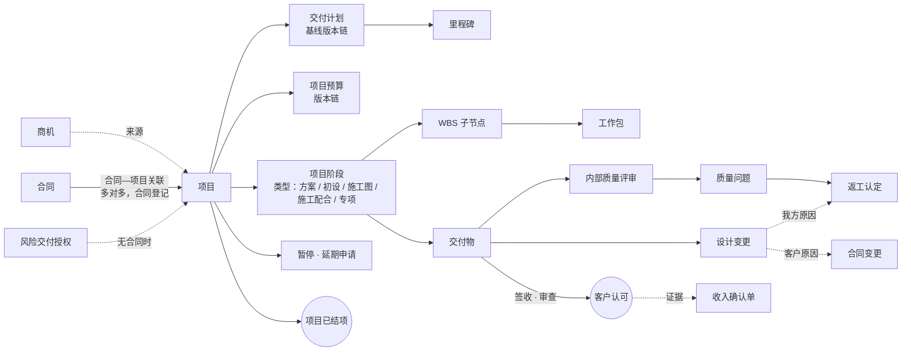
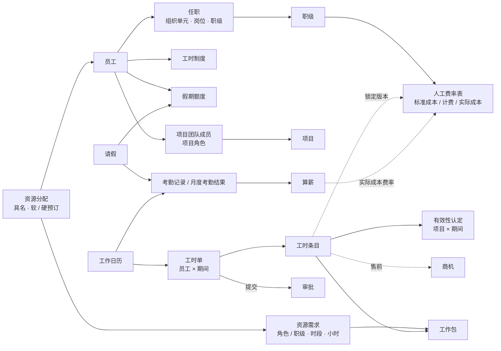

# AEC 项目制专业服务公司的业务对象：交付、资源与工时

状态：历史记录｜2026-10-15｜负责：one-architecture

状态：研究提议，待用户裁定 · 日期：2026-10-15 · 作者：one-architecture 子代理

依据：用户原话「生产数据只能是参考，因为我们旧系统是一个不完整的系统，必须要思考 AEC 行业项目制专业服务公司的总体情况」（intent `2026-10-15-202634`）。用户已给的业务事实：合同与项目分开、项目可先于合同建立、合同—项目多对多且关联由合同登记（intent `2026-10-15-205406`、`2026-10-15-210513`）；三套费率——标准成本费率用于签约后交付，计费费率 = 标准成本费率 × 系数、用于售前，实际成本费率用于核算（intent `2026-10-15-211139`）；费率放主数据作为候选，所有业务对象识别完毕后再统一定 BC、子域、价值流（intent `2026-10-15-211634`）；新系统自建整个 HRM、算薪迁入（ADR-0021）；总账进新系统（ADR-0022）；收入确认口径为「产出法 · 客户价值确认」（ADR-0016 决定 4、ACC-R01）。格式、判据与来源缩写沿用 `AEC_BUSINESS_OBJECTS.md`（下称「售前段研究」）。

## 0. 来源与缩写

按权威性排序。凡标「未核实」的，不作硬依据。售前段研究已列的缩写（〔CAS14〕〔GF0209〕〔RIBA〕〔AIA〕〔FIDIC〕〔BIZ〕〔G211〕〔VP-DD〕〔VP-H〕〔SPI〕〔词表〕）含义不变，下表只列本段新增或本次重新取得的。

| 缩写 | 来源 | 本次怎么取得 |
|---|---|---|
| 〔CAS14〕 | 《企业会计准则第 14 号——收入》（财会〔2017〕22 号），财政部会计司页 https://kjs.mof.gov.cn/zt/kjzzss/kuaijizhunzeshishi/201709/t20170907_2694006.htm | 联网重读第十一、十二、二十六、二十八条原文 |
| 〔勘设条例〕 | 《建设工程勘察设计管理条例》，2015 年 6 月国务院令第 662 号修订文本（生态环境部转载 https://www.mee.gov.cn/zcwj/gwywj/202001/t20200114_759321.shtml ） | 联网读取第二十六、二十八、三十条；2017 年后是否再修订且改动这三条：**未核实** |
| 〔质量条例〕 | 《建设工程质量管理条例》（国务院令第 279 号；国务院公报 2019 年刊载修订本 https://www.gov.cn/gongbao/content/2019/content_5468867.htm ；上海市住建委转载） | 检索摘要核对第二十三、二十四条；此后修订是否改动：**未核实** |
| 〔深度〕 | 住建部《建筑工程设计文件编制深度规定（2016 年版）》（地方政府转载文本） | 检索摘要：分方案、初步、施工图三阶段，新增幕墙、基坑支护、建筑智能化等专项设计；发文号与是否有更新版本：**未核实** |
| 〔GF0209〕 | GF-2015-0209 全文（地方转载 PDF，售前段研究已下载） | 本地重读 1.1.2.6、1.1.3.2–1.1.3.6、1.1.4、3.2–3.3、5.4、6.1–6.5、7、8、9、10.1、10.2、11 |
| 〔RIBA〕 | RIBA Plan of Work 2020 Overview 官方 PDF https://www.riba.org/media/syneeeto/2020ribaplanofworkoverviewpdf.pdf | 本次下载并抽取全文（146 页）：阶段 0–7、Stage Boundaries、客户每阶段末签认 Stage Report、Information Exchanges、Responsibility Matrix |
| 〔AIA〕 | AIA B101–2017 官方摘要（售前段研究）；按阶段百分比计酬的说明见 AIA 文章 https://www.aia.org/resource-center/calculating-architects-fee-there-better-way | 只读到摘要与二手说明；B101 第 11.5 款各阶段百分比为当事人填写，常见分配（15/20/40/5/20）只见于第三方备考资料，**未核实** |
| 〔劳动法〕 | 《中华人民共和国劳动法》第四十一、四十四条（最高人民法院官网案例转引 https://www.court.gov.cn/zixun/xiangqing/319151.html ） | 检索摘要；全国人大网原文未直接打开 |
| 〔年休假〕 | 《职工带薪年休假条例》（国务院令第 514 号）第三条 | 检索摘要（上海市人社局 PDF 等转载一致） |
| 〔工资支付〕 | 《工资支付暂行规定》（劳部发〔1994〕489 号）第六条（深圳市政府公报转载 https://www.sz.gov.cn/zfgb/2002/gb298/content/post_4969442.html ） | 检索摘要 |
| 〔折算〕 | 人社部 2025 年 1 月 1 日关于职工全年月平均工作时间和工资折算的通知（废止劳社部发〔2008〕3 号）；香港贸易署转载 https://www.tid.gov.hk/en/tradecircular/files/2025/ci202534a.pdf | 检索摘要：法定节假日 13 天、年工作日 248 天、月工作日 20.67 天、月计薪天数仍为 21.75 天；新通知文号：**未核实** |
| 〔BIZ〕 | BIZBOK v11 本地文本 | §2.5（对象判据，页 185–203）；8.6 图 8.6.2 通用能力定义（页 652–653：Human Resource、Initiative、Job、Time、Work、Competency Management）；8.1 图 8.1.9 与 8.7 图 8.7.8 两张行业信息图中的通用概念定义（页 586–590、687–688：Initiative、Plan、Human Resource、Job、Competency、Work、Work Item、Schedule、Time、Event） |
| 〔VP-DD〕〔VP-H〕 | Deltek Vantagepoint 2026.4 数据字典与帮助镜像（本地） | 本次由子代理解析 1,352 张表全部列，检索帮助页；表名、列名见正文 |
| 〔SPI〕 | SPI Research《2023 Professional Services Maturity Benchmark》本地 PDF | Service Execution 支柱（页 143–166）、Resource Management Processes（页 149 起） |
| 〔规则〕 | 仓库 `BUSINESS_RULES.md`（老系统代码抽取的规则卡） | 本地；**只作参考**，标明是老系统行为 |
| 〔OA〕 | 仓库 `OA_PROCESS_INVENTORY.md`（A8 模板盘点、180 天计数） | 本地；只作参考 |
| 〔事实〕 | 用户事实（上文所列 intent） | — |

产品证据（Deltek、SPI）只说明「行业成熟产品这样建模」，不是权威；与法规、合同范本、准则冲突时以后者为准。老系统与 A8 的计数只作核对。

## 1. 汇总表

「现状」列：✅ 已有且分类合适；⚠️ 已有但分类、定义或归属需调整；❌ 缺失。

### 1.1 交付

| 对象 | 一句话定义 | 关键状态 | 主要关系 | 来源 | terms.yaml 现状 |
|---|---|---|---|---|---|
| 项目 Project | 为一份或多份合同（或签约前的先行投入）组织的交付单元，是工时、成本、计划的归集坐标 | 已立项 → 执行中 ⇄ 已暂停 → 收尾中 → 已结项；可取消（未投入时） | N 项目 ↔ N 合同（关联由合同登记）；1 项目 → 1 棵 WBS；1 项目 → 0..N 来源商机；1 项目 → 1 项目负责人、1 承担部门 | 〔事实〕；〔GF0209〕1.1.2.6（项目负责人）、6.4（暂停设计）；〔VP-DD〕`PR.Status`（A/I/D）、`CFGProjectStatusData`（含 C 收尾）、`PR.CloseDate`、`ClosedReason`；〔OA〕项目立项申请（180 天 213 单）、项目结项申请（177 单） | ⚠️ `project` 定义只有「交付执行的项目聚合（词表未收录，补入）」，无状态与规则 |
| 设计阶段 Design Stage（阶段类型 + 项目阶段） | 按设计深度划分的工作段：方案、初步设计、施工图、施工配合，及专项设计；阶段类型是公司主数据，项目阶段是项目 WBS 第一层的实例 | 未开始 → 进行中 → 成果已提交 → 已认可（客户签认 / 审查同意 / 视为同意）→ 已完成；可暂停 | 1 项目 → N 项目阶段；1 项目阶段 → 1 阶段类型；1 项目阶段 → N 交付物；合同付款条件项 ↔ 项目阶段（见 §2.3） | 〔勘设条例〕第二十六条；〔GF0209〕协议书「工程设计阶段」、1.1.3.2、6.1.1、6.2（各阶段开始时间）；〔深度〕；〔RIBA〕阶段 0–7；〔AIA〕五阶段；〔VP-H〕`wbs_wbs_components_overview`（WBS2 默认叫 Phase，无标准阶段表） | ❌ 只有 `wbs_node`；无阶段、阶段类型 |
| WBS 节点 WBS Node | 项目工作分解结构的一个节点（阶段、子项、专业） | 有效 / 已作废（被修订淘汰，保留历史） | 项目的组成部分；可挂接合同范围条目（0..1） | 〔VP-DD〕`PR` WBS1/2/3；〔规则〕RULE-216、229（作废节点须确认） | ⚠️ 定义写「节点必须挂接合同范围条目或已批准变更」，与「项目可先于合同建立」冲突 |
| 工作包 Work Package | WBS 末级的可分派、可记工时、可估算的工作单元 | 进行中 → 已完成 → 已锁定（随交付物提交）→ 返工中；已完成可重开 | N 工作包 → 1 WBS 节点；1 工作包 → 0..N 资源分配；工时 → 工作包 | 〔规则〕RULE-223、207；〔VP-DD〕`RPTask`；PMBOK（词表 naming_priority） | ⚠️ `work_package` 与 `delivery_package` 定义逐字相同（「WBS 下的工作单元分组」） |
| 交付计划 / 计划基线 Delivery Plan / Plan Baseline | 项目的进度与资源计划；客户批准或内部锁定的版本为基线 | 草拟 → （报客户）已批准 / 内部锁定 → 被修订版取代 | 1 项目 → N 计划版本，同时只有 1 个生效基线；含里程碑、阶段起止、计划工时 | 〔GF0209〕6.1.1（进度计划经发包人批准后实施，是控制依据）、6.1.2（修订后 5 天内审核，逾期视为同意）；〔RIBA〕Project Programme；〔VP-DD〕`RPPlan.PlanType`（S 情景 / L 实时 / B 基线）、`Baseline*` 列 | ✅ `delivery_plan`、`plan_baseline` |
| 里程碑 Milestone | 计划中的关键控制节点（如阶段成果提交日、审查会） | 计划 → 已达成 / 已延误 | 计划的组成部分；可被付款条件项引用 | 〔GF0209〕6.1.1（关键性控制节点）；〔VP-DD〕`PRMilestone`、`CFGProjectMilestoneData` | ✅ `milestone`（应注明是计划的组成部分，不是独立聚合，见 §4） |
| 交付物 Deliverable | 交给客户的设计文件（图纸、说明、计算书、模型等），是阶段成果的载体 | 编制中 → 内审中 → 已交付（客户签收）→ 审查中 → 已认可 / 退回修改（重新提交、审查期重起算）/ 视为同意（逾期无结论）；可作废 | N 交付物 → 1 项目阶段；1 交付物 → N 次提交（每轮一条记录）；证据：签收单、审查意见 | 〔GF0209〕1.1.3.6、7.1–7.3（书面签收单内容）、8.1（审查期不超过 15 天、退回重起算、逾期视为同意）、8.3（政府审查）；〔规则〕RULE-207、225、226、236（老系统：内审 → 评审 → 待客户验收 → 已验收） | ✅ `deliverable`；签收、审查意见未建模 |
| 内部质量评审 Internal Design Review | 我方对设计成果的内审（阶段评审、成果内审、PMO 评分） | 待评审 → 通过 / 不通过（整改后复审） | 交付物提交的前置步骤；产生质量问题 | 〔GF0209〕5.3（文件深度、质量要求）；〔OA〕项目成果内审（180 天 233 单）、项目阶段评审（45 单）；〔规则〕RULE-217、234、235 | ⚠️ 只有度量 `internal_review_coverage` |
| 质量问题 Quality Issue | 设计文件中的缺陷或不符合项，含客户、审图机构、施工现场反馈 | 识别 → 确认 → 处置（返工 / 让步接受）→ 关闭；阻断性问题未关闭则阻断认可 | N 质量问题 → 1 交付物或项目；→ 0..1 返工认定 | 〔GF0209〕5.4（不合格文件按责任方补救）、8.6；〔质量条例〕第二十四条（参与质量事故分析、提出技术处理方案） | ✅ `quality_issue`、`blocking_quality_issue` |
| 返工认定 Rework Recognition | 对返工事实的认定：原因分类 + 责任归因 | 草拟 → 已认定；可撤销（冲销） | 1 质量问题 → 0..1 返工认定；→ 返工工时（工时类别） | 〔GF0209〕5.4.1 / 5.4.2（设计人原因自担、发包人原因由发包人承担费用与工期）；〔规则〕RULE-215、230 | ✅ `rework_recognition`、`rework_reason_category`、`responsibility_attribution` |
| 设计变更 Design Change（技术意义） | 对已交付或已认可设计文件内容的修改，无论起因（客户要求、审查意见、法规标准变化、现场问题、我方差错） | 提出 → 原因认定与影响评估 → 编制 → 内审 → 发出（变更通知单 / 修改图）→ 关闭 | N 设计变更 → 1 项目（及受影响交付物）；客户原因且增加工作量 → 引发 0..1 合同变更；我方原因 → 0..1 返工认定 | 〔勘设条例〕第二十八条（只能由原设计单位修改；重大修改须报原审批机关）；〔GF0209〕11.1–11.5（发包人变更须书面要求，增加工作量应增付设计费；11.4 基准日后法规变化由发包人承担；11.5 设计人 5 天内书面通知）、8.2–8.3；〔VP-DD〕无对应对象 | ❌ 词表只有合同侧 `change_order`、`site_visa`、`scope_creep_identified` |
| 暂停与延期 Suspension / Extension of Time | 项目或阶段的暂停（含原因与复工）、因发包人原因的工期顺延申请 | 暂停：已暂停 → 已复工；延期申请：已通知 → 已提交详细说明 → 已批准 / 已拒绝 / 视为批准 | 暂停是项目（或阶段）的状态，带原因归属；延期申请依附项目，结果改计划基线 | 〔GF0209〕6.3.1（5 天书面通知、10 天详细说明、发包人 5 天答复，逾期视为批准）、6.4（暂停与复工，发包人原因增加的费用由发包人承担） | ❌ |
| 施工配合服务 Construction-Stage Service | 施工阶段的技术交底、解决施工中设计问题、参加竣工验收；合同约定时限外另行计费 | 随施工配合阶段：进行中 → 时限届满 → 已结束；时限外服务单独登记 | 是一种阶段类型；时限外服务 → 0..1 合同变更或后期服务单 | 〔勘设条例〕第三十条；〔质量条例〕第二十三条；〔GF0209〕1.1.3.2、9.2；〔RIBA〕Stage 5「除回应现场问题外无设计工作」 | ⚠️ `post_completion_service_order`（后期服务单，归属待 Q21）只覆盖质保期 |
| 项目预算 Project Budget | 项目（按 WBS）的成本预算：计划工时 × 标准成本费率 + 非人工成本类别 | 编制中 → 审批中 → 已锁定（成为成本基线）→ 修订中 → 已锁定（新版） | 1 项目 → N 预算版本、1 个生效；依据报价（售前测算）；与项目交付计划同步 | 〔规则〕RULE-181、219、221、227、239、244、246（老系统：预算毛利低于报价毛利时须 CEO 审批；锁定时冻结角色费率）；〔VP-DD〕`RPPlan.CompensationFee`、`BudgetType`、`PR.BudgetedFlag`；〔OA〕项目预算编制（193 单）、变更（91 单） | ✅ `project_budget`；`cost_budget` 是度量 |
| 客户认可（成果认可）Client Acceptance | 客户对阶段成果或交付物的书面认可，是收入确认（客户价值确认）的证据 | 事件 + 证据，不是独立对象 | 交付物 / 项目阶段 → 认可事件 → 收入确认单引用 | 〔GF0209〕7.2、8.1；〔RIBA〕「客户每阶段末签认 Stage Report」；〔CAS14〕第十二条；ACC-R01 | ⚠️ `acceptance_record`（document）、`milestone_accepted`（event）在 `delivery.acceptance`，但老系统验收与收入确认已脱钩（RULE-236 疑似缺陷） |
| 项目结项 Project Close-out | 交付结束、不再归集成本的事实及其前置检查 | 事件（「项目已结项」）+ 结项检查单；项目状态的终态 | 结项检查引用：工时已审批、收入确认已完成或已有结论、分包已结算等 | 〔OA〕项目结项申请（「关闭后不得再归集成本，不等于财务结清」）；〔VP-DD〕`PR.CloseDate`、`ClosedReason`；Deltek Closeout 工具删除原项目（〔VP-H〕`ut_project_closeout_overview`，不适用） | ❌（OA 盘点已列为需新增词条） |

### 1.2 资源与工时

| 对象 | 一句话定义 | 关键状态 | 主要关系 | 来源 | terms.yaml 现状 |
|---|---|---|---|---|---|
| 员工 Employee | 与公司有劳动或劳务关系的个人 | 待入职 → 在职（试用 / 正式）→ 离职 | 1 员工 → N 任职；→ 职级、工时制度；→ 假期额度 | 〔BIZ〕Human Resource（状态 Former / Current / Future）；〔VP-DD〕`EMCompany.Status`（A/I/T） | ✅ `employee`、`employment_status` |
| 任职 Assignment | 员工在某组织单元、某岗位、某职级上的一段任职（含汇报线） | 生效期间不重叠的版本 | N 任职 → 1 员工；→ 组织单元、岗位、职级 | 〔规则〕RULE-007（费率按工作日当日的任职记录取） | ✅ `workforce__assignment` |
| 岗位 Position / Job | 一组职责的命名类别（如结构设计师、项目经理），可配职级区间 | 启用 → 停用 | N 任职 → 1 岗位；项目角色可要求岗位 | 〔BIZ〕Job（Primary，状态 Open / Closed）；〔VP-DD〕`JobTitles`；〔事实〕公司要重新梳理岗位体系（ADR-0029 暂缓） | ⚠️ `position` 标 `kind: value`，按 BIZBOK 是有状态的一级概念 |
| 职级 Job Grade | 员工能力与薪酬档位（T1–T7），是成本费率与计费费率的主键之一 | 无独立生命周期（主数据取值，版本化） | 任职 → 职级；费率表行 → 职级 | 〔词表〕；〔VP-DD〕`BTLaborCatsData`（Labor Category，计费类别）、`EMCompany.BillingCategory` | ✅ `job_grade` |
| 人工费率表 Labour Rate Table（三套） | 按职级（等）给出每小时或每日人工单价的版本化表：标准成本费率、计费费率（= 标准成本费率 × 系数）、实际成本费率 | 草拟 → 已确认生效（生效期不重叠）→ 已失效；被引用后不可改 | 费率表 → N 费率行（键：职级等）；工时、预算、报价记所用版本 | 〔事实〕三套费率；〔规则〕RULE-007、031、058、245（老系统键 = 职级 + 薪档 + 城市类别；提交时锁定）；〔VP-DD〕`BTRCT` / `BTRCTCats`（按类别计费率表）、`BTRRT`（按员工）、`EMCompany.CostRateTableNo` | ⚠️ `standard_cost_rate_card`、`rate_card_version` 在 `cost.costing`；`rate_card` / `bill_rate_card` / `rate_card_item` 在 `contract.baseline`；计费费率、实际成本费率已登记用语问题待 one-glossary |
| 项目团队成员 Project Team Member（项目角色） | 员工在某项目上承担的角色（项目负责人、专业负责人、设计、校对、审核、审定等）及期间 | 拟派 → 在岗 → 已撤出 | N 成员 → 1 项目；→ 1 员工；→ 1 项目角色类型；关键角色更换须通知或经客户同意 | 〔GF0209〕3.2（项目负责人更换须事先书面通知并经发包人同意，以专用条款为准）、3.3（主要设计人员相对稳定）；〔RIBA〕Responsibility Matrix；〔VP-DD〕`EMProjectAssoc`（Role、TeamStatus Active / Proposed、StartDate、EndDate）、`CFGEmployeeRoleData` | ❌ |
| 资源需求 Resource Demand | 项目在某时段需要某角色 / 职级 / 专业的工时量（可未指定到人） | 草拟 → 已提出 → 部分满足 / 已满足 / 已取消 | N 需求 → 1 工作包或项目阶段；1 需求 → 0..N 资源分配 | 〔VP-DD〕`RPAssignment.GenericResourceID`（通用资源）、`RPPlan.GRMethod`；〔SPI〕资源管理五种策略（集中、本地、按客户、按专业、卓越中心） | ❌ |
| 资源分配 Resource Allocation（排程） | 把具名员工按时段分配到工作包，含计划小时与预订强度 | 软预订 → 硬预订 → 已释放；有工时后人员固定 | N 分配 → 1 员工；N 分配 → 1 工作包；按期间分摊小时 | 〔VP-DD〕`RPAssignment`、`RPPlannedLabor.HardBooked`、周期分摊列；〔规则〕RULE-014–019、059、206（老系统：忙闲度 = 分派工时 ÷（工作日 × 7.5）；记过工时后不能换人） | ❌（只有属性 `planned_hours`） |
| 工时（条目）Time Entry | 员工在某工作日对某工作对象（工作包 / 商机 / 间接事项）投入的小时 | 随工时单：草稿 → 已提交 → 已审批 / 已退回 → 已过账；更正走冲销 / 修正单 | N 工时 → 1 工时单；→ 1 工作坐标（项目 + WBS，或商机，或间接事项）；→ 锁定的费率版本 | 〔VP-DD〕`tkDetail`（TransDate、WBS1/2/3、RegHrs、OvtHrs、LineItemApprovalStatus）、`LD`（过账后）；〔规则〕RULE-021、027–031；〔SPI〕time and expense capture | ✅ `time_entry`、`work_date`、`time_entry_category` |
| 工时单 Timesheet | 员工 × 填报期间的工时集合，是提交、审批、锁定的单位 | 草稿 → 已提交 → 审批中 → 已通过 / 已退回 / 已撤回 → 已过账；关期后只能冲销 | 1 员工 × 1 期间 → 1 工时单（老系统按日一张）；1 工时单 → N 工时 | 〔VP-DD〕`tkMaster`（EndDate、Submitted）、`tkControl`（周期起止、Closed）；〔VP-H〕`ac_timesheets_grid`（Missing / In Progress / Submitted / Approved / Rejected / Posted）；〔规则〕RULE-025、048 | ⚠️ `timesheet` 标 `kind: document`，实为有状态的聚合（与售前段 `quote` 同类问题） |
| 工时有效性认定 Effectiveness Assessment | 项目 × 期间对已审批工时的批量认定：有效 / 无效 / 返工 / 可计费 | 草拟 → 已认定（封期锁定）；更正走期间调整 | 1 项目 × 1 期间 → 1 认定；→ 认定证据（交付事实引用） | 〔词表〕（数量守恒：四类之和 = 填报总数）；Deltek 用 `LD.BillStatus` 与计费改写，不另设认定对象 | ✅ `effectiveness_assessment`、`validation_evidence` |
| 工作日历 Work Calendar | 按年维护的节假日、调休上班日；默认一份，预留法人专属 | 年度：未维护 → 已维护；过去日期锁定 | 工时最低时数、审批时限、可用产能都引用它 | 〔折算〕（2025 起法定节假日 13 天）；〔VP-DD〕`CFGHoliday`；用户 2026-10-14 | ✅ `work_calendar` 等 |
| 工时制度 Working-Time Arrangement | 员工适用的工作时间制度：标准工时、综合计算工时、不定时 | 随任职版本化；综合 / 不定时须经劳动行政部门批准（未核实细节） | 员工 → 1 工时制度；决定加班判定与日标准工时 | 〔劳动法〕第四十一条（延长工作时间每月不超过 36 小时）、第四十四条（150% / 200% / 300%）；〔VP-DD〕`EMCompany.HoursPerDay` | ❌ |
| 请假 Leave Request | 员工申请在某些日期或时段不出勤 | 草稿 → 审批中 → 已批准 / 已驳回 → 已销假 / 已撤销 | N 请假 → 1 员工；→ 假期类型；扣减假期额度；影响工时最低时数与考勤结果 | 〔年休假〕第三条；〔VP-DD〕`AbsenceRequests`、`AbsenceRequestsHours`；〔OA〕年假申请（180 天 1,027 单）、日常请假（804）、特殊假别（212）、销假（16）；〔规则〕RULE-024、034、062 | ❌ |
| 假期额度 Leave Entitlement / Balance | 员工某假期类型在某年度的应享、已用、结转额度 | 按年度：已核定 → 使用中 → 已清零 / 已结转 | N 额度 → 1 员工 × 假期类型 × 年度；请假扣减 | 〔年休假〕第三条（累计工作满 1 年不满 10 年 5 天、满 10 年不满 20 年 10 天、满 20 年 15 天）；〔VP-DD〕`EMAccrual`（HoursPerYear、CarryoverLimit、Maximum）、`EMAccrualDetail`、`CFGAccrualScheduleDetail`；〔OA〕年假延期申请（已停用） | ❌ |
| 考勤记录与月度考勤结果 Attendance Record / Monthly Attendance | 打卡、外勤、补卡等出勤原始记录，及按月汇总、经员工确认的出勤结果（算薪输入） | 原始记录只追加；月度结果：生成 → 员工确认 → 锁定（交算薪） | 原始记录 → 员工 × 日；月度结果 → 员工 × 月；引用请假、工作日历 | 〔工资支付〕第六条（工资支付记录保存两年以上；考勤记录保存期见地方规定，未核实）；〔OA〕A8 原始打卡档案 794,221 行、外勤申请（3,476 单）、补卡（755）、月度考勤确认表（12 单） | ❌（BC `organization.attendance` 已建，只有工作日历） |
| 加班 Overtime | 超出标准工时的工作及其补偿方式（加班费或调休） | 申请 → 批准 → 已补偿（付薪 / 调休） | 依附员工 × 日；可与工时条目对应（工时记的是投入，加班记的是劳动法意义的时间） | 〔劳动法〕第四十一、四十四条；〔VP-DD〕`tkDetail.OvtHrs`、`SpecialOvtHrs`（美国式，不直接适用）；〔规则〕RULE-037（老系统每日申报上限 15 小时） | ❌ |

## 2. 交付段详述

### 2.1 总体结构

行业证据的一致点与分歧：
- **项目与合同分开**。Deltek 的合同（`Contracts`）挂在项目（WBS1）上，一个项目可有多份合同（原合同、变更、附加服务），合同金额按 WBS2/3 分摊（`ContractDetails`）；合同—项目多对多在 Deltek 中未查到（〔VP-DD〕）。用户已定多对多、由合同登记关联，比 Deltek 更宽。
- **阶段是 WBS 的第一层，但 Deltek 没有标准阶段代码表**：阶段由每个项目或项目模板自建（〔VP-H〕`cf_project_templates_setup_overview`、`wbs_wbs_components_overview`）。中国设计行业的阶段有法规定义（〔勘设条例〕第二十六条），适合做成公司主数据「阶段类型」。
- **交付物在 Deltek 里不是对象**（只是 WBS3 的备选标签），验收也没有专门记录（〔VP-DD〕）；中国设计合同把签收、审查、视为同意写成了条款（〔GF0209〕第 7、8 条），新系统需要独立对象。这是北美产品与中国语境的第二个结构性差异（第一个是售前段的投标）。
- **Deltek 的收入方法以工时与开票为主**（B 累计开票、M 人工 × 系数、P 完工百分比 × 费用等，〔VP-H〕`cf_standard_revenue_methods`），与 ACC-R01「凭客户价值确认」不同；Deltek 的完工百分比可在项目、阶段、任务每层录入（`PR.PctComp`、`BTF.PctComplete`），说明「按阶段计量进度」是行业通行做法。

### 2.2 项目 Project

- **定义**：为履行一份或多份合同（或经授权的签约前投入）而组织的交付单元；是工时、费用、分包成本、计划与预算的归集坐标（`ProjectCoordinate`，ADR-0016 决定 8）。
- **状态机（提议）**：已立项 → 执行中 ⇄ 已暂停（原因必填：发包人原因 / 我方原因 / 其他，〔GF0209〕6.4）→ 收尾中 → 已结项；「已立项」且无任何工时、费用时可取消。已结项后可否重开见 §6 问题 6。
- **类型**：业务线（幕墙、照明、景观、第三方评估、项目管理，词表 `business_line`）；工时类别的「项目 / 售前 / 间接」由归集对象决定，不是项目类型——售前投入记在商机上（用户已定），间接工时记在间接事项上，不再像 Deltek 那样用 ChargeType = P / H 的「伪项目」承接（〔VP-DD〕`PR.ChargeType`）。
- **关系**：N 项目 ↔ N 合同（关联由合同登记，〔事实〕）；0..N 来源商机；1 项目负责人（〔GF0209〕1.1.2.6、3.2）；1 承担部门（交付单元，词表 `delivery_unit`）；1 承担法人。
- **规则（违反即拒绝）**：
  - 已结项、已取消的项目不得新记工时、费用、分包成本（〔OA〕项目结项申请说明「关闭后不得再归集成本」）；
  - 已暂停期间是否禁止记工时：未定（§6 问题 5）；
  - 无生效合同关联的项目记工时，须有有效的风险交付授权——用户已定「风险交付登记 + 度量 + 预警」，即**只预警不拒绝**（intent `2026-10-15-205406`）。
- **负责人**：项目负责人（项目经理）；立项审批由交付部门负责人等（流程梳理时定）。
- **中国语境**：GF-2015-0209 中「项目负责人」是合同概念，由设计人任命、在专用条款中写明，更换须事先书面通知并经发包人同意（〔GF0209〕3.2.1–3.2.2）——项目负责人既是内部角色，也是对客承诺。
- **老系统参照**：项目档案在 A8，老系统镜像；立项早于合同回签的占约 90%（`PRESALES_OBJECTS_EVIDENCE.md`）——印证「项目可先于合同建立」。

### 2.3 设计阶段：阶段类型与项目阶段

- **为什么是一级关注点**：在设计咨询中，阶段同时是三件事的单位——设计深度（法规）、进度计划（合同 6.1.1「明确约定各阶段设计任务的完成时间区间」）、价款与付款（付款条件常按阶段成果）。
- **法规与范本的阶段**：
  - 〔勘设条例〕第二十六条：方案设计（满足初步设计与控制概算）→ 初步设计（满足施工招标、主要设备材料订货、施工图设计）→ 施工图设计（满足采购、非标设备制作和施工，注明合理使用年限）；
  - 〔GF0209〕1.1.3.2：基本服务 = 方案、初步设计（含概算）、施工图设计文件 + 技术交底、解决施工中的设计问题、参加竣工验收；1.1.3.3：其他服务（总体设计、主体设计协调、施工图预算、竣工图编制等）另行计费；
  - 〔深度〕2016 年版新增幕墙、基坑支护、建筑智能化等**专项设计**深度——公司主营的幕墙、照明、景观设计属于专项设计，其阶段常为「方案 → 深化 / 施工图 → 施工配合」，老系统的 INITIAL / DEEPEN 两类评审与「深化阶段」（〔规则〕RULE-217、238）正是这一现实的影子；
  - 〔RIBA〕0 战略定义、1 准备与任务书、2 概念设计、3 空间协调、4 技术设计、5 制造与施工、6 移交、7 使用；「项目一般覆盖 1–6」「0–4 依次进行，4 与 5 重叠」「客户在每阶段末签认 Stage Report」「阶段末的信息交换是下一阶段的基础」（Template 页，约页 38；Information Exchanges 节）；
  - 〔AIA〕方案设计、扩初设计、施工文件、采购、施工五阶段，按阶段百分比计酬（当事人填写）。
- **建模建议**：
  - **阶段类型**（主数据，版本化）：名称、对应国标阶段、对应 RIBA 阶段（便于海外项目与对标）、是否基本服务、默认交付物清单、评审要求（老系统 INITIAL 需会议时间，DEEPEN 需评审文件、需求评审日期、图纸类别、是否含施工图审查——RULE-217）；
  - **项目阶段**：项目 WBS 第一层节点，引用一个阶段类型，带计划起止、实际开始（〔GF0209〕6.2：各阶段开始时间以发包人书面开始设计通知所载日期起算）、状态（未开始 → 进行中 → 成果已提交 → 已认可 → 已完成；可暂停）；
  - 项目阶段**不是**合同付款条件项：两者常一一对应，但也会出现一个阶段对应多期付款（如施工配合按月）或多个阶段合并付款，需要显式的对应关系（§6 问题 2）。
- **对象判据**：阶段类型是对象类型（type），项目阶段是有自己状态的次级对象（依附项目）。

### 2.4 交付物与客户认可

- **定义**：设计人按合同约定交给发包人的阶段性或最终成果，采用约定载体（〔GF0209〕1.1.3.6）。
- **交付与签收**：发包人应出具书面签收单，载明图纸名称、内容、形式、份数、提交与签收日期、双方亲笔签名（〔GF0209〕7.2）——签收单是单据，「已交付」是事件。
- **审查**：设计文件报发包人审查同意；审查期不超过 15 天（专用条款可另约）；不同意须书面说明，设计人修改后重新报送、审查期重新起算；**期满无结论也无异议视为同意**（〔GF0209〕8.1）。需政府审查的，由发包人报送，设计人协助（8.3）。审查不减轻设计人法定责任（8.7）。
- **状态机（提议）**：编制中 → 内审中（不通过回编制）→ 已交付（签收）→ 审查中 → 已认可 | 退回修改（回编制，提交轮次 +1）| 视为同意（审查期满无结论，系统按约定期限判定，人工确认）；作废（范围取消或被新版本取代）。
- **与老系统对照**：老系统「提交」记录有 DRAFT → INTERNAL → EVAL → ACCEPTING → ACCEPTED，同一交付物同时只有一个在途提交（RULE-226）；登记客户验收须签字日期不晚于当天、且同时有验收文件和邮件确认（RULE-236）。老系统的收入确认**已不要求**交付物已验收（RULE-236 标注的疑似缺陷），即「交付认可」与「收入确认」两条线脱钩。
- **与收入确认的关系（本段最重要的交接）**：
  - ACC-R01 规定收到客户价值确认是确认收入的唯一触发点（ADR-0016 决定 4）；〔CAS14〕第十二条：产出法是「根据已转移给客户的商品对于客户的价值确定履约进度」。
  - 对设计咨询，「客户价值确认」最自然的证据正是 GF-2015-0209 第 7、8 条产生的签收单、审查同意书面意见、（视为同意时的）审查期届满记录，以及阶段末客户签认（〔RIBA〕Stage Report sign-off）。
  - 建议：**客户认可是事件，不另建对象**；收入确认单（`revenue_recognition`，在 `receivables.wip`）引用一个或多个「交付物已认可 / 项目阶段已认可」事件作为证据，而不是只上传附件。是否允许「视为同意」作为收入证据、预付款条款（PREPAY）免交付证据是否继续，属财务口径（§6 问题 3）。
  - 是否「时段履约」：设计成果按发包人要求定制、具有不可替代用途，若合同约定发包人解约时须支付已完成部分的合理对价，可能满足〔CAS14〕第十一条第（三）项；ACC-R01 已选产出法，此处只提示「一个阶段是否就是一项履约义务」须财务判定（〔CAS14〕第九条）。

### 2.5 交付计划、里程碑与计划基线

- **两种计划不要混**：
  - **对客进度计划**：〔GF0209〕6.1.1 要求设计人提交、经发包人批准后实施，是控制依据，发包人按关键控制节点检查；6.1.2 修订后发包人 5 天内审核，逾期视为同意——它有「客户批准」状态，是合同性质的计划；
  - **内部资源计划**：按工作包、人、周期分摊小时（资源分配，见 §3.4），频繁调整，不需要客户批准。
- Deltek 用同一个计划对象区分实时计划、情景、基线三类（`RPPlan.PlanType`），基线是「Save Baseline」时把计划值复制进 `Baseline*` 列的快照，**没有多版本号**（〔VP-DD〕）。词表已有 `delivery_plan`（版本化计划）与 `plan_baseline`（不可变版本），比 Deltek 更严格，符合 ADR-0016「只追加」精神。
- **里程碑**：计划的组成部分（〔BIZ〕Schedule 定义为「时间、日期与里程碑的集合」，次级概念）。付款条件项（合同侧）可以引用某个里程碑或项目阶段，但「付款里程碑」属于合同，「进度里程碑」属于计划，不应合为一个对象。
- **规则**：同一项目同时只有一个生效基线；修订须写原因（词表 `plan_baseline`「修订须依据」）；因发包人原因的延期获批（§2.8）自动成为修订依据。

### 2.6 项目预算

- **定义**：项目按 WBS 的成本预算 = 计划工时 × 标准成本费率 + 外包、差旅、信息服务等非人工类别（老系统 RULE-181 的结构合理，可作参照）。
- **与三套费率的关系（〔事实〕）**：预算用**标准成本费率**；报价用**计费费率**（= 标准成本费率 × 系数）；核算用**实际成本费率**。老系统还以「预算毛利低于报价毛利」触发 CEO 审批（RULE-239、244），以「赢单报价」作为预算基线来源（RULE-246）——这是售前与交付的交接点，具体口径在流程梳理时由用户定。
- **状态**：编制中 → 审批中 → 已锁定（成本基线生效）→ 修订中 → 已锁定（新版本）；锁定时冻结所用费率版本（RULE-219）。
- **分类注意**：词表把 `project_budget` 归 `delivery.execution`，`cost_budget` / `cost_budget_variance` 是 `cost.costing` 的度量，`budget_baseline` 等在 `operations.budgeting`（经营预算）——三者是不同概念，词表已区分，信息图上保持分开。

### 2.7 质量问题、返工与设计变更

- **内部质量评审**：设计院普遍的校审制度（设计 → 校对 → 审核 → 审定）在法规层面体现为设计文件须满足深度与强制性标准（〔GF0209〕5.3；〔勘设条例〕第二十六条），具体签署层级：**未核实**（〔深度〕是否规定签署栏未读到）。老系统与 A8 有「项目成果内审」「项目阶段评审」及 PMO 三项评分（RULE-235）。建议内审是交付物提交前的一个**评审记录**（次级对象：评审人、结论、评分、问题清单），其不通过项生成质量问题。
- **质量问题与返工**：词表已有完整链条（质量问题 → 处置：返工 / 让步接受 → 返工认定：原因分类 + 责任归因），与〔GF0209〕5.4 的「按责任方承担」一致：设计人原因不合格自担补救并承担违约责任，发包人原因不合格由发包人承担增加的费用和工期。
- **设计变更（技术意义）是缺失的对象**：
  - 法规：设计文件只能由原设计单位修改；经原设计单位书面同意可委托其他有资质单位修改；施工、监理发现不符合强制性标准须报建设单位，由其要求设计单位补充修改；重大修改须报原审批机关批准（〔勘设条例〕第二十八条）。
  - 合同：发包人变更内容、规模、功能、条件须提供书面要求；增加工作量的应按所耗工作量增付设计费，可协商调整价格与工期（〔GF0209〕11.1–11.2）；减少工作量的可协商下调（11.3）；基准日期后法规、强制性标准变化的费用与工期由发包人承担（11.4）；设计人认为应增加价款或工期的，事项发生后 5 天内书面通知（11.5）。审查意见超出原发包人要求的修改，也按第 11 条另行计费（8.2、8.3）。
  - **区别**：合同变更（`change_order`，在合同 BC）改的是范围、价格、工期的商业基线；设计变更改的是设计文件内容。一次设计变更可能：(a) 由客户提出且增加工作量 → 触发合同变更（或签证）；(b) 由我方差错引起 → 触发返工认定，不改合同；(c) 由法规变化引起 → 按 11.4 可主张费用与工期。词表 `scope_creep_identified`（未正式化的范围扩张）正是 (a) 没有走合同变更的情形。
  - **建议对象**：设计变更（次级对象，依附项目，引用受影响的交付物），状态：提出 → 原因认定与影响评估（归因：发包人 / 设计人 / 法规标准变化 / 第三方）→ 编制 → 内审 → 发出（变更通知单 / 修改图为单据）→ 关闭；规则：归因必填；归因为发包人且影响评估有工作量增加的，须关联一个合同变更意向（`change_order_draft`）或说明不主张的理由——后者只预警。
  - Deltek 没有技术设计变更对象（〔VP-DD〕只有合同的 Change Order 与计划的 Change Order 情景）；这是中国法规直接要求的。

### 2.8 暂停、延误与延期申请

- 〔GF0209〕6.3.1 列出发包人原因的延误（资料迟交或错误、定金预付款进度款未按期支付、影响工期的设计变更）；设计人须在 5 天内书面通知、10 天内提交详细说明，发包人 5 天内答复，**逾期未答复视为批准**；设计人未按期通知则发包人可拒绝延期。6.4 暂停设计按原因分担费用与工期；10.3.2 发包人逾期未付定金或预付款，催告 7 天后设计人有权不开始或暂停设计。
- 建议：**暂停**是项目（或阶段）的状态，带原因归属与起止；**延期申请**是依附项目的次级对象，有法定化的期限与「视为批准」规则，结果改交付计划基线、可能联动合同变更（工期）或索赔（词表 `claim`、`claim_time_bar` 已有）。归合同 BC 还是交付 BC，留到统一定 BC 时决定。

### 2.9 施工配合与后期服务

- 施工配合是法定义务（〔勘设条例〕第三十条：施工前向施工、监理单位说明设计意图、解释设计文件，及时解决施工中的设计问题；〔质量条例〕第二十三、二十四条：就审查合格的施工图作详细说明，参与质量事故分析）。
- 〔GF0209〕9.2：基本服务包含技术交底、解决施工中设计问题与竣工验收服务；**专用条款约定的现场服务时限外**仍要求的，发包人按工作量另付费。
- 建议：施工配合作为一种阶段类型，带「合同约定服务时限」；时限外的服务登记为后期服务（词表 `post_completion_service_order` 现只指质保期，建议扩展或另建），并可触发合同变更。施工配合阶段的收入证据形式（按月确认、按竣工验收）须用户定（§6 问题 2）。

### 2.10 项目结项

- 结项是**事件**（「项目已结项」）+ **结项检查**（一组前置检查的结论），项目进入终态；与竣工结算（`final_account`，确定最终交易价格）、财务结清不是一回事（〔OA〕项目结项申请说明）。
- 候选前置检查：所有工时已审批或已退回处理；所有工作包已完成或作废；收入确认已覆盖已认可成果或有结论；分包已结算或有结论；无在途设计变更、质量问题；项目资料归档。哪些拦截、哪些只预警须用户定（§6 问题 6）。
- Deltek 的结项工具把数据转入接收项目后**删除原项目**（〔VP-H〕`ut_project_closeout_overview`），不符合 ADR-0016「只追加」与会计档案要求，不采用。

## 3. 资源与工时段详述

### 3.1 总体结构

### 3.2 员工、任职、岗位、职级

- 新系统自建整个 HRM（ADR-0021；用户 2026-10-14）。〔BIZ〕把 Human Resource（员工与承包人，状态 Former / Current / Future）、Job（职责类别，状态 Open / Closed）、Competency（技能与知识）列为一级概念；8.6 通用能力中 Job Management、Competency Management 与 Human Resource Management 并列（页 652–653）。
- **岗位**：词表 `position` 标为 `value`，但按〔BIZ〕Job 定义它有状态、有关系（任职、项目角色、费率），应为实体。用户已决定「公司要重新梳理岗位体系」，ADR-0029 暂缓，设计不依赖现有岗位名称与数量——信息图上保留「岗位」对象，取值待梳理。
- **职级**：T1–T7，是费率与折扣权限的档位（词表）。老系统费率键是「职级 + 薪档 + 城市类别」三要素（RULE-007、031、245）；Deltek 按「劳务类别」（Labor Category）或按员工给费率，并允许按员工覆盖（`BTRCT`、`BTRRT`、`BTRCTEmpls`）。新系统的费率键须用户定（§6 问题 10）。
- **技能 / 资质**：中国设计行业有注册执业资格（注册建筑师、注册结构工程师等），与投标资格、施工图签章相关；本次未查法规条文，**未核实**，作为员工的组成部分（次级概念）记一笔，不展开。

### 3.3 人工费率表（三套费率）

- **用户事实**：标准成本费率用于签约后交付（预算、直接人工成本），计费费率 = 标准成本费率 × 系数用于售前报价，实际成本费率用于核算。
- **建模建议**：一个「人工费率表」概念、三种费率类型（对象类型，不是三个对象）；每个费率表按生效期版本化（D17 主数据版本化），被引用后不可改（词表 `rate_card_version`）；工时、预算、报价记所用版本 ID（老系统 RULE-058：提交时锁定，审批时按锁定费率计算）。
- **计费费率的两种来源要分开**：公司对外计费费率（售前用，标准成本 × 系数）与合同约定费率卡（`rate_card` / `bill_rate_card`，T&M 合同、战略协议价目）。后者是合同或协议价目的组成部分，前者是公司主数据——售前段已定「只定单价型战略协议为协议价目」（intent `2026-10-15-210513`）。
- **实际成本费率**：由算薪结果（职工薪酬）按期间计算，属核算口径；是否按人、按职级平均还是按部门，须用户与财务定。项目经理只能按职级标准费率看到个人行、真实成本只在项目合计层体现（INTENT.md，经 one-coordinator 转达）——这决定了实际成本费率不能下沉到工时行展示。
- **归属**：费率放主数据为候选（intent `2026-10-15-211634`），与往来单位一起在统一定 BC 时决定；售前与成本都依赖它，放在二者共同上游可避免依赖成环（PRESALES_AGGREGATES 第 3 稿）。

### 3.4 项目团队、资源需求与资源分配

- **项目团队成员（项目角色）**：员工在项目上的角色与期间。依据：〔GF0209〕3.2（项目负责人是合同当事人确认的人选，更换须事先书面通知并经发包人同意）、3.3（设计人员相对稳定，更换主要设计人员须通知，发包人对资格能力有异议可要求更换）；〔RIBA〕Responsibility Matrix 在 Stage 1 定义各方职责；〔VP-DD〕`EMProjectAssoc` 记角色、在岗 / 拟派、起止日期。用途：工时可记范围（老系统 RULE-030、063：只能记到当前允许的工作包）、审批取人（项目经理）、数据可见范围、对客承诺的关键人员。
- **资源需求与资源分配**：
  - 行业做法：Deltek 把计划小时按周期分摊（`RPPlannedLabor`），区分硬预订与软预订（`HardBooked`），允许先用「通用资源」（按类别或劳务代码占位）再替换为具名员工（`GenericResourceID`、`RPPlan.GRMethod`）（〔VP-DD〕）。
  - SPI 列出五种资源管理策略（集中管理、本地管理、按客户、按专业、卓越中心），指出集中管理在本年度基准中项目超支更少、人均收入与项目毛利最好，但「没有唯一最优」（〔SPI〕页 149 起）；资源管理过程有效性随成熟度从 3.21 升到 4.11（图 45）。
  - 老系统有资源忙闲度（分派工时 ÷（工作日 × 7.5））、甘特、逾期任务剩余工时估算（RULE-014–019），以及「记过工时后不能换人、不能删任务」（RULE-059、206）。
  - 建议：**资源需求**（按角色 / 职级 / 专业 + 时段 + 小时，可未指定到人）与**资源分配**（具名员工 + 时段 + 小时 + 预订强度）分成两个次级对象，依附工作包或项目阶段；可用产能 = 工作日历 × 日标准工时 − 已批准请假，是派生度量。由谁排程（资源经理集中排还是项目经理自排）是业务方式问题（§6 问题 8）。

### 3.5 工时与工时单

- **工时条目**：员工某工作日对某工作对象的投入小时；工作对象三选一——项目工作包（项目工时）、商机（售前工时，用户已定记到商机、赢单后转入项目）、间接事项（间接工时）；词表 `time_entry_category` 已有三类。
- **工时单**：员工 × 填报期间的提交与审批单位。行业做法：Deltek 以周期（`tkControl` 起止日期，常为周或半月）为单位，状态 Missing / In Progress / Submitted / Approved / Rejected / Posted，支持行级审批（`LineItemApprovalStatus`、`LineItemApprover`）（〔VP-DD〕〔VP-H〕）。老系统按日一张（RULE-025），工作日「工时 + 请假」不少于 7.5 小时（RULE-024），今日工时 9:00 后才能提交（RULE-036、065），每日申报上限 15 小时（RULE-037）。用户已定审批时限 T+1 工作日、多审批人取「任一人办理」，填报截止与锁定留到 Phase 2 流程梳理（INTENT.md）。
- **分类问题**：词表 `timesheet` 标 `kind: document`，但它有状态机（1a 已实现状态机穷举测试）、有版本、有审批——与售前段 `quote` 同类，应为聚合（实体），「工时单」这张单据是其呈现。
- **更正**：过账前退回重填；过账后只能冲销或修正（kernel `reversal_document`、`correction_document`，ADR-0031）。Deltek 过账后可改计费侧或转移到其他项目（`LD.XferWBS1`、`tkBillingXferReasons`），说明「转移工时」是常见需求，新系统以修正单承接。
- **工时 ≠ 考勤**：工时记的是对项目的投入（成本口径），考勤记的是劳动法意义的出勤（算薪口径）。二者由工作日历与请假连接（老系统「工时 + 请假 ≥ 7.5」就是这种连接），但不是同一对象；加班的认定看考勤与工时制度，不看工时条目。

### 3.6 工时有效性认定

- 词表已有：项目 × 期间的批量认定，有效 / 无效 / 返工 / 可计费四类守恒，须引用交付事实作为认定证据。这是 FORCITIS 自有的管理口径（Deltek 只有计费状态 `LD.BillStatus` 与计费改写，没有「有效性」概念）。
- 与交付段的连接：返工工时只能由返工认定产生（词表 `rework_hours`）；有效性的证据是交付物、阶段的进展事件。
- 直接人工成本 = 有效工时 × 标准费率版本（词表 `direct_labor`）——是否所有已审批工时都计成本、只有「有效」才进项目成本，属成本口径，已在词表定义，不在本段重议。

### 3.7 考勤、请假、假期额度、加班、工作日历

- **范围**：用户已定自建 HRM，假勤随 6e 迁入（ADR-0021；OA 盘点 §6.3 列出年假、日常请假、特殊假、销假、补卡、外勤、考勤调整、月度考勤确认、原始打卡对接）。BC `organization.attendance`（考勤与休假）1a 已建、只含工作日历。
- **法定口径（会影响对象设计）**：
  - 年休假按累计工作年限 5 / 10 / 15 天，法定节假日和休息日不计入（〔年休假〕第三条）→ 假期额度要按「累计工作年限」计算，入职前工龄是员工档案的组成部分；
  - 延长工作时间一般每日不超过 1 小时、特殊原因每日不超过 3 小时、每月不超过 36 小时；加班工资不低于 150% / 200%（休息日且不能补休）/ 300%（法定休假日）（〔劳动法〕第四十一、四十四条）→ 加班要区分「工作日延时 / 休息日 / 法定节假日」、休息日加班可调休；
  - 2025 年起法定节假日 13 天，年工作日 248 天、月工作日 20.67 天；月计薪天数仍为 21.75 天（〔折算〕）→ 工作日历与「日工资 / 小时工资」折算口径是两个参数，不能混用；老系统按 7.5 小时为日标准工时，是公司制度，不是法定值（法定为 8 小时，见〔劳动法〕第三十六条，本次未直接核对原文）；
  - 用人单位须书面记录工资支付并保存两年以上（〔工资支付〕第六条）；考勤记录的保存期地方规定不一（如浙江要求工资支付表与考勤记录不少于两年，检索摘要），**未核实**全国口径。
- **建议对象**：请假（有生命周期的单据型聚合）、假期额度（员工 × 假期类型 × 年度）、考勤原始记录（只追加）、月度考勤结果（员工确认后锁定、交算薪）、加班（申请 → 批准 → 补偿）、工时制度（员工属性，版本化）。假期类型（年假、病假、事假、婚假、产假等）是对象类型。
- **Deltek 参照**：额度按年或按工作小时累计、有结转上限与最大值、按工龄阶梯（`EMAccrual`、`CFGAccrualScheduleDetail`）；请假记到 H 类间接项目（〔VP-H〕`wbs_wbs_components_overview`）——新系统不需要用间接项目承载请假，请假是独立对象，工时单只读取已批准请假做校验。

## 4. 对象判据与分类

依〔BIZ〕§2.5（页 185–203）：业务对象是名词、持久、有定义、类型、状态与关系；依附其他对象存在的是次级概念；估值、评级、价格是属性；文件、单据是对象的呈现形式。

| 类别 | 判据 | 归入的对象 |
|---|---|---|
| 一级对象 | 独立存在、有生命周期与规则 | 项目、员工、岗位、人工费率表 |
| 对象类型（type） | 同一对象的现实分类 | 阶段类型（方案 / 初设 / 施工图 / 施工配合 / 专项）；费率类型（标准成本 / 计费 / 实际成本）；项目角色类型；工时类别（项目 / 售前 / 间接）；假期类型；工时制度（标准 / 综合 / 不定时）；质量问题来源（内审 / 客户 / 审图 / 现场）；设计变更归因；业务线 |
| 有独立生命周期的次级对象 | 依附主对象、有自己的状态与规则 | 项目阶段、交付物（及其提交轮次）、交付计划版本、项目预算版本、质量问题、返工认定、设计变更、延期申请、项目团队成员、资源需求、资源分配、工时单、工时有效性认定、任职、请假、假期额度、月度考勤结果、加班 |
| 组成部分（无独立状态） | 离开主对象没有意义 | WBS 节点、工作包（老系统有执行状态，可视为次级对象）、里程碑（计划的组成部分）、工时条目（工时单的组成部分）、费率行、内部评审记录、考勤原始记录 |
| 事件 | 发生一次、只追加 | 项目已立项、项目已暂停 / 已复工、项目已结项、阶段已开始、交付物已交付（签收）、交付物已认可 / 已退回 / 视为同意、计划基线已生效、预算已锁定、设计变更已发出、返工已认定、工时单已提交 / 已通过 / 已退回、工时已过账、请假已批准、月度考勤已确认 |
| 派生度量 | 由对象计算 | 计划工时、实际工时、剩余工时、EAC、计划价值 / 挣值 / CPI / SPI、预算偏差、返工率、缺陷率、利用率、可用产能、闲置产能、工时捕获率、按期交付率、启动会完成率、内部评审覆盖率、假期余额 |
| 单据 / 证据 | 对象或事件的呈现形式 | 开始设计通知、进度计划报批件、签收单、审查意见书、政府审查意见、变更通知单 / 修改图、延期通知与详细说明、暂停 / 复工通知、内审意见表、结项申请表、工时单打印件、请假单、考勤确认表 |

注：〔BIZ〕Work（Primary，聚合型：任务、请求、日程、事件与相关决定）与 Work Item（Secondary：可分派的界定清楚的任务，状态 Open / In-Progress / Completed）、Schedule（Secondary：时间、日期与里程碑的集合）、Time（Primary：时点或时长）的划分，与「工作包 = Work Item、交付计划 = Schedule、工作日历与工时期间 = Time」对得上；Initiative（Primary：为创造独特结果而协调的一组临时性努力，状态 Proposed / In-Flight / Paused / Completed / Cancelled）与「项目」最接近，其状态集合也包含「暂停」与「取消」，支持 §2.2 的状态机。

## 5. 跨段关系（交接对象与事件）

| 交接 | 上游 → 下游 | 交接对象 / 事件 | 要点 |
|---|---|---|---|
| 售前 → 交付 | 商机 → 项目 | 「项目已建立」（独立发生，可早于合同）；项目记来源商机 | 用户已定项目可先于合同建立 |
| 售前 → 交付 | 报价（赢单版本）→ 项目预算 | 报价版本 ID（工时估算、成本估算、毛利） | 老系统以赢单报价为预算基线来源（RULE-246），预算毛利与报价毛利比较（RULE-239） |
| 售前 → 成本 | 商机上的售前工时、费用 → 项目 | 「售前投入转入」（冲销 + 新事实） | 用户已定赢单后转入项目；财务口径待定（PRESALES_AGGREGATES §5） |
| 合同 → 交付 | 合同 ↔ 项目 | 合同—项目关联（合同登记，多对多） | 无合同时由风险交付授权承接，只预警 |
| 合同 → 交付 | 合同范围条目 → WBS / 项目阶段 | 范围条目引用（0..1） | 词表 `wbs_node`「必须挂接」须改为「可挂接」 |
| 合同 ↔ 交付 | 付款条件项 ↔ 项目阶段 / 交付物 / 里程碑 | 对应关系 | 决定收入确认单引用哪些认可事件（§6 问题 2） |
| 交付 → 合同 | 设计变更（客户原因）→ 合同变更意向 | 「设计变更已提出」携归因与影响评估 | 〔GF0209〕11.2；未正式化的为 `scope_creep_identified` |
| 交付 → 合同 | 延期申请 → 工期变更 / 索赔 | 「延期已批准 / 视为批准」 | 〔GF0209〕6.3.1 |
| 交付 → 收入 | 交付物 / 项目阶段已认可 → 收入确认单 | 认可事件作为证据引用 | ACC-R01；ADR-0016 决定 4；ADR-0024 |
| 交付 → 成本 | 返工认定 → 返工工时、质量损失 | `ReworkRecognized` | 词表已有 |
| 资源 → 成本 | 工时（已审批、已认定）→ 成本明细 | 「工时已过账」（交易类型 TS，ADR-0016 后果） | 按锁定的标准成本费率版本计价 |
| HRM → 成本 | 算薪结果 → 实际成本费率、人工成本重分类 | 「工资已核定」（名称待登记） | 老系统人工重分类（RULE-076、077）是现状参照 |
| 考勤 → 算薪 | 月度考勤结果、请假、加班 → 算薪 | 「月度考勤已确认」 | 6e |
| 工作日历 → 多处 | 工作日历 → 工时最低时数、审批时限、可用产能、考勤 | 查询「第 N 个工作日」 | 1a 已建 |
| 期间 | 工时期间封闭 → 成本 → WIP → 经营 → 核算 | 期间关闭顺序（词表 `period_close_sequence`） | 已定 |

## 6. 与仓库现状对照

### 6.1 已有且合适

`delivery_plan`、`plan_baseline`、`milestone`、`deliverable`、`project_budget`、`quality_issue`、`blocking_quality_issue`、`concession_acceptance`、`rework_recognition`、`rework_reason_category`、`responsibility_attribution`、`employee`、`workforce__assignment`、`job_grade`、`org_unit`、`delivery_unit`、`time_entry`、`time_entry_category`、`work_date`、`effectiveness_assessment`、`validation_evidence`、`work_calendar` 及工作日历取值、EVM 各度量（`planned_value`、`earned_value`、`actual_cost` 等）、`utilization_rate`。

### 6.2 缺失（建议登记提议术语，经 one-glossary 查重）

| 建议对象 | 依据 | 可能归属 |
|---|---|---|
| 阶段类型、项目阶段 | 〔勘设条例〕第二十六条；〔GF0209〕协议书、6.2；〔深度〕；〔RIBA〕 | 阶段类型：主数据；项目阶段：交付 |
| 设计变更（技术） | 〔勘设条例〕第二十八条；〔GF0209〕11、8.2–8.3 | 交付（与合同变更分开） |
| 暂停（项目状态）、延期申请 | 〔GF0209〕6.3–6.4 | 交付或合同（统一定 BC 时定） |
| 交付物提交轮次、签收、审查结论（含视为同意） | 〔GF0209〕7.2、8.1 | 交付 |
| 内部质量评审记录 | 〔OA〕项目成果内审；〔规则〕RULE-217、235 | 交付（质量） |
| 项目结项、结项检查 | 〔OA〕项目结项申请 | 交付 |
| 项目团队成员、项目角色类型 | 〔GF0209〕3.2–3.3；〔VP-DD〕`EMProjectAssoc` | 交付或组织 |
| 资源需求、资源分配 | 〔VP-DD〕`RPAssignment`、`RPPlannedLabor`；〔SPI〕 | 交付（计划）或独立资源 BC |
| 计费费率、实际成本费率（费率类型） | 〔事实〕；已登记用语问题 | 主数据（候选） |
| 工时制度、请假、假期类型、假期额度、考勤原始记录、月度考勤结果、加班、外勤 | 〔劳动法〕〔年休假〕〔折算〕；〔OA〕假勤模板 | `organization.attendance` |
| 岗位改为实体 | 〔BIZ〕Job | `organization.workforce` |
| 事件：项目已立项 / 已暂停 / 已复工 / 已结项、交付物已交付 / 已认可 / 视为同意、设计变更已发出、月度考勤已确认 | 上文 | 各归属 BC |

### 6.3 分类或定义可能有误

| 词条 | 现状 | 问题 | 建议 |
|---|---|---|---|
| `timesheet` | `kind: document` | 有状态机、审批、锁定，是聚合（1a 已按聚合实现） | 改为 `entity`，「工时单」打印件作为单据别名 |
| `position` | `kind: value` | 〔BIZ〕Job 是有状态的一级概念；用户要重梳岗位体系 | 改为 `entity`；取值待岗位梳理 |
| `work_package` / `delivery_package` | 两条定义逐字相同 | 同名异义或重复 | 交 one-glossary 判定合并或区分 |
| `wbs_node` | 「节点必须挂接合同范围条目或已批准变更」 | 与用户决定「项目可先于合同建立」冲突 | 改为「可挂接」；未挂接时由风险交付度量预警 |
| `eac_assessment` | 「投入法 POC 分母」 | ACC-R01 不提供投入法收入；EAC 只作成本预测 | 删去「投入法 POC 分母」表述，定位为成本预测 |
| `measure_of_progress`、`input_method` | 「按投入法或产出法计量」 | 与 ADR-0016 决定 4「不提供投入法选项」不一致（ADR-0016 后果已提示随改名评审更正） | 交 one-glossary 按 ACC-R01 更正 |
| `acceptance_record`、`milestone_accepted` | 验收单统一载体；事件名 MilestoneAccepted | 设计咨询的「认可」对象主要是交付物与阶段，不只是里程碑；且未连到收入确认 | 事件改为对象中性名称（如「成果已认可」），定义写明是收入确认单可引用的证据 |
| `project` | 「交付执行的项目聚合（词表未收录，补入）」 | 无定义要点 | 补：多对多合同、可先于合同、状态与结项规则 |
| `attendance` | `kind: entity`，定义是「考勤与休假限界上下文」 | 把 BC 当成了实体 | 改为 `module` 或拆出真实对象（请假、考勤结果等） |
| `organization.payroll`（contexts.yaml） | zh「假勤薪酬 BC」 | 「假勤」已判为方言；假勤已有 `organization.attendance` | 交 one-glossary：改为「薪酬」类名称 |
| `post_completion_service_order` | 「质保期服务」，归属待 Q21 | 施工配合时限外服务未覆盖 | 扩展定义或新增词条 |
| `standard_cost_rate_card`（cost.costing）与 `rate_card` / `bill_rate_card`（contract.baseline） | 费率分散在两个 BC | 三套费率中的公司计费费率不属于合同；费率放主数据为候选 | 统一定 BC 时一并处理 |

## 7. 需要用户回答的业务问题

证据答不了、只有业务方知道的问题。每题给出建议选项（「推荐」为本稿倾向，供参考）。

1. **公司实际使用哪些设计阶段？**
   - A（推荐）阶段类型做成主数据：国标三阶段（方案、初步设计、施工图）+ 施工配合 + 专项设计常用的「方案 → 深化 → 施工配合」，每个阶段类型对应国标与 RIBA 阶段，项目立项时按业务线模板生成；
   - B 只用老系统的「初步 / 深化」两类；
   - C 不设阶段类型，由项目自由建 WBS（Deltek 做法）。
2. **收入确认（客户价值确认）与阶段、交付物、付款条件的对应是什么样？**
   - A（推荐）一个付款条件项对应一个或多个「项目阶段已认可」事件，允许多对多，收入确认单引用认可事件；
   - B 一个付款条件项严格对应一个阶段；
   - C 只按付款条件项确认，不引用交付认可（维持老系统脱钩，不推荐）。
   另需说明：施工配合阶段通常凭什么确认（按月、按竣工验收、按服务时限届满）。
3. **哪些证据算「客户认可」？**（业务与财务共同答）
   - 发包人书面签收单、审查同意书面意见、邮件确认、阶段会议纪要、政府审查通过、GF-2015-0209 第 8.1 款「审查期满视为同意」——请勾选可作为收入证据的；「视为同意」是否接受（推荐：接受，但须人工确认并附送达与期满证据）。
4. **技术意义的设计变更要不要单独登记？**
   - A（推荐）所有修改已交付或已认可文件的设计变更都登记，归因必填，客户原因且增加工作量的须关联合同变更意向或写明不主张理由；
   - B 只登记客户提出的变更；
   - C 不单独登记，靠返工与合同变更覆盖。
5. **项目暂停常见吗？暂停期间怎么管？**
   - A（推荐）暂停须登记原因与起止，暂停期间记工时只预警；发包人原因的暂停自动提醒发起延期申请 / 费用主张；
   - B 暂停期间禁止记工时；
   - C 不管暂停。
6. **项目结项的条件与能否重开？**
   - 请从候选检查中选「拦截」与「只预警」：工时全部审批；工作包全部完成或作废；收入确认已覆盖已认可成果；分包已结算；无在途设计变更与质量问题；资料已归档。
   - 结项后能否重开：A（推荐）可重开，须审批并留痕；B 不可重开，新工作另立项目。
7. **项目团队角色用哪一套？角色影响什么？**
   - 候选：项目负责人、专业负责人、设计、校对、审核、审定、项目助理；是否另有「对客承诺的关键人员」标记（更换须客户同意）。
   - 角色是否决定：工时可记范围、工时审批人、数据可见范围（推荐：前两项由角色决定，可见范围按已定授权模型）。
8. **资源怎么排？**
   - A 集中排程（资源经理按技能、可用度、成本分配）；B 项目经理自排、部门负责人审批；C 混合（推荐：部门资源经理维护资源分配，项目经理提资源需求）。
   - 是否需要「软预订 / 硬预订」与「按职级占位的通用资源」（推荐：需要，用于售前与签约前的产能预判）。
9. **工时按什么周期提交？最低时数规则是否保留？**
   - A 保持按日一张；B（推荐）按周一张、按日填写，T+1 审批按行；C 半月一张。
   - 工作日「工时 + 请假 ≥ 7.5 小时」：保留为拦截 / 改为预警 / 取消。
10. **标准成本费率的键是什么？实际成本费率怎么算？**
    - 标准成本费率键：A 只按职级（推荐，配合岗位重梳）；B 职级 + 薪档 + 城市类别（老系统）；C 职级 + 城市类别。
    - 实际成本费率：按人、按职级平均、按部门平均，按月还是按年（须与财务一起定）。
11. **加班与工时制度？**
    - 公司实行哪些工时制度（标准、综合计算、不定时，是否已获批）；加班是付加班费还是调休、是否需要事前审批；项目工时超过日标准工时是否自动视为加班（推荐：不自动，加班以考勤与审批为准，工时只记投入）。
12. **假期规则？**
    - 假期类型清单与公司额度是否优于法定；年假能否跨年延期（A8「年假延期申请」已停用）、结转上限；假期按天还是按小时计（推荐：按小时，最小单位与日标准工时一致）。
13. **工时与考勤要不要互相校验？**
    - A（推荐）工时只与「已批准请假」和工作日历校验，与打卡不校验；B 工时须与打卡出勤时长一致；C 互不校验。

## 8. 未核实清单

- 〔勘设条例〕2017 年之后的修订是否改动第二十六、二十八、三十条；〔质量条例〕2019 年后修订是否改动第二十三、二十四条。
- 〔深度〕的发文号、是否有 2016 年之后的新版本、是否规定设计文件签署层级（设计、校对、审核、审定）。
- 施工图审查制度的现行状态（《房屋建筑和市政基础设施工程施工图设计文件审查管理办法》修订情况与各地取消或告知承诺改革），影响「政府审查」是否作为认可证据。
- 注册执业资格（注册建筑师、注册结构工程师等）对签章与投标的要求：本次未查。
- 〔劳动法〕第三十六条（每日 8 小时）与《国务院关于职工工作时间的规定》（每周 40 小时）原文：本次未直接核对；第四十一、四十四条来自最高法官网转引。
- 综合计算工时、不定时工作制的审批要求（劳部发〔1994〕503 号等）：本次未查。
- 〔折算〕2025 年新通知的文号与人社部原文：只见转载与检索摘要。
- 考勤记录全国性的保存期限：只见浙江地方规定的检索摘要。
- 《会计档案管理办法》对工时单、考勤、工资表等的保管期限：本次未查（ADR 已定审批结论按 10 年）。
- RIBA 引文页码为抽取文本估算（Template 约页 38；Information Exchanges 在第三部分），未逐页对照原 PDF 版面。
- AIA B101 第 11.5 款各阶段百分比、条款号：只读摘要与二手资料。
- 〔CAS14〕应用指南中「产出法包括已达到的里程碑、已交付单位」等具体举例：本次未读应用指南，只读准则第十二条。
- 一个设计阶段是否构成单独的履约义务（〔CAS14〕第九条）：须财务判定。
- Deltek：`RPPlan.VersionID` 无字典说明；合同—项目多对多未查到；`tkCustomFields` 不在字典中；项目关闭检查未查到。
- 老系统与 A8 中阶段、交付物、设计变更、资源计划的实际使用量：本次未取证（按用户要求以行业为主，取证另行登记）；文中老系统事实均来自已有规则卡与 OA 盘点。
