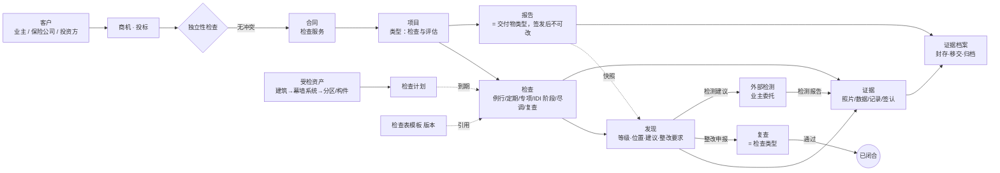

# AEC 项目制专业服务公司的业务对象：检查与评估服务、品控证据线

状态：历史记录｜2026-10-15｜负责：one-architecture

状态：研究提议，待用户裁定 · 日期：2026-10-15 · 作者：one-architecture 子代理

依据：用户原话「纳入，检查和证据线也一起梳理」（intent `2026-10-15-213845`）；行业通行做法与法规为主要依据，老系统只作参考（intent `2026-10-15-202634`）；干系人目录 `STAKEHOLDERS.md`（用户已确认，intent `2026-10-15-213742`）。格式、判据与来源缩写沿用 `AEC_BUSINESS_OBJECTS.md`（售前段）、`AEC_OBJECTS_DELIVERY_RESOURCES.md`（交付段）。

本段范围：资本方（投资方与金融机构的技术尽调；保险公司 IDI 委托的风险管理与技术检查）、既有建筑业主（幕墙安全检查、周期检查、安全性鉴定配合、改造前评估）委托的「检查与评估」类服务，以及这类服务和公司品控所需的证据线。公司业务以建筑外立面（幕墙）与照明专项为主。

## 0. 来源与缩写

按权威性排序。凡标「未核实」或「二手」的，不作硬依据。

| 缩写 | 来源 | 本次怎么取得 |
|---|---|---|
| 〔沪幕墙〕 | 《上海市建筑玻璃幕墙管理办法》（2011 年沪府令第 77 号公布，2018 年沪府令第 15 号修正，2012-02-01 施行）https://www.shanghai.gov.cn/cmsres/25/252ff5bb6fd342c692f3e2583b2dc019/02711536a86d7ce94c39d8a822495ff6.pdf | 下载官方 PDF 全文，逐条读 |
| 〔深幕墙〕 | 《深圳市既有建筑幕墙安全维护和管理办法》（深建规〔2020〕7 号，2020-06-06 施行；深建规〔2025〕9 号延期至 2030-06-05）https://www.sz.gov.cn/zfgb/2025/gb1373/content/post_12199655.html ；解读 https://www.sz.gov.cn/zfgb/zcjd/content/post_7759829.html | 读市政府公报页（含办法全文），经抓取工具按条概括；**逐字未与原件核对** |
| 〔沪IDI〕 | 《上海市推进住宅工程质量潜在缺陷保险实施办法》（沪建规范联〔2024〕4 号，2024-03-28 施行，有效期至 2029-03-27）https://zjw.sh.gov.cn/cmsres/7a/7a0293671d694ea9a8b166505b1ae744/3bc9cdf375fa7f24c2a7c910604fedef.pdf | 下载官方 PDF 全文，逐条读 |
| 〔沪TIS〕 | 《上海市建设工程质量风险管理机构管理规定》（沪住建规范〔2023〕12 号，2023-10-01 施行，有效期至 2028-09-30）https://zjw.sh.gov.cn/cmsres/c3/c339162ebcd849c3bd5ac1c266546052/4b2c02589eba5613fe15e761f69645b9.pdf | 下载官方 PDF 全文，逐条读 |
| 〔检测办法〕 | 《建设工程质量检测管理办法》（住建部令第 57 号，2023-03-01 施行）地方住建局转载 PDF https://zjj.huainan.gov.cn/group4/M00/09/8B/rB40qWPbK0KAME91AAJiATRh4M8055.pdf | 下载全文（转载件，页眉为「住房和城乡建设部发布」），逐条读；未与住建部原件比对 |
| 〔建标38〕 | 住建部、国家安监总局《关于进一步加强玻璃幕墙安全防护工作的通知》（建标〔2015〕38 号） | **二手**：只读到深圳解读页的概括（普查、建立既有幕墙信息库、健全监管、加大巡查）；原文未读 |
| 〔建质291〕 | 建设部《既有建筑幕墙安全维护管理办法》（建质〔2006〕291 号） | **未核实**：只见南京等地方文件引作上位依据，原文未读 |
| 〔沪803〕 | 上海地方标准《既有建筑幕墙检查及安全性鉴定技术标准》DG/TJ08-803-2024（2024-12-01 实施，替代 DG/TJ08-803-2013） | **二手**：检索摘要；内容未读 |
| 〔SJG43〕 | 深圳地方标准《深圳市既有建筑幕墙安全检查技术标准》SJG 43 | 〔深幕墙〕第十条引用；标准内容未读 |
| 〔JGJ〕 | 《玻璃幕墙工程质量检验标准》JGJ/T 139-2020；《建筑幕墙工程检测方法标准》JGJ/T 324-2014 | **二手**：检索摘要只确认编号与实施日期；内容未读 |
| 〔RICS〕 | RICS *Technical due diligence of commercial property*, 1st edition, guidance note, global（2020-01 发布，2020-04-01 生效）https://rics.org/content/dam/ricsglobal/documents/standards/Technical_Due_Diligence_Of_Commercial_Property_1st_Edition.pdf | 下载全文，读 §3、§4.1、§4.4、§4.8、§5.2、§6；2023 年是否改版为 professional standard：**未核实** |
| 〔ASTM〕 | ASTM E2018-24 *Standard Guide for Property Condition Assessments: Baseline PCA Process* | **二手**：经销商页面的范围摘要（§1.1 目的、走查、文件审阅与访谈、物业状况报告 PCR）；正文未读 |
| 〔ISO17020〕 | ISO/IEC 17020（检验机构能力要求；国内对应 GB/T 27020）https://www.iso.org/standard/86292.html | ISO 官方摘要：2026 版把独立性由 A/B/C 三类简化为 A 类与非 A 类；2012 版 A/B/C 定义为**二手**；条文未读 |
| 〔BIZ〕 | BIZBOK Guide v11 本地文本 `/Users/yeliang/Projects/YeliangDu/standards/bizbok-v11/_text/BIZBOK-v11.txt` | §2.5 页 194–195（保险公司示例：Evidence 是依附 Legal Proceeding 的次级概念；类型不拆成多个概念）；第 8 部分通用参考模型信息概念表页 588–589（Asset、Facility、Incident、Inquiry） |
| 〔VP-DD〕 | Deltek Vantagepoint 2026.4 数据字典 `/Users/yeliang/Projects/YeliangDu/VP/corpus/raw/vendor-docs/Vantagepoint_2026.4_DataDictionary/Content/` | 本地解析全部 1351 张表的表名与定义 |
| 〔CAS14〕 | 《企业会计准则第 14 号——收入》 | 沿用售前段 `AEC_BUSINESS_OBJECTS.md` §0 的核对结果 |
| 〔STK〕 | `docs/architecture/proposals/stakeholders.md` | 本地（用户已确认） |
| 〔词表〕 | `docs/glossary/terms.yaml` | 本地检索 |
| 〔事实〕 | intent `2026-10-15-213845`；词表 `contract_clause`「按量结算款 UNIT_RATE——品控按次月结（业主口述 2026-07-07）」；`business_line`「第三方评估 AS」 | 本地 |

法规证据以上海、深圳为主：两地是本次能读到全文的地方规章与规范性文件。北京未找到专门的既有幕墙规定（只见《北京市房屋建筑使用安全管理办法》被列为房屋安全鉴定监管依据），**未核实**。国家层面 IDI 指导文件（常被引作国办函〔2019〕92 号）原文未读，**未核实**。

## 1. 汇总表

「现状」列：✅ 已有且合适；⚠️ 已有但分类或定义可能需调整；❌ 缺失。

| 对象 | 一句话定义 | 关键状态 | 主要关系 | 来源 | terms.yaml 现状 |
|---|---|---|---|---|---|
| 受检资产 Inspected Asset（建筑 → 幕墙系统 → 分区 / 构件） | 客户名下、接受检查或评估的建筑及其外立面系统、部位；不是公司资产 | 在用 → 超设计使用年限仍在用 → 改造中 → 拆除 / 不再受托 | 1 建筑 → N 幕墙系统 → N 分区 / 构件；N 资产 ↔ N 客户（业主、物业、权益受让人）；1 资产 → N 检查、N 发现 | 〔BIZ〕Asset、Facility（页 588–589）；〔沪幕墙〕第 16、20、21 条（设计使用年限、结构类型决定周期）；〔深幕墙〕第 13–15 条 | ❌ |
| 检查计划 Inspection Schedule | 按法规与合同为某资产排出的各类检查到期日 | 生效 → 到期提醒 → 已执行 / 逾期 / 不再受托 | 1 受检资产 → N 计划行（每类检查一行）；计划行 → 0..1 检查 | 〔沪幕墙〕第 20 条；〔深幕墙〕第 12–15 条；〔沪IDI〕第 10 条（设计、施工、竣工、两年回访） | ❌ |
| 检查 Inspection（现场检查 / 一次检查轮次） | 按约定范围与检查表，在某一时点对受检资产实施的一次检查活动 | 已计划 → 已安排 → 现场进行中 → 记录已提交 → 已审核 → 已锁定；取消（原因必填） | N 检查 → 1 项目（类型：检查与评估）；1 检查 → N 受检部位、N 检查项结果、N 发现、N 证据；类型：例行 / 定期 / 专项定期 / 安全性鉴定配合 / IDI 阶段检查 / 尽调走查 / 复查 | 〔深幕墙〕第 10–15 条；〔沪TIS〕第 8 条；〔RICS〕§5；〔ASTM〕§1.1.2 | ❌ |
| 检查表模板 Inspection Checklist | 规定某类检查要看哪些项目、依据哪条标准的版本化参考数据 | 草拟 → 生效 → 停用（只增版本） | 1 模板版本 → N 检查项；检查引用一个模板版本 | 〔SJG43〕〔沪803〕〔JGJ〕（标准内容未读） | ❌ |
| 发现 Finding（技术风险 / 缺陷 / 隐患） | 检查中识别、需要向客户报告的一项不符合、缺陷或风险，带等级、位置、建议与整改要求 | 已识别 → 已复核 → 已发布（随报告或通知）→ 整改中 → 整改已申报 → 复查通过（已闭合）/ 复查未通过（回整改中）/ 风险保留（客户书面接受）/ 不再跟踪（原因必填） | N 发现 → 1 检查；1 发现 → 1..N 受检部位；1 发现 → 1..N 证据；整改责任方 → 往来单位（施工单位、业主等）；1 发现 → 0..N 复查 | 〔沪IDI〕第 10 条（正常、轻微、中等、严重、风险保留五级；跟踪整改）；〔沪TIS〕第 2、8 条；〔RICS〕§6.1（问题、后果、修复、时限、费用责任方、是否需进一步调查）、§6.1.1–6.1.2（时限与红黄绿评级）；〔深幕墙〕第 17 条 | ❌（有 `quality_issue`，但指我方交付成果的质量问题，语义不同） |
| 复查 Re-inspection（整改核验） | 对已申报整改的发现到场或凭资料核验，决定闭合与否 | 是一种「检查」类型，不另立对象 | 1 复查 → N 发现 | 〔沪TIS〕第 2、8 条（跟踪整改直至闭合）；〔深幕墙〕第 17 条（治理完成后核实） | ❌ |
| 报告 Report（检查报告、评估报告、尽调报告、安全性鉴定配合报告） | 交给客户、有签发人与版本、签发后不可改的成果；**是「交付物」的一种类型** | 草稿 → 内审 → 签发（签字、盖章）→ 已发布 → 被新版本取代 / 撤回（原因必填，不删除） | 1 报告 → 1 项目；1 报告 → N 检查、N 发现（发布时快照）；1 报告 → 1 结论 | 〔沪TIS〕第 8 条（六类报告）；〔深幕墙〕第 16 条（鉴定报告）；〔RICS〕§6；〔ASTM〕§1.1.4（PCR 带修复费用意见）；〔检测办法〕第 21 条（报告签署盖章方生效） | ⚠️ 只有 `deliverable`（交付物），无报告类型与签发规则 |
| 评估结论 Assessment Conclusion | 报告对资产整体状况或风险等级的结论 | 不是对象：报告的组成部分（等级值） | 报告 → 1 结论；结论引用发现 | 〔BIZ〕页 198–199（评级是属性）；〔深幕墙〕第 16 条（鉴定等级）；〔沪IDI〕第 10 条 | ❌ |
| 证据 Evidence（照片、视频、测量 / 检测数据、现场记录、签认、外部检测报告） | 支持某个检查记录或发现的原始材料，带采集时间、地点、采集人与完整性校验，进入后不可修改 | 已采集 → 已上传（计算摘要）→ 已关联 → 已封存（随报告签发）；作废（原因必填，保留原件） | N 证据 ↔ N 发现；N 证据 → 1 检查；证据 → 0..1 外部来源（检测机构报告） | 〔BIZ〕页 194–195（Evidence 为次级概念）；〔沪TIS〕第 12 条第（九）项（照片、视频与说明须上传平台）；〔检测办法〕第 22、23、26、27 条；〔RICS〕§5.2（保存现场笔记、草图、照片） | ⚠️ 词表有 `fact_evidence`、`signature_evidence`、`approval_evidence`、`validation_evidence`、`evidence_level`，各指一种证据，没有通用的证据项 |
| 证据档案 Evidence File / Case File | 一个检查项目（或一份报告）的全部证据、记录、报告版本与往来的封存集合 | 开放 → 封存（报告签发）→ 已移交客户（如约定）→ 归档 → 到期处置 | 1 项目 → 1 档案；档案 → N 证据、N 报告版本 | 〔沪幕墙〕第 24 条（技术资料移交业主）；〔深幕墙〕第 19 条；〔检测办法〕第 26 条（连续编号，不得抽撤、涂改）；仓库 XD-04（10 年 WORM） | ❌ |
| 检测建议 / 外部检测 Testing Request | 我方建议、由业主（或保险公司）另行委托检测机构实施的检测，及其返回的报告 | 已建议 → 业主已委托 → 报告已收到 → 已采信 / 未采信（原因） | 1 发现或检查 → 0..N 检测建议；检测报告作为证据引用；检测机构 → 往来单位 | 〔检测办法〕第 15、16、18、21 条；〔沪幕墙〕第 21 条；〔深幕墙〕第 15 条；〔RICS〕§4.8（专家可由客户直接委托） | ❌ |
| 利益冲突与独立性检查 Independence Check | 承接前核对我方及关联方是否参与过同一工程的设计、施工、监理、供货等，并记录结论 | 待查 → 无冲突 / 有冲突已获书面同意（只限允许的服务）/ 有冲突不得承接 | 1 商机或投标 → 1 检查结论；引用受检资产、本公司历史项目 | 〔沪TIS〕第 6 条、第 12 条第（二）（十二）项；〔检测办法〕第 15、45 条；〔RICS〕§4.1；〔ISO17020〕A 类独立 | ❌ |
| 往来单位角色（委托人、业主、主承保保险公司、建设单位、整改责任方、检测机构、物业、主管部门） | 同一相对方在检查项目中的身份 | 不是新对象：「相对方 + 角色」 | 项目 → N 角色 | 〔STK〕；〔沪IDI〕第 9、10 条；〔沪TIS〕第 5 条 | ⚠️ 词表只有客户、项目业主主体等合同侧角色 |
| 资质 / 能力依据 Qualification Basis | 承接某类检查所需的企业资质或能力（设计、施工、检测资质；人员注册与年限） | 证书：有效 → 到期 / 撤销 | 检查项目 → 所用资质；人员 → 注册执业资格 | 〔沪幕墙〕第 20、21 条；〔深幕墙〕第 11、15 条；〔沪TIS〕第 3、4 条 | ❌（属企业监管段，另行梳理） |

事件（不是对象）：检查已到期、检查已完成、发现已发布、整改已申报、发现已闭合、风险已保留、报告已签发、报告已撤回、证据已封存、重大险情已报告。

## 2. 检查与评估段详述

### 2.1 总体结构

要点：
- **检查服务和设计服务共用商机、合同、项目、工时、费用、交付物、开票、收入确认**；检查独有的是受检资产、检查计划、检查、检查表模板、发现、证据、证据档案、外部检测、独立性检查。
- **受检资产是新的一级对象**，在设计业务里没有对应（设计的对象是「项目」，不是建成后的建筑）。周期检查的「下一次何时做」由资产属性（竣工日期、设计使用年限、幕墙结构类型）加地方规则推出，所以资产必须独立于某个合同存在，才能跨年、跨合同、跨业主延续。

### 2.2 法规给出的服务类型与节点

| 服务 | 委托人 | 法定或约定的节点 | 规定的执行主体要求 | 来源 |
|---|---|---|---|---|
| 施工单位保修期全面检查 | 施工单位（义务人） | 竣工验收满 1 年全面检查；拉杆拉索幕墙竣工 6 个月预拉力检查 | 施工单位 | 〔沪幕墙〕第 17 条 |
| 既有玻璃幕墙定期检查（上海） | 业主 | 竣工 1 年后每 5 年；结构粘接满 10 年抽检硅酮结构胶，此后每 3 年；拉杆拉索每 3 年；超设计年限每年 | **原施工单位或其他有玻璃幕墙施工资质的单位** | 〔沪幕墙〕第 20 条 |
| 安全性鉴定（上海） | 业主 | 异常变形脱落爆裂、灾害或事故损坏、主体结构有隐患、超设计年限仍用、其他 | 具有玻璃幕墙检测能力的单位，出具鉴定结论 | 〔沪幕墙〕第 21 条 |
| 年度备案（上海） | 业主 | 每年 12 月报送当年检查、鉴定、维修、防护措施的技术资料 | — | 〔沪幕墙〕第 24 条 |
| 例行 / 定期 / 专项定期检查（深圳） | 房屋安全责任人 | 例行：交付 6 个月内首次、此后不超过 6 个月；定期：1 年后每 5 年；专项：预应力索杆每 3 年，硅酮结构胶满 10 年后每 3 年 | 例行可自行；定期、专项须委托具有设计、施工或检测资质的机构；技术负责人、项目负责人有年限与职称要求 | 〔深幕墙〕第 10–14 条 |
| 安全性鉴定（深圳） | 房屋安全责任人 | 原则上每 10 年；六类触发情形 | 具备幕墙检测资质；发现重大险情立即告知委托人并报街道与区主管部门 | 〔深幕墙〕第 15、16 条 |
| IDI 风险管理（上海住宅） | 主承保保险公司（建设单位投保） | 设计、施工、竣工阶段与竣工后两年回访期；初步风险分析、过程检查、阶段风险评估、专项检查、竣工最终风险评估、回访风险评估 | 风险管理机构（TIS）：独立第三方，不得参与该工程勘察设计施工监理供货 | 〔沪IDI〕第 9、10 条；〔沪TIS〕第 2–8 条 |
| IDI 争议鉴定 | 业主与保险公司共同 | 是否属保险责任有异议时 | 有资质的第三方鉴定机构 | 〔沪IDI〕第 14 条 |
| 技术尽调（收购、持有、处置、开发） | 投资方、金融机构（也可能是卖方） | 交易时间表；报告可对第三方出具依赖函 | 无中国国家标准；国际通行 RICS 指引、ASTM E2018 | 〔RICS〕§3、§3.4、§4.1；〔ASTM〕§1.1 |

**由此得出的业务含义（推断，须用户确认）**：
1. 上海的定期检查**法定执行人是有施工资质的单位**（〔沪幕墙〕第 20 条），深圳允许设计资质单位（〔深幕墙〕第 11 条）。公司若只有设计资质，在上海做的「周期检查」很可能是为业主提供技术咨询或配合有施工资质的单位，而不是法定定期检查本身。检查项目因此需要记录「所用资质」与「法定角色」，同一服务在不同城市的法律地位不同。
2. 安全性鉴定要求检测资质或检测能力（〔沪幕墙〕第 21 条、〔深幕墙〕第 15 条）。用户已说明「检测由业主委托、非我方分包」，与〔检测办法〕第 18、21 条（新建工程的检测由建设单位委托；非建设单位委托的检测报告不得作为验收资料）以及〔RICS〕§4.8 中「专家由客户直接委托」的模式一致。所以检测在本系统里是**外部检测**：我方提出检测建议、引用检测机构报告作证据，不是我方的分包合同，也不进我方成本。
3. 〔STK〕把「保险公司和 TIS」同时列为渠道伙伴（转介绍方），把 TIS 列为价值阶段参与者。这说明公司可能是 TIS 的**专项分包顾问**（幕墙、照明专项检查），而不是 TIS 本身。〔沪TIS〕第 12 条第（一）项把 TIS「转包、违规分包质量风险管理业务」列为失信情形，专项分包是否允许、要满足什么条件，取决于 TIS 与保险公司的合同。需要用户说明公司处于哪个位置（§7 问题 2）。

### 2.3 受检资产 Inspected Asset

- **定义**：客户名下、接受检查或评估的建筑及其外立面（幕墙）与照明系统的层级：建筑 → 系统（某类幕墙、某套泛光照明）→ 分区或立面 → 构件或部位。
- **为什么是一级对象**：它不依赖某一份合同存在，跨年度、跨合同、跨业主延续（〔沪IDI〕第 11 条：所有权转让时受让人承继保单权益；周期检查每 3–5 年一次），有自己的状态，并被多个检查与发现引用。〔BIZ〕通用参考模型把 Asset（有形或无形财产，状态：在用、退役、处置）与 Facility（进行业务的物理建筑）列为一级概念（页 588–589）。本段的「受检资产」是**客户的**财产，属 Asset 的一种类型，不能与公司固定资产混在一起。
- **关键属性**（驱动规则，不是装饰）：竣工验收日期、交付使用日期、设计使用年限、幕墙结构形式（结构粘接装配、拉杆拉索、点支承等）、面板材料（钢化玻璃等，决定〔沪幕墙〕第 23 条防护措施要求）、是否临街、所在城市（决定适用哪套地方规则）、《使用维护手册》是否齐备（〔沪幕墙〕第 16 条；〔深幕墙〕第 6、7 条）。
- **状态机（提议）**：在用 → 超设计使用年限仍在用（由日期推出，可人工确认）→ 改造中 → 拆除；另有「不再受托」（我方不再服务，资产记录保留）。
- **关系**：N 资产 ↔ N 客户（业主、物业受托方、权益受让人；带角色与起止）；1 资产 → N 检查计划行、N 检查、N 发现；资产 ↔ 我方设计项目（若我方设计过该幕墙，用于独立性检查，§3.4）。
- **中国语境**：〔建标38〕要求主管部门建立既有幕墙信息库；上海有全市玻璃幕墙信息管理系统（〔沪幕墙〕第 26 条），深圳有房屋安全管理信息系统（〔深幕墙〕第 20 条）。这些政府平台的建筑编号是外部标识，可作资产的外部引用，不作主键。
- **谁负责**：资产主数据由检查业务线维护；客户关系由客户主数据负责。

### 2.4 检查计划 Inspection Schedule

- **定义**：为某个受检资产排出的各类检查到期日，来源有两种：法规周期（〔沪幕墙〕第 20 条、〔深幕墙〕第 12–15 条）和合同约定（IDI 的阶段节点，〔沪IDI〕第 10 条）。
- **判据**：计划行依附资产（或合同），是**次级对象**；到期日是由规则算出的派生值，但人工调整需要原因，所以计划行要存储，不能每次现算。
- **规则**：
  - 拦截：无。法定周期的义务人是业主，不是我方；系统不能拒绝业主不做检查。
  - 预警：到期前提醒客户经理；逾期未委托的提醒（可作为商机来源，〔事实〕线索来源「老客户再委托」）。
- **与售前的关系**：到期提醒是再委托商机的稳定来源；计划行到期 → 生成线索或直接续签。

### 2.5 检查 Inspection

- **定义**：在某一时点、按约定范围与检查表，对受检资产实施的一次检查活动（含远程资料检查）。
- **类型**（按〔BIZ〕页 194–195「类型不拆成多个概念」）：例行检查、定期检查、专项定期检查（结构胶、索杆）、安全性鉴定配合、IDI 阶段检查（设计、施工过程、专项、竣工、回访）、尽调走查、改造前评估、复查。
- **状态机（提议）**：已计划 → 已安排（人员、时间、通行条件）→ 现场进行中 → 记录已提交 → 已审核 → 已锁定；取消（原因必填）。锁定后只能以「更正记录」追加，不改原记录（与 ADR-0016「只追加」一致）。
- **组成部分**：检查范围（受检部位清单）、所用检查表模板版本、检查项结果（合格 / 不合格 / 未检及原因）、未能进入的部位与原因、天气与现场条件、在场人员。〔RICS〕§6.3.2 要求报告载明检查日期、天气、使用状况、提供信息的人、未进入的部位；〔RICS〕§5.2 要求区分事实与推断、保存现场记录。
- **规则**：
  - 拦截：记录提交时每个检查项必须有结果或「未检原因」（缺失不得静默跳过，CLAUDE.md 第 6 条）；锁定后不得修改；
  - 拦截（法规依据，仅 IDI）：项目风险管理负责人不得同时担任 10 个以上项目负责人（〔沪TIS〕第 4 条），不得兼任其他项目的总监理工程师或施工项目经理（第 12 条第（十二）项）——只在公司作为 TIS 时适用；
  - 预警：检查人员与资质要求不符（〔深幕墙〕第 11 条年限与职称）。
- **与工时的关系**：检查人员的工时记到检查项目；「品控按次月结」（〔事实〕）说明有按检查次数计费的合同条款，检查完成（或报告签发）是计量依据（§4.2）。

### 2.6 发现 Finding

- **定义**：检查中识别的一项不符合、缺陷、隐患或技术风险，带等级、位置、证据、建议与整改要求。
- **命名建议**：用「发现」（Finding）作概念名，「缺陷」「隐患」「技术风险」作类型或口语。原因：词表里「缺陷」已有三种含义——`defects_liability_period`（缺陷责任期，质保金期间）、`defect_rate`（我方交付质量的缺陷率）、〔沪IDI〕第 2 条的「工程质量潜在缺陷」——再加一个会造成同名异义。
- **与 `quality_issue` 的区别**：`quality_issue`（delivery.acceptance）是**我方交付成果**的质量问题，处置是我方返工或让步接受；「发现」是**客户资产或第三方工作**的问题，整改责任方是业主、施工单位等，我方只识别、报告、复查。两者不能合并（同一个「整改」词，主体不同）。
- **等级**：
  - IDI：正常、轻微、中等、严重、风险保留五级（〔沪IDI〕第 10 条）；
  - 尽调：红黄绿评级须在报告中定义（〔RICS〕§6.1.2），时限分立即、短期（1 年内）、中期（2–5 年）、长期（6–10 年）（§6.1.1）；
  - 既有幕墙：深圳鉴定有鉴定等级（〔深幕墙〕第 16 条），隐患本身未设分级（第 17 条）；〔沪803〕是否规定隐患分级：**未核实**。
  - 建议：等级体系作为**按服务类型版本化的参考数据**，发现记录「等级体系版本 + 等级值」，不写死一套。
- **内容**（〔RICS〕§6.1 的六问可作为字段骨架）：问题是什么、后果、建议的修复、完成时限、费用由谁承担、是否需要进一步调查（含检测建议）；位置（受检部位）；依据条款（标准号与条文）；证据（1..N）。
- **状态机（提议）**：已识别 → 已复核（技术负责人）→ 已发布（随报告或单独整改通知送达）→ 整改中 → 整改已申报 → 复查通过（已闭合）| 复查未通过（回整改中）| 风险保留（委托人书面接受）| 不再跟踪（服务终止等，原因必填）。
- **规则**：
  - 拦截：发布前必须至少有一条证据（〔沪TIS〕第 12 条第（九）项把未上传照片、视频与说明列为失信情形）；闭合必须引用复查记录或整改证据；风险保留必须有委托人的书面确认（与词表 `concession_acceptance`「客户书面确认为硬性守卫」同一思路）；
  - 拦截（IDI）：存在等级为「严重」且未闭合的发现时，不得签发**竣工最终风险评估报告**（〔沪TIS〕第 8 条；〔沪IDI〕第 10 条要求设计阶段严重风险在送审前、竣工阶段严重风险在竣工验收前完成整改）；
  - 拦截（深圳鉴定）：发现重大险情须立即告知委托人，并报告街道办事处与区主管部门（〔深幕墙〕第 16 条）——这是对外报告义务，系统应记录「已报告」事件与时间，未记录不得关闭该发现；
  - 预警：整改超期；同一部位反复出现。
- **谁负责**：检查工程师识别；技术负责人复核与签发；整改由第三方实施，我方只核验。

### 2.7 报告 Report

- **判据**：报告既是「单据」又像「对象」。按〔BIZ〕页 197 的做法，「报告这份文件」是单据，背后的概念是「交付物」——我方交给客户的成果。检查报告有签发、版本、撤回，与设计交付物同一套生命周期，只是多了签发与不可改规则。建议：**报告 = 交付物的一种类型**（`deliverable` 增加类型「检查与评估报告」），不另立平行对象；报告的每个签发版本是**不可变快照**（含发现清单与结论）。
- **报告类型**：IDI 六类（〔沪TIS〕第 8 条）；定期检查报告；安全性鉴定报告（我方通常是配合方，出具方须有检测资质）；技术尽调报告（〔RICS〕§6）；物业状况报告 PCR（〔ASTM〕§1.1.4，含修复费用意见）；改造前评估报告。
- **状态机**：草稿 → 内审 → 签发（签署人、日期、印章）→ 已发布 → 被新版本取代 | 撤回（原因必填）。已发布版本不得修改、不得删除。
- **规则**：
  - 拦截：签发人必须具备约定资格（〔检测办法〕第 21 条要求检测报告经检测、审核、授权签字人签署并盖章方生效——这是检测报告的规则，我方报告参照执行属**推断**）；签发时冻结所引用的发现与证据（证据封存）；
  - 拦截：修订只能出新版本并引用被取代版本，说明变更内容；
  - 预警：报告引用的外部检测报告来自非业主委托的机构（〔检测办法〕第 21 条第三句）。
- **结论**：报告的「评估结论 / 风险等级」是报告的组成部分（值），不是独立对象（〔BIZ〕页 198–199：评级是属性）。
- **依赖与对外使用**：尽调报告常需向贷款方等第三方出具依赖函（〔RICS〕§3.4、§4.1），记录在报告上（依赖方、范围、上限）。

### 2.8 外部检测 Testing Request

- **定义**：我方提出、由业主（或保险公司）直接委托检测机构实施的检测，及其返回的报告。
- **为什么不是分包**：用户已定「检测由业主委托、非我方分包」；〔检测办法〕第 16、18、21 条与〔RICS〕§4.8 模式（b）都支持「专家由客户直接委托、对客户直接负责」。因此不建分包合同、不进我方成本；检测机构作为往来单位，检测报告作为**外部证据**引用。
- **状态机**：已建议 → 业主已委托 → 报告已收到 → 已采信 | 未采信（原因必填）。
- **规则**：外部检测报告只引用、不修改；采信时记录检测机构、报告编号、签发日期。〔检测办法〕第 25 条：利害关系人对检测结果有争议时，可委托共同认可的机构复检——复检报告作为新的证据并存，不覆盖原报告。
- **适用范围提醒**：〔检测办法〕第 2 条适用于新建、扩建、改建工程的质量检测；既有建筑的鉴定检测由地方幕墙或房屋安全规定约束（〔沪幕墙〕第 21 条、〔深幕墙〕第 15 条）。

## 3. 证据线

### 3.1 行业通行的「证据链」要什么

把法规与行业指引里对证据的要求归纳为五条（每条注明依据；无依据的标「推断」）：

| 要求 | 含义 | 依据 |
|---|---|---|
| 1 可追溯 | 每份报告结论能回溯到发现，发现能回溯到证据，证据能回溯到检查、人员、时间、地点、设备 | 〔检测办法〕第 27 条（检测全过程信息化、可追溯）；〔沪TIS〕第 9 条（技术风险信息在 IDI 业务管理平台全过程管理）；〔RICS〕§5.2（保存现场笔记、草图、照片） |
| 2 不可篡改 | 原始记录与报告不得涂改、抽撤；更正只能追加 | 〔检测办法〕第 23 条（不得篡改、伪造报告）、第 26 条（按年度连续编号，不得随意抽撤、涂改）；ADR-0016 决定 2（事实只追加） |
| 3 完整 | 编号连续、不合格项单独建台账；未检部位要说明 | 〔检测办法〕第 26 条（不合格项目台账）；〔RICS〕§6.3.2（未进入部位须说明） |
| 4 独立 | 检查方与被检工程的设计、施工、监理、供货方无隶属或利害关系 | 〔沪TIS〕第 6 条、第 12 条第（二）项；〔检测办法〕第 15 条；〔RICS〕§4.1（利益冲突须排除或取得知情同意）；〔ISO17020〕A 类 |
| 5 留存与移交 | 技术资料移交业主；机构自身档案按制度保存；上传政府或保险平台 | 〔沪幕墙〕第 24 条；〔深幕墙〕第 19 条；〔沪TIS〕第 12 条第（九）项；〔检测办法〕第 22、26 条 |

### 3.2 证据是对象还是属性（〔BIZ〕§2.5 判据）

〔BIZ〕页 194–195 的保险公司示例把 Evidence 列为**次级信息概念**：它只有在 Legal Proceeding 存在时才有意义。照此类推：

- 证据依附检查或发现存在 → 次级；
- 但它有自己的状态（采集、封存、作废）、规则（不可修改、摘要校验、保留期）、多对多引用（一张照片支持多个发现、一个发现需要多张照片）、自己的责任人（采集人）→ **有独立生命周期的次级对象**，不是发现的附件属性。
- 对照：普通单据附件（报销发票照片、合同扫描件）只是所属单据的属性，没有独立规则，不必建成证据对象。判别点是「是否要对第三方证明某个事实」。

**证据项的最小内容（提议）**：类型（照片、视频、测量数据、现场记录、签认、外部报告、往来函件）；采集时间与采集人；地点（受检部位，可带坐标）；采集设备或来源；文件摘要（哈希）；关联的检查与发现；封存时间（随报告签发）；作废原因（作废不删除）。

### 3.3 与仓库现有「证据」用法的关系

仓库里「证据」已有多种含义：`business_fact` 定义中的「证据化」与 `fact_evidence`（事实的来源事件与原始单据引用，值对象）、`signature_evidence`、`approval_evidence`（合同签署与审批证据）、`validation_evidence`（工时有效性认定）、`evidence_level`（风险交付证据的司法效力四级）、收入确认的客户价值确认证据（ADR-0016 决定 4；交付段 §2.4）。

这说明「证据线」可能有两种范围：
- **窄**：检查与评估服务、品控（〔事实〕「品控按次月结」）中，证明客户资产状况与我方检查结论的证据；
- **宽**：所有权责事实（收入确认、风险交付、合同签署、工时认定、检查结论）的统一证据机制——同一个证据项结构、同一个封存与保留规则、同一个文件存储，各 BC 引用。

宽口径与 ADR-0016「事实只追加、证据化」一致，但会把检查业务的需要扩成横切能力。到底指哪一种，只有用户能定（§7 问题 1）。

### 3.4 独立性与信息隔离

- **组织独立性有明文依据**：TIS 不得与该工程参建单位有关联关系，不得直接或间接参与该工程的勘察、设计、施工、监理、材料供应（〔沪TIS〕第 6 条），违者按失信处理（第 12 条第（二）项，范围含集团公司及下级公司）；检测机构不得与所检工程的建设、施工、监理、供货单位有隶属或利害关系（〔检测办法〕第 15 条，罚则第 45 条）。〔RICS〕§4.1 要求承接前排除利益冲突或取得知情同意。
- **对公司的直接后果**：公司主业是幕墙与照明设计。**如果公司做过某工程的幕墙或照明设计，就不能在同一工程担任 TIS 或其专项分包**（〔沪TIS〕第 6 条「直接或间接参与……设计」）。这是一条承接前的**拦截规则**，需要：受检资产 ↔ 我方设计项目的关联；商机或投标阶段的独立性检查记录。对尽调与既有幕墙检查，法规没有同样硬的禁止，按〔RICS〕§4.1 是「排除或知情同意」，属预警加审批。
- **信息隔离（检查方与设计方之间的数据屏障）**：本次**没有找到**中国法规或行业指引明确要求同一公司内部设计团队与检查团队之间的数据隔离。〔ISO17020〕的独立性分类（2012 版 A/B/C，2026 版 A 类与非 A 类）针对的是检验机构与受检对象的关系，条文未读。以下是**推断**：如果公司同时做 A 项目的设计和 B 项目的 TIS 专项检查，而 A、B 的建设单位、施工单位有重合，检查结论可能涉及设计同行或自身客户的利益；常见做法是按项目设置访问控制、检查报告由未参与相关设计的人员签发。是否需要、做到什么程度，须用户定（§7 问题 4）。
- **保密**：尽调资料室文件常受保密约束，〔RICS〕§4.4 要求在保密允许时下载留存，并说明是否保留。证据档案需要「保密级别 + 可否留存」属性。

## 4. 对象判据与分类

依〔BIZ〕§2.5：名词、持久、有类型、状态与关系的为信息概念；不依附其他对象存在的为一级，依附的为次级（页 194–195、198）；估值、评级是属性（页 198–199）；文件是对象的呈现形式（页 197）；类型不拆成多个概念（页 194–195）。

| 类别 | 归入的对象 |
|---|---|
| 一级对象（新） | 受检资产 |
| 一级对象（与设计共用） | 客户、相对方、商机、投标、合同、项目、员工 |
| 对象类型（不是新对象） | 项目类型「检查与评估」；检查类型（例行、定期、专项定期、鉴定配合、IDI 阶段、尽调走查、改造前评估、复查）；报告类型（交付物类型）；发现类型（缺陷、隐患、技术风险、不符合）；证据类型；受检资产层级（建筑、系统、分区、构件）；往来单位角色 |
| 有独立生命周期的次级对象 | 检查计划行（依附资产）、检查（依附项目）、发现（依附检查）、证据（依附检查 / 发现）、证据档案（依附项目）、外部检测（依附发现或检查）、独立性检查记录（依附商机或投标） |
| 组成部分 | 检查项结果、未检部位说明（属检查）；整改要求、建议、依据条款（属发现）；评估结论、依赖方（属报告版本） |
| 参考数据（版本化） | 检查表模板、等级体系（IDI 五级、红黄绿、鉴定等级）、地方周期规则 |
| 事件 | 检查已到期、检查已完成、发现已发布、整改已申报、发现已闭合、风险已保留、报告已签发、报告已撤回、证据已封存、重大险情已报告 |
| 派生度量 | 发现闭合率、按等级的未闭合数、平均整改天数、检查准时率、复查一次通过率、资产覆盖率（到期且已执行 ÷ 到期） |
| 单据 / 证据载体 | 报告文件、整改通知单、复查记录表、现场照片与视频文件、外部检测报告、依赖函、业主签认单 |

## 5. 跨段关系（交接对象与事件）

| 交接 | 上游 → 下游 | 交接对象 / 事件 | 要点 |
|---|---|---|---|
| 检查计划 → 售前 | 检查已到期 → 线索 / 商机 | 「检查已到期」 | 周期检查是稳定的再委托来源 |
| 售前 → 检查 | 商机 / 投标 → 独立性检查 | 独立性检查记录 | IDI 场景为拦截（〔沪TIS〕第 6 条）；其他为预警加审批 |
| 交付（设计）→ 检查 | 我方设计项目 ↔ 受检资产 | 资产与设计项目的关联 | 独立性检查的依据；也可反向：检查发现可作为改造设计的商机来源 |
| 合同 → 检查 | 合同条款 → 检查项目 | 计价方式：按次（UNIT_RATE，〔事实〕「品控按次月结」）、按阶段总价、按报告 | 决定收入确认的计量单位 |
| 检查 → 收入 | 检查已完成 / 报告已签发 → 收入确认单 | 认可事件作为证据引用 | 按次计价时以「检查已完成 + 客户签认」还是「报告已签发」为准，须财务定（〔CAS14〕第十二条产出法；ACC-R01） |
| 检查 → 成本 | 检查人员工时、差旅、高空作业设备租赁 → 项目成本 | 工时、费用 | 外部检测费由业主直接支付，不进我方成本 |
| 检查 → 往来单位 | 发现已发布 → 整改责任方 | 整改通知 | 整改责任方往往与我方无合同（施工单位），只是相对方角色 |
| 检查 → 外部平台 | 证据、报告 → IDI 业务管理平台、幕墙信息系统 | 外部推送（防腐层） | 〔沪TIS〕第 9 条、第 12 条第（九）项；〔沪幕墙〕第 24 条（业主报备，我方可能代为准备） |
| 检查 → 归档 | 证据已封存 → 档案 | 证据档案 | 保留期须定；仓库 XD-04 已定审计与流程归档 10 年（在线 3 年 + WORM 约 7 年） |

## 6. 与仓库现状对照

### 6.1 已有且可共用

`customer`、`opportunity`、`contract`、`contract_clause`（已含 UNIT_RATE 按次结算）、`project`、`deliverable`、`acceptance_record`、`time_entry`、`expense_claim`、`revenue_recognition`、`business_line`（已含「第三方评估 AS」）。

### 6.2 缺失（建议登记提议术语，经 one-glossary 查重）

| 建议对象 | 依据 | 可能归属 |
|---|---|---|
| 受检资产（含层级） | 〔BIZ〕Asset、Facility；〔沪幕墙〕第 16、20、21 条 | 新 BC「检查与评估」，或主数据 |
| 检查计划 | 〔沪幕墙〕第 20 条；〔深幕墙〕第 12–15 条 | 同上 |
| 检查、检查表模板 | 〔深幕墙〕第 10 条；〔沪TIS〕第 8 条；〔RICS〕§5 | 同上 |
| 发现（等级体系、整改、复查、风险保留） | 〔沪IDI〕第 10 条；〔RICS〕§6.1 | 同上 |
| 证据项、证据档案 | 〔检测办法〕第 22–27 条；〔沪TIS〕第 12 条第（九）项；〔BIZ〕页 194–195 | 检查 BC；若用户选宽口径，则为平台横切能力（§7 问题 1） |
| 外部检测 | 〔检测办法〕第 15–21 条 | 检查 BC |
| 独立性检查 | 〔沪TIS〕第 6 条；〔RICS〕§4.1 | 售前（承接前检查） |
| 报告类型、签发、依赖函 | 〔沪TIS〕第 8 条；〔RICS〕§3.4、§6 | 交付物类型扩展 |
| 事件：检查已到期、发现已发布、发现已闭合、报告已签发、重大险情已报告 | 同上 | 检查 BC |

### 6.3 分类或定义可能有误、用语冲突

| 词条 | 问题 | 建议 |
|---|---|---|
| 「缺陷」 | `defects_liability_period`（缺陷责任期）、`defect_rate`（我方交付缺陷率）、IDI「潜在缺陷」、检查「缺陷」四义 | 检查侧用「发现」作概念名；用 `new_term_issue.py` 登记给 one-glossary 裁定（本文未登记，只读任务） |
| 「证据」 | `fact_evidence`、`signature_evidence`、`approval_evidence`、`validation_evidence`、`evidence_level` 各指一种 | 等用户回答 §7 问题 1 后，决定是否抽象出统一的「证据项」；同样登记给 one-glossary |
| 「整改」 | `quality_issue`（我方返工）与检查发现（第三方整改）共用 | 定义中写明主体 |
| `deliverable` | 未区分报告类交付物的签发与不可改规则 | 增加类型与签发规则，或在交付物上加「签发」状态 |
| `business_line` 的「第三方评估 AS」 | 与本段「检查与评估」是否同一业务线、是否包含品控 | §7 问题 3 |

### 6.4 行业产品（Deltek）证据

- 〔VP-DD〕2026.4 全部 1351 张表中**没有**检查、缺陷 / 发现、客户资产类对象。`Equipment` 及 `CFGFAAssetType*` 等是**公司自有固定资产与设备**（折旧、处置），其 `ShopInspectionDate` 等字段是采购到货检验，与本段无关。
- 附件是通用机制：`FW_Attachments`（父记录键 + 分类码 `CategoryCode` + 文件 ID）与 `FW_Files`（文件名、大小、上传人、修改人）；另有 `FW_FilesPurgeLog` 记录**已清除**的文件。即 Deltek 的附件可修改、可清除，只记清除日志，不满足 §3.1 的「不可篡改」。
- 结论：`PSA` 类产品不覆盖检查业务；检查对象与证据链须按法规与行业指引自行建模（行业通常另用专门的检查软件，**推断**，未查证具体产品）。

## 7. 需要用户回答的业务问题

只列证据答不了、业务方才知道的。每题给出建议选项。

1. **公司说的「证据线」确切指什么、范围多大？**
   - (a) 窄：只指检查与评估服务（含品控）中证明检查结论的证据链——照片、数据、记录、签认、报告版本；
   - (b) 宽：所有权责事实（收入确认、风险交付、合同签署、工时认定、检查结论）共用一套证据机制，检查只是其中一个使用方；
   - (c) 另有含义（例如公司内部设计品控的过程证据：校审记录、内审评分）。
   - 建议：先按 (a) 建模，证据项结构设计成可被其他 BC 引用，(b) 留作后续横切决定。请同时说明「品控」是指施工阶段幕墙品控（替开发商看现场）、IDI 专项检查，还是公司内部设计质量控制。
2. **公司在 IDI 中处于什么位置？** (a) 自己就是风险管理机构（TIS）；(b) TIS 的幕墙 / 照明专项分包顾问；(c) 保险公司直接委托的专项顾问；(d) 都有。这决定独立性规则是硬拦截还是合同约定，以及〔沪TIS〕第 4、12 条的人员限制是否适用。
3. **检查与评估服务有哪些类型、各占多少？** 请按合同额或项目数粗估：技术尽调；IDI 风险管理 / 专项检查；既有幕墙周期检查；安全性鉴定配合；改造前评估；施工阶段品控；其他。并说明是否与词表业务线「第三方评估 AS」是同一条线。建议：占比前两位的先做完整状态机，其余先共用通用检查与发现模型。
4. **检查与设计之间要不要信息隔离、隔离到什么程度？**
   - (a) 只在承接前做独立性检查（我方设计过的工程不接其 TIS / 检查），系统内不做数据隔离；
   - (b) 再加项目级访问控制：检查项目的发现与证据只对检查团队可见，设计团队不可见；
   - (c) 再加人员回避：参与过相关设计的人不得签发该资产的检查报告。
   - 建议 (a) + (c)，(b) 视客户合同保密条款而定。〔沪TIS〕第 6 条支持 (a)；(b)(c) 是推断。
5. **在上海做的「周期检查」，公司以什么资质、什么法律角色承接？** 〔沪幕墙〕第 20 条要求施工资质单位实施定期检查。选项：(a) 公司有相应施工资质，作法定检查人；(b) 作业主的技术顾问，法定检查另由施工资质单位实施；(c) 与施工资质单位联合。这决定报告能否用于业主年度备案（〔沪幕墙〕第 24 条）。
6. **发现的等级体系用哪套？** (a) 按服务类型分别用：IDI 五级、尽调红黄绿 + 时限、既有幕墙按地方标准；(b) 公司统一一套，再映射到各外部体系。建议 (a)，存为版本化参考数据。
7. **整改跟踪做到哪一步？** (a) 只在报告中列出，不跟踪；(b) 跟踪到复查闭合（IDI 必需）；(c) 同时向客户提供在线整改清单。
8. **检查计价与收入确认的依据？** 按次计价（「品控按次月结」）时，以检查完成并经客户签认、还是以报告签发为收入证据？尽调、IDI 是否按阶段总价？须财务定口径（ACC-R01 产出法）。
9. **证据与报告保存多久、是否移交客户？** 选项：(a) 随审计归档 10 年（XD-04）；(b) 资产在服务期内一直保留（周期检查需要历次对比）；(c) 按合同约定移交客户后我方只留报告。建议 (b)，并对 IDI 遵从保险公司合同。
10. **受检资产谁维护、是否跨客户共用？** 同一栋楼换了业主或物业，资产记录是否延续（建议延续，客户关系带起止）？

## 8. 未核实清单

- 建标〔2015〕38 号原文：只读到深圳解读页的概括。
- 建质〔2006〕291 号《既有建筑幕墙安全维护管理办法》原文与条号：只见地方文件引作依据。
- 〔深幕墙〕条文：经抓取工具按条概括市政府公报页，逐字未与原件核对；条号以公报页为准。
- 北京既有幕墙检查的专门规定：未找到；《北京市房屋建筑使用安全管理办法》中与幕墙相关的条款未读。
- 国家层面 IDI 文件（国办函〔2019〕92 号等）原文；北京、其他省市的 IDI 实施办法与 TIS 职责。
- DG/TJ08-803-2024、SJG 43、JGJ/T 139-2020、JGJ/T 324-2014 的内容（检查项目、隐患分级、报告格式）：只确认编号与实施日期。
- 检验检测机构资质认定（CMA）对我方出具含检测数据报告的约束：未查。
- ISO/IEC 17020 条文（独立性附录、记录保存要求）：只读 ISO 官方摘要，2012 版 A/B/C 定义为二手。
- RICS 指引 2023 年是否改版为 professional standard 及改动内容。
- ASTM E2018-24 正文（只读到经销商范围摘要）。
- 检查方与设计方「信息隔离」的明文依据：未找到，§3.4 相关内容为推断。
- 行业专门检查软件的对象模型：未查。
- 老系统中「品控」「第三方评估」的实际数据与用法：未取证（本文按用户要求以行业为主，取证另行登记）。
