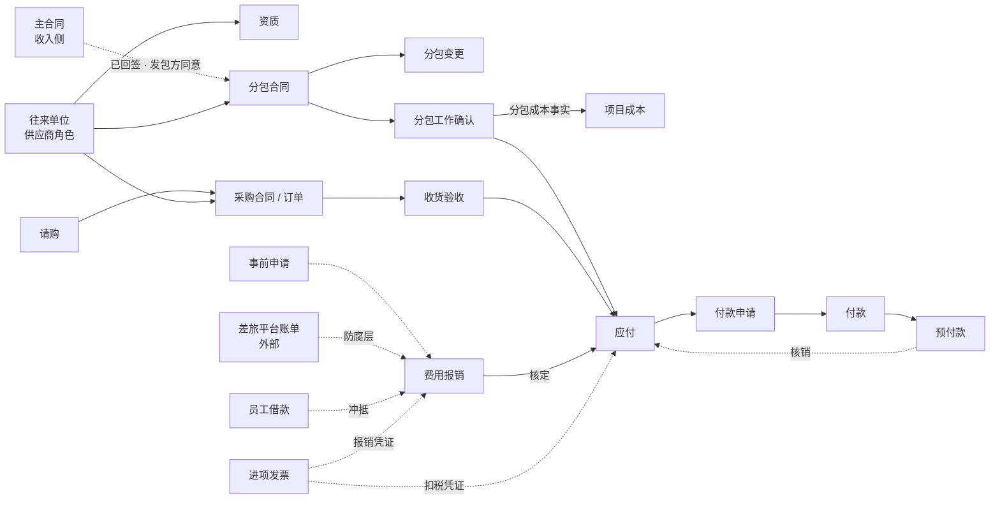
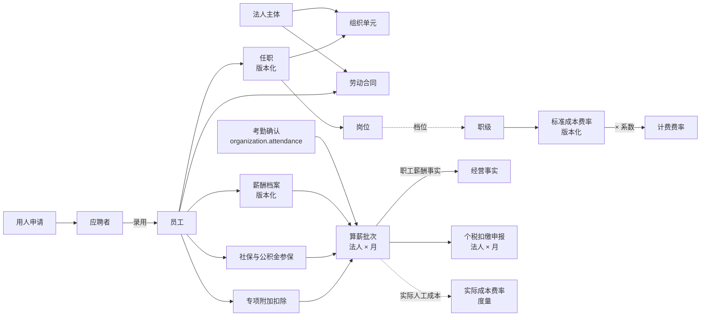
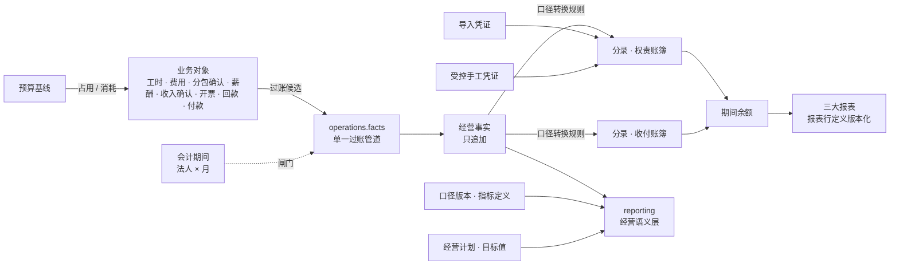

# AEC 项目制专业服务公司的业务对象：支出、组织与人力、财务与经营

状态：历史记录｜2026-10-15｜负责：one-architecture

状态：研究提议，待用户裁定 · 日期：2026-10-15 · 作者：one-architecture 子代理

依据：用户原则「行业通行做法为主要依据，老系统生产数据只作参考」（intent `2026-10-15-202634`）、「架构选择必须深入研究」（intent `2026-10-15-193135`）。本段用户已给的业务事实：客户与供应商共用单位档案、分角色（intent `2026-10-15-205406`）；分包合同要在新系统管（intent `2026-10-15-202939`）；三套费率（intent `2026-10-15-211139`）；非项目采购、员工借还款、合伙人注资退回「都算，都进新系统」，「新系统要自建整个hrm，算薪要迁入」，「主数据全部进新系统」（ADR-0021）；总账进新系统、出权责口径三大报表（ADR-0022）；先识别全部业务对象，再统一定 BC、子域、价值流（INTENT.md 2026-10-15 「费率可以放在主数据吧？……」一行）。

格式、来源缩写与判据沿用 `AEC_BUSINESS_OBJECTS.md`（售前段）。本文不定 BC，只给对象、状态、关系、规则与现状差异；「可能归属」一栏只是现有规划的位置，供统一定 BC 时参考。

## 0. 来源与缩写

按权威性排序。凡标「未核实」的，不作硬依据。「原文」= 读到官方或地方政府转载的正文；「转载」= 只读到地方政府转载件。

### 0.1 法规与准则

| 缩写 | 来源 | 取得方式 |
|---|---|---|
| 〔招标法〕 | 《招标投标法》第 48、58 条 https://www.ndrc.gov.cn/xxgk/zcfb/qt/201511/t20151103_967422.html | 原文。2026 年 6 月修订草案已征求意见，正式通过后条号可能变 |
| 〔招标条例〕 | 《招标投标法实施条例》第 59、76 条（2019 国务院令第 709 号修订后条号未变）https://www.gov.cn/gongbao/content/2019/content_5468831.htm | 原文 |
| 〔勘设条例〕 | 《建设工程勘察设计管理条例》第 19–21 条 https://www.gov.cn/gongbao/content/2019/content_5468869.htm | 原文 |
| 〔质量条例〕 | 《建设工程质量管理条例》第 18、78 条 https://www.gov.cn/gongbao/content/2019/content_5468867.htm | 原文 |
| 〔增值税法〕 | 《增值税法》（2026-01-01 施行）第 16、21、22 条 https://fgk.chinatax.gov.cn/zcfgk/c100009/c5237365/content.html | 原文 |
| 〔增值税细则〕 | 《增值税法实施条例》（国务院令第 826 号）第 11、20、21、25 条 https://fgk.chinatax.gov.cn/zcfgk/c100010/c5246349/content.html | 原文 |
| 〔发票办法〕 | 《发票管理办法》（2023 修订）第 3、18–21、28 条 https://fgk.chinatax.gov.cn/zcfgk/c100010/c5195084/content.html | 原文 |
| 〔发票细则〕 | 《发票管理办法实施细则》（国家税务总局令第 56 号）第 3、24、26、27、29、40 条 https://www.gov.cn/gongbao/2024/issue_11286/202404/content_6945583.html | 原文 |
| 〔数电公告〕 | 国家税务总局公告 2024 年第 11 号（数电发票）第一、二、四、八、十、十一条 https://www.gov.cn/zhengce/zhengceku/202411/content_6989164.htm | 原文 |
| 〔扣除凭证〕 | 《企业所得税税前扣除凭证管理办法》（总局公告 2018 年第 28 号）第 4、6、7、9、12–17 条 https://www.gov.cn/gongbao/content/2018/content_5326376.htm | 原文 |
| 〔中小款项〕 | 《保障中小企业款项支付条例》（2025 修订，国务院令第 802 号，2025-06-01 施行）第 3、9、10、16–18 条 https://www.gov.cn/zhengce/content/202503/content_7015401.htm | 原文 |
| 〔会计法〕 | 《会计法》（2024 修正）第 9、11、14–16、25、35 条 https://kjs.mof.gov.cn/zhengcefabu/202408/t20240812_3941615.htm | 原文 |
| 〔会计基础〕 | 《会计基础工作规范》（财政部令第 98 号）第 47–51、61–63 条 | 转载（威海市财政局）；修订在财政部 2026 年立法计划中，未见正式印发 |
| 〔会计档案〕 | 《会计档案管理办法》（财政部 国家档案局令第 79 号）第 6、8、14、15 条及附表 1 https://www.gov.cn/gongbao/content/2016/content_5041555.htm | 原文；附表取自财政部页面附件 |
| 〔软件规范〕 | 《会计软件基本功能和服务规范》（财会〔2024〕12 号）第 21、24、32 条 https://www.gov.cn/gongbao/2024/issue_11606/202409/content_6976924.html | 原文；全文**没有**「反结账」「结账后不得修改」「红字冲销」条文 |
| 〔信息化规范〕 | 《会计信息化工作规范》（财会〔2024〕11 号）第 27、28、31、32、38 条 https://www.gov.cn/gongbao/2024/issue_11586/202409/content_6975086.html | 原文 |
| 〔基本准则〕 | 《企业会计准则——基本准则》第 9、10、20–37 条 https://www.gov.cn/gongbao/content/2014/content_2775514.htm | 原文 |
| 〔CAS9〕 | 《企业会计准则第 9 号——职工薪酬》（2014）第 2、3、5–7 条 https://www.gov.cn/gongbao/content/2014/content_2684515.htm | 原文 |
| 〔CAS14〕 | 《企业会计准则第 14 号——收入》第 26–28 条 | 原文（售前段已核） |
| 〔CAS30〕 | 第 30 号（财会〔2014〕7 号）第 2 条；2026 修订（财会〔2026〕11 号）非上市企业 2030-01-01 起执行 https://m.mof.gov.cn/czxw/202608/t20260805_3994927.htm | 原文 |
| 〔CAS31〕 | 第 31 号——现金流量表 第 2 条 | 原文 |
| 〔报表格式〕 | 财会〔2019〕6 号一般企业财务报表格式（附件 2 适用已执行新收入、新金融、新租赁准则的企业） | 原文 |
| 〔内控〕 | 《企业内部控制基本规范》（财会〔2008〕7 号）第 28–30、33 条（转载）；应用指引第 6 号资金活动第 21 条、第 7 号采购业务第 4、11、13–15 条、第 15 号全面预算第 9、11、14 条 http://kjs.mof.gov.cn/zhengcefabu/201005/P020230421440664863663.pdf | 应用指引原文；基本规范转载 |
| 〔劳动合同法〕 | 第 7、10、14、19、20、44、50、82 条 https://fgk.chinatax.gov.cn/zcfgk/c100009/c5193025/content.html | 税务总局法规库转载的 2012 修正本；之后是否再修订未核实 |
| 〔社保法〕 | 《社会保险法》第 2、12、23、33、44、53、57、58、60、84、86 条 https://fgk.chinatax.gov.cn/zcfgk/c100009/c5192937/content.html | 同上（2018 修正本） |
| 〔公积金条例〕 | 《住房公积金管理条例》（2019 修订）第 14–17、19、20 条 | 转载（三明市）；2019 年后是否再修订未核实 |
| 〔个税法〕 | 《个人所得税法》第 9–11、14 条 https://www.chinatax.gov.cn/n810219/n810744/n3752930/n3752974/c3970366/content.html | 原文 |
| 〔个税条例〕 | 《个人所得税法实施条例》（国务院令第 707 号）第 24–26、28 条 https://fgk.chinatax.gov.cn/zcfgk/c100010/c5194444/content.html | 原文 |
| 〔扣缴办法〕 | 《个人所得税扣缴申报管理办法（试行）》（总局公告 2018 年第 61 号）第 2、3、6、13–16 条 https://fgk.chinatax.gov.cn/zcfgk/c100012/c5194838/content.html | 原文 |
| 〔工资支付〕 | 《工资支付暂行规定》（劳部发〔1994〕489 号）第 5–7、9、15、16 条 https://www.gov.cn/zhengce/2022-08/31/content_5711284.htm | 原文 |
| 〔公司法〕 | 《公司法》（2023 修订）第 13、32、33 条 https://fgk.chinatax.gov.cn/zcfgk/c100009/c5233383/content.html | 原文 |

### 0.2 框架、产品与仓库

| 缩写 | 来源 |
|---|---|
| 〔BIZ〕 | BIZBOK Guide v11 本地文本 `/Users/yeliang/Projects/YeliangDu/standards/bizbok-v11/_text/BIZBOK-v11.txt`；页码按页脚「Version 11.0 N」 |
| 〔G190〕〔G211〕〔G233〕 | TOGAF Series Guide：Information Mapping（G190）、Business Capabilities v2（G211）、Business Capability Planning（G233），本地 `.../togaf10-2025-05/_text/` |
| 〔VP-DD〕〔VP-H〕 | Deltek Vantagepoint 2026.4 数据字典（表名即页标题）与帮助镜像（`Learning_Mirror/.../page/<文件名>`，下文省略后缀） |
| 〔SPI〕 | SPI Research《2023 Professional Services Maturity Benchmark》本地 PDF；页码为 PDF 页 |
| 〔词表〕 | `docs/glossary/terms.yaml`（580 条） |
| 〔事实〕 | 用户业务事实（intent 文件名见文首） |
| 〔仓库〕 | ADR-0016、0021、0022、0023、0026；`OA_PROCESS_INVENTORY.md`；`rules/GL_FINANCE_DECISIONS.md`；`r0/FINANCE_DECISIONS.md`（FD-xx）；`BUSINESS_RULES.md`（RULE-xxx）；`PRESALES_OBJECTS_EVIDENCE.md` §10；`architecture/ddd/contexts.yaml`；IDENTITY_LIFECYCLE（提交 `2b9a60f7`，在其他分支） |

产品证据（Deltek、SPI）只说明「行业成熟产品这样建模」，不是权威；与法规、准则冲突时以法规、准则为准。老系统与 A8 的计数只作参考。

### 0.3 判据（与售前段一致，补三条本段特有的）

依〔BIZ〕§2.5：业务对象是名词、持久、有定义、类型、状态与关系（p186）；不依附其他对象存在的是一级，依附的是次级（p194–195、p198）；同一对象的变体用**类型**，不得按类型拆成多个对象——不造 Customer Agreement / Vendor Agreement，只有 Agreement 加类型（p195）；估值、评级、价格是属性（p198–199）；文档、表单、**发票**是人造物，不是信息概念（p197，原例把发票表示为 Payment 加 Message）；汇聚型对象（如 Finance）只列名，不填类型与状态，其子对象才是次级概念（p195、p199）。TOGAF 元模型把 Measure（度量）与 Data Entity 分开（〔G233〕p10 也把转化率等单列为 measures）。

本段补充三条：

1. **中国增值税发票不按「纯单据」处理。** BIZBOK 把发票看成 Payment 与 Message 的呈现。但数电发票有法定编号（〔数电公告〕第四条，20 位）、由税务系统登记，有用途确认、入账确认、红字确认单（72 小时未确认自动作废）、进项转出等法定状态（〔数电公告〕第八、十、十一条；〔发票细则〕第 26、27 条），且「不合规发票不得报销、不得税前扣除」（〔发票办法〕第 20 条；〔扣除凭证〕第 12 条）。这些状态与规则是业务必须追踪的，所以按「有法定生命周期的对象」建模；票面本身仍是单据。售前段已对销项发票作同样处理。
2. **记账凭证同理。** 〔软件规范〕第 21 条第（三）项规定已记账不可逆、不得删除或插入、不得改日期金额科目——凭证有「未审核 → 已审核 → 已记账」的受法规约束的状态。本文把「会计分录 / 凭证」作为对象，凭证打印件、附件作为单据。
3. **度量与指标定义分开。** 指标的「值」是派生度量；「指标定义」（公式、口径版本、审批）是有版本与状态的配置对象（ADR-0023 第 2、3 条，词表 `metric_definition`）。

## 1. 汇总表

「现状」列：✅ 已有且分类合适；⚠️ 已有但分类或定义可能需调整；❌ 缺失。

### 1.1 支出

| 对象 | 一句话定义 | 关键状态 | 主要关系 | 来源 | terms.yaml 现状 |
|---|---|---|---|---|---|
| 往来单位（供应商角色）| 与我方有或将有协议、向我方提供服务或货物的法律主体；与客户共用一份单位档案，按角色区分 | 角色：申请 → 合格（可用）→ 暂停 → 停用（原因必填）| 1 往来单位 → 0..1 供应商角色、0..1 客户角色；1 供应商 → N 资质、N 银行账户、N 分包 / 采购合同 | 〔事实〕；〔BIZ〕p84、p587（Partner：Supply 类型）；〔VP-DD〕`Clendor.ClientInd/VendorInd`、`VEAccounting`；〔VP-H〕`st_firms_firm_classifications` | ❌ 无「往来单位」「供应商」词条（只在 contexts.yaml 职责中出现） |
| 供应商资质（次级） | 供应商承接某类工作所需的资质、证书及其有效期 | 有效 → 到期 / 吊销 | 依附供应商；分包合同签订时引用 | 〔招标法〕第 48 条（分包人须有相应资格）；〔勘设条例〕第 19 条（相应资质）；〔VP-DD〕未找到资质专表 | ❌ |
| 分包合同 Subcontract | 我方把所承接合同中的部分工作交给供应商完成而订立的合同（成本侧，不是收入合同）| 草案 → 审批中 → 已签署生效 → 履行中 → 已结算 → 关闭；或终止；违法分包即无效 | N 分包合同 → 1 主合同（及其项目）；1 分包合同 → 1 供应商；1 → N 分包变更、N 分包工作确认、N 付款条件 | 〔招标法〕第 48、58 条；〔招标条例〕第 59、76 条；〔勘设条例〕第 19、20 条；〔质量条例〕第 18、78 条；〔事实〕；〔VP-DD〕无独立表（`PR.ConsultFee`、`RPConsultant`、PO 承载） | ❌（只有度量 `subcontract_cost`、`outsourcing_cost`） |
| 采购合同 / 采购订单（非项目） | 为公司运营购买货物或服务而订立的合同或订单 | 编制 → 已提交 → 已批准 / 驳回 → 执行中（部分收货）→ 关闭；可变更、取消 | 0..1 请购 → 1 采购合同 → N 收货验收 → N 应付 | 〔内控〕第 7 号第 4、11、13 条；〔VP-DD〕`POMaster.Status`（N/S/A/J/R/P/G/C）、`POCOMaster`；〔事实〕（非项目采购进新系统） | ❌ |
| 请购 Purchase Requisition | 内部提出的采购需求与审批 | 草稿 → 已提交 → 已批准 / 驳回 → 已转订单 | 1 请购 → 0..N 采购合同行 | 〔内控〕第 7 号第 4 条；〔VP-DD〕`POPRMaster.Status`、`POPRDetail.OrderStatus` | ❌ |
| 收货验收（次级） | 对采购货物或服务的验收结论 | 已验收（接收 / 拒收数量与金额） | 依附采购合同行；是应付与付款的前置证据 | 〔内控〕第 7 号第 11 条（专门人员验收并出具证明）；〔会计基础〕第 48 条（购实物须有验收证明）；〔VP-DD〕`ReceiveMaster/Detail` | ❌ |
| 分包工作确认 | 对分包方某期已完成工作的确认，是分包成本与应付的发生依据 | 提交 → 审核 → 已确认；冲销 | N → 1 分包合同；确认 → 分包成本事实 + 应付 | 〔事实〕（A8「项目委外交付确认单」：确认即形成分包成本与应付，OA 盘点 #41）；〔CAS14〕第 26 条（合同履约成本）；〔VP-H〕`ac_consultant_accruals`（按顾问计提，不依赖供应商开票节奏） | ❌ |
| 应付（开放项） | 我方对供应商、员工或其他方的无条件付款义务余额 | 未付 → 部分付 → 已付清；冲销 | 来源：分包工作确认、采购验收（+ 发票）、费用核定、员工借款；1 应付 ← N 付款核销 | 〔基本准则〕第 23 条（负债定义）；〔内控〕第 7 号第 15 条（与供应商定期对账）；〔VP-DD〕`apMaster`、`LedgerAP`、`VO` | ⚠️ `payables.payment` 只有度量 `expense_payment` |
| 付款申请 | 申请从公司账户向外付款的内部审批载体 | 草稿 → 审批中 → 已批准 / 驳回 → 已支付（部分）/ 撤销 | 1 付款申请 → N 应付 / 预付；→ 1..N 付款 | 〔内控〕第 6 号第 21 条（写明用途、金额、预算并附原始单据）；第 7 号第 13 条；〔仓库〕OA 盘点 #29–37 | ❌ |
| 付款 Payment | 从公司账户实际划出的一笔款项 | 已发起 → 已成功 / 已失败（退票）→ 已核销 | 1 付款 → 1 收款方银行账户；N 付款 ↔ N 应付（核销分配） | 〔BIZ〕p588（Payment：Outbound；Paid / Unpaid / Cancelled）；〔VP-DD〕`apppChecks`、`cvMaster` | ⚠️ 只有度量 `expense_payment` |
| 预付款 | 先于取得服务或发票支付、待以后核销的款项 | 已付 → 部分核销 → 核销完；长期未核销预警 | 1 预付 → N 核销（对应分包确认或进项发票） | 〔内控〕第 7 号第 14 条（大额、长期预付定期追踪）；〔仓库〕D17-9（预付核销只由应付与付款 BC 生成一次）；〔VP-DD〕未找到供应商预付专表 | ❌ |
| 员工借款 | 员工因公预借的款项 | 已借出 → 部分归还 / 报销冲抵 → 结清 | 1 员工 → N 借款；还款、报销冲抵 → 核销 | 〔事实〕（员工借还款进新系统）；〔仓库〕OA 盘点 #10、A6（员工借款单独记账、专项台账）；〔VP-DD〕`EXAdvance` | ❌ |
| 费用报销 | 员工为公务垫付费用后，经审核由公司偿付并确认费用 | 草稿 → 已提交 → 审批中 → 已核定（费用所属期间确定）→ 已过账 → 已付；驳回、冲销 | 1 报销 → N 明细（费用类别、项目 / 商机、可计费）；明细 → 0..N 发票；0..1 事前申请；可冲抵借款 | 〔发票办法〕第 20 条；〔扣除凭证〕第 9 条；〔会计基础〕第 47–49 条；〔仓库〕FD-16（按核定的费用所属期间）；〔VP-H〕`st_exp_expense_report_status`（In Progress → Submitted → Approved → Posted；付款状态另记） | ⚠️ `expense_claim` 标 `document`（报销单），但它有状态与规则 |
| 事前申请（出差、业务招待） | 费用发生前的申请与额度批准 | 已提交 → 已批准 / 驳回 → 已使用 / 过期 | 1 申请 → 0..N 报销明细 | 〔仓库〕OA 盘点 #27（业务招待申请决定可报销额度）；brief Phase 3（出差申请） | ❌ |
| 差旅订单与统一结算账单（外部） | 在差旅平台下单形成的机票、酒店订单，以及平台按月出具的结算账单 | 外部对象，只引用 | 账单 → 分摊到项目 / 商机 → 费用 | brief Phase 3；ADR-0039（外部概念只在 `platform.integration`） | 不进领域词表（外部概念） |
| 进项发票 | 我方取得的增值税扣税凭证及其抵扣处理 | 已取得（查验）→ 已用途确认（抵扣 / 不抵扣）→ 已入账；红字确认、进项转出 | 1 进项发票 → 1 销售方（往来单位或个人）；N ↔ N 报销明细、应付、预付核销 | 〔增值税法〕第 16、22 条；〔增值税细则〕第 11、20、21 条；〔发票办法〕第 18–20 条；〔数电公告〕第八、十、十一条；〔VP-DD〕`CFGBillTaxesData.NonRecoverPercent` | ❌ |

### 1.2 组织与人力

| 对象 | 一句话定义 | 关键状态 | 主要关系 | 来源 | terms.yaml 现状 |
|---|---|---|---|---|---|
| 法人主体 | 能独立承担民事责任的公司；分公司不是法人 | 筹建 → 存续 → 注销（法人代码发号后不可改） | 1 法人 → N 组织单元、N 账簿、N 资质；分公司 = 法人下的核算维度 | 〔公司法〕第 13 条；〔BIZ〕p670（Business Entity：Extant / Non-Extant / In-Formation）；〔仓库〕ADR-0022 第 1 条（分公司 1004、1005 是维度，不是期间闸门粒度） | ✅ `legal_entity` |
| 组织单元 | 法人下的部门、BU、区域、交付中心等管理单元 | 启用 → 停用 / 撤销（两者不同） | 1 法人 ← N 组织单元（默认归属，带生效区间）；树形层级 | 〔仓库〕ADR-0026 D-1、RULE-355；〔G206〕p4–5（组织图不等于组织结构图）；〔BIZ〕p472（Business Unit 属组织图） | ✅ `org_unit`（BIZBOK 视为组织图元素，见 §3.2） |
| 员工 | 与我方法人存在劳动关系（或劳务关系）的自然人 | 待入职 → 试用期 → 正式 → 待离职 → 已离职；停薪留职 | 1 员工 → N 劳动合同、N 任职、1 薪酬档案；员工 → 法人（默认随部门，可单独指定，带生效区间） | 〔劳动合同法〕第 7 条（用工之日起建立劳动关系、建职工名册）；〔BIZ〕p589（Human Resource：Former / Current / Future）；〔仓库〕RULE-363；〔VP-DD〕`EMMain` + `EMCompany.Status`（A/I/T） | ✅ `employee`；在职状态只有「在职 / 离职」两值 |
| 劳动合同 | 员工与法人订立的书面劳动合同及其续签、变更 | 待签 → 生效（试用期 → 期满）→ 续签 / 变更 → 终止 / 解除 | N → 1 员工；1 → 1 法人 | 〔劳动合同法〕第 10、14、19、44、82 条；〔仓库〕OA 盘点 #66（劳动合同续签意向征询） | ❌ |
| 任职 | 员工在某组织单元、某岗位上的任职及其汇报线 | 生效区间（只追加版本） | N → 1 员工；→ 1 组织单元、1 岗位；→ 直属上级 | 〔仓库〕`WORKFORCE_HISTORY_RULES.md`；〔VP-DD〕未找到任职历史表 | ✅ `workforce__assignment` |
| 岗位 | 组织中一个具名的职责位置（是否带编制待定） | 若为编制坑位：开放 → 已占用 → 关闭 | 1 岗位 → N 任职；岗位 → 职级（档位）| 〔BIZ〕p589（Job：Permanent / Temporary；Open / Closed）；〔事实〕（用户：「公司要重新梳理岗位体系」）；〔VP-DD〕`CFGHRJobs`、`JobTitles` | ⚠️ `position` 标 `value` |
| 职级 | 员工能力与薪酬的档位（T1–T7） | 无（配置值，版本化） | 任职 → 职级；职级 → 标准成本费率、计费费率档位 | 〔仓库〕RULE-007（费率按职级 × 薪档 × 城市取值）；〔VP-DD〕`CFGJobLevelData` | ✅ `job_grade`（value） |
| 用人申请（招聘需求） | 组织单元提出的增补人员需求 | 已提交 → 已批准 → 招聘中 → 已关闭（录满 / 取消） | 1 → N 应聘者；→ 1 岗位 | 〔仓库〕OA 盘点 #67、#55、#57、#74（用人申请、应聘登记、录用审批、面试评估） | ❌ |
| 应聘者 | 申请加入的外部个人 | 登记 → 面试 → 录用 / 未录用 | → 用人申请；录用 → 员工 | 同上 | ❌ |
| 薪酬档案（薪酬标准） | 员工的薪资结构、薪档与生效日 | 版本化（调薪产生新版本） | 1 员工 → N 薪酬档案版本 | 〔仓库〕OA 盘点 #60（调薪申请单）；〔CAS9〕第 5 条 | ❌ |
| 社保与公积金参保 | 员工在某参保地的险种参保、缴费基数与增减员 | 增员 → 在缴 → 减员（转移 / 封存） | 1 员工 → N 参保记录（险种 × 参保地）；年度缴费基数版本 | 〔社保法〕第 2、58、60 条；〔公积金条例〕第 15–17、19、20 条 | ❌ |
| 算薪批次 | 某法人某月一次薪酬计算、审核与发放 | 草稿 → 已计算 → 审核中 → 已批准 → 已发放 → 已过账；更正走冲销 | 1 批次（法人 × 月）→ N 员工薪酬行；输入：考勤确认、薪酬档案、参保、专项附加扣除；输出：职工薪酬事实、个税扣缴 | 〔工资支付〕第 6、7、15、16 条；〔CAS9〕第 5–7 条；〔仓库〕OA 盘点 #69、矩阵第 7 行；RULE-107（归集前须算薪完整） | ❌（`organization.payroll` 只在 contexts.yaml） |
| 个税扣缴申报 | 某法人某月对全员的个税预扣与申报缴款 | 待申报 → 已申报 → 已缴款；更正申报 | 1 申报（法人 × 月）→ N 员工累计预扣行；→ 算薪批次 | 〔个税法〕第 9–11、14 条；〔个税条例〕第 24、26、28 条；〔扣缴办法〕第 2、3、6 条 | ❌ |
| 专项附加扣除信息（次级） | 员工报送的子女教育、住房等扣除信息 | 有效年度内生效；一年一处扣除 | 依附员工 × 年度 | 〔个税条例〕第 28 条；〔扣缴办法〕第 14–16 条（不得擅改、保密） | ❌ |
| 费率（三套） | 标准成本费率（签约后交付）、计费费率（售前，= 标准成本费率 × 系数）、实际成本费率（核算） | 前两者版本化配置；实际成本费率是度量 | 职级 × 薪档 × 城市 → 费率；报价记所用计费费率版本 | 〔事实〕intent `2026-10-15-211139`；〔VP-DD〕`EMCompany.JobCostRate`、`BTRRT/BTRCT/BTRLT`、`PayRate` + Job Cost Variance | ⚠️ 见 §2.3、§5（已登记 4 条用语问题） |

### 1.3 财务与经营

| 对象 | 一句话定义 | 关键状态 | 主要关系 | 来源 | terms.yaml 现状 |
|---|---|---|---|---|---|
| 会计科目 / 科目表 | 按会计要素分类的账户；每个账簿一张科目表 | 启用 → 停用（被引用后不可删）；科目表版本化 | 1 账簿 → 1 科目表 → N 科目；收付科目 ↔ 权责科目映射 | 〔基本准则〕第 10 条；〔仓库〕ADR-0022 第 2 条、D3；〔BIZ〕p588（Financial Account：Pending / Open / Closed / Suspended）；〔VP-DD〕`CA.Type`（10 类） | ⚠️ `account` 定义「外购系统承载」已过期；科目表、科目映射无词条 |
| 账簿 | 同一法人并行的会计账簿：收付（法定）、权责（管理） | 开立 → 在用 → 只读 | 1 法人 → 2 账簿 | 〔仓库〕ADR-0022 第 2 条 | ✅ `ledger` |
| 会计分录 / 记账凭证 | 按借贷记账法记录一笔经济业务的分录集合，凭证是其法定呈现 | 草稿 → 已审核 → 已记账（不可逆）；更正只能冲销 | 来源：经营事实（系统凭证）、导入、受控手工、期末；N 凭证 → 1 账簿 × 期间 | 〔会计法〕第 14、15 条；〔会计基础〕第 50、51 条；〔软件规范〕第 21 条；〔会计档案〕附表 1（30 年）；〔仓库〕ADR-0022 第 3 条 | ⚠️ `journal_voucher` 标 `document`，定义「外购系统承载」已过期 |
| 会计期间 | 法人 × 月（及第 13 调整期）的记账期间 | 未开 → 开放 → 关账中 → 已关账；重开须审批 | 1 法人 → N 期间；两账簿同时关账 | 〔会计法〕第 11 条；〔会计基础〕第 63 条；〔软件规范〕第 24 条；〔仓库〕ADR-0016、ADR-0022 第 10 条、FD-46 | ✅ `accounting_period`；⚠️ 事件 `accounting_period_closed` 中文名写成「会计期间」 |
| 期间余额（次级） | 账簿 × 科目 × 辅助维度 × 期间的余额与发生额 | 关账后冻结 | 由分录汇总；报表取数来源 | 〔仓库〕ADR-0022 第 3 条 | ❌（度量 / 快照，不是有状态对象） |
| 财务报表 | 资产负债表、利润表、现金流量表（及所有者权益变动表、附注） | 报表格式版本化；期间报表随关账生成、只读 | 报表行 → 科目 / 现金流量项目映射；1 账簿 × 期间 → 1 套报表 | 〔CAS30〕第 2 条；〔CAS31〕第 2 条；〔报表格式〕；〔会计档案〕附表 1（年报永久、月季报 10 年）；〔仓库〕ADR-0022 第 4、5 条 | ⚠️ `financial_statement`、`balance_sheet`（中文名缺「表」）标 `document`；报表行定义无词条 |
| 经营事实 | 由事件认定、证据化、可归属的业务事实；单一过账管道的输入 | 只追加；更正只能冲销 | 各业务对象 → 过账候选 → 经营事实 → 会计分录 | 〔基本准则〕第 9 条；〔仓库〕ADR-0016 第 1、2 条 | ✅ `business_fact`、`posting_candidate`、`reversing_entry` |
| 经营计划 | 计划周期内目标与动作的版本化计划 | 编制中 → 审批 → 基线（不可变）→ 新版本 | 1 计划 → N 计划目标值（组织 × 期间 × 指标 × 目标类型） | 〔BIZ〕p670（Plan：Strategic / Tactical / Operational；In-Formulation / Formulated）；〔仓库〕ADR-0023 第 1 条 | ✅ `business_plan`、`business_plan_baseline` |
| 预算 | 预算年度 × 预算主体的版本化编制结果及其执行（占用、消耗、释放） | 编制 → 审批 → 生效基线 → 调整（新版本）；账户可冻结 | 1 预算基线 → N 预算账户；业务单据 → 占用 | 〔内控〕基本规范第 33 条、第 15 号第 9、11、14 条；〔VP-DD〕`CAB/CABDetail`（预算名 × 科目 × 13 期）；〔仓库〕ADR-0023 第 1 条 | ✅ `budget_baseline` 等 14 条 |
| 经营口径 / 指标定义 | 指标的公式、来源映射、维度与口径版本 | 草拟 → 审批 → 生效版本（不追溯） | 1 口径版本 → N 指标定义 → OAT 原语 | 〔仓库〕ADR-0023 第 2、3 条；〔G233〕p10、C220 元模型（Measure 单列） | ✅ `policy`、`policy_version`、`metric_definition` |
| 指标值（度量） | 按指标定义计算出的数值：利用率、贡献毛利、DSO、预算消耗率…… | 不是对象 | 由事实与快照计算 | 〔SPI〕附录 D（p223–227 标准 KPI 定义）；〔VP-H〕`dvp_rept_execreports_keyfin_columnsfor`（Backlog、Effective Multiplier 只是报表列） | ✅ 多条 `metric`，见 §4 |

## 2. 支出段详述

### 2.1 总体结构

行业证据的一致点与分歧：

- **客户与供应商是一份单位档案上的两个角色**。Deltek 用同一张 `Clendor` 表，`ClientInd`、`VendorInd` 两个标志位，供应商专属的付款条件、银行、税码放在按公司分行的 `VEAccounting`（〔VP-DD〕；〔VP-H〕`st_firms_firm_classifications`：一个单位可以既是客户又是供应商，不必录两条）。BIZBOK 也把 supplier、vendor、contractor 收敛为 Partner 的类型（〔BIZ〕p84、p201、p587），政府参考模型同样把「Supplier、Vendor、Provider」映射到 Partner（p701–702）。与用户事实一致。
- **分包合同在 Deltek 中不是独立对象**：合同额上有 `ConsultFee`，项目计划里按供应商分行的 Consultant 行，承诺和付款走 PO 与 AP 凭证（〔VP-DD〕`PR.ConsultFee`、`RPConsultant`、`POMaster.Type=S`）。这是北美设计院以「consultant」小额委托为主的做法。中国法规对分包设有前置条件与无效后果（§2.3），用户也明确要管分包合同（〔事实〕），所以应为独立对象。BIZBOK 的口径是：分包合同与采购合同、收入合同都是 **Agreement**，用类型区分（p92、p195）。
- **采购链条**：Deltek 的流水线是 请购 → 询价（可选）→ PO（可变更）→ 收货 → 两单 / 三单匹配 → AP 凭证（〔VP-DD〕`POPRMaster`、`POMaster`、`ReceiveMaster`、`POVoucherMaster.MatchCode`）。〔内控〕第 7 号第 4 条要求明确请购、审批、购买、验收、付款、后评估各环节职责，与此一致。
- **费用报销**：Deltek 的报销是「主 + 明细」，明细行带项目、可计费、公司已付标志并逐行审批；公司卡流水是独立表，经匹配进入报销行（〔VP-DD〕`ekDetail.Billable/CompanyPaid`、`CreditCardTransaction`）。差旅在 Deltek 没有专表（只有里程）。
- **应付与付款分开**：Deltek 把应付（`apMaster` → `LedgerAP`）与付款运行（`apppChecks`、`CFGPostControl.PaymentProcessRun`）分开；BIZBOK 金融模型把 Payment 定为次级概念（Inbound / Outbound；Paid / Unpaid / Cancelled，p588）。

### 2.2 往来单位（供应商角色）与资质

- **定义**：与我方有、将有或曾有协议的法律主体（〔BIZ〕p587 Partner 定义）。供应商是它的一个角色，不是另一个对象。也包括个人（个人劳务、居间方）。
- **状态（角色级）**：申请 → 合格（可用于签约与付款）→ 暂停（如资质过期、违约）→ 停用（原因必填）。档案本身按 DATA_DESIGN_CHECKLIST §14.1 D17 版本化；合并时广播事件（售前聚合已定）。
- **组成部分**：联系人；银行账户（付款对象，敏感，变更须审批留痕）；税务登记信息（纳税人识别号、一般 / 小规模纳税人——决定能否取得专票抵扣）；**企业规模（中小企业与否，按合同订立时确定，〔中小款项〕第 3 条）**；资质证书与有效期。
- **类型**：分包方（专业分包）、外包方（人力外包）、采购供应商、居间方、个人。
- **规则**：
  - 违反即拒绝：分包合同只能与持有相应资质的供应商订立（〔招标法〕第 48 条；〔勘设条例〕第 19 条）——是否在系统中硬控见 §7 问题 1；被停用的供应商不得新建合同与付款申请。
  - 预警：资质临近到期；银行账户近期变更后的首笔付款。
- **负责人**：采购或费控（档案维护）；财务（银行与税务信息）。
- **中国语境**：A8 有供应商档案 1,452 条（线下 757、线上 352、空 343），无状态字段；U8C 另有客商档案，两者关系未核实（〔仓库〕`PRESALES_OBJECTS_EVIDENCE.md` §10）。

### 2.3 分包合同

- **定义**：我方把所承接合同中的部分工作交给供应商完成而订立的合同。它是成本侧合同，不是 CAS 14 意义上的收入合同。
- **类型**（同一对象的变体，不拆对象，〔BIZ〕p195）：
  - **专业分包**（成果性，按验收计价，责任随成果转移）与**人力外包**（按工时 / 人月计费，人员受我方管理）。词表已用两个度量区分（`subcontract_cost`、`outsourcing_cost`，「Q31 业主定稿」），用户在用语确认中答「两种都有，按单据区分」（INTENT.md 用语确认第二轮 A5）。
  - 计价方式：总价、单价、按工时。
- **状态机**：草案 → 审批中 → 已签署生效 → 履行中 → 已结算（最终结算确认）→ 关闭；可终止（原因必填）；被认定违法分包时合同无效（〔招标法〕第 58 条；〔招标条例〕第 76 条）。
- **组成部分**：分包范围（对应主合同的哪些工作 / WBS）、分包金额、付款条件、质保金、发包方同意证据、分包变更（有自己的审批与生效，产生新版本，与主合同变更同构）。
- **关系**：N 分包合同 → 1 主合同（老系统与 A8 中 300 个项目有分包，一项目最多 5 份，〔仓库〕§10）；1 → 1 供应商；1 → N 分包工作确认 → 分包成本 + 应付。
- **规则**：
  - 违反即拒绝（法规）：
    - 只能分包非主体、非关键性工作；分包人不得再分包（〔招标法〕第 48 条，〔招标条例〕第 59 条——适用于中标项目）。
    - 建设工程勘察设计：主体部分不得分包；其他部分须经**发包方书面同意**、分包给有相应资质的单位；不得转包（〔勘设条例〕第 19、20 条；〔质量条例〕第 18 条，违法分包四种情形见第 78 条）。
    - 大型企业向中小企业付款：**不得以收到第三方付款作为付款条件**，交付起 60 日内付款（〔中小款项〕第 9 条）；以验收为付款条件的，从验收合格日起算（第 10 条）。这直接约束「背靠背付款」条款——Deltek 的 Pay When Paid（`VO.PayTerms='PWP'`，客户付清后才付分包，〔VP-H〕`ap_payment_terms`）在中国对中小分包方只有在我方不属大型企业时才可用。我方是否属大型企业见 §7 问题 3。
  - 违反即拒绝（业务，取证支持，待用户确认）：主合同回签前不签分包——A8 中 388 份项目委外合同全部在主合同「合约已回」之后（〔仓库〕§10）。
  - 预警：分包金额占主合同金额比例过高（SPI：分包超过收入 20% 会被看作人力外包，〔SPI〕p166）；分包累计确认超合同额；付款逾期（〔中小款项〕第 17 条，逾期利息未约定的按日万分之五）。
- **负责人**：项目经理提出；采购或经营管理审批；财务审付款条件。
- **中国语境差异**：北美以 consultant 委托为主、靠 PO 承载；中国有法定前置条件和无效后果，且有付款期限的行政法规。

### 2.4 分包工作确认与分包成本

- **定义**：对分包方某期已完成工作的确认（A8「项目委外交付确认单」，确认即形成分包成本与应付，OA 盘点 #41）。
- **状态**：提交 → 审核 → 已确认；更正走冲销（ADR-0031 冲销单、修正单）。
- **规则**：累计确认 ≤ 分包合同金额（含已生效变更）——违反即拒绝；确认日期决定成本期间，所属期间已关账的落开放期间并标注原期间（ADR-0016 第 2 条；RULE-134）。
- **会计含义**：确认形成合同履约成本（〔CAS14〕第 26 条），与发票无关——Deltek 的「顾问计提」也是为了让项目利润不依赖供应商开票节奏（〔VP-H〕`ac_consultant_accruals`）。事实类型「分包成本」须补进过账管道（OA 盘点矩阵第 13 行）。
- **判据**：有状态、有规则的次级对象（依附分包合同）。

### 2.5 采购（非项目）

- **对象**：请购 → 采购合同 / 订单 → 收货验收。三者都有独立状态（〔VP-DD〕各自有 `Status`），但都依附同一个采购 Agreement 链条。
- **规则**：
  - 违反即拒绝：采购须经专门人员验收并出具验收证明（〔内控〕第 7 号第 11 条）；付款前须审核预算、合同、单据、审批与发票，异常拒付（第 13 条）。
  - 预警或流程：两单 / 三单匹配差异（〔VP-DD〕`MatchMethod` 默认三单）；与供应商定期对账（第 15 条）。
- **中国语境**：A8 采购合同档案 1,181 份，「是否项目委外」只有 388 份标「是」，793 份为空；订单类型是自由文本（〔仓库〕§10）。说明今天分包与普通采购共用一张表单、靠标志区分——与 BIZBOK「一个 Agreement 加类型」一致。
- **固定资产**：IT 资产采购审批随非项目采购迁入；资产卡片与折旧在 G1 期间走导入通道（ADR-0022 第 6、7 条）。本文不展开固定资产对象。

### 2.6 应付、付款申请、付款、预付

- **应付**：无条件付款义务的开放项。来源有四：分包工作确认、采购验收（及发票）、费用报销核定、员工借款（应付给员工）。状态：未付 → 部分付 → 已付清。冲销走冲销单。
- **付款申请**：内部审批载体。〔内控〕第 6 号第 21 条要求写明用途、金额、预算，附原始单据并经授权审批——这是「违反即拒绝」的字段完整性规则。今天 A8 有 5 种付款申请单（公共、人事、财务、外部代发、特殊款项，OA 盘点 #29–37），在新系统中应是**一个对象加类型**（〔BIZ〕p195）。
- **付款**：实际划款。状态：已发起 → 成功 / 失败（退票）→ 已核销。银行流水在 G1 期间导入并与付款事实匹配（ADR-0022 第 6 条）。
- **预付款**：先付后核销。预付核销只由应付与付款 BC 生成一次（D17-9，已定）；大额、长期预付定期追踪（〔内控〕第 7 号第 14 条，预警）。
- **规则**：
  - 违反即拒绝：付款金额 ≤ 所选应付（或预付额度）未付余额；收款方须是该应付对应往来单位的已登记银行账户；不相容职务分离——经办、审批、出纳、记账不得为同一人，出纳不得兼任稽核与收支账目登记（〔会计法〕第 25、35 条；〔内控〕第 6 号第 21 条）。
  - 预警：对中小企业的付款临近 60 日期限（〔中小款项〕第 9 条，若适用）；中小企业提出确权请求须 30 日内确认（第 16 条）。
- **员工借款**：用户决定进新系统（ADR-0021）；财务决定员工借款按性质单独记账、设专项台账（GL_FINANCE_DECISIONS A6）。借款可被报销冲抵或现金归还。

### 2.7 费用报销、事前申请与差旅

- **费用报销**：员工垫付后由公司偿付并确认费用。
  - 状态：草稿 → 已提交 → 审批中 → 已核定 → 已过账 → 已付；驳回可重提；冲销走冲销单。「已付」是付款侧状态，Deltek 也把审批状态与付款状态分开记（〔VP-H〕`st_exp_expense_report_status`）。
  - 组成：明细行（费用类别、日期、项目或商机、是否可向客户转收、是否公司直付）、发票、事前申请引用、借款冲抵。
  - 规则：不合规发票不得作为报销凭证（〔发票办法〕第 20 条；〔发票细则〕第 40 条）；原始凭证须具备法定要素，外来凭证须盖章（〔会计基础〕第 47–49 条）——违反即拒绝。业务招待属「个人消费」，进项不得抵扣（〔增值税细则〕第 20 条；〔增值税法〕第 22 条）——这是税务处理规则，不拦报销。费用所属期间按审核核定的业务发生月（FD-16 推荐，财务答复一致）。
  - 词表 `expense_claim` 标为 `document`（报销单）。按〔BIZ〕p197，「报销单」这张纸是单据，概念是「费用报销」，它有状态与规则，应为对象（§5.3）。
- **事前申请**：出差申请、业务招待申请决定可报销额度（OA 盘点 #27）。有状态的次级对象。
- **差旅平台（外部）**：订单与月度结算账单是外部对象，只在防腐层（ADR-0039）。新系统中对应的业务对象是「费用」（统一结算的公司直付费用），账单分摊到项目或商机后形成费用事实（brief §4 业务走查：月底财务把账单和发票分摊到项目或商机并审批月度对账单）。

### 2.8 进项发票

- **定义**：我方取得的增值税扣税凭证（专票、数电发票、海关缴款书等，〔增值税细则〕第 11 条）及其抵扣处理。
- **状态**：已取得（查验真伪）→ 已用途确认（抵扣 / 不抵扣）→ 已入账；对方红冲时：受票方未确认用途的由开票方直接红冲；已确认的须经《红字发票信息确认单》（72 小时未确认自动作废），已抵扣的先转出进项（〔数电公告〕第八条）。
- **规则**：
  - 违反即拒绝：不合规发票不得报销、不得作扣除凭证（〔发票办法〕第 20 条；〔扣除凭证〕第 12 条）；付款方不得要求变更品名和金额（〔发票办法〕第 19 条）；同一张发票不得重复入账（〔软件规范〕第 21 条第（二）项：防止电子凭证重复入账）。
  - 税务处理（不拦业务）：用于集体福利或个人消费、餐饮、居民日常与娱乐服务、贷款利息及相关顾问费的进项不得抵扣（〔增值税法〕第 22 条；〔增值税细则〕第 21 条）。
  - 预警：应取未取的扣除凭证——须在汇算清缴期结束前取得，被告知后 60 日内补正（〔扣除凭证〕第 6、15、16 条）。
- **保存期限**：会计凭证 30 年（〔会计档案〕附表 1）；已开发票存根联 5 年（〔发票办法〕第 28 条，针对开票方）。
- **归属**：ADR-0022 第 7 条提议的 `accounting.tax` 负责「增值税（进项类型、销项）」。进项发票同时被报销、应付、预付核销引用，归属待统一定 BC 时决定（§7 问题 7）。

## 3. 组织与人力段详述

### 3.1 总体结构

行业证据：

- **BIZBOK**：Human Resource 是一级对象（类型 Contractor / Employee，状态 Former / Current / Future），Job 是一级对象（Permanent / Temporary；Open / Closed）（〔BIZ〕p589）；Human Resource Management 能力含「评估、辅导、报酬、终止」及薪酬福利（p653）；参考模型**没有** Payroll 概念或能力，「结算月度工资」只是 Settle Financial Accounts 价值流的例子（p669）。通用模型有价值流 Onboard Human Resource（p665）。
- **Deltek**：员工「一人一档 + 每公司一行」（`EMMain` + `EMCompany`），状态、类型、组织、入离职日期在每公司行上（〔VP-DD〕）；**没有任职或雇佣历史表**；内置 Payroll 明显是美国口径（W-2、州税），海外靠第三方接口（`ADPExport`、`PayrollInterface`）。项目人工成本按「工时 × job cost rate」计入，实际工资与之的差额记 Job Cost Variance 科目，靠日记账或 Adjust Salaried Job Cost 对平（〔VP-H〕`ac_timesheet_posting_and_labor_distribution`）。
- **SPI**：Talent 支柱只给度量（自愿 / 非自愿离职率、招聘用时、到全计费用时、利用率、满负荷成本），没有薪酬或个税对象（〔SPI〕p127、p230）。

结论：行业产品在中国 HRM 的法定对象（劳动合同、社保公积金、个税累计预扣）上帮不上忙，这部分只能以法规为主要依据。

### 3.2 法人主体与组织单元

- **法人主体**：能独立承担民事责任；分公司不具法人资格（〔公司法〕第 13 条）。仓库已定：法人代码发号后禁改（INTENT.md 2026-10-14），分公司是核算维度（ADR-0022 第 1 条）。法人主体还承载**资质**（勘察设计单位只能在资质范围内承揽，〔勘设条例〕第 21 条；〔质量条例〕第 18 条），这是收入合同与分包合同共同的前置条件，目前词表没有。
- **组织单元**：BIZBOK 认为 Business Unit 属于组织图、不是信息概念（〔BIZ〕p472；〔G190〕p5：信息图要与组织图保持独立）。仓库把 `org_unit` 作为实体是因为它是数据范围、法人归属、审批路由的锚点。两者不冲突：在信息图上把组织单元标为「组织图元素，被多个对象引用」，不为它画状态机；在数据层仍是版本化主数据（ADR-0026、RULE-385）。

### 3.3 员工、劳动合同、任职、岗位与职级

- **员工**：
  - 状态机（建议）：待入职（录用已批、未到岗）→ 试用期 → 正式 → 待离职（离职申请已同意）→ 已离职；停薪留职为可恢复状态。现有词表只有在职 / 离职两值（`employment_status`），对权限与会话够用（RULE-363），对 HRM 不够。
  - 规则：劳动关系自用工之日起建立，应建职工名册（〔劳动合同法〕第 7 条）；入职 30 日内办社保登记（〔社保法〕第 58 条）与公积金缴存登记（〔公积金条例〕第 15 条）——预警；离职须 15 日内办档案和社保转移、出具证明（〔劳动合同法〕第 50 条）——预警；离职时一次付清工资（〔工资支付〕第 9 条）——算薪规则。
  - 身份衔接：IDENTITY_LIFECYCLE 取证结论——入职到企业微信可用中位数 0 天，离职以 HR 离职为准、即吊销会话；6e 后 HR 入职事件可预建外部身份待绑定。
- **劳动合同**：
  - 状态：待签 → 生效 → 续签 / 变更 → 终止（〔劳动合同法〕第 44 条情形）/ 解除。
  - 规则：试用期上限按合同期限 1 / 2 / 6 个月、同一单位只能约定一次、不满 3 个月不得约定（第 19 条）——违反即拒绝；试用期工资不低于约定工资 80% 且不低于最低工资（第 20 条）——算薪规则；用工满一个月未签书面合同（第 10、82 条）——预警；连续工作满十年等应签无固定期限（第 14 条）——续签时的硬规则；解除或终止的合同文本至少保存 2 年（第 50 条）。
  - 判据：有独立生命周期、有法定规则的对象，依附员工与法人。
- **任职**：员工在某组织单元、某岗位的任职，含汇报线；只追加版本（仓库已定）。Deltek 没有任职历史表，是其短板，不应照搬。
- **岗位与职级**：
  - 用户已决定「公司要重新梳理岗位体系」，ADR-0029 暂缓（INTENT.md）。
  - BIZBOK 把 Job 作为有 Open / Closed 状态的一级对象（p589）——那是「编制坑位」口径；Deltek 只有职位与职级码表（`CFGHRJobs`、`CFGJobLevelData`）——那是「职位目录」口径。两者都是行业做法，选哪种是业务问题（§7 问题 9）。
  - 职级 T1–T7 是档位值，决定标准成本费率与计费费率档位（词表 `job_grade`；RULE-007：费率按职级 × 薪档 × 城市取值）。
- **招聘**：用人申请、应聘者、录用审批、面试评估都在 A8 有在用模板（OA 盘点 #55、57、67、74），ADR-0021 已定随 HRM 迁入。用人申请（有审批与关闭状态）与应聘者（登记 → 面试 → 录用 / 未录用）是对象；面试评估是应聘者的组成部分。

### 3.4 薪酬、社保公积金与个税

- **薪酬档案**：员工的薪资结构与薪档，版本化（调薪产生新版本，OA 盘点 #60）。敏感：只授给人（INTENT.md 2026-10-14「采纳，敏感权限授给人」；项目经理只按职级标准费率看到个人行）。
- **社保与公积金参保**：
  - 状态：增员 → 在缴 → 减员（转移或封存，〔公积金条例〕第 15 条：终止劳动关系 30 日内）。
  - 计算口径：五险中工伤与生育只由单位缴（〔社保法〕第 2、33、53 条）；公积金月缴存额 = 上年度月平均工资 × 缴存比例，新参加工作的从第二个月起缴（〔公积金条例〕第 16、17 条）；单位代扣个人部分、发薪日起 5 日内汇缴（第 19、20 条）。缴费基数按年度调整，应作为版本化配置。
- **算薪批次**（法人 × 月）：
  - 状态：草稿 → 已计算 → 审核中 → 已批准 → 已发放 → 已过账；已批准后的更正走冲销（ADR-0031 模式）。
  - 输入：考勤确认（`organization.attendance`）、薪酬档案、参保、专项附加扣除、奖金与补录；输出：员工薪酬行（工资条是其单据）、职工薪酬事实（经过账管道）、个税扣缴、社保公积金代扣、付款（经应付与付款）。
  - 规则（违反即拒绝）：以法定货币支付、至少每月一次（〔工资支付〕第 5、7 条）；可代扣款项限于个税、个人社保等法定项目，赔偿损失扣款每月不超过当月工资 20% 且扣后不低于最低工资（第 15、16 条）；工资支付记录保存 2 年以上（第 6 条）。
  - 会计口径：短期薪酬在服务期间确认负债，按受益对象计入成本或损益；社保公积金按计提基础与比例确认（〔CAS9〕第 5–7 条）。职工范围含劳务派遣人员（第 3 条）。
  - 与成本的关系：老系统要求归集前算薪必须完整（RULE-107），三要素（工资、社保、公积金）分别舍入到分并锚定合计（RULE-075）；工时成本按「人天 × 日薪」使项目成本合计等于实际薪酬（FD-09 推荐）。6e 前薪酬凭证经指定导入通道进入（FD-30 推荐）。
- **个税扣缴申报**（法人 × 月）：
  - 状态：待申报 → 已申报 → 已缴款；更正申报。
  - 规则：支付所得的单位为扣缴义务人，全员全额申报（〔个税法〕第 9、10 条）；工资薪金按累计预扣法（〔扣缴办法〕第 6 条）；次月 15 日内申报缴库（〔个税法〕第 14 条）——期限是预警，金额计算是硬规则；同一专项附加扣除一年只能一处扣除（〔个税条例〕第 28 条）；不得擅改纳税人提供的信息，专项附加扣除信息保密（〔扣缴办法〕第 14–16 条）；年度终了两个月内向纳税人提供已扣税信息（第 13 条）。
  - 判据：员工累计预扣行是它的组成部分；专项附加扣除信息是依附员工 × 年度的次级对象（敏感个人信息）。
- **外部系统**：社保、公积金、个税的申报端在政府系统（自然人电子税务局扣缴端等）——新系统产出申报数据与回执登记，政府端对象只在防腐层。是否直连见 §7 问题 10。

### 3.5 三套费率

用户事实：标准成本费率用于签约后交付；售前用计费费率 = 标准成本费率 × 系数；实际成本费率用于核算（intent `2026-10-15-211139`）。

| 我方 | Deltek 对应 | 性质（建议） |
|---|---|---|
| 标准成本费率 | job cost rate：`EMCompany.JobCostRate`，或按项目选的 `CostRT/CostCT/CostLT`（带 `EffectiveDate`） | 版本化政策配置（财务维护）；职级 × 薪档 × 城市取值（RULE-007）；工时按工作日期锁定所用版本（RULE-147 已定「提交时锁定」） |
| 计费费率 | `BTRRT/BTRCT/BTRLT`，项目按 `BT.LabMeth` 与乘数 `Mult1..3` 选用 | 售前用：= 标准成本费率版本 × 系数；**被配置的是系数**（及其版本），计费费率是派生值；报价记所用标准费率版本与系数版本 |
| 实际成本费率 | pay rate：`EMCompany.PayRate`、`LD.Payrate`，实际工资在 `PYChecks*`；与 job cost rate 的差额记 Job Cost Variance | **派生度量**（实际薪酬 ÷ 有效工时，按人或按档汇总），由算薪批次与工时得出，不是主数据 |

注意：Deltek 的「provisional」费率（`ProvCostRate`）只是未过账工时在报表上的估算，与「暂估 vs 实际」无关（〔VP-DD〕）。

与词表的冲突：`bill_rate_card`（contract.baseline）定义为「对客计费费率卡，与成本费率卡对称」，是合同约定的 T&M 计费费率；用户所说的售前计费费率是内部测算用、由系数派生。两者是同名异义——前者属合同，后者属售前测算的输入。已有用语问题 4 条（`glossary/issues/2026-10-15-2111*`），本文不再重复登记，建议 one-glossary 按「合同计费费率」与「售前计费费率（系数派生）」分立。费率表放主数据作为候选，统一定 BC 时与往来单位一并定（INTENT.md 2026-10-15）。

## 4. 财务与经营段详述

### 4.1 总体结构

本段大部分对象已由 ADR-0016、0022、0023 定下，这里只按信息图判据补齐定义、状态与问题。

### 4.2 会计科目与科目表

- 两个账簿各一张科目表：收付账簿沿用 U8C 收付账套数字编码、改准则名称；权责账簿按准则新编，共同科目沿用收付编码，二者之间有版本化映射表（ADR-0022 第 2 条；D3）。
- 状态：启用 → 停用；被分录引用后不可删除（〔会计法〕第 15 条连续、可追溯的要求延伸）；科目表按版本生效。
- 类型：按会计要素（资产、负债、所有者权益、收入、费用、利润，〔基本准则〕第 10 条）；控制科目（应收、应付、合同资产等）带「来源通道授权表」（ADR-0022 第 3 条）。
- Deltek 的科目类型（`CA.Type` 10 类）把「可报销」「直接顾问」「间接」做成科目类型，用于项目计费口径（〔VP-DD〕；〔VP-H〕`concepts_accounting_account_types`）——那是收付混合口径下的做法；我方已定业务 BC 不认识科目（ADR-0016 第 3 条），可计费性在业务侧判定，不进科目类型。

### 4.3 会计分录 / 记账凭证

- **定义**：一笔经济业务的借贷分录集合；记账凭证是其法定呈现（〔会计基础〕第 50、51 条：凭证要素、连续编号）。
- **状态机**：草稿 → 已审核 → 已记账。记账不可逆，不得删除、插入或修改已记账凭证的日期、金额、科目、操作人（〔软件规范〕第 21 条第（三）项）。
- **更正**：当年错误红字注销再蓝字订正，或作差额调整凭证；以前年度错误用蓝字更正凭证（〔会计基础〕第 51 条第（五）项）。仓库已定：冲销以红字（同方向负数）表示，关账后更正落开放期间并标注原期间（ADR-0022 第 10 条）。〔软件规范〕没有「红字冲销」「反结账」条文，这些是本系统的设计选择，依据是〔会计基础〕第 51 条与〔软件规范〕第 21 条。
- **来源（类型）**：系统凭证、导入凭证、受控手工凭证（理由 + 附件 + 双人复核）、期末凭证（ADR-0022 第 3 条）。
- **组成**：分录行（科目、辅助维度：法人、部门、项目与合同、往来单位、人员、研发项目、进项类型）、现金流量项目标注（现金类分录必填，ADR-0022 第 5 条）、附件（电子原件须保存，〔信息化规范〕第 27、28 条）。
- **保存**：30 年（〔会计档案〕附表 1）；电子会计资料满足条件可只以电子形式归档（〔会计档案〕第 8 条；〔信息化规范〕第 31、32 条）。

### 4.4 会计期间与关账

- 会计年度为公历年度（〔会计法〕第 11 条）；期间粒度 (期间, 法人)（ADR-0016）；第 13 期只收年度审计调整（用户 A13；FD-46 待定细节）。
- 状态：未开 → 开放 → 关账中 → 已关账；重开须财务负责人审批（GL-123）。仓库已有 `period_status`（OPEN / CLOSING / CLOSED）。
- 关账前置检查（违反即拒绝）：本期凭证全部入账（〔会计基础〕第 63 条；〔软件规范〕第 24 条）、过账与分录生成队列为空、推送死信为空、明细账与控制科目一致、损益结转完成、现金流量标注完整、直接法 = 间接法、试算平衡、D17-0 三条对账等式（ADR-0022 第 10 条）；薪酬次月第 2 个工作日到齐（财务答复，关账日见 FD-26）。
- Deltek：按公司存关账状态（`CFGDatesStatus.Closed`），关账清单表标「For future use」（〔VP-DD〕）——说明行业产品的关账检查多在线下，我方把它做成闸门是更严的选择，有准则依据。

### 4.5 总账、期间余额与三大报表

- **总账**是汇聚型概念（〔BIZ〕p195 意义上的 Finance 一类），本身不画状态；其内容是账簿、科目、分录、期间余额。词表 `general_ledger`、`account`、`journal_voucher` 的定义仍写「外购系统承载」，与 ADR-0022（G1 起新系统为完整总账、G2 起为法定账）不符。
- **期间余额**：账簿 × 科目 × 辅助维度 × 期间，月结生成快照、关账后冻结（ADR-0022 第 3 条）——是派生快照，不是有状态对象。
- **财务报表**：
  - 组成：资产负债表、利润表、现金流量表、所有者权益变动表和附注（〔CAS30〕第 2 条）；格式按〔报表格式〕附件 2；现金等价物定义见〔CAS31〕第 2 条（受限资金、理财不算，GL-051）。
  - 对象拆分：**报表格式 / 报表行定义**（行项目 → 科目或现金流量项目的映射，版本化、财务评审后生效，两账簿共用一套行定义，ADR-0022 第 4 条）是配置对象；**某期报表**是关账后生成的只读产出（单据，年报永久、月季报 10 年，〔会计档案〕附表 1）。
  - 预警：〔CAS30〕2026 修订版（财会〔2026〕11 号）对非上市企业 2030 年起执行，报表行定义须预留版本切换。
- BIZBOK 与 Deltek 都没有「报表行定义」对象（BIZBOK 无 General Ledger、Journal、Accounting Period、Budget 概念，〔BIZ〕检索；Deltek 只有科目分组 `GLGroup`）。这部分以准则与仓库 ADR 为准。

### 4.6 经营事实

- 已由 ADR-0016 定：`operations.facts` 是唯一过账管道，事实只追加，更正只能冲销。信息图上，经营事实是**事件型对象**：一旦认定不可变，有归属（九维）与证据（`fact_evidence`），没有业务状态机。
- 本段需补的事实类型（OA 盘点矩阵「须补」项）：员工往来、应付、付款、预提、分包成本、职工薪酬、权益（注资退回）、减值（ADR-0021 后果第 2 条）。
- BIZBOK 对应 Financial Transaction（类型 Sale / Purchase / Receipt / Payment；状态 Executed / Pending / Rejected / Cancelled，〔BIZ〕p588）。我方「过账候选」承担 Pending / Rejected，「经营事实」只有 Executed（及被冲销关联）。

### 4.7 经营计划与预算

- **经营计划**：计划周期内目标与动作的版本化计划，审批生效为基线（词表已有）；计划目标值按目标类型（预算、承诺、挑战、预测、减值计划）与版本保存。BIZBOK Plan 的状态为 In-Formulation / Formulated（p670），与「编制中 → 基线」一致。
- **预算**：
  - 预算基线（预算年度 × 预算主体，生效后不可变，调整产生新版本）→ 预算账户（按维度树分解）→ 执行（占用、消耗、释放）。
  - 规则：预算刚性；超预算或预算外支付须严格审批；预算不得随意调整、调整须审批（〔内控〕第 15 号第 9、11、14 条）——「违反即拒绝」还是「超预算审批放行」见 §7 问题 11。
  - Deltek：公司预算是「预算名 × 科目 × 13 期金额」带审批状态（`CAB/CABDetail`），项目预算是另一套计划对象（`RPPlan`）（〔VP-DD〕）——与仓库「项目预算在 delivery、公司预算在 operations.budgeting」一致。
  - ADR-0023 第 1 条：planning 与 budgeting 的划分「待用户确认」。

### 4.8 经营口径与指标

- **对象**：口径版本、指标定义（公式 → 语义字段 → 事实表 → 维度），按版本生效、审批留痕（ADR-0023 第 2、3 条）。
- **不是对象**：指标值。SPI 把利用率、DSO、收入漏损、分包毛利等都作为 KPI 定义（〔SPI〕附录 D p223–227）；Deltek 的 Backlog、Effective Multiplier、Realization 只是报表列，利用率只存目标（`EMMain.TargetRatio`），不存结果（〔VP-DD〕；〔VP-H〕`dvp_rept_execreports_keyfin_columnsfor`）。BIZBOK 把评级、估值归为属性（p198–199），把 Metric 映射到 TOGAF Measure（p506）。
- 本段相关、行业常用而词表未见的度量（供 one-glossary 判断是否登记）：分包毛利（〔SPI〕附录 D：(分包产生收入 − 分包成本) / 分包产生收入）、第三方交付收入占比（〔SPI〕p45）、人均满负荷成本（〔SPI〕p127）、自愿 / 非自愿离职率（词表只有 `attrition_rate`，注明分主动、被动）、应付周转天数、预付账龄。

## 5. 跨段关系（交接对象与事件）

| 上游 → 下游 | 交接对象 | 事件（建议名，词表未有的须登记） | 依据 |
|---|---|---|---|
| 售前 → 组织与人力 | 职级、标准成本费率版本、系数版本 → 售前计费费率 | 费率版本已生效 | 〔事实〕三套费率；RULE-007 |
| 合同 → 支出 | 主合同（已回签）、主合同范围 / WBS → 分包合同 | `ContractSigned`（已有）→ 允许签分包 | 〔仓库〕§10（388/388）；〔勘设条例〕第 19 条 |
| 支出 → 成本 | 分包工作确认 → 分包成本 | 分包工作已确认（新） | OA 盘点矩阵第 13 行 |
| 支出 → 应收（若用背靠背） | 主合同回款 → 分包付款条件满足 | 回款已到账（已有 `cash_received`） | 〔VP-H〕`ap_payment_terms`；受〔中小款项〕第 9 条约束 |
| 支出 → 成本 / 售前 | 费用报销明细（项目或商机）→ 直接费用、售前投入 | 费用已核定（新） | FD-16；售前聚合 §5 |
| 组织与人力 → 成本 | 算薪批次 → 职工薪酬事实 → 工时成本单价 | 薪资已批准（新）；职工薪酬已过账 | 矩阵第 7 行；RULE-107；FD-09 |
| 组织与人力 → 平台 | 员工入职 / 离职 → 账号开通 / 吊销 | `EmployeeRegistered`（已有，组织同步）；员工已离职 | IDENTITY_LIFECYCLE；RULE-363 |
| 组织与人力 → 全部 | 员工 → 法人归属（生效区间）→ 单据法人 | 法人归属已更正（已有 `LegalEntityAttributionCorrected`） | ADR-0026；RULE-385 |
| 支出 → 应付与付款 → 总账 | 应付、付款、预付核销、员工往来 → 经营事实 → 分录 | 应付已确认、付款已完成 / 已失败（新） | ADR-0022 第 6 条 |
| 支出 → 税 | 进项发票 → 进项税额、进项转出 | 进项已用途确认（新） | 〔数电公告〕第十条 |
| 往来单位 → 支出、售前、应收 | 往来单位（客户 / 供应商角色）、银行账户 | 往来单位已合并（售前聚合已定） | 〔事实〕；ADR-0021「主数据全部进新系统」 |
| 全部 → 会计期间 | 业务日期 → 期间闸门 | 会计期间已关账（词表 `accounting_period_closed`，中文名待改） | ADR-0016、ADR-0022 第 10 条 |
| 总账 → 经营分析 | 已关账期间余额与报表 → 语义层引用、不重算 | 会计期间已关账 | ADR-0023 第 4 条 |
| 预算 → 支出 | 采购、付款、报销 → 预算占用 / 消耗 | `budget_reserved`、`budget_consumed`（已有） | 〔内控〕第 15 号第 11 条 |

BIZBOK 通用模型中与本段对应的价值流：Onboard Partner（p666）、Onboard Human Resource（p665）、Settle Financial Accounts（p669，例子含结算月度工资、向合作方付款）、Report Financials（p668）、Acquire Asset（p655，采购相关端到端价值）。统一定价值流时可作参照。

## 6. 与仓库现状对照

### 6.1 已有且合适

`legal_entity`、`org_unit`、`employee`、`workforce__assignment`、`workforce__reporting_line`、`job_grade`、`work_calendar` 等考勤词条、`ledger`、`accounting_period`、`period_status`、`period_close`、`reopen_accounting_period`、`business_fact`、`posting_candidate`、`reversing_entry`、`fact_evidence`、`business_plan`、`business_plan_baseline`、`plan_target_value`、`target_type`、`budget_baseline` 等预算 14 条、`policy`、`policy_version`、`metric_definition`、`accounting_mapping_rule_set`、`standard_cost_rate_card`、`rate_card_version`、`reversal_document`、`correction_document`。

### 6.2 缺失（建议经 one-glossary 查重后登记提议术语；本次未登记，见文末说明）

| 建议对象 | 依据 | 现有规划位置 |
|---|---|---|
| 往来单位（及供应商角色） | 〔事实〕；〔BIZ〕p587 | 售前聚合「往来单位主数据」 |
| 供应商资质（及法人资质） | 〔招标法〕第 48 条；〔勘设条例〕第 19、21 条 | 往来单位 / `organization.workforce` |
| 分包合同、分包变更、分包工作确认 | 〔事实〕；〔招标法〕〔勘设条例〕 | `procurement.subcontracting` |
| 请购、采购合同 / 订单、收货验收 | 〔内控〕第 7 号；〔事实〕 | 「非项目采购扩展」（未定） |
| 应付、付款申请、付款、预付款、员工借款 | ADR-0021、ADR-0022 第 7 条；〔内控〕第 6、7 号 | `payables.payment`（借款今在 `expense.spend`） |
| 事前申请 | OA 盘点 #27 | `expense.spend` |
| 进项发票 | 〔增值税法〕〔数电公告〕 | `accounting.tax`（ADR-0022 第 7 条）或支出侧 |
| 劳动合同、用人申请、应聘者、薪酬档案、社保与公积金参保、算薪批次、个税扣缴申报、专项附加扣除信息 | 〔劳动合同法〕〔社保法〕〔公积金条例〕〔个税法〕〔工资支付〕；ADR-0021 6e | `organization.workforce`、`organization.payroll` |
| 科目表、科目映射（收付 ↔ 权责）、报表行定义 | ADR-0022 第 2、4 条 | `accounting.ledger`、`accounting.reporting` |
| 事件：分包工作已确认、费用已核定、应付已确认、付款已完成 / 失败、薪资已批准、进项已用途确认、员工已离职 | §5 | 各自上游 |

### 6.3 分类或定义可能有误

| 词条 / 文件 | 现状 | 问题 | 建议 |
|---|---|---|---|
| `expense_claim` | `document`「报销单」 | 有状态、审批、核定期间，是对象；〔BIZ〕p197：单是单据 | 概念改为「费用报销」`entity`，「报销单」作单据别名 |
| `journal_voucher` | `document`，「外购系统承载」 | 已记账不可逆的法定状态（〔软件规范〕第 21 条）；ADR-0022 后总账在新系统 | 改 `entity` 或注明「凭证 = 分录集合的法定呈现」；删去「外购系统承载」 |
| `general_ledger`、`account` | 「法定账簿与报表对象（外购系统承载）」 | 与 ADR-0022 不符 | 更新定义 |
| `balance_sheet` | zh「资产负债」 | 缺「表」字 | 改「资产负债表」 |
| `financial_statement`、`income_statement` | `document` | 报表实例是单据可以保留；缺「报表行定义」配置对象 | 补报表行定义 |
| `accounting_period_closed` | `event`，zh「会计期间」，bc `accounting.ledger` | 中文名与实体同名；ADR-0016 后期间归 `accounting.period` | zh 改「会计期间已关账」，bc 改 `accounting.period` |
| `position` | `value`「任职与费率适用的岗级体系」 | 若采编制口径，岗位是有 Open / Closed 的对象（〔BIZ〕p589）；用户已决定重梳岗位体系 | 随 §7 问题 9 定 |
| `employment_status` | 只有在职 / 离职 | HRM 需要试用期、待离职、停薪留职 | 保留二值供权限用；HRM 另设员工状态 |
| `bill_rate_card`、`rate_card`、`rate_card_item` | contract.baseline；「费率表」与「费率卡」混用 | 与用户「售前计费费率 = 标准成本 × 系数」同名异义 | 已登记用语问题（`glossary/issues/2026-10-15-2111*`），按 bc 分立 |
| `subcontract_cost`、`outsourcing_cost` | 只有度量 | 缺对象 | 补分包合同（类型：专业分包 / 人力外包） |
| `expense_payment`（payables.payment 唯一词条） | `metric` | 应付与付款 BC 没有任何对象词条 | 补应付、付款等 |
| `contexts.yaml` `organization.payroll` | 职责写「外购优先、无自建聚合档」 | 与用户决定「新系统要自建整个hrm，算薪要迁入」（ADR-0021）冲突 | 按 ADR-0021 改写 |
| `contexts.yaml` `procurement.subcontracting`、`expense.spend` | 职责都含「付款」 | ADR-0022 第 7 条：付款在 `payables.payment`，分包应付由 `procurement.subcontracting` 提交 | 付款只留 `payables.payment` |
| ADR-0016 第 9 条 | `procurement.subcontracting`「以外部 AP 为准、强契约对账」 | ADR-0021 / 0022 后 AP 在新系统内（`payables.payment`），「外部 AP」不再成立 | 统一起草 ADR 时一并修订（用户：所有对象识别完再调整 ADR） |
| `organization.payroll` 中文名「假勤薪酬 BC」 | 与已建 `organization.attendance`（考勤与休假）重叠；「假勤」已被判为方言 | 统一定 BC 时处理 |

## 7. 需要用户回答的业务问题

只列证据答不了、业务方才知道的。每题给选项与建议。

1. **供应商准入要不要硬控？** 法规要求分包人有相应资质（〔招标法〕第 48 条；〔勘设条例〕第 19 条）。选项：(a) 合格供应商名录 + 资质有效期，未合格或资质过期不得签分包、不得付款（建议）；(b) 只预警；(c) 不管资质。
2. **主合同回签前能否签分包合同？** 取证 388 / 388 都在回签之后。选项：(a) 一律不能（建议）；(b) 可以，但须风险交付授权覆盖；(c) 不限制。
3. **我们是否属于《保障中小企业款项支付条例》下的「大型企业」？分包合同是否约定「甲方付款后再付」？** 若是大型企业，对中小分包方不得以收到第三方付款为付款条件、交付起 60 日内付款（〔中小款项〕第 3、9 条）。选项：(a) 是大型企业——系统对中小供应商拒绝背靠背条款、60 日到期预警；(b) 不是——允许背靠背，按客户回款触发付款（Deltek PWP 做法）；(c) 各法人不同，按法人设定。
4. **分包、人力外包、非项目采购是否同一个「采购合同」对象加类型？** 选项：(a) 一个对象、三种类型，共用审批与付款（建议，BIZBOK 一个 Agreement 加类型；A8 今天也是一张表）；(b) 分包合同独立，采购另一个对象。
5. **非项目采购要走完整链条吗？** 选项：(a) 请购 → 合同 / 订单 → 验收 → 付款全链（建议用于资产与大额）；(b) 只有合同 + 验收 + 付款，请购可选；(c) 小额直接走付款申请。请给小额门槛。
6. **发包方书面同意分包的证据，系统要不要强制上传？** 〔勘设条例〕第 19 条要求书面同意。选项：(a) 签分包合同时必须附同意证据（建议）；(b) 只提醒。另：我们的业务线（幕墙、照明、景观设计、第三方评估、项目管理）中，哪些属于「建设工程勘察设计」适用该条例？
7. **进项发票在新系统做到哪一步？** 选项：(a) 新系统建进项发票池：查验、用途确认结果回写、与报销 / 应付 / 预付核销关联、进项转出（建议）；(b) 只登记发票号与金额，用途确认在税务数字账户手工做；(c) 不登记。
8. **员工借款与报销冲抵**：借款是否必须先冲抵再付报销余额？超期未还是否从工资代扣？（代扣受〔工资支付〕第 15、16 条限制。）选项：(a) 报销先冲借款、超期预警、不从工资扣（建议）；(b) 报销先冲借款、超期经本人书面同意后工资代扣；(c) 两者独立。
9. **岗位是「职位目录」还是「编制坑位」？** 选项：(a) 职位目录：岗位是类型值，不管编制（Deltek 做法，改动小）；(b) 编制坑位：岗位有开放 / 占用 / 关闭状态，用人申请须对应空岗（BIZBOK Job，适合控人数）；(c) 两层：岗位目录 + 组织单元编制数。请结合正在进行的岗位体系梳理回答。
10. **社保、公积金、个税的申报端怎么接？** 选项：(a) 新系统算出结果、生成申报文件，由人在政府端申报后回填回执（建议起步）；(b) 经第三方薪税服务商接口直连；(c) 社保公积金由外包服务商代办，新系统只接收账单。另：是否有劳务派遣或外籍员工？
11. **预算对单据是拦还是提醒？** 〔内控〕第 15 号要求超预算须严格审批。选项：(a) 采购、付款、报销超可用额度即拦，走超预算审批放行（建议）；(b) 只对部分预算科目硬拦，其余预警；(c) 只预警。
12. **实际成本费率按什么粒度？** 选项：(a) 按人按月（实际薪酬 ÷ 当月有效工时），对外只显示汇总（建议，与 FD-09「人天 × 日薪」一致）；(b) 按职级 × 法人 × 月平均；(c) 按部门平均。（敏感权限只授给人已定。）
13. **经营计划与预算的划分**（ADR-0023 第 1 条「待用户确认」）：目标值（承诺、挑战、预测）归计划，占用额度、拦截单据的归预算——是否同意？

## 8. 未核实

- 《招标投标法》修订草案（2026 年 6 月征求意见）通过后，第 48、58 条条号与内容可能变化。
- 《会计基础工作规范》《企业内部控制基本规范》《住房公积金管理条例》只读到地方政府转载件，未与正本比对；《劳动合同法》《社会保险法》读的是税务总局法规库转载的 2012、2018 修正本，之后是否再修订未核实。
- 《会计档案管理办法》附表取自财政部页面附件，国务院公报版为「附表略」，未逐条比对。
- 旧《增值税暂行条例》第 8、10 条只见摘要（已于 2026-01-01 废止，只作对照）。
- 《会计软件基本功能和服务规范》全文没有「反结账」「结账后不得修改」「红字冲销」条文——本文相关规则是依据〔会计基础〕第 51 条与〔软件规范〕第 21 条的设计推导，不是条文原意。
- 《企业会计准则第 1 号——存货》原文未读；合同履约成本按〔CAS14〕第 26 条。
- 我方是否属于〔中小款项〕所称大型企业、各业务线是否适用〔勘设条例〕：须业务方回答（§7 问题 3、6）。
- Deltek：`ekMaster.Status`（N / Y / P）与业务状态的对应、`CFGVendorTypeData` 取值字典未列；Payroll「仅限美国」无明文，只是证据一致指向美国；Pay When Paid 状态无物理列，只在报表上（NF / NP / PD）。
- BIZBOK：未找到「度量 / 指标不是信息概念」的直接句子（本文依据为 p198–199 属性口径、p506 Metric ↔ Measure 映射与 TOGAF 元模型）；通用参考模型信息图只给节选（p669–671），Agreement、Partner、Human Resource、Finance 的定义取自金融服务模型（p586–590）。
- SPI 报告无「Realization」KPI；DSO 公式在文本中缺失；无应付、总账、社保个税相关指标。
- A8 供应商档案与 U8C 客商档案的关系（售前取证已列为未解）。
- 老系统与 A8 中报销、付款、算薪的生产数据本次未取证（按用户原则以行业为主；如需核对另行登记 ADR-0037）。

---

说明：本文按任务要求只写本文件。§6.2 的缺失术语与 §6.3 的分类问题未登记到词表或用语问题（按规则须由会话经 `new_term_issue.py` 登记给 one-glossary），由调用方决定是否登记；费率的 4 条用语问题此前已登记。
