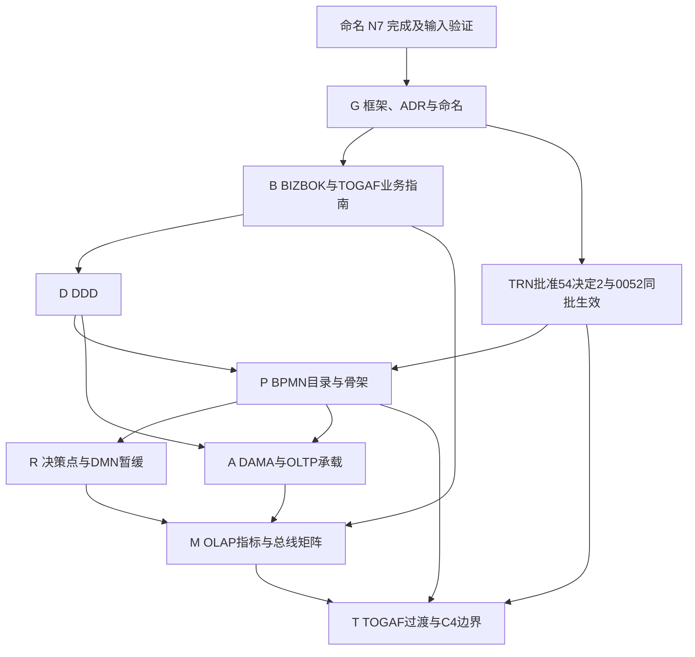

# 架构设计产出盘点与 SSOT 整合确认包方案
状态：草稿｜2026-10-17｜负责：one-architecture

依据：ARCH-CONS 派工卡；用户原话「这一轮命名结束后，我准备把架构设计的所有内容整理，我确认后写入 SSOT，按照相应框架的要求。」本文件只准备盘点、确认包与后续写入方案，不批准设计、不写 SSOT、不创建或发布确认页。本文的分册编号只用于本方案，不新设业务概念或永久架构编号。

## 0. 证据范围与读法

- 当前检出为 detached HEAD `84c633022fe63a745f1ae8ad87d98d03b047950c`，开工时工作区干净。只新增本文件；结果另写 `/tmp/ARCH-CONS-result.md`。
- 已读 `CLAUDE.md`、`CODING_STANDARD.md`、`NAMING_STANDARD.md`、`METHODS.md` §5、§6.1，以及 [ARCH_CONTEXT](../ARCH_CONTEXT.md)、[FRAMEWORKS](../frameworks.md)、[METHOD](../method.md)、[DESIGN](../design.md)、[收尾计划](arch-closeout-plan.md)、[2026-10-17 交接](HANDOFF_2026-10-17.md)。本卡的文件白名单优先，不执行会改其他文件的开场生成、画像、日志或术语登记动作。
- 所有分支证据来自本机 `git branch -r`、`git log`、`git ls-tree`、`git show`，没有 fetch 或联网。`origin/*` 是本机远端跟踪引用，不能证明 GitHub 最新状态、PR 是否合并或在线页最新答案。下文固定到已读提交，避免分支在盘点中继续前进。
- “已入 SSOT”只表示已有登记文件，不表示其中每条已获用户批准或已经实现；草稿放在 SSOT 目录仍是草稿。“提议稿”可以包含已答复的条目，须逐条保留 `decision_ref`，不能整份升级为已批准。
- 下文“框架要求”限于仓库已采纳的适配范围与结构，不声称通过标准全文符合性认证。本轮没有重读受许可限制的框架全文，也没有重新核验版本或法规。已有文件中标“未核实／待独立复核”的出处继续保留该标记。

### 0.1 分支证据固定点

| 本机引用／固定提交 | 本轮直接读到的产出及历史证据 | 可证明的边界 |
|---|---|---|
| 当前检出 `84c63302` | `git log`：`2acfd46e` CAPINFO 写回；`c5cb2448` 新名词交接；`84c63302` TRN 14 题题面 | 已有 CAPINFO 答案与写回，TRN 只有题面；不证明发布或用户已答 TRN |
| `origin/main` `9bf76677` | `git log -1`：合并 #463 的本机记录 | 仅供识别本机 main 快照；不是本卡的内容基线 |
| `origin/claude/one-arch-revenue-closeout` `5b31ba27` | `bd857d77`：SD-11–15 复核、BPMN 与 `revenue/VS_REVIEW.md` | 收入组草稿存在于分支；当前检出没有该组目录 |
| `origin/claude/one-arch-people-closeout` `0d220033` | `dab07edd`：`people/REVIEW_PACK.md`；`d726fb60`：记审稿通过；`0d220033`：PRC-107 云端试点写法 | 已读包内“审稿通过”记录；本轮未复做审稿，不等于用户批准或云端能力验收 |
| `origin/claude/one-arch-finance-closeout` `2bec63a0` | `be5152f5`：10 条流程归 VS-10.0；`ded5ebab`：`finance/QC-VS-10.md` 复查 | 财务组片段、QC 与待定题存在；不能从“包齐”推出所有问题关闭 |
| `origin/claude/one-glossary-bcs-systems` `d2e65391` | `769e3d0a`：NM2–NM4 写回；`d2e65391`：NM5 三题审题后版本；`glossary/arch-naming/N4_VERBS_STATES.md`、`N6_MIGRATION_NOTES.md`、`N9_WRITEBACK.md` | 比 ARCH_CONTEXT／交接更新；只按原始答案、词表与报告认定各自状态，不宣布 N4–N7 整体完成 |

重放例：`git show 5b31ba27:docs/modernization/architecture/proposals/closeout/revenue/VS_REVIEW.md`；其他分支文件同理。后续收集时先由负责会话重新确认提交号，不把本文固定点自动视作最新输入。

### 0.2 框架版本与文件漂移

现行 `FRAMEWORKS.md` 仍是 ADR-0041 的收窄版本；ADR-0050 已采纳并补入 BIZBOK 与三份 TOGAF 指南，正式入口尚未换稿。不能把 BIZBOK 说成已写在现行 FRAMEWORKS，也不能忽略已采纳 ADR-0050。确认包须同时展示“现行条目 → 已采纳修订 → 拟换稿”，先消除这处漂移。

- **DDD**：现行 FRAMEWORKS §1；Evans 2003、DDD Reference 2015（模式名依据）、Vernon 2013。ADR-0050 决定 19／`FRAMEWORKS_V4_DRAFT.md` §1 修正为“不变量定聚合，统一语言与模型一致范围定 BC”。
- **BIZBOK 11.0（2022）**：现行 FRAMEWORKS 未列；已采纳 ADR-0050 决定 19；锁版映射见 `FRAMEWORKS_V4_DRAFT.md` §2 B1–B5：干系人与价值流、信息对象、能力命名、流程映射、参考模型查漏。只有这五项；对象先于能力、门只预警等本地偏离须显式保留。
- **TOGAF Standard 10th Edition，C220，含 Technical Corrigendum 1（2025）**：现行 FRAMEWORKS §4，仅迁移规划；ADR-0050 决定 19／第 4 稿 §3.2–3.4 增补 G178、G190、G211 v2（均以稿内核对的 2022 出版、2025 勘误版本为准）。G178 用价值流四要素和阶段六要素；G190 用信息概念识别及信息图与数据模型的区分；G211 用能力命名。冲突按已定 BIZBOK 优先规则，不套用 ADM 全套治理。
- **BPMN 2.0.2**：现行 FRAMEWORKS §2，OMG formal/13-12-09，2014-01 发布；不得称为 ISO/IEC 19510:2013 的同版。描述级图、目录与实现登记分工按 ADR-0052 的生效条件处理。
- **DMN**：现行 FRAMEWORKS §7 明确推迟，未锁定“本项目采用版本”。Flowable 8 的已知解析上限 1.3 是兼容性记录，不是采用 DMN 1.3 的决定。
- **DAMA-DMBOK 第 2 版修订版（2024）**：现行 FRAMEWORKS §5，仅概念参照；项目规则以 DATA_DESIGN_CHECKLIST §14.1 全部条目及数据注册表为准。
- **Kimball & Ross，第 3 版（2013）**：现行 FRAMEWORKS §3；粒度、事实表类型、一致性维度、SCD2、总线矩阵；ADR-0050 决定 20 将矩阵行明确为“度量事件”。
- **C4**：现行 FRAMEWORKS §6，无版本号，只用 System Context／Container。命名另受已采纳 ADR-0053 约束：ISO 704:2022、ISO 1087:2019 为概念与指称参照，SKOS 为关系语义参照；详细核实边界见 `NAMING_ADR_0053_NOTES.md`，不把这些新增标准冒称已列入 FRAMEWORKS。

## 一、盘点清单

### 1.1 总表

短路径默认相对 `docs/`；`backend/`、`scripts/` 相对仓库根。`architecture/` 指其下架构目录，`proposals/`、`closeout/` 分别指 `architecture/proposals/`、`architecture/proposals/closeout/`；框架目录 `business/`、`togaf/`、`ddd/`、`bpmn/`、`dmn/`、`dama/`、`olap/` 均在 `architecture/` 下。分支限定以 §0.1 为准。

| 产出 | 所在位置、条目量及草稿／分支 | 所依框架条目与所需结构 | 现行 SSOT 或缺口 | 状态与待定题号 | 与已采纳结构的差距 |
|---|---|---|---|---|---|
| 愿景、驱动力、目标与商业模式 | `architecture/togaf/vision.yaml`：6 驱动力、8 目标、16 KPI、6 个 open_questions；`MODERNIZATION_BRIEF.md`、`GUIDING_PRINCIPLES.md` 为来源 | FRAMEWORKS §4、METHOD §4：阶段出口度量；FRAMEWORKS §8 不采用商业模式画布。没有已采纳的商业模式九格结构要求 | `togaf/vision.yaml` 已有草稿；未见独立商业模式正本或批准证据 | 已入 SSOT **但 status=draft**；OQ-01–06 是旧草稿待问项，须先去重；不自动重问 | 文件仍写 TOGAF Preliminary／Phase A、分阶段切换等旧话语；企业经营愿景与系统迁移目标尚未分清；商业模式缺口不能擅自选框架或补业务目标 |
| 干系人、价值流 | `proposals/STAKEHOLDERS.md`、`STEP1_VALUE_STREAMS.md`、`STEP1_INTERNAL_SERVICES_VS.md`、`value-streams.v2.yaml`：36 干系人、14 价值流 | ADR-0050 决定 1／19；第 4 稿 §2 B1、§3.2 G178：触发者、描述、价值、关系；不得用能力或部门代替价值流 | `togaf/value-streams.yaml` 仍 8 条；已定目标为 `business/value-streams.yaml`（含干系人段），当前目录未建 | 提议稿含已答复内容；CAPINFO-C13 选单一 VS-14，C14 合同档案不纳入；不是待答 | 新旧清单未替换；新增 VS-14 尚须接入骨架与完整评审包；来源干系人只引用用户指定部分，不扩引学习仓库 |
| 阶段、门与阶段类型 | `value-streams.v2.yaml`：58 阶段；`STEP3_STAGES.md`、`STAGE_TYPES_DRAFT.md`、`closeout/STAGE_ALIGN_REPORT.md` | BIZBOK B1、G178 §2.2（第 4 稿 §2、§3.2）；名称、描述、参与者、进入、退出、价值项；门引用业务对象状态 | 现行 `togaf/value-streams.yaml`；目标 `business/value-streams.yaml`；阶段类型取值归信息对象，不另手写一份状态机 | 提议稿；AN-07–11／SD-11–15 已答；Q06、Q09 其余状态、Q20、Q21 与 MS-17 等来源缺口须逐条复核 | 不把阶段等同聚合状态或 BPMN；生成的 object-layer 有 58 段不代表所有条件已通过；仍有 missing_states／caveats 列表须按答复核销 |
| 能力地图 | `STEP2_CAPABILITIES.md`、`capabilities.v2.yaml`：23 一级、76 二级，另 pending 1、excluded 1、proposed_l1 4 | ADR-0050 决定 6；第 4 稿 §2 B3／B5、§3.4 G211：对象管理、父子结构、定义、阶段支撑；禁止 bc/module/subdomain 字段 | `togaf/capabilities.yaml`：12 一级、77 二级；目标 `business/capabilities.yaml` | 提议稿；CAPINFO-C12 已答；行政类 proposed_l1 尚非批准结构，见 STEP2 §12 | 两套能力不可并存为正本；结构须从信息图校验，名称与定义由用户认可后登记；四个 proposed_l1 不计入 23 |
| 信息图、业务对象 | `ENTERPRISE_INFO_MAP_DRAFT.md` 总表 123 行：101 有效记录（23 一级、76 次级、1 待定、1 组织图元素）、22 非对象；`PRIMARY_OBJECT_TEST.md`、`OBJECT_COMPLETENESS_REPORT.md`、`AEC_BUSINESS_OBJECTS.md` 与四组 `AEC_OBJECTS_*.md` 为判据和研究 | ADR-0050 决定 1／19；BIZBOK B2、G190（第 4 稿 §2、§3.3）：定义、类型、状态、关系基数、来源、范围；与聚合分开 | 目标 `business/information-map.yaml` 尚未建；不能用 DAMA 表目录代替 | 提议稿；Q04/R1、Q09（部分）、Q13、Q20、Q21、Q31b、Q34、OBJ-78 分类待复核；CAPINFO-I01/I02/I05/I07/I08/I09 已答，I08/I09 选非推荐 | 需结构化而非照搬 Markdown 全文；旧首部“21 一级／90 对象”是历史数，不能作现值；新增 OBJ-117–123 与词表、聚合、能力仍须对齐 |
| BC、命名空间与上下文映射 | `ENTERPRISE_AGGREGATES_DRAFT.md` §3.2：30 个 B-编号行；§4.1 依赖骨架；`closeout/bc-map.yaml`；`ADR-0051`、`STRUCTURAL_ITEMS.md` 与 S-31/S-43 裁定 | FRAMEWORKS §1／DDD Reference；ADR-0050、0051；边界、深浅、模块/schema、方向、api/events、四类有代码后果关系 | `ddd/subdomains.yaml` 13 条、`contexts.yaml` 41 条（built 13/planned 28）、`context-map.yaml` 21 边；代码边只引用 `backend/architecture/module-dependencies.txt` | 部分已入；全企业调整仍在提议稿／收尾裁定。D-1–D-9 已答，不重问；新增 B-31 等与 ADR-0051 原表逐项核对 | 最大编号不是 BC 数；旧 28 规划 BC 不能覆盖后续回补；built 与 planned、业务 BC 与技术模块需分开，不能将全企业规划边冒作代码已建边 |
| 不变量、聚合、命令、状态与领域事件 | 聚合稿 §1／§2.2：130 聚合行，另 AGG-134 仅预留；三组 `commands.yaml`、`state-machines.yaml`；people/events.yaml、finance/events.finance.yaml；revenue 事件在命令 emits／状态机及骨架 | FRAMEWORKS §1；DDD Reference 2015；ADR-0050 决定 8–13：聚合根、不变量 A/B/C、命令前置、事件发布与订阅、跨聚合引用、对象对应方式 | `ddd/aggregates.yaml` 15 条；`events/{approval,attendance,identity,integration,numbering,timesheet,workforce}.yaml` 与生成的 `asyncapi.yaml`；表归属只引用注册表 | 提议稿＋部分已入；Q09/Q13/Q20/Q21/Q34；AGG-134 仅在 VS04-01 选择单独单据时启用 | 三组 596 条命令、130 个机器记录与权责矩阵 586 行计数对象不同，不能强行相等；事件不能重复手写，命令中文名不是永久 ID；预留不能当成已定聚合 |
| 流程目录、骨架、权责、审批和场景 | `processes.v1.yaml` 五类 135 条；`closeout/process-catalog.yaml` 200 条（business105、event_policy33、single_aggregate29、read_model6、integration17、merged10）；各组骨架、`CONVENTIONS.md`、`RESPONSIBILITY_MATRIX.yaml` 586 行、`APPROVAL_RULES.yaml`、`ORG_NEEDS.md` | BIZBOK B4；BPMN FRAMEWORKS §2；ADR-0052 决定 1–6：目录管身份，骨架管步骤、角色、命令、判断、审批、超时、证据、权限与页面；多对多映射阶段 | `bpmn/processes.yaml` 当前 7 条（built1、documented6）；拟在 `bpmn/` 落目录及三组骨架，保留并收窄实现登记 | 主要只在三组分支；AN-01 已批准但 ADR-0052 文本仍提议，生效依赖 ADR-0054 决定 2；组内待题见 §1.3 | 200 含 10 合并号，非合并190仍含非业务类型；未实现唯一目录迁移；旧 v1 不能继续作为生成器最终输入；权责一致不等于审批业务已获认可 |
| BPMN 描述级图与可执行图 | 三组 `closeout/<组>/bpmn/PRC-*.bpmn`：收入56、人员3、财务29（不计 sample）；`BPMN_STYLE.md`、`bpmn_gen.py`、`bpmn_check.py`；可执行文件 `backend/src/main/resources/processes/cost_timesheet_approval.bpmn20.xml` | BPMN 2.0.2；FRAMEWORKS §2；ADR-0052 决定 3/4：描述级非执行、Flow Objects/Sequence Flow/Lane/DI、图从骨架生成；可执行版随实现 | 描述图是生成物，不是另一 SSOT；实现登记 `bpmn/processes.yaml` 指向 `.bpmn20.xml` | 分支图稿；当前只1个运行时 BPMN 登记；TRN-02／ADR-0054 决定 2 是方法生效依赖 | 文件存在数不是覆盖率；人员分支主要仍为样板；需按目录筛“业务流程”重生成、逐价值流核对；XML通过不证明审批或异常路径正确 |
| DMN 决策点 | `dmn/decisions.yaml` 15 个 DEC（代码位置、输入输出、规则、证据及部分 test）；骨架判断点和规则卡 | FRAMEWORKS §7：推迟采用；METHOD 接缝1：判定与计算、不变量、人工编排分开 | `dmn/decisions.yaml` 为决策点目录；没有本轮可确认的真实 DMN 表 | 已入目录；引擎/版本待首张真实表另开 ADR；不是待用户立即重选框架 | `target: dmn-planned` 不能解读为已采用 DMN；不能把15点批量转DMN；若采用再补 decision/inputs/outputs/hit policy/rules/version/effective-date/tests |
| DAMA 数据对象、表级模型、分类与血缘 | 三组 `data-model.<组>.yaml`：53/34/44 承载记录，162/95/105 表项；people/DATA_MODEL.md、finance/OBJECTS.md；`data/DATA_DESIGN_GATE.md`、`phase1a/DATA_SCORECARD.md` | FRAMEWORKS §5／DAMA 2024仅参照；DATA_DESIGN_CHECKLIST §14/14.1：粒度、归属、记录系统、键、版本、保留、分级、血缘、质量、变更 | `backend/architecture/data-access-registry.yaml` 50 表键；`backend/architecture/data-classification.txt`、`phase1a/COLUMN_OWNERSHIP.md`、迁移目录；`dama/` 未建且按决定不另建 data-objects.yaml | 部分已入；全企业模型只在三组分支，未等于 one-data 签字；Q34、财务U类与人员数据例外待核销 | 362 是表项数，不是362张已建表；131承载记录含 REF-01/02，AGG-47规则层无表，不能与130聚合硬对齐；访问分级大小写、PI/SPI写法在组间不同，须按固定字段规范化 |
| OLAP 总线矩阵、指标与 OAT | `r0/METRIC_BASELINE_DRAFT.md` M-01–48、8报表包；`glossary/oat/{README.md,forcitis_operating_accounting_taxonomy.csv,standard_concept_mapping.csv,KPI体系设计.md}`；`BI_SCOPE.md`、ADR-0023/0025 | FRAMEWORKS §3／Kimball 2013；ADR-0050 决定20：度量事件→粒度→事实表类型→一致性维→指标，期间/含税/账簿/加总/口径版本可追溯 | 指标基线和 OAT 是外部于 architecture 的唯一来源；`olap/` 未建，不新增一套口径YAML；`togaf/vision.yaml` 只存KPI→M引用 | 指标草稿，B6–B11 已答；其余业务/财务口径看基线 §6，不能整包宣告已定 | 48个ID不是48个已批准指标；缺全企业度量事件与注册表/事件目录的完整追溯；总线矩阵应生成，报表不是直接查询OLTP的授权 |
| 过渡架构、边界与地基/估算 | `togaf/transitions.yaml` 12 条；`CONSTRUCTION_PLAN_DRAFT.md`、`construction-plan.v1.yaml`、`FOUNDATION_RECHECK*.md`、`FOUNDATION_NEW_ITEMS.md`、`LOC_AND_STAFFING_ESTIMATE.md`、`CALIBRATION_SLICE.md`；C4见 `REIMAGINED_ARCHITECTURE.md` | FRAMEWORKS §4 TOGAF C220及§6 C4：基线/目标/过渡、入口出口、依赖、回滚；不要求完整ADM | `togaf/transitions.yaml` 与已有brief/边界文档；`FOUNDATION_MATRIX.md` 本基线未见正式产出 | 提议与旧SSOT并存；TRN-01–14未见答案；ADR-0054/55/56均提议 | 旧12过渡条目与一次投产路线尚未整合；不能据结构估算宣告工期；ARCH_CLOSEOUT_PLAN标题“六项”实列七项，历史估时不作为本轮承诺 |
| ADR、方法与变更治理 | `adr/src/ADR-*.md`、`adr/catalog.yaml`、`adr/src/_readme_deviations.md`（勘误与历史偏差）；`FRAMEWORKS.md/METHOD.md/DESIGN.md` 与 V3/V4、适配/符合性研究 | 项目ADR生命周期；FRAMEWORKS防漂移规则；决策要有范围、后果、影响、迁移、回滚、守护及取代链 | ADR正文只编辑 `adr/src/`，`adr/ADR-*.md`、README由 `build_adrs.py` 生成；已有ADR只引用 | 0050/51/53已采纳；0052已获AN-01答复但生效受条件约束；0054/55/56提议。详见TRN | “批准”与“生效”分离；不得因整合重写已采纳正文；METHOD仍六步而0050已七步，换稿须连依赖和生成器一起处理 |
| 命名 N1–N7 与改名对照 | ADR-0053；`NAMING_STANDARD.md`；`PREREQ_NAMING_CONSTRUCTION_2026-10-17.md`；`closeout/rename/RENAME_A/B/C.{md,yaml}`、`RENAME_V2.{md,yaml}`；用语分支 `glossary/arch-naming/`、NM1–NM5页/答案 | DDD统一语言（FRAMEWORKS §1）；ADR-0053：概念/指称/命名面、槽位、语言/用途角色、生命周期、引用稳定ID | `glossary/terms.yaml`及并入源、`bcs.yaml`、ACL归类；NAMING_STANDARD为细则唯一入口，不另创架构词表 | N1完成；N2已定；N3未见落地；N4部分有NM1答复；N5部分NM2–4写回但分支门禁未全过；N6真实迁移FAIL；N7候选待重算及认可 | N7本地旧输入2384条：blocked2117/generated210/manual57，另155条架构名沿用；不能用N4/N5新答复自动宣告旧候选有效；具体开工条件见§2.1 |

### 1.2 业务架构与命名的收口边界

愿景文件已经存在，商业模式材料则未在本次目标目录、草稿树与所读分支发现可作为正本的完整产出。该结论限于已查范围，不是断言企业没有商业模式。FRAMEWORKS §8 明确不采用商业模式画布，故本轮只把“现有经营背景／价值主张的来源、缺失业务事实、是否需要单独研究”列入业务册；不补画九格、不把系统迁移KPI当经营战略。OQ-01–06先对DECISION_DIGEST及新路线去重；如需重启某题，写明为何原答案或原前提不再适用。

能力和信息层以CAPINFO原始答复为准：`rules/decide/answers/CAPINFO.json` 的提交 `CAPINFO-20261017-111010-cfy`，7题按推荐、I08/I09改选。假期余额账户、薪酬档案已选单列，不能沿用旧前提清单说这两项“待用户定”。新增名词交接见 `closeout/CAPINFO_NEWTERMS.md`；这不自动完成新对象与聚合、表、流程的全部设计。

命名逐项核对：

1. **N1**：`adr/src/ADR-0053.md`状态已采纳；AN-03有原始答案，不能重复申请批准。
2. **N2**：AN-06单立“确认入账”已答；前提清单记用户免再转财务的单项决定。不能扩大为其他会计用语均免确认。
3. **N3**：本基线NAMING_STANDARD仍含旧词源、21命名面、旧多语言规则；尚不具备ADR-0053完整字段、角色与投影细则。新文件名也须通过N3/N7，本文后续路径除已采纳ADR指定者外均是提议落点。
4. **N4**：用语分支N4文件记NM1共22题已答（`NM1-20261017-101116-a4n`），中文动词/状态归并有依据；拟英文代码名、权限映射未因该次答复一并批准。
5. **N5**：用语分支NM2/3/4共48题已答，提交分别`NM2-20261017-105418-xsj`、`NM3-20261017-105653-1u6`、`NM4-20261017-105806-n04`。`N9_WRITEBACK.md`记新增55词、更新11词、定稿8会计动作片段，同时明确整体交付未达0 FAIL。本轮只核对记录与答案文件存在，未复跑其前后端测试。NM5-01–03在固定点只有题面，未见NM5答案文件。
6. **N6**：`N6_MIGRATION_NOTES.md`记994顶层词条中991完整还原，3条指称可用/禁用冲突，真实迁移FAIL；这是该分支原报告，不是本轮重新执行结果。不能切换读取方或把N6称已完成。
7. **N7**：RENAME_V2仍以`c544ab2d`的临时动词和旧名词为输入；NM1–4及CAPINFO后的增量须重算。用户逐条认可、概念ID不变、例外理由齐全、新旧投影比对通过，才算出口。`generated`只证明机械可渲染，`manual`不表示已获认可。

N8（工具读取方）及分支称N9的写回是后续验证依赖，保留名称以便追溯，不在本卡替其派工或改状态。

### 1.3 三组价值流评审包与待定题索引

三组都不是当前检出的本地文件。以下路径均加前缀 `docs/architecture/proposals/closeout/`，按§0.1固定提交读取；`parts/`、`notes/`和样板保留为过程证据，不重复灌入SSOT。

- **revenue（VS-01–04）**：`revenue/VS_REVIEW.md`为整包；`QC-VS-01.md`至`QC-VS-04.md`、`QC-LIFECYCLE.md`、`STAGE_ALIGN.md`、`OBJECT_LAYER.md`、`Q04_STORAGE.md`、`NOTES.md`为审稿/口径证据。骨架46业务＋10事件策略＋13单聚合＋3读模型＝72单元；260命令、52状态机、53数据承载记录、162表项、507场景。待核销：Q-04/Q20（收入确认形态与存储，VS04-01）、Q21、Q34、VS_REVIEW所列PRC-43的M8（现场签认如何到收入侧）及无编号原文事项。`Q04_STORAGE.md`与聚合稿AGG-134预留只作选项，不提前启用。
- **people（VS-07/09/11/13，及B-31支撑）**：`people/REVIEW_PACK.md`、`QC-VS-07.md`、`QC-VS-09.md`、`QC-VS-11.md`、`QC-VS-13.md`、`QC-B-31.md`、`QC-OBJECTS.md`、`DATA_MODEL.md`、`NOTES.md`。骨架30业务＋11事件策略＋5单聚合＋1读模型＝47单元；168命令、34状态机、34数据承载记录、95表项、245场景。包内待题按原来源保留：VS-07的V-1/2/4–8/10–16/18–20、C-1/3/4、b13data#1/2；VS-09的vs0911#4a/4b/9/10/11/13；VS-11的vs0911#5/6/8/12；VS-13的U类、U6′及vs13att/b15data来源题；B-31见同包章节。V-3与U6′是同题，不能问两次。未在此重建新编号；全量题面以该包各“待用户定”表为准。
- **finance（VS-05/06/08/10/12）**：`finance/QC-VS-05.md`、`QC-VS-06.md`、`QC-VS-08.md`、`QC-VS-10.md`、`QC-VS-12.md`、`QC-LIFECYCLE.md`、`REVIEW.md`、`ANSWERS.md`、`NOTES.md`、`OBJECTS.md`、`EXPENSE_COVERAGE.md`。骨架`processes`字段54单元（不能按字段名一概称业务流程），168命令、44状态机、44数据承载记录、105表项、664场景。NOTES保留U-01–54原题与后续答复，不能把整个号段全说成未答；出页前对ANSWERS/intent逐行核销。QC-VS10仍明确U-27/SQ-13期间配置生效与挂起队列闭环、U-30/31资产控制、SQ-32关账例外等待裁定；U-01–05/U-11等前提受TRN新路线影响，须重审题意。

以上三组共173骨架单元、596命令、130状态机、1416场景。它们与目录190非合并项的差额17条，数量上对应目录integration类型，但仍须按PRC集合逐项对账，不能只凭差额认定覆盖完整。补充输入是`INTEGRATION_INVENTORY.{md,yaml}`（PRC-184–200）；VS-14新增后也要重做覆盖。88个非sample描述级图文件只是存在数，不能以88/105直接称覆盖率。

`closeout/PAGE_IMPACT.md`目前列F05-06（外部代发题面前提）、F05-09（分贝通渠道）待改；`STRUCTURAL_ITEMS.md`及`rulings/S-31_FINANCE_SQ01-33.md`、`S-43_OBJECT_CLASSIFICATION.md`有已裁结构问题。出确认包先做“来源题号→已有答复/裁定→是否仍需问→新册位置”的核销表，已答事项只作依据，不因换册重问。

### 1.4 数据、分析与ADR不得合成第二套正本

信息图的对象是业务语义；表级模型的对象是持久化承载；DAMA的记录系统、分级与血缘是治理属性，三者必须引用连接，不能合并成一个“对象清单”。三组数据承载记录合计131且无组间重复ID，其中REF-01、REF-02不是聚合；聚合稿130行中的AGG-47为规则层而未列模型。应确认这些语义差异并登记“不落表”理由，不补一张虚构表凑数。

已有注册表50表键只是当前登记集合，不与全企业362表项直接相加；后者需核对schema、重复/合并/退役、技术表归属，再经one-data复核。全企业尚未落库的细节继续留提议稿；进入本期实现的条目才与DDL及注册表同批对齐，不能用架构确认替代数据设计签字。

OLAP只引用OAT与M-01–48基线的稳定ID及口径版本；`olap/`不另手写公式，`dama/`不另手写表归属。指标基线仍引用已变化的BC（如organization.incentive），须按已采纳0051映射后回读；B6–B11已答口径保留，未答/会计口径另核。目录、总线矩阵、CRUD、权责与追溯图是生成视图，不成为另一编辑入口。

ADR-0050/51/53已经采纳，整合只引用并检查实施差距；ADR-0052的AN-01已有批准答复，但正文仍提议且明确与ADR-0054决定2同批生效。ADR-0054/55/56在本基线均提议，TRN-01–14只有题面。不得从AN-01推定TRN已批准，也不得因55或56未定而虚构0052对它们的生效依赖。

## 二、确认包组织方式

### 2.1 开工条件与每册出口

**正式整合开工以N7完成为条件**：采用已审定N4/N5输入重算；本次写入涉及的候选逐条有用户认可和来源；blocked项已解决或明确撤出本次范围；不因改名改变概念ID、状态语义或聚合归属。N3细则、N6迁移及读取方验证的实际完成证据一并作为输入；若仍有N6真实数据FAIL，不进行新结构切换。本文盘点准备不受此开工条件阻塞。

one-architecture另须冻结资料清单（提交号、文件摘要、计数口径、来源与排除项），按最新DECISION_DIGEST/intent/答案核销题目；0052/0054条件未满足的文件不按新方法生效。未定内容可留在草稿，已定且无依赖的条目可按册/价值流分批整合；不能用一册通过覆盖另一册的未定事项。

每册出口统一为：①用户已提交该版确认；②相关业务页答案已对账且无提交后改动；③条目/引用/状态校验及生成重放通过；④数据、安全、守护改动按负责会话要求复审；⑤已定条目与未定条目、实施状态分开。框架册的确认只批准所列整合差异，不重复批准已采纳ADR，不自动批准所有实现。

### 2.2 分册清单：每册一页整合确认页

以下文件均为**未来确认后的写入清单**，本轮不创建。固定路径依已有ADR；新增文件名/拆分方式若尚未定，列入本册的结构提议，经过命名规则后才锁定。每册页面先给摘要及可展开清单，再问仍需裁定的业务点或写入范围。

**G册：框架、ADR与命名（跨册前置）**

- 写入：按生效条件同步`architecture/FRAMEWORKS.md`、`METHOD.md`、`DESIGN.md`及README指针；命名细则`NAMING_STANDARD.md`和`glossary/`源由各自负责会话交付。ADR只引用；确需变更决定时新增`adr/src/ADR-*.md`并按生命周期占号，不能在本册直接改已采纳正文。
- 骨架：框架ID/版本/采用范围/排除项/出处/本地偏离；ADR与intent引用；每个命名面取用的语言和用途角色、投影与守护。数量：现行FRAMEWORKS九节；本次重点核对0050–0056共7份ADR及N1–N7共7个前提项，不把它们算作7份新ADR。
- 未定/依赖：N7、NM5-01–03及N6冲突；TRN-01–14分流到T册；AN-01/03–06及NM1–4已答只列依据。G册不越权裁定命名业务词。
- 检查/生成：`adr/build_adrs.py`、`glossary/build_terms.py`、`term_rules.py`、`build_all.py --check`、`name_id_check.py`、`term_gate_check.py`，读取新概念/指称结构的工具须先到位；已知状态行冲突见§3。

**B册：BIZBOK业务架构及TOGAF G178/G190/G211**

- 写入：`business/value-streams.yaml`、`information-map.yaml`、`capabilities.yaml`（ADR-0050已定三文件落点）；`togaf/vision.yaml`仅更新用户确认的愿景/目标/KPI引用。商业模式暂留缺口，不新增未采纳框架的正本。
- 骨架：价值流含`stakeholders`（ID、类型/类别、角色关系）、`value_streams`（ID、名称、触发者、描述、价值、用途分类、阶段）；阶段含六要素和对象状态条件；信息图含ID、定义、层级、父对象、类型、状态、关系基数、范围、来源、规则引用；能力含ID、对象引用、父子结构、名称/定义、用途分类、阶段支撑，不含BC。
- 数量：36干系人、14价值流、58阶段；123对象总表行分为101有效记录/22非对象；能力23＋76，pending/excluded各1；另4个proposed_l1不混入。实际写入哪些非对象/退役记录及如何留档在本册确认；愿景6/8/16作为独立草稿清单。
- 未定：Q04/R1、Q06、Q09余项、Q13、Q20、Q21、Q31b、Q34、OBJ-78分类、四个行政能力提议、愿景OQ去重。CAPINFO九题与SD-11–15已答，不重问；N7改名只更新指称，不改这些业务结论。
- 检查/生成：`j_checks.py`（J1–J7）、`vs_links_gen.py`、`stage_align_check.py`、`object_layer_check.py`、`name_id_check.py`；生成能力—阶段、共享对象状态与覆盖视图。信息图YAML/能力结构与新路径的生成器、保留退役记录的校验尚须补齐，不能写成已有实现。依赖G；已定对象状态是D/P册的输入。

**D册：DDD战略与战术设计**

- 写入：`ddd/subdomains.yaml`、`contexts.yaml`、`context-map.yaml`、`aggregates.yaml`；领域事件仍在`events/*.yaml`，模块边仍在`backend/architecture/module-dependencies.txt`，表归属仍在数据注册表，仅引用不复制。
- 骨架：命名空间/BC/模块/schema/kind/生命周期/深浅；关系含端点、方向、api/events契约、四类关系、built/planned；聚合含稳定ID、所属BC、对象对应方式、根、命令（参数/前置/权限/幂等/转换）、不变量落点、事件目录引用、表键引用。状态机来自聚合职责；不另建手写同义事件目录。
- 数量：当前13命名空间、41上下文、21关系、15聚合；候选30个B行、130聚合行、596命令、130状态机记录。由负责会话逐条确认新增/替换/退役数量后才生成最终manifest；AGG-134仅预留。不把当前值和目标值相加。
- 未定：Q09/Q13/Q20/Q21/Q34、VS04-01、结构裁定后回补是否齐全，新增B-31等对0051的适用范围；需要改变已采纳决定时走新ADR。依赖G/B；与P/A/M册通过引用迭代核对，不互相复制主数据。
- 检查/生成：已有`aggregates_dep_check.py`、`converge_check.py`、`seam_check.py`、`object_check.py`、`build_architecture.py --check`/`--svg`、`events/build_asyncapi.py`，以及实现阶段的EventCatalogueTest/SingleAggregateGuardTest。DESIGN拟设的`scripts/ci/architecture_check.py`在本基线不存在，须列为待建，不能称A1–A7已完整实现。全企业规划边的表达及新ID读取须调整后再验，不借生成器现有A1把规划冒作已建。

**P册：BPMN流程与确认包汇总**

- 写入：提议`bpmn/process-catalog.yaml`及三组`bpmn/processes.<组>.yaml`；字段依CONVENTIONS并按ADR-0052规范化。`bpmn/processes.yaml`保留为实现登记，当前7条中的documented条目迁入目录后不重留两套；目录只引用实现登记。权责/命令/状态机归属由G/D册锁定，目录不重复保存步骤内容。
- 骨架：目录`id/name/type/stages/primary_object/owner_bc/group/status/merged_into/实现引用/decision_ref`；骨架`id/triggers/roles/steps/outcomes/decisions/approval/timeouts/cross_bc/evidence/permissions/pages/notifications/migration/scenario_refs`。字段名是拟规范化映射，最终以批准的CONVENTIONS及命名投影为准。描述图从骨架生成，不能手工改图反向成为设计源。
- 数量：200目录记录含10合并/190非合并；三组173单元，集成目录17条另对账；当前88个分支描述图文件，1个built可执行流程。场景1416只代表草稿场景条数，非执行过的验收测试。
- 未定：§1.3各组题、PAGE_IMPACT F05-06/F05-09、VS-14骨架补齐；依赖G/B/D及0052生效条件。跨册未决题只保留一个归属和原题号。
- 页面组织：本册一页只确认整合范围、目录/骨架/实现登记分工、差异与未定列表，链接各价值流业务确认页。ADR-0052的“每价值流一页、评审完即出”继续适用，不能用框架汇总页替代14条价值流的逐流确认或把已答页重出一遍。
- 检查/生成：`build_catalog.py --check`、`closeout_check.py`及`--qc`、`stage_align_check.py --no-write`、`seam_check.py --no-write`、`raci_build.py`、`bpmn_gen.py <骨架> --out <临时目录>`与`bpmn_check.py <输出目录>`；需补“全部业务流程生成集合=目录应生成集合”、场景到出口/超时/判断分支覆盖、目录→实现登记引用的校验。原`processes_check.py`读v1，须改读批准后的目录/骨架，不能假装已支持新输入。

**R册：DMN决策登记与暂缓范围**

- 已定（用户 2026-10-17「不引入但要版本化配置」，intent 已由调度记）：本轮不引入 DMN；业务判断规则统一走 D15 版本化配置表，每版记生效日、批准人、依据并登记变更，不写死在代码。DEC-06 及 `DMN_FIT_RESEARCH.md` 认定适合成表的判断点按 D15 设计。本册逐条登记：判断进配置表还是留在代码，各写理由；下列「未定」中引擎选型一项随之撤下。

- 写入：只核对`dmn/decisions.yaml`，不新增DMN执行文件。骨架为`DEC-ID/所属BC/location/input/output/rule_refs/execution/evidence/test_ref/status/decision_ref`，消除“dmn-planned=已选引擎”的歧义。
- 数量：现有15个代码决策点；本轮拟新增真实DMN表0张。骨架判断点与DEC差异先列出，补录数在manifest冻结时给出。
- 未定：没有已批准的引擎/版本/首张真实表；将来出现真实表才按FRAMEWORKS §7另开选型ADR，比较DMN与D15版本化配置表，不为完成本册强迫用户选型。依赖G/D/P的判断点归类。
- 检查/生成：当前`build_architecture.py --check`可核对已有引用；G47/NamingSurfaceTest只证明命名面，不证明决策语义。尚缺DEC目录与所有骨架判断点、规则/测试的双向检查；未来表需hit policy、输入组合、边界/冲突/空结果测试，再接入所选引擎。

**A册：DAMA数据治理与OLTP承载**

- 写入：`backend/architecture/data-access-registry.yaml`、`backend/architecture/data-classification.txt`，必要时由既有负责会话更新`phase1a/COLUMN_OWNERSHIP.md`引用；全企业未实现模型仍留各组草稿，经one-data签字并进入实现时逐表入登记。不新增`dama/data-objects.yaml`，本册确认不等于建362张表。
- 骨架：表键→聚合/BC、类别/粒度、记录系统、读写方、business_key、mutability、version/有效区间、retention、lineage、references、敏感分级/PI属性、查询路径、豁免依据。列级隐私不由表级最高分级代替；跨BC按ID引用、不建跨schema外键。
- 数量：50当前表键；候选131承载记录/362表项（162＋95＋105），逐项区分已有/改形/新建/退役/不落表，最终入册数待one-data确认。REF与AGG差异见§1.4。
- 未定：Q34、各组数据例外、敏感与保留判定、主数据版本规则、财务配置/期间闭环；不把报告中的建议改成豁免。依赖G/B/D/P的对象、聚合、流程输入。
- 检查/生成：`closeout_check.py`及`object_check.py`做草稿交叉核对；DataArchitectureTest、DdlNamingTest、PrimaryKeyTypeGuardTest与one-data逐表D1–D19复核在对应实现批执行；`build_architecture.py`生成承载视图。当前草稿表模型到注册表的无损转换/差异生成器尚缺，不自动捏造正式列、保留期或敏感例外。

**M册：Kimball/OLAP指标与总线矩阵**

- 写入：经业务/财务确认的`r0/METRIC_BASELINE_DRAFT.md`正式化去向由指标负责会话决定，OAT源仍在`glossary/oat/`；`togaf/vision.yaml`仅更新KPI→M-ID/口径版本引用。`architecture/olap/*.yaml`不另存指标算法。
- 骨架：指标ID、OAT概念、业务定义、事实来源、粒度、单位、账簿/期间/含税口径、加总规则、分母、口径版本/生效日、确认依据；生成总线矩阵以度量事件为行、主数据一致性维为列，含来源事件/过账明细与主数据版本引用。
- 数量：48指标草稿ID、8报表包；16阶段KPI属于另一清单；全企业度量事件行数和事实表数尚无冻结总数，不能用流程数或指标数代填。
- 未定：基线§6未核销口径、OAT映射、分母与财务确认、目标/期限；B6–B11已答只回读。依赖G/B/D/A与P/R的事实/判断来源，不能在交易表上直接跑分析凑报表。
- 检查/生成：OAT引用及指标定义一致性由负责会话检查；已有`build_architecture.py`的分析追溯能力以实际代码为界，尚缺全企业度量事件→事实→维→M-ID完整生成与粒度/可加总性验证。正式册列“待建检查”并派卡，不能把图生成成功称为口径通过。

**T册：TOGAF过渡、路线图与C4边界引用**

- 写入：`togaf/transitions.yaml`；按批准TRN对应新ADR源与取代标注、brief/边界文档的受影响条款由各负责会话改。C4只引用`REIMAGINED_ARCHITECTURE.md`等已有L1/L2，不把聚合图改叫C4。地基矩阵与重估仍是决策输入，不能自批投产日。
- 骨架：baseline/target/transition、交付范围、依赖、入口/出口、验收证据、回滚条件/窗口、迁入/切换、外部边界、风险、ADR/intent引用。数量：旧12过渡条目，目标一次投产的具体分组与条目数等TRN批准后冻结；不把“一次投产”理解成所有准备步骤只有一行。
- 未定：TRN-01–14（拆分、54/55/56批准、A8提前停用及回退、来源对照锁定、财务确认与复核材料等）；ADR-0052仅与54决定2同批生效。依赖G，最终施工范围/估算依赖B/D/P/R/A/M输出。
- 检查/生成：`adr/build_adrs.py`取代链、`build_architecture.py --check`路线图/过渡图；`FOUNDATION_RECHECK*.md`对账并补正式地基需求矩阵；估算脚本`proposals/loc-estimate/model.py`按最终输入重算。批准条件、回滚和切换行为仍须实际演练，图或模型运行不等于演练通过。

### 2.3 先后顺序与依赖图

建议确认顺序：G → B → D → P → R/A → M → T。TRN法定批准条件可以先行处理；T册最终范围与估算等后册输入齐再确认。图中X不是新册，也不依赖T册全部完成，避免“先完成流程才批方法、先批方法才完成流程”的循环。G册先展示当前有效框架和待生效差异，条件满足后由负责会话进行换稿；不能在X前提前宣布0052生效。

图表示交付依赖，不表示顺序推导一次后不能回溯：B中的对象状态缺口可由D/P发现后回补；涉及已答业务或已采纳ADR的改变单独裁定。并行准备不等于允许跨册未定引用进入已批准SSOT。

### 2.4 在线页沿用规则及审批对象

使用`rules/decide/sheets/<册单子>.json`及`build_decision_page.py`，`sheet/preselect/title/lede/groups/items/info/side`保持现有格式。每题含`no/grp/title/src/ctx/basis/practice/opts(label/effect/rec)`；侧栏列文件路径、固定提交、内容摘要、计数口径与增删改清单。本轮只给方案，不占用新单子名、不创建JSON/HTML。

每册**一页整合确认页**，按主题分组，一屏一组、单组不超过40题；条目清单放可展开信息区，不能把2384改名候选直接变成2384道架构题。确需逐条业务认可的N7仍由命名页承担。每个原始未决事项保留来源题号，册内题号映射它，不建立第二份互相覆盖的答案。

框架、标准与选型类整合页一律`preselect:false`（拿不准也按此类）；每题一个推荐并列代价，未答保持未答。业务价值流确认页沿既定预选规则，单独链接；不把两类单子混入同一页改变预选语义。已答条目只展示选择与依据，涉及重新决定必须写明重问原因。

发布仍须one-coordinator独立审题、`check_pages.py`检查，contract固定0.2.80；发布后真实浏览器核对，再进收件箱pending。用户“检查答案”整页提交后，读answers与answers-submit，用`decide_sync.py`对账并登记提交号/intent；提交后又改题的不视为有效批准。本轮不联网，不证明现有在线页的当前可见性或答案状态。

### 2.5 写入与检查的执行约定（后续派工）

1. 先锁资料/命名/题面版本及清单，再生成各册可审差异。所有新路径是后续卡白名单，不能由本方案直接授权改文件。
2. 用户确认与生效条件满足后，按册写入；流程目录与对应骨架按价值流同批进入SSOT。共享对象只由归属册维护，其他册存稳定ID与必要引用。
3. 先补读取新ID/路径的检查，再迁条目、重生成，旧编辑入口移除或改指针；旧ID退役不复用，不留两个手写目录。已应用DDL或已发布契约上的改名仍走ADR-0038/0035，不能当作文档整理直接改。
4. 每批检查包括：结构/唯一ID/悬空引用、计数与清单集合对账、用户已定与未定状态隔离、新旧投影与生成重放、跨册接缝、必要复审，最后`scripts/precheck.sh <该批基线>`。没有本批执行证据的项明确NOT RUN。
5. 报告型脚本退出0只证明脚本跑完，须另列发现数、处置/豁免依据和剩余缺口。`stage_align_check.py`、`seam_check.py`、`closeout_check.py`等不以零退出码证明业务通过；现有NAME_ID/SEAM等报告也只代表当时输入。
6. 本轮调用只读脚本须用`--no-write`或脚本默认只读方式；默认会写报告的脚本不能直接运行。生成演练输出放临时目录，正式生成留后续卡；不联网、不起容器。集成测试、渲染器和全量构建由后续负责会话在其授权范围执行。

## 三、风险与拿不准处

### 3.1 必须显式处理的冲突与缺口

1. **本卡状态行与检查器冲突**：卡指定“状态：提议”，`architecture/check_proposals.py`的受控枚举只有草稿/评审中/已确认/历史记录/已成文/已并入/已取代。本文按用户指定保留“提议”；该检查器会判“近似”不合规。不能为了绿灯改卡指定文字或越界修改脚本；结果须单列，交负责会话决定状态词或另派工具卡。本方案文件的存在不表示门禁已全部通过。
2. **正式入口落后于已采纳ADR**：FRAMEWORKS/METHOD/DESIGN仍带旧口径，0050/51已采纳而0052又有条件批准。须给逐句替换清单，不简单覆盖为V4原稿（V4仍写只可执行BPMN等待修句）。保留已采纳的范围、偏离和许可限制。
3. **分支/在线状态时差**：本轮没有fetch；NAMING分支在盘点期间已有新提交，已固定到`d2e65391`。三组骨架还未同一基线整合，包内旧QC发现可能已被后续裁定；只用已读原文说明，不宣布全部未决或全部清零。
4. **已答与未落地混淆**：CAPINFO、ANM和NM1–4不能重复问；N9报告明确整体门禁未过，N6报告真实词表FAIL，不能因部分测试通过称命名迁移完成。N7旧候选的generated/manual也不是批准状态。
5. **范围与数量漂移**：ARCH_CONTEXT里的103聚合、21一级能力、13价值流等是历史快照；当前按具体集合计数。目录200、非合并190、业务105、骨架173、表项362等口径各异。每册须有新增/合并/退役/未定分列，不能以最大编号或历史估数代替实数。
6. **商业模式与愿景缺证**：没有发现独立批准商业模式正本，且FRAMEWORKS不采用画布。是否需要新增研究由用户另定；在缺业务事实时不填增长目标或声称已覆盖完整战略架构。
7. **规范全文与框架符合性**：BIZBOK/G190等出处仍有待独立复核记录；本轮只能核对仓库锁版与采用口径。后续按原许可规则概括和引用，不复制受限定义/清单，也不将项目偏离藏入“符合框架”。
8. **工具未覆盖新结构**：当前若干检查仍读Markdown、v1流程及旧词表；缺信息图YAML、规划边、新概念/指称、多语言消息、全企业总线矩阵的完整检查。先补工具和负例，不能灌入新格式后用未覆盖的检查冒充通过。
9. **业务流程仍有未决前提**：财务期间配置/挂起队列闭环、收入确认形态、人员及薪酬数据例外等不能作为普通改名关闭；TRN路线会改变旧U8C/A8接缝前提。确认包须给出具体原题与受影响条目，用户未定的保持undecided。
10. **数据与实施安全边界**：表级架构确认不等于one-data签字、不等于列级隐私或迁入演练通过。N7文件名/指称变更不授权修改已发布接口、已应用Flyway、业务状态机或验收测试。

### 3.2 本方案交给负责会话的确定动作

先核对N7及N3/N6/N8验证证据、固定新输入；收齐三个分支和集成片段；对已有答复逐条核销；为G/B/D/P/R/A/M/T八册各做一份写入manifest和一页整合确认页。需要改变已采纳ADR的点、商业模式新增研究、尚未定的文件拆分、状态枚举冲突集中报one-coordinator，不在本轮写SSOT或替用户裁定。

本轮验证输出与未运行项以 `/tmp/ARCH-CONS-result.md` 为交付记录；该记录必须保留原始precheck输出及状态检查结论，不能因本文是准备稿省略失败或SKIP理由。
