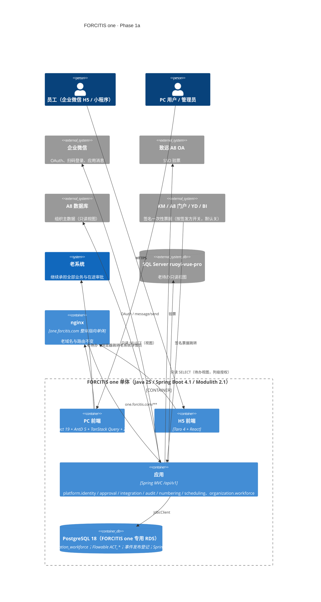
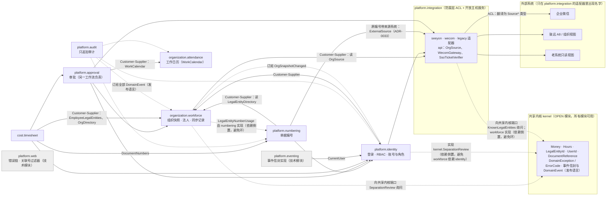
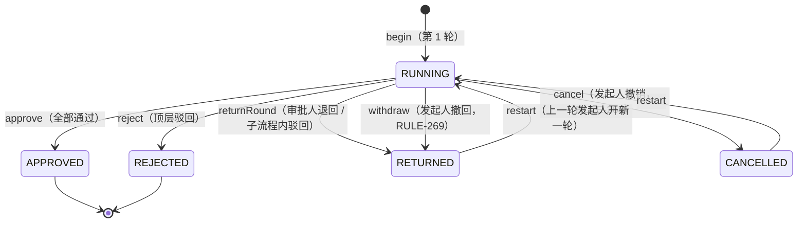
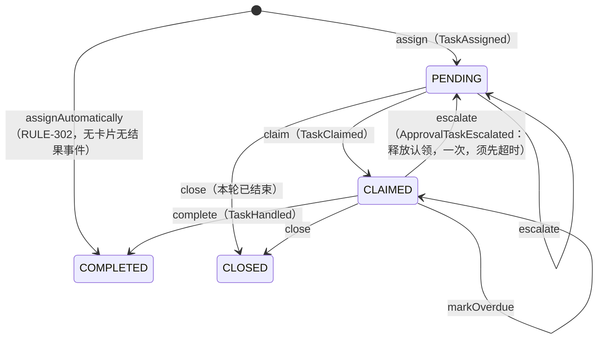
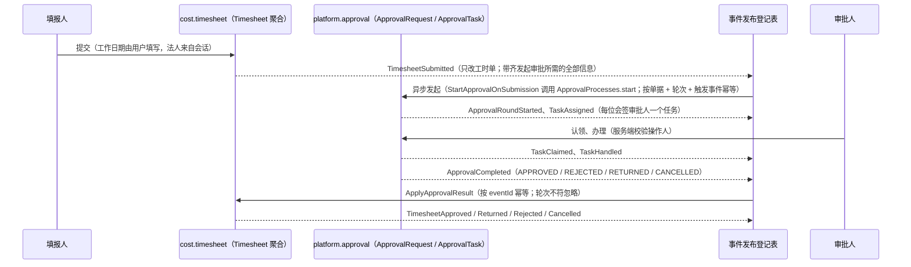
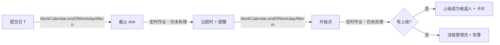

> 冻结（2026-11-04）：Phase 1a 平台桥接试点的架构稿，不再更新；技术栈与平台决定见 ADR-0001、ADR-0002 及其后各 ADR，现行决定见 `docs/adr/current.md`。

# REIMAGINED_ARCHITECTURE — FORCITIS one · Phase 1a 平台桥接（试点）

日期：2026-10-14 · 会话：psa-1a-platform-bridge-reimagine · 状态：**已批准（检查点 2，2026-10-14）**——修订稿已吸收 architecture-critic 评审；Q-1..Q-4 用户决定见 §7

约束来源（本文不重新决定）：brief §2 终态架构与 §3 Phase 1a 条件、`STACK_DECISION.md`、ADR-0002..0020、`architecture-guardrails/`（已实测骨架与守护测试）。规格见 `AI_NATIVE_SPEC.md`：检查点 1 已批准；identity/org 第三批规则已评审，见 §5.2。评审意见的逐条处理见 §8。标「**待 Q-x**」的设计项需在检查点 2 由用户决定，未决定前不实施。

## 1. C4 Container（Phase 1a 终点）



1a 不做按路径分流：新系统使用独立域名 `one.forcitis.com`，老域名、老路由、老登录保持不变（评审 #5 消除了前后矛盾）。

## 2. 模块边界与规则归属

包结构 `com.forcitis.one.<子域>.<bc>.{api,events,application,domain,infrastructure,web}`（ADR-0003，守护 G1–G48）。**防腐层放进使用它的模块的 `infrastructure` 包**；只有多个模块共用的企业微信客户端和出站投递留在 `platform.integration`（评审 #7）。

| 模块 | 职责（Phase 1a） | 规则 / 能力 | 自有 schema 与主要表 |
|---|---|---|---|
| `platform.identity` | 登录（企业微信 H5 / 扫码 / 小程序、致远验票、签名票据、应急管理员）；服务端会话与吊销；`CurrentUser`；RBAC（`Permission`、角色、导航）；`AccessScope` 类型与单测；**唯一**配置 Spring Security 的模块（G33）。内部 ACL：致远验票客户端、票据校验 | C1a-01..09；RULE-316..353（已评审） | `platform_identity`：`user_accounts`、`roles`、`role_permissions`、`account_roles`、`navigation_items`、`sso_ticket_uses`、`login_states`、`ticket_issuers`、`emergency_admins`、`authorization_requests`（敏感授权的双人确认，ADR-0027 第 3 项）；Spring Session 表（DdlNamingTest 豁免） |
| `organization.workforce` | A8 组织快照（部门、人员、岗位、任职、汇报线、负责人 / 区域 AR / 类别 / 交付标识、**企业微信 userid**）；同步运行与差异；缩水保护与人工放行；对账查询；单人即时查询（登录未命中时）；`OrgChanged` 事件。内部 ACL：A8 只读视图 | C1a-10、11；RULE-354..373 | `organization_workforce`：`org_units`、`employees`、`positions`、`assignments`、`legal_entities`、`sync_runs`、`sync_diffs`、`sync_run_held_separations`（暂停时的离职名单，ADR-0028） |
| `platform.approval` | Flowable 8 引擎封装；纯函数 `AssigneeResolver`（引擎与回放共用）；发起 / 认领 / 办理 / 退回发起人；幂等发起与轮次；类型化结果事件；合并待办；通知意图（模块内接口隔离）。内部 ACL：老待办只读视图。**其余生命周期能力范围待 Q-3** | C1a-12..15；RULE-248..314（已评审） | `platform_approval`：`approval_requests`、`start_rounds`；Flowable `ACT_*`（无 `approval_tasks_view`、`hook_registrations`、`assignment_rules`、`legacy_inbox_cache`，评审 #9） |
| `platform.integration` | 共用企业微信客户端（access_token 缓存、OAuth code 换 userid、发送文本卡片）；`outbound_deliveries`（重试、退避、死信） | C1a-01、15 出站部分 | `platform_integration`：`outbound_deliveries` |
| `platform.audit` | 只追加审计：登录成功 / 失败、会话吊销、权限变更、代理操作；失败类审计用独立事务（REQUIRES_NEW），触发器保证只追加（G34） | C1a-17 | `platform_audit`：`audit_entries` |
| `platform.numbering` | 模板已实现；1a 增加编号规则页与 `legacy_numbers`（**范围待 Q-2**） | C1a-16；ADR-0010 | `platform_numbering`：`numbering_rules`、`numbering_rule_versions`（模板按版本保存、保存后不可变，四眼确认，发号取生效日不晚于业务日期的最高已确认版本）、`numbering_counters`、`legacy_numbers` |
| `platform.scheduling` | ShedLock（模板已有）；作业失败用 Micrometer 定时任务观测指标，不建表（评审 #13） | C1a-18 | `platform_scheduling` |
| `kernel` | `Money`、`LegalEntityId`（已有），新增最小形态的 `AccountingPeriod`、`ProjectCoordinate`（类型 + 不变式，不含业务行为，评审 #3） | ADR-0016 入口条件 | — |

**依赖图**（提议加入 `architecture/module-dependencies.txt`，经 CODEOWNERS 评审）：

```
platform.integration ->
platform.audit ->
platform.scheduling ->
organization.workforce -> platform.audit, platform.integration
platform.identity -> organization.workforce, platform.integration, platform.audit
platform.numbering -> platform.identity, organization.workforce, platform.integration
platform.approval -> platform.identity, organization.workforce, platform.integration, platform.audit
```

### 2.1 检查点 2 之后的修订（用户决定，2026-10-14）

上表中凡与本节冲突处，以本节为准。

| 修订 | 用户决定（原话） | 落点 |
|---|---|---|
| **外部系统适配器集中到 `platform.integration`**（推翻上文「防腐层放进使用它的模块」） | 「G46 为什么新系统要放 A8 这类旧系统的名称？」→「改名并移到 integration」 | <ul><li>致远 / A8 视图读取：`platform.integration.infrastructure.seeyon`，api 端口 `OrgSource`。</li><li>致远验票：同一适配器，端口 `SsoTicketVerifier`。</li><li>老库组织短名：`platform.integration.infrastructure.legacy`，端口 `OrgShortNames`。</li><li>workforce 与 identity 只经端口取数，领域模块的类、包、配置键、表、事件里不出现 a8 / seeyon / u8c / yudao（LegacyShapeTest）。</li><li>致远登录在 identity 中称为通用 SSO（`sessions:sso-login`）。</li><li>例外：老待办视图仍由 `platform.approval.infrastructure.legacy` 读取（按角色命名 legacy，无供应商名）。</li><li>依赖新增 `organization.workforce -> platform.integration`。</li></ul> |
| 组织快照是过渡态，来源可替换 | 「主数据全部进新系统」「自建整个 hrm」 | `OrgSource` 端口后换实现即可。PATH 编码只在 seeyon 适配器内换算为父 id，快照表与接口不含 path |
| **法人小表**放在 `organization.workforce` | 「新系统维护法人小表 (Recommended)」 | <ul><li>`legal_entities`（法人代码如 FST）由管理员维护，不从外部同步。</li><li>numbering 的 `{LE}` 渲染法人代码，例如 `QT-FST-202610-0001`。</li><li>依赖新增 `platform.numbering -> organization.workforce`；正式词表中 LegalEntity 归属 organization.workforce。</li></ul> |
| 原编号检索单独授权 | 「单独设 legacy-number:read (Recommended)」 | `platform.numbering:legacy-number:read` |
| **退回即结束本轮**（取代 §3.4 的发起人节点与令牌回移） | 「退回即结束本轮，重提开新一轮 (Recommended)」 | <ul><li>退回（含子流程内驳回）以 RETURNED 结束本轮实例。</li><li>重提在同一单据上开新一轮（`start_rounds`）。</li><li>只有上一轮发起人能开新一轮。</li><li>INITIATOR 指派类型删除。</li><li>RULE_REVIEWS「实现方式变更」记录 RULE-275/287。</li></ul> |
| **指派规则类型** | 「按建议：保留 5 种、推迟 3 种、不建 2 种」 | <ul><li>实现：ROLE、DEPARTMENT_HEAD、INITIATOR_SUPERVISOR、FORM_FIELD_USERS（第 5 种 INITIATOR 随上一条删除）。</li><li>推迟：区域应收负责人，见 1b OPP_QUOTATION 与 Phase 2 PM_BUDGET；表单用户的上级，见 Phase 2/4 PM_ETC、PM_REVENUE；部门总监，生产无使用，按新角色体系再定义。</li><li>不建：NAMED_USERS、PROCESS_VARIABLE_USERS。</li><li>由 BpmnRuleConventionsTest 守护；说明见 `docs/data/timesheet-replay.md`。</li></ul> |
| TIMESHEET 与生产当前版本（v15）对齐 | ——（依据 `docs/legacy/runtime-usage/prod-bpm.tsv` ##13） | <ul><li>节点：项目经理 `projectManagerId`；售前分支的区域负责人 `regionalHeadId`，路由标记 `preSalesHours`；发起人一级上级。</li><li>老变量名只在回放转换表中出现。</li><li>节点顺序与子流程范围**待用户确认**。</li></ul> |
| 列名 `is_fee_earner`（原文 `fee_earner_flag`） | ——（DdlNamingTest：布尔列以 is_ 开头，禁用 flag） | `organization_workforce.employees.is_fee_earner` |
| `event_publication` 归 `platform_integration` schema | psa-coordinator 同意 | Flyway 创建，关闭自动建表 |
| 外发投递的并发令牌 | psa-coordinator 接受（代理 B 方案） | `outbound_deliveries` 以「认领号（`attempt_count`）+ 状态」作乐观锁；`version` 只递增，不参与校验。原因：卡片在途时，「已处理」说明仍要能写入同一行，若以 version 校验，会让投递作业持有的版本失效；认领号才是这张表真正的并发令牌 |
| 审计最终一致 | 「B 审计订阅领域事件 (Recommended)」 | 业务审计在事件投递后可见，不与业务写入同时可见。延迟上限由事件发布登记表的重投策略决定：1 分钟间隔，最多 8 次；超过上限会触发「未完成事件发布」告警（P2）。安全审计（登录失败、拒绝访问）仍在独立事务中同步写入 |
| **审批路由引入 DMN**（修订检查点 2「1a 不引入 DMN」） | 「B 决策表管业务判断 (Recommended)」 | DMN 只负责：走哪几路、能否跳过、能否自动通过、节点时限。用 Flowable DMN 执行，按部署版本生效，业务可评审。「取谁」仍由 BPMN 上的类型化指派规则决定，AssigneeResolver 只执行决策结果 |
| **新建 `platform.web`** | 「新建 platform.web (Recommended)」 | 技术模块，承载跨模块的 web 装配：领域异常 → ErrorCode → ProblemDetail 的全局处理器、OpenAPI 定制 |
| **新建 `platform.eventing`**（事件信封的实现位置，实现 `kernel.event.EventEnvelopes` 与 `DomainEvents`） | 「事件信封实现放在符合依赖图的位置，可以新建技术模块」 | 技术模块，不被任何模块依赖（各模块只用 kernel 里的端口），只依赖 `platform.identity` 的 `CurrentUser`；eventId 用 UUIDv7，时间取注入的 Clock，关联号从 `X-Correlation-Id` 经 MDC 带入事件信封与出站投递，行为人在请求里是用户、在作业或事件处理里是作业名 |
| **`organization.attendance` 提前到 1a 建**（工作日历） | 「BC 提前到 1a 建；默认日历一份，预留法人专属日历」 | schema `organization_attendance`；`WorkCalendar` 周末休息、其余上班，叠加按年维护的节假日与调休上班日，业务时区 Asia/Shanghai（`forcitis.kernel.business-zone`）；依赖的年份未维护则失败并告警；维护权限 `organization.attendance:work-calendar:update` |
| **版本只写在路径里**（复审 M3） | 「删除 ApiVersioning，@RequestMapping 写死 /api/v1」 | 控制器直接写 `/api/v1/...`，`/api/1/...` 是 404；破坏性变更另开 `/api/v2/` 控制器 |
| **审计订阅领域事件** | 「B 审计订阅领域事件 (Recommended)」 | 对外有意义的业务状态变化，审计统一订阅领域事件（事件发布登记表保证不漏记）；安全事件（登录失败、拒绝访问）仍用 `recordIndependently` |
| **审批时限 T+1 工作日** | 「工时要求T+1 审批完毕……」；T 从提交当天起算，+1 按工作日（需要工作日历）；超时提醒、升级给上级、计入时效统计，不自动通过 | 引擎通用的审批时限能力，时限由 DMN 或配置给出；工作日历由管理员维护；事件 `ApprovalTaskBecameOverdue`、`ApprovalTaskEscalated` |

无环要点：integration 不认识 FORCITIS one 用户；企业微信 userid 由 workforce 快照持有，identity 在登录时按 userid 查 workforce 的 api（取消 `external_identities` 表，评审 #8）；通知时 approval 从 workforce 取收件人的 userid，再调 integration 发送；审计由各模块调用 audit 的 api。各模块 api 方法数 ≤ 12（`ArchitectureRulesTest`）。

### 2.2 上下文映射图（METHODS M4）

箭头从下游指向上游（下游依赖上游的 `api` 或 `events`）；边与 `architecture/module-dependencies.txt` 一致，`ModuleDependencyTest` 守护。



- **共享内核**：`kernel` 只放不含业务行为的类型与端口；`WorkContext`（关联号、行为人）、`AggregateRoot`、`StateMachine` 也在这里。
- **发布语言**：领域事件的信封与负载约束见 `docs/architecture/events/event-analytics-fields.md` §6，目录在 `docs/architecture/events/asyncapi.yaml`（`EventCatalogueTest` 守护）。
- **防腐层**：外部系统名只出现在 `platform.integration.infrastructure.*`；workforce 直接用 `platform.integration.api` 的 `Source*` 类型，不再有镜像类型。
- **开放主机服务**：每个模块的 `api` 包（窄接口，`ArchitectureRulesTest` 守护）。
- **依赖倒置（共享内核端口）**：同步运行要在把人变成离职之前问「会不会让管理员全部离开」，workforce 不能依赖 identity（identity 已依赖 workforce），所以端口 `kernel.SeparationReview` 放在共享内核，由 identity 的 `AdministratorSeparationReview` 实现（ADR-0027 第 1 项、ADR-0028）；`module-dependencies.txt` 因此不增加边。
- **依赖倒置**：workforce 需要知道某法人是否已发过号，却不能依赖 numbering（numbering 已依赖 workforce）；接口 `LegalEntityNumberUsage` 放在 workforce 的 api，由 numbering 实现。
- **依赖倒置**：登记核算组织编码要确认所指法人存在，integration 却不能依赖 workforce（workforce 已依赖 integration）；端口 `kernel.KnownLegalEntities` 放在共享内核，由 workforce 实现（ADR-0033 第 5 项）；`module-dependencies.txt` 因此不增加这条边。numbering 的原编号带来源系统，使用 `platform.integration.api.ExternalSource`，所以增加 `platform.numbering -> platform.integration`（integration 不依赖任何模块，不成环）。
- **一致性**：同一事务只改一个聚合；跨聚合协作经事件（至少一次，按 eventId 幂等）或按 ID 查询。

## 3. 关键设计

### 3.1 登录与会话
- **企业微信**：H5 内嵌静默授权（`snsapi_base`）；小程序 `jscode2session`（RULE-323 保留）；PC 扫码登录。integration 把 code 换成 userid → identity 调 workforce 按 userid 精确查人 → **统一入口检查**「账号启用且员工在职」（RULE-326/327）→ 更换会话 ID（防会话固定）→ 建会话。
- **登录未命中**（新入职员工尚未同步）：workforce 按 userid 即时到 A8 查这一个人，校验规则与同步相同，命中则当场建档并写审计（评审 #14）。
- **会话**：Spring Session JDBC，Cookie `SESSION`（HttpOnly、Secure、SameSite=Lax）；**空闲 10 h、绝对上限 24 h**，均为配置项（RULE-331/332 用户决定）；CSRF 用 Spring Security 的 SPA token 处理器（`XSRF-TOKEN` Cookie 回写请求头）。
- **即时吊销**（RULE-338/363/366）：两道保证。① 每次解析会话时校验账号状态与在职状态（Caffeine 缓存 ≤ 60 s）；② 收到 `OrgChanged` 或角色变更时删除该用户全部会话。①不依赖事件，所以 C1a-11 保持 P1，C1a-05 仍成立（评审 #8）。
- **致远 SSO**：服务端验票，`sso_ticket_uses` 唯一约束防重放；验票失败或致远不可用时，错误页提供「回到老系统登录」链接（brief 风险一缓解，评审 #5）。
- **外部签名票据**（C1a-03）：**每个签发方一把密钥**（KMS，`kid` 区分）；`ticket_issuers` 为每个签发方配置允许的用户范围，**禁止通过票据进入管理员角色**；每个签发方单独开关，**调用方完成对接前保持关闭**（评审 #12）。票据 ≤ 60 s，nonce 一次性。
- **应急管理员**：独立表，Argon2id，TOTP，5 次失败锁 15 分钟；「仅内网」通过 nginx 可信代理配置（`server.forward-headers-strategy` + 只信任 nginx 地址）实现（评审 #18）。
- **老令牌桥接**（C1a-06）：**已删除（Q-1）**。评审指出：老令牌有效期在 Redis 中滑动、数据库里的过期时间不更新，只读数据库无法正确判断；实现它需要改老前端；能读令牌表的账号等于能冒充任何人；1a 也没有「老页面跳到新页面」的场景。建议 1a 删除，ADR-0009 §6 改为「需要时由老后端签发一次性签名票据，复用 C1a-03」。

### 3.2 授权
- `Permission` 为类型化常量（`<子域>.<bc>:<资源>:<动作>`，G43）；角色—权限、账号—角色存库，变更时失效缓存，即时生效。
- 新员工：同步建档时**显式**授予配置项 `forcitis.platform.identity.default-role`（最小权限）一次并写审计；管理员移除后不补回；离职者不授（RULE-344 修正）。新角色默认数据范围 SELF（RULE-345）。
- `AccessScope`（法人 × 部门子树 × 项目角色；「本人及下属」只算直接下属，RULE-349 用户决定）：1a 只交付类型与单测，`data_scope_grants` 表推迟到第一个使用者 1b（评审 #16）。
  - **已由 ADR-0026 改变**（用户 2026-10-14 批准）：1a 交付范围授予明细表（`role_scope_grants`）、数据访问注册表与守护、部门浏览和人员详情按范围过滤、「部门 → 法人」与「员工 → 法人」生效区间表、管理模式；法人限定与审批参与访问在 1b。以 ADR-0026「1a 交付范围」为准。
- 初始授权：一次性 ETL，从老库只读导出角色与菜单权限，按映射表转成新 `Permission`；没有对应的不授予（映射表在实施时给用户确认）。

### 3.3 组织快照
- **过渡态说明**（用户 2026-10-14：「主数据全部进新系统」「自建整个 hrm」）：1a 的 A8 组织快照是**过渡态**——员工与组织主数据最终归新系统（自建 HRM），届时 A8 不再是组织主数据源；1a 范围不变，快照模型与 `OrgDirectory` 契约按「来源可替换」设计（来源只在 workforce 的 infrastructure 中）。
- **权责事实边界（GUIDING_PRINCIPLES §9a，用户 2026-10-14：「确保权责业务事实全部在新系统」）**：A8 在新系统中作为组织主数据（部门、人员、岗位、汇报线、负责人）、身份（致远 SSO）的来源。合同、产值 / 收入确认、成本、费用、开票、回款、分包、付款等权责事实不得**作为输入**从 A8 读取，也不在 A8 存放；取证、迁入、对账与等价核对可读 A8 任意表（ADR-0037）。A8 读取只在 `platform.integration` 的适配器中，由 ArchUnit 守护（`ExternalConnectionIsolationTest`）。老 fst 中其他 `a8_db` 跨库读取（如 `docs/ops/oa-*` 存储过程涉及的报价、产值、开票、奖金）不在新系统中以「直接读 A8」延续，在各自阶段改为新系统自有事实。
- **§9a 的机器守护**（architecture-critic §9a 专项核对，2026-10-14）：
  - **外部读取登记入库**：`backend/architecture/external-read-registry.yaml` 一列一行登记读取的对象（`forcitis_one` 视图或 `dbo.` 基表）、列、来源表与列、分类、敏感级别与读取用途（运行时同步 / 运行时待办 / 迁入 / 迁入核对）；启动时仍经视图读取的路径校验 `INFORMATION_SCHEMA.COLUMNS` 与登记**完全相等**（不只是「所需列存在」），运行时用途的基表行做子集检查（基表多出的列不报），迁入与迁入核对用途的行不进启动检查（ADR-0037 第 6 项第 1 条、第 8 项第 4 条）。基表一律写 `dbo.` 限定名（A8 账号默认 schema 为 `forcitis_one`）。A8 账号按 ADR-0037 全库只读（库级 SELECT，库级 DENY 写、DDL、EXECUTE、REFERENCES），应用启动、每次同步前与至少每天按 ADR-0037 第 4 项 (a)–(f) 校验账号等于平台基线，不满足或无法判定即拒绝启动或停掉连接；集成测试断言写操作被拒绝。视图冻结，视图列与登记的相等校验只对仍经视图读取的路径（ADR-0037 第 6 项）。
  - **1a 白名单范围**（运行时经视图读取的范围，不再是授权边界，ADR-0037）：`ORG_UNIT`、`ORG_RELATIONSHIP`（负责人、区域 AR 两种关系类型）、`ADDRESSBOOK` 扩展属性 32 / 33 与 `CTP_ENUM*` 显示值、`ORG_POST`、`ORG_MEMBER`、`ORG_PRINCIPAL.LOGIN_NAME`，以及 `formmain_0307` 的 3 列（企业邮箱、性别、收费员工标识）。生日（`EXT_ATTR_21`，敏感信息）、银行卡等不进 1a 视图。
  - **收费员工标识**：A8 `FIELD0244` 在新系统中命名为 `employees.is_fee_earner`（不叫 `is_billable`），只是人事分类。可计费性由新系统判定，这个标识只是输入之一；以后凡是用到它的权责事实，都要把当时的值和同步批次号一并快照。
  - **单一路径**：批量同步与登录未命中时的单人查询共用同一视图、同一映射器，只是查询条件不同。
  - **ArchUnit**：只有 `platform.integration.infrastructure.seeyon..` 能连接 A8，外部连接只经 `platform.integration` 的连接工厂建立（`ExternalConnectionIsolationTest`）；只有 `platform.identity.infrastructure..` 能使用致远验票客户端。
  - **源码扫描测试**：`src/main` 与 Flyway 中禁止出现 `formmain_`、`formson_`、`a8_db`、`LEXMIS`、`T_U8C_`（白名单视图名除外）。
  - **依赖与 DDL 禁令**：Maven Enforcer 禁止 `dynamic-datasource`；Flyway 禁止 `CREATE EXTENSION tds_fdw|postgres_fdw|dblink`、`CREATE SERVER`、`IMPORT FOREIGN SCHEMA`。
  - **schema 守护**：`organization_workforce` 不得有金额列；workforce 的 `api` 不暴露 `Money` / `AccountingPeriod`。
  - **跨阶段台账**：老系统对 A8 的全部读写登记在 `docs/legacy/seeyon-oa/access-register.md`，每个阶段出口时更新状态。
- 数据源：**A8 只读视图**（视图冻结，ADR-0037 第 6 项；账号全库只读并按第 4 项校验；启动时校验列集合与白名单完全相等；关系类型 ID 等改为配置，RULE-356），不读老 `system_users` / `system_dept`。出口条件「与 A8 零差异」以 A8 为基准。
- 每 **5 分钟**一次（ShedLock；每次约 1,300 人、367 个部门），全量拉取 → 计算差异 → 单事务写入，并记录 `sync_runs` / `sync_diffs`。源数据缩水超过 20 % 或本次会让超级管理员、安全审计员离职时中止并告警；暂停按类型记录（缩水保护、管理员离职），各类由有资格的人在页面分别放行，全部放行后才按最新源数据重跑（RULE-358/366，评审 #14，ADR-0028）。
- A8 权威列按值同步，空值也写入（RULE-365）；单行缺部门或岗位时隔离该行并告警（RULE-365）；`we_com_id` 在建档时写入（RULE-362）；多名负责人时取 ID 最小者并告警（RULE-356）。
- `short_name`：在新系统的维护页上线前，每天从老表只读刷新一次（评审 #20）。`company_code`：不迁移。
- **非 A8 账号**：老 `system_users` 中管理员手工建的雪花 ID 账号，新系统不会建档。切换前盘点，逐个决定去留（评审 #14，归入 Q-4）。

### 3.4 审批引擎（范围待 Q-3）
- Flowable 8 嵌入同一数据源（`ACT_*` 在 `platform_approval` schema）。BPMN 文件进版本库，不提供设计器（D-05）。**生产环境 `flowable.database-schema-update=false`**，引擎升级走专门的手册（评审 #15）。
- **指派**：每个节点恰一条规则（RULE-262），写在 BPMN 扩展属性里，由 Java 的 `AssigneeResolver`（纯函数：规则 + 组织快照 + 流程变量 → 候选集）实现。DMN 的引入见 §2.1 与 §3.4.2（取代此前「1a 不引入 DMN」）。
- **单人节点**：改为候选组 + 认领（RULE-249）。排除停用和离职人员（RULE-253）；取不到人时转流程管理员并告警（RULE-250/254）；防自审（RULE-307）。
- **1a 建议交付**（Q-3 建议项）：发起（幂等，唯一约束（流程类型, 单据 ID）与（流程类型, 单据 ID, 轮次），RULE-264/266/278）、认领（RULE-276）、办理（RULE-272/280）、退回发起人（RULE-275）、类型化结果事件（经事件发布登记表，至少一次，RULE-295/303/304）、合并待办。
- **随第一个使用者交付**（Q-3 建议项）：加签、转交、退回到指定节点、撤回 / 撤销截止点（1b 报价）；行级审批生命周期（Phase 2 工时）。它们的规则已评审，验收测试在对应阶段启用。
- **BEFORE 钩子**：SPI `ApprovalHook` 定义在 approval 的 `api` 中，在办理事务内调用（RULE-277/280）。1a 只有接口与测试替身。
- **1a 不接入业务单据**（brief 风险二缓解）。

#### 3.4.1 聚合边界与状态机（Phase 1a 第二轮，用户决定「现在就改，并加守护」）
- **聚合**：`ApprovalRequest` 是聚合根，每张单据一个，带法人、轮次、状态、事件计数、`version`；它的 `ApprovalTask`（每个引擎任务一行）是成员实体，有自己的事件计数。所有改动先锁请求行，再改任务行，所以一个事务只改一个聚合；引擎里的流程实例不是聚合，是请求聚合的执行态。
- **状态机在聚合内**：合法转换表是 `ApprovalRequest` / `ApprovalTask` / `Timesheet` 的私有常量，状态只能经领域方法改变，非法转换抛领域异常，应用层把它转成 `ErrorCode`，再由 web 转 ProblemDetail。仓储只写聚合给出的结果，更新带 `version` 与前置状态条件，不满足即 `StaleAggregateException`（409）。穷举测试：`ApprovalRequestStateMachineTest`、`ApprovalTaskStateMachineTest`、`TimesheetStateMachineTest`。





#### 3.4.2 事件流：审批 → 工时单

- **一个事务只改一个聚合**：`ApprovalRequest` 聚合含本轮的任务（任务是内部实体，共用请求的版本与事件序号）；提交只改 `Timesheet`，审批由事件异步发起，结果由事件回写。唯一登记的例外是首次提交同事务取号（`architecture/multi-aggregate-exceptions.txt`），其事件的 relatedAggregates 列出 NumberingRule。订阅者放在 cost.timesheet 一侧，是因为模块依赖图里 platform.approval 不能反向依赖业务模块。D-1a-107：1a 不对外开放工时单的提交、撤回、取消，也无只读接口，入口随 Phase 2。
- 两边只经事件协作：approval 拥有流程状态，业务模块拥有单据状态。事件由聚合记录（`EventDraft`，聚合上的事件计数就是信封的 `aggregateVersion`），应用层在同一事务里用 `EventEnvelopes` 包装后交 Modulith 发布；事件目录条目见 `docs/architecture/events/approval.yaml`、`timesheet.yaml`。
- **会签**（RULE-248/273，G-2 已做）：TIMESHEET 三路都是 Flowable 多实例并行节点，集合表达式 `approverResolution` 给出去重后的审批人，每人一个任务；全部通过才过节点，任一正式驳回结束本轮（子流程内驳回即退回），加签人的驳回只作建议。
- **节点属性**（D-1a-100，1a 不用 DMN）：走哪几路（`routingFlag`）、取不到人能否跳过（`skipWhenEmpty`）、重复审批人能否自动通过（`autoApproveRepeat`）、取不到本规则点名的人时是否不转交上级或管理员而挂起告警（`noFallback`）、节点时限与升级间隔（`deadlineWorkdays` 与 `escalationWorkdays`，成对出现）都是 BPMN 节点规则元素的属性，随流程文件的部署版本生效。发起时给出的路由标记若没有任何节点声明，发起被拒绝（M-10）。「取谁」由类型化指派规则决定。
- **重复审批人**（RULE-302）：同一审批人在同一实例的同一节点再次出现，且内容摘要未变，由系统自动通过并记审计；内容变了必须重审。**撤回 / 撤销 / 截止点**（RULE-268/269/309）：「能否撤回」的显示与执行用同一个判断（`ApprovalRequest.checkWithdraw`），截止点是 BPMN 上标了 `cutoff` 的节点，只要有已完成的任务即越过。**转交**（RULE-285）只有当前处理人能做，新处理人要在职、非发起人、不在同节点已有任务。
- **审批时限**（D-1a-110..117，RULE-377..384）：每个任务从创建时起算，T = 创建所在工作日（非工作日顺延），截止 = T 之后第 n 个工作日 23:59（`WorkCalendar`，按法人），截止后下一个工作日 09:00 提醒，提醒日之后第 m 个工作日 09:00 升级：已认领的升给认领人的直属上级（认领人保留为候选），未认领的升给流程管理员，取不到上级也交流程管理员并告警；不自动通过；ShedLock 定时作业 `platform.approval.deadline.enforce`，一任务一事务。



### 3.5 TIMESHEET 审批人序列回放（两步法，待 Q-4）
- **(a) 引擎等价**：生产只读导出近期、**当前定义版本**的 TIMESHEET 实例样本，同时导出**当时的老 `system_users` / `system_dept` 快照**、指派规则、流程变量快照与实际审批人序列。`AssigneeResolver` 用老组织快照逐节点计算候选集。匹配口径为「老审批人 ∈ 新候选集」，以适应 RULE-249 的随机选人改为候选组。
- **(b) 数据源差异**：单独报告 A8 与老表之间的漂移（领导被清空不同步、改名不同步等，RULE-365），不混入 (a)。
- 差异分为三类：已评审的修正、数据源漂移、真缺陷。前两类按类别由用户接受，真缺陷逐条修复（评审 #6）。
- 导出文件含人员姓名，不进仓库，只存本机 `~/.modernize/psa/`。执行前需用户授权生产只读查询。
- **会签已实现**（G-2）：生产 v15 的三路都是并行多实例会签；新流程与之一致，每个不同的审批人一个任务，回放仍只比对「老审批人 ∈ 新候选集」。路由由决策表给出，回放工具的分支表与 BPMN、决策表的一致性由 `TimesheetApproverReplayIT.branchTableEqualsTheProcess` 守护。

### 3.6 合并待办
- **新待办**：Flowable 任务，加上本人所在候选组的任务；会签节点每位审批人是自己的一项待办。
- **老待办**：approval 的内部 ACL 通过只读账号查询**老库视图**（`bpm_task_ext` 中 result=1，关联 `ACT_RU_TASK` 与 `bpm_process_instance_ext` 标题），按 RULE-261 把行任务合并为（实例, 节点）一项。
  - 视图由 DBA 建立（已冻结，ADR-0037 第 6 项）；账号按 ADR-0037 全库只读，令牌表可读但应用代码不引用、凭据值不进新系统（I-1）；建视图作为一次老系统变更登记（评审 #11）。
  - **不做缓存**：查询量约每天 540 次（180 天 97,591 次），直接查询即可。这样「待办数一致」的测试结果稳定（评审 #9）。
  - 点击老待办时，浏览器跳到老系统详情页。用户在老系统未登录时：H5 在企业微信内静默登录老系统；PC 端回到老系统登录页（1a 可接受，见 Q-1）。

### 3.7 企业微信通知
- 通知意图（`TaskAssigned`、`ApprovalCompleted`、知会）→ approval 内部的通知端口（接口隔离；出现第二个使用者时再抽出 `platform.notification`，评审 #17）→ 从 workforce 取 userid → integration 发送 **文本卡片 + 跳转链接，不带按钮**（评审 #10）。`touser` 精确匹配，不带 `@all`。失败记入 `outbound_deliveries`，退避重试，进死信时告警。
- 卡片按钮回调（C1a-15 的 P1 部分）推迟。原因：企业微信应用只有一个回调地址，目前由老系统占用。等老待办排空，或者新开独立的企业微信应用之后再做。
- **候选组通知策略待 Q-3**：改为候选组认领后，一个任务会通知 N 个人。
- 审批时限与转交增加三种卡片：超时提醒（`ApprovalTaskBecameOverdue`，发给处理人）、升级（`ApprovalTaskEscalated`，发给上级或流程管理员）、转交（`TaskTransferred`，发给新处理人）；去重键分别是 `approval-task:{taskId}:overdue`、`:escalated`、`:transfer:{eventId}`。
- 非生产环境：收件人改为配置的白名单，agentId 按环境配置（RULE-375）。

### 3.8 安全验证
- **匿名访问**（评审 #4，措辞修订待 Q-2）：
  - 非 `@PublicEndpoint` 的 handler，匿名访问一律返回 401；
  - `@PublicEndpoint` 集合必须等于入库的白名单快照，白名单经 CODEOWNERS 评审；
  - 加一条不带 CSRF 的写操作用例，应返回 403；
  - `/v3/api-docs` 与 `/actuator/**` 在生产不对外，只保留 health；
  - 上线前从 nginx 外侧做一次黑盒遍历。
- **公开端点放行**：`SecurityConfiguration` 增加读取 `@PublicEndpoint` 注解的放行机制（骨架目前没有）。

### 3.9 可观测性与告警
- Micrometer 指标送 ARMS（Prometheus 协议），结构化日志送 SLS。
- 四类告警：

  | 告警 | 触发条件 |
  |---|---|
  | 组织同步延迟 | 距上次成功超过 2 个周期，或同步因缩水保护中止 |
  | 未完成事件发布 | `event_publication` 中未完成超过 10 分钟，或 `outbound_deliveries` 进入死信 |
  | 作业失败 | 定时任务观测指标中出现失败，或 Flowable 死信任务数大于 0（评审 #13） |
  | 登录失败率 | 5 分钟内失败率超过 20 % 且失败不少于 20 次 |

- 告警在 dev 上用故障注入演练触发。

### 3.10 前端与设计正本
- **结构**：单仓 `frontend/`（pnpm workspace），含：
  - `apps/web`：React 19 + Vite + AntD 5；
  - `apps/h5`：Taro 4 + React；
  - `packages/api`：OpenAPI 生成的客户端 + Zod；
  - `packages/design-system`：`tokens.css`，与设计正本逐项一致；
  - `packages/ui`：`shared/ui`，以正本组件为起点。
- **守护**：沿用 `architecture-guardrails/frontend` 的 F1–F14。
- **1a 页面**：
  - PC：登录、布局与导航、合并待办、审批详情（新引擎）、编号规则页、组织浏览（只读）、同步记录与人工放行、权限不足页、会话过期页；
  - H5：静默登录、待办、审批详情。
- **设计正本步骤**（独立工作项，评审 #13）：
  1. 先完整备份正本；
  2. 把正本组件取下作为 `shared/ui` 的起点；
  3. 补齐 `DS_GAPS.md` 中 1a 的差距（收件箱、登录页、权限不足 / 会话过期页），先补正本、再写页面；
  4. 阶段末执行首次 `/design-sync`：正本由 `shared/ui` 同步生成，逐个组件比对预览，写入 `_ds_sync.json` 锚点。

### 3.11 切换手册与回滚（评审 #5）
切换手册逐项列出外部变更及其反向步骤，回滚演练覆盖全部变更：

| 变更 | 执行方 | 反向步骤 |
|---|---|---|
| 开通 `one.forcitis.com` DNS、证书、nginx server 块 | 运维 | 关闭 server 块 |
| 企业微信：可信域名、扫码登录回调域、新出口 IP 加入企业可信 IP | 企业微信管理员 | 移除 |
| 企业微信工作台新增「FORCITIS one」入口（**不替换**老 H5 入口） | 企业微信管理员 | 隐藏入口 |
| 致远：为新系统登记验票回跳地址（**不替换**老 SSO） | A8 管理员 | 删除登记 |
| 老库只读待办视图 + 只读账号；A8 只读视图 + 只读账号；网络白名单 | DBA / 运维 | 收回账号 |
| 新系统通知开关 | 新系统配置 | 关闭 |

由于 1a 只「新增入口」、不替换老入口，回滚就是关闭新入口和通知开关，老系统的登录和审批不受影响（出口条件）。新引擎不承接业务单据，因此不会出现新旧双发通知。

## 4. 技术选择（一行理由）

| 选择 | 理由 |
|---|---|
| Spring Modulith 单体 + 单库 | 活跃用户 335 人，单台 ECS；模块边界由 `verify()` 与 ArchUnit 守护（ADR-0003/0004） |
| Spring Session JDBC | 会话可在服务端吊销，不需要 Redis（ADR-0009） |
| Flowable 8 嵌入，生产关闭自动改表 | 用户已决定引入；与业务同库同事务，满足 RULE-280 的修正；表结构变更受控 |
| BPMN 扩展属性 + Java `AssigneeResolver`（1a 不用 DMN） | 可测试，引擎与回放共用；去掉 Groovy 和「从 HashSet 取第一个」的写法 |
| Modulith 事件发布登记表 | 取代 RocketMQ + outbox + 对账（RULE-295/303/304 的评审结论） |
| JdbcClient + Flyway（每个模块一个 schema 目录） | 定栈（ADR-0002/0011），模板已实测 |
| ShedLock + Micrometer 定时任务观测 | 单实例作业与失败告警，取代 XXL-JOB |
| Caffeine | 缓存企业微信 access_token、账号状态和权限，不需要 Redis |
| springdoc + OpenAPI 生成前端客户端 | 契约只有一个来源（ADR-0008/0013） |
| WireMock + Testcontainers PG 18 | 外部系统契约测试，以集成测试为主（ADR-0012） |

## 5. 数据迁移方式

| 数据 | 方式 |
|---|---|
| 组织（部门、人员、岗位、任职、汇报线、企业微信 userid） | 不迁移老表；首次同步直接从 A8 视图全量建快照 |
| `short_name` | 维护页上线前，每天从老表只读刷新 |
| 角色与授权 | 一次性 ETL（老角色 / 菜单权限 → 新 `Permission` 映射表） |
| 老令牌 | 不迁移，不读取（待 Q-1） |
| 老审批数据（`bpm_*`、`ACT_*`） | 不迁移；在老 Flowable 上排空；合并待办只读视图；Phase 5 归档 |
| `psa_process_to_be_sent` | 1a 不涉及（Phase 2；切换前先清理死信，Phase 2 入口项） |
| 原编号 | 待 Q-2 |

ETL 为自建（用户已决定）：用 JdbcClient 编写，可重跑、可对账，凭据走环境变量。

## 6. 逐列所有权矩阵中 6 个问题的处理

| 问题 | 处理 |
|---|---|
| 1 组织快照的数据源 | 设计：A8 只读视图（§3.3）；零差异以 A8 为基准 |
| 2 A8 与老系统冲突以谁为准、是否冻结手工编辑 | 已由第三批评审决定：A8 为源，新系统组织只读（RULE-357/359/368）。老系统菜单是否收回属运维动作，**待 Q-4** |
| 3 `short_name` / `company_code` | 设计：`short_name` 每天只读刷新，`company_code` 不迁移（§3.3） |
| 4 outbox 死信 | 1a 不涉及；列入 Phase 2 入口项（生产中 7 行的状态待查） |
| 5 合并待办怎么读老待办 | 设计：老库只读视图，列级授权（§3.6） |
| 6 BI 读哪些列 | 1a 不改任何老表，对 BI 无影响；列入 Phase 5，由 BI 负责人（业务 Admin 都业梁）盘点 |

## 7. 检查点 2 需用户决定的问题

- **Q-1 老令牌桥接**：1a 是否删除（修订 ADR-0009 §6，以后需要时由老后端签发一次性签名票据）？
- **Q-2 出口条件措辞**（以 `Proposed revision:` 形式追加到 brief，不改写原条件）：
  - 「原编号」：1a 只交付编号规则与原编号检索结构，各单据老编号的导入与新旧对照随该单据的切换阶段完成；
  - 「匿名 401」：改为「非公开端点 401，且公开端点等于评审过的白名单」。
- **Q-3 审批引擎 1a 范围与通知**：是否收窄为「解析审批人 + 发起 / 认领 / 办理 / 退回发起人 + 合并待办 + 结果事件」，其余能力随第一个使用者交付？候选组的企业微信通知发给全员，还是只发一张、认领后其他人不再提醒？
- **Q-4 数据与运维授权**：TIMESHEET 回放两步法及其生产只读导出；老库与 A8 只读视图和账号；老系统组织编辑菜单是否收回；非 A8 账号的盘点。

**用户决定（检查点 2，2026-10-14，原话为所选项）**：
- Q-1：「1a 删除桥接 (Recommended)」——C1a-06 从 1a 删除；ADR-0009 §6 修订为「需要时由老后端签发一次性签名票据，复用 C1a-03」；新系统不读老令牌表。
- Q-2：「两条都按建议修订 (Recommended)」——brief Phase 1a 出口条件追加两条 `Proposed revision:`。
- Q-3：「收窄；通知发候选组全员 (Recommended)」——1a 审批范围按 §3.4「1a 建议交付」；候选组每人一张卡片，认领后卡片更新为「已由某人处理」，其他人不再提醒。
- Q-4：「四项都同意 (Recommended)」——回放两步法及生产只读导出（本会话执行）；老库待办只读视图与 A8 只读视图及账号（运维 / DBA，由用户安排执行人）；收回老系统部门 / 人员手工编辑菜单（运维）；切换前盘点非 A8 账号（本会话执行，去留由用户逐个决定）。

## 8. architecture-critic 评审处理（opus，2026-10-14）

| # | 严重度 | 意见 | 处理 |
|---|---|---|---|
| 1 | 阻断 | identity/org 规则未评审 | **已解决**：第三批评审已合并（main b1765b3），设计按评审结论 |
| 2 | 阻断 | 老令牌桥接机制不成立、需改老前端、令牌表可被读出 | 采纳建议，**待 Q-1**；1a 不授权令牌表 |
| 3 | 阻断 | 「原编号」无落点；内核缺 `AccountingPeriod`、`ProjectCoordinate` | 内核：采纳（最小形态）；原编号：**待 Q-2** |
| 4 | 重要 | 匿名 401 与公开端点冲突，测试证明不了 | 采纳（§3.8）；措辞**待 Q-2** |
| 5 | 重要 | 切换与回滚不完整，nginx 描述矛盾，风险一缓解无落点 | 采纳（§1、§3.1、§3.11） |
| 6 | 重要 | 回放用当前 A8 证明不了一致 | 采纳两步法（§3.5），**待 Q-4** |
| 7 | 重要 | integration 大杂烩、api 方法数预算 | 采纳：ACL 下沉到使用模块（§2） |
| 8 | 重要 | P0 依赖 P1 事件；企业微信 ID 路径未定义 | 采纳：会话解析时校验状态；userid 由 workforce 持有（§2、§3.1） |
| 9 | 重要 | 审批在 1a 建得过多，多张表与 DMN | 删除 4 张表与 DMN（已采纳）；功能收窄**待 Q-3** |
| 10 | 重要 | 企业微信回调地址占用、通知扩散、可信 IP / 域名 | 采纳：1a 卡片不带按钮；运维项入切换手册；通知策略**待 Q-3** |
| 11 | 重要 | 老库 / A8 直连权限过宽 | 采纳：视图 + 列级授权 + 变更登记 + 启动校验（§3.3、§3.6） |
| 12 | 重要 | 签名票据信任面过宽 | 采纳：每个签发方一把密钥、禁止进入管理员、默认关闭（§3.1） |
| 13 | 重要 | design-sync 与作业失败告警无落点 | 采纳（§3.9、§3.10） |
| 14 | 重要 | 15 分钟同步副作用、非 A8 账号 | 采纳：5 分钟、即时单人查询、人工放行；盘点**待 Q-4** |
| 15 | 重要 | Flowable 成熟度、自动改表 | 采纳：生产关闭自动改表；1a 不用 DMN；补集成测试 |
| 16 | 建议 | AccessScope 无使用者 | 采纳：只交付类型与单测 |
| 17 | 建议 | 通知放在 approval | 采纳：模块内接口隔离，暂不拆模块 |
| 18 | 建议 | 会话细节 | 采纳（§3.1、§2） |
| 19 | 建议 | 审计可能丢失 | 采纳（§2） |
| 20 | 建议 | `short_name` 无人维护 | 采纳（§3.3） |
