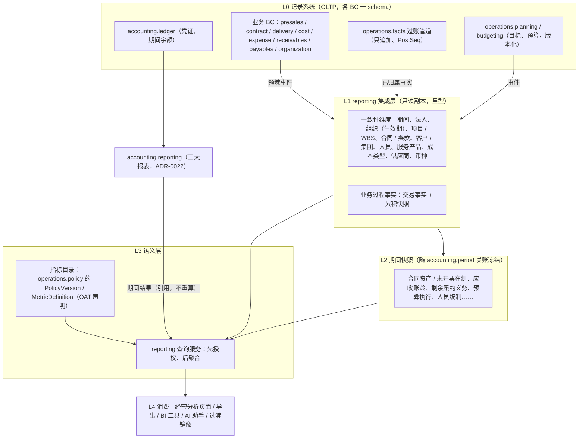
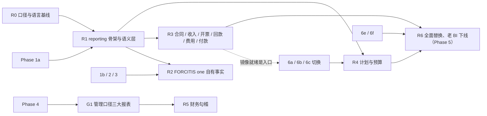

# 经营分析范围评估（经营子域、reporting 与语义层、BI 重构）

- 日期：2026-10-14 · 会话：psa-bi-scope（原「reporting 契约」单元并入）· 决策记录：ADR-0023（已采纳，用户 2026-10-14：「批准 ADR-0023」）
- 用户决定（经 psa-coordinator 转达，原话）：
  - 先前：「现代化负责 reporting 数据层、KPI 语义层（按 OAT）和 BI 过渡不中断；BI 工具和看板由 BI 项目负责。」
  - 现在（覆盖先前的边界）：「BI 要重构，不满足经营管理需要。经营分析纳入现代化：经营子域 4 个 BC、reporting 与语义层纳入，BI 重构同步规划。暂停 BI 迁移会话在老数据源上的新建模，现有报表照常运行。」
- 方法：只读。BI、BI-olap、BI-release 三个仓库的源码、文档、git 历史与 GitHub issue / PR；BI 迁移相关会话的标题与 PR；OAT 机器主数据与 KPI 体系设计；本仓库的 ADR、词表、OA 盘点、psa-gl-scope 的 ADR-0022 初稿（其工作树只读）。**没有访问任何生产库**：BI 的使用量来自 BI 仓库中 2026-10-10 的调研文档（由 BI 生产库审计表聚合，只含计数），本次未复算（复算需要访问 BI 生产库，不在已授权的老系统只读通道内，见 §6 Q11）。
- 子代理与模型：仓库与数据源清点 2 个（haiku）；OAT / 词表 / BI 语义层口径映射 1 个（sonnet）；BC 划分、分层设计、过渡方案与 ADR 由本会话完成（opus）。
- ADR-0023 已采纳；§6 各项的用户决定见 §6.1。正文中标「建议」的条目，以 §6.1 的决定和 ADR-0023 为准。

## 0. 结论

1. **现有 BI 有两套，都不在 FORCITIS one 的事实上**：
   - 老 BI（`BI`，Express + Vue，约 133 页 + 12 个小程序页）在运行，经 BI 库 118 个 `T_FST_*` 视图跨库读取 A8（`a8_db`）和老系统（`ruoyi-vue-pro`），还直接写 A8 表 8 处。
   - 新经营分析（`BI-olap` 的 `analytics/`，PG + 语义层 + React）是 2026-10-10 至 10-11 两天内建成的读模型：11 个事实、64 个指标，与老视图对账多数 0 差异，但**没有上线**，叠层 PR #50–#58 未合并，生产 0 个数据集发布。
   - 两套都**不读 U8C**，因而经营结果无法与财务结果勾稽。
2. **经营管理需要满足不了的证据**（§1.5）集中在五类：
   - 同一指标多套算法：应收 4 套、2 个源表、2 种逾期定义（issue #59）；收入 3 处来源无统一定义；利用率 3 套，7.5 小时硬编码。
   - 没有期间快照，看不到「上月末」的应收、在手合同、合同资产。
   - 没有毛利和权责口径成本：后端无毛利计算，费用只有现金支付口径。
   - 计划、目标与实际脱节：目标表稀疏、两个看板重复读同一目标表、口径冲突。
   - BI 自己在写业务数据：条款进度、开票、商机等 A8 表单字段。
3. **经营子域 4 个 BC** 是 `operations.facts`、`operations.policy`、`operations.planning`、`operations.budgeting`（§2）：
   - 前两个已在主干内（ADR-0016）；
   - 后两个原为「蓝图未覆盖、6f 视情况」，按本次决定纳入建设范围。
   - `reporting`（蓝图 BC-15）不是这 4 个之一，是经营子域之外的只读分析模块。
4. **分层**（§3）：
   - L0 记录系统（各 BC + 过账管道）
   - → L1 reporting 集成层（一致性维度 + 业务过程事实）
   - → L2 期间快照（随关账冻结）
   - → L3 语义层（指标定义由 `operations.policy` 治理、按 OAT 声明，`reporting` 只执行）
   - → L4 消费（页面、导出、BI 工具、AI）。
5. **与总账三大报表不重复建设**（§3.4）：
   - 报表行项目只在 `accounting.reporting`（ADR-0022 初稿）计算，语义层引用其期间结果、不重算；
   - 经营指标只在 `reporting` / `operations.policy`；
   - 两边共用期间、法人、项目维度与关账事件；
   - 差异由 `operations.policy` 的口径差异清单月结勾稽。
6. **过渡不中断**（§4）：
   - 老系统自有表在切换期靠反向同步（ADR-0011），老 BI 视图不受影响。
   - A8 表单来源在 6a–6f 一次切换、不设双源期（ADR-0021），A8 表停止增长后对应视图会**静默过期**。
   - 建议在每个切换日前，把受影响的 `T_FST_*` 视图改为读「过渡镜像」：由 FORCITIS one `reporting` 生成、形状与老视图一致、回填到 BI 库，老 BI 代码不改。
7. **BI 重构的工具**有四个选项（§5.1），由用户定。阶段草案 R0–R6（§5.2）：
   - R0 口径与语言基线可以立即开始，与 Phase 1a 并行；
   - 全面替换（R6）依赖 Phase 4、6a–6f 与 G1，**与 BI 仓库调研文档记载的「BI 整体替换：2026-12-31」不相容**（§6 Q2）。

## 1. 现状盘点（只读）

### 1.1 三个仓库

| 仓库 | 实为 | HEAD | 状态 |
|---|---|---|---|
| `BI` | 老 BI 主仓（`FORCITIS/BI`，master） | `436ea0b`（2026-10-11，合并 #38） | 现行系统；327 个提交，2024-03 至今 |
| `BI-release` | 老 BI 的发布副本 | `a497c6e`（detached） | 比主仓少 3 个提交，**缺数据权限修复 `4db1384`**：权限范围为空时不加过滤、返回全部数据（`utils/db/queryBuild.js:65-67`）。现网是否与发布副本一致未核实 |
| `BI-olap` | 同一 GitHub 仓库的另一个工作副本，检出 `feat/olap-retire-legacy-tables` | `6a613cb`（2026-10-11） | `analytics/` 只在这条叠层分支上，`master` 上没有；PR #39–#49 已合并到叠层基线，#50–#58 未合并 |

### 1.2 数据源与跨库耦合

| 系统 | 老 BI | 新经营分析（analytics） |
|---|---|---|
| BI 库（SQL Server） | 118 个 `T_FST_*` 视图 + 1 张表；本地表 `employees`、`department`、`attendance`、`api_audit_logs`、`export_audit_logs`、`marketing_target_scope` | 只作对账基线，不装载 |
| A8（同实例 `a8_db`） | 直读 45 张表（117 行代码）；**直接写 8 处**：`T_FST_CALENDAR`、`ORG_MEMBER.we_com_id`、存储过程 `UpdateAttendanceBatch`、`formmain_0348`、`formmain_0051.field0639`（KM 目录号）、`formmain_0238`（商机）、`formson_0296`（合同条款）、`formmain_0428`（开票） | 11 个业务过程的源：开票 `formmain_0428`、回款 `formson_0601`、合同 `formmain_0374/formson_0375`、条款 `formson_0296` 等、产值 `formmain_0581/formson_0583`、商机 `formmain_0238`、项目档案 `formmain_0051`、费用六类单据、考勤 `formmain_0792`、组织人员 |
| 老系统（`ruoyi-vue-pro`） | 经 BI 库视图间接读（工时 `psa_term_work` 等） | 工时 `psa_time_sheet_works_end`（人员、部门 ID 与 A8 一致） |
| U8C | 无 | 无 |
| 其他 | DSM（MySQL，解密日志）、企业微信、KM、致远 REST、Redis；12 个定时任务（`tasks/scheduler.js`，含考勤加工、企业微信同步、KM 建目录回写 A8） | 财务手工汇率 CSV |

证据：调研报告（本会话 scratchpad `bi_legacy.md` §1–§3、`bi_olap.md` §2）；`BI/utils/db/index.js:3-24`、`controllers/init/index.js:508-516,666,2106`、`controllers/system/index.js:608-616`、`controllers/transction/*/list/index.js:772,2112,2121`；`BI-olap/analytics/ingestion/src/sqlserver-*.ts`。

### 1.3 看板与使用情况

| 模块（老 BI） | 页面 | 近 90 天调用 | 说明 |
|---|---|---|---|
| 分析报表 `analysis` | 约 59 | 项目 5.2 万、销售 4.7 万、财务 2.7 万 | 人员、销售、项目、质量、财务、预测、多维分析 |
| 数据底表 `database` | 约 39 | （计入上行各组） | CRM、销售、项目、财务、员工明细表 |
| 数据看板 `dataBoard` | 9 | — | 经营看板、营销目标看板（2026-10-09 上线）、KPI 完成看板、员工画像等 |
| 门户 `portal` | 6（另约 25 个子页） | — | 集团、项目经理、销售总监、销售经理、员工门户 |
| 数据更新 `dataUpdate` | 6（**有写入**） | 条款进度写入 1,541 次 / 14 人 | 商机跟进、待签合约、条款进度、已确认未开票、应收账款、岗位理论值 |
| 排行榜、看板、工作台、基础 | 约 12 | 排行约 1.1 万 | — |
| 预测 `forecast` | （在分析报表内） | **0** | 14 个接口整组零调用 |
| 小程序 | 12 | — | 10 页调用 35 个接口，最近修改 2026-05 |

- 全体：近 90 天 171 名用户、22.3 万次调用、1.02 万次导出（166 人，几乎人人导出）；月活 110–145 人；420 个接口中 151 个有调用（约 36%）。
- 来源：`BI/.scratch/platform-rebuild/research/bi-inventory.md`（2026-10-10，未入库，由 `BI.dbo.api_audit_logs` 只读聚合）；本次未复算。

### 1.4 BI 迁移做到哪一步

| 会话（标题） | 产出 |
|---|---|
| BI 迁移-开票回款 | PR #38–#40 等：一致性维度、开票与收款认领事实 |
| BI 商机/合同及条款迁移 | PR #41–#48：语义层、多币种、命名、商机、合同、合同服务产品、付款条款 |
| BI 迁移：产值/应收/工时/费用/考勤/项目属性入模，旧数据集路径退役（#49–#58） | #49 已合并；#50–#58 未合并（应收、工时、费用、项目属性、考勤、开票挂客户、语义层补齐、前端只留经营分析、删除旧接口与旧表） |
| BI 项目目标看板规划 / BI 主分支项目目标看板规划 | `openspec/changes/project-target-board/plan.md`（规划稿，未实现） |
| 营销目标看板数据透视 | PR #36（未合并） |
| 仓库 issue 处理和部署 | 受控发布、性能、考勤修复等 |

新经营分析的成果（可复用的资产，不论工具怎么选）：
- 20 份 ADR：粒度、日期、口径裁决、法人推导、未知成员、币种；
- 11 份对账证据（`contracts/reconciliation-*-20261011.json`），多数 0 差异，可作新系统迁入的验收基线；
- 「先授权后聚合」的权限模型；
- 65 万行规模测试。

尚缺：生产发布、定时采集、OA 身份、组织到法人映射、回款方式分类、周期快照、审计维度、AG Grid 许可（`analytics/README.md:39-43`，research `dimensional-modeling-wayfinding.md:248-261`）。

### 1.5 经营管理需要满足不了的地方（证据，不臆测）

「不满足经营管理需要」是用户的判断；下表只列仓库中能找到的证据。**仓库中没有找到业务方的需求清单或访谈记录**，各管理层级的具体诉求见 §6 Q12。

| # | 问题 | 证据 |
|---|---|---|
| E1 | **应收四套算法、两个源表、两种逾期定义**；「应收账款汇总-财务」与「应收账龄统计-部门」对不上 | `controllers/transction/finance/index.js:1657,1951`、`project/index.js:5085`、`forecast/index.js:1180`；GitHub issue FORCITIS/BI#59（2026-10-12，未关闭） |
| E2 | 收入三处来源，无统一定义；签约金额两张源表；商机至少 6 处实现，过滤条件各不相同 | `project/index.js:861`、`finance/index.js:314,551`、`user/index.js:3321`；`sales/index.js:2525`、`project/index.js:1408`；`sales/index.js:152,3793,8290` 等 |
| E3 | 利用率三套算法，理论工时 7.5 小时 / 日在 4 处硬编码；「人均人力成本」以工作天数作除数 | `user/index.js:4987,5016,5033,3157,3165`、`user/list/index.js:1402`、`ranking/index.js:2996` |
| E4 | 「逾期」名不副实（实为开票超过 90 天）；开票视图与条款视图对红冲的处理不同，冲红字段与红字记录同时使用会重复扣减 | `BI-olap/analytics/docs/adr/0014-receivable-snapshot.md:24`、`0003-invoice-and-receipt-allocation-grain.md:13,15` |
| E5 | 指标锁在数据集内，跨业务过程的问题问不出（例如收入确认与工时、开票同屏） | `analytics/docs/adr/0005-semantic-layer.md:9` |
| E6 | **没有期间快照**：应收、在手合同、在途商机只有当前值，无法回答「上月末是多少」，也无法做期间对比 | `analytics/docs/research/dimensional-modeling-wayfinding.md:252`；ADR-0014（应收为「最近一次采集」快照） |
| E7 | **没有毛利与权责口径成本**：老 BI 后端无毛利计算，仅前端展示「预估毛利率」；费用只有支付日的现金口径；新经营分析没有任何成本度量 | `pcWeb/src/components/transations/ProjectItem.vue:100-108`；`analytics/contracts/semantic.ts:214`（「只计入现金流的单据和科目」） |
| E8 | **经营结果无法与财务勾稽**：两套 BI 都不读 U8C；而 U8C 本身没有项目维度（`U8C_GL_PRACTICE.md`，psa-gl-scope） | §1.2 |
| E9 | 计划与实际脱节：2026 年项目经理承诺目标 22 人、预算目标 3 人；营销看板与项目看板对合同指标口径冲突（客户中心 vs BU）；KPI 完成看板与项目目标看板重复读取同一目标表 | `BI/openspec/changes/project-target-board/plan.md` |
| E10 | 维度只有当前名称，没有历史；考勤经月中间表汇总丢失日粒度；工时与开票处于不同命名空间 | `analytics/docs/adr/0006`、`0018-attendance-day.md:11`、`0015-timesheet-on-a8-dimensions.md:16` |
| E11 | **BI 在写业务数据**：条款进度更新、应收催收跟进等 6 个数据更新页；直接 UPDATE A8 的合同条款、开票、商机、项目档案字段。按 GUIDING_PRINCIPLES §9a，权责事实的产生与变更不能在 BI | §1.2；`bi-inventory.md` §3 |
| E12 | 性能：付款 / 存货查询公司级季度 217 秒；财务接口秒级耗时 | `BI/docs/performance/inventory-query-equivalence.md`；issue FORCITIS/BI#3、#20 |
| E13 | 用语与统一语言不一致：「产值」族 7 个度量（词表已裁定为方言，正式用语是「收入确认」）；「在手合同金额」对应词表的「剩余履约义务」；「付款条款」对应「合同条款」；新经营分析的指标没有 owner、口径依据、含税性、期间类型、加总规则字段，不满足 OAT 的声明要求 | `analytics/contracts/semantic.ts:113-237`；`glossary/terms.yaml`（RevenueRecognition、RemainingPerformanceObligation、ContractClause 条目）；OAT 槽位文件第 25–26 行 |
| E14 | 安全（老系统，按用户「老系统先不管」原则只记录）：数据权限修复未进发布副本；OA 账号口令拼进 URL；服务端口直接暴露公网且有扫描记录 | `BI-release/utils/db/queryBuild.js:65-67`；`BI/controllers/system/index.js:332`；`bi-inventory.md` §4 |

## 2. 经营子域 4 个 BC

来源：`GLOSSARY.md` §1 与附录（第 19–22、107–170 行）；psa 仓库 `02-子域划分.md:62,70-81`、`04-限界上下文清单.md:10-15`；ADR-0016、ADR-0017；OAT 机器主数据（`ddd-theory/cases/forcitis-aec-ops/forcitis_operating_accounting_taxonomy.csv`，245 条原语）。子域定位：「经营目标、预算约束、经营事实如何被及时、准确、可追溯地认定、归属、解释和管控」，数据主权含「经营分析口径」与「跨域勾稽结果」。

| BC | 蓝图 | 职责（本方案） | 范围变化 | 所需事实来源 | 对 `reporting` 的产出 | OAT 对应 |
|---|---|---|---|---|---|---|
| `operations.facts` 经营事实与归属 | BC-08 Posting | 单一过账管道（ADR-0016）；九维归属（`BusinessFactAttributed`、`PrimaryAttribution`，主归属唯一、辅助归属比例守恒）；经营期间；重述（`BusinessFactRestated`，只追加） | 已在范围 | 所有触账 BC 的过账候选：工时成本、费用、收入确认、开票、回款、付款、分包、薪酬、手工分录（ADR-0016、ADR-0021、ADR-0022） | 已归属的明细事实流（事件）；经营台账 `BusinessFactLedger` 是读模型，**物理上落在 reporting 集成层**（建议） | 事实侧原语：REV、BILL、DL、DE、DC、PTC、OH、IMP、WO、PAID、HRS 等；OAT 的 `fact_owner_bc` 由事实源契约解析 |
| `operations.policy` 经营口径与勾稽 | BC-09 Reconciliation | **口径主权**：经营口径 `Policy` 与口径版本 `PolicyVersion`（按期版本化、审批留痕）；指标定义 `MetricDefinition`；OAT 登记（标准原语、经营扩展原语）；经营勾稽与勾稽差异案；口径差异清单 `BasisDifferenceList`（与核算共维护） | 已在范围；**新增承担语义层的指标目录**（建议） | 不产生事实；读 reporting 的聚合结果做勾稽 | 版本化的指标目录（语义层 L3 的唯一定义来源）；勾稽结果事实 | OAT 245 条的 `metric_owner_bc` 全部是本 BC |
| `operations.planning` 战略与经营计划 | 蓝图未覆盖 | 战略目标、经营计划与计划基线、计划周期；承诺目标（项目组 / 营销人员 / 交付中心 / 客户中心）；销售承诺（CommitCall）；滚动预测（13 周、现金流预测）；经营复盘与经营动作；目标偏差 | **由「6f 视情况」改为纳入**（本次用户决定） | A8 模板 #90–#95、#97（`OA_PROCESS_INVENTORY.md` §3）；老 BI 目标表 `T_FST_DEPARTMENTKPI`、`MANAGERKPI`、`SALESKPI`、`ZONEKPI`、`COMMITCALL*`、`OPPFORECAST`；实际值取自 reporting | 计划目标事实（版本化）；预测事实 | PLAN_TARGET_VALUE、ACTUAL_STRATEGIC_TARGET_VALUE；BACKLOG、PIPE 的预测值 |
| `operations.budgeting` 预算管控 | 蓝图未覆盖 | 预算基线、预算编制与分解、预算主体、占用 / 释放 / 消耗、可用额度、预算调整、超预算审批、预算冻结 | **由「6f 视情况」改为纳入** | A8 模板 #99–#102（预算目标）；老系统项目预算（`delivery.execution`，RULE-182 / 239）；费用、付款单据的额度占用（6c） | 预算执行事实（占用 / 消耗 / 可用，期间快照） | BURN；预算偏差（DC、OH 预算偏差） |

要点：
- **目标值与额度控制分开**（建议）：A8 的「预算目标新增」实质是目标值，归 `operations.planning`（`BudgetTarget` 在词表附录中就属于 planning）；`operations.budgeting` 只管会占用额度、会拦截单据的预算。两者在 OA 盘点中被一并归为 6f，需要用户确认划分（§6 Q4）。
- 项目预算（WBS 成本预算）仍属 `delivery.execution`，是交付侧的计划；`operations.budgeting` 的预算主体是法人、BU、部门、项目层面的经营预算，项目预算可以作为它的一个预算主体，但不另存一份。
- `operations.planning` 和 `operations.budgeting` 都不触账，不经过账管道；它们的事实（目标、预算基线、占用）也只追加、按版本生效。
- 词表缺口：`terms.yaml` 中 planning、budgeting 两个 BC 为 0 条（附录中的 8 + 13 个术语尚未进入机器可读词表），`reporting` 也为 0 条。登记清单见 §3.3。

## 3. reporting 数据层与 KPI 语义层

### 3.1 分层

| 层 | 内容 | 规则 |
|---|---|---|
| L0 记录系统 | 各 BC 自有数据；过账管道的明细事实 | 唯一事实来源；分析侧不回写（ADR-0016 第 7 条） |
| L1 集成层 | 一致性维度 + 一业务过程一事实表（总线矩阵，见 §3.2）；粒度写进表注释与 ADR | 由 Modulith 事件发布登记表增量构建（GUIDING_PRINCIPLES §8），**不再从 A8 / 老系统库采集**（老源只用于过渡镜像的对账，见 §4）；维度按生效期保留历史（组织归属、项目属性），未知成员显式挂键；金额带币种 |
| L2 期间快照 | 月结时由 `accounting.period` 的关账事件触发，按 (期间, 法人) 生成并冻结 | 快照不改；关账后的更正走重述，生成新版本并标原期间（与 ADR-0016 第 2 条一致） |
| L3 语义层 | 指标目录（定义）+ 查询服务（执行） | **定义在 `operations.policy`、执行在 `reporting`**（建议）：指标的公式、来源映射、维度适用、口径版本只有一个来源；查询服务按授权范围先过滤后聚合；页面、导出、BI 工具、AI 只经语义层或 L1 / L2 只读视图取数，不自带算法（直接解决 E1–E3） |
| L4 消费 | 见 §5.1 工具选项 | 导出是全员行为（166 人），新方案须有对等能力 |

物理位置（建议）：L1 / L2 放在 FORCITIS one 的 PG（RDS PG 18）中 `reporting` 下的 schema，先用表 + 物化视图；查询压力上来后再加只读实例，或迁到列式库（GUIDING_PRINCIPLES §8 已有此路线）。新经营分析已经验证了 PG 上 65 万行工时、130 万行权限的查询性能（P95 约 174 毫秒），可作参考。

### 3.2 总线矩阵（草案）

| 业务过程事实 | 粒度 | 事实 BC（来源） | 阶段 | 期间 | 法人 | 组织 | 项目 / WBS | 合同 / 条款 | 客户 | 人员 | 服务产品 | 成本类型 | 供应商 |
|---|---|---|---|---|---|---|---|---|---|---|---|---|---|
| 商机（累积快照） | 一个商机 | `presales.customer` / `quoting` | 6f | ✔ | ✔ | ✔ | — | — | ✔ | ✔ | ✔ | — | — |
| 报价 | 一版报价 | `presales.quoting` | 1b | ✔ | ✔ | ✔ | — | — | ✔ | ✔ | ✔ | — | — |
| 合同、合同条款（累积快照） | 一份合同 / 一个条款 | `contract.baseline`、`changeorder` | 6a | ✔ | ✔ | ✔ | ✔ | ✔ | ✔ | ✔ | ✔ | — | — |
| 工时条目 | 一条审批通过的工时 | `cost.timesheet` | 2 | ✔ | ✔ | ✔ | ✔ | — | — | ✔ | — | — | — |
| 成本台账分录 | 一条成本归集 | `cost.costing`（经过账管道） | 4 | ✔ | ✔ | ✔ | ✔ | ✔ | — | ✔ | — | ✔ | ✔ |
| 费用 | 一条费用明细（权责 + 支付日两个日期） | `expense.spend` | 3、6c | ✔ | ✔ | ✔ | ✔ | — | — | ✔ | — | ✔ | ✔ |
| 收入确认 | 一张收入确认单 | `receivables.wip` ← `delivery.acceptance` | 6a | ✔ | ✔ | ✔ | ✔ | ✔ | ✔ | ✔ | ✔ | — | — |
| 开票 | 一条开票记录（含红冲、作废状态） | `receivables.wip` | 6b | ✔ | ✔ | ✔ | ✔ | ✔ | ✔ | ✔ | — | — | — |
| 回款分配 | 一笔回款分配到一条开票 / 条款 | `receivables.collection` | 6b | ✔ | ✔ | ✔ | ✔ | ✔ | ✔ | — | — | — | — |
| 付款 | 一笔付款 | `payables.payment` | 6c | ✔ | ✔ | ✔ | ✔ | — | — | ✔ | — | ✔ | ✔ |
| 考勤、休假 | 一人一天 | `organization.attendance` | 6e | ✔ | ✔ | ✔ | — | — | — | ✔ | — | — | — |
| 人工成本 / 薪酬 | 一人一期间 | `organization.payroll` | 6e | ✔ | ✔ | ✔ | ✔ | — | — | ✔ | — | ✔ | — |
| 计划目标、预测 | 一个目标 × 版本 | `operations.planning` | R4 | ✔ | ✔ | ✔ | ✔ | — | ✔ | ✔ | ✔ | — | — |
| 预算执行 | 一次占用 / 释放 / 消耗 | `operations.budgeting` | R4 | ✔ | ✔ | ✔ | ✔ | — | — | ✔ | — | ✔ | ✔ |
| 审批时效（累积快照） | 一个审批任务（指派 → 超时 → 升级 → 办理） | `platform.approval`（领域事件，不过账；ADR-0025） | R1 | ✔ | ✔ | ✔ | ✔ | — | — | ✔ | — | — | — |
| **期间快照**：合同资产 / 未开票在制、应收账龄、剩余履约义务、预算执行、人员编制 | 一个对象 × 期间 | 由 L1 生成 | 随来源 | ✔ | ✔ | ✔ | ✔ | ✔ | ✔ | — | — | — | — |

### 3.3 口径按 OAT 声明、与 terms.yaml 对齐

**OAT 的位置**：本仓库及 psa 仓库中的 `08-FORCITIS Operating Accounting Taxonomy.md` 只是 27 行的槽位文件，自述正本为 `08-财务原语.md`，该文件在 psa 仓库中不存在。真正的原语主数据在 `YeliangDu/ddd-theory` 仓库：
- `cases/forcitis-aec-ops/forcitis_operating_accounting_taxonomy.csv`：245 条原语，27 列，含单位、期间类型、加总规则、事实归属、指标归属；
- `standard_concept_mapping.csv`；
- `forcitis_anti_custom_symbol_audit.csv`；
- `obsidian/FORCITIS-one/80-经营度量/FORCITIS one KPI体系设计.md`。

ADR-0018 记录的缺口「OAT 正本不在本机」由此可以补上，但它在个人研究仓库中，需要用户决定是否引入本仓库、由谁治理（§6 Q5）。

**每个指标必须声明**（`MetricDefinition` 的最小字段，取 OAT 槽位文件第 25–27 行与 KPI 体系设计第 347–393 行的交集，建议）：

| 字段 | 含义 | 现状缺口 |
|---|---|---|
| `oat_symbol` | 对应的 OAT 原语（如 REV、BILL、AR、RPO）或登记的经营扩展原语 | 新经营分析 64 个指标均无 |
| `term_id` | `terms.yaml` 词条（中英文名取自词表，禁用方言） | 「产值」族 7 个度量用方言 |
| `unit` | money / hours / days / count / ratio / fte …… | 新经营分析无比率类指标、金额单位隐含 |
| `period_type` | `duration`（流量）/ `instant`（存量） | 新经营分析用「按日期 / 截至采集时点 / 不受期间限制」三类，需映射 |
| `aggregation_rule` | 可加 / 半可加（存量跨期不可加）/ 不可加（比率） | 只有 sum / count |
| `fact_owner_bc`、`metric_owner_bc` | 事实来自哪个 BC；指标归 `operations.policy` | 无 |
| `accounting_basis` | 权责 / 收付 / 经营管理口径 | 费用是现金口径，未声明 |
| `tax_policy` | 含税 / 不含税 | 收入确认金额未声明（老载体含税，OAT 的 REV 不含税） |
| `policy_version` | 口径版本（按期生效、审批留痕） | 无 |

**守护**（建议，扩展 ADR-0018 的 G37–G39）：构建时扫描指标目录，缺 OAT 声明、引用未登记或已废弃的词、引用方言即失败；指标名、维度名与界面文案键同样走词表。

**terms.yaml 需登记**（348 条，经 psa-terms-review 后的现状；全部按 ADR-0018 起草为「提议」，会计类由财务确认、业务类由业务 Admin 确认）：

| 类别 | 条目 |
|---|---|
| `operations.planning`（附录已有，未入词表） | 战略目标、经营计划、计划基线、计划周期、预算目标、经营复盘、经营动作、目标偏差；新增：承诺目标、销售承诺（CommitCall，方言待确认）、滚动预测 |
| `operations.budgeting`（附录已有，未入词表） | 预算基线、预算编制、预算分解、预算主体、预算占用、预算释放、预算消耗、可用额度、预算调整、超预算审批、预算冻结、预算执行、预算科目 |
| `reporting`（新） | 一致性维度、业务过程事实、累积快照、期间快照、语义层、指标观测值（OAT 的 `MetricObservation`） |
| OAT 有、词表无的指标 | 净服务收入（NR）、开票金额（BILL）、间接费用（OH）、转付成本（PTC）、贡献毛利（CM）、经营利润（OP）、回款率（COLR）、应收周转天数（DSO）、逾期应收率（ODAR）、开票转化率（BCR）、合同资产天数（CAD）、已签约净订单、商机管道、预算消耗率、缺勤工时 |
| 词表与 BI 叫法对齐（方言登记） | 「产值」族 → 收入确认；「在手合同金额」「剩余合同」→ 剩余履约义务；「付款条款」→ 合同条款；「逾期」（开票超 90 天）→ 账龄超 90 天，「逾期」只指过了到期日 |

**口径冲突，需要财务或业务 Admin 裁决**（§6 Q6）：
1. 收入含税还是不含税：OAT 的 REV 为不含税；老收入确认单金额含税；ADR-0016 已把「含税额配对成本」列为待财务确认。
2. 毛利：OAT 没有毛利原语，只有贡献毛利（CM）；RULE-144 已定「不含税、用表头税率」，RULE-182 / 239 须同口径。毛利登记为经营扩展原语，还是统一用 CM？
3. 费用：权责口径（按发生期间）与现金口径（按支付日）两个指标都要，名称必须区分。
4. 逾期定义：过了到期日、开票超 90 天、超 45 天，老系统三种并存。
5. 利用率的理论工时（7.5 小时 / 日）改为按法人或日历配置的参数。
6. 「人均」类指标的除数统一为平均在册人数。

### 3.4 与总账三大报表的边界（不重复建设）

参照 psa-gl-scope 的 ADR-0022 初稿（未合入 main）：`accounting.ledger` 升级为完整总账，新增 `accounting.reporting`，按财会〔2019〕6 号格式出三大报表，合同资产、合同负债、合同履约成本单独列报，总账新增项目辅助核算。

| 维度 | `accounting.reporting`（财务报表） | `reporting` + `operations.policy`（经营分析） |
|---|---|---|
| 回答的问题 | 法人在期间的财务状况、经营成果、现金流量（准则列报） | 项目、合同、客户、人员、BU 的经营结果与过程（管理口径） |
| 粒度 | 法人 × 科目 × 辅助维度 × 期间余额 | 业务过程事实粒度（一张单据、一条工时、一个条款） |
| 来源 | `accounting.ledger` 的期间余额与现金流量标注 | 业务 BC 事实与 `operations.facts` 的已归属事实 |
| 口径 | 企业会计准则（OAT 的 `standard_financial_reporting` 层） | 经营口径版本（OAT 的 `management_accounting_convention` 层） |
| 归属 | 核算子域 | 经营子域（口径）+ 分析模块（执行） |

规则（建议）：
1. **报表行项目只在 `accounting.reporting` 计算**。语义层中的「营业收入」「营业成本」「净利润」「经营活动现金流量净额」「合同资产」「合同负债」等报表数，以 `source = accounting.reporting` 的指标引用其已关账期间结果，不在 reporting 重算。
2. **经营指标只在 reporting / policy**：净服务收入、贡献毛利、利用率、DSO、剩余履约义务、商机管道等不进入 `accounting.reporting`。
3. **共用**：期间（`AccountingPeriod`，同一关账事件触发两边快照）、法人、项目坐标（`ProjectCoordinate`）、客户、供应商、人员维度引用同一份主数据，两边不各建一套维度表。
4. **勾稽**：`operations.policy` 的口径差异清单（`BasisDifferenceList`，词表已有、「与核算共维护」）逐期列出经营口径与法定口径的差异及解释，例如收入确认（含税）与营业收入（不含税）、项目成本与营业成本、权责账与收付账。月结检查「法人 × 期间」的差异全部有解释，作为 `accounting.period` 关账的前置检查之一（与 ADR-0022 第 10 条衔接）。
5. G1（管理口径三大报表）之前，语义层中的报表类指标为空，不用经营数据近似填充。

## 4. BI 过渡不中断

### 4.1 依赖链与原则

依赖链：老 BI（页面、小程序、导出）→ BI 库 118 个 `T_FST_*` 视图 + SQL Agent 作业 → `a8_db`、`ruoyi-vue-pro`。用户决定「现有报表照常运行」，GUIDING_PRINCIPLES §8 要求「过渡期 `reporting` 视图的形状与老表一致」。由此得出三条规则：
1. 每个迁移阶段切换前，受影响的每个 `T_FST_*` 对象都要有形状一致（列名、类型、粒度、编码值）的过渡来源，并通过对账（行数、金额与切换前一致）。
2. 老 BI 代码在过渡期不改。
3. 过渡来源只读 FORCITIS one 的 `reporting`，不得写回 A8（ADR-0021：老系统→A8 的权责写通道在对应阶段删除，A8 不得作为权责事实的存放地）。

### 4.2 三类来源、三种做法

| 来源 | 切换后会怎样 | 做法 |
|---|---|---|
| 老系统自有表（工时、项目预算、报价、收入确认单 `psa_*`） | Phase 1b–4 期间由反向同步（ADR-0011 逐列所有权）保持写入 | **不动**：视图照常可用；brief Phase 1b 出口「BI 查询在反向同步后的 SQL Server 上结果不变」按阶段推广为契约测试 |
| A8 表单（合同、条款、收入确认、开票、回款、费用、付款、人事、商机、目标） | 6a–6f 一次切换、不设双源期，切换日后 A8 表不再增长，对应视图**静默过期** | **过渡镜像**（建议）：FORCITIS one `reporting` 提供与老视图同形状的过渡视图（`reporting_compat`），由同步作业按小时回填到 BI 库的镜像表；切换日把该 `T_FST_*` 视图改为读「A8 历史（切换日前）∪ 镜像（切换日起）」，或在历史迁入后整张改读镜像 |
| BI 自己的写入（数据更新 6 页、A8 表 8 处 UPDATE、营销目标配置） | 权责类写入违反 §9a；切换后写 A8 已无意义 | **迁入对应 BC 的界面**，随该阶段切换停用 BI 的写入入口：条款进度 → `contract.baseline`（6a）；开票字段、应收催收跟进 → `receivables.*`（6b）；商机跟进 → `presales`（6f）；营销目标负责人配置、岗位理论值 → `operations.planning`（R4）；KM 目录号回写 → `platform.integration`；考勤加工与 `UpdateAttendanceBatch` → `organization.attendance`（6e） |

备选做法：
- 老 BI 直连 PG 读过渡视图：需要把约 151 个在用接口的 SQL 移植到 PG 方言。工作量大，但收益只延续到老 BI 下线为止。
- 写回 A8：违反 ADR-0021，不可取。

是否采用过渡镜像，由用户决定（§6 Q7）。

### 4.3 各老数据源的切换时点

按视图名与已读到的定义归组；118 个视图逐个核对定义与列形状，在 R0 完成（只读，取 BI 库元数据）。

| `T_FST_*` 对象组 | 当前源 | 新事实 BC | 切换阶段 | 过渡做法 |
|---|---|---|---|---|
| `ACTUALHOURS*`、`DAILY_RATE`、`CONTRIBUTION`（工时、费率、贡献度） | 老系统工时 | `cost.timesheet` | Phase 2 | 反向同步 |
| `PROJECTBUDGET`、`QUOTAION` | 老系统 | `delivery.execution`、`presales.quoting` | Phase 1b / 2 | 反向同步 |
| `CONTRACT`、`SIGNCONTRACT*`、`CONTTRACTTERMS`、`PROJECT`、`CUVALUE*`、`TOBCUVALUE`、`BADCUVALUE`、`INVOICING_CUVALUE`、`INVALID_DELIVERY`、`COMMITDELIVERY`、`TOSING_CONSTATUS` | A8 合同、项目档案、收入确认单 | `contract.*`、`receivables.wip`、`delivery.*` | 6a | 过渡镜像 |
| `INVOICING`、`COLLECTION`、`ACCOUNTREC`、`RECEIVABLE`、`BILL_RECEIVABLE`、`BADDEBT`、`COMMITINVOICING`、`NOTINVOICEREASON` | A8 开票、回款、应收 | `receivables.wip`、`receivables.collection` | 6b | 过渡镜像；应收以单一口径替代 E1 的四套算法（老页面读到的数随之改变，须在切换前由财务确认，§6 Q6） |
| `PAY`、`PAY_DAILY`、`PAY_TRAVEL`、`PAY_SPECIAL`、`PAY_PAYMENTAPPLICATION`、`INFOFEE`、`INVENTORY` | A8 报销、付款（存货视图关联老系统 工时） | `expense.spend`、`payables.payment`、`cost.costing` | 6c（差旅在 Phase 3） | 过渡镜像 |
| `PAY_SALARY*`、`EMPLOYEE*`、`EMPLOYEESALARY`、`EMPLOYEEPAY`、`DEPARTMENT`、`POST`、`USER`、`LEAVE`、`ATTENDANCE*`、`CALENDAR` | A8 人事、组织、假勤；BI 本地考勤表 | `organization.*`（自建 HRM）；工作日历归 `organization.attendance`（1a 建，ADR-0025） | 6e（组织主数据在 6e 前仍以 A8 为源；`CALENDAR` 随 1a 的工作日历迁入） | 过渡镜像；BI 的考勤加工作业停用 |
| `OPPORTUNITY*`、`LEADS*`、`CUSTOMERVISIT`、`CUSTOMERCONTACTS`、`GROUPS`、`RISKCUSTOMER*`、`SATISFACTION`、`COMMITCALL*`、`OPPFORECAST` | A8 营销 | `presales.*`、`operations.planning` | 6f（客商主档随 6b / 6c 先行） | 过渡镜像 |
| `DEPARTMENTKPI`、`MANAGERKPI`、`SALESKPI`、`ZONEKPI`、`*KPITYPE` | A8 目标表单 | `operations.planning` | R4 | 过渡镜像 |
| `PROJECTAUDIT`、`PROJECTREVIEW`、`PROJECTSTARTUP` | A8 交付质量（视情况） | `delivery.*` | 视情况 | 迁入前保持原样 |
| 码表（`*STATUS`、`*TYPE`、`AGINGSEC`、`SIGNSEC` 等） | A8 枚举 | 随所属主题 | 随主题 | 随主题 |

老 BI 下线条件（R6 出口草稿）：
- 所有 `T_FST_*` 已改读镜像或废弃；
- BI 的写入入口全部停用；
- 151 个在用接口对应的功能在新方案中均有承接或经确认不承接；
- 旧 Spring Cloud 服务（zuul 等）的调用方已查清；
- BI 库转只读归档。

## 5. BI 重构同步规划

### 5.1 工具选项（只列取舍，由用户定）

| 选项 | 做法 | 好处 | 代价与风险 |
|---|---|---|---|
| A 保留老 BI，只换数据源 | Vue + Express 不动，过渡结束后改读 `reporting` | 用户无感；最省 | 指标算法仍写在约 420 个接口里，口径分裂（E1–E3）不会消失；技术栈与 FORCITIS one 不同；安全问题（E14）延续；不解决「不满足经营管理需要」 |
| B 以新经营分析（BI-olap analytics）为基础 | 保留其 PG 星型、语义层、React + AG Grid 前端，数据源从 A8 / 老系统改为 FORCITIS one 的 `reporting` 与 `operations.policy` 指标目录；独立部署 | 已有 20 份口径 ADR、11 份对账、权限模型与规模测试；前端同为 React | 语义引擎在 Node / TypeScript，与 Java 单体是两套技术；指标目录要从 policy 同步过去；AG Grid 企业版许可待定；两个部署单元、两套身份接入 |
| C 并入 FORCITIS one | `reporting` 模块（Java）提供语义查询 API；经营分析页面放进 FORCITIS one 的 React 前端（ADR-0013，设计正本补界面）；新经营分析的模型、口径 ADR 与对账作为设计输入 | 一个系统、一套身份、一个设计正本；指标目录与执行同仓守护；与 ADR-0004 / 0018 的守护一体 | 需要重写语义查询引擎；单体承担分析查询负载（可用只读实例缓解）；工作量最大 |
| D 引入 BI 工具 | 开源（Superset、Metabase）或商用（FineBI、Quick BI、Power BI）接 L1 / L2 只读视图；指标由语义层或工具自带模型承接 | 自助分析、拖拽看板、移动端现成 | 工具自带的指标模型容易成为第二个口径来源（必须锁定只用语义层或只读视图）；许可费用；与企业微信、OA 身份的集成；界面不在设计正本内 |

可以组合：例如 C 作为日常经营分析与驾驶舱，D 只开放给少数分析人员做自助探索，并只连 L1 / L2 只读视图。

### 5.2 阶段草案（编号为占位，由 psa-coordinator 统一）

| 阶段 | 内容 | 入口（草稿） | 出口（草稿） |
|---|---|---|---|
| **R0 口径与语言基线** | OAT 正本入库（经用户同意）；经营指标目录初稿：老 BI 151 个在用接口 + 新经营分析 64 个指标 + KPI 体系设计 → 每个指标的 OAT 映射、词表词条、口径冲突清单；`terms.yaml` 登记（§3.3）；118 个 `T_FST_*` 逐个核对定义与形状；复核使用量 | 本 ADR 获批；可与 Phase 1a 并行 | 指标目录中每个指标有 OAT 声明与词表词条；口径冲突（§3.3）全部由财务 / 业务 Admin 裁决并入档；`T_FST_*` 对象清单与归属阶段确认 |
| **R1 reporting 骨架与语义层** | `reporting` 模块与 schema；一致性维度（期间、法人、组织、人员、项目、客户）；`operations.policy` 的口径版本与指标定义、OAT 声明守护；语义查询服务与授权（先授权后聚合）；工具选型落地 | Phase 1a 出口（身份、组织、审批可用）；R0 出口；§6 Q1 已决定 | 维度与 A8 / 老系统主数据对账一致；守护生效（缺 OAT 声明、方言即构建失败）；授权测试覆盖公司 / 部门 / 个人 / 指定部门四种范围 |
| **R2 FORCITIS one 自有事实入模** | 报价、工时、项目预算、差旅事实表；对应期间快照 | 随 Phase 1b、2、3 各自出口 | 与老 `T_FST_ACTUALHOURS*`、`PROJECTBUDGET` 对账 0 差异；老 BI 不受影响（反向同步契约测试通过） |
| **R3 合同、收入、开票、回款、费用、付款** | 对应事实、累积快照、期间快照（合同资产 / 未开票在制、应收账龄、剩余履约义务）；各 `T_FST_*` 过渡镜像；应收单一口径 | 6a、6b、6c 各自的切换日之前就绪（作为这三个阶段的入口条件之一） | 每个切换日后，受影响的老报表与切换前对数一致（或差异经财务签字）；BI 对应写入入口停用；新经营分析的对账证据作为基线 |
| **R4 经营计划与预算** | `operations.planning`、`operations.budgeting` 建设；A8 目标、承诺、预算、预测模板（#90–#102）迁入；计划—实际偏差指标；预算占用接入费用、付款单据 | R1 出口；预算占用依赖 6c | 目标与预算只在新系统维护；目标类 `T_FST_*` 改读镜像；KPI 完成看板与项目目标看板合一 |
| **R5 财务勾稽** | `accounting.reporting` 的期间结果进入语义层（引用不重算）；口径差异清单月结检查 | G1（管理口径三大报表）出口 | 连续 N 个期间经营口径与法定口径差异全部有解释（N 由财务定） |
| **R6 新 BI 全面替换、老 BI 下线**（Phase 5 中的 BI 部分） | 在用功能逐项承接（含导出、小程序、门户）；老 BI 与 BI 库下线归档 | R3、R4、6e、6f（或其经营计划部分已由 R4 承接）出口 | §4.3 末「老 BI 下线条件」全部满足；brief Phase 5 出口「BI 查询清单在 `reporting` 上结果一致」 |

对 BI 迁移会话的含义（只陈述，暂停通知由 psa-coordinator 发出）：
- 在老数据源上的新建模已暂停。
- 新经营分析的 ADR、对账 JSON、权限与规模测试是 R0、R1、R3 的输入。
- 未合并的 PR #50–#58 如何处置，由用户决定（§6 Q3）。

## 6. 需要用户决定的问题

**状态（2026-10-14）：Q1–Q12 均已有用户决定，见 §6.1。下表保留原问题，以 §6.1 为准。**

| # | 问题 | 选项 / 说明 |
|---|---|---|
| Q1 | BI 工具 | A 保留老 BI / B 以新经营分析为基础 / C 并入 FORCITIS one / D 引入 BI 工具，或组合（§5.1）。R1 之前必须定 |
| Q2 | 2026-10-10 记载的硬日期是否仍然有效 | BI 仓库调研文档（`.scratch/platform-rebuild/background.md` §1，未入库）记有用户决定：「BI 重构完成并替换现有 BI：2026-12-31」「A8 财务相关部分 2026-12-31 前替代」「先迁 OLAP，再迁 OLTP」「OLAP 以 BI-olap 分支为基础」。本方案的 R6 依赖 Phase 4 与 6a–6f，12 月 31 日前不可能完成全面替换；若该日期仍有效，只能先让新经营分析读老数据源上线，这与本次「暂停在老数据源上新建模」相冲突。请确认 2026-10-14 的决定是否取代上述日期和顺序 |
| Q3 | 新经营分析（BI-olap analytics）的处置 | ① 作为 R1 的设计输入，代码冻结；② 作为选项 B 的代码基础；③ 未合并的 PR #50–#58 是否合入 BI 仓库保留成果（不上线） |
| Q4 | 经营计划与预算的范围与划分 | `operations.planning`、`operations.budgeting` 由「6f 视情况」改为纳入（R4）；A8 的「承诺目标 / 预算目标」归 planning（目标值），`operations.budgeting` 只管占用额度、会拦截单据的预算（建议）。是否需要额度控制，还是只要目标？ |
| Q5 | OAT 正本 | 把 `ddd-theory` 中的 OAT 机器主数据（3 个 CSV）与 KPI 体系设计复制进本仓库（如 `glossary/oat/`），由 `operations.policy` 治理并按版本变更？还是继续以个人研究仓库为正本、本仓库只引用？ |
| Q6 | 口径裁决（财务 / 业务 Admin） | §3.3 的 6 项：收入含税还是不含税；毛利原语；费用权责与现金两个指标；逾期定义；理论工时参数化；人均除数。另：应收单一口径切换后，老页面读到的数会变，是否接受 |
| Q7 | 过渡机制 | 过渡镜像回填 BI 库、老 BI 不改（建议）/ 老 BI 直连 PG |
| Q8 | BI 中的写入功能 | 条款进度、应收催收跟进、商机跟进、营销目标配置等迁入对应 BC 的界面（§4.2），随阶段停用 BI 写入。是否同意 |
| Q9 | 老 BI 的安全问题（E14） | 数据权限修复未进发布副本、OA 口令在 URL、服务端口暴露公网。按「老系统先不管」处理，还是作为例外（数据权限修复已在主仓，只差发布）？ |
| Q10 | 维度历史 | 组织归属与项目属性按生效期保留历史（建议；新经营分析 ADR-0002 与 ADR-0017 在此不一致） |
| Q11 | 使用量复核 | 是否授权只读读取 BI 生产库 `api_audit_logs` 的计数（不取用户明细），以复核 §1.3 的数字并逐页统计使用量 |
| Q12 | 业务诉求 | 仓库中没有各管理层级的需求清单。是否需要在 R0 中由业务 Admin 列出「经营管理需要回答而现在答不了的问题」，作为 R0 的输入、R6 的验收清单 |

### 6.1 用户决定（2026-10-14）

Q1、Q2 由 psa-coordinator 询问并记入 INTENT；Q3–Q12 由 psa-bi-decisions 会话当面逐项确认（选项与依据见上表与各节证据），原话即所选选项。

| # | 用户决定（原话） | 落实 | 待财务 / 待业务 |
|---|---|---|---|
| Q1 | 「先不定，由 R0 出对比后再定 (Recommended)」；R0 对比后（2026-10-14，经 psa-coordinator 转达）：「C 为主，D 待定为后期可选 (Recommended)」；透视「沿用 AG Grid 企业版」 | 以 C 为主：语义层（指标目录由 `operations.policy` 治理、编译与执行在 `reporting`）与 8 个报表包并入 FORCITIS one；B 冻结作设计输入；D（自助 BI 工具）待定为 R6 之后的可选项，若采用只连 L1 / L2 只读视图、关闭原生 SQL；A 只作过渡。前端透视沿用 AG Grid 企业版，许可采购为部署前事项，许可密钥不进仓库。依据与 R1 入口条件草稿见 `r0/TOOL_COMPARISON.md` §0、§7 | — |
| Q2 | 「已被 10-14 的决定取代 (Recommended)」 | 2026-12-31 替换 BI、A8 财务部分年内替代、先 OLAP 后 OLTP 不再有效；以 R0–R6 与现代化阶段为准，日期在统一编排时重估；老 BI 保持运行 | — |
| Q3 | 「冻结作设计输入 (Recommended)」 | BI-olap `analytics/` 代码冻结、不上线；PR #50–#58 不合入 BI master（保持未合并，分支保留）；其 20 份口径 ADR、11 份对账 JSON、权限模型与规模测试由 R0 / R1 / R3 引用。本仓库不对 BI 仓库做任何操作（BI 会话由用户自行处理） | — |
| Q4 | 「按建议划分，两者都建 (Recommended)」 | `operations.planning` 管目标值（含 A8「承诺目标 / 预算目标」#90–#102，`BudgetTarget`）；`operations.budgeting` 只管额度（占用 / 释放 / 消耗 / 可用 / 调整 / 超预算审批 / 冻结），R4 建，预算占用接入 6c 的费用、付款单据 | 待业务 B3 |
| Q5 | 「复制进本仓库，policy 治理 (Recommended)」 | R0 把 ddd-theory `cases/forcitis-aec-ops/` 的 3 个 CSV 与 KPI 体系设计复制到 `docs/glossary/oat/`，记录来源提交号；此后本仓库为正本，变更按 ADR-0018 提议 → 确认，由 `operations.policy` 治理；指标目录 OAT 声明守护（扩展 G37–G39）在 CI 中读取 | — |
| Q6-1 | 「不含税为准，含税另列 (Recommended)」 | 收入类指标（REV、NR 及派生）一律不含税，与 OAT、RULE-144、ADR-0022 两个账簿的营业收入一致；另设「收入确认（含税）」度量，仅用于与开票、回款对比，名称必须带「含税」 | 待财务 F1 |
| Q6-2 | 「统一用 CM 及其变体 (Recommended)」 | 报价、预算、预估、实际毛利分别映射到 OAT 的 CM / CMR 变体（PLAN、BAC、EAC、实际）；「毛利」「毛利率」登记为方言；不自造新原语。RULE-144 / 182 / 239 的不含税口径不变 | 待财务 F2 |
| Q6 ①–⑤ | 「整批同意 (Recommended)」 | ① 两个指标：「费用（权责，按发生期间）」「费用支付（按支付日）」；② 「逾期」只指过了到期日，开票超 90 / 45 天改称「账龄超 N 天」；③ 理论工时按法人 / 日历参数化，不再硬编码 7.5 小时；④ 「人均」除数统一为平均在册人数；⑤ 应收改为单一口径后老 BI 页面读数会变，接受，6b 切换前由财务确认差异 | 待财务 F3–F5；待业务 B1、B2 |
| Q7 | 「过渡镜像回填 BI 库 (Recommended)」 | §4.2 过渡镜像（`reporting_compat` → BI 库镜像表，按小时回填）；老 BI 代码不改；受影响 `T_FST_*` 镜像就绪并对账作为 6a–6c 入口条件（由 psa-coordinator 并入 brief） | — |
| Q8 | 「同意，随阶段迁入并停用 (Recommended)」 | 按 §4.2 迁入对应 BC，随阶段停用 BI 写入入口（含直接 UPDATE A8 的 8 处） | 待业务 B5 |
| Q9 | 「不例外，先不管 (Recommended)」 | 与老系统、U8C 一致，老 BI 安全问题（E14）不处理、不派工，风险由用户承担；8 处 UPDATE A8 随 Q8 停用；新 `reporting` 与新 BI 必须先授权后聚合、不暴露公网（沿用 phase1a/SECURITY_INVARIANTS） | — |
| Q10 | 「按生效期保留历史 (Recommended)」 | 新系统内维度（组织归属、项目属性等）按生效期（SCD2）建，事实挂业务日期当时的版本；迁入的只有当前值的历史数据，首版从最早日期生效（沿用 BI-olap ADR-0006 的近似）并在维度上标注；BI-olap ADR-0017 的类型 1 做法不沿用 | — |
| Q11 | 「同意，放在 R0 做 (Recommended)」 | 授权只读、只取计数（不取用户明细）；本会话不执行。R0 会话执行前须先把访问方式报 psa-coordinator，与 118 个 `T_FST_*` 元数据核对一起做 | — |
| Q12 | 「需要，R0 列清单 (Recommended)」 | R0 由会话按管理层级（集团、BU / 交付中心、项目经理、销售总监 / 经理、财务）起草问题模板，业务 Admin（都业梁）补充删改；作为 R0 输入与 R6 验收清单 | 待业务 B4 |

**待财务**（随 R0 交财务；与 psa-gl-finance-review 的结论对齐，截至 2026-10-14 该会话尚无相关结论，无冲突）：
- F1 经营口径收入以不含税为准是否同意；ADR-0016 待确认项「收入金额以含税额配对成本」在经营口径下改为不含税额配对。
- F2 CM 的扣减项：直接人工（DL）、直接费用（DE）、直接成本 / 分包（DC）、转付成本（PTC）哪些扣减；NR 是否等于 REV − PTC。
- F3 账龄分段方案（现有 45 天、90 天并存）。
- F4 应收单一口径的源表（开票记录还是合同条款）与红冲处理（E4：冲红字段与红字记录不得同时使用）；6b 切换前对老页面差异签字。
- F5 「费用（权责）」的发生期间取单据日期、费用所属期间还是凭证期间；与 ADR-0022 收付口径账簿的「费用支付」之差列入口径差异清单。

**待业务**（业务 Admin：都业梁）：
- B1 日标准工时按法人 / 日历的取值（现硬编码 7.5 小时）。
- B2 平均在册人数口径（月初月末平均还是日均；是否含实习、外包）。
- B3 哪些单据占用预算额度（费用报销、付款、采购），超预算是拦截还是走审批。
- B4 「经营管理需要回答、现在答不了的问题」清单（R0 起草模板后补充）。
- B5 营销目标负责人配置、岗位理论值迁入 `operations.planning` 后由谁维护。

由 psa-coordinator 统一（不需用户决定）：
- R0–R6 与 Phase 1a–5、6a–6f、G1 / G2 的编号；
- 本 ADR 的 `T_FST_*` 镜像就绪条件如何写进 6a–6c 的入口；
- brief Phase 5「BI」部分的修订稿。
