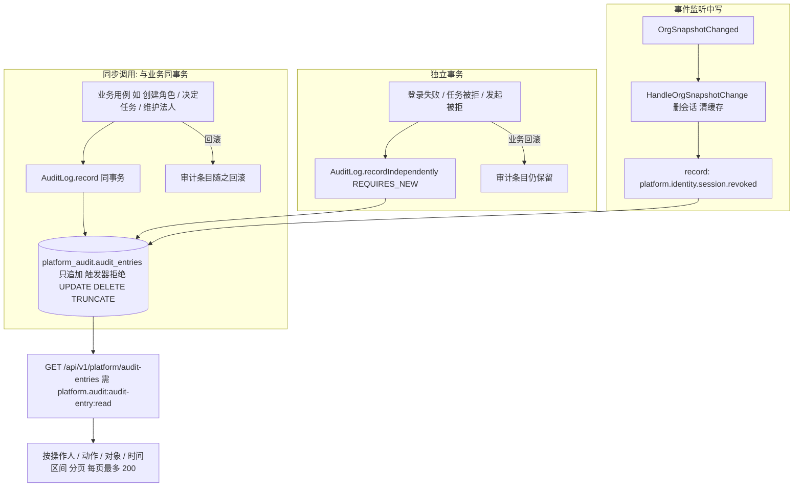

# 审计（Phase 1a）

- 涉及 BC：`platform.audit`（审计条目）、各写审计的模块（identity、workforce、approval、numbering）
- 涉及的 A8 模板 / 老系统入口：老登录日志、操作日志（AOP）、API 访问日志、错误日志、令牌管理页
- 证据采集日期：2026-10-14（老代码只读；生产数字引自 `runtime/prod_usage.tsv`）
- 梳理会话：psa-1a-process-review（现状 / 目标由 sonnet 子代理整理，差异判断与建议由 opus 完成，差异由用户逐条决定）

范围：哪些动作记审计、记什么、谁能查、保留多久、是否只追加、能否导出。只读调查，不含建议、不做决定。生产数字只引用文档已有的（出处与日期见各处）。

路径缩写：

- `OLD` = `/Users/yeliang/Projects/FORCITIS/psa/psa-backend`
- `OPLOG` = `OLD/yudao-framework/yudao-spring-boot-starter-biz-operatelog/src/main/java/cn/iocoder/yudao/framework/operatelog`
- `SYS` = `OLD/yudao-module-system/yudao-module-system-biz/src/main/java/cn/iocoder/yudao/module/system`
- `INFRA` = `OLD/yudao-module-infra/yudao-module-infra-biz/src/main/java/cn/iocoder/yudao/module/infra`
- `WEB` = `OLD/yudao-framework/yudao-spring-boot-starter-web/src/main/java/cn/iocoder/yudao/framework`
- `BPM` = `OLD/yudao-module-bpm/yudao-module-bpm-biz/src/main/java/cn/iocoder/yudao/module/bpm`
- `BE` = `backend/src/main/java/com/forcitis/one`（新仓库，工作树 `.../worktrees/xin-7143b1`）
- `DOC` = `docs`
- 生产数字出处 = `DOC/runtime/prod_usage.tsv`（只读采集，2026-10-14，README.md 说明）

## 现状流程

老系统有四条互不相干的日志线，没有统一的「审计」概念：登录日志（同步写）、操作日志（AOP + 异步写）、API 访问 / 错误日志（过滤器 + 异步写）、审批记录（bpm 任务扩展表，另有取消时删除 Flowable 历史的行为）。

```mermaid
flowchart TD
  subgraph L[登录日志 system_login_log 同步写]
    A1[登录: 账号 / SSO / 手机 / 社交 / 自定义] --> A2{校验结果}
    A2 -- 成功 --> A3[createLoginLog 结果0 + 更新最后登录 IP]
    A2 -- 账号错 / 口令错 / 禁用 / 验证码错 --> A4[createLoginLog 结果10/20/30/31 后抛异常]
    A5[登出 / 管理员删令牌] --> A6[removeAccessToken 成功才写登出日志 类型200 或 202]
  end
  subgraph O[操作日志 system_operate_log AOP + 异步]
    B1[Controller 方法带 @ApiOperation 或 @OperateLog] --> B2{登录用户类型是管理员?}
    B2 -- 否 --> B3[直接放行 不记]
    B2 -- 是 --> B4{有 @OperateLog? 否则仅 POST/PUT/DELETE}
    B4 -- 记 --> B5[环绕记录 参数 结果 耗时 IP UA traceId]
    B5 --> B6[@Async 经 OperateLogApi 写表 参数截 8000 结果截 4000]
    B6 -- 写失败 --> B7[只打错误日志 不重试]
  end
  subgraph P[API 访问日志 infra_api_access_log / 错误日志]
    C1[每个请求过滤器] --> C2[@Async 写访问日志 含查询串和请求体]
  end
  subgraph W[审批记录 bpm_task_ext + Flowable 历史]
    D1[通过 / 驳回 / 退回] --> D2[任务扩展表写 result + reason]
    D3[转派 setAssignee] --> D4[无原因 无审计 只依赖 @ApiOperation 的操作日志]
    D5[发起人取消] --> D6[原因必填 删实例 默认再删 Flowable 历史]
  end
  subgraph Q[查询]
    E1[操作日志页 / 登录日志页 / API 访问日志页 / 错误日志页 / 令牌页] --> E2[query 与 export 权限码分开 导出 Excel 且导出本身记操作日志]
  end
```

| # | 步骤 | 角色 | 系统 | 数据 / 状态变化 | 证据 |
|---|---|---|---|---|---|
| 1 | 账号登录：账号不存在 / 口令错记 `BAD_CREDENTIALS(10)`，禁用记 `USER_DISABLED(20)`，随后抛异常 | 登录用户 | psa-backend system | 插入 `system_login_log`（类型 100、用户 ID 可空、冗余账号名、IP、UA、traceId）；同步写，类未标 `@Transactional`（未逐个核事务边界） | `SYS/service/auth/AdminAuthServiceImpl.java:116-129`；`SYS/dal/dataobject/logger/LoginLogDO.java:22-75` |
| 2 | 致远 SSO 登录：票据重放 / 无此用户记 `BAD_CREDENTIALS`，禁用记 `USER_DISABLED` | 登录用户 | system | 同上，类型 106 | `AdminAuthServiceImpl.java:220-247`；`.../enums/logger/LoginLogTypeEnum.java:13-22` |
| 3 | 验证码错误记 `CAPTCHA_CODE_ERROR(31)` | 登录用户 | system | 同上 | `AdminAuthServiceImpl.java:327`；`.../enums/logger/LoginResultEnum.java:13-20` |
| 4 | 登录成功：先写成功日志，再建令牌；成功才更新最后登录时间 / IP | 登录用户 | system | `result=0`；`updateUserLogin(userId, ip)` | `AdminAuthServiceImpl.java:332-347,404-408` |
| 5 | 登出 / 管理员强制删令牌：删令牌成功才记登出日志（自己登出 200，强制退出 202）；找不到令牌则不记 | 用户 / 管理员 | system | 登录日志同表，类型 200 / 202 | `AdminAuthServiceImpl.java:415-446`；`SYS/controller/admin/auth/AuthController.java:155`；`SYS/controller/admin/oauth2/OAuth2TokenController.java:44-49` |
| 6 | 令牌分页 / 强制删除（`system:oauth2-token:page` / `:delete`）；没有会话吊销专项审计 | 管理员 | system | 删 `system_oauth2_access_token`；原因只体现在登出日志类型 | `OAuth2TokenController.java:35-49` |
| 7 | 操作日志 AOP：拦截 `@ApiOperation` 或 `@OperateLog`；只有管理员用户类型才记；无 `@OperateLog` 时只记 POST / PUT / DELETE | 管理员 | OperateLogAspect | 记模块、操作名、类型、IP、UA、traceId、方法参数、返回数据、耗时、结果码；`content` 与 `exts` 由业务代码手填（本仓库未发现调用 `addExt` / `setContent` 的业务点） | `OPLOG/core/aop/OperateLogAspect.java:74-112,147-166,215-264`；`OPLOG/core/util/OperateLogUtils.java:17-18` |
| 8 | 异步写表，参数截 8000、结果截 4000；写失败只打日志，业务请求不受影响 | 系统 | OperateLogFrameworkServiceImpl（`@Async`） | 插入 `system_operate_log` | `OPLOG/core/service/OperateLogFrameworkServiceImpl.java:26-37`；`SYS/service/logger/OperateLogServiceImpl.java:40-45`；`SYS/dal/dataobject/logger/OperateLogDO.java:29,34`；`OperateLogAspect.java:130-145` |
| 9 | API 访问日志：每个请求写一条，含查询串、JSON 请求体、结果码、耗时、用户 ID、IP、UA、traceId；异步 | 系统 | ApiAccessLogFilter | 插入 `infra_api_access_log`；错误另有 `infra_api_error_log` | `WEB/apilog/core/filter/ApiAccessLogFilter.java:47-110`；`WEB/apilog/core/service/ApiAccessLogFrameworkServiceImpl.java:22-27`；`INFRA/service/logger/ApiAccessLogServiceImpl.java:30-34` |
| 10 | 审批通过 / 驳回：任务扩展表写结果与审批建议；同时发审批结果消息 | 审批人 | bpm | `bpm_task_ext.result`、`reason`、`end_time` | `BPM/service/task/BpmTaskServiceImpl.java:771-797`；`BPM/dal/dataobject/task/BpmTaskExtDO.java`（`result`、`reason`、`endTime`） |
| 11 | 转派（页面「转派」）：任意改 assignee，无目标校验、无原因、无专门审计 | 持 `bpm:task:update` 者 | bpm | assignee 变更；只被 `@ApiOperation` 的 AOP 操作日志捕获（若调用者是管理员类型） | `BpmTaskServiceImpl.java:1228-1238`；`BPM/controller/admin/task/BpmTaskController.java:117-123`（`bpm:task:update` 在 `:119`） |
| 12 | 批量审批：以每个待办人名义批量通过，审计里看到的是被代办人而非操作人 | 管理员 | bpm | 见 RULE-270（评审结论「错误」，不复刻） | `BpmTaskServiceImpl.java:430-466`；`DOC/RULE_REVIEWS.md:36` |
| 13 | 发起人取消：原因必填；任务扩展表记「已取消」；删除实例后默认连 Flowable 历史一并删除（模型显式保留者除外）；启动时还有对账清理残留历史 | 发起人 | bpm | 历史不保留，已办 / 我的流程不再展示 | `BPM/service/task/BpmProcessInstanceServiceImpl.java:239-278,340-356`；`BPM/service/task/BpmWithdrawnHistoryCleanupRunner.java` |
| 14 | 登录日志查询 / 导出：按 IP（like）、账号（like）、成败、时间；`system:login-log:query` / `:export`；导出记操作日志（类型 EXPORT） | 管理员 | system | 只读；导出 Excel | `SYS/controller/admin/logger/LoginLogController.java:40-60`；`SYS/dal/mysql/logger/LoginLogMapper.java:17-27` |
| 15 | 操作日志查询 / 导出：按模块、操作人昵称、类型、是否成功、开始时间；`system:operate-log:query` / `:export` | 管理员 | system | 只读；导出 Excel | `SYS/controller/admin/logger/OperateLogController.java:50-54,71-76`；`SYS/service/logger/OperateLogServiceImpl.java:48-59`；`.../vo/operatelog/OperateLogPageReqVO.java:18-31` |
| 16 | API 访问日志 / 错误日志查询 / 导出：`infra:api-access-log:query|export`、`infra:api-error-log:query|export|update-status` | 管理员 | infra | 只读；错误日志可改处理状态 | `INFRA/controller/admin/logger/ApiAccessLogController.java:40-52`；`INFRA/controller/admin/logger/ApiErrorLogController.java:47,56,64` |
| 17 | 保留与清理：本次在 `OLD` 范围内按「清理 / 保留」类关键字检索，未发现日志清理任务（未逐个核 XXL-JOB 配置）；访问日志时间窗从 2024-08-14 起未截断 | — | — | 日志表只增不减 | grep 无命中；`DOC/runtime/prod_usage.tsv:2` |

**生产计数**（均出自 `DOC/runtime/prod_usage.tsv`，2026-10-14 只读采集）：

| 表 | 行数 | 行号 |
|---|---|---|
| `system_operate_log` | 805,022 | `:1445` |
| `system_login_log` | 178,533 | `:1432` |
| `infra_api_access_log` | 4,903,080（时间窗 2024-08-14 16:18 至 2026-10-14 14:01） | `:1186`、`:2` |
| `infra_api_error_log` | 15,613 | `:1187` |
| `system_oauth2_access_token` | 192,659 | `:1440` |

近 180 天各查询接口调用量（第一个数字；列含义按 README 描述，未核对表头）：

| 接口 | 调用 | 行号 |
|---|---|---|
| 操作日志分页 | 9 | `:446` |
| API 访问日志分页 | 13 | `:87` |
| API 错误日志分页 | 11 | `:218` |
| 登录日志分页 | 1 | `:295` |
| 令牌分页 | 1 | `:205` |

结论：这些页面几乎没人用。`DOC/INTENT.md` 与 `DOC/adr/ADR-0019.md:11` 也只引了行数，没有引用过查询页的使用结论。

---

## 目标流程

依据：`DOC/AI_NATIVE_SPEC.md:34`（C1a-17，P0，「登录成功 / 失败、会话吊销、代理操作（记录操作人与被代理人）、权限变更」）；`DOC/REIMAGINED_ARCHITECTURE.md:53,86`（只追加、失败类用独立事务 REQUIRES_NEW、审计由各模块调用 audit 的 api）；`DOC/adr/ADR-0019.md:29-30`（操作日志、登录日志 去 `platform.audit`；API 访问日志、错误日志 不写业务库，改为结构化日志进 SLS）。



要点（依据与 1a 实现状态）：

1. **只追加由数据库保证**：`V20261014134000__platform_audit_create_audit_entries.sql:28-42` 建 `BEFORE UPDATE OR DELETE` 与 `BEFORE TRUNCATE` 触发器；集成测试 `backend/src/test/java/com/forcitis/one/platform/audit/AuditLogIT.java:119-134` 验证三种操作都被拒。
2. **两种写入语义**：`AuditLog.record` 加入调用方事务，业务回滚则无审计；`recordIndependently` 用 `REQUIRES_NEW`，业务回滚仍保留（`BE/platform/audit/api/AuditLog.java:3-9`，`BE/platform/audit/application/RecordAuditEntry.java:23-33`）。测试 `AuditLogIT.java:86-117`。
3. **条目结构**只有 6 个业务列：`action`、`actor_id`（系统动作为空）、`on_behalf_of_id`（仅显式代理）、`subject_key`（`{类型}:{id}`）、`detail`（自由文本）、`created_at`（注入时钟）。无 traceId、无来源 IP 列、无前后值列、无原因列、无法人列（`V20261014134000...sql:4-13`；`BE/platform/audit/api/AuditEntry.java:7`）。登录审计把 IP / UA 拼进 `detail`（`BE/platform/identity/application/LoginAdmission.java:67-74`）。
4. **查询只有一个接口**：`GET /api/v1/platform/audit-entries`，过滤条件 `actorId`、`action`（精确）、`subjectKey`（精确）、`from`（含）、`to`（不含），每页最多 200（`BE/platform/audit/web/AuditEntryController.java:24-36`；`BE/platform/audit/domain/AuditQuery.java:7-21`；`BE/platform/audit/infrastructure/persistence/JdbcAuditEntryRepository.java:50-88`）。无导出接口，无前端页面（`frontend/` 内除生成的 `openapi.json` 外无 audit 引用；导航种子也没有审计页，`V20261014130300__platform_identity_seed_roles_and_navigation.sql:15-27`）。
5. **保留 / 归档**：新代码无任何保留期、归档、分区机制；老日志表去向见 `ADR-0019.md:38`「日志类表按保留期只读归档」，保留期数字未定（`DOC/intent/2026-10-14-122-1a流程-登录-历史登录日志.md`：「保留期按公司审计要求（下线前再定）」）。
6. **请求访问日志与 traceId**：`ADR-0019.md:30` 把 API 访问 / 错误日志去向定为 SLS 结构化日志，但 `backend/src` 内未检索到访问日志过滤器、`traceId` 或 MDC 的实现。

### 2.1 1a 代码中所有写审计的调用点

事务一列：「同」= 同业务事务（`record`）；「独」= 独立事务（`recordIndependently`）。操作人为空即系统动作。

| # | 动作名 | 所在类:行（`BE/` 下） | 事务 | 操作人 |
|---|---|---|---|---|
| 1 | `organization.workforce.legal-entity.created` | `organization/workforce/application/CreateLegalEntity.java:39` | 同 | 会话用户 |
| 2 | `organization.workforce.legal-entity.updated` | `organization/workforce/application/UpdateLegalEntity.java:41` | 同 | 会话用户 |
| 3 | `organization.workforce.sync-run.released` | `organization/workforce/application/RecordSyncRunRelease.java:31` | 同（但放行的同步在另一事务先行，见 §6 #23） | 会话用户 |
| 4 | `organization.workforce.employee.registered-on-login` | `organization/workforce/application/PersistRegisteredEmployee.java:34` | 同 | 空 |
| 5 | `platform.identity.session.revoked` | `platform/identity/application/HandleOrgSnapshotChange.java:55` | 事件监听事务 | 空 |
| 6 | `platform.identity.account.roles.replaced` | `platform/identity/application/ReplaceAccountRoles.java:67` | 同 | 会话用户 |
| 7 | `platform.identity.login.succeeded` | `platform/identity/application/LoginAdmission.java:52` | 同 | 登录者 |
| 8 | `platform.identity.login.failed` | `platform/identity/application/LoginAdmission.java:62` | 独 | 已识别则登录者，否则空 |
| 9 | `platform.identity.account.created` | `platform/identity/application/AccountProvisioning.java:40` | 同 | 空 |
| 10 | `platform.identity.role.granted` | `platform/identity/application/AccountProvisioning.java:44` | 同 | 空 |
| 11 | `platform.identity.role.grant.skipped` | `platform/identity/application/AccountProvisioning.java:47` | 同 | 空 |
| 12 | `platform.identity.role.created` | `platform/identity/application/CreateRole.java:47` | 同 | 会话用户 |
| 13 | `platform.identity.role.updated` | `platform/identity/application/UpdateRole.java:51` | 同 | 会话用户 |
| 14 | `platform.identity.role.deleted` | `platform/identity/application/DeleteRole.java:41` | 同 | 会话用户 |
| 15 | `platform.identity.account.enabled` / `.disabled` | `platform/identity/application/ChangeAccountStatus.java:37` | 同 | 会话用户 |
| 16 | `platform.identity.logout` | `platform/identity/application/Logout.java:27` | 同 | 会话用户 |
| 17 | `platform.approval.task.claim` | `platform/approval/application/ClaimTask.java:32` | 同 | 认领人 |
| 18 | `platform.approval.task.approve` / `.reject` | `platform/approval/application/DecideTasks.java:117` | 同 | 办理人 |
| 19 | `platform.approval.task.return`（退回发起人，原因必填） | `platform/approval/application/ReturnToInitiator.java:49` | 同 | 办理人 |
| 20 | `platform.approval.task.denied` | `platform/approval/application/TaskGuard.java:43` | 独 | 越权者 |
| 21 | `platform.approval.start.denied` | `platform/approval/application/StartApproval.java:41` | 独 | 越权发起者 |

所有 21 处的 `onBehalfOfId` 均为 `null`；`audit_entries.on_behalf_of_id` 列与查询视图已预留，但没有任何调用点填写。`platform.integration`、`platform.numbering`、`platform.scheduling` 内没有任何审计调用（`grep AuditEntry` 无命中）。

### 2.2 对照应记动作，标缺失

| 应记动作 | 来源 | 1a 状态 | 说明 |
|---|---|---|---|
| 登录成功 / 失败 | C1a-17 | 有（#7、#8） | 失败走独立事务；含登录方式、IP、UA（拼在 detail） |
| 登出 | RULE-334（`DOC/process/1a/登录与会话.md:159`） | 有（#16） | 无会话时不写（接口要求会话，决定要求匿名也成功，D-1a-46） |
| 会话吊销：离职 | C1a-17 / 123 | 有（#5） | 经事件写入 |
| 会话吊销：账号停用 | 123 | **缺失** | `ChangeAccountStatus.java:37-41` 先写 `account.disabled`，再 `revokeAll`，不写 `session.revoked` |
| 会话吊销：角色替换 | 123 | **缺失** | `ReplaceAccountRoles.java:67-69` 同理 |
| 会话过期（空闲 10h / 绝对 24h，清理 cron 每分钟） | 123「过期…原因只记审计」 | **缺失**（无过期写入点） | 配置 `platform_identity.properties:5-14`；Spring Session 清理不触发审计 |
| 管理员强制下线（老系统有） | — | **无入口** | 新系统没有等价的令牌删除功能 |
| 角色创建 / 修改 / 删除 | C1a-17 | 有（#12-14） | 修改只记 code / enabled / scope，不记权限集合前后值 |
| 账号角色替换 | C1a-17 | 有（#6） | 只记替换后的角色编码，不记前值 |
| 账号启停 | — | 有（#15） | |
| 默认角色授予 / 跳过 | RULE-344 | 有（#10、#11） | |
| 代理操作（操作人 + 被代理人） | C1a-17；125 | **缺失** | 无代理入口，`onBehalfOfId` 恒 null（`DOC/process/1a/审批通用流程.md` T16 已记「部分」） |
| 代理通知被代理人 | 125 | **缺失** | 未实现 |
| 组织同步放行 | 104 | 有（#3），但**无原因** | 放行接口只有路径参数与会话用户，无原因入参（`BE/organization/workforce/web/SyncRunController.java:46-60`；`ReleaseSyncRun.java:25-43`）；detail 为固定文案 |
| 法人维护 | 104 | 有（#1、#2） | 只有创建 / 更新，更新 detail 记更新后的状态与名称，不记前值 |
| 编号模板确认 / 变更 | 用户任务清单 | **缺失** | `ConfigureNumberingRule.java:17-21` 无审计，`NumberingRuleController.java:48-57` 不传操作人 |
| 审批转交 / 改派 | 128、124 | **缺失** | approval 内无转交 / 改派代码（`grep transfer|reassign` 无命中） |
| 审批撤销（发起人撤回 / 取消） | 128 | **缺失** | approval 内无撤回 / 取消代码 |
| 退回到指定节点 | 128（D-1a-71） | **缺失** | 未实现 |
| 退回发起人 | — | 有（#19） | 原因必填 |
| 通过 / 驳回 | — | 有（#18） | 通过无原因时写默认文案；驳回原因必填，有钩子也不免（用户 2026-10-16 删掉免填放行；代码里 `DecideTasks.java:101-106` 的放行分支待 DATA-REPAIR-approval 删除） |
| 发起审批成功 | — | **缺失**（仅记发起被拒） | `StartApproval.java:41` 只在拒绝时记 |
| 任务办理记录表（含自动同意、加签建议、转交、代理） | 130 | **缺失** | 未建表；现仅有审计条目 |
| 离职者在途待办重新取人（原、新处理人） | 107 | **缺失** | 未实现 |
| 复职重授基础角色 | 115 | **缺失** | `AccountProvisioning` 只在创建账号时授一次 |
| 应急账号开通 / 启停 / 重置（运维脚本） | 113 | **缺失** | `JdbcEmergencyAdminRepository` 无审计调用；脚本未实现 |
| 出站投递死信重投 / 放弃（填原因） | 130（D-1a-91） | **缺失** | integration 无审计调用 |

### 2.3 附注

**(a) 法人维度**：审计表没有法人列；`subject_key` 是 `{类型}:{id}`，不含法人；查询接口无法人过滤。按法人查审计目前做不到。「登录后按哪个法人生效与数据范围授予表」已被推到 1b（`DOC/intent/2026-10-14-123-1a流程-登录-其余建议.md`：「会话法人推到 1b」）。法人小表本身的创建 / 更新有审计（#1、#2），且用 `legal-entity:{id}` 作对象，可按对象查到。

**(b) DMN 不适用**：审计是事实记录，不含判定规则；没有决策表。

**(c) 与业务 / 审批状态的关系**：

- 多数调用点是**事务内同写**（`record`）：审批通过、驳回、退回、认领、角色与账号变更、法人维护、登录成功、登出。业务回滚则审计一并回滚，因此审计与审批状态一致（`DecideTasks.java:47,117`：同在 `@Transactional` 内）。
- **失败类走独立事务**（登录失败、任务越权、发起越权），业务回滚也保留（`RecordAuditEntry.java:29-33`）。
- **事件后写**只有一处：离职吊销审计在 `OrgSnapshotChanged` 的 `@ApplicationModuleListener` 中写（`HandleOrgSnapshotChange.java:33-56`），晚于同步事务提交；类注释说明请求时的主体校验兜底，吊销生效不依赖该事件（`:14`），但审计依赖事件投递。
- **跨事务**一处：组织同步放行先在另一事务重新执行同步，再写放行审计（`ReleaseSyncRun.java:37-41`），两者不原子。
- 审计**不驱动**任何业务状态，业务状态**不依赖**审计读取（审批状态机在 `platform.approval`，审计只记事实）。

---

## 涉及的聚合与状态机

- **审计条目（`audit_entries` 行）**：只追加，无状态；`updated_at` 恒等于 `created_at`（`V20261014134000...sql:26`）。`AuditEntry` 是值对象式记录（`BE/platform/audit/api/AuditEntry.java:7`），仓储接口只有保存与分页查询（`BE/platform/audit/domain/AuditEntryRepository.java`）。
- **归档 / 保留状态**：1a 代码与文档均未定义，因此不画 stateDiagram-v2。
- **会话**：按 123，会话不设状态字段，过期 / 吊销 / 登出原因只记审计；会话本身由 Spring Session 表持有，删除即失效（`BE/platform/identity/infrastructure/security/ServletSessionRegistry.java:68-79`）。因此审计是会话终止原因的**唯一**记录来源，这也是第 2.2 节「会话吊销」缺口（停用、角色替换、过期）影响最大的地方。
- **同步运行（`sync_runs`）**：HELD 到 RELEASED 的状态由同步运行表自身持有，放行审计只是旁证（`DOC/process/1a/组织与人员同步.md:219`）。
- **审批任务**：办理结果在审批侧状态机；审计不是状态来源。130 决定新增只追加的「任务办理记录」，属审批侧聚合，尚未建立。

---

## 发出 / 消费的领域事件

| 方面 | 老系统 | 新系统（1a） | 证据 |
|---|---|---|---|
| 写入方式 | 登录日志：业务代码同步调用 `loginLogService.createLoginLog`；操作日志：Spring AOP 环绕 + `@Async`；API 访问日志：Servlet 过滤器 + `@Async` | 业务用例同步调用 `AuditLog.record` / `recordIndependently`；不靠 AOP、不靠领域事件 | `AdminAuthServiceImpl.java:332-347`；`OperateLogAspect.java:164-165`；`ApiAccessLogFrameworkServiceImpl.java:22-27`；`BE/platform/audit/api/AuditLog.java` |
| 写失败 | 操作日志 / API 日志写失败只打日志，业务不受影响，记录丢失 | 同事务写入：写失败则业务失败；独立事务写失败会使失败路径抛异常 | `OperateLogFrameworkServiceImpl.java:31-36`；`OperateLogAspect.java:141-144` |
| 谁决定记什么 | 注解 + 请求方法 + 管理员身份，自动、粗粒度（整参整结果） | 调用点显式决定，细粒度（动作名 + 对象键 + 说明文字） | `OperateLogAspect.java:92-96,256-264` |
| 发出的事件 | 无 | 审计模块**不发布**任何领域事件 | `BE/platform/audit/` 内无 `publishEvent` |
| 消费的事件 | 无 | 审计模块**不订阅**事件；但 `platform.identity` 的 `HandleOrgSnapshotChange` 订阅 `OrgSnapshotChanged` 并在监听事务中写审计（离职吊销） | `HandleOrgSnapshotChange.java:33-56`；`DOC/process/1a/登录与会话.md:299-302` |
| 规格里的事件 | — | `AccountStatusChanged` 已按 123 删去，有订阅方时再加 | `DOC/intent/2026-10-14-123-1a流程-登录-其余建议.md` |
| 请求级日志 | AOP / 过滤器自动记全部请求（490 万行） | ADR-0019 定为结构化日志进 SLS；`backend/src` 未见实现 | `ADR-0019.md:30` |

---

## 权限

**新系统**：

- 查询：权限码 `platform.audit:audit-entry:read`，单一码，写在三处并由 `AuditPermissionsTest` 保持一致（`BE/platform/audit/web/AuditPermissions.java:3-8`；`BE/platform/identity/api/Permission.java:15,42`；`BE/platform/audit/web/AuditEntryController.java:25`）。
- 种子角色 `employee` 只含待办的读与办理两个码（`V20261014130300...sql:8-11`），不含审计读；`super_admin` 是管理员角色，`PrivilegeCeiling` 对管理员放行授予（`BE/platform/identity/application/PrivilegeCeiling.java:21-27`）。导航种子无审计页入口。
- 能否按人查：能（`actorId`）；按被代理人查：不能（无该过滤条件，列有）；按对象查：能（`subjectKey` 精确）；按动作：能（精确，不支持前缀）；按时间区间：能；按 IP / 结果 / 法人：不能。
- 数据范围：该码一旦授予，可看全部条目，没有按法人 / 部门 / 本人的范围限制；查询审计本身不写审计。
- 导出：无接口，无导出权限码。

**老系统**：

| 能力 | 权限码 | 证据 |
|---|---|---|
| 操作日志查询 / 导出 | `system:operate-log:query` / `system:operate-log:export` | `OperateLogController.java:52,73`；菜单 `prod_usage.tsv:681-682` |
| 登录日志查询 / 导出 | `system:login-log:query` / `system:login-log:export` | `LoginLogController.java:42,51`；`prod_usage.tsv:683-684` |
| 令牌页 / 强制删除 | `system:oauth2-token:page` / `:delete` | `OAuth2TokenController.java:36,46`；`prod_usage.tsv:685-686` |
| API 访问日志查询 / 导出 | `infra:api-access-log:query` / `:export` | `ApiAccessLogController.java:42,50`；`prod_usage.tsv:711,717` |
| API 错误日志查询 / 导出 / 处理 | `infra:api-error-log:query|export|update-status` | `ApiErrorLogController.java:47,56,64`；`prod_usage.tsv:713-718` |
| 导出行为本身 | 记一条操作日志（类型 EXPORT） | `OperateLogController.java:74`；`LoginLogController.java:52`；`ApiAccessLogController.java:51` |
| 按人查 | 操作日志按操作人昵称，登录日志按账号（like）与 IP（like） | `OperateLogServiceImpl.java:49-56`；`LoginLogMapper.java:18-20` |

## 差异清单

「已决定」引用用户原话；「需改代码」已报 psa-coordinator 转 1a 会话。本会话不改代码。

| 编号 | 现状 | 目标 | 影响 | 建议 | 用户决定 |
|---|---|---|---|---|---|
| D-1a-162 | 停用用户无专门吊销记录；令牌过期不记录 | 停用、角色变更、离职都写「会话吊销」审计；会话清理作业对每个过期会话写一条审计（空闲过期或到达上限） | 会话去向可查 | 逐条记 | 已决定：「会话不设状态字段」（intent/2026-10-14-123）；「会话过期逐条记」（intent/2026-10-14-154）；需改代码 |
| D-1a-163 | 管理员可在令牌页强制删令牌（记登出类型 202） | 强制下线列为管理模式的平台权限：吊销某用户全部会话，填原因并审计 | 可踢人且可追溯 | 管理模式 | 已决定：「新增强制下线」（intent/2026-10-14-154）；「审计归安全审计员，下线归管理模式 (Recommended)」（intent/2026-10-14-158）；需改代码 |
| D-1a-164 | 无同步放行 | 放行须填原因，原因进审计 | 放行理由可查 | 按已定 | 已决定：intent/2026-10-14-104；需改代码（`release` 无请求体） |
| D-1a-165 | 转派无校验、无原因、无审计 | 转交、改派、退回指定节点、代理都写审计（含原因；代理记操作人与被代理人并通知被代理人） | 可追溯 | 按已定 | 已决定：intent/2026-10-14-124、125、128；需改代码 |
| D-1a-166 | 办理结果在 `bpm_task_ext`，撤销后默认删历史 | 只追加的任务办理记录（含自动同意、加签建议、转交、代理）；审计条目不替代它 | 已办与逐轮历史可查 | 按已定 | 已决定：「办理记录表」（intent/2026-10-14-130）；需改代码 |
| D-1a-167 | 发起、撤回不单独记 | 审批发起、撤回、撤销、办结写审计（办理明细另在任务办理记录） | 生命周期可查 | 也记 | 已决定：「审批生命周期也记」（intent/2026-10-14-154）；需改代码 |
| D-1a-168 | — | 离职者在途待办重新取人、复职重新授予基础角色、应急账号登记 / 启停 / 重置都写审计 | 可追溯 | 按已定 | 已决定：intent/2026-10-14-107、115、113、156；需改代码 |
| D-1a-169 | 无编号模板 | 编号规则修改、确认、停用、启用写审计（前后值）并登记 CONFIG_CHANGELOG | 可追溯 | 按已定 | 已决定：「规则变更写审计」（intent/2026-10-14-151）；需改代码 |
| D-1a-170 | 登录日志有追踪号、IP、UA；操作日志有整参数，无前后值 | 审计条目增加追踪号、来源 IP、变更前后值、原因四列；详情不得含密钥与个人敏感信息并加守护（L3 / L4 不进审计详情，ADR-0026 §7） | 可按 IP 与追踪号检索；前后值可审 | 增加字段 | 已决定：「增加字段」（intent/2026-10-14-155）；需改代码 |
| D-1a-171 | 登录日志按 IP、账号、成败、时间查 | 可按操作人、被代理人、来源 IP、结果、动作前缀、对象、时间查 | 常见核查可做 | 扩展维度 | 已决定：「扩展查询维度」（intent/2026-10-14-155）；需改代码 |
| D-1a-172 | 五类日志页可导出，导出记操作日志 | 审计查询与导出为两个权限，归「安全审计员」角色（授予公司审计人员；业务 Admin 如需另按敏感权限双人确认授予）；员工可查自己的登录记录；查询与导出本身写审计；1a 提供审计查询页 | 管理员不默认可看审计 | 安全审计员 | 已决定：「独立权限+查看留痕+页面 (Recommended)」（intent/2026-10-14-152）；「审计归安全审计员，下线归管理模式 (Recommended)」（intent/2026-10-14-158）；ADR-0026 D-11；需改代码 |
| D-1a-173 | 日志表只增不减，无清理 | 新审计在线保留 3 年，之后归档到对象存储（国内、合规保留 2557 天的 WORM bucket，流程归档与审计归档共用），从产生起满 10 年；审批结论按 10 年，不随会计档案 30 年；过账类审计的 30 年存放由首个产生过账的阶段定（phase1a/DEFERRED.md「数据打分卡推迟项」） | 保留有底线 | 满 10 年 | 已决定：「一个 10 年的 bucket」「不算，按 10 年」「锁约 7 年（2557 天） (Recommended)」（intent/2026-10-14-192237、192731，取代 intent/2026-10-14-153「至少 5 年，1a 不删」）；老日志：「不迁，老表只读归档 (Recommended)」（intent/2026-10-14-122） |
| D-1a-174 | AOP 自动覆盖管理员写操作 | 规格列出必须写审计的动作清单（登录、会话、权限与角色、代理、放行、法人、编号规则、审批改派 / 转交 / 撤销、应急账号、配置变更等），并加架构守护防止漏记 | 新功能不漏记 | 清单 + 守护 | 已决定：「必记清单+守护」（intent/2026-10-14-154）；需改代码与文档 |
| D-1a-175 | 登录日志同步直写；操作日志异步写会丢 | 审计与动作同事务或独立事务同步写；事件监听中写的审计与对应动作在同一事务（离职吊销、放行后重跑同步） | 动作成功则审计必在 | 同事务 | 已决定：架构评审 #19；「审计与动作同事务」（intent/2026-10-14-155）；需改代码 |
| D-1a-176 | 无只追加约束 | 审计表的只追加写入守护清单（架构守护 + 数据库触发器），更正对 G34 的引用 | 防止误改 | 守护 | 已决定：「只追加守护覆盖审计表」（intent/2026-10-14-155）；需改代码与文档 |
| D-1a-177 | API 访问日志 490 万行、错误日志写业务库 | 不写业务库，改为结构化日志进 SLS（含追踪号） | 业务库减负 | 按已定 | 已决定：ADR-0019；需改代码（未见访问日志过滤器与追踪号） |
| D-1a-178 | 无法人概念 | 审计不设法人列；法人生效与数据范围授予在 1b 定 | 无 | 按已定 | 已决定：「会话法人推到 1b」（intent/2026-10-14-123） |
