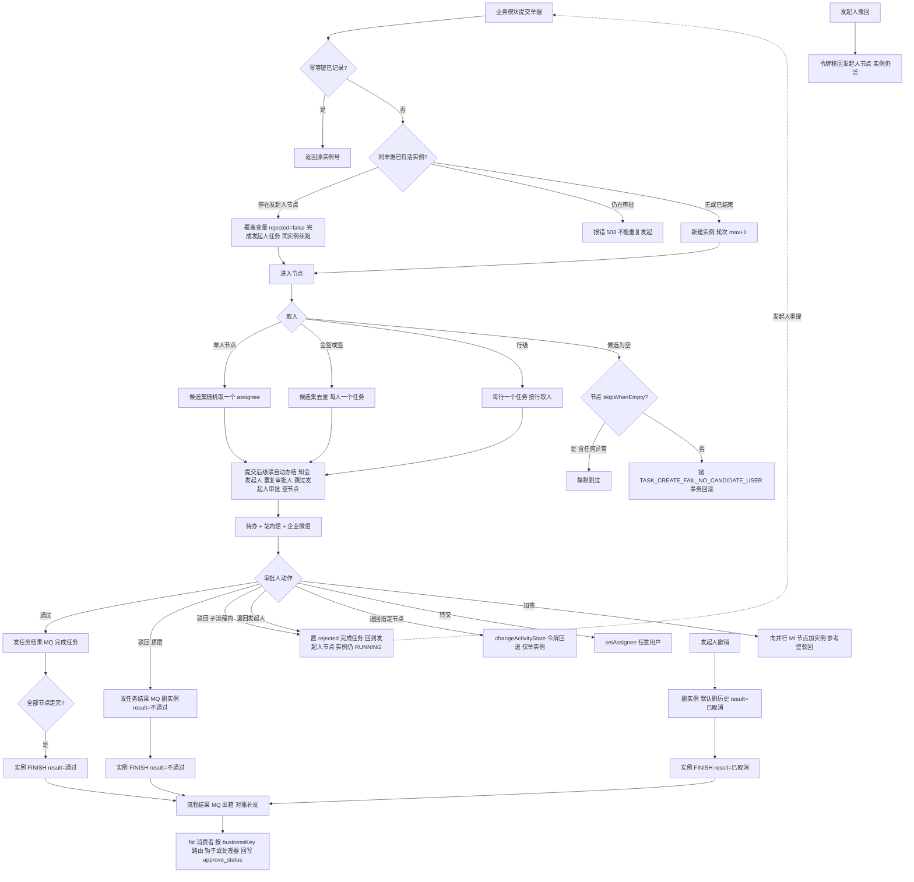
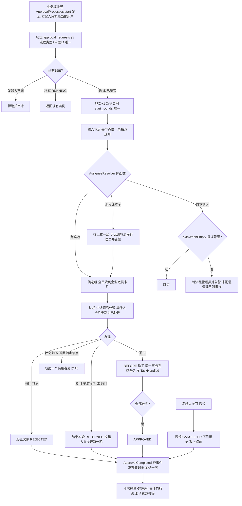
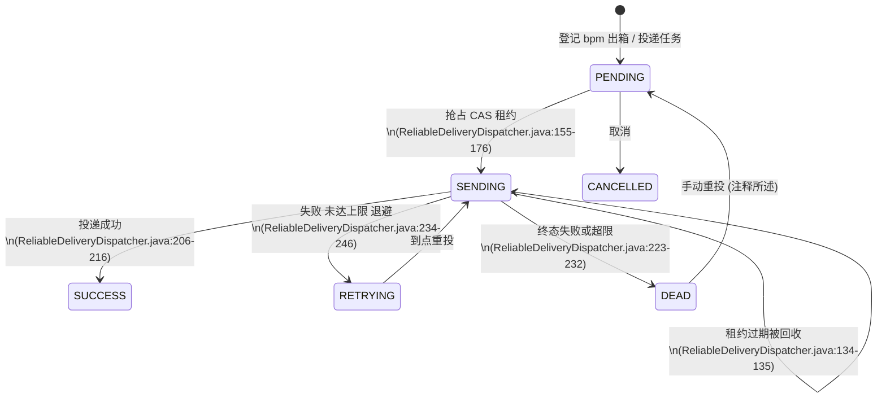
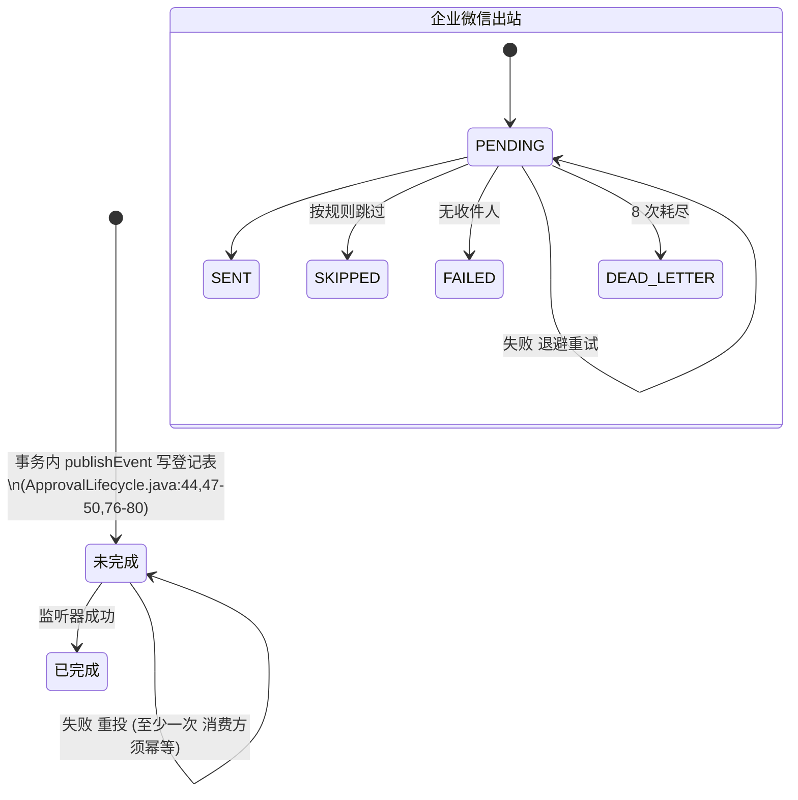
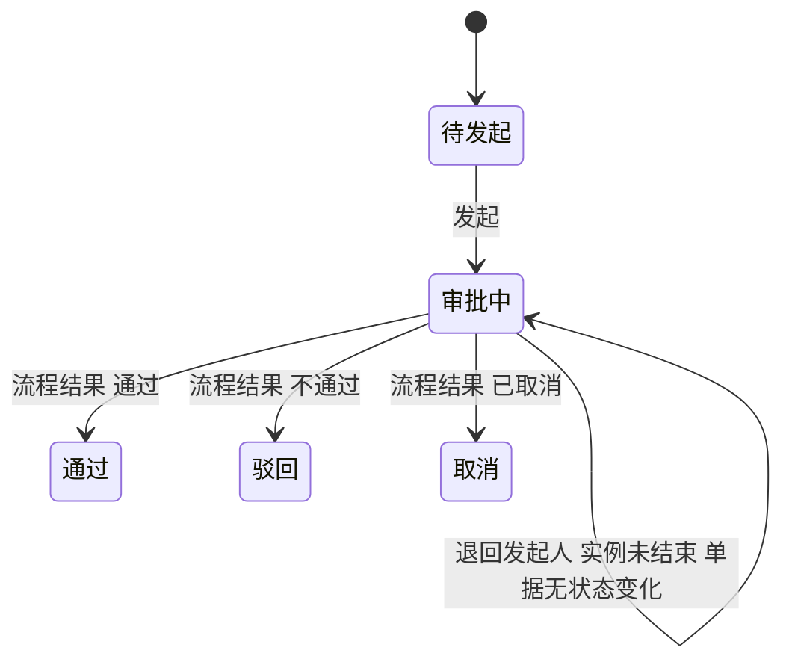

# 审批通用流程（Phase 1a）

- 涉及 BC：`platform.approval`（审批请求、任务、指派、钩子、结果事件）、`platform.integration`（出站投递、企业微信）、`organization.workforce`（取人读汇报线与部门负责人）、`platform.identity`（发起人与操作人取自会话）、`platform.audit`
- 涉及的 A8 模板 / 老系统入口：老 bpm 模块（Flowable 6，`bpm_task_assign_rule`、可靠投递、按表名回写）；fst 结果消费与钩子；老待办 / 已办 / 我的流程页面
- 证据采集日期：2026-10-14（老代码只读；生产数字引自已有文档）
- 梳理会话：psa-1a-process-review（现状 / 目标由 sonnet 子代理整理，差异判断与建议由 opus 完成，差异由用户逐条决定）
- 路径缩写（证据列用）：
- `BPM` = `psa/psa-backend/yudao-module-bpm/yudao-module-bpm-biz/src/main/java/cn/iocoder/yudao/module/bpm`
- `FST` = `psa/psa-backend/yudao-module-fst/yudao-module-fst-biz/src/main/java/cn/iocoder/yudao/module/fst`
- `NEW` = `backend/src/main/java/com/forcitis/one/platform/approval`（新仓库 1a 代码）
- `DOC` = `docs`
- 规则卡 = `DOC/BUSINESS_RULES.md`（RULE-248..315），评审结论 = `DOC/RULE_REVIEWS.md`

## 生产计数（引自已有文档）

| 项 | 数字 | 出处 |
|---|---|---|
| 流程定义 | 10 个；近 180 天实例：TIMESHEET 34,498、PM_ETC 103、OPP_QUOTATION 29、PM_REVENUE 20、PM_BUDGET 18、TRAVEL 18、TRAVEL_REVISION 1、其余 3 个为 0 | `DOC/runtime/README.md`（2026-10-14） |
| TIMESHEET 任务 | 近 180 天 66,766 个；当前定义版本 15 | `README.md`；`DOC/runtime/prod_bpm.tsv` ##10/##14 |
| BPMN 结构 | 每流程 3-11 个用户任务；无并行网关、服务任务、子流程；包容网关仅 TRAVEL(4)、TIMESHEET(2)；「少量会签、少量边界事件（超时）」 | `README.md`（列含义未标注，「超时」未核实，见 D30） |
| 审批人分配规则 | 230 条：脚本 50 = 127、角色 10 = 48、自定义数据 60 = 34、指定用户 30 = 10、空节点 70 = 10、部门负责人 21 = 1 | `README.md`；类型码含义核对 `BPM/../bpm-api/.../BpmTaskAssignRuleTypeEnum.java:15-23` |
| 写热点 | 审批 decide 3,779 次 / 180 天；发起 2,964 次 | `DOC/AI_NATIVE_SPEC.md:208` |
| 读热点 | H5 待办 97,591 次、我的流程 81,013 次 / 180 天 | `AI_NATIVE_SPEC.md:207` |
| 存量表 | `bpm_task_ext` 166,037；`bpm_process_instance_ext` 132,304；`bpm_oa_customized` 131,142；`bpm_oa_start_request` 198；`bpm_node_field_permission` 899 | `DOC/runtime/prod_usage.tsv:1134,1136,1139,1141`；`AI_NATIVE_SPEC.md:210` |
| 在途 | `ACT_RU_TASK` 95、`ACT_RU_EXECUTION` 380；`ACT_RU_TIMER_JOB` 0、`ACT_RU_JOB` 0、`ACT_RU_DEADLETTER_JOB` 0 | `prod_usage.tsv:1118,1121,1125,1127,1128` |
| 投递 | `psa_reliable_delivery_task` 354 行；`psa_bpm_mq_outbox` 0 行 | `prod_usage.tsv:1359,1224` |
| 通知 | 站内信日志 23.3 万行，几乎全为审批通知，发送状态全部「初始化」，短信从未真正发出 | `DOC/adr/ADR-0019.md`（表中「短信」行） |

---

## 现状流程

### 1.1 总图

### 1.2 步骤表

| # | 步骤 | 角色 | 系统 | 数据 / 状态变化 | 证据 |
|---|---|---|---|---|---|
| 1 | 发起：业务模块调用 createOA；发起人取调用方传入的 `creator`，否则登录人 | 发起人 / 业务模块 | bpm + fst | 建 `bpm_oa_customized`（paramsId 与实例号映射），建 Flowable 实例，`bpm_process_instance_ext` status=1 result=1 | `BPM/service/oa/CustomizedBpmOAServiceImpl.java:105-110,168-198`；`BPM/service/task/BpmProcessInstanceServiceImpl.java:556-577`；RULE-265（评审：错误） |
| 2 | 发起幂等：幂等键 + 事务级数据库应用锁；键 = `processKey:businessId:轮次` | 业务模块 | fst + bpm | `bpm_oa_start_request` 记键与实例号；`workflow_start_round` 轮次取 max+1，无唯一约束 | `BPM/service/oa/BpmOAIdempotentStartService.java:26-53`；`FST/application/platform/workflow/WorkflowStartRoundService.java:21-31`；RULE-264/278（生产 198 行请求记录） |
| 3 | 重复发起守卫：同单据活实例停在发起人节点则续跑，仍在审批则报 503，已结束则新建实例 | 发起人 | bpm | 续跑：覆盖变量、`rejected=false`、更新 `data_stamp`、完成发起人任务，同实例；新建：覆盖映射行 | `CustomizedBpmOAServiceImpl.java:137-166`（查询只按 params_id，不含 processKey）；RULE-266/287 |
| 4 | 重提（退回后）：带 `returnTaskId` 校验轮次；已前进则快照一致才幂等 no-op | 发起人 | bpm | 同实例继续，不新建 | `CustomizedBpmOAServiceImpl.java:229-283`；RULE-267 |
| 5 | 批量发起：已映射单据直接返回原实例 | 业务模块 | bpm | 无新实例 | `CustomizedBpmOAServiceImpl.java:91-103`；RULE-282/296 |
| 6 | 取人（单人节点）：按规则类型算候选集后随机取 1 个作 assignee | 系统 | bpm | `ACT_RU_TASK.ASSIGNEE_` 为随机选中的人 | `BPM/framework/flowable/core/behavior/BpmUserTaskActivityBehavior.java:73-100`；RULE-249（评审：错误，改候选组认领） |
| 7 | 取人（规则类型）：角色 / 部门成员 / 部门负责人 / 岗位 / 指定用户 / 用户组 / 脚本 / 自定义数据 / 空节点（admin）；停用人员过滤函数未被调用；部门无负责人会放入 null | 系统 | bpm | 候选集 | `BPM/service/definition/BpmTaskAssignRuleServiceImpl.java:476-499,564-616,692-701`；RULE-253 |
| 8 | 取人（汇报线脚本）：发起人 → 一级 / 二级汇报人，汇报线不完整即空指针 | 系统 | bpm | 候选集或抛异常 | `BPM/framework/flowable/core/behavior/script/impl/BpmTaskAssignLeaderAbstractScript.java:39-72`（行 48-50 无判空）；RULE-250 |
| 9 | 取人（自定义数据）：取不到字段时回落到写死的个人 | 系统 | bpm | 候选集 = 固定用户 | `BpmTaskAssignRuleServiceImpl.java:665-689`（行 680）；RULE-254 |
| 10 | 反自审：开关打开且候选含发起人时，去掉发起人并加入其直属领导，没有领导则把发起人加回 | 系统 | bpm | 候选集 | `BpmTaskAssignRuleServiceImpl.java:504-526`；RULE-307 |
| 11 | 候选组认领：老系统没有；一个任务一个 assignee | — | — | — | `BpmUserTaskActivityBehavior.java:94-97` 注释「责任到人」 |
| 12 | 会签 / 或签：候选集去重，每人一个任务；是否全签或任一由库内 BPMN 的完成条件决定；行审批不短路 | 系统 | bpm | N 个任务 | `BPM/framework/flowable/core/behavior/BpmParallelMultiInstanceBehavior.java:45-93`；RULE-248（生产会签「少量」，无并行网关） |
| 13 | 取不到人：配置 skipWhenEmpty 则静默离开节点（算人时任何异常按空处理）；未配置则抛 `TASK_CREATE_FAIL_NO_CANDIDATE_USER`，事务回滚（发起或上一审批动作失败） | 系统 | bpm | 跳过：无任务；失败：回滚 | `BpmUserTaskActivityBehavior.java:40-60`；`BpmTaskAssignRuleServiceImpl.java:446-469`；RULE-300（评审：正确+修）。老系统没有「转流程管理员 / 告警」 |
| 14 | 自动办结级联（提交后迭代，上限 50 轮）：知会 → 发起人节点 → 同节点重复审批人 → 跳过发起人审批（审批人 = 发起人）→ 空节点 | 系统 | bpm | 任务自动完成，原因前缀「系统自动」 | `BPM/framework/flowable/core/listener/BpmTaskEventListener.java:126-129,164-196,287-331`；RULE-301 |
| 15 | 重复审批人：同人已在本节点通过则新任务自动同意，除返工入口和「退回必审」；行节点按 rowId | 系统 | bpm | `bpm_task_ext.result` 自动写通过 | `BpmTaskEventListener.java:334-409`；RULE-302 |
| 16 | 待办通知：任务分配后站内信 + websocket / 企业微信；跳过的节点、知会、已终态任务不发 | 系统 | bpm | 通知（尽力而为，失败仅记日志） | `BPM/service/task/BpmTaskServiceImpl.java:1427-1514`；短信从未发出（ADR-0019） |
| 17 | 待办列表：本人 assignee 的存活任务，行任务按（实例, 节点）合并为一条，并入未读知会 | 审批人 | bpm | 读 | `BpmTaskServiceImpl.java:142-209,285-377`；RULE-261/299 |
| 18 | 通过：校验任务归属本人，发任务结果 MQ，完成任务 | 审批人 | bpm | 任务 result=2 | `BpmTaskServiceImpl.java:771-798,1303-1312`；RULE-272/276 |
| 19 | 统一办理 decide：同实例；按节点分组；先全部过 BEFORE 钩子再产生副作用；驳回组殿后；单人节点一次一条 | 审批人 | bpm + fst | 同一事务 | `BpmTaskServiceImpl.java:865-975`；`FST/service/workflowform/WorkflowApproveServiceImpl.java:52-174`；RULE-272/277/280 |
| 20 | 驳回（顶层）：发任务结果 MQ，删整个实例，ext result=不通过 | 审批人 | bpm | 实例 FINISH result=3 | `BpmTaskServiceImpl.java:802-844`；`BpmProcessInstanceServiceImpl.java:625-650`；RULE-271/290 |
| 21 | 驳回（子流程内）：按「退回发起人」处理，主流程不结束 | 审批人 | bpm | 实例仍 RUNNING，令牌回发起人节点 | `BpmTaskServiceImpl.java:808-818,850-861`；生产 TIMESHEET 评审阶段在子流程内（见新 BPMN 注释对照老模型） |
| 22 | 退回发起人：原因必填 + BEFORE 钩子；发 REJECT 任务结果 MQ；置 `rejected=true` 完成任务，BPMN 错误边界取消子流程回到发起人节点；任务 ext 记为不通过 | 审批人 | bpm | 实例仍 RUNNING，任务 result=3；发起人任务停留 | `BpmTaskServiceImpl.java:1109-1152`；`BpmTaskEventListener.java:111-124`；RULE-275/293 |
| 23 | 退回指定节点：仅单实例源与目标；`changeActivityState` 令牌回退，不发业务 MQ；任务 result=5 | 审批人 | bpm | 实例仍 RUNNING | `BpmTaskServiceImpl.java:1155-1225`；RULE-284/298 |
| 24 | 转交：当前 assignee 改派任意用户，无目标校验、无原因、无审计；触发新 assignee 的待办通知 | 审批人 | bpm | assignee 变更 | `BpmTaskServiceImpl.java:1228-1238`；`BpmTaskController`（`bpm:task:update`，接口表 P18）；RULE-285 |
| 25 | 加签：向运行中的并行 MI 节点加实例；不校验操作人与实例关系；任务标 `countersign=1` | 审批人 / 管理员 | bpm | 新任务 | `BpmTaskServiceImpl.java:1242-1295`；`DOC/phase1a/INTERFACES.md:504`；RULE-286/313 |
| 26 | 加签人驳回仅为参考：任务完成、不终止流程、不发结果 MQ | 加签人 | bpm | 任务 result=3 但实例继续 | `BpmTaskServiceImpl.java:982-1006,1037-1040`；RULE-273/291 |
| 27 | 行级审批：每行一个任务，必须一次提交本人在该节点的全部待办行；任一行驳回置 `rejected` 但其余行仍走完 | 审批人 | bpm | 行任务各自 result | `BpmTaskServiceImpl.java:1042-1098`；`BpmParallelMultiInstanceBehavior.java:56-60,88-93`；RULE-274/292 |
| 28 | 批量审批：对所有用户的待办按 assignee 名义逐条通过（并 sleep），跳过行节点和知会节点 | 管理员 | bpm | 以他人名义写通过 | `BpmTaskServiceImpl.java:430-466`；RULE-270（评审：错误）；无「代理」概念，全库 grep 无代理 / 委托功能 |
| 29 | 撤回修改：仅发起人、未越过「撤回截止」节点、当前节点非多实例、不在发起人处；现存任务记 BACK(5)，令牌移回发起人节点，实例仍活 | 发起人 | bpm | 实例仍 RUNNING | `BPM/service/task/BpmProcessInstanceServiceImpl.java:360-420,449-477`；RULE-269/297/309 |
| 30 | 撤销（取消）：仅发起人、未越过截止节点、原因一律必填，有钩子也不免（用户 2026-10-16：撤销与驳回统一；老系统是「或钩子决定」，不沿用）；任务 result=4；删实例；默认同步删除 Flowable 历史，除非模型配置 `retainHistoryOnCancel` | 发起人 | bpm | 实例 FINISH result=4；历史被删 | `BpmProcessInstanceServiceImpl.java:239-278,340-356,580-601`；`BpmWithdrawnHistoryCleanupRunner.java:23-55`；RULE-268/288 |
| 31 | 过程结果事件：通过 / 驳回 / 取消三种终态才发流程结果 MQ；撤回类取消用 ext 终值回查区分驳回伴生 | 系统 | bpm | MQ | `BPM/mq/producer/BpmProcessResultProducer.java:47-88`；RULE-306 |
| 32 | 任务结果事件：通过 / 驳回发任务结果 MQ（含 rowId、AFTER 钩子快照）；自动办结、加签建议不发 | 系统 | bpm | MQ | `BPM/mq/producer/BpmApprovalTaskResultProducer.java:63-108`；RULE-305 |
| 33 | 可靠投递：Redis 暂存 + 出箱表 + 清扫 + 重发（退避 30 秒起，最多 10 次后转死信）+ 对账（每 10 分钟从引擎记录反推补发） | 系统 | bpm | 出箱行 PENDING / DEAD | `BPM/mq/producer/BpmApprovalMqReliableSender.java:96-98,355-398,402-485`；RULE-303/304（生产出箱 0 行） |
| 34 | 业务消费：任务结果按 businessKey 路由，有 AFTER 钩子则钩子替换处理器；流程结果先钩子再处理器；失败抛出让 MQ 重投 | 业务模块 | fst | 业务表终态回写 | `FST/mq/consumer/approval/ApprovalTaskResultConsumer.java:41-75`；`ProcessResultConsumer.java:43-75`；RULE-311/312 |
| 35 | 通用回写：非工时流程按表名拼 SQL 写 `approve_status`（通过 3 / 驳回 2 / 取消 4） | 系统 | bpm | 业务表 `approve_status` | `CustomizedBpmOAServiceImpl.java:303-337`；`DOC/../CommonConstants.java:13-18`（`yudao-common`）；RULE-308（评审：错误） |
| 36 | 详情可见性：持功能权限或为流程参与人，bpm 不可达则拒绝 | 审批人 / 发起人 | fst | 读 | `FST/application/platform/workflow/ApprovalVisibilityGuard.java:51-77`；RULE-310 |
| 37 | 超时 / 催办：未发现（源码 grep 无定时边界、催办、到期逻辑；见 D30） | — | — | — | grep `BPM/**`、`FST/**/main`；`prod_usage.tsv:1128` 定时作业 0 |

---

## 目标流程

### 2.1 图

### 2.2 要点、依据与 1a 实现状态

| # | 要点 | 依据 | 1a 状态 | 1a 证据 |
|---|---|---|---|---|
| T1 | 发起幂等：唯一键（流程类型, 单据 ID）+（流程类型, 单据 ID, 轮次），数据库唯一约束 | RULE-266/278 评审「正确+修」；`AI_NATIVE_SPEC.md:89` | 已实现 | `NEW/infrastructure/persistence/JdbcApprovalRequestRepository.java:30-45`；迁移 `db/migration/platform_approval/V20261014132000...sql`（`uq_approval_requests_document`、`uq_start_rounds_round`）；`NEW/application/StartApproval.java:36-60` |
| T2 | 发起人只能是当前登录用户；他人不能续他人单据 | RULE-265 评审「错误」改；ADR-0009、G33 | 已实现 | `NEW/api/ApprovalRequest.java:7`；`StartApproval.java:40-44`；无 HTTP 发起端点 `ApprovalTaskController.java:25` |
| T3 | 单人节点改候选组 + 认领，不随机 | RULE-249 用户逐条作答「错误，改成候选组认领」 | 已实现 | `NEW/infrastructure/flowable/TaskAssignmentListener.java:89-90`；`NEW/domain/TaskActors.java:11-16`；`ClaimTask.java:25-33` |
| T4 | 汇报线不完整往上推一级；一直找不到转流程管理员并告警，不能空指针也不能静默跳过 | RULE-250 用户原话（`INTENT.md:85`） | 部分：转管理员已实现；「告警」仅日志 + 计数器；未配置管理员则整个命令回滚 | `NEW/domain/AssigneeResolver.java:121-137,60-65`；`TaskAssignmentListener.java:79-87`；`config/platform_approval.properties:6`（默认空）；`EngineWiring.java:40-43` |
| T5 | 自定义数据去掉写死兜底，取不到人转管理员并告警 | RULE-254 评审「错误」 | 已实现（同 T4 的告警限制） | `AssigneeResolver.java:79,54-56` |
| T6 | 排除停用 / 离职；部门无负责人取上级；候选集无空值 | RULE-253 评审「正确+修」 | 已实现（仅按在职状态过滤） | `AssigneeResolver.java:99-119,139-151` |
| T7 | skipWhenEmpty 仅在显式配置且确实无人时跳过，配置错误和脚本异常报错 | RULE-300 评审「正确+修」 | 已实现 | `AssigneeResolver.java:38-40`；`NodePolicyReader.java:20-39`；`FlowableApprovalEngine.java:116-126` |
| T8 | 反自审仅在没有其他非发起人候选时上溯到直属领导 | RULE-307 评审「正确+修」 | 已实现；节点可 `selfApproval="allowed"` 豁免 | `AssigneeResolver.java:42-53`；`NodePolicy.java:4` |
| T9 | 先认领再处理，各入口口径统一；并发认领只有一个赢家 | RULE-276 评审「正确」 | 已实现 | `TaskGuard.java:36-40`；`ApprovalLifecycle.java:39-45`；`TaskActorAuthorizationIT.java:169-200` |
| T10 | 办理：BEFORE 钩子，钩子变量与任务完成同事务；驳回必填原因，节点有钩子也不免填，加签人驳回同样必填（用户 2026-10-16：删掉免填放行，intent 2026-10-16-085331-one-data-审批被驳回-被撤销后能不能再发起）；通过缺省理由「同意」 | RULE-272/277/280（280「正确+修」：同事务） | 已实现（钩子目前只有接口与测试替身） | `NEW/application/DecideTasks.java:47-86,112-127`；`HookGate.java:28-45` |
| T11 | 子流程内驳回结束本轮；顶层驳回终止实例 | RULE-271/290 已定 | 已实现；但仓库唯一 BPMN 的所有节点都在子流程内，顶层驳回路径无 BPMN 覆盖 | `DecideTasks.java:124-126`；`ApprovalLifecycle.java:69-74`；`resources/processes/cost_timesheet_approval.bpmn20.xml:15-49` |
| T12 | 退回发起人＝以「已退回」结束本轮，仍要原因、仍过 BEFORE 钩子；重提开新一轮，历史按轮次保留 | RULE-293 用户「按建议：改为已退回」；`RULE_REVIEWS.md` 实现方式变更：RULE-275/287（M3「退回即结束本轮，重提开新一轮 (Recommended)」） | 已实现 | `NEW/application/ReturnToInitiator.java:35-51`；`ApprovalLifecycle.java:61-67`；`start_rounds` 表 |
| T13 | 结果用枚举（已通过 / 已驳回 / 已撤销），不靠文案；撤销后单据回草稿，不记驳回 | RULE-289/279 评审「正确+修」 | 枚举已实现；撤销转换未实现 | `NEW/domain/ApprovalStatus.java:4-9`；`NEW/api/ApprovalOutcome.java:3-8` |
| T14 | 撤销不删历史，原审批人仍可见单据与审批记录 | RULE-288 评审「错误」 | **未实现**：`CANCELLED` 在枚举和库 CHECK 中存在，但无用例、端点或引擎调用转入该状态 | `ApprovalStatus.java:8`；迁移 `...create_requests.sql` status CHECK |
| T15 | 撤回修改（截止点前）、撤销截止点、退回到指定节点、转交、加签（建议性）、会签 / 或签、行级审批 | C1a-12（`AI_NATIVE_SPEC.md:29`）；Q-3 用户「收窄；通知发候选组全员 (Recommended)」→ `REIMAGINED_ARCHITECTURE.md:129-130`：随第一个使用者交付（1b 报价、Phase 2 工时） | **未实现**（无 BPMN、无用例、无端点；`TaskHandled.advisory` 恒 false） | `events/TaskHandled.java:9`；`ApprovalTaskController.java:47-77` 仅 list / get / claim / decide / return |
| T16 | 批量审批只能处理本人待办；管理员代办须显式「代理」，审计记录操作人与被代理人 | RULE-270 评审「错误」；D-07；`AI_NATIVE_SPEC.md:49,82` | 部分：用例支持多任务批量且整批鉴权，HTTP 只暴露单任务；代理未实现，审计字段 `onBehalfOfId` 预留但审批侧恒传 null | `DecideTasks.java:47-69`；`ApprovalTaskController.java:66-71`；`platform/audit/api/AuditEntry.java:6`；`DecideTasks.java:117-118` |
| T17 | 取不到人的告警 + 流程管理员处理 | RULE-250/254（原话「转给流程管理员并告警」） | 部分（见 T4）；管理员收到的是普通候选任务，无单独的待处理列表或重新指派入口 | `TaskAssignmentListener.java:83-96` |
| T18 | 重复审批人自动通过（行内容变化需重审）、自动办结级联、知会节点 | RULE-301 已定；RULE-302 评审「正确+修」；RULE-299/301 | **未实现**（规格未写明属哪一阶段） | grep `NEW` 无 duplicate / notify 相关代码 |
| T19 | 结果事件：类型化，经事件发布登记表至少一次，消费方幂等；不再从引擎记录反推；不拼 SQL 回写 | RULE-295/303/304/308/311 评审；`AI_NATIVE_SPEC.md:50,180-185` | 事件已发布（`ApprovalCompleted`、`TaskHandled`、`TaskAssigned`、`TaskClaimed`）；1a 无业务消费者；AFTER 钩子无 | `ApprovalLifecycle.java:44,47-50,76-80`；`TaskLifecycleIT.java:209`；`config/platform_integration.properties`（登记表） |
| T20 | 合并待办：新引擎任务 + 老库只读视图，行任务按（实例, 节点）合并；点击老待办跳老系统；不缓存 | RULE-261；C1a-14；`REIMAGINED_ARCHITECTURE.md:140-146` | 已实现（仅「待办」；无已办 / 知会） | `NEW/application/ListInbox.java:28-44`；`domain/InboxMerger.java:16-26`；`infrastructure/legacy/JdbcLegacyInbox.java:36-46` |
| T21 | 通知：候选组每人一张企业微信卡片，认领后更新为「已由某人处理」；按 we_com_id 精确投递，缺失仅告警跳过；短信不迁移 | Q-3 用户决定；RULE-374；`INTENT` 037「短信不迁移，审批通知走企业微信」 | 待办卡片 + 已处理更新已实现；完成卡片、知会卡片未实现 | `NEW/infrastructure/notification/TaskNotifier.java:40-64` |
| T22 | 在途老实例排空：老实例在老引擎走完，新提交走新引擎；老审批数据不迁移 | ADR-0007 决定 4；`MODERNIZATION_BRIEF.md:84,107`；`REIMAGINED_ARCHITECTURE.md:229` | 已实现为「只读合并待办」；新引擎不承接老单据，1a 不接业务单据 | `JdbcLegacyInbox.java`；`REIMAGINED_ARCHITECTURE.md:131` |
| T23 | 指派规则类型：1a 仅 ROLE / DEPARTMENT_HEAD / INITIATOR_SUPERVISOR / FORM_FIELD_USERS；其余延后或不提供 | M1「先看剩余 7 种指派类型说明再定」（`INTENT.md:114`，尚未定） | 其余类型使流程部署失败 | `NEW/domain/AssignmentRuleCodec.java:10-35` |
| T24 | 超时 / 催办 | `GUIDING_PRINCIPLES.md:18,69`、ADR-0007 决定 3 写「BPMN 编排…超时」「超时催办（定时边界事件）」，没有具体规则 | 未实现 | `cost_timesheet_approval.bpmn20.xml` 无定时边界 |

### 2.3 法人维度、DMN、状态归属（补充）

**(a) 法人维度来源**

- 老系统：审批没有法人维度。发起变量只有发起人、角色名、一级汇报人、部门链、岗位、是否收费员工（`BPM/service/oa/CustomizedBpmOAServiceImpl.java:206-225`）；流程定义按 key 全局唯一，规则表 `bpm_task_assign_rule` 无法人字段（`BPM/dal/dataobject/definition/BpmTaskAssignRuleDO.java`）。多租户在 ADR-0019 中去掉，由 `LegalEntity` 承担。
- 目标规格：法人是 `AccessScope`（法人 × 部门子树 × 项目角色）的一维（`AI_NATIVE_SPEC.md:26`；`REIMAGINED_ARCHITECTURE.md:103`）；`LegalEntityId` 在 kernel（`REIMAGINED_ARCHITECTURE.md:56`）；法人小表放 `organization.workforce`，1a 实际用于编号与数据范围（`AI_NATIVE_SPEC.md:91`；`REIMAGINED_ARCHITECTURE.md:78`）。规格没有写审批请求或业务单据的法人由谁确定（发起人所在法人、单据字段、还是项目所属法人），也没有写法人对取人（候选集是否限制在同法人）和权限（审批人看单据是否受 AccessScope 约束）的影响。
- 1a 代码：`approval_requests` 无法人列；`ApprovalRequest` 无法人字段；`AssigneeResolver` 的组织目录与角色目录不带法人参数（`NEW/domain/AssigneeResolver.java:17-30,73-81`；迁移 `V20261014132000...sql`）；`GetTaskDetail` 只按参与人判定可见（`NEW/application/GetTaskDetail.java:34-36`）。结论：1a 审批完全不感知法人。

**(b) DMN**

- 规格：C1a-12 与 ER 图写「指派 DMN」（`AI_NATIVE_SPEC.md:29,74`）；ADR-0007 决定 3：业务判定用 DMN 或由业务模块算好以 routingFlags 传入。检查点 2 评审 #9/#15 采纳「1a 不引入 DMN，出现真正的决策表时再引入」（`REIMAGINED_ARCHITECTURE.md:127,213,273,279`）。
- 1a 代码：仓库内没有 `.dmn` 文件，后端 `src/main` 无 DMN 引用。路由由两部分表达：BPMN 包容网关条件读取领域预先算好的标志（`resources/processes/cost_timesheet_approval.bpmn20.xml:19-27`，标志 `projectHours / preSalesHours / overheadHours`），指派规则写在节点扩展属性 `forcitis:assignmentRule`，由 Java `AssigneeResolver` 解析（`NodePolicyReader.java:20-39`；`AssigneeResolver.java:73-81`）。决策表输入输出：无。
- 对照老系统 `bpm_task_assign_rule`：类型 10 角色、20 部门成员、21 部门负责人、22 岗位、30 用户、40 用户组、50 脚本、60 自定义数据、70 空节点（`BpmTaskAssignRuleTypeEnum.java:15-23`）；生产 230 条（脚本 127、角色 48、自定义数据 34、指定用户 10、空节点 10、部门负责人 1）。1a 的 4 种类型 `ROLE / DEPARTMENT_HEAD / INITIATOR_SUPERVISOR / FORM_FIELD_USERS`（`AssignmentRuleCodec.java:29-34`）大致对应：角色 ≈ 10，部门负责人 ≈ 21 与部门脚本（RULE-257），发起人汇报线 ≈ 脚本 50 中的汇报人脚本（RULE-250），表单字段用户 ≈ 60 与脚本（RULE-258）；其余未建（`AssignmentRuleCodec.java:10-14`）。

**(c) 审批与业务单据的状态归属**

| 状态 | 归属聚合 | 取值 | 同步方式 |
|---|---|---|---|
| 审批请求状态 | 审批请求（`platform.approval`） | `RUNNING / RETURNED / APPROVED / REJECTED / CANCELLED`（`ApprovalStatus.java:4-9`），按（流程类型, 单据 ID）一行 | 审批模块内部事务更新（`JdbcApprovalRequestRepository.java:75-83`） |
| 单据 `approve_status` / 业务状态 | 拥有单据的业务模块 | 各模块自定 | 业务模块监听 `ApprovalCompleted`（类型化、至少一次、按（流程类型, 单据 ID, 轮次）幂等，`events/ApprovalCompleted.java:7-10`）；审批模块不写业务表 |
| 老系统 | bpm 写实例 ext，同时按表名拼 SQL 写业务表 `approve_status`（`CustomizedBpmOAServiceImpl.java:325-332`，表名取自 `bpm_process_definition_ext.table_name`，`:309`） | 0-4 | 隐式耦合，RULE-308 评审为错误 |

1a 没有业务单据，故无业务侧监听器：`ApprovalCompleted`、`TaskHandled` 目前只有发布，无消费者。

---

## 涉及的聚合与状态机

涉及四个聚合 / 对象：审批请求（单据 + 轮次 + 实例）、审批任务、结果投递（出站事件 / MQ）、业务单据审批状态（属业务模块，仅作映射）。

### 3.1 审批请求 / 流程实例

**现状（老系统）**。字段与取值：

- `bpm_process_instance_ext.status`：1 进行中、2 已完成（`bpm-api/.../BpmProcessInstanceStatusEnum.java:15-16`）。
- `bpm_process_instance_ext.result`：1 处理中、2 通过、3 不通过、4 已取消（5 退回、6 知会为任务专用）（`BpmProcessInstanceResultEnum.java:16-29`）。
- 生产存量 132,304 行（`prod_usage.tsv:1139`）。
- 没有「轮次」字段，退回后实例不结束；轮次只存在于 fst 的 `workflow_start_round`（`WorkflowStartRoundService.java:21-31`）。

```mermaid
stateDiagram-v2
  [*] --> 进行中_处理中: 发起 status=1 result=1\n(BpmProcessInstanceServiceImpl.java:556-577)
  进行中_处理中 --> 进行中_处理中: 驳回(子流程内)/退回发起人/撤回/退回指定节点\n令牌回发起人节点 实例仍活\n(BpmTaskServiceImpl.java:1109-1152; BpmProcessInstanceServiceImpl.java:360-420)
  进行中_处理中 --> 已完成_通过: 全部节点走完 status=2 result=2\n(BpmProcessInstanceServiceImpl.java:604-621)
  进行中_处理中 --> 已完成_不通过: 顶层驳回 删实例 result=3\n(BpmProcessInstanceServiceImpl.java:625-650)
  进行中_处理中 --> 已完成_已取消: 发起人撤销 result=4 默认删历史\n(BpmProcessInstanceServiceImpl.java:239-278,580-601)
  已完成_通过 --> [*]
  已完成_不通过 --> 进行中_处理中: 同单据重新发起 新建实例\n(CustomizedBpmOAServiceImpl.java:165-198)
  已完成_已取消 --> 进行中_处理中: 同单据重新发起 新建实例
```

**目标（新系统）**。依据：RULE-289「结果用枚举」、`RULE_REVIEWS` 实现方式变更 RULE-275/287（M3）、RULE-288（撤销不删历史）。1a 实现：

- `ApprovalStatus` 枚举 `RUNNING / RETURNED / APPROVED / REJECTED / CANCELLED`（`NEW/domain/ApprovalStatus.java:4-9`）。
- 表 `platform_approval.approval_requests`，字段 `status`、`current_round`、`current_instance_id`、`result_reason`（迁移 `V20261014132000...sql`）。
- 每轮一个实例，见 `start_rounds`。

```mermaid
stateDiagram-v2
  [*] --> RUNNING: 发起 round+1 新实例\n(StartApproval.java:52-60; JdbcApprovalRequestRepository.java:58-73)
  RUNNING --> RUNNING: 重复发起返回现有实例\n(StartApproval.java:45-47)
  RUNNING --> APPROVED: 引擎无存活实例\n(ApprovalLifecycle.java:53-59)
  RUNNING --> REJECTED: 顶层驳回\n(ApprovalLifecycle.java:69-74)
  RUNNING --> RETURNED: 子流程内驳回或退回发起人 结束本轮\n(ApprovalLifecycle.java:61-67)
  RUNNING --> CANCELLED: 发起人撤销 不删历史 (规格; 1a 未实现)
  RETURNED --> RUNNING: 原发起人重提 开新一轮\n(StartApproval.java:40-49)
  REJECTED --> RUNNING: 重新发起 新一轮 (用户 2026-10-16 已定：驳回后可原单再发起)
  APPROVED --> RUNNING: 重新发起 新一轮 (代码允许)
  CANCELLED --> RUNNING: 重新发起 新一轮 (用户 2026-10-16 已定：撤销后可原单再发起)
```

再发起的规则（用户 2026-10-16：「驳回、撤销后可原单再发起；加签人驳回也须填原因；删掉免填放行」，intent `2026-10-16-085331-one-data-审批被驳回-被撤销后能不能再发起.md`，落点写明状态机保留 `REJECTED → RUNNING`、`CANCELLED → RUNNING`）：

- **已定**：被驳回或被撤销的单据可以原单再发起，开新一轮（`current_round` 加 1、新实例），历史按轮次保留；再发起时 `result_reason` 置空。
- **沿用现状**：再发起人须是上一轮的发起人，否则拒绝并审计（`StartApproval.java:36-47`）；`RETURNED → RUNNING` 的重提同此。
- **未覆盖**：`APPROVED → RUNNING`（已通过后重新发起）现状是「代码允许」，用户这句话只说驳回与撤销，没有说已通过的单据；是否保留，待向用户另问，未问之前不改代码行为。
- 老系统的画法（上方「现状」状态图：不通过、已取消后「同单据重新发起，新建实例」）保留作对照，两者的差别是新系统按轮次保留历史、旧系统新建实例。

### 3.2 审批任务

**现状**。字段与取值：

- `bpm_task_ext.result`：1 处理中、2 通过、3 不通过、4 已取消、5 退回、6 知会（`BpmProcessInstanceResultEnum.java:16-29`）。
- `countersign=1` 标记加签任务；`row_id` 标记行任务（`BpmTaskServiceImpl.java:1288-1289,1350-1359`）。
- 生产存量 166,037 行（`prod_usage.tsv:1141`）；运行中 `ACT_RU_TASK` 95。
- 没有「未认领 / 已认领」状态，任务创建即有 assignee。

```mermaid
stateDiagram-v2
  [*] --> 处理中: 任务创建 assignee=随机选中的人 result=1\n(BpmTaskServiceImpl.java:1350-1359; BpmUserTaskActivityBehavior.java:73-100)
  处理中 --> 通过: 审批人通过 result=2\n(BpmTaskServiceImpl.java:771-798)
  处理中 --> 通过: 自动办结(重复审批人/跳过发起人审批/空节点)\n(BpmTaskEventListener.java:287-409)
  处理中 --> 不通过: 驳回 result=3\n(BpmTaskServiceImpl.java:802-844)
  处理中 --> 不通过: 退回发起人(任务记为不通过)\n(BpmTaskServiceImpl.java:1147-1150)
  处理中 --> 退回: 退回指定节点/发起人撤回 result=5\n(BpmTaskServiceImpl.java:1216-1218; BpmProcessInstanceServiceImpl.java:407-412)
  处理中 --> 已取消: 实例撤销或被取消 result=4\n(BpmProcessInstanceServiceImpl.java:340-350; BpmTaskServiceImpl.java:1394-1424)
  处理中 --> 知会: 知会节点自动办结 result=6 未读直到打开详情\n(BpmTaskServiceImpl.java:1316-1345)
  处理中 --> 处理中: 转交 setAssignee(任意用户)\n(BpmTaskServiceImpl.java:1228-1238)
  处理中 --> 通过: 加签人通过
  处理中 --> 不通过: 加签人驳回(仅参考 实例继续)\n(BpmTaskServiceImpl.java:993-998)
```

**目标**。依据：RULE-249/276（候选组 + 先认领再处理）、RULE-291（加签驳回建议性）、RULE-293（退回「已退回」）、Q-3（认领后卡片更新）。1a 实现：

- 任务本体是 Flowable 任务，没有自有状态枚举。「待认领」＝无 assignee 且有候选人，「已认领」＝有 assignee（`NEW/domain/TaskView.java`、`TaskActors.java:11-16`）。
- 办理结果是事件枚举 `TaskOutcome`：`APPROVED / REJECTED / RETURNED`（`NEW/api/TaskOutcome.java:4-8`）。
- 任务完成后即在引擎历史中，1a 没有查询已办任务的接口，`findTask` 只查存活任务（`FlowableApprovalEngine.java:72-75`）。

```mermaid
stateDiagram-v2
  [*] --> 待认领: 任务创建 候选组 无 assignee\n(TaskAssignmentListener.java:89-90)
  待认领 --> 已认领: 候选人认领 TaskClaimed\n(ClaimTask.java:25-33; ApprovalLifecycle.java:39-45)
  待认领 --> 已认领: 候选人直接办理(先自动认领)\n(DecideTasks.java:129-133)
  已认领 --> 已通过: 通过 TaskHandled(APPROVED)\n(DecideTasks.java:119-122)
  已认领 --> 已驳回: 驳回 TaskHandled(REJECTED)\n(ApprovalLifecycle.java:69-74)
  已认领 --> 已退回: 退回 TaskHandled(RETURNED)\n(ApprovalLifecycle.java:61-67)
  待认领 --> 已跳过: skipWhenEmpty 无人 不发事件\n(TaskAssignmentListener.java:73-78)
  已认领 --> 已认领: 转交 (规格 未实现)
  已认领 --> 已通过: 加签人通过 (规格 未实现)
  已认领 --> 已驳回: 加签人驳回 advisory=true (规格 未实现)
  待认领 --> 已撤销: 请求撤销 (规格 未实现)
```

### 3.3 结果投递（出站事件 / MQ）

**现状**。三套并存：

- bpm 出箱 `psa_bpm_mq_outbox`：状态 `PENDING(0)`、`DEAD(2)`，重发退避 {30,60,120,300,600,1800} 秒，最多 10 次后转死信（`BpmMqOutboxDO.java:23,25`；`BpmApprovalMqReliableSender.java:96-98`）。生产 0 行。
- 对账：每 10 分钟从 `bpm_task_ext` / `bpm_process_instance_ext` 反推补发（`BpmApprovalMqReliableSender.java:402-485`）。
- fst `psa_reliable_delivery_task`：状态 `PENDING0 / SENDING1 / SUCCESS2 / RETRYING3 / DEAD4 / CANCELLED5`（`fst-api/.../ReliableDeliveryStatusEnum.java:17-22`）。生产 354 行。

**目标**。依据：RULE-295/303/304（事件发布登记表，重试有默认次数与退避，消费方幂等，不反推）。1a 实现：

- 模块事件经 Modulith 事件发布登记表 `platform_integration.event_publication`（`config/platform_integration.properties`）。状态为 Modulith 标准：已完成时间为空 = 未完成，由 `IncompleteEventPublications` 重投（`TaskLifecycleIT.java:209`）。
- 企业微信出站 `platform_integration.outbound_deliveries.status`：`PENDING / SENT / SKIPPED / FAILED / DEAD_LETTER`；退避 30 秒、2 分钟、10 分钟、30 分钟、2 小时，8 次后死信（迁移 `V20261014133100...sql:9,30`；`platform_integration.properties`）。

### 3.4 业务单据审批状态（映射，非审批聚合）

**现状**。`approve_status`：0 待发起、1 审批中、2 驳回、3 通过、4 取消（`CommonConstants.java:13-18`，`yudao-common`）。非工时流程由 bpm 按表名拼 SQL 通用回写（`CustomizedBpmOAServiceImpl.java:303-337`）。工时由 fst 消费者写。

**目标**。依据：RULE-308 评审「错误」：各业务模块通过类型化结果事件自行处理，去掉通用回写；RULE-279：撤销后单据回到草稿，不记驳回。审批模块不拥有单据状态，只发 `ApprovalCompleted(outcome ∈ APPROVED/REJECTED/RETURNED/CANCELLED)`（`NEW/events/ApprovalCompleted.java:8-10`；`NEW/api/ApprovalOutcome.java:3-8`）。业务模块如何映射 `RETURNED` 到单据状态，规格未写（见 D38）。

---

## 发出 / 消费的领域事件

### 3A.1 现状（老系统）

| 事件 / 消息 | 触发时机（状态转换） | 负载要点 | 消费方及反应 | 证据 |
|---|---|---|---|---|
| M1 `topic-bpm-approval-task-result` | 任务通过 / 驳回 / 退回发起人（退回也发 REJECT）完成时；事务提交后发；自动办结、加签建议驳回、知会不发 | `businessKey`(流程 key)、`paramsId`、实例号、`taskId`、`taskDefinitionKey`、`assigneeId`、`result`(2/3)、`reason`、`rowId/rowIds`、可选 `afterHookKey + approvalSnapshot` | fst `ApprovalTaskResultConsumer`：有 AFTER 钩子则钩子替换处理器，否则按 businessKey 找处理器写业务行；失败抛出让 RocketMQ 重投 | `BPM/mq/producer/BpmApprovalTaskResultProducer.java:63-108`；`BpmTaskServiceImpl.java:784-785,826-827,1137-1138`；`FST/mq/consumer/approval/ApprovalTaskResultConsumer.java:41-75`；`INTERFACES.md:163` |
| M2 `topic-bpm-process-result` | 实例到达终态：通过 / 不通过 / 真撤销；撤销事件回查 ext 终值，区分驳回伴生 | `businessKey`、`paramsId`、实例号、`result`(2/3/4)、`reason`、`afterHookKey`、`cancelAction` | fst `ProcessResultConsumer`：先 AFTER 钩子，再处理器；失败重投，处理器须幂等 | `BPM/mq/producer/BpmProcessResultProducer.java:47-88`；`FST/mq/consumer/approval/ProcessResultConsumer.java:43-75`；`INTERFACES.md:164` |
| bpm 进程内结果事件 `BpmProcessInstanceResultEvent` | 同上 | 实例结果 | `CustomizedBpmOAServiceImpl.bpmProcessOver`：非工时流程按表名拼 SQL 写 `approve_status`（通过 3 / 驳回 2 / 取消 4）；bpm 直接回写业务表的隐式耦合 | `CustomizedBpmOAServiceImpl.java:303-337`；RULE-308 |
| M3 `topic-bpm-task-created` | 任务创建且节点配置了 AFTER 钩子 | 实例号、`taskId`、`afterHookKey` | fst `TaskCreatedConsumer` 执行钩子 | `BpmTaskEventListener.java:136-161`；`INTERFACES.md:165` |
| M4 `topic-bpm-activity-event` | BPMN 显式活动监听器 | `messageId`、`activityId`、`eventName` | fst `ActivityEventConsumer`，有 `insertIfAbsent(messageId)` 去重表 | `FST/mq/consumer/approval/ActivityEventConsumer.java:40-57`；`INTERFACES.md:166` |
| M5 `topic-websocket-01` | 待办 / 完成 / 知会 | `PSAMessageModel{userId,type,stage,id}` | fst `WebsocketConsumer` → 企业微信；「发出即不管」 | `INTERFACES.md:167`；`BpmTaskServiceImpl.java:1507-1508` |
| 出箱 `psa_bpm_mq_outbox` | 暂存失败 / 陈旧暂存兜底；drainer 每 30 秒重发，退避 30 秒起，10 次后转死信 | 序列化消息 | 同上 | `BPM/mq/producer/BpmApprovalMqReliableSender.java:96-98,327-398`；生产 0 行 |
| 对账补发 | 每 10 分钟以 `bpm_task_ext`（通过 / 驳回）与 `bpm_process_instance_ext`（通过 / 驳回 / 取消）为权威反推，漏发则进出箱；会把自动办结或加签建议当结果补发 | 重建的消息 | 同上 | `BpmApprovalMqReliableSender.java:402-485`；RULE-304 |
| `psa_reliable_delivery_task`（fst） | fst 的外发投递（差旅等），非审批结果主链路 | 场景 + 业务 ID | 场景 handler | `FST/application/platform/integration/reliabledelivery/ReliableDeliveryDispatcher.java:120-251`；RULE-295；生产 354 行 |
| BEFORE 钩子（同步 RPC，非事件） | 办理 / 退回 / 撤销前，办理事务内 | `WorkflowHookExecuteReqDTO` | fst `workflow-hook/before` | `BPM/service/task/BpmApprovalTaskHookService.java:75-133`；`INTERFACES.md:190` |

### 3A.2 目标（1a 代码与规格）

| 事件名 | 触发时机（状态转换） | 负载要点 | 消费方及其反应 | 依据与证据 |
|---|---|---|---|---|
| `TaskAssigned` | 任务创建且解析出候选人（`TaskAssignmentListener` 在引擎命令内发布）；跳过的节点不发 | 任务、实例、流程类型、业务键、节点、发起人、候选人列表 | `TaskNotifier.onTaskAssigned`：为每个有 we_com_id 的候选人发一张企业微信文本卡片，缺失只告警计数 | `NEW/events/TaskAssigned.java:10-16`；`TaskAssignmentListener.java:92-96`；`TaskNotifier.java:39-58`；Q-3、RULE-374；规格 `AI_NATIVE_SPEC.md:184` 含 `notifyKind`，代码无 |
| `TaskClaimed` | 待认领 → 已认领（认领或直接办理时） | 任务、认领人 | `TaskNotifier.onTaskClaimed`：卡片更新为「已由 X 处理」，其他人不再提醒 | `events/TaskClaimed.java:7`；`ApprovalLifecycle.java:44`；`TaskNotifier.java:60-64`；Q-3 |
| `TaskHandled` | 任务通过 / 驳回 / 退回（`DecideTasks`、`ApprovalLifecycle.returned/reject`）；自动办结不发 | 任务、实例、流程类型、业务键、节点、办理人、结果、`advisory`(恒 false)、原因 | 1a 无消费者 | `events/TaskHandled.java:9-12`；`ApprovalLifecycle.java:47-50,64,71`；规格 `AI_NATIVE_SPEC.md:182`（含 `rowIds`，代码无） |
| `ApprovalCompleted` | 请求离开 `RUNNING`：`APPROVED / REJECTED / RETURNED`（撤销 `CANCELLED` 未实现） | 实例、流程类型、业务键、轮次、结果、原因；监听器须按（流程类型, 业务键, 轮次）幂等 | 1a 无业务消费者；业务模块自行处理（RULE-308、RULE-311：钩子与业务处理都执行、顺序固定） | `events/ApprovalCompleted.java:7-10`；`ApprovalLifecycle.java:76-80`；规格 `AI_NATIVE_SPEC.md:181` 枚举缺 `RETURNED` |
| 登记与重投 | 事务内 `publishEvent` 写 Modulith 登记表；未完成的由 `IncompleteEventPublications` 重投 | — | 至少一次；不从引擎记录反推 | `config/platform_integration.properties`；`TaskLifecycleIT.java:209`；RULE-295/303/304 |
| `outbound_deliveries` | 企业微信卡片出站 | 收件人、去重键 `approval-task:{taskId}` | 投递作业；退避，8 次后死信 | `TaskNotifier.java:20,66-68`；迁移 `V20261014133100...sql` |
| BEFORE 钩子（同步 SPI） | 办理 / 退回前，办理事务内 | `HookContext` | 业务模块实现 `ApprovalHook`；1a 只有测试替身 | `NEW/api/ApprovalHook.java:3`；`HookGate.java:28-45`；RULE-277 |
| 缺失 | 完成 / 知会通知事件；撤销 / 撤回事件；转交 / 加签事件；任务创建 AFTER 钩子（M3）；活动事件（M4） | — | — | 规格未列，见 D43-D45 |

## 权限

### 谁能发起、谁能看、谁能操作（1a 代码）

- **谁能发起**：
  - 只有业务模块在自己的事务内、用当前登录用户作为发起人，经模块 API 发起；不提供 HTTP 发起接口（`BE/platform/approval/api/ApprovalProcesses.java:3-7`）。
  - 同一单据再次发起，发起人必须是同一人，否则 `AccessDeniedException` 并独立事务审计（`StartApproval.java:36-47`）。
  - 例：工时提交接口需要 `cost.timesheet:timesheet:submit`（`BE/cost/timesheet/web/TimesheetController.java:29-31`）。
- **谁能看**：
  - 待办收件箱：自己作为办理人或候选人的未结束任务，加上老系统只读视图里自己的待办（`ListInbox.java:28-44`；`ApprovalTaskController.java:47-51`，`task:read`）。
  - 任务详情：该任务的发起人、办理人或候选人，仅限任务未结束时；其他人一律回「不存在」（`GetTaskDetail.java:23-36`；`FlowableApprovalEngine.java:72-75` 查的是运行中任务）。
- **谁能操作**：
  - 认领、办理（通过 / 不通过）、退回发起人：持 `platform.approval:task:approve`（`ApprovalTaskController.java:60,67,74`），且是该任务的办理人（认领后只认认领人）或候选人（`TaskActors.java:11-16`；`TaskGuard.java:25-46`）；批量办理中有一条不属于自己，整批 403（`DecideTasks.java:53-59`）。
  - 转交、加签、撤回、撤销、管理员代理：1a 都没有（规格推迟到 1b，见 3.3）。
- **因审批获得的临时访问**：
  - 审批人在任务未结束期间能打开任务详情（只含流程键、单据号、节点、发起人、办理人 / 候选人，不含单据内容和附件，`TaskDetail`）。
  - 任务一结束（通过、不通过、退回），任务详情对所有人（包括发起人）变成「不存在」。
  - 单据内容的「参与人可见」判断 1a 没有提供给业务模块（`ApprovalProcesses` 只有 `start`、`isFinished`）。
  - 加签人、被转交人、知会人能看什么：规格没写，代码没有（见 A8、A9、A15）。

### 现状（老系统）

| # | 项 | 现状 | 证据（file:line） | 生产数字（仅文档已有） |
|---|---|---|---|---|
| 1 | 发起（标准） | `POST /bpm/process-instance/create` 只要 `bpm:process-instance:query` | `BPM/controller/admin/task/BpmProcessInstanceController.java:37-41`（`DOC/phase1a/INTERFACES.md:121`） | `bpm:process-instance:query/create/cancel` 各授给 29 个角色（`prod_usage.tsv:795,807,808`） |
| 2 | 发起（业务） | `POST /bpm/oa/customized/create` 是 `@PermitAll`，`@DataPermission(enable=false)`，发起人取请求里的 `creator`；app 端同样 | `BPM/controller/admin/oa/CustomizedBpmController.java:28-37`；`BPM/controller/app/oa/CustomizedBpmAPPController.java:30,33`（RULE-265；SEC-005/117） | — |
| 3 | 待办 | 本人待办 `bpm:task:query`；`todo-page/all` 返回所有人的待办，同样只要 `bpm:task:query`；按流程实例列出任务也只要 `bpm:task:query` | `BPM/controller/admin/task/BpmTaskController.java:32-51,68-75` | `bpm:task:query/update` 授给 30 个角色（`prod_usage.tsv:809,810`） |
| 4 | 办理 | `decide`、`return`、`return-to-activity`、`return-activity-list` 不要菜单权限点，由服务层 `checkTask` 要求任务办理人等于当前用户 | `BPM/controller/admin/task/BpmTaskController.java:77-115`（`:85-86,94-95` 注释 refs #1034）；`BPM/service/task/BpmTaskServiceImpl.java:1303-1312`（RULE-276）。fst 的统一审批入口另外接受「未认领的候选人」（RULE-280，`FST/service/workflowform/WorkflowApproveServiceImpl.java:52-174`） | — |
| 5 | 转交 | `PUT /bpm/task/update-assignee`：`bpm:task:update` + 当前办理人才能转；目标用户不校验，不记原因 | `BpmTaskController.java:117-123`；`BpmTaskServiceImpl.java:1228-1238`（RULE-285） | — |
| 6 | 加签 | `POST /bpm/task/add-countersign`：只要 `bpm:task:update`，不校验操作人与实例的关系；只能加到运行中的并行会签节点；加签人驳回仅为建议 | `BpmTaskController.java:125-132`；`BpmTaskServiceImpl.java:1242-1295`、`:1034-1039`（RULE-286/291/313；`INTERFACES.md:138,504`） | — |
| 7 | 撤销 / 撤回 | 仅发起人；`bpm:process-instance:cancel`；越过撤回截止节点则不能；撤销时删除 Flowable 历史（可由模型保留） | `BpmProcessInstanceController.java:52-58,69-77`；`BPM/service/task/BpmProcessInstanceServiceImpl.java:244-245,366-367,354`（RULE-268/269/288/309） | — |
| 8 | 批量代审 | `PUT /bpm/task/batch/approve`：`bpm:task:update` 即可对所有人的匹配待办逐条以其办理人名义通过，不跑 BEFORE 钩子，审计只显示办理人 | `BpmTaskController.java:53-59`；`BpmTaskServiceImpl.java:430-466`（`:458`）（RULE-270；D-07） | — |
| 9 | 取不到人 | 兜底到硬编码的一个个人用户 | `BPM/service/definition/BpmTaskAssignRuleServiceImpl.java:665-689`（RULE-254） | — |
| 10 | 防自审 | 仅差旅等少数流程开启（升级到发起人直属领导）；其余流程发起人可审批自己的单据 | `BpmTaskAssignRuleServiceImpl.java:504-550`（RULE-307） | — |
| 11 | 单据详情「参与人可见」 | 持业务功能权限，或是该流程实例的参与人（发起人、历史办理人、当前办理人与候选人），否则回「不存在」；bpm 不可达时拒绝。覆盖知会人 / 加签人（他们是任务办理人，进入 Flowable 的 `involvedUser`） | `FST/application/platform/workflow/ApprovalVisibilityGuard.java:45-77`；`BPM/api/task/BpmProcessTaskApiImpl.java:137-152`；调用点 `FST/controller/admin/quotation/QuotationController.java:179`、`pmproject/PmProjectController.java:191`、`PmProjectBudgetController.java:119`、`PmRevenueConfirmationController.java:107`、`application/delivery/project/GetEtcApprovalViewUseCase.java:45`（RULE-310） | — |
| 12 | 取消后可见性 | 取消会 `deleteHistoricProcessInstance`，此后所有人（含发起人）都不再是参与人，退化为只看功能权限；正常结束的实例历史保留，历史审批人仍可回看 | `BpmProcessInstanceServiceImpl.java:354`；`ApprovalVisibilityGuard.java:29-34`（RULE-288 疑似缺陷） | — |
| 13 | 数据权限（行级） | bpm 对任务 / 实例查询没有行级过滤，指派规则服务和 OA 发起显式关掉数据权限 | `BpmTaskAssignRuleServiceImpl.java:275,458`；`CustomizedBpmController.java:33` | — |
| 14 | 节点字段权限 | 审批人可编辑字段由 `bpm:node-field-permission:*` 配置，未列出字段只读，加载失败则拒绝 | `BPM/controller/admin/definition/BpmNodeFieldPermissionController.java:40-79`（RULE-280/281） | — |
| 15 | 附件 | 审批可见性守卫只被上面 5 处单据详情调用，本次未见对附件按参与人放行的判断；基础设施文件下载匿名可访问（SEC-010，已列入老系统发现） | 调用点同 #11；`DOC/SECURITY_FINDINGS.md:55` | — |

### 目标（新系统，1a 代码）

| # | 项 | 目标 | 1a 实现（file:line） | 状态 |
|---|---|---|---|---|
| 1 | 发起 | 发起人只取当前登录用户，调用方须拥有单据，由业务模块校验后经模块 API 发起；approval 不提供 HTTP 发起 | `BE/platform/approval/api/ApprovalProcesses.java:3-7`；`BE/platform/approval/application/StartApproval.java:36-50`；`BT/platform/approval/ApprovalStartOwnershipIT.java` | 已实现（单据归属校验由业务模块在 1b 实现，`SECURITY_INVARIANTS.md` §3） |
| 2 | 待办与详情 | 收件箱只含自己的任务；详情仅发起人 / 办理人 / 候选人，其余回「不存在」 | `ListInbox.java:28-44`；`GetTaskDetail.java:23-36`；`BT/platform/approval/TaskActorAuthorizationIT.java:243-254`（`detailsAreForParticipantsOnly`） | 已实现（仅未结束任务） |
| 3 | 认领 / 办理 / 退回 | `task:approve` + 处理人校验（认领后只认认领人）；拒绝时独立事务审计 `platform.approval.task.denied`；批量中任一条不属于自己整批 403；操作人取自会话 | `ApprovalTaskController.java:60-77`；`TaskGuard.java:25-46`；`TaskActors.java:11-16`；`ClaimTask.java:25-33`；`DecideTasks.java:47-86`；`ReturnToInitiator.java:35-51`；`TaskActorAuthorizationIT.java:89-260` | 已实现 |
| 4 | 取不到人 | 排除停用 / 离职；取不到人转流程管理员并告警；没配置流程管理员则整个命令回滚，不静默跳过 | `BE/platform/approval/domain/AssigneeResolver.java:54-65`；`BE/platform/approval/infrastructure/flowable/TaskAssignmentListener.java:69-82`；`AssignmentProperties.java:5-7`；`EngineWiring.java:38-43`；配置 `BER/config/platform_approval.properties:5` | 已实现；流程管理员是一个配置项里的用户 id，不是角色（见 A12） |
| 5 | 转交 | 当前处理人转交；随第一个使用者（1b）交付 | `DOC/REIMAGINED_ARCHITECTURE.md:130`；`BT/platform/approval/PendingApprovalRulesTest.java:98-103` | 未实现（1b 起） |
| 6 | 加签 | 加签（建议性）；加签人驳回只算建议；1b 交付 | 同上；`PendingApprovalRulesTest.java:63-68,105-110` | 未实现（1b 起） |
| 7 | 撤回 / 撤销 | 发起人，截止点之前，须填原因；撤销不删历史，原审批人仍可见单据与审批记录 | `PendingApprovalRulesTest.java:40-52,112-116,124-128,154-158` | 未实现（1b 起） |
| 8 | 管理员代理 | 只能批量处理本人待办；管理员代办须显式「代理」，审计记录操作人与被代理人 | 批量本人已覆盖（`DecideTasks.java:53-59`、`TaskActorAuthorizationIT.java:138-153`）；代理未做（`PendingApprovalRulesTest.java:55-61`） | 部分 |
| 9 | 单据详情参与人可见 | 持功能权限，或是流程参与人，其余回「不存在」；取消后原审批人仍可见 | `PendingApprovalRulesTest.java:160-163`；`ApprovalProcesses.java:3-10` 没有参与人判断方法，业务模块无从调用 | 未实现（1b 起） |
| 10 | 知会 | 知会节点自动完成并产生未读待办，打开详情后消失 | `PendingApprovalRulesTest.java:130-134` | 未实现（1b 起） |
| 11 | 节点字段权限 | 未列出字段只读，配置读取失败则拒绝 | `PendingApprovalRulesTest.java:77-82` | 未实现（1b 起） |
| 12 | 合并待办中的老待办 | 老系统待办只读，同一用户计数一致，点击跳回老系统；老库只读账号按 ADR-0037 第 4 项校验 | `BE/platform/integration/infrastructure/connection/ReadOnlyBaseline.java`；`JdbcLegacyInbox.java`；`ListInbox.java:36-44` | 已实现 |
| 13 | 离职者在途待办 | 按规则重新取人，取不到转流程管理员并告警，审计记原、新处理人 | approval 没有 `OrgSnapshotChanged` 监听（`OrgSnapshotChanged` 只被 identity 监听：`HandleOrgSnapshotChange.java:33`） | 未实现 |

权限上的差异已并入下方差异清单（ADR-0026 覆盖的超管边界、管理员角色、老角色迁移、敏感字段按 ADR-0026 执行）；本节证据由 sonnet 子代理整理，2026-10-14。

## 审批时限（用户补充要求）

- 现状：老系统没有任何审批时限、催办或升级；TIMESHEET v15 唯一的边界事件是驳回错误边界（`Error_REJECT`），生产定时作业 `ACT_RU_TIMER_JOB` 为 0（生产只读，2026-10-14，本会话采集）。
- 目标：时限在各流程的节点上配置，按工作日计（Asia/Shanghai，一份默认日历），未配置的不计时。每个任务从创建时起算，T = 创建所在工作日（非工作日顺延），截止 = T 之后第 1 个工作日 23:59；截止后下一个工作日 09:00 提醒（候选组发全体候选人），截止后第 2 个工作日 09:00 仍未办理则升级——已认领的升级给认领人的直属上级（加入候选、原人保留），未认领的候选组升级给流程管理员，只升一次；不自动通过；计入时效统计（落在工作日内的自然小时）；企业微信卡片 + 合并待办标红（只对新系统任务）。TIMESHEET 配 T+1（见 `TIMESHEET审批.md` D-1a-110..117）。某年日历未录入时报错告警。依据：intent/2026-10-14-116、118、129、133、134、142、144、145。

## 差异清单

「已决定」引用用户原话（`intent/` 片段或已有决定的出处）；「需改代码」表示决定与 1a 已实现代码不一致或尚未实现，已报 psa-coordinator 转 1a 会话；「需改文档」由 psa-coordinator 安排。本会话不改代码。

| 编号 | 现状 | 目标 | 影响 | 建议 | 用户决定 |
|---|---|---|---|---|---|
| D-1a-59 | 单人节点从候选集中随机取一人（`BPM/.../BpmUserTaskActivityBehavior.java:98-99`） | 候选组，先认领后处理；通知发给候选组全员 | 同组成员都收到卡片 | 按已定 | 已决定：RULE-249「错误，改成候选组认领」；Q-3「通知发候选组全员 (Recommended)」 |
| D-1a-60 | 汇报线缺失时空指针；无候选且未配跳过即抛错回滚 | 汇报线不完整往上推一级，一直找不到转流程管理员并告警 | 提交不再因空指针失败 | 按已定 | 已决定：RULE-250（用户原话见 RULE_REVIEWS） |
| D-1a-61 | 无流程管理员机制；代码中为单个配置用户，告警只有日志，未配置时发起报错 | 流程管理员是角色（可多人）；取不到人的任务进该角色候选组并用企业微信告警；管理员可改派（填原因、审计）；生产未配置时系统拒绝启动 | 取不到人的任务有人负责 | 角色 + 告警 + 改派 | 已决定：「角色+企微告警+可改派 (Recommended)」（intent/2026-10-14-124）；需改代码 |
| D-1a-62 | 配置「为空跳过」时，算人异常也按空静默跳过 | 仅显式配置且确实无人时跳过；配置错误或脚本异常报错告警 | 不再静默放行 | 按已定 | 已决定：RULE-300 评审 |
| D-1a-63 | 停用 / 离职过滤无调用点；部门无负责人时放入 null | 排除停用（账号）与离职（员工）；部门无负责人取上级部门负责人；候选集无空值 | 离职 / 停用者不再收到任务 | 按已定 | 已决定：RULE-253 评审；需改代码（现只按员工在职过滤，未排除账号停用，`AssigneeResolver.java:149-151`） |
| D-1a-64 | 候选含发起人时一律去掉并加入其领导 | 只有没有其他非发起人候选时才升级到直属领导 | 同组其他人保留 | 按已定 | 已决定：RULE-307 评审 |
| D-1a-65 | 节点标「跳过发起人审批」且审批人为发起人时自动通过 | 不自动通过，按反自审升级给直属领导 | 管理者自填自审不再免审 | 不自动通过 | 已决定：「不自动通过本人单据」（intent/2026-10-14-128） |
| D-1a-66 | 同节点同审批人已通过则自动同意，级联最多 50 轮 | 保留自动同意；行内容在上次审批后有变化（按内容比对）则必须重审；自动同意也发任务结果事件并标注「自动」 | 少点一次；改动后须重审 | 按已定 | 已决定：RULE-301、RULE-302 评审；「自动同意也发结果」（intent/2026-10-14-131）；需改代码（随第一个出现同节点重复审批人的流程交付） |
| D-1a-67 | 知会节点任务即办结，未读待办，打开详情消除 | 知会在合并待办里单列，发卡片，打开即已读，不阻塞流程；随第一个用到知会的流程交付 | 被知会人 | 进收件箱 | 已决定：「知会进收件箱」（intent/2026-10-14-130）；需改代码（收件箱无 TODO / DONE / CC 状态） |
| D-1a-68 | 并行多实例每人一任务；行审批每行一任务 | 会签 / 或签与行级审批随第一个使用者交付 | TIMESHEET 评审阶段在 Phase 2 切换 | 按已定 | 已决定：Q-3「收窄」；RULE-248；需改文档（已在本分支修订） |
| D-1a-69 | 退回时令牌回发起人，实例仍进行中，重提续跑同一实例 | 退回即以「已退回」结束本轮；重提开新一轮，历史按轮次保留 | 重提整单重新审批 | 按已定 | 已决定：RULE-275/287「退回即结束本轮，重提开新一轮 (Recommended)」；RULE-293 |
| D-1a-70 | 子流程内驳回走退回发起人，顶层驳回删实例 | 同 | TIMESHEET 的「驳回」实际是退回 | 按已定 | 已决定：RULE-271/290 已定 |
| D-1a-71 | 退回到指定节点：令牌回退，不发业务事件 | 同一轮内回退重审，状态仍为审批中，不通知业务模块，审计记录；随第一个用到的流程交付 | 审批人 | 不结束本轮 | 已决定：「退回指定节点不结束本轮」（intent/2026-10-14-128） |
| D-1a-72 | 发起人把令牌拉回发起人节点，实例仍进行中；「能否撤回」显示与执行判据不同 | 撤回与退回一样结束本轮（记为已退回，来源发起人撤回），单据回到可编辑，重提开新一轮；显示与执行同一判断 | 发起人 | 结束本轮 | 已决定：RULE-269 评审；「发起人撤回=结束本轮」（intent/2026-10-14-128）；需改代码（未实现） |
| D-1a-73 | 撤销默认删除引擎历史，发起人与原审批人都看不到 | 撤销不删历史，原审批人仍可见单据与审批记录；单据回草稿、不记驳回 | 可追溯 | 按已定 | 已决定：RULE-288、RULE-279 评审；需改代码（`CANCELLED` 无转入用例） |
| D-1a-74 | 仅发起人可撤回 / 撤销；任一「撤回截止」节点已有完成任务即禁止；原因必填 | 同 | 节点标记写入新 BPMN | 按已定 | 已决定：RULE-268/309 已定；需改代码（未实现） |
| D-1a-75 | 当前处理人可改派任意用户，不校验、无原因、无审计 | 只能转给在职、非发起人用户；原因必填并审计；候选组任务须先认领再转交；通知被转交人 | 防止误转、可追溯 | 转交规则 | 已决定：「转交规则」（intent/2026-10-14-128）；需改代码（未实现） |
| D-1a-76 | 加签不校验操作人与实例关系；加签人驳回仅参考 | 只有已认领的当前处理人可加签；加签人须在职、非发起人；加签意见只作参考（行节点同样） | 加签可控 | 加签人限制 | 已决定：RULE-291/292 评审；「加签人限制」（intent/2026-10-14-129）；需改代码（未实现） |
| D-1a-77 | 管理员可对所有人待办以审批人名义批量通过 | 批量只处理本人待办；只有流程管理员可代理，每次选被代理人并填原因，可代理通过与驳回，审计记录操作人与被代理人，企业微信通知被代理人，不设长期委托 | 不再被他人无痕代批 | 仅流程管理员代理 | 已决定：RULE-270 评审、D-07；「仅流程管理员、逐次、通知本人 (Recommended)」（intent/2026-10-14-125）；需改代码（代理未实现） |
| D-1a-78 | 调用方幂等键 + 数据库锁，轮次无唯一约束；结束后可再建实例 | 唯一键（流程类型，单据 ID，轮次）；同一单据 + 轮次的重试返回原实例；已退回、已驳回、已撤销可开新一轮；已通过不允许再发起 | 防重复、防重审 | 已通过不再发起 | 已决定：RULE-264/266/278；「已通过不再发起 (Recommended)」（intent/2026-10-14-126）；需改代码（现无调用方幂等键，APPROVED 后可再开一轮，`StartApproval.java:45-49`） |
| D-1a-79 | 发起人可由调用方传入（SEC-005 已补丁）；重提校验轮次 | 发起人只能是当前登录用户；所有续跑入口检查轮次；只有原发起人能重提；发起人离职时由流程管理员撤销在途审批并通知业务负责人重新发起；管理员不能代发起 | 身份不可伪造 | 按已定 | 已决定：RULE-265、RULE-267；「发起人离职不代重提」（intent/2026-10-14-129） |
| D-1a-80 | BEFORE 钩子在办理事务内；有交互式确认弹窗协议 | 钩子保留，字段写入与任务完成同一事务；失败返回明确校验信息，不延续弹窗协议 | 业务模块实现钩子 | 不做弹窗 | 已决定：RULE-277、RULE-280；「钩子不做弹窗协议」（intent/2026-10-14-129） |
| D-1a-81 | 任一行驳回置 rejected，退回后其余行仍「审批中」 | 退回后其余未审行统一改为「已退回」，重提整单重新审批 | 工时行状态（Phase 2） | 按已定 | 已决定：RULE-293（用户亲自决定）、RULE-292 |
| D-1a-82 | MQ + Redis + 出箱 + 清扫 + 对账补发 + 按表名回写 | 类型化事件经事件发布登记表，至少一次，消费方幂等；不从引擎记录反推；钩子与业务处理都执行、顺序固定 | 业务模块写幂等监听器 | 按已定 | 已决定：RULE-295/304/308「错误」、RULE-303「正确」、RULE-311 |
| D-1a-83 | 任务分配发站内信 / 企业微信；结果发流程结果消息 | 待办 / 完成 / 知会卡片；候选组每人一张，认领后更新；发起人收到结果通知 | 发起人、审批人 | 按已定 | 已决定：C1a-15、Q-3、ADR-0019；需改代码（只有「待办」与「已处理」，完成 / 知会卡片与发起人结果通知未实现） |
| D-1a-84 | 无时限、催办、升级（见上节） | 时限按流程节点配置（工作日），未配置不计时；到期提醒、再过 1 个工作日升级直属上级（取不到给流程管理员并告警）；不自动通过；按工作日小时统计时效；企业微信卡片 + 合并待办标红 | 审批及时性可管理 | 按流程配置 | 已决定：「时限按流程配置」（intent/2026-10-14-129）；「按工作日+企业微信 (Recommended)」（intent/2026-10-14-118）；细则见 intent/2026-10-14-133、142、144、145；需改代码（未实现） |
| D-1a-85 | 生产在途任务 95、执行 380 | 老实例在老引擎走完；每个流程在其业务迁入阶段出口前排空；停滞超 30 天的老实例每周列清单给流程管理员处理；离职者名下老任务同样列入 | 两处办理期间有人兜底 | 按阶段排空 | 已决定：ADR-0007 决定 4；「按阶段排空+停滞清单 (Recommended)」（intent/2026-10-14-127） |
| D-1a-86 | 老待办 = 本人存活任务 + 未读知会，行任务合并 | 新任务（含候选组）+ 老库只读视图，行任务合并，计数一致 | 审批人 | 按已定 | 已决定：RULE-261；C1a-14 |
| D-1a-87 | 老接口 `/bpm/task/...` | 规格的接口路径、权限点（`decide` / `approve`）与 `rows[]` 按代码修订 | 文档一致 | 按代码修订规格 | 已决定：「DMN 与指派类型随阶段定」中的规格修订（intent/2026-10-14-131）；需改文档（已在本分支修订） |
| D-1a-88 | 流程结果三种（通过 / 不通过 / 已取消） | 结果枚举含 RETURNED（退回结束本轮）；规格同步 | 业务监听器须处理退回 | 按代码修订规格 | 已决定：M3「退回即结束本轮」；intent/2026-10-14-131；需改文档（已在本分支修订） |
| D-1a-89 | 实例 status + result 两字段，文案参与判断；退回时实例保持进行中 | 单一枚举 RUNNING / RETURNED / APPROVED / REJECTED / CANCELLED；退回 RUNNING → RETURNED，重提 RETURNED → RUNNING（新一轮） | 报表口径变化 | 按已定 | 已决定：RULE-289；M3；RULE-293 |
| D-1a-90 | 任务结果六值；已办分页；详情按功能权限或参与人可见 | 新增只追加的任务办理记录（含自动同意、加签建议、转交、代理），已办与逐轮历史从中查询；撤销后原审批人仍可见 | 可追溯 | 办理记录表 | 已决定：RULE-287/288/294/310；「办理记录表」（intent/2026-10-14-130）；需改代码（`GetTaskDetail` 只查存活任务，无已办与逐轮查询） |
| D-1a-91 | 出箱最多重发 10 次；fst 投递有「取消」状态 | 事件登记表 + 出站投递 PENDING / SENT / SKIPPED / FAILED / DEAD_LETTER（8 次后死信）；进死信即告警运维与流程管理员；管理页可重投或放弃（填原因、审计） | 死信有人处理 | 告警 + 重投入口 | 已决定：RULE-295、RULE-303；「死信告警+重投入口」（intent/2026-10-14-130）；需改代码（无重投入口） |
| D-1a-92 | 退回期间单据保持「审批中」 | 退回（含撤回）后业务单据回到可编辑并带「已退回」标记，具体状态名在各业务阶段定 | 发起人可修改重提 | 可编辑 | 已决定：「退回后单据可编辑」（intent/2026-10-14-130） |
| D-1a-93 | 生产 230 条指派规则（脚本 127、角色 48、自定义数据 34 等） | 1a 只有 4 种类型；其余随各流程迁入时翻译 | 各流程切换时翻译 | 随阶段定 | 已决定：「DMN 与指派类型随阶段定」（intent/2026-10-14-131） |
| D-1a-94 | runtime README 称生产 BPMN 无子流程，而老代码与新 BPMN 都按子流程处理 TIMESHEET 评审 | — | 文档读者 | 以生产 TIMESHEET v15 结构（`docs/data/timesheet-replay.md`）为准更正 README | 不涉及业务决定（文档更正）；需改文档（已在本分支修订） |
| D-1a-95 | 退回时也发 REJECT，退回与驳回不可区分；对账会把自动办结、加签建议当结果补发 | 任务结果含 APPROVED / REJECTED / RETURNED；自动同意发结果并标「自动」；加签建议不作正式结果；结果事件带行 ID | 业务可区分退回 | 按已定 | 已决定：RULE-291、RULE-304；intent/2026-10-14-131；需改代码（`TaskHandled` 缺 `rowIds`） |
| D-1a-96 | bpm 按表名拼 SQL 回写 `approve_status` | 去掉通用回写，业务模块监听类型化结果事件 | 各业务切换时自写监听 | 按已定 | 已决定：RULE-308 |
| D-1a-97 | 任务创建、活动事件、AFTER 钩子快照；websocket 待办 / 完成 / 知会 | 转交、加签、知会事件随功能交付时补；AFTER 钩子与老任务创建 / 活动消息的去留随第一个使用者（差旅 Phase 3）定；规格补列 TaskClaimed | 文档与代码一致 | 随功能补齐 | 已决定：RULE-311/312；「事件随功能补齐」（intent/2026-10-14-131）；需改文档（已在本分支修订） |
| D-1a-98 | 出箱退避 30 秒起，最多 10 次；消费端无通用去重 | 登记表默认重试；企业微信出站 8 次后死信；消费方必须幂等 | 业务监听器须幂等 | 按已定 | 已决定：RULE-303 |
| D-1a-99 | 老审批无法人维度 | 审批请求记录单据法人（业务模块传入）；取人不限同法人；审批期间可见性按参与人规则、不受法人范围限制；1b 落地 | 跨法人单据可正常审批 | 记录不限取人 | 已决定：「法人记录不限取人」（intent/2026-10-14-131）；需改代码（1b，`approval_requests` 加法人列） |
| D-1a-100 | 规则表 + Groovy 脚本取人 | 1a 不用 DMN（BPMN 扩展属性 + `AssigneeResolver`）；出现真正的多维决策表时在该阶段引入 DMN | 改规则需发版 | 随阶段定 | 已决定：检查点 2 评审 #9/#15；intent/2026-10-14-131；需改文档（已在本分支修订） |
| D-1a-101 | 实例 ext 与业务表 `approve_status` 由 bpm 双写，可能错位 | 审批请求拥有审批状态，业务模块拥有单据状态，经事件同步 | 状态口径变化 | 按已定 | 已决定：RULE-308、RULE-279、RULE-289 |
| D-1a-179 | 办理 / 退回不需菜单权限，任务派给谁谁就能审 | 办理只要求是处理人或候选人（含流程管理员），不另需权限码；待办列表登录即可；代码现要求「处理人 + `task:approve`」 | 移除权限码不再让已分到的任务失效 | 只认处理人 | 已决定：「只认处理人；审批件跟随单据范围 (Recommended)」（intent/2026-10-14-159）；需改代码（`ApprovalTaskController.java:60,67,74`） |
| D-1a-180 | `bpm:task:query` 可看所有任务与实例；`todo-page/all` 看全部待办 | 主管 / PMO 不因身份看审批件，按业务单据的数据范围（ADR-0026）看单据，审批记录跟随单据显示；流程管理员另有只读「全部待办」（D-1a-139） | 审批件可见性与单据一致 | 跟随单据 | 已决定：intent/2026-10-14-159、138 |
| D-1a-181 | 单据详情对参与人放行；附件下载匿名（SEC-010） | 候选人、办理人、升级上级、流程管理员、加签人、被转交人、知会人可只读查看单据与附件；已办理者、发起人、知会对象办后保留只读，未办理的候选人在任务关闭时收回；不含另行授权的敏感字段；1b 交付 | 审批人无需单据菜单权限 | 参与人只读 | 已决定：「参与人只读，办后仍可看 (Recommended)」（intent/2026-10-14-143）；ADR-0026 第 3 项、D-4；需改代码（1b） |

离职者名下在途待办的处理见 `组织与人员同步.md` D-1a-18。
