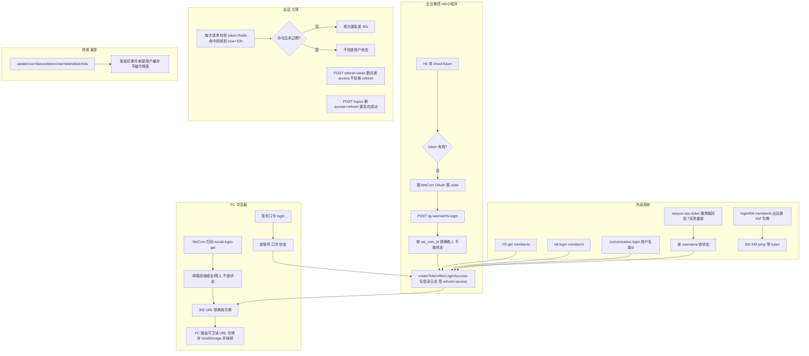
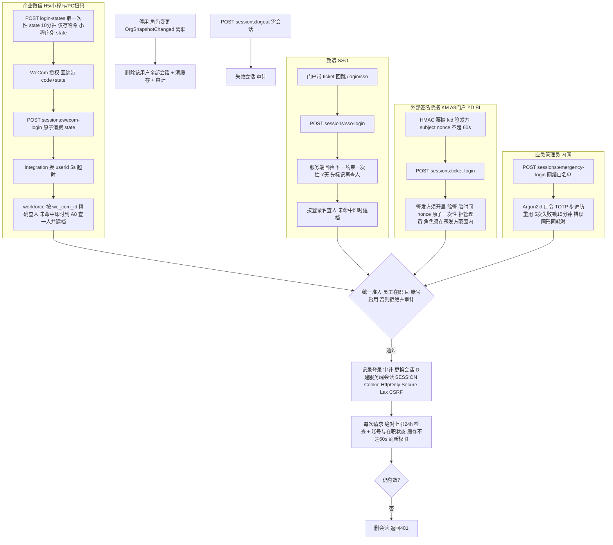
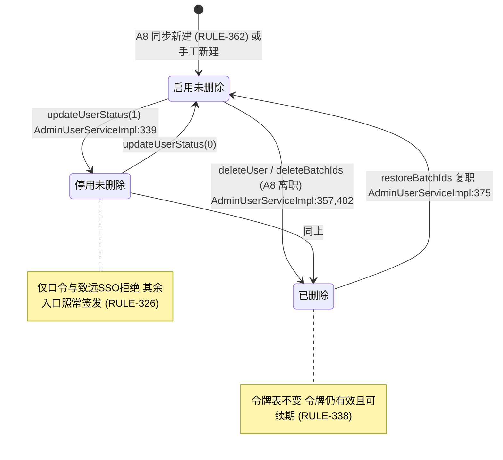
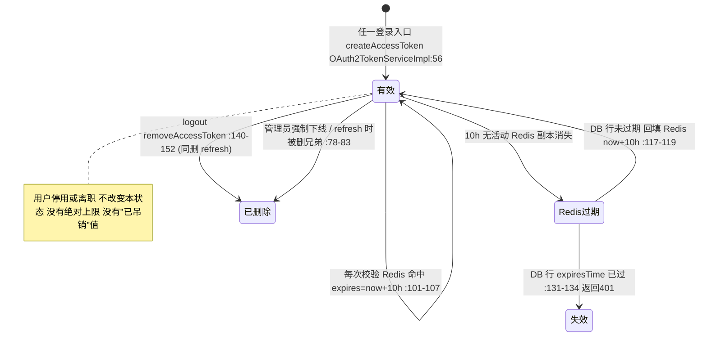
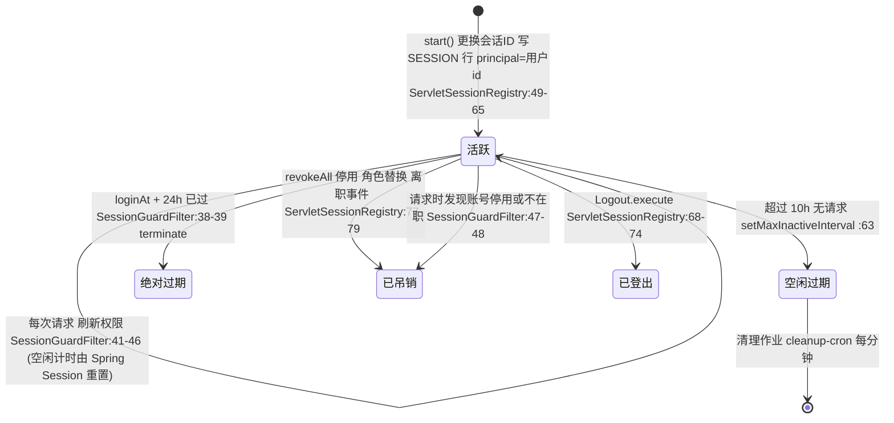
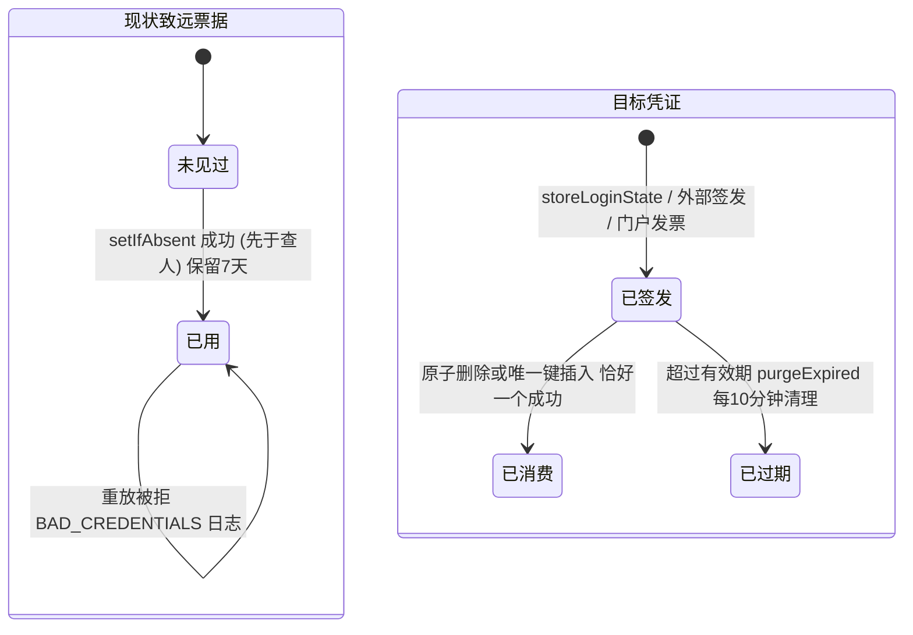
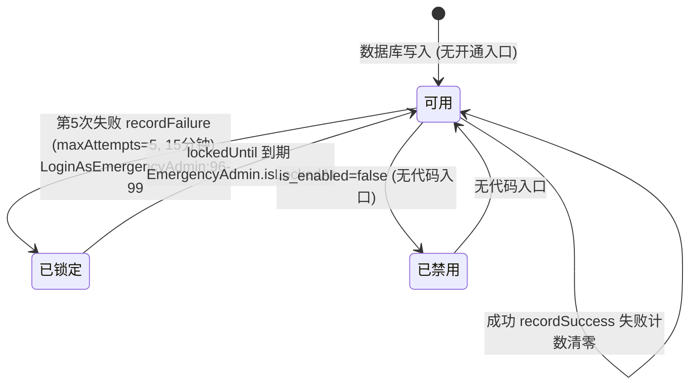
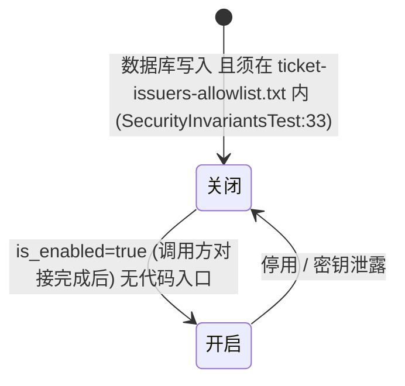

# 登录与会话（Phase 1a）

- 涉及 BC：`platform.identity`（账号、会话、一次性凭证、票据签发方、应急管理员）、`platform.integration`（企业微信、致远验票）、`organization.workforce`（在职判断、登录未命中建档）、`platform.audit`
- 涉及的 A8 模板 / 老系统入口：企业微信 H5 / 小程序 / PC 扫码；致远（A8 门户）SSO；免密端点 `customization-login`、`/id`、`singleSignOn/YD-get`、`a8-login`、`login/KM`；口令登录；令牌刷新与登出
- 证据采集日期：2026-10-14（老代码只读；生产数字引自已有文档，出处见各行）
- 梳理会话：psa-1a-process-review（现状 / 目标由 sonnet 子代理整理，差异判断与建议由 opus 完成，差异由用户逐条决定）
- 路径简写（相对路径均可在对应仓库中打开）：
- 老后端 `SYS` = `psa/psa-backend/yudao-module-system/yudao-module-system-biz/src/main/java/cn/iocoder/yudao/module/system`
- 老 PC `PC` = `psa/psa-front-desk-pc/src`；老 H5/小程序 `MINI` = `psa/psa-mini/src`
- 新仓库 `DOC` = `docs`；新后端 `ID` = `backend/src/main/java/com/forcitis/one/platform/identity`；新前端 `WEB` = `frontend/apps/web/src/modules/session`
- 生产计数全部引自 `DOC/runtime/prod_usage.tsv`（生产只读采集，2026-10-14；`##01` 为近 180 天访问日志，列依次为 调用数、去重用户数、首次、末次、平均耗时、最大耗时、错误数），及 `DOC/SECURITY_FINDINGS.md`、`DOC/AI_NATIVE_SPEC.md §4`。登录类接口匿名，去重用户数恒为 1 或 0，不代表人数。近 180 天窗口内共 1,258 个账号、335 人活跃、登录 55,790 次（`prod_usage.tsv:1463-1464`，`AI_NATIVE_SPEC.md §4`）。

## 现状流程

### 1.1 总览图（按入口分泳道）



### 1.2 步骤表

| # | 步骤 | 角色 | 系统 | 数据 / 状态变化 | 证据 |
|---|---|---|---|---|---|
| **A. 企业微信 H5（含小程序壳）** ||||||
| A1 | H5 打开先 `checkToken`：无 token 直接走 A3；有 token 调后端校验，非 200 或 code≠0 则清 token 走 A3 | 员工 | psa-mini → system | 读 Taro 存储 `APP_TOKEN_KEY` | `MINI/pages/qyLogin/qyLogin.tsx:233-271`；`MINI/permission.ts:53-60` |
| A2 | 后端 `checkToken`：空 token→401「token不能为空」；`checkAccessToken` 取不到或过期→401；校验本身把 Redis 里的过期时间续到 now+10h | 员工 | system | Redis 过期时间重置（DB 过期时间不变） | `SYS/controller/admin/auth/AuthController.java:300-313`；`SYS/service/auth/AdminAuthServiceImpl.java:629-637`；`SYS/service/oauth2/OAuth2TokenServiceImpl.java:101-107,124-137`。生产：`qy-wechat/checkToken` 49,536 次，错误 25,394 次（51%）（`prod_usage.tsv:439`） |
| A3 | H5 无 code：`location.replace` 到企业微信 OAuth 授权页（`snsapi_base`，state 为本地随机串且后端不校验） | 员工 | psa-mini → 企业微信 | 无 | `MINI/pages/qyLogin/qyLogin.tsx:117-135,169-173` |
| A4 | 回跳带 `code`，H5 立即抹掉 URL 上的 code；`wx.qy.login`（小程序端）拿到的 code 也发往同一个 h5-login 接口 | 员工 | psa-mini | 无 | `MINI/pages/qyLogin/qyLogin.tsx:153-192,199-208` |
| A5 | `POST qy-wechat/h5-login`：code→企业微信 `gettoken`（按环境选 Secret，硬编码）→`auth/getuserinfo`→读 `UserId`/`userid`；40029=凭证过期；`local` 环境直接给固定开发者 id | 员工 | system → 企业微信 | 无；超时 5 s | `SYS/service/auth/AdminAuthServiceImpl.java:544-607`。生产：25,112 次，错误 250，首次 2026-05-30（`prod_usage.tsv:458`） |
| A6 | 按 `system_users.we_com_id` 精确查人（`selectOne`，软删除行被 ORM 过滤）；查不到→503「未绑定系统用户」。**不检查 `status`** | 员工 | system | 无 | `SYS/service/auth/AdminAuthServiceImpl.java:601-604`；`SYS/dal/dataobject/user/AdminUserDO.java:92,116` |
| A7 | 签发令牌：走 `customizationLoginByUserId`→`createTokenAfterLoginSuccess`；**只把 access token 返给 H5**（不返 refresh） | 员工 | system | 写 `system_login_log`（LOGIN_CUSTOMIZATION），更新 `login_ip/login_date`，插入 refresh+access 两行 | `SYS/service/auth/AdminAuthServiceImpl.java:207-211,405-413,332-349,609-618` |
| A8 | 小程序旧路径 `POST qy-wechat/login`（`jscode2session`，读 `userid`），后续同 A6/A7 | 员工 | system → 企业微信 | 同上 | `SYS/service/auth/AdminAuthServiceImpl.java:462-532`；`SYS/controller/admin/auth/AuthController.java:282-289`。生产：POST 7,828 次（首次 2026-04-20，**末次 2026-06-08**，错误 187）；GET 16 次（`prod_usage.tsv:532,423`） |
| A9 | H5 拿到 token 存储后拉用户信息并跳首页；之后每次请求带 `Authorization: Bearer` | 员工 | psa-mini | 本地存储 token | `MINI/pages/qyLogin/qyLogin.tsx:215-223` |
| **B. PC 账号口令** ||||||
| B1 | 登录页表单：账号 4–16 位字母数字、口令 4–16 位；验证码在 prod 关闭（`yudao.captcha.enable`），短信 tab 已注释 | 员工/管理员 | PC | 「记住我」把账号口令存浏览器 | `PC/views/login.vue:17-22,254-281`；RULE-317；`SECURITY_FINDINGS.md`（SEC-011、SEC-015） |
| B2 | `POST /login`：验证码（如开）→查账号→比对口令→**检查 status**；未知账号与错口令同一错误；无锁定无计数 | 员工/管理员 | system | 失败写登录日志（BAD_CREDENTIALS / USER_DISABLED） | `SYS/service/auth/AdminAuthServiceImpl.java:115-151`；`SYS/controller/admin/auth/AuthController.java:79-85`。生产：1,198 次，错误 621（`prod_usage.tsv:204`）；验证码 `captcha/get` 4,436 次（`:124`） |
| B3 | 成功后同 A7 签发令牌对 | — | system | 同 A7 | `SYS/service/auth/AdminAuthServiceImpl.java:405-413` |
| **C. PC 企业微信扫码** ||||||
| C1 | PC 取授权 URL：`social-auth-redirect` | 员工 | PC → system | 无 | `PC/views/login.vue:282-296`；`SYS/controller/admin/auth/AuthController.java:226-237`。生产：423 次，3 人，末次 2026-10-09（`prod_usage.tsv:250`） |
| C2 | 回调 `GET social-login-get?code=`：换 userid，再用 `getUserIdByWeComId`：含 `@` 时按邮箱本地段（不分大小写）匹配，否则去掉所有「f」后与老系统 user id 比较；取缓存中首个命中，含已删除用户；**不查 status** | 员工 | system | 无 | `SYS/service/auth/AdminAuthServiceImpl.java:372-397`；`SYS/service/social/SocialUserServiceImpl.java:169-194` |
| C3 | 签发令牌后 302 到 `http://psa.forcitis.com/index?accessToken=…&refreshToken=…`（明文 http） | 员工 | system | 同 A7 | `SYS/controller/admin/auth/AuthController.java:248-264`。生产：`social-login-get` 近 180 天访问日志无记录；POST `social-login`（需已绑定）195 次，5 人，末次 2026-06-06（`prod_usage.tsv:462`） |
| C4 | POST `social-login` 路径：未绑定时对企业微信自动绑定，查询用 ADMIN 类型、写入用 MEMBER 类型，故每次重复插入 | 员工 | system | `system_social_user_bind` 累积（表共 515 行；`system_social_user` 192 行） | `SYS/service/social/SocialUserServiceImpl.java:141-167`；`prod_usage.tsv:1454-1455` |
| **D. 致远（A8）SSO** ||||||
| D1 | A8 门户跳 `GET seeyon-sso?ticket=`（限流 `backendA`）；开关 `psa.seeyon-sso.enabled` 默认 false；票据空或>256 字符→无效 | 员工 | system | 无 | `SYS/controller/admin/auth/AuthController.java:119-132`；`SYS/service/auth/AdminAuthServiceImpl.java:219-228`；`SYS/framework/seeyon/SeeyonSsoProperties.java:18` |
| D2 | 服务端向 OA `/seeyon/thirdpartyController.do` 回验，只认 OA 返回的登录名（≤64 字符、无 `<>` 空格换行），5 s 超时，非 200=OA 不可用 | 员工 | system → 致远 | 无 | `SYS/service/auth/AdminAuthServiceImpl.java:229-231`；RULE-321 |
| D3 | Redis `setIfAbsent(seeyon_sso:ticket:<t>)`，TTL 7 天（因 OA 票据可反复通过回验）；重放→BAD_CREDENTIALS 日志。**先标记再查人**，未知用户的票据也被烧掉 | 员工 | system | Redis 写一条 | `SYS/service/auth/AdminAuthServiceImpl.java:232-240`；`SYS/framework/seeyon/SeeyonSsoProperties.java:35-39` |
| D4 | 按 username 精确查（无模糊），不存在→`AUTH_SEEYON_SSO_USER_NOT_EXISTS`；**检查 status**（停用→`AUTH_LOGIN_USER_DISABLED`） | 员工 | system | 登录日志 | `SYS/service/auth/AdminAuthServiceImpl.java:241-250` |
| D5 | 签发令牌对，302 到配置的 `redirectUrl?accessToken=…&refreshToken=…` | 员工 | system | 同 A7 | `SYS/controller/admin/auth/AuthController.java:127-131`。生产：`seeyon-sso` 1,079 次，首次 2026-10-08，错误 23（`prod_usage.tsv:415`）；生产开关值未直接取得（`AI_NATIVE_SPEC.md §6`），但调用量显示在用 |
| **E. 外部系统免密 / 半免密入口** ||||||
| E1 | YD 门户 `GET singleSignOn/YD-get?memberId=`：`permitAll`，不校验调用方与状态，签发令牌对，302 到 `https://psa.forcitis.com?accessToken=…&refreshToken=…` | YD 门户用户 | system | 同 A7 | `SYS/controller/admin/auth/AuthController.java:266-280`；`SYS/service/auth/AdminAuthServiceImpl.java:160-164`。生产：15,281 次，末次 2026-09-28，错误 60（`prod_usage.tsv:511`；`SECURITY_FINDINGS.md` 生产实证表） |
| E2 | A8 门户 `POST a8-login?memberId=`：memberId 即老系统用户 id，无任何校验，302 到 `http://psa.forcitis.com/index?...令牌` | A8 门户用户 | system | 同 A7；用户不存在会 NPE | `SYS/controller/admin/auth/AuthController.java:104-117`；`SYS/service/auth/AdminAuthServiceImpl.java:207-216`。生产：POST 1,425 次（末次 2026-09-22，错误 196）+ GET 33 次 = 1,458（`prod_usage.tsv:169,229`；`SECURITY_FINDINGS.md`） |
| E3 | 免密 `POST customization-login`（用户名）与 `/id`（用户 id）：匿名，无状态检查，直接签发令牌对返回 JSON | 未知调用方 | system | 同 A7；未知用户名 NPE，未知 id IndexOutOfBounds | `SYS/controller/admin/auth/AuthController.java:88-102`；`SYS/service/auth/AdminAuthServiceImpl.java:154-164`。生产：`customization-login` 2,371 次（末次 2026-05-29）、`/id` 1,397 次（**末次 2026-10-13**）合计 3,768（`prod_usage.tsv:139,238`）。真实调用方未知（`AI_NATIVE_SPEC.md §6`） |
| E4 | KM：`POST login/KM?memberId=`，匿名；长度>11 当老系统 id 换成手机号，否则当 KM 登录名；老系统带共享 integrationKey 与固定 IP 1.1.1.1 向 KM 换 token（明文 http），302 到 KM `jump.html?token=` | 员工（老系统→KM 方向） | system → KM | 无老系统令牌写入 | `SYS/controller/admin/auth/AuthController.java:134-146`；`SYS/service/auth/AdminAuthServiceImpl.java:254-281`。生产：近 180 天访问日志无记录 |
| E5 | BI：`weiXinLogin(code,"BI")` 无调用方（死代码）；`PSA` 分支在查不到人时回落到硬编码账号 | — | system | — | `SYS/service/auth/AdminAuthServiceImpl.java:167-204`；`DOC/phase1a/INTERFACES.md` B1 |
| **F. 令牌落地与会话校验** ||||||
| F1 | PC 路由守卫：URL 带 `accessToken` 即存 localStorage 并 `replace` 抹掉地址栏；有 token 则 `GetInfo`+`GenerateRoutes`（权限信息、菜单各拉一次）；无 token 且不在白名单跳 `/login` | 员工 | PC | localStorage `ACCESS_TOKEN`/`REFRESH_TOKEN` | `PC/permission.js:21-31,31-82`；`PC/utils/auth.js:3-19`。生产：`get-permission-info` 155,244 次，`list-menus` 22,571 次（`prod_usage.tsv:552,308`） |
| F2 | 每个业务请求：服务先信任请求头 `login-user`（JSON），无头则用 Bearer 令牌向 system 校验；坏令牌→匿名而非 401；用户类型不匹配的检查被注释；`mockEnable` 开时 `mockSecret+用户id` 即登录 | 员工 | 各服务 | 无 | `psa-backend/yudao-framework/yudao-spring-boot-starter-security/src/main/java/cn/iocoder/yudao/framework/security/core/filter/TokenAuthenticationFilter.java:44-67,86-130` |
| F3 | 网关：先移除 `login-user` 头，然后 `if (true) return chain.filter` 直接放行，令牌校验与缓存是死代码 | — | gateway | 无 | `psa-backend/yudao-gateway/src/main/java/cn/iocoder/yudao/gateway/filter/security/TokenAuthenticationFilter.java:89,103-106` |
| F4 | 令牌校验：Redis 命中就把过期时间设成 now+10h 并回写（滑动，无绝对上限）；Redis 未命中查 DB，DB 未过期则回填 Redis（now+10h），DB 过期时间永不更新；缺失时 `System.out` 打印令牌明文；**不看用户状态** | 员工 | system | Redis 过期时间；DB 行 `expires_time` 不变 | `SYS/service/oauth2/OAuth2TokenServiceImpl.java:96-137`；`SYS/dal/dataobject/oauth2/OAuth2AccessTokenDO.java:35-64`。生产：`system_oauth2_access_token` 192,659 行、`refresh_token` 192,671 行（`prod_usage.tsv:1440,1444`）；客户端 `default` 的生产有效期未取得（RULE-331，仓库种子 180 s / 8640 s） |
| **G. 刷新 / 登出 / 停用** ||||||
| G1 | PC 401 处理：`handleAuthorized()` 在刷新代码之前就 `return`，其后的刷新逻辑是不可达的；弹窗「登录状态已过期」，点确定登出重登。H5 不返回 refresh token | 员工 | PC / H5 | 清 localStorage | `PC/utils/request.js:101-102,122-123,126-147,231-250`。生产：`refresh-token` 近 180 天访问日志无记录 |
| G2 | 后端刷新（实际无人调用）：删除同 refresh 的全部 access，过期则删 refresh 并 401，否则在同一 refresh 下新发 access，**不轮换 refresh** | — | system | 旧 access 行与 Redis 删除，新 access 插入 | `SYS/service/oauth2/OAuth2TokenServiceImpl.java:65-93` |
| G3 | 登出：`POST logout` 匿名；有 Bearer 则删 access（DB+Redis）及其 refresh，写 LOGOUT_SELF 日志；无令牌也返回成功 | 员工 | system | 令牌行删除 | `SYS/controller/admin/auth/AuthController.java:148-158`；`SYS/service/auth/AdminAuthServiceImpl.java:416-430`；`SYS/service/oauth2/OAuth2TokenServiceImpl.java:140-152`；PC `PC/store/modules/user.js:182-193`。生产：`POST logout` 133,108 次、112 人（`prod_usage.tsv:190`），为何远高于登录次数未核实 |
| G4 | 停用：`updateUserStatus` 改 `status`，发组织变更事件与用户缓存刷新，**不碰令牌表** | 管理员 | system | `system_users.status` 0→1 | `SYS/service/user/AdminUserServiceImpl.java:339-353` |
| G5 | 删除 / A8 离职同步：`deleteUser`、`deleteBatchIds` 软删除（`deleted=1`），删角色关联，发事件，**令牌继续有效并可续期**；复职用 `restoreBatchIds` 复位 | 管理员 / 同步作业 | system | `deleted` 0→1；复职 1→0 | `SYS/service/user/AdminUserServiceImpl.java:355-412`；`psa-backend/yudao-framework/yudao-spring-boot-starter-mybatis/src/main/java/cn/iocoder/yudao/framework/mybatis/core/dataobject/BaseDO.java:17-18` |
| G6 | 强制下线：管理员在「令牌管理」页删 access token；`oauth2-token/page` 近 180 天仅 1 次 | 管理员 | system | 令牌行删除 | `DOC/phase1a/INTERFACES.md` U11；`prod_usage.tsv:205` |

### 1.3 现状小结（只列事实）
- 8 条路径建立会话：口令、H5/小程序、PC 扫码、致远 SSO、YD-get、a8-login、customization-login(/id)、KM（出站）；只有口令与致远 SSO 检查 `status`（RULE-326）。
- 5 条路径把令牌放在跳转 URL 里：a8-login、seeyon-sso、social-login-get、YD-get（RULE-335）。
- 令牌滑动续期无上限、不看用户状态；停用 / 离职不吊销（RULE-332、338）。

---

## 目标流程

### 2.1 图



### 2.2 要点、依据、1a 实现状态

| # | 目标行为 | 依据 | 1a 实现状态（file:line） |
|---|---|---|---|
| T1 | 企业微信三个入口（H5 静默、PC 扫码、小程序）按 `we_com_id` 精确映射，只放行「启用且在职」，不再按邮箱前缀或去 f 猜人 | C1a-01；RULE-322/323/324/326/327 评审「正确+修 / 错误」（`DOC/RULE_REVIEWS.md` 第三批）；RULE-323 用户答「保留」（`DOC/INTENT.md:89`） | 后端已实现：`ID/application/LoginWithWecom.java:38-64`（入口枚举 `ID/application/LoginMethod.java:5-11`；小程序免 state 见 `:47`；换 userid 见 `integration/infrastructure/wecom/HttpWecomClient.java:73-84`）；统一准入 `ID/application/LoginAdmission.java:39-47`。**前端：PC 扫码已实现**（`WEB/pages/login-page.tsx:21-31`、`WEB/model/login-config.ts:21-30`、`WEB/pages/login-callback-page.tsx:25-53`）；**H5 静默登录与小程序前端未实现**（`frontend/apps/h5/src/` 仅有 `.gitkeep`） |
| T2 | 一次性 OAuth state（防登录 CSRF）：只存哈希、10 分钟、消费原子 | I-9（`DOC/phase1a/SECURITY_INVARIANTS.md`）；ADR-0009 §3 | 已实现：`ID/application/BeginWecomLogin.java:17,28-35`；`ID/application/LoginWithWecom.java:66-72`；表 `platform_identity.login_states`（`backend/src/main/resources/db/migration/platform_identity/V20261014130100__platform_identity_create_login_credentials.sql:1-13`） |
| T3 | 登录未命中（新入职尚未同步）：workforce 即时到 A8 查这一个人，规则同批量同步，命中则建档并审计 | `DOC/REIMAGINED_ARCHITECTURE.md:92`（评审 #14） | 已实现：`backend/src/main/java/com/forcitis/one/organization/workforce/application/OrgDirectoryService.java:36-40,42-51`；建账号 + 一次性默认角色 `employee`：`ID/application/AccountProvisioning.java:32-51`，配置 `backend/src/main/resources/config/platform_identity.properties:24` |
| T4 | 致远 SSO：服务端验票、票据一次性（唯一约束原子占用）、先标记再查人、只放行启用且在职；致远不可用或验票失败时错误页给「回到老系统登录」链接；开关默认关，门户需登记新回跳地址 | C1a-02；RULE-320/321（Review=No，按老行为复刻）；`DOC/REIMAGINED_ARCHITECTURE.md:95,200`；ADR-0009 §3 | 已实现：`ID/application/LoginWithSso.java:38-70`；验票 `backend/src/main/java/com/forcitis/one/platform/integration/infrastructure/seeyon/SeeyonTicketVerifier.java:36-67`；老系统登录链接 `ID/web/SessionController.java:65-69`、`WEB/pages/login-callback-page.tsx:56-67`；配置 `config/platform_identity.properties:26-31`（`enabled=false`、`replay-window=7d`）。登录名未命中时即时建档（T3） |
| T5 | 外部系统（KM、A8 门户、YD 门户、BI）用「签名、≤60 s、nonce 一次性」票据；每个签发方一把密钥（`kid`）、独立开关、**调用方完成对接前保持关闭**；禁止经票据进入管理员角色；签发方有允许的角色范围；老系统 后端永远不得作为签发方 | C1a-03；RULE-318/319 评审「错误」（`DOC/RULE_REVIEWS.md`）；`DOC/REIMAGINED_ARCHITECTURE.md:96`；I-2（`DOC/phase1a/SECURITY_INVARIANTS.md`） | 验证侧已实现：`ID/application/LoginWithSignedTicket.java:47-103`（管理员拒绝 `:94-97`，角色范围 `:98-101`）；`ID/domain/SignedTicket.java:14-17,98-113`；表 `ticket_issuers` 默认关闭且 CHECK 禁含 `super_admin`（迁移 `…130100…sql:31-48`）。**未种入任何签发方**：`backend/architecture/ticket-issuers-allowlist.txt` 只有候选注释 `km, org-portal, yd-portal, bi`；仓储只读（`ID/infrastructure/persistence/JdbcTicketIssuerRepository.java:22-33`），无管理入口；**前端无票据落地页**（`WEB/api/session-api.ts`、`frontend/apps/web/src/app/app-routes.tsx:27-30` 仅有 `/login/wecom`、`/login/sso`） |
| T6 | KM：跳转须已登录，KM 身份取自会话，签名票据，HTTPS，密钥移配置并轮换 | RULE-329 评审「错误」；`DOC/RULE_REVIEWS.md` | **未实现**：`backend/src/test/java/com/forcitis/one/platform/identity/PendingIdentityRulesTest.java:11-14`（`@Disabled`，1a 只交付验证侧）；`backend` 内无 KM 相关代码 |
| T7 | 管理员应急账号：独立表、Argon2id、TOTP（步进防重用）、5 次失败锁 15 分钟、仅内网、错误同形同耗时；口令至少 12 位 + 复杂度；员工无口令 | C1a-04；RULE-316/317/370；D-02；`DOC/REIMAGINED_ARCHITECTURE.md:97` | 登录已实现：`ID/application/LoginAsEmergencyAdmin.java:47-85`；锁定 `:96-99`；配置 `config/platform_identity.properties:33-37`（内网段含全部 RFC1918）；表 `…130100…sql:50-61`。**未实现**：口令策略类 `ID/domain/EmergencyPasswordPolicy.java` 无任何调用方；无开通 / 登记 TOTP / 改口令入口，改口令后吊销其他会话（RULE-370）也没有；应急账号 `user_id` 外键到 `user_accounts`，且登录末尾仍过员工在职检查（`LoginAsEmergencyAdmin.java:76-83`） |
| T8 | 服务端会话：Spring Session JDBC，Cookie `SESSION` HttpOnly + Secure + SameSite=Lax，CSRF，登录时更换会话 ID；空闲 10 h、绝对上限 24 h，均为配置项；无刷新令牌 | C1a-05；ADR-0009 §2；RULE-331/332/333 用户答「空闲10h+上限24h」（`DOC/INTENT.md:89`） | 已实现：`ID/infrastructure/security/IdentityConfiguration.java:25-40`；`ID/infrastructure/security/ServletSessionRegistry.java:49-65`（轮换 `:56`，空闲 `:63`，返回绝对到期时间 `:64`）；绝对上限 `ID/infrastructure/security/SessionGuardFilter.java:38-39`；`ID/application/SessionSettings.java:9-23`；`config/platform_identity.properties:4-14`；CSRF `ID/infrastructure/security/SecurityConfiguration.java:31-33` |
| T9 | 每次解析会话校验账号启用 + 员工在职（缓存 ≤ 60 s），否则删会话、401；无效会话是 401 不是匿名；不信任任何身份请求头；默认拒绝，仅 `@PublicEndpoint` 白名单可匿名 | RULE-336/337/338；C1a-07；ADR-0009 §1 | 已实现：`ID/infrastructure/security/SessionGuardFilter.java:35-50`；`ID/application/SessionPrincipals.java:28-44`；`ID/infrastructure/security/CachedSessionPrincipals.java:23-45`；`ID/infrastructure/security/SecurityConfiguration.java:34-41`；白名单快照 `backend/architecture/public-endpoints.txt`（5 条，均 POST） |
| T10 | 停用、离职（含同步）、角色变更即时吊销该用户全部会话并清缓存；两道保证：每请求校验 + 事件 | RULE-338/363/366；`DOC/REIMAGINED_ARCHITECTURE.md:94` | 已实现：停用 `ID/application/ChangeAccountStatus.java:30-44`（`:39-41`）；角色变更 `ID/application/ReplaceAccountRoles.java:66-71`；离职事件 `ID/application/HandleOrgSnapshotChange.java:33-56`；按用户删除全部会话 `ID/infrastructure/security/ServletSessionRegistry.java:77-79`；角色定义变更只清缓存 `ID/application/UpdateRole.java:53`、`DeleteRole.java:43` |
| T11 | 登出：失效会话并审计 | RULE-334（Review=No，按老行为复刻）；`DOC/AI_NATIVE_SPEC.md §3.2`（`DELETE /platform/identity/session`） | 已实现但形态不同：`POST /api/{version}/platform/sessions:logout`，需会话（`ID/web/SessionController.java:83-88`）；`ID/application/Logout.java:23-28` |
| T12 | 审计：登录成功 / 失败（失败走独立事务）、会话吊销、权限变更、代理操作 | C1a-17；RULE-330（复刻，含最后登录 IP / 时间） | 登录成功 / 失败 / 最后登录：`ID/application/LoginAdmission.java:49-65`；离职吊销 `HandleOrgSnapshotChange.java:55`；账号启停、角色替换各有审计条目（`ChangeAccountStatus.java:37`、`ReplaceAccountRoles.java:67`），但这两处**没有写「会话吊销」条目**；登录计数指标 `LoginAdmission.java:55,63`（供 C1a-18「登录失败率」告警） |
| T13 | 过渡期老令牌桥接：**删除**（C1a-06）；新系统不写、不校验老令牌表，应用代码不引用（只读账号的读取授权按 ADR-0037 放开） | 检查点 2 Q-1「1a 删除桥接」（`DOC/INTENT.md:91`）；「取消桥接」（`:96`）；ADR-0009 §6 修订；I-1 | 一致：`backend/src/test/java/com/forcitis/one/SecurityInvariantsTest.java:25`（`legacyTokenTablesAreNeverTouched`）、`:33`（签发方白名单） |
| T14 | 现有新旧并存：1a 不替换老入口，新系统用独立域名 `one.forcitis.com`，回滚=关闭新入口 | `DOC/REIMAGINED_ARCHITECTURE.md:41,204`；brief 出口条件 | 配置层面：`sso.enabled=false`、签发方全部关闭 |
| T15 | 舍弃：短信登录、图片验证码、「记住我」、yudao OAuth2 开放授权、社交绑定（企业微信除外）、免密端点、`weiXinLogin` BI 分支 | D-01..D-04、D-09；ADR-0019 | `ID/…` 无对应端点；`backend/src/test/java/com/forcitis/one/platform/identity/ProductionConfigSanityTest.java:28,57,75` |

### 2.3 法人维度、DMN、状态归属（本流程）

- **(a) 法人维度来源**：登录与会话**不确定法人归属**。会话主体只含用户 id、登录时间、登录方式与权限码（`ID/infrastructure/security/SessionGuardFilter.java:43-46`、`ID/infrastructure/security/IdentityAuthentication.java`）。法人只出现在数据范围类型里：`AccessGrant(legalEntityId, orgUnitId, withDescendants, projectRole)`（`ID/api/AccessGrant.java:8`），`AccessScope` 由各角色的授予取并集（`ID/api/AccessScope.java:34-43`）；授予的存储表 `data_scope_grants` 推迟到 1b（`REIMAGINED_ARCHITECTURE.md:103`；`PendingIdentityRulesTest.java:29`）。法人代码来自 `organization.workforce.legal_entities`，由管理员维护、不从外部同步（`REIMAGINED_ARCHITECTURE.md:78`；`organization/workforce/api/LegalEntityDirectory.java`）。登录时按用户取哪个法人，规格与代码均未写（见差异 34）。老系统的令牌与会话不含法人（`OAuth2AccessTokenDO.java:35-64`）。
- **(b) 审批路由 / DMN**：不适用。登录与会话没有审批路由；且 1a 整体不引入 DMN（指派由 BPMN 扩展属性 + `AssigneeResolver` 表达，`REIMAGINED_ARCHITECTURE.md:127,213`；评审 #9 删除 DMN）。
- **(c) 审批与业务单据的状态归属与协作事件**：不适用。登录与会话不拥有也不改变任何审批实例或业务单据状态；与审批的唯一交集是被动的：审批发起人只取当前会话用户（RULE-265，I-5），任务操作人由会话决定（I-7）。老系统同样如此（审批在 bpm 服务，登录在 system 服务）。

---

## 涉及的聚合与状态机

相关聚合：**用户账号**（老 `system_users` 行；新 `platform_identity.user_accounts` 与 `organization.workforce` 的员工在职状态，两个聚合）、**会话**（老 access+refresh 令牌行；新 Spring Session 行）、**一次性登录凭证**（老 Redis 票据标记；新 `login_states`、`sso_ticket_uses`）、**应急管理员**（仅新）、**票据签发方**（仅新）。

### 2A.1 用户账号 —— 现状

状态字段：`status`（`CommonStatusEnum`：0=开启，1=关闭，`psa-backend/yudao-framework/yudao-common/src/main/java/cn/iocoder/yudao/framework/common/enums/CommonStatusEnum.java:18-19`；`AdminUserDO.java:92`）、`deleted`（`BaseDO.java:17-18`，`@TableLogic`）、`we_com_id`（`AdminUserDO.java:116`）、`login_date`（`:100`）。离职 = 软删除，没有独立的「离职」状态值。



规模：在 `system_users` 的账号 1,258（`AI_NATIVE_SPEC.md §4`）；停用 / 删除 / 复职人数未取得。

### 2A.2 用户账号与在职 —— 目标

依据：RULE-326/327/338/362/363/364 评审结论（`DOC/RULE_REVIEWS.md`：在职与启用分开；「启用状态由 PSA 拥有」；复职恢复；离职吊销会话）。1a 代码：账号状态 `AccountStatus {ENABLED, DISABLED}`（`ID/domain/AccountStatus.java`，表 `…130000…sql:6` CHECK）；在职状态 `EmploymentStatus {EMPLOYED, SEPARATED}`（`backend/src/main/java/com/forcitis/one/organization/workforce/api/EmploymentStatus.java`，由组织快照拥有，「无源登录名即离职」）。

```mermaid
stateDiagram-v2
  [*] --> 已启用: 首次登录或同步 createIfAbsent (AccountProvisioning:36 一次性授予默认角色)
  已启用 --> 已停用: ChangeAccountStatus.execute(false) 删全部会话
  已停用 --> 已启用: ChangeAccountStatus.execute(true)
  state 在职 {
    [*] --> EMPLOYED
    EMPLOYED --> SEPARATED: 组织快照 源登录名为空 发 OrgSnapshotChanged
    SEPARATED --> EMPLOYED: 复职 快照恢复
  }
  note right of 已启用: 可登录 = 账号 ENABLED 且 EMPLOYED LoginAdmission:39-47 SessionPrincipals:28-44
  note right of 在职: 转为 SEPARATED 时 HandleOrgSnapshotChange:35-37,52-56 吊销会话 账号状态不自动改
```

### 2A.3 会话 —— 现状

老系统没有会话状态字段。存在两层：DB 行 `system_oauth2_access_token`（字段 `accessToken/refreshToken/userId/userType/clientId/expiresTime`，`OAuth2AccessTokenDO.java:35-64`）+ Redis 副本（过期时间被反复重置）；`system_oauth2_refresh_token`。生产：access 192,659 行、refresh 192,671 行（`prod_usage.tsv:1440,1444`）。



### 2A.4 会话 —— 目标

依据：RULE-331/332/333/338，C1a-05，ADR-0009 §2。1a 代码没有显式状态枚举；状态由 Spring Session 行是否存在、`loginAt`（`ID/infrastructure/security/IdentityAuthentication.java`）与派生检查决定。



### 2A.5 一次性登录凭证 —— 现状 / 目标

现状：致远票据仅有 Redis 键 `seeyon_sso:ticket:<t>`（存在=已用，TTL 7 天，`AdminAuthServiceImpl.java:232-240`）；企业微信 code 由企业微信保证一次性，H5 的 `state` 不校验（`qyLogin.tsx:125`）。
目标：`login_states`（`login_state_id` UUIDv7 主键，`state_hash` 唯一约束，`entry`，`expires_at`，10 分钟）、`sso_ticket_uses`（`sso_ticket_use_id` UUIDv7 主键，`(ticket_source, ticket_hash)` 唯一约束，致远票据 7 天；签名票据 nonce 保留到过期后 5 分钟）。依据 I-9、RULE-320；代码 `ID/application/BeginWecomLogin.java:17`、`LoginWithSso.java:55-56`、`LoginWithSignedTicket.java:25,74-75`、`ID/domain/OneTimeCredentials.java:10-16`、迁移 `…130100…sql:1-29`。



### 2A.6 应急管理员（仅目标）

字段 `failed_attempts`、`locked_until`、`is_enabled`、`last_totp_step`（`…130100…sql:50-61`；`ID/domain/EmergencyAdmin.java:7-8`）。依据 C1a-04、RULE-316/317，5 次失败锁 15 分钟。



### 2A.7 票据签发方（仅目标）

字段 `is_enabled`（默认 false）、`allowed_role_codes`（空=无人可进，不得含 `super_admin`）（`…130100…sql:31-40`）。依据 C1a-03、`REIMAGINED_ARCHITECTURE.md:96`、I-2。


当前：`ticket_issuers` 迁移不含任何种子行。

---

## 发出 / 消费的领域事件

### 2B.1 目标（1a 代码）
事件机制：Spring Modulith 事件发布登记表（至少一次投递，消费方必须幂等），表 `platform_integration.event_publication`（`backend/src/main/resources/config/platform_integration.properties:31-34`）；规格 C1a-11、RULE-295/303/373。

| 事件名 | 触发时机（状态转换） | 负载要点 | 消费方及反应 | 依据 / 代码 |
|---|---|---|---|---|
| `OrgSnapshotChanged`（规格名 `OrgChanged`；已随 #934 删除） | 旧组织同步一次运行提交后（旧同步、事件与消费方均已随 #934 删除，离职由 `EmployeeSeparated` 触发，见 `HandleEmployeeSeparated`） | — | — | 规格 `AI_NATIVE_SPEC.md §3.2` asyncapi（`OrgChanged`）、C1a-11 P1；`REIMAGINED_ARCHITECTURE.md:94`（会话吊销有两道保证，不依赖事件） |
| `AccountStatusChanged`（仅规格） | 账号启用 / 停用 | `userId`、`status`、`revokeSessions` | 规格未写消费方 | `AI_NATIVE_SPEC.md §3.2` asyncapi；**代码中不存在**（grep 无命中）；停用时由 `ChangeAccountStatus.java:36-43` 同步调用 `sessions.revokeAll` 与 `cache.evict` |
| 无事件：登录成功 / 失败、登出、会话吊销的审计 | 每次登录准入结果；登出；离职吊销 | 审计条目（动作、操作人、主体、说明） | `platform.audit` 通过模块 API `AuditLog.record`（同事务）与 `recordIndependently`（失败，独立事务）同步写入 | `ID/application/LoginAdmission.java:52,62`、`Logout.java:27`、`HandleOrgSnapshotChange.java:55`；`DOC/REIMAGINED_ARCHITECTURE.md:53` |
| 无事件：账号创建、默认角色授予 | 首次登录 / 同步命中 | — | 同步审计 | `ID/application/AccountProvisioning.java:39-49` |
| 无事件：角色替换 / 角色定义变更的缓存失效 | 管理员操作 | — | 同步 `sessions.revokeAll`（用户角色替换）与 `cache.evict` / `evictAll`（提交后） | `ReplaceAccountRoles.java:69-70`；`UpdateRole.java:53`；`CachedSessionPrincipals.java:37-58` |

### 2B.2 现状（老系统）

| 机制 | 触发时机 | 负载 / 隐式耦合 | 消费方及反应 | 证据 |
|---|---|---|---|---|
| 登录日志：同步写库 | 每个登录入口与登出 | 直接 `loginLogService.createLoginLog` 插入 `system_login_log`；成功时同事务外再 `updateUserLogin` | 无异步消费方；生产 178,533 行 | `SYS/service/auth/AdminAuthServiceImpl.java:332-349,432-446`；`SYS/service/logger/LoginLogServiceImpl.java:37-40`；`prod_usage.tsv:1432` |
| 令牌吊销：无 | 停用、删除、离职、角色变化 | 令牌表与用户状态之间没有任何联动；令牌校验也不读用户状态 | 无 | `SYS/service/user/AdminUserServiceImpl.java:339-353,357-372`；`OAuth2TokenServiceImpl.java:96-137` |
| `UserRefreshMessage`（Bus 事件） | 用户新增 / 修改 / 停用 / 删除 / 复职后 | 无负载，只表示「用户缓存陈旧」 | `UserRefreshConsumer`（`@EventListener`）调用 `userService.initLocalCache()` 重载全部用户缓存（含已删除用户，RULE-371） | 发布 `SYS/mq/producer/user/UserProducer.java:15-17`，调用点 `AdminUserServiceImpl.java:152,187,227,352,371,398,411`；消费 `SYS/mq/consumer/user/UserRefreshConsumer.java:17-21` |
| 组织变更消息（RocketMQ topic-org-change） | 用户停用 / 删除 / 批量删除（A8 离职）/ 复职后，事务提交后投递 | 字段差异（RULE-373：部门同步事件缺字段、重复发删除） | 系统外订阅方（具体消费方本次未取得；`DOC/phase1a/INTERFACES.md` 记录 8 个 RocketMQ 主题） | `SYS/mq/producer/org/OrgChangePublisher.java:36`、`OrgChangeProducer.java:15`；调用 `AdminUserServiceImpl.java:350,369,396,408` |
| 隐式耦合：角色 2 补授 | 用户缓存重载时 | 缓存重载附带「无角色者补授角色 2」副作用（RULE-344） | — | `DOC/rules/IDENTITY_ORG_RULES.md` RULE-344、371 |
| 隐式耦合：致远票据防重放 | 致远 SSO | Redis 键，不是事件 | — | `AdminAuthServiceImpl.java:232-240` |
| 隐式耦合：权限变更 | 角色 / 菜单变化 | 需重启服务才生效（ADR-0009 背景） | — | `DOC/adr/ADR-0009.md` 背景 |

## 权限

### 谁能触发、谁能看、谁能操作

- **谁能触发**：
  - 任何在 A8 中在职、账号启用的员工，通过企业微信 OAuth（含小程序）、致远 SSO、外部系统签名票据登录。
  - 管理员应急账号：仅内网、口令 + TOTP。
  - 匿名调用方只能到达 5 个登录端点（`@PublicEndpoint`，`BE/platform/identity/web/SessionController.java:50-81`）；其余端点一律先认证。
- **谁能看（数据范围）**：
  - 已登录用户只看自己的资料、权限码和菜单（`sessions:current`，`SessionController.java:90-94`；`GetCurrentUserProfile.java:34-45`）。
  - 角色定义和权限码清单需要 `platform.identity:role:read`。
  - 账号侧没有「列出账号」接口。
- **谁能操作**：
  - 登出：任何已认证用户（`SessionController.java:83-88`）。
  - 创建 / 改 / 删角色、替换某账号的角色、启停账号：持 `platform.identity:role:update`（`BE/platform/identity/web/RoleController.java:34-35,69-112`），再受「不得授予多于自己所有」约束（`PrivilegeCeiling.java:21-27`）。
- **因审批获得的临时访问**：本流程没有（登录不产生任何基于审批的访问）。唯一与「临时」相关的是会话本身：空闲 10 小时、绝对 24 小时（`SessionSettings.java:9`）。

### 现状（老系统）

| # | 项 | 现状 | 证据（file:line） | 生产数字（仅文档已有） |
|---|---|---|---|---|
| 1 | 认证入口 | `AuthController` 有 17 个 `@PermitAll` 登录相关端点：`login`、`customization-login`、`customization-login/id`、`a8-login`、`seeyon-sso`、`login/KM`、`logout`、`refresh-token`、`sms-login`、`send-sms-code`、`social-auth-redirect`、`social-login`、`social-login-get`、`singleSignOn/YD-get`、`qy-wechat/login`、`qy-wechat/h5-login`、`qy-wechat/checkToken`。只有 `get-permission-info`、`list-menus` 要求登录 | `SYS/controller/admin/auth/AuthController.java:79-80,88-89,96-97,104-105,119-120,134-135,148-149,160-161,207-208,215-216,226-227,239-240,248-249,266-267,282-283,291-292,300-301`；`:169`、`:191` | `get-permission-info` 155,244 次、`list-menus` 22,571 次（已有文档，见 `DOC/process/1a/登录与会话.md` 步骤 F1） |
| 2 | 默认放行规则 | `@PermitAll` 注解的 URL 全部免登录；其余 `anyRequest().authenticated()`；system、bpm 模块的 RPC 前缀 `/rpc-api/**` 整个 `permitAll` | `FW/yudao-spring-boot-starter-security/.../YudaoWebSecurityConfigurerAdapter.java:124-155`；`SYS/framework/security/config/SecurityConfiguration.java:34`；`BPM/framework/security/config/SecurityConfiguration.java:34` | 全系统 84 个 `@PermitAll` 写端点；约 190 个端点没有权限检查（`DOC/ASSESSMENT.md:88`；`DOC/SECURITY_FINDINGS.md:54` SEC-009） |
| 3 | 身份来源 | 各服务先信请求头 `login-user`，没有才看 token；无效 token 当匿名 | `FW/yudao-spring-boot-starter-security/.../core/filter/TokenAuthenticationFilter.java:44-67`（RULE-336；SEC-020） | — |
| 4 | 功能权限判定 | 用户的启用角色里，只要有一个链接了带该权限字符串的菜单 / 按钮就通过；`super_admin` 对一切权限检查返回 true；结果缓存 1 分钟 | `SYS/service/permission/PermissionServiceImpl.java:392`（`hasAnyPermissions`）、`:422`（`hasAnyRoles`）；`SYS/service/permission/RoleServiceImpl.java:202`（`isSuperAdmin`）；`FW/.../core/service/SecurityFrameworkServiceImpl.java:33-56`（RULE-340/341/343） | 489 个菜单、47 个角色、2,155 条角色—菜单、1,857 条用户—角色、1,258 个用户（`DOC/runtime/prod_usage.tsv:1436,1447,1448,1457,1459`）；启用且已授权的页面 89 个（`DOC/runtime/README.md:22`） |
| 5 | 权限点授予面 | 系统管理类权限点各只授给 1 个角色：`system:user:*`、`system:role:*`、`system:dept:*`、`system:permission:assign-*`、`system:oauth2-token:*`、`bpm:model/form/user-group/task-assign-rule:*`；审批类权限点授给很多角色：`bpm:task:query/update` 30 个角色，`bpm:process-instance:query/create/cancel` 29 个角色 | `DOC/runtime/prod_usage.tsv` `##02_menus` 段（619 行起；如 `:795`、`:803-810`） | 同左 |
| 6 | 新角色默认 | 新建角色默认数据范围 ALL | `SYS/service/permission/RoleServiceImpl.java:99`（RULE-345） | — |
| 7 | 默认角色 | 用户缓存每次重载时给「无任何角色」的用户补角色 2（含管理员刚移除的） | `SYS/service/permission/PermissionServiceImpl.java:513-531`（RULE-344） | — |
| 8 | 数据权限（行级） | 只对带 `@DataPermission(enable = true)`（默认 false）的方法、且结果实体有 `@DataOwner` 字段时，才改写 SQL。范围为空时不加条件（等于看全部）。解析异常 `printStackTrace` 后原 SQL 放行 | `DP/core/annotation/DataPermission.java:23`；`DP/core/db/DataPermissionDatabaseInterceptor.java:80,114,196`（RULE-349/350/351） | 约 41 个选入方法、26 个 `@DataOwner` 字段（RULE-350 规则卡，fst） |
| 9 | 第二套数据权限 | system 模块另配一套，只管用户 / 部门的 UPDATE、DELETE；fst 模块的配置是空实现 | `SYS/framework/datapermission/config/DataPermissionConfiguration.java:17-26`；`FST/framework/datapermission/config/DataPermissionConfiguration.java:15-20`（RULE-352；SEC-009） | — |
| 10 | 导航与按钮权限 | 导航取启用角色可达的启用目录 / 菜单；`get-permission-info` 返回含按钮权限串 | `SYS/controller/admin/auth/AuthController.java:169-203`（RULE-348） | — |
| 11 | 会话吊销 | 停用、删除、离职同步都不吊销令牌；权限变更靠缓存刷新 / 重启 | RULE-338（`DOC/rules/IDENTITY_ORG_RULES.md:364-370`）；ADR-0009 背景（权限变更需重启） | — |

### 目标（新系统，1a 代码）

| # | 项 | 目标 | 1a 实现（file:line） | 状态 |
|---|---|---|---|---|
| 1 | 默认拒绝 | 所有请求须认证；每个处理方法有 `@PreAuthorize` 或带理由的 `@PublicEndpoint`；只有 identity 能配置 Spring Security | `BE/platform/identity/infrastructure/security/SecurityConfiguration.java:34-40`；`BE/kernel/PublicEndpoint.java:9-13`；`PublicEndpointRegistry.java:15-30`；ArchUnit `BT/ArchitectureRulesTest.java:332-344`、`:347-354`；匿名遍历 `BT/ApplicationIntegrationTest.java:114`、缺权限 403 `:152` | 已实现 |
| 2 | 类型化权限 | `Permission` 枚举 + `Codes`，格式 `{子域}.{bc}:{资源}:{动作}` | `BE/platform/identity/api/Permission.java:4-47`：15 个码，涉及三个流程的是 `platform.approval:task:read/approve`、`platform.identity:role:read/update`、`organization.workforce:org-unit:read`、`org-reconciliation:execute`（原 `sync-run:read/execute` 已随 #934 删除，对账执行码承接 execute 的角色授予）、`legal-entity:update`、`cost.timesheet:timesheet:submit/approve`。workforce 里有一份复制（`BE/organization/workforce/web/WorkforcePermissions.java:4-12`，因不得依赖 identity） | 已实现 |
| 3 | 角色种子 | Flyway 种子只有 `super_admin`（ALL、管理员角色）和 `employee`（SELF，仅 `platform.approval:task:read` + `task:approve`）；导航 5 项各挂一个权限码 | `BER/db/migration/platform_identity/V20261014130300__platform_identity_seed_roles_and_navigation.sql:1-10,12-28` | 已实现；业务角色和「组织数据管理员」未种子（见 D8、②-C1） |
| 4 | super_admin | 预留码，只能由迁移建立；持有者拥有枚举里的每个权限；不得经外部签名票据进入 | `BE/platform/identity/domain/AccessProfile.java:13,37-41`；`Role.java:30-36`；`LoginWithSignedTicket.java:93-97` | 已实现；企业微信、致远 SSO 入口不拦管理员（见 D7） |
| 5 | 签发方用户范围 | 每个票据签发方配置允许进入的角色集合；不在范围内则拒绝；签发方默认关闭 | `BE/platform/identity/application/LoginWithSignedTicket.java:59-61,98-101`；`is_administrative` 列 `BER/db/migration/platform_identity/V20261014130000__platform_identity_create_accounts_and_roles.sql:29,43` | 已实现 |
| 6 | 角色与账号管理 | 角色增改删、替换账号角色、启停账号；授予上限；变更即吊销该用户会话并清缓存、写审计 | `BE/platform/identity/web/RoleController.java:57-112`；`PrivilegeCeiling.java:21-27`；`ReplaceAccountRoles.java:42-72`；`CreateRole.java:32-54`；`UpdateRole.java:47`；`ChangeAccountStatus.java:37-40` | 已实现（会话吊销本身没有单独审计条目，见 D11） |
| 7 | 请求期权限刷新 | 每次请求解析会话主体：账号存在、启用、员工在职，否则终止会话；权限码来自启用角色；缓存 ≤ 60 秒，变更时淘汰 | `BE/platform/identity/infrastructure/security/SessionGuardFilter.java:36-52`；`BE/platform/identity/application/SessionPrincipals.java:27-44`；`CachedSessionPrincipals.java:23-31`；`SessionSettings.java:20-22` | 已实现 |
| 8 | 默认角色 | 只在建账号那一次显式授予配置项 `default-role`（`employee`），管理员移除后不补回，离职者不授 | `BE/platform/identity/application/AccountProvisioning.java:32-51`；`LoginAdmission.java:39-47` | 已实现 |
| 9 | 数据范围 `AccessScope` | 法人 × 部门 × 项目角色；显式传入仓储；空范围 = 无行；「本人及下属」只算直接下属 | 类型与计算已有：`BE/platform/identity/api/AccessScope.java:8-44`、`AccessScopeKind.java:3-12`、`AccessGrant.java:8-21`、`BE/platform/identity/domain/AccessScopeCalculator.java:35-58`；除单测 `BT/platform/identity/domain/AccessScopeTest.java:52-92` 外无调用方；`CurrentUser` 只暴露 `userId`、`legalEntityId`（`api/CurrentUser.java:7-12`）；授予表 `data_scope_grants` 不存在；`PendingIdentityRulesTest.java:29-31` 已 `@Disabled` | 部分（规格明确 1a 只交付类型，`DOC/AI_NATIVE_SPEC.md:26`；与规格一致） |
| 10 | 应急管理员 | 独立表，Argon2id + TOTP，5 次失败锁 15 分钟，仅内网；规格（用户决定）：不绑员工、不依赖 A8 | `BE/platform/identity/application/LoginAsEmergencyAdmin.java:48-96` | 与规格不一致：登录成功后仍要求该用户 id 在组织快照里有在职员工记录（`:76-82`，另 `SessionPrincipals.java:36-42` 对每次请求也要求），见 D9 |
| 11 | 小程序会话载体 | 请求头携带会话标识，不用 Cookie，不接受 Cookie 故无需 CSRF | 未见头部会话入口；唯一安全链是 Cookie + CSRF（`SecurityConfiguration.java:31-33`） | 未实现（`DOC/intent/2026-10-14-114`，见 D10） |
| 12 | 老角色 / 菜单 → 新权限 | 一次性 ETL，按映射表转成新 `Permission`，没有对应的不授予；映射表实施时给用户确认 | `DOC/REIMAGINED_ARCHITECTURE.md:103`；代码里没有 ETL、也没有映射表 | 未实现 |

权限上的差异已并入下方差异清单（ADR-0026 覆盖的超管边界、管理员角色、老角色迁移、敏感字段按 ADR-0026 执行）；本节证据由 sonnet 子代理整理，2026-10-14。

## 差异清单

「已决定」引用用户原话（`intent/` 片段或已有决定的出处）；「需改代码」表示决定与 1a 已实现代码不一致，已报 psa-coordinator 转 1a 会话；「需改文档」由 psa-coordinator 安排。本会话不改代码。

| 编号 | 现状 | 目标 | 影响 | 建议 | 用户决定 |
|---|---|---|---|---|---|
| D-1a-29 | 免密端点匿名发令牌（YD-get 15,281 次、customization-login 2,371、`/id` 1,397（末次 2026-10-13）、a8-login 1,458，近 180 天） | 不迁移；外部调用方改用签名、≤60 s、一次性票据，拒绝管理员角色 | 调用方必须改造 | 按已定 | 已决定：RULE-318/319 评审；检查点 1「D-01..D-09 全部舍弃」 |
| D-1a-30 | 各调用方直连老端点，无清单、无顺序 | 先盘点调用方（含查明 customization-login 的调用方）；每个调用方一份切换步骤、一把密钥；签发方由用户逐个批准开启并做安全复审；老端点到 Phase 5 下线 | 切换可控、可回退 | 逐个切换 | 已决定：「逐个切换、逐个批准 (Recommended)」（intent/2026-10-14-112） |
| D-1a-31 | 老系统→KM 出站跳转匿名，memberId 取自请求（近 180 天无访问记录） | 须已登录，KM 身份取自会话，签名票据、HTTPS，密钥进配置并轮换；与入站票据分开（出站方向） | KM 接收端需改造 | 按已定 | 已决定：RULE-329 评审；需改代码（1a 只交付验证侧，`PendingIdentityRulesTest.java:11-14`）；需改文档（已在本分支修订） |
| D-1a-32 | 文档残留「过渡期只读校验老令牌」（RULE_REVIEWS RULE-333 备注、brief 风险一与契约测试）；ADR-0009 §6 修订文字与 I-2「老 PSA 后端不得作为签发方」矛盾 | 新系统不写、不校验老令牌表，不信任老系统签发的身份；应用代码不引用令牌表，凭据值不进新系统；只读账号对令牌表的读取授权按 ADR-0037 放开；老系统 后端不得作为票据签发方 | 后续会话不再误读 | 按最新决定统一文档 | 已决定：「取消桥接 (Recommended)」、检查点 2 Q-1（INTENT）；需改文档（已在本分支修订） |
| D-1a-33 | 老令牌在老域名，两系统登录互不相通 | 新系统不识别老令牌；从合并待办点老待办时，PC 未登录老系统则回老登录页，H5 在企业微信内静默登录老系统 | 用户需分别登录两个系统 | 按已定 | 已决定：Q-1「1a 删除桥接」；REIMAGINED_ARCHITECTURE「1a 可接受」 |
| D-1a-34 | PC 扫码按邮箱前缀或去掉 f 猜人；H5 / 小程序按 `we_com_id` | 三个入口统一按 `we_com_id` 精确映射，未映射拒绝 | 只靠邮箱命中的 PC 用户需补企业微信 ID | 按已定 | 已决定：RULE-324 评审 |
| D-1a-35 | 老 `we_com_id` 覆盖率未知 | 上线前按「在职但无企业微信 ID」清单由组织数据管理员在 A8 补齐；1a 出口要求该清单为 0（确无企业微信者逐个登记原因） | 上线即可全员登录与收卡片 | 列为出口条件 | 已决定：「列为 1a 出口条件 (Recommended)」（intent/2026-10-14-120）；「加 (Recommended)」——列为 Phase 1a 正式出口条件（intent/2026-10-14-136，已写入 brief 模板） |
| D-1a-36 | 旧小程序接口末次调用 2026-06-08，psa-mini 的小程序分支已改调 h5-login | 小程序保留，与 H5 共用映射与「启用且在职」 | 小程序用户 | 按已定 | 已决定：RULE-323「保留 (Recommended)」；需改代码（小程序前端未实现） |
| D-1a-37 | H5 / 小程序用 `Authorization: Bearer` 头 + 本地存储令牌 | 同一服务端会话；小程序用请求头携带会话标识、不用 Cookie，该入口不接受 Cookie 故无需 CSRF；不引入令牌对 | 小程序可用且仍受时长与吊销约束 | 请求头带会话标识 | 已决定：「请求头带会话标识 (Recommended)」（intent/2026-10-14-114）；需改代码 |
| D-1a-38 | H5 `qyLogin` 页（`checkToken` 49,536 次、`h5-login` 25,112 次，近 180 天） | Taro 4 H5 企业微信静默登录与待办 | 全体手机端用户 | 按已定 | 已决定：检查点 1 批准 C1a-19 为 P0；需改代码（`frontend/apps/h5/src/` 仅 `.gitkeep`） |
| D-1a-39 | 老接口多为 302 直跳并把令牌放进 URL | 前端落地页接收回跳，再 POST 到 `sessions:*-login`，返回 JSON；规格改为与代码一致；补外部票据落地页；一次性凭证不出现在服务端访问日志的 GET 参数中 | 门户与外部系统登记前端回跳地址 | 按代码 | 已决定：「按代码（落地页+POST） (Recommended)」（intent/2026-10-14-121）；需改代码（票据落地页）；需改文档（已在本分支修订） |
| D-1a-40 | 致远 SSO 已是服务端验票、一次性（生产 1,079 次，首次 2026-10-08） | 同样做法，新回跳地址由 A8 管理员登记；失败页给「回到老系统登录」 | 门户用户 | 按已定 | 已决定：RULE-320/321 按老行为复刻（未标记评审） |
| D-1a-41 | 令牌每次校验滑动 10 小时、无上限 | 服务端会话，空闲 10 小时、绝对 24 小时，均为配置项；登录时更换会话 ID | 每 24 小时至少重新登录一次 | 按已定 | 已决定：「空闲10h+上限24h (Recommended)」（RULE-331/332） |
| D-1a-42 | 有刷新接口但前端不可达，生产无调用 | 无刷新令牌 | 无 | 按已定 | 已决定：RULE-333 评审 |
| D-1a-43 | 停用、离职不吊销，令牌照常续期 | 停用、离职（含同步）、角色变更即时吊销全部会话；每次请求校验账号与在职状态（缓存 ≤ 60 秒） | 离职者即刻失效 | 按已定 | 已决定：RULE-338/363/366 评审 |
| D-1a-44 | 老同步 cron 不可见 | 同步每 5 分钟；距上次成功超过 2 个周期（10 分钟）或被拦下即告警；离职者最长约 6 分钟失效 | 失效延迟有上限 | 10 分钟 | 已决定：「同步延迟告警 10 分钟」（intent/2026-10-14-123）；同步间隔见 D-1a-03 |
| D-1a-45 | 无吊销记录 | 停用、离职、角色变更都写「会话吊销」审计；会话本身不设状态字段，过期 / 吊销 / 登出原因只记审计 | 审计可追溯 | 补写审计 | 已决定：C1a-17；「会话不设状态字段」（intent/2026-10-14-123）；需改代码（停用、角色替换未写吊销审计） |
| D-1a-46 | `logout` 匿名也返回成功，删访问与刷新令牌 | 登出失效会话并审计；无会话时也返回成功 | 前端登出不报错 | 按老行为复刻 | 已决定：RULE-334 按老行为复刻（未标记评审）；需改代码（现要求会话，`SessionController.java:83-88`） |
| D-1a-47 | 员工口令登录，4–16 位（生产 1,198 次、错误 621） | 员工无口令；应急账号强口令（≥ 12 位 + 复杂度）+ TOTP + 5 次失败锁 15 分钟，仅内网；改口令后吊销其其他会话 | 应急通道安全可用 | 按已定 | 已决定：RULE-316/317/370 评审；C1a-04；需改代码（口令策略无调用方，无开通 / 改口令入口） |
| D-1a-48 | 无独立应急账号；代码要求应急账号绑定在职员工并过在职检查 | 应急账号须对应一名超管持有人（运维命令、双人在场登记、审计），登录后只进管理模式 1 小时并告警；应急登录不要求「在职」快照（A8 或同步故障时仍可用），持有人离职时由运维注销；保留 2 个 | A8 不可用时仍可应急，且权限受限 | 合并 | 已决定：「独立账号+运维开通 (Recommended)」（intent/2026-10-14-113）经「合并：绑超管、不验在职 (Recommended)」修订（intent/2026-10-14-156）；ADR-0026 第 5 项第 6 条（修订）；需改代码（`LoginAsEmergencyAdmin.java:76-83`、`SessionPrincipals.java:36-42`） |
| D-1a-49 | 存在非 A8 来源账号（数量未取得） | 切换前盘点非 A8 账号，去留由用户逐个决定 | 这些账号在新系统无入口 | 按已定 | 已决定：Q-4「四项都同意」（待执行） |
| D-1a-50 | 短信登录、图片验证码、「记住我」、OAuth2 开放授权、社交绑定 | 均不迁移 | 少数用户（`social-login` 195 次 / 5 人，末次 2026-06-06） | 按已定 | 已决定：「短信不迁移，审批通知走企业微信」；D-01..D-03；RULE-325/328 评审 |
| D-1a-51 | 信任 `login-user` 头、网关不鉴权、mock 登录 | 默认拒绝；身份只来自服务端会话；无效会话 401；匿名遍历全部接口返回 401 | 安全基线 | 按已定 | 已决定：RULE-336/337 评审；C1a-07 |
| D-1a-52 | 新员工须先被同步；缓存重载时补授角色 2 | 登录未命中即时到 A8 查一人建档；`employee` 仅在建档时授予一次 | 新人首次登录不必等同步 | 按已定 | 已决定：RULE-344 评审；见 D-1a-14、D-1a-24 |
| D-1a-53 | `system_login_log` 178,533 行 | 不迁移，老表只读归档；老系统下线时导出，保留期按公司审计要求（下线前再定） | 历史可查 | 只读归档 | 已决定：「不迁，老表只读归档 (Recommended)」（intent/2026-10-14-122） |
| D-1a-54 | 账号 `status` + `deleted` 一列兼管停用与离职 | 账号 ENABLED / DISABLED（identity 拥有）与员工 EMPLOYED / SEPARATED（workforce 拥有）分开 | 停用与离职各有含义 | 按已定 | 已决定：RULE-363/364 评审；见 D-1a-19 |
| D-1a-55 | 致远票据用 Redis 键（7 天）；企业微信 state 不校验 | 致远票据、签名票据 nonce、OAuth state 均为数据库唯一键原子一次性；state 10 分钟 | 并发重放只有一个成功 | 按已定 | 已决定：I-9；RULE-320 |
| D-1a-56 | 无票据签发方（1a 代码无管理入口、无种子行） | 签发方默认关闭；由用户逐个批准后以受控变更开启（见 D-1a-30） | 签发方开启可控 | 受控变更开启 | 已决定：「逐个切换、逐个批准 (Recommended)」（intent/2026-10-14-112） |
| D-1a-57 | 停用只发用户缓存刷新与组织变更消息 | 规格中的 `AccountStatusChanged` 删去，停用时同步吊销会话；有订阅方时再加；老系统外部订阅方在 Phase 5 前盘点 | 无 | 1a 不加 | 已决定：「1a 不加账号停用事件」（intent/2026-10-14-123）；需改文档（已在本分支修订） |
| D-1a-58 | 令牌与会话不含法人 | 登录后按哪个法人生效、数据范围授予表由谁维护，在 1b 流程梳理时定 | 1b 起的业务仓储 | 推到 1b | 已决定：「会话法人推到 1b」（intent/2026-10-14-123） |
