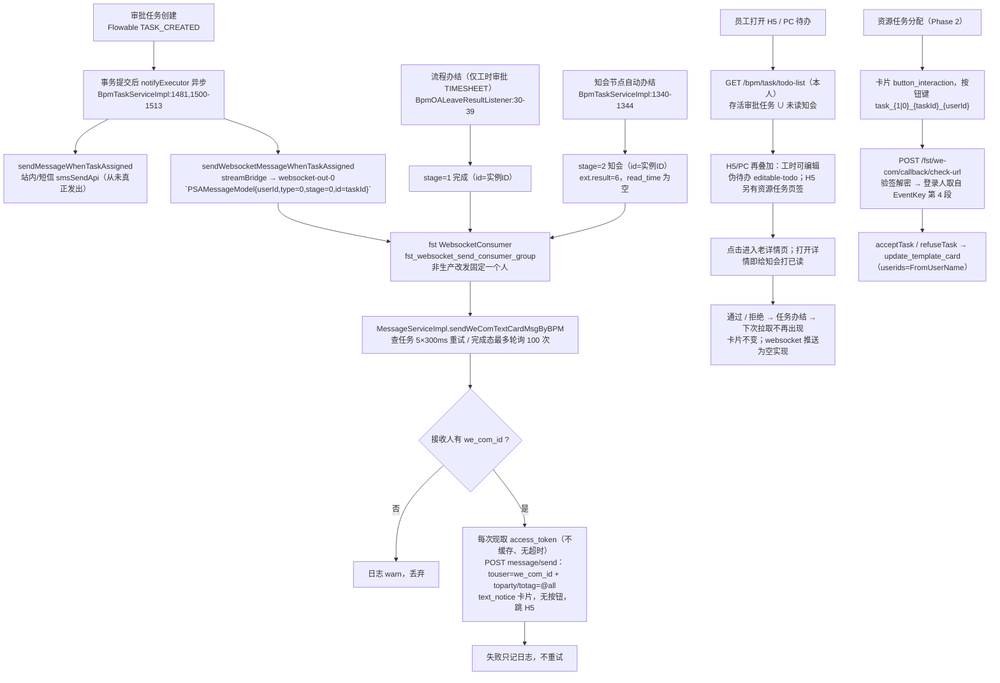
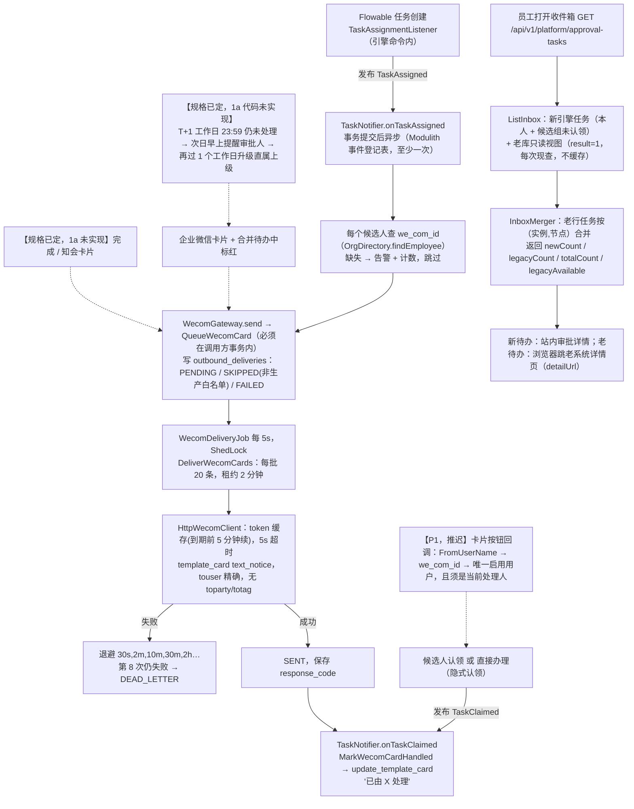
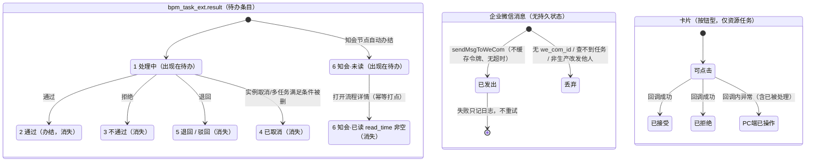
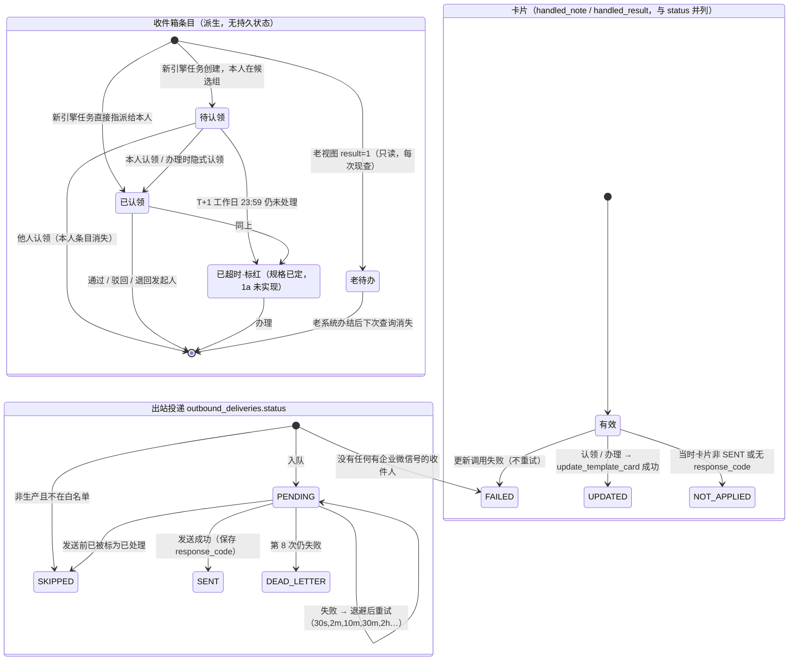

# 合并待办与通知（Phase 1a）

- 涉及 BC：`platform.approval`（收件箱、通知触发）、`platform.integration`（企业微信出站投递）、`organization.workforce`（收件人解析）
- 涉及的 A8 模板 / 老系统入口：老待办 / 已办接口、老 H5 首页待办、企业微信卡片与按钮回调（只服务资源任务）
- 证据采集日期：2026-10-14（老代码只读；生产数字引自已有文档）
- 梳理会话：psa-1a-process-review（现状 / 目标由 sonnet 子代理整理，差异判断与建议由 opus 完成，差异由用户逐条决定）

调查日期：2026-10-14。只读：没有改仓库、没有访问生产；生产数字只引用文档已有的，注明出处与日期。

路径缩写（下文 file:line 一律用这些前缀）：

| 缩写 | 含义 |
|---|---|
| OLD | `/Users/yeliang/Projects/FORCITIS/psa`（老系统，只读） |
| OLDBE | `OLD/psa-backend`；模块 bpm = `yudao-module-bpm/yudao-module-bpm-biz/src/main/java/cn/iocoder/yudao/module/bpm`，fst = `yudao-module-fst/yudao-module-fst-biz/src/main/java/cn/iocoder/yudao/module/fst` |
| DOC | 新仓库 worktree 的 `docs` |
| BE | 新仓库 worktree 的 `backend/src/main/java/com/forcitis/one` |
| FE | 新仓库 worktree 的 `frontend` |
| RT | `DOC/runtime`（只读采集于 2026-10-14，近 180 天访问日志 + 当日表行数） |

关键前提（读后面的表之前先看）：

1. 老系统"企业微信卡片按钮回调"（RULE-376）**只服务资源任务（Phase 2 的任务接受 / 拒绝）**，不服务审批。老系统审批卡片是无按钮的 `text_notice`，点击跳 H5（`OLDBE/fst/service/message/MessageServiceImpl.java:251-263`、`WeComCallbackController.java:115-136`）。
2. 老系统**没有任何审批超时提醒、催办、升级**（源码无定时边界、无催办作业；见第 1 节表 #17）。所以"超时提醒与升级的通知"在老系统无对照，全部是新增。
3. 新系统 1a 代码已有：收件箱合并（新引擎 + 老视图）、`TaskAssigned`/`TaskClaimed` 驱动的待办卡片、出站投递（重试 / 死信）、卡片"已处理"替换。**没有**：完成卡片、知会卡片、卡片按钮回调、超时提醒 / 升级、红标、H5 页面。

## 现状流程

| # | 步骤 | 角色 | 系统 | 数据 / 状态变化 | 证据 |
|---|---|---|---|---|---|
| 1 | 审批任务创建后，事务提交再发通知；提交后再确认任务未终态，终态不发 | 引擎 | bpm | `bpm_task_ext.result=1`；通知放线程池（1–4 线程、队列 1000），失败只记日志 | `OLDBE/bpm/service/task/BpmTaskServiceImpl.java:1481,1491-1513` |
| 2 | 站内 / 短信通知：`sendMessageWhenTaskAssigned` → `smsSendApi.sendSingleSmsToAdmin` | 引擎 | bpm → system | 写短信日志；**从未真正发出**（短信已定不迁移） | `OLDBE/bpm/service/message/BpmMessageServiceImpl.java:77-91`；短信结论 `DOC/adr/ADR-0019.md:31`；`DOC/INTENT.md:76` |
| 3 | 发 MQ：`PSAMessageModel{userId:long,type:0流程/1任务,stage:0待办/1完成/2知会,id,realUserId?}` 到 `websocket-out-0`（topic-websocket-01） | 引擎 | bpm → RocketMQ | 发出即不管，异常吞掉 | `BpmMessageServiceImpl.java:93-109`；`OLDBE/yudao-framework/yudao-common/.../CommonConstants.java:194-198,221-224,235`；`DOC/phase1a/INTERFACES.md:167` |
| 4 | fst 消费者收到后，非生产把收件人**强制改成一个写死的人**；流程类走 `sendWeComTextCardMsgByBPM`，任务类走 `sendWeComMsgByTask`，最后调 `sendWebsocketMsg` | 系统 | fst | 无状态 | `OLDBE/fst/mq/consumer/websocket/WebsocketConsumer.java:24-53` |
| 5 | 待办卡片前先按任务 ID 查任务，扑空重试 5 次 × 300 ms（容忍事务可见性延迟）；仍无则丢弃 | 系统 | fst → bpm RPC | 无状态 | `OLDBE/fst/service/message/MessageServiceImpl.java:163-190` |
| 6 | 组装卡片：`text_notice`，来源"您有【流程】需要处理"（红色），发起人 / 部门 / 发起时间，跳 H5 `pages/index/index`；**没有按钮** | 系统 | fst | 无状态 | `MessageServiceImpl.java:208-263`，H5 地址 `:614-626` |
| 7 | 解析接收人 `we_com_id`；用户缓存为空、用户不存在或未绑定就告警跳过（流程卡片有保护；任务卡片三处无空值保护会 NPE） | 系统 | fst | 无状态 | 流程卡片 `MessageServiceImpl.java:324-328`；任务卡片无保护 `:426,470,537`；`DOC/rules/IDENTITY_ORG_RULES.md`（RULE-374） |
| 8 | 发送：每次调用现取 access_token（不缓存），fst 的 RestTemplate 没设超时；请求体 `touser=we_com_id`，**同时带 `toparty="@all"`、`totag="@all"`**；失败只记日志，不重试 | 系统 | fst → 企业微信 | 无投递记录 | 取令牌 `OLDBE/fst/service/common/CommonServiceImpl.java:400-418`；发送 `:421-434`；`@all` `MessageServiceImpl.java:142-148`；`DOC/phase1a/INTERFACES.md:66,69` |
| 9 | "完成"卡片：只有**工时审批**办结才发（监听器写死 `工时审批`），发给发起人；消费者在流程结果还是"处理中"时循环睡眠等待，最多 100 次、每次 `i×1s+5s`（合计约 90 分钟，占着 MQ 消费线程）；取消不发 | 系统 | bpm → fst | 卡片红 / 绿由 `ext.result` 决定 | `OLDBE/bpm/service/oa/listener/BpmOALeaveResultListener.java:30-39`；`BpmMessageServiceImpl.java:115-131`；`MessageServiceImpl.java:265-309`（轮询 `:268-288`） |
| 10 | "知会"卡片：知会节点任务被级联自动办结，`ext.result=6`、`read_time` 为空；事务提交后发 stage=2 卡片，文案"有流程知会您"，跳首页待办 | 系统 | bpm → fst | 条目挂进待办直到打开详情 | `BpmTaskServiceImpl.java:1314-1347`；`BpmMessageServiceImpl.java:133-149`；`MessageServiceImpl.java:310-323`；RULE-299 `DOC/BUSINESS_RULES.md:4927` |
| 11 | 员工拉待办：`GET /bpm/task/todo-list`（H5 `/app-api`，PC `/admin-api`），按**本人**登录号取 Flowable 任务 `taskAssignee=本人`；行审批任务按（实例, 节点）合并成一条（代表任务取最新）；并入未读知会；按创建时间倒序 | 员工 | bpm | 读；待办数 = 审批动作数 + 未读知会数 | `OLDBE/bpm/controller/app/task/BpmTaskAPPController.java:31-44`；`BpmTaskController.java:32-44`；`BpmTaskServiceImpl.java:142-176,189-209,377-395`；RULE-261 `DOC/BUSINESS_RULES.md:4275` |
| 12 | 前端再叠加：工时"可编辑"伪待办（`/fst/man-hour/editable-todo`）置顶合并；PC 另把同一实例的多条待办按实例去重（保留最早）；H5 另有"待办任务 / 待批"两个任务页签（`/fst/task/user/page/all`、`/fst/task/shortcut/page`） | 员工 | H5 psa-mini / PC | 读，前端合并 | H5 `OLD/psa-mini/src/pages/index/index.tsx:210-221,619-625,648-691`；接口 `OLD/psa-mini/src/api/project/task.ts:33-35,66-69`、`api/project/manhour.ts:124-126`；PC `OLD/psa-front-desk-pc/src/views/bpm/task/todo.vue:147-159` |
| 13 | 点待办进老详情页（PC 先查流程实例取表单模块路径再路由）；知会条目"知道了"= 调实例详情，后端幂等回填 `read_time` | 员工 | PC / H5 / bpm | 知会：`read_time` 由空变有，之后不再出现在待办 | PC `todo.vue:284-303`；H5 `index.tsx:805-818`；打点 `OLDBE/bpm/service/task/BpmProcessInstanceServiceImpl.java:186-197`、`dal/mysql/task/BpmTaskExtMapper.java:80-98` |
| 14 | 办理（通过 / 拒绝 / 退回）：任务办结，`ext.result` 变 2 / 3 / 5；之后拉取不再出现。**没有推送**（`sendWebsocketMsg` 对页面的发送被注释掉）；**企业微信卡片不变** | 审批人 | bpm / fst | 状态值见第 3 节 | `MessageServiceImpl.java:553-586`（发送行 `:584` 被注释）；RULE-294 `DOC/BUSINESS_RULES.md:4848` |
| 15 | 资源任务分配（Phase 2 才迁）：睡 1 秒后发 `button_interaction` 卡片，按钮键 `task_{1接受/0拒绝}_{taskId}_{userId}`（"待批"阶段按钮是同意 / 驳回） | 系统 | fst | 无状态 | `MessageServiceImpl.java:357-367,384-427,428-471`；触发 `OLDBE/fst/service/resource/ResourceServiceImpl.java:254,297`、`TaskServiceImpl.java:1307,1326` |
| 16 | 用户点按钮 → `POST /admin-api/fst/we-com/callback/check-url`：`@PermitAll`，只靠签名 / 解密（Token、AESKey 硬编码）；**登录人 = EventKey 第 4 段**，不是 `FromUserName`；动作 `acceptTask / refuseTask` 内只校验任务状态，不校验操作人是不是处理人；异常一律把按钮换成"PC端已操作"；最后 `update_template_card`，`userids=[FromUserName]`，按钮改为"已接受 / 已拒绝" | 员工 | fst | 资源任务 `flagAccept` 0→1 / 2；卡片按钮被替换 | `OLDBE/fst/controller/admin/wecom/WeComCallbackController.java:65-142,153-165`；`ResourceServiceImpl.java:212-299`；RULE-376 `DOC/rules/IDENTITY_ORG_RULES.md:856-864`；SEC-006 `DOC/SECURITY_FINDINGS.md:49`；SEC-120 `DOC/phase1a/SECURITY_INVARIANTS.md:25` |
| 17 | 超时提醒 / 催办 / 升级：**不存在**。源码无定时边界、催办、到期逻辑，fst 的 XXL-JOB 没有催审作业；README 写"少量边界事件（超时）"但未指出哪个流程，代码里能见到的边界事件只有错误边界 | — | — | — | 本次 `grep` 全部 `sendMsgToWeCom` 调用方只有上面的待办 / 完成 / 知会 / 任务卡片；`OLDBE/bpm/.../BpmProcessGraphUtils.java:183`；`DOC/runtime/README.md:42`（"超时"列含义未核实） |

### 生产计数（只引用文档；全部为近 180 天或当日表行数，采集于 2026-10-14）

| 指标 | 数值 | 出处 |
|---|---|---|
| H5 `GET /app-api/bpm/task/todo-list` | 97,591 次、329 个用户、错误 46；约每天 540 次 | `RT/prod_usage.tsv:429`；`DOC/REIMAGINED_ARCHITECTURE.md:144` |
| PC `GET /admin-api/bpm/task/todo-list` | 11,047 次、229 人、错误 2 | `RT/prod_usage.tsv:561` |
| 旧分页接口 `todo-page`（H5 / PC） | 12,671 次（末次 2026-06-05）/ 1,691 次（末次 2026-05-14）：已被 todo-list 取代 | `RT/prod_usage.tsv:356,525` |
| "所有人待办" `todo-page/all` | 184 次、16 人，末次 2026-10-12 | `RT/prod_usage.tsv:208` |
| 工时可编辑伪待办 `editable-todo` | H5 11,074 次、PC 475 次（2026-09-22 起） | `RT/prod_usage.tsv:363,571` |
| 资源任务待办 / 待批 | `/app-api/fst/task/user/page/all` 10,841；`/admin-api/fst/task/user/page/all` 9,275；`/admin-api/fst/task/shortcut/page` 10,207 | `RT/prod_usage.tsv:55,360,293` |
| 企业微信回调 `POST …/we-com/callback/check-url` | 4,701 次、错误 410（错误原因文档未见）；GET 校验 3 次 | `RT/prod_usage.tsv:487,104` |
| 运行中任务 `ACT_RU_TASK` | 95 行 | `RT/prod_usage.tsv:1127` |
| `bpm_task_ext` / `bpm_process_instance_ext` | 166,037 / 132,304 行 | `RT/prod_usage.tsv:1141,1139` |
| 用户表 `system_users` / 近 180 天活跃用户 | 1,258 行 / 335 人 | `RT/prod_usage.tsv:1459,1462` |
| 菜单"待办任务"/"全部待办"授权角色数 | 30 / 5（列含义按 `RT/README.md` 的 `##02` 说明推断） | `RT/prod_usage.tsv:796,1002` |
| 审批任务（近 180 天，TIMESHEET） | 66,766 个，占绝大多数 | `RT/prod_bpm.tsv:259` |
| 短信日志（审批通知） | 23.3 万行，状态全是"初始化"，没有一条发送成功或失败；近 30 天仍新增约 1.2 万 | `DOC/adr/ADR-0019.md:31`（核实于 2026-10-14） |
| **文档中没有的数** | `bpm_task_ext.result` 各值的行数；未读知会条数；在职但无 `we_com_id` 的人数；企业微信发送成功 / 失败次数；每人平均待办数。要这些数需另行授权生产只读查询 | — |

---

## 目标流程

要点（依据；1a 实现状态）：

1. **新待办 = Flowable 任务**：本人被指派的任务 + 本人在候选组且尚未被认领的任务；认领后只有认领人看得到。依据：`DOC/REIMAGINED_ARCHITECTURE.md:141`；Q-3 `:258`。实现：已实现 `BE/platform/approval/infrastructure/flowable/FlowableApprovalEngine.java:84-94`、`BE/platform/approval/application/ListInbox.java:28-44`；测试 `backend/src/test/.../MergedInboxIT.java:118-139`。
2. **老待办只读视图**：`bpm_task_ext.result=1` 且仍在 `ACT_RU_TASK`，只含 7 列（待办人、任务号、实例号、节点 key、节点名、标题、创建时间 UTC），账号按 ADR-0037 全库只读（视图冻结），启动时、至少每天由集成层连接工厂按 ADR-0037 第 4 项 (a)–(f) 校验，不通过或无法判定即拒绝启动或停掉连接。依据：`DOC/phase1a/LEGACY_INBOX_VIEW.sql`；SECURITY_INVARIANTS I-1 `DOC/phase1a/SECURITY_INVARIANTS.md:13`；ADR-0037。实现：读取 `BE/platform/approval/infrastructure/legacy/JdbcLegacyInbox.java`，校验 `BE/platform/integration/infrastructure/connection/ReadOnlyBaseline.java`；**视图本身是"提议，待 DBA 评审"的 SQL（`LEGACY_INBOX_VIEW.sql:1`），仓库内无证据已在老库创建**。
3. **不缓存、不可读时明说**：每次打开查一次；读不到时只显示新待办并返回 `legacyAvailable=false`，前端出提示条。依据：`REIMAGINED_ARCHITECTURE.md:144`。实现：已实现 `JdbcLegacyInbox.java:20,42-45`、`MergedInbox.java:5-6`、`FE/apps/web/src/modules/approval/pages/inbox-page.tsx:55-60`。
4. **同一用户计数一致**：行审批合并后 `totalCount = newCount + legacyCount`，前端三个过滤标签各带计数。依据：brief 出口条件 `DOC/MODERNIZATION_BRIEF.md:127`；`DOC/AI_NATIVE_SPEC.md:243`。实现：`MergedInboxIT.java:55-86`（用夹具表，不是真老库）。**与老系统口径是否一致见第 6 节 D1–D3。**
5. **点击老待办跳回老系统**：后端按模板 `{processInstanceId}`、`{taskId}` 拼 `detailUrl`，前端仅允许 http(s) 并作外链打开；新系统不传令牌（I-1）。老系统未登录：H5 在企业微信内静默登录老系统，PC 回老系统登录页（1a 可接受，Q-1）。依据：`REIMAGINED_ARCHITECTURE.md:145`、`:98`。实现：`JdbcLegacyInbox.java:56-62`、`FE/apps/web/src/shared/lib/safe-url.ts:2-9`、`inbox-page.tsx:41-52`；模板只来自环境变量，无默认值，空则老待办无链接（`JdbcLegacyInbox.java:57-59`、`BE/.../config/platform_approval.properties:12-13`）。
6. **企业微信待办通知**：`TaskAssigned` → `TaskNotifier` → 候选人逐个解析 `we_com_id`（缺失告警跳过）→ 一个 `WecomCard`（多收件人）入 `outbound_deliveries` → 定时投递。`touser` 为精确 id 用 `|` 连接，请求体不含 `toparty` / `totag`。依据：C1a-15 `DOC/AI_NATIVE_SPEC.md:32`；SEC-118 `DOC/phase1a/SECURITY_INVARIANTS.md:23`；RULE-374 评审（`DOC/RULE_REVIEWS.md:96`）。实现：`BE/platform/approval/infrastructure/notification/TaskNotifier.java:39-58`、`BE/platform/integration/application/QueueWecomCard.java:33-60`、`infrastructure/wecom/WecomMessagePayload.java:21-32`。
7. **access_token 缓存、超时、重试**：token 缓存到期前 5 分钟续，WeCom 报 40014 / 42001 / 41001 时丢弃重取并重发一次；连接 / 读取超时各 5 s；投递失败按 30s、2m、10m、30m、2h 退避，最多 8 次进死信；`pending.overdue`（排队超 10 分钟）和 `dead.letters` 两个指标。依据：`AI_NATIVE_SPEC.md:32`；RULE-295 评审（`RULE_REVIEWS.md:46`）；`REIMAGINED_ARCHITECTURE.md:148`。实现：`BE/platform/integration/infrastructure/wecom/HttpWecomClient.java:33-41,52,106-141`、`WecomProperties.java:10-13`、`domain/RetrySchedule.java:10-22`、`infrastructure/metrics/DeliveryMetrics.java:25-30`。**告警规则（谁收、阈值）未见**，C1a-18 的四类告警不含投递死信（`AI_NATIVE_SPEC.md:35`）。
8. **已处理同步**：新系统任务一旦被认领或被直接办理（办理会先隐式认领），`TaskClaimed` 触发 `update_template_card`，把**同一张卡**换成"已由 X 处理"；卡片还没发出去就被处理，则该投递直接标 `SKIPPED`。老系统任务由老系统自己处理，新系统每次现查视图，所以老任务在老系统处理后，下一次打开收件箱就消失；新系统**不处理老任务**，也不更新老系统发出的卡片。依据：Q-3 `REIMAGINED_ARCHITECTURE.md:258`。实现：`TaskNotifier.java:60-64`、`BE/platform/approval/application/DecideTasks.java:129-133`、`MarkWecomCardHandled.java:26-50`、`DeliverWecomCards.java:41-45`、`WecomMessagePayload.java:34-45`；测试 `TaskNotificationIT.java:69-99`。
9. **卡片按钮回调（P1，推迟）**：目标写法是 `FromUserName` → `we_com_id` → 唯一启用用户，且必须是该任务当前处理人，按钮键严格解析，Token / AESKey 用新企业微信应用的新值。推迟原因：企业微信应用只有一个回调地址，现被老系统占用。依据：RULE-376 评审（`RULE_REVIEWS.md:98`）；SEC-119 `SECURITY_INVARIANTS.md:24`；`REIMAGINED_ARCHITECTURE.md:149`；`AI_NATIVE_SPEC.md:262`。实现：**1a 代码无回调端点**（`BE/platform/integration` 下无入站控制器）；1a 卡片不带按钮（`WecomMessagePayload.java:61-76`）。
10. **完成 / 知会卡片**：规格要求。依据：`AI_NATIVE_SPEC.md:32`、`REIMAGINED_ARCHITECTURE.md:148`（意图 `TaskAssigned`、`ApprovalCompleted`、知会）。实现：**未实现**——`ApprovalCompleted`、`TaskHandled` 已发布（`BE/platform/approval/application/ApprovalLifecycle.java:47-50,76-80`）但仓库内没有任何监听方；`platform/approval` 下没有知会节点。
11. **非生产环境**：收件人限白名单，agentId 按环境配置（RULE-375）。实现：`BE/platform/integration/domain/RecipientPolicy.java:8-25`、`QueueWecomCard.java:41-50`、`config/platform_integration.properties:45-47`。
12. **审批超时提醒与升级**（用户已定）：T+1 工作日 23:59 仍未处理即超时，次日早上提醒审批人；再过 1 个工作日升级给直属上级；提醒与升级用企业微信卡片，并在合并待办中标红；耗时按工作日小时计。依据：`DOC/intent/2026-10-14-116-1a流程-工时审批-截止时刻.md`、`2026-10-14-118-1a流程-审批时效统计.md`；`DOC/INTENT.md:152,154`。实现：**1a 代码完全没有**——无工作日历、无定时扫描任务、`InboxItem` 无超时 / 红标字段（`BE/platform/approval/application/InboxItem.java:7-8`）、`WecomCard` 无卡片类型（`BE/platform/integration/api/WecomCard.java:8`）、`outbound_deliveries.deduplication_key` 唯一（`V20261014133100…sql:3`）。

**(a) 法人维度来源**

- 收件箱与通知本身**不按法人过滤**：待办按人（assignee / 候选人）取，老视图没有法人列（`LEGACY_INBOX_VIEW.sql`），`approval_requests`、`outbound_deliveries` 都没有法人列（`BE` 下 `db/migration/platform_approval/V20261014132000…sql`、`platform_integration/V20261014133100…sql`）。
- 会话上的法人**目前是写死的 1**：`CurrentUser.legalEntityId()` 的实现直接返回 `new LegalEntityId(1L)`（`BE/platform/identity/infrastructure/security/SessionCurrentUser.java:22-25`），`ListInbox` 不使用它。
- 法人归属的数据来源：用户已定"1a 就建员工→法人生效区间表，由组织数据管理员维护"（`DOC/INTENT.md:144`，`intent/2026-10-14-108`）；登录后按哪个法人生效、数据范围授予表推到 1b（`INTENT.md:159`）。1a 代码里员工 / 部门快照仍无法人列，姊妹文档已记录（`DOC/process/1a/组织与人员同步.md` 2.3 (a)）。
- 审批时效统计的维度是审批人、部门、月份（`intent/…-118`），**没有写法人**。

**(b) 是否涉及 DMN**

- 本流程不涉及。"超时 / 提醒 / 升级"是固定参数（T+1、次日早上、再 1 个工作日）加"直属上级"，不是决策表；取人沿用 `AssigneeResolver`（RULE-250 / 307），1a 不引入 DMN（`REIMAGINED_ARCHITECTURE.md:127,213`，架构评审 #9/#15）。
- 规格文字有内部分歧：`AI_NATIVE_SPEC.md:29` 的 C1a-12 仍写"指派 DMN"，而 `REIMAGINED_ARCHITECTURE.md:127` 写"1a 不用 DMN"（见第 6 节 D22）。

**(c) 审批 / 业务单据与通知的状态归属、协作事件**

- 审批状态归 `platform.approval`：`approval_requests.status ∈ {RUNNING, RETURNED, APPROVED, REJECTED, CANCELLED}`（`BE/platform/approval/domain/ApprovalStatus.java:4-9`）；业务单据状态归各业务 BC（1a 无业务单据接入）。
- 通知投递状态归 `platform.integration.outbound_deliveries`；**收件箱条目没有自己的持久状态**，是"引擎任务 + 老视图"的派生读模型（`ListInbox.java:28-44`）。
- 已有事件：`TaskAssigned`（驱动卡片，`events/TaskAssigned.java:10`）、`TaskClaimed`（卡片置已处理）、`TaskHandled`、`ApprovalCompleted`（后两者当前无监听方）。超时 / 升级所需事件（如"任务已超时""任务已升级"）未定义。

**(d) 超时提醒与升级的通知如何出现在卡片与收件箱**

- 已定：渠道是企业微信卡片，并在合并待办中标红（`intent/…-118`）。
- 未定（见第 6 节 T1–T5）：卡片是另发一张还是替换原卡片；红标的字段、判定口径（新旧待办是否都标）；提醒具体几点、重复几次；升级后原审批人的任务是否保留；升级上级取不到怎么办；提醒发给候选组全员还是只发未认领者。
- 现有设计的约束：每个任务只有一个投递键 `approval-task:{taskId}`，且 `outbound_deliveries.deduplication_key` 唯一，同键重复入队被忽略（`TaskNotifier.java:66-68`、`JdbcOutboundDeliveryRepository.java:42`）；老系统的待办卡片来源文案本来就是**固定红色**（`OLDBE/fst/.../MessageServiceImpl.java:217`），所以"卡片里标红"不能沿用来源色区分超时。

---

## 涉及的聚合与状态机

聚合：**收件箱条目**（派生，无表）、**出站投递**（企业微信消息，`outbound_deliveries`）、**卡片**（企业微信侧对象，由投递的 `response_code` 间接引用）。老系统另有"待办任务"（`bpm_task_ext`）与"资源任务"（`flagAccept`）。

### 3.1 现状

老状态值：

| 对象 | 值 | 证据 | 生产计数 |
|---|---|---|---|
| `bpm_task_ext.result` | 1 处理中、2 通过、3 不通过、4 已取消、5 退回 / 驳回、6 知会；"终态"= 2/3/4/5/6 | `OLDBE/yudao-module-bpm/yudao-module-bpm-api/src/main/java/cn/iocoder/yudao/module/bpm/enums/task/BpmProcessInstanceResultEnum.java:16-29,50-53`；RULE-294 `DOC/BUSINESS_RULES.md:4848` | 各值行数文档未见；`bpm_task_ext` 共 166,037 行，运行中任务 95（`RT/prod_usage.tsv:1141,1127`） |
| `bpm_task_ext.read_time` | 仅对 result=6 有意义；空 = 未读 | `OLDBE/bpm/dal/mysql/task/BpmTaskExtMapper.java:80-98` | 文档未见 |
| 消息阶段（流程） | 0 待办、1 完成、2 知会 | `CommonConstants.java:194-198` | — |
| 消息阶段（任务） | 0 待办、1 已接受、2 已拒绝、3 待批、4 已同意 | `CommonConstants.java:210-216` | — |
| 消息类型 | 0 流程、1 任务 | `CommonConstants.java:221-224` | — |
| 资源任务 `flagAccept` | 0 待接受、1 接受、2 拒绝；任务状态 0 进行中、1 已保存、2 已完成、3 已逾期（`TaskStatus` 里 TODO 注明"其他两个状态需要完善"） | `OLDBE/yudao-module-fst/yudao-module-fst-api/src/main/java/cn/iocoder/yudao/module/fst/enums/fst/FSTConstant.java:24-31,70-77` | 文档未见 |
| 卡片按钮替换文案 | "已接受"、"已拒绝"、"PC端已操作" | `WeComCallbackController.java:121,125,130,134` | — |
| 回调按钮结果码 | "1" 接受 / 同意，"0" 拒绝 | `FSTConstant.java:203-207` | 回调 4,701 次（`RT/prod_usage.tsv:487`） |
| 老系统的"出站投递"状态 | **无**：没有投递表、没有重试、没有死信 | `CommonServiceImpl.java:428-433` | — |

### 3.2 目标（1a 已写的部分 + 规格已定未实现的部分）

目标状态值（1a 代码）：

| 对象 | 值 | 证据 |
|---|---|---|
| 收件箱来源 | `NEW`、`LEGACY` | `BE/platform/approval/application/InboxSource.java:3-6` |
| 新任务条目 | `claimed` 布尔：未认领 = 候选人可见；认领后仅认领人可见 | `InboxItem.java:7`；`FlowableApprovalEngine.java:84-94`；`domain/TaskActors.java:11-16` |
| 审批请求 | RUNNING / RETURNED / APPROVED / REJECTED / CANCELLED | `ApprovalStatus.java:4-9`；`V20261014132000…sql` |
| 投递状态 | PENDING、SENT、SKIPPED、FAILED、DEAD_LETTER | `BE/platform/integration/domain/DeliveryStatus.java:3-9`；`V20261014133100…sql:9` |
| 卡片已处理结果 | UPDATED、NOT_APPLIED(附原因)、FAILED(附原因) | `V20261014133100…sql:37`；`MarkWecomCardHandled.java:36-49` |
| 投递租约 | 认领时 `attempt_count+1`，`next_attempt_at` = 租约到期（2 分钟）；崩溃则到期后重发，不丢卡 | `JdbcOutboundDeliveryRepository.java:64-78`；`DeliverWecomCards.java:17,23` |

---

## 发出 / 消费的领域事件

| 事件 | 触发转换 | 负载要点 | 消费方及反应 | 证据 |
|---|---|---|---|---|
| `TaskAssigned`（新） | 引擎创建任务、候选人解析完成（在引擎命令内发布；监听器 `isFailOnException=true`） | 任务 ID、实例 ID、流程键、业务键、节点 key / 名、发起人、候选人列表 | `TaskNotifier`：每个候选人查 `we_com_id`，入队一张卡（缺失告警跳过）；无其他消费方 | `BE/platform/approval/events/TaskAssigned.java:10-11`；发布 `infrastructure/flowable/TaskAssignmentListener.java:93-96,98-101`；消费 `TaskNotifier.java:39-58` |
| `TaskClaimed`（新） | 认领，或办理未认领任务时隐式认领 | 任务 ID、认领人 | `TaskNotifier`：把同一张卡换成"已由 X 处理" | `events/TaskClaimed.java:7`；发布 `ApprovalLifecycle.java:39-45`；`DecideTasks.java:129-133`；消费 `TaskNotifier.java:60-64` |
| `TaskHandled`（新） | 通过 / 驳回 / 退回；自动办结不发 | 任务、实例、流程键、业务键、节点、办理人、结果、是否建议性(1a 恒 false)、原因 | **无监听方** | `events/TaskHandled.java:10-11`；发布 `ApprovalLifecycle.java:47-50` |
| `ApprovalCompleted`（新） | 实例通过 / 驳回 / 退回，随状态更新同事务发布，至少一次 | 实例、流程键、业务键、轮次、结果、原因；监听方须按（流程键,业务键,轮次）幂等 | **无监听方**（业务 BC 1a 未接入；完成卡片也未实现） | `events/ApprovalCompleted.java:7-10`；发布 `ApprovalLifecycle.java:76-80` |
| 超时 / 升级事件 | 规格已定要提醒、升级，但**事件未定义** | — | — | 见第 6 节 T3 |
| 老：`PSAMessageModel`（MQ `websocket-out-0`） | 任务分配、流程办结（仅工时审批）、知会节点办结 | `{userId,type,stage,id,realUserId?}`；待办的 id 是任务 ID，其余是实例 ID | fst `WebsocketConsumer` → 企业微信卡片；失败只记日志；发出即不管 | `OLDBE/bpm/.../BpmMessageServiceImpl.java:93-149`；`OLDBE/fst/mq/consumer/websocket/WebsocketConsumer.java:24-53`；`DOC/phase1a/INTERFACES.md:167` |
| 老：同步 RPC | fst 查任务 / 用户缓存、取 token、调企业微信 | — | — | `MessageServiceImpl.java:155,171,181`；`CommonServiceImpl.java:412-434` |
| 老：知会已读（读路径副作用，非事件） | 打开流程详情 | 回填 `read_time`，失败不影响详情返回 | 待办列表自然少一条 | `OLDBE/bpm/service/task/BpmProcessInstanceServiceImpl.java:186-197` |

对照说明：老系统用 MQ 加同步 RPC，消息"发出即不管"，所以要靠 5×300ms 重试容忍事务可见性；新系统用 Spring Modulith 事件登记表，事务提交后至少一次投递，投递层有重试与死信（`ApprovalCompleted.java:7`；`ADR-0019.md:21` 合并为模块化单体；RULE-295 评审 `RULE_REVIEWS.md:46`）。

---

## 权限

| 问题 | 老系统 | 新系统（规格） | 新系统（1a 代码） |
|---|---|---|---|
| 谁能看谁的待办 | `todo-list` / `todo-page` 只取**登录人自己的**任务（权限 `bpm:task:query`）；另有 `todo-page/all` 只要 `bpm:task:query` 就能看**所有人**待办，菜单"全部待办"授权 5 个角色，近 180 天 184 次 / 16 人（`OLDBE/bpm/controller/admin/task/BpmTaskController.java:32-50`；`RT/prod_usage.tsv:208,1002`） | 本人收件箱；管理员代办必须显式"代理"并审计（RULE-270 评审 `RULE_REVIEWS.md:36`；D-07 `AI_NATIVE_SPEC.md:49`）；"管理员只读查看他人待办"规格未写 | 只有本人收件箱，用户取自会话（`BE/platform/approval/web/ApprovalTaskController.java:25,47-51`）；没有看他人待办的接口，没有代理机制 |
| 代理 | 老系统没有审批代理；`PUT /bpm/task/batch/approve` 可对所有人的匹配待办逐条通过，审计记的是被代理人（`BpmTaskController.java:53-58`；`BpmTaskServiceImpl.java:430-466`；RULE-270） | 只能批量处理本人待办，代理显式、记操作人与被代理人（C1a-17 `AI_NATIVE_SPEC.md:34`） | 1a 代码没有批量办理他人待办的入口；代理未实现 |
| 候选组与认领 | 指派到具体的人（RULE-249 已评审为错误：随机挑一个候选） | 候选组全员收到卡片，认领后只认领人可办，其他人卡片更新（Q-3 `REIMAGINED_ARCHITECTURE.md:258`；I-7 `SECURITY_INVARIANTS.md:25`） | 已实现 `domain/TaskActors.java:11-16`、`application/TaskGuard.java:30-47`（非处理人 403 并独立审计）；测试 `TaskActorAuthorizationIT` |
| 卡片按钮回调的身份判定 | 登录人 = 按钮键第 4 段 `{userId}`；`FromUserName` 只用来更新卡片；`@PermitAll`，只靠签名；`acceptTask` 不校验操作人（`WeComCallbackController.java:105,113,139`；SEC-006 / SEC-120） | `FromUserName` → `we_com_id` → 唯一启用用户，且须是该任务当前处理人；按钮键严格解析；Token / AESKey 取自新应用新值（RULE-376 评审；SEC-119） | **未实现**（无回调端点，P1 推迟） |
| 点老待办时的身份 | 在老系统里用老系统自己的登录会话 | 新系统不读老令牌（I-1）；H5 在企业微信内静默登录老系统，PC 回老系统登录页（`REIMAGINED_ARCHITECTURE.md:145`；Q-1） | 只拼 `detailUrl`，不带任何凭证（`JdbcLegacyInbox.java:56-62`） |
| 接口权限 | `bpm:task:query` | `platform.approval:task:read` 查看，`…:approve` 认领 / 办理 / 退回 | `ApprovalTaskController.java:47-76`（`@PreAuthorize`） |
| 通知收件人范围 | `touser` 加 `toparty=@all`、`totag=@all`；`@all` 在企业微信的实际效果未测（`DOC/phase1a/INTERFACES.md:514`）；非生产写死发给一个人 | `touser` 精确，body 不含 `toparty/totag/@all`（I-6）；非生产白名单（RULE-375） | 已实现 `WecomMessagePayload.java:12-32`、`RecipientPolicy.java:8-25` |

## 差异清单

「已决定」引用用户原话；「需改代码」已报 psa-coordinator 转 1a 会话。本会话不改代码。

| 编号 | 现状 | 目标 | 影响 | 建议 | 用户决定 |
|---|---|---|---|---|---|
| D-1a-128 | 老待办 = 存活审批任务 + 未读知会，只对行审批节点合并；老 H5 另有工时可编辑提醒与资源任务页签 | 「待办数量一致」以老审批待办接口为准：老视图加入未读知会（单列「知会」，点击跳老系统），只对行审批节点合并；工时可编辑提醒与资源任务不在 1a 收件箱，不计入比较 | 出口条件可验证 | 对齐老接口 | 已决定：「对齐老审批待办接口 (Recommended)」（intent/2026-10-14-132）；需改代码（视图加知会与行审批判定） |
| D-1a-129 | 处理后卡片不变，审批卡片无按钮 | 认领 / 办理后同一张卡改为「已由某人处理」，其他候选人卡片一起更新 | 体验改进 | 按已定 | 已决定：Q-3 |
| D-1a-130 | 老 H5 处理后重拉列表 | 收件箱窗口重新获得焦点即刷新，并每 60 秒轮询；不做服务端推送 | 在老系统办完回到新收件箱很快消失 | 自动刷新 | 已决定：「收件箱自动刷新」（intent/2026-10-14-138）；需改代码 |
| D-1a-131 | 一次一人一张卡 | 候选组卡片每人一条投递（每人一个更新凭证）；修正「已处理」与首次发送的竞态（发送成功后再检查并补更新） | 每张卡都能被更新 | 每人一条投递 | 已决定：「每人一条投递」（intent/2026-10-14-139）；需改代码（现为一条投递共用一个 response_code） |
| D-1a-132 | 发送失败只记日志，不重试 | 8 次、30 秒起退避；进死信即告警运维与流程管理员，管理页可重投或放弃 | 死信有人处理 | 按已定 | 已决定：C1a-15；RULE-295；「死信告警+重投入口」（intent/2026-10-14-130）；需改代码 |
| D-1a-133 | 老卡片有发起人、部门、发起时间 | 卡片显示发起人、部门、发起时间、截止时间；业务摘要由业务模块在发起时随请求提供，通知不回查业务单据 | 审批人在卡片上即可判断 | 加字段与摘要 | 已决定：「卡片加字段与摘要」（intent/2026-10-14-138）；需改代码 |
| D-1a-134 | 老卡片跳 H5 首页 | 卡片落地到 H5 待办（Taro）；1a 现落到 PC 站点 | 手机端体验 | 按已定 | 已决定：C1a-19 P0；需改代码（H5 未实现，同 D-1a-38） |
| D-1a-135 | 「完成」卡片只有工时审批发 | 所有流程办结（通过 / 驳回 / 退回 / 撤销）给发起人发「完成」卡片；知会卡片随知会节点发 | 发起人及时知道结果 | 办结卡片发发起人 | 已决定：C1a-15；「办结卡片发发起人」（intent/2026-10-14-138）；需改代码（`ApprovalCompleted` 无监听方） |
| D-1a-136 | 完成态轮询 100 次、约 90 分钟占消费线程 | 结果事件自带结果，不轮询 | 消除阻塞 | 不复刻 | 不涉及业务决定（实现细节，代码已一致） |
| D-1a-137 | 无超时提醒 | 提醒与升级的卡片与收件箱标红按 D-1a-112、113、117；超时与升级属于审批任务，发事件供业务模块选用；投递键区分待办、提醒、升级 | 时限功能可实现 | 按已定 | 已决定：intent/2026-10-14-133、134、142、144；需改代码（未实现） |
| D-1a-138 | 卡片按钮回调以按钮键定人（只服务资源任务，回调近 180 天 4,701 次、错误 410） | 新系统卡片按钮回调推迟（P1）；实现时以 FromUserName → we_com_id → 用户定人并校验处理人；新系统用新的企业微信自建应用（新 agentId、新密钥、独立回调），老应用随老系统下线，老回调密钥按「老系统先不管」不在 1a 处理 | 新旧应用并存 | 新开独立应用 | 已决定：RULE-376；C1a-15 卡片按钮 P1；「新开独立应用 (Recommended)」（intent/2026-10-14-135）；运维事项（新建应用） |
| D-1a-139 | `todo-page/all` 可看所有人待办（近 180 天 184 次、16 人）；批量以他人名义通过 | 流程管理员的只读「全部待办」视图（可按超时筛选），查看写审计；其余人不保留；批量只处理本人待办 | 管理员可监控积压 | 管理员只读视图 | 已决定：RULE-270；「管理员只读全部待办」（intent/2026-10-14-138）；需改代码 |
| D-1a-140 | 老 PC 详情按模块与业务 ID 拼路径 | 老待办视图补上模块与业务 ID，按老 PC 详情路径拼链接，上线前用测试账号实测 | 点击老待办能落到正确页面 | 实测 | 已决定：「老待办链接实测」（intent/2026-10-14-139）；需改代码（视图与模板） |
| D-1a-141 | 缺 we_com_id 时告警跳过，任务卡片三处会空指针 | 发送时跳过已离职候选人并记 SKIPPED；全部候选人缺企业微信 ID 时也写入投递记录并告警（I-6）；「在职但无企业微信 ID」清单为 0 是 1a 出口条件 | 失败可查 | 按已定 | 已决定：RULE-374；「不给离职者发卡」（intent/2026-10-14-139）；「加 (Recommended)」（intent/2026-10-14-136）；需改代码（`TaskNotifier.java:44-53`） |
| D-1a-142 | 非生产消息发给写死的人 | 测试收件人白名单配置，非白名单标 SKIPPED | 无 | 按已定 | 已决定：RULE-375 |
| D-1a-143 | 待办按人，无法人 | 收件箱不按法人筛选；审批请求带法人后（1b）时效统计增加法人维度 | 无 | 按已定 | 已决定：「时效统计按法人」（intent/2026-10-14-139） |
