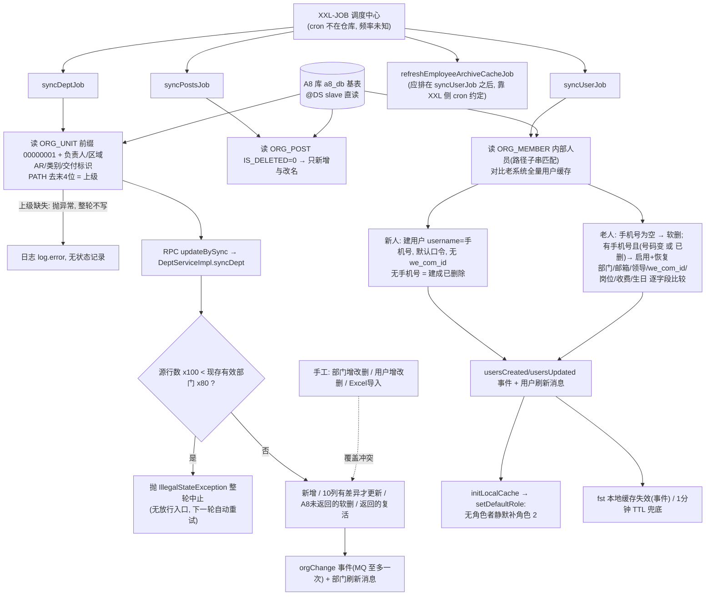
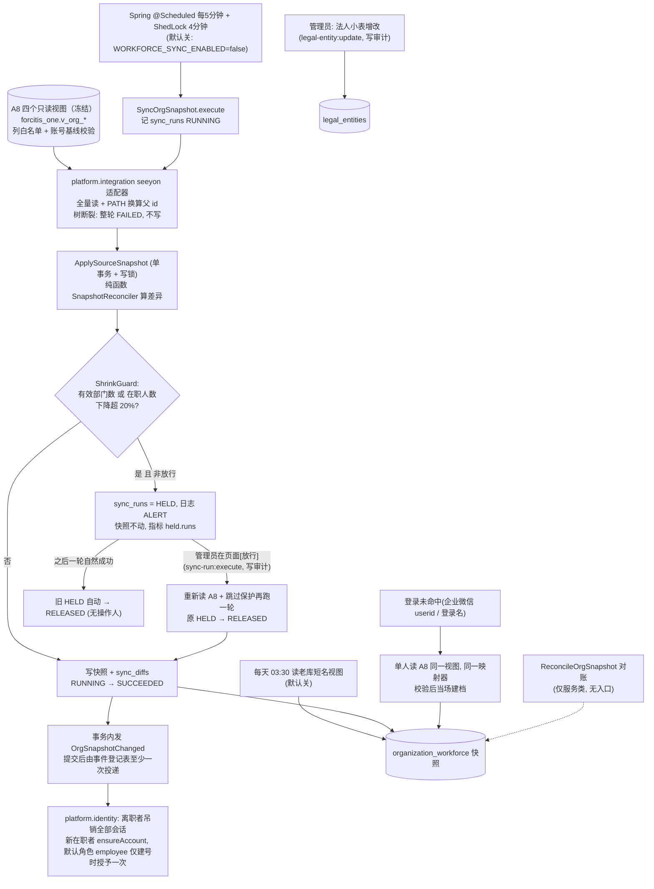
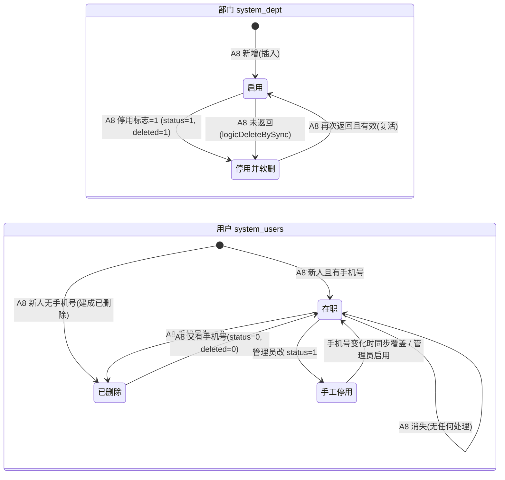
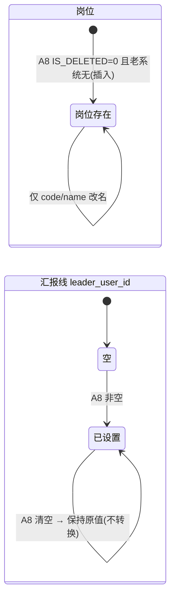
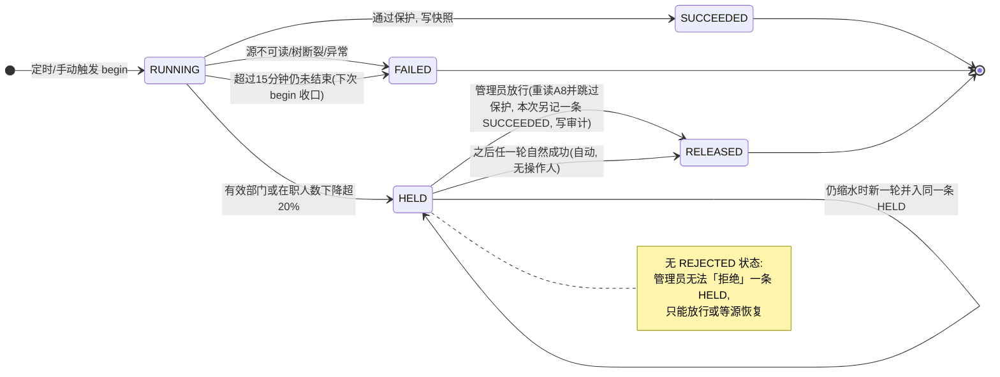
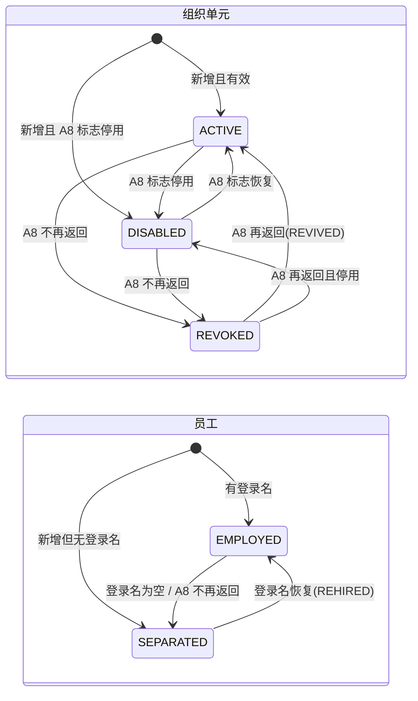
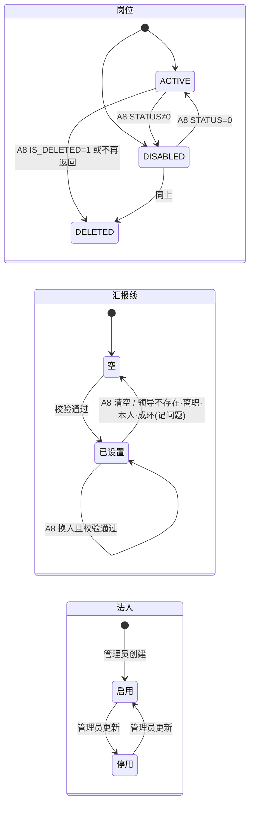

# 组织与人员同步（Phase 1a）

> **已退役（2026-10-21）**：本文件描述的是从 A8 同步组织与人员及登录补建。ADR-0055（自成体系：不接老系统与 A8，2026-10-17 已采纳）取消这一流程：人员由 `organization.workforce` 的人事命令维护。本文件仅作历史证据与迁入对账参考；拆除与改造顺序见 `phase1a/a8-split/SPLIT_PLAN.md`。

- 涉及 BC：`organization.workforce`（组织快照、同步批次、法人）、`platform.integration`（A8 视图适配器）、`platform.identity`（账号、会话、默认角色）、`platform.approval`（取人读快照）
- 涉及的 A8 模板 / 老系统入口：A8 `ORG_UNIT` / `ORG_MEMBER` / `ORG_POST` / `ORG_RELATIONSHIP` / `formmain_0307`；老 XXL-JOB `syncDeptJob`、`syncUserJob`、`syncPostsJob`；老手工维护部门 / 用户 / Excel 导入
- 证据采集日期：2026-10-14（老代码 psa HEAD 只读；生产数字均引自已有文档，出处见各行）
- 梳理会话：psa-1a-process-review（现状 / 目标由 sonnet 子代理整理，差异判断与建议由 opus 完成，差异由用户逐条决定）
- 路径缩写：老系统 `FST/` = `psa-backend/yudao-module-fst/yudao-module-fst-biz/src/main/java/cn/iocoder/yudao/module/fst/`，`SYS/` = `psa-backend/yudao-module-system/yudao-module-system-biz/src/main/java/cn/iocoder/yudao/module/system/`；新仓库 `BE/` = `backend/src/main/java/com/forcitis/one/`，`BER/` = `backend/src/main/resources/`，`FE/` = `frontend/apps/web/src/modules/workforce/`，`DOC/` = `docs/`

## 现状流程

### 1.1 流程图

### 1.2 步骤表

| # | 步骤 | 角色 | 系统 | 数据 / 状态变化 | 证据 |
|---|---|---|---|---|---|
| 1 | 定时任务触发：`syncDeptJob`、`syncUserJob`、`syncPostsJob` 各为独立 XXL-JOB，异常只记日志，不留运行记录 | 调度中心（XXL-JOB） | 老 fst 服务 | 无「同步批次」实体；失败只在日志 | `FST/trigger/task/SyncDeptJob.java:16`、`SyncUserJob.java:17`、`SyncPostsJob.java:16`；cron 在 XXL 调度库，仓库无（`DOC/phase1a/COLUMN_OWNERSHIP.md:52`、`:352`，同步延迟未知） |
| 2 | 部门读取：A8 `ORG_UNIT` 路径以 `00000001` 开头；停用判定 `IS_DELETED=1 or IS_INTERNAL!=1 or IS_ENABLE!=1`（NULL 落入「有效」）；类别取 ADDRESSBOOK 枚举、交付标识 MAX(CASE) | 系统（同步任务） | 老 fst → A8 基表（slave 数据源） | 读 A8，不写 | `FST/dal/mysql/a8/A8DeptMapper.java:35-48`；NULL 为 0 行见 `DOC/phase1a/A8_DEPT_NULL_FLAGS.md`（2026-10-14） |
| 3 | 负责人 / 区域 AR 读取：`ORG_RELATIONSHIP` 固定关系类型 ID（硬编码），人员未删；多条取先到的并告警 | 系统 | 老 fst → A8 | 部门负责人、区域 AR；无关系 = NULL（清空老系统值） | `A8DeptMapper.java:50-98`；`SyncServiceImpl.java:189-221` |
| 4 | 上级部门：PATH 去末 4 位反查；PATH 重复取未停用者；上级缺失抛异常，整轮不写 | 系统 | 老 fst | `parent_id`；根为 0 | `FST/service/sync/SyncServiceImpl.java:154-181`、`:241-281`（RULE-354） |
| 5 | 部门写入：缩水保护（源行数×100 < 现存有效部门数×80 则抛异常中止）→ 新增 / 仅 10 个同步字段有差异才更新（含 NULL）/ A8 未返回者软删（deleted=1,status=1）/ 返回者复活；short_name、final_dept、phone、email 不动 | 系统（RPC 无鉴权） | 老 system | `status`=A8 停用标志，`deleted`=(status≠0)；老系统手工部门每轮被软删 | `SYS/service/dept/DeptServiceImpl.java:202-245`（写）、`:255-271`（缩水）、`:274-305`（字段）；`SYS/dal/mysql/dept/DeptAllMapper.java:21`；RULE-355/357/358 |
| 6 | 岗位同步：A8 `IS_DELETED=0` 的岗位，新岗位插入，已有岗位只改 code/name；A8 停用 / 删除 / 排序变化忽略 | 系统 | 老 fst → system | 岗位表只增不减 | `SyncServiceImpl.java:445-487`；`A8PostMapper.java:19-22`（RULE-367） |
| 7 | 人员读取：`ORG_MEMBER` 内部人员 + 工号非空 + 部门非空 + 部门 PATH `LIKE '%00000001%'`（子串）；含已离职（登录名为空）；读 A8 自有列 `we_com_id`；生日另走 EXT_ATTR_21 | 系统 | 老 fst → A8 | 读 | `FST/dal/mysql/a8/A8UserMapper.java:24-40`（`:29` we_com_id）；`A8MemberBirthdayMapper.java:21-24`（RULE-361） |
| 8 | 新人入职：A8 id 不在老系统缓存 → 建用户（id=A8 id，username=手机号或工号，默认口令，状态启用，无手机号则建成已删除，岗位取单个）；不写 we_com_id | 系统 | 老 fst → system | 用户行新增 | `SyncServiceImpl.java:299-340`；默认口令 `SYS/service/user/AdminUserServiceImpl.java:174`；RULE-362 |
| 9 | 离职：登录名为 null → 若老系统已删则整行跳过，否则软删；不收回角色、不吊销令牌；空串登录名不算离职 | 系统 | 老 fst → system | `deleted=1`；之后部门、领导变更被冻结 | `SyncServiceImpl.java:359-369`；`SYS/api/user/AdminUserApiImpl.java:182-207`；RULE-363/338 |
| 10 | 复职与换号：有手机号且（号码变 或老系统已删）→ status=0、deleted=0（覆盖手工停用）；先恢复再改字段；username 不跟随 | 系统 | 老 fst → system | 启用并恢复 | `SyncServiceImpl.java:380-398`；`AdminUserApiImpl.java:195-205`；RULE-364 |
| 11 | 字段更新：部门（不同则改）、邮箱 / 领导 / we_com_id / 生日（仅 A8 非空才改，A8 清空不同步）、岗位（单个，覆盖老系统多岗）、收费标志（含 null）；昵称、性别、工号只在创建时写 | 系统 | 老 fst → system | 汇报线只增不清；we_com_id 新人晚一轮 | `SyncServiceImpl.java:342-441`；`DOC/phase1a/COLUMN_OWNERSHIP.md`（system_users 表）；RULE-365/372 |
| 12 | A8 里消失的人（改外部、清工号、移出范围、物理删除）：无任何处理，仍可登录 | — | 老 fst | 无变化 | `SyncServiceImpl.java:283-441`（RULE-366，推断） |
| 13 | 事件：部门同步按（code、name、parentId、sort、deleted）差异发 orgChange，A8 未返回者每轮重复发 DELETED；用户创建 / 更新提交后发；MQ 至多一次 | 系统 | 老 system → RocketMQ → fst | 负责人 / AR / 类别 / 交付标识变化不触发事件 | `SYS/mq/producer/org/OrgChangePublisher.java:110-140`；`FST/trigger/mq/organization/OrgChangeConsumer.java`；`DOC/phase1a/INTERFACES.md:168`（M6）；RULE-373 |
| 14 | 缓存刷新：用户批量创建 / 更新后发用户刷新消息；部门有变动才发部门刷新消息；fst 订阅者本地缓存失效，1 分钟 TTL 自愈 | 系统 | 老 system / fst | Caffeine 缓存 | `AdminUserServiceImpl.java:187`、`:242`；`DeptServiceImpl.java:246-249`；`FST/trigger/mq/organization/UserDeptCacheInvalidationSubscriber.java`；`FST/service/.../UserDeptCacheService.java:46-49` |
| 15 | 默认角色：`initLocalCache`（启动与每次用户缓存重载）里对「没有任何角色」的用户补角色 2（含管理员刚移除的）。`SyncService.setDefaultRole()` 声明了但仓库内无调用方 | 系统 | 老 system | `system_user_role` 新增 | `AdminUserServiceImpl.java:102-123`；`SYS/service/permission/PermissionServiceImpl.java:513-531`；`CommonConstants.java:180`（DEFAULT_ROLE=2）；RULE-344 |
| 16 | 手工维护：管理员可增改删部门（名称等被下一轮同步覆盖，手工部门被软删）、增改删用户、Excel 导入（初始口令） | 管理员 | 老 system | 与同步冲突 | `DeptServiceImpl.java:150-158`、`:308-318`、`:326-336`；`AdminUserServiceImpl.java:620-665`；生产使用：`/system/dept/update` 92 次 / 1 人 / 末次 2026-08-14，`/system/user/update` 14 次 / 2 人 / 末次 2026-09-24，未见 create / import / delete 调用（`DOC/runtime/prod_usage.tsv`，日志窗口至 2026-10-14） |
| 17 | 企业微信对应：`system_users.we_com_id` 只来自 A8 `ORG_MEMBER.we_com_id` 的同步，企业微信通讯录 API 未调用；谁在 A8 填该列，文档未载 | 系统 | 老 fst | 登录与消息按它解析 | `A8UserMapper.java:29`；`DOC/phase1a/INTERFACES.md:75` |
| 18 | 法人：老系统没有法人维护界面；核算组织编码 `company_code` 取自 `psa_employee_transfer_record` 视图（HR / DBA 按生效区间维护）；`system_users.company_code` 无写入方也不再读取 | HR / DBA | 老库视图 | 工时提交时落 `psa_time_sheet.company_code` | `FST/dal/dataobject/user/EmployeeTransferRecordDO.java:47-55`；`DOC/phase1a/COLUMN_OWNERSHIP.md`（company_code 行） |
| 19 | 对账：无 | — | — | 无对账查询；A8 与老系统是否一致靠人工 | 仓库内未见（`DOC/phase1a/COLUMN_OWNERSHIP.md:352` 亦称无 BI 清单） |
| 20 | 其他读者：飞书外部「分贝通」组织快照读 `system_users/system_dept`；A8 侧 OA 存储过程假定 `system_users.id = ORG_MEMBER.id` | 系统 | 老系统 | 只读 | `DOC/phase1a/COLUMN_OWNERSHIP.md:37-43` |

### 1.3 频率与规模（只引用文档已有数字）

- 频率：三个任务 cron 不在仓库，延迟未知（`DOC/phase1a/COLUMN_OWNERSHIP.md:52,352`）。
- `system_users` 1,258 行、`system_dept` 367 行、`system_user_role` 1,857 行、`system_role` 47 行、`system_user_post` 40 行（`DOC/runtime/prod_usage.tsv` `##04_table_rows`，采集至 2026-10-14）。
- 老系统在职用户 305 人、有效部门 41 个；A8 `ORG_UNIT` 全表 368 行、同步范围 367 行（停用 291 + 31 + 4，有效 40 + 根 1）；三个标志 NULL 行数为 0（`DOC/phase1a/A8_DEPT_NULL_FLAGS.md`，2026-10-14，用户授权只读查询）。
- 近 180 天活跃用户 335 人（`DOC/runtime/README.md:21`）。
- 推导：A8 每轮返回 367 个部门行而老系统现存有效部门 41 个，老缩水保护比较的是 367 对 41×80%（约 33），实际要 A8 只返回不到 9% 的行才会触发（由上述两个数字推出，非文档原话）。

---

## 目标流程

### 2.1 流程图

### 2.2 要点与依据

| # | 目标要点 | 依据 | 1a 实现状态（file:line） |
|---|---|---|---|
| T1 | A8 为组织主数据源，快照只读；手工维护部门 / 人员 / Excel 导入全部舍弃 | D-06；用户 2026-10-14「按建议批准」（`DOC/AI_NATIVE_SPEC.md:48`、`:262`）；RULE-359/368/369 评审「错误」（`DOC/RULE_REVIEWS.md:82,91,92`） | 已实现：无任何写人员 / 部门的接口，`OrgUnitController` 只有 GET（`BE/organization/workforce/web/OrgUnitController.java:25-36`） |
| T2 | 每 5 分钟全量拉取，单事务写入，记录 `sync_runs` / `sync_diffs` | `DOC/REIMAGINED_ARCHITECTURE.md:120`（架构评审 #14，非用户原话） | 已实现：`BER/config/organization_workforce.properties:5-9`；`BE/organization/workforce/infrastructure/scheduling/OrgSnapshotSyncJob.java:20-24`；`application/ApplySourceSnapshot.java:44-68`。默认关闭，生产需 `WORKFORCE_SYNC_ENABLED=true` |
| T3 | 经冻结的 A8 只读视图读取，视图列启动时与外部读取登记完全相等；部门类型 `TYPE` 按主键从 `dbo.ORG_UNIT` 读出（根以下出现 `Account`、或 `TYPE` 为 NULL / 非 Department、Account 即整轮 FAILED + ALERT），基表启动时做子集检查；A8 账号全库只读，按 ADR-0037 第 4 项校验，无写权限 | 用户「确保权责业务事实全部在新系统」「改名并移到 integration」（`DOC/INTENT.md:113`；`DOC/REIMAGINED_ARCHITECTURE.md:107-117`）；D-1a-01、R-1b-0a | 代码已实现：`BE/platform/integration/infrastructure/seeyon/SeeyonViewSql.java`、`SeeyonOrgTree.java`、`SeeyonStartupCheck.java`；外部读取登记 `backend/architecture/external-read-registry.yaml`。视图 DDL 仍是提议稿「尚未执行」（`DOC/phase1a/SEEYON_VIEWS.sql:1`），生产未就绪 |
| T4 | 部门树：前缀范围、PATH 换算父 id、树断裂整轮拒绝；重复 PATH 取有效者并记问题 | RULE-354（评审「正确」；`DOC/rules/IDENTITY_ORG_RULES.md:566-577`） | 已实现：`SeeyonOrgTree.java:18-60`；`SnapshotReconciler.java:211-217` |
| T5 | 停用与撤销分开：`IS_DELETED/IS_INTERNAL/IS_ENABLE` 决定 ACTIVE / DISABLED，A8 不再返回 = REVOKED；NULL 视为有效并记 NULL_FLAG 问题，另报同步报告 | RULE-355 评审（`DOC/RULE_REVIEWS.md:79`）；`DOC/phase1a/A8_DEPT_NULL_FLAGS.md` 结论（生产 NULL 0 行，保留为防御规则） | 已实现：`SeeyonViewReader.java:30-58`；`SnapshotReconciler.java:229-232`、`:255-261` |
| T6 | A8 权威：部门负责人、区域 AR、类别、交付标识；关系类型 ID 改配置并启动校验；多名取 ID 最小者并告警 | RULE-356 评审（`DOC/RULE_REVIEWS.md:80`） | 已实现：`BER/config/platform_integration.properties:16-20`；`SnapshotReconciler.java:218-219`、`:299-318`；`SeeyonStartupCheck.java:34-48`。「告警给数据管理员」只落到 `sync_diffs` 问题行，未见推送渠道（见差异 D9） |
| T7 | 人员范围改前缀规则；新人用 A8 ID 建档，无本地口令，`we_com_id` 建档时写入；同一 `we_com_id` 在多个在职者时全部不存 | RULE-361/362 评审（`DOC/RULE_REVIEWS.md:84,85`） | 已实现：`SeeyonViewSql.java:39-40`；`MemberChecks.java:36-40`；`SnapshotReconciler.java:177-203`；唯一索引 `BER/db/migration/organization_workforce/V20261014131000__organization_workforce_create_snapshot.sql:78-79`。重复处理超出评审原文（见 D14） |
| T8 | 离职：登录名 null 或空串都算无；A8 不再返回的人视为离职；离职后 HR 字段继续更新；离职吊销会话、收回角色；复职恢复 | RULE-363/364/366 评审（`DOC/RULE_REVIEWS.md:86,87,89`） | 部分：`MemberChecks.java:12-18`；`SnapshotReconciler.java:160-169`（缺席 → SEPARATED）；`HandleOrgSnapshotChange.java:33-56`（吊销会话，不收回角色，见 D18） |
| T9 | 汇报线按值同步含清空；校验存在、在职、非本人、无环，不合格者报告；审批取上级按 RULE-250 往上一级 | RULE-365/372 评审（`DOC/RULE_REVIEWS.md:88,94`） | 已实现：`ReportingLines.java:19-45`；`SnapshotReconciler.java:109-130`。不合格时存 NULL（见 D17） |
| T10 | 单行缺部门或岗位：隔离该行并告警，不中断整批 | RULE-365 评审 | 已实现：`MemberChecks.java:21-34`；`SnapshotReconciler.java:93-99` |
| T11 | 岗位同步状态与删除 | RULE-367 评审（`DOC/RULE_REVIEWS.md:90`） | 已实现：`SnapshotReconciler.java:40-68`（缺席 → DELETED，停用 → DISABLED） |
| T12 | 源缩水保护：有效部门与在职人数各自下降超 20% 则本批 HELD，管理员可在页面人工放行 | RULE-358/366；C1a-10（`DOC/AI_NATIVE_SPEC.md:27`）；`DOC/REIMAGINED_ARCHITECTURE.md:120` | 已实现：`ShrinkGuard.java:12-30`；`ApplySourceSnapshot.java:49-59`；`ReleaseSyncRun.java:25-43`；`SyncRunController.java:46-60`；前端 `FE/pages/sync-runs-page.tsx:38,62`、`FE/model/sync-run.ts:3` |
| T13 | 对账：与 A8 零差异（人员数、部门数、上级关系）是 1a 出口条件 | `DOC/MODERNIZATION_BRIEF.md:124`；C1a-10 | 部分：算法 `OrgReconciliation.java:16-69`、服务 `ReconcileOrgSnapshot.java:19-21` 已有，但无接口、无定时、无页面，只被测试调用（`backend/src/test/.../OrgReconciliationIntegrationTest.java:19`） |
| T14 | 组织变更事件：提交后发、字段清单与同步清单同一份、已撤销不重复发、经事件发布登记表至少一次 | RULE-373 评审（`DOC/RULE_REVIEWS.md:95`）；C1a-11（P1） | 部分：`OrgSnapshotChanged.java:8`（只含人员 id 与部门 id，无字段名）；`ApplySourceSnapshot.java:63-66`；`SnapshotReconciler.java:256-259`；`@ApplicationModuleListener` 消费 `HandleOrgSnapshotChange.java:33`；岗位变更不发事件 |
| T15 | 登录未命中：按 userid / 登录名到 A8 查这一个人，同视图同映射器，命中则当场建档并写审计 | `DOC/REIMAGINED_ARCHITECTURE.md:92`、`:110`（架构评审 #14） | 已实现：`OrgDirectoryService.java:36-51`；`RegisterEmployeeOnLogin.java:26-35`；`LoginMissRegistration.java:30-64`；`SeeyonOrgSource.java:43-63`。审计写入点未在本次逐行核对 |
| T16 | 默认角色：不在缓存刷新时隐式补；新建在职账号时显式授予一次 `employee`，管理员移除后不补回，离职者不授 | RULE-344 评审（`DOC/RULE_REVIEWS.md:73`） | 已实现：`BE/platform/identity/application/AccountProvisioning.java:32-51`；种子 `BER/db/migration/platform_identity/V20261014130300__platform_identity_seed_roles_and_navigation.sql:1-10`（`employee` 仅 task:read / task:approve） |
| T17 | 法人：「新系统维护法人小表」，由新系统管理员维护，不从外部同步；`{LE}` 渲染法人代码 | 用户「新系统维护法人小表 (Recommended)」（`DOC/INTENT.md:127`）；`DOC/REIMAGINED_ARCHITECTURE.md:78` | 部分：表与 API 已实现（`BER/db/migration/organization_workforce/V20261014131500__organization_workforce_create_legal_entities.sql:1-10`；`web/LegalEntityController.java:34-50`；`application/UpdateLegalEntity.java:25-42` 写审计）；无前端页面；没有角色被授予 `legal-entity:update`（仅 super_admin 隐含，见 `BE/platform/identity/domain/AccessProfile.java:13`）；员工与法人无关联 |
| T18 | 老库部门简称：新系统维护页上线前，每天从老库只读视图刷新 | `DOC/REIMAGINED_ARCHITECTURE.md:122`（评审 #20）；`DOC/phase1a/LEGACY_ORG_NAMES_VIEW.sql` | 代码已实现：`ShortNameRefreshJob.java:18-22`（03:30，默认关）；视图是提议稿，待 DBA |
| T19 | 可观测：同步延迟（距上次成功超 2 个周期或被保护中止）、未完成事件发布、作业失败 | `DOC/MODERNIZATION_BRIEF.md` 出口条件；`DOC/REIMAGINED_ARCHITECTURE.md:162-170` | 指标已实现：`SyncMetrics.java:27-35`（lag、held、employed.without.wecom）；告警规则与 dev 演练未在仓库中见到 |
| T20 | 过渡态：6e 自建 HRM 后方向反转，新系统为源、A8 为接收方 | 用户「主数据全部进新系统」「自建整个hrm」（`DOC/INTENT.md:97`）；ADR-0021 | 1a 范围外；`OrgSource` 端口按「来源可替换」设计 |
| T21 | 与老系统并存：1a 新系统不写老表，无反向同步 | `DOC/phase1a/COLUMN_OWNERSHIP.md:10` | 已实现：新系统只读老库一个短名视图（`BE/platform/integration/infrastructure/legacy/LegacyOrgNames.java`） |

### 2.3 法人维度、审批路由（DMN）、状态归属（目标流程补充）

**(a) 法人维度来源**
- 现状（老系统）：部门、员工本身不带法人。工时提交时按 `worksDate` 查 `psa_employee_transfer_record` 视图的 `company_code`（核算组织编码），由 HR / DBA 在该视图上按生效区间维护，写入 `psa_time_sheet.company_code`（`FST/dal/dataobject/user/EmployeeTransferRecordDO.java:47-55`）；`system_users.company_code` 无写入方也不再读取（`DOC/phase1a/COLUMN_OWNERSHIP.md` company_code 行）。
- 目标：法人主体是 `organization_workforce.legal_entities` 小表，管理员维护（T17）。部门、员工归哪个法人：1a 没有映射。快照表 `org_units`、`employees`、`assignments` 都没有法人列（`BER/db/migration/organization_workforce/V20261014131000__organization_workforce_create_snapshot.sql`），`AccessScope` 的「法人 × 部门子树」只交付类型，数据范围授权表推迟到 1b（`DOC/REIMAGINED_ARCHITECTURE.md:103`）。法人归属如何确定（A8 字段、老系统维护、映射表）：未见规格；老的按日期生效的异动区间在新系统中去向未见。
- 1a 代码：只有法人小表、API、编号使用 `LegalEntityDirectory`（`BE/organization/workforce/api/LegalEntityDirectory.java`；`BE/platform/numbering/application/IssueDocumentNumber.java`）。

**(b) 审批路由是否用 DMN**
- 不适用于 1a：规格明确「1a 不引入 DMN，出现真正的决策表时再引入」，每个节点恰一条规则，写在 BPMN 扩展属性里，由纯函数 `AssigneeResolver` 计算候选集（`DOC/REIMAGINED_ARCHITECTURE.md:127`、`:213`、`:273`、`:279`，架构评审 #9/#15）。
- 解析器的组织输入（1a 代码）：直属领导 `OrgDirectory.findSupervisor`（`BE/platform/approval/domain/AssigneeResolver.java:48`、`:127`，逐级往上、跳过已走过者与非在职者）；部门负责人 `findOrgUnitHead`（`:113`）；在职判断 `findEmployee`（`:150`）。区域 AR 有接口 `findRegionalReceivablesManager`（`BE/organization/workforce/api/OrgDirectory.java:23`），本次未见 AssigneeResolver 使用。输出为候选用户集合，取不到人转流程管理员并告警（RULE-250/254）。
- 老系统：指派规则存 `bpm_task_assign_rule`，由 Groovy 脚本类取人，如 `BpmTaskAssignLeaderAbstractScript.java:48-50`（沿 `leader_user_id`）、`BpmTaskAssignDeliveryDeptLeaderScript.java:62`（部门负责人）、`BpmTaskAssignDeliveryDeptArScript.java:67`（区域 AR）（`DOC/phase1a/COLUMN_OWNERSHIP.md` 读者列）。
- 取人时点：新系统在 Flowable `TASK_CREATED` 时解析一次（`BE/platform/approval/infrastructure/flowable/EngineWiring.java:45`、`TaskAssignmentListener.java:35-94`）。

**(c) 审批与业务单据的状态归属、协作事件**
- 新系统：审批引擎只管流程实例与任务状态，业务单据状态归各业务 BC；审批结果以类型化事件通知业务 BC（C1a-12 「类型化结果事件」，`DOC/AI_NATIVE_SPEC.md:29`）。1a 无业务单据接入。已有事件：`TaskAssigned`、`TaskClaimed`（`BE/platform/approval/events/TaskAssigned.java:10`、`TaskClaimed.java:7`），监听方是通知（`BE/platform/approval/application/TaskNotifier.java:39`、`:60`）。
- 组织变更对在途审批：1a 代码里 `OrgSnapshotChanged` 唯一监听方是 identity（`HandleOrgSnapshotChange.java:33`）；approval 不监听，已创建的任务不重新指派，离职者手上的在途任务没有转交或转管理员的触发点。规格未写这一环（RULE-250/253/254 只覆盖创建时取人）。
- 老系统：审批结果经 `topic-bpm-approval-task-result` 回写 fst，至少一次，业务状态由 fst 持有（`DOC/phase1a/INTERFACES.md:163`，M1；`BpmApprovalTaskResultProducer.java`）；在途任务同样在创建时取人，老用户缓存按 1 分钟 TTL 或刷新消息更新。

---

## 涉及的聚合与状态机

聚合：同步批次、组织单元（部门）、员工 / 用户账号、岗位、汇报线（员工任职上的 `reports_to`）、法人。

### 3.1 现状（老系统）

老系统没有「同步批次」实体，也没有法人实体。其余聚合的状态由列直接表达：

| 聚合 | 老系统状态字段 | 值 | 转换发生处 | 生产计数 |
|---|---|---|---|---|
| 部门 `system_dept` | `status` smallint（0 启用）、`deleted`（软删，`@TableLogic` 被同步绕开） | 同步时 status=A8 停用标志，deleted=(status≠0)；缩水保护外的 A8 未返回者 status=1,deleted=1 | `SyncServiceImpl.java:154-181`、`DeptServiceImpl.java:202-245`、`DeptAllMapper.java:21` | 367 行，有效 41（A8_DEPT_NULL_FLAGS，2026-10-14） |
| 用户 `system_users` | `status`（0 启用 / 1 停用）、`deleted` | 在职 / 软删 / 手工停用 | 创建 `SyncServiceImpl.java:299-340`；软删 `:359-369`；恢复 `:380-398`；手工停用 `AdminUserServiceImpl.java`（W-U-STS） | 1,258 行，在职（status=0 且 deleted=0）305 |
| 岗位 | `status`、`deleted` | 只会新增与改名 | `SyncServiceImpl.java:445-487` | 文档未载 |
| 汇报线 `leader_user_id` | 可空 | 非空才写，A8 清空不同步 | `SyncServiceImpl.java:402-405` | 文档未载 |
| 缩水保护 | 无状态，抛异常 | 中止即本轮无事发生 | `DeptServiceImpl.java:266-271` | — |

### 3.2 目标（1a 代码）

| 聚合 | 状态集合 | 依据 | 1a 代码 |
|---|---|---|---|
| 同步批次 `sync_runs` | RUNNING、SUCCEEDED、HELD（待放行）、RELEASED（已放行）、FAILED。没有「已拒绝」状态 | RULE-358/366；C1a-10；`DOC/REIMAGINED_ARCHITECTURE.md:120` | 枚举 `BE/organization/workforce/domain/SyncRunStatus.java`；CHECK `BER/db/migration/organization_workforce/V20261014131100__organization_workforce_create_sync_runs.sql:5`；转换 `infrastructure/persistence/JdbcSyncRunRepository.java:40-78`（begin 同时把 15 分钟前仍 RUNNING 的收为 FAILED）、`:95-114`、`:171-173` |
| 组织单元 | ACTIVE、DISABLED、REVOKED（A8 不再返回；返回则 REVIVED） | RULE-355/357 评审 | `domain/OrgUnitStatus.java`；CHECK 同上迁移 `:31`；`SnapshotReconciler.java:248-261` |
| 员工 | EMPLOYED、SEPARATED（登录名空或 A8 缺席） | RULE-363/364/366 评审 | `api/EmploymentStatus.java`；CHECK `V20261014131000...sql:70`；`SnapshotReconciler.java:144-169`、`MemberChecks.java:12-18` |
| 用户账号（identity，另一聚合） | ENABLED、DISABLED；与员工状态分开 | RULE-364 评审「启用状态由 PSA 拥有」 | `BER/db/migration/platform_identity/V20261014130000__platform_identity_create_accounts_and_roles.sql:6`；`platform/identity/application/ChangeAccountStatus.java:36` |
| 岗位 | ACTIVE、DISABLED、DELETED | RULE-367 评审 | `domain/PositionStatus.java`；CHECK `V20261014131000...sql:10`；`SnapshotReconciler.java:40-68` |
| 汇报线 | 空 / 已设置；候选先过「存在、在职、非本人、无环」，不合格记问题并存 NULL | RULE-372 评审 | `domain/ReportingLines.java:19-45`；`SnapshotReconciler.java:109-130` |
| 法人 | ACTIVE、INACTIVE | 用户「新系统维护法人小表」 | `domain/LegalEntityStatus.java`；`V20261014131500...sql:5`；`application/UpdateLegalEntity.java:25-42` |

## 发出 / 消费的领域事件

| 方 | 事件名 | 触发时机（状态转换） | 负载要点 | 消费方及反应 | 依据 / file:line |
|---|---|---|---|---|---|
| 老 | orgChange（RocketMQ `topic-org-change`，`OrgChangeMessage`） | 部门同步提交后（新增 / 字段差异 / A8 未返回）；用户创建 / 更新提交后 | eventId、items[实体类型、变更类型 CREATED/UPDATED/DELETED、实体 id、名称、changedFields]；部门只比 code、name、parentId、sort、deleted；已软删的部门每轮重复发 DELETED；至多一次 | fst `OrgChangeConsumer` 广播给订阅方，目前订阅方是本地用户 / 部门缓存失效；单个订阅方失败只记日志 | `SYS/mq/producer/org/OrgChangePublisher.java:110-140`；`SYS/service/dept/DeptServiceImpl.java:246`；`FST/trigger/mq/organization/OrgChangeConsumer.java`、`UserDeptCacheInvalidationSubscriber.java`；`DOC/phase1a/INTERFACES.md:168` |
| 老 | 用户刷新消息（`sendUserRefreshMessage`） | 用户批量创建 / 更新、手工改用户等 20 余处 | 无业务负载 | 各实例重载全量用户缓存；重载内顺带 `setDefaultRole`，给无角色用户补角色 2 | `SYS/service/user/AdminUserServiceImpl.java:152,187,242`；`:102-123`；`SYS/service/permission/PermissionServiceImpl.java:513-531` |
| 老 | 部门刷新消息（`sendDeptRefreshMessage`） | 部门同步有新增 / 更新 / 作废时，或手工改部门 | 无业务负载 | 重载部门缓存 | `DeptServiceImpl.java:162,249,322,340`；`SYS/mq/consumer/dept/DeptRefreshConsumer.java` |
| 老 | 无岗位事件、无账号 / 授权事件 | — | — | 岗位变更不通知任何人 | `SyncServiceImpl.java:445-487` |
| 目标 | `OrgSnapshotChanged`（Spring 事件，Modulith 事件发布登记表至少一次投递） | 同步批次 SUCCEEDED 的同一事务内发出，提交后投递；登录未命中当场建档时也发（单人） | `changedEmployees`、`separatedEmployees`、`changedOrgUnits` 三个 id 列表，无字段名；无内容不发 | identity `HandleOrgSnapshotChange`：离职者吊销全部会话、清访问缓存、写审计；在职的变更者确保账号存在（建账号时授予默认角色一次）并清缓存；不在职的变更者吊销会话 | `BE/organization/workforce/events/OrgSnapshotChanged.java:8`；`ApplySourceSnapshot.java:63-66`；`application/PersistRegisteredEmployee.java:37`；`BE/platform/identity/application/HandleOrgSnapshotChange.java:33-56`；`AccountProvisioning.java:32-51`；规格 C1a-11、RULE-373 评审；登记表 `BER/config/platform_integration.properties`（event_publication） |
| 目标 | 同步批次状态（HELD / 放行）无领域事件，只有日志、审计、指标 | HELD 时 ALERT 日志；放行写审计 `organization.workforce.sync-run.released` | — | 无订阅方；告警靠指标 `sync.held.runs` | `ApplySourceSnapshot.java:52-54`；`RecordSyncRunRelease.java:31`；`SyncMetrics.java:30` |
| 目标 | 岗位变化、汇报线问题、法人变更：无事件 | — | — | — | `ApplySourceSnapshot.java:63-66`（事件只含员工与部门） |
| 目标（邻接） | `TaskAssigned`、`TaskClaimed` | 任务创建 / 认领 | 任务 id、实例 id、业务键、候选人等 | 通知（企业微信卡片入队） | `BE/platform/approval/events/TaskAssigned.java:10`；`TaskNotifier.java:39,60` |

老系统的隐式耦合：缓存重载触发授权（用户刷新消息 → `initLocalCache` → `setDefaultRole`）；组织同步后各服务缓存依赖 MQ 事件或 1 分钟 TTL 自愈；`refreshEmployeeArchiveCacheJob` 依赖 XXL 侧 cron 排在 `syncUserJob` 之后（`FST/trigger/task/EmployeeArchiveCacheRefreshJob.java:14-18`）。
## 权限

### 谁能触发、谁能看、谁能操作

- **谁能触发**：
  - 定时同步：每 5 分钟的 `@Scheduled`，系统触发，无操作人（`BE/organization/workforce/infrastructure/scheduling/OrgSnapshotSyncJob.java:20-24`）。
  - 登录未命中当场建档：由通过企业微信验证的本人触发（`LoginMissRegistration`、`RegisterEmployeeOnLogin`）。
  - 放行 HELD 批次：持 `organization.workforce:sync-run:execute`（`BE/organization/workforce/web/SyncRunController.java:46-60`）。
  - 法人新增 / 修改：持 `organization.workforce:legal-entity:update`（`LegalEntityController.java:40-50`）。
  - 对账：1a 无入口（`ReconcileOrgSnapshot.java:19-21` 只有服务类，只被测试调用）。
- **谁能看（数据范围）**：
  - 组织单元列表 / 详情：`org-unit:read`（`OrgUnitController.java:25-36`）；法人列表也用 `org-unit:read`（`LegalEntityController.java:34-38`）。
  - 同步记录列表与详情（含差异行）：`sync-run:read`（`SyncRunController.java:32-43`）。
  - 全部是「有权限即看全部」，没有按部门 / 法人收窄。
- **谁能操作**：见上；操作人取自会话 `Principal`，不取请求体（`SyncRunController.java:45`；`LegalEntityController.java:43,49`）。
- **因审批获得的临时访问**：本流程没有。但组织快照是审批取人的输入（模块内 `OrgDirectory`，不经 HTTP 权限），见 ③。

### 现状（老系统）

| # | 项 | 现状 | 证据（file:line） | 生产数字（仅文档已有） |
|---|---|---|---|---|
| 1 | 同步触发者 | 三个 XXL-JOB 定时任务，无人工角色、无运行记录；写部门走 RPC `updateBySync`，RPC 前缀整体免认证 | `FST/trigger/task/SyncDeptJob.java:16`、`SyncUserJob.java:17`、`SyncPostsJob.java:16`；`SYS/api/dept/DeptApiImpl.java:61-63`；`SYS/framework/security/config/SecurityConfiguration.java:34` | cron 不在仓库，频率未知（`DOC/phase1a/COLUMN_OWNERSHIP.md:52,352`） |
| 2 | 被拦下时 | 缩水保护抛异常整轮中止，无放行入口，无负责人，问题只写日志 | `SYS/service/dept/DeptServiceImpl.java:255-271`（`DOC/process/1a/组织与人员同步.md` 步骤 5） | — |
| 3 | 人工维护部门 | 管理员可增改删部门，名称等被下一轮同步覆盖，手工部门被软删 | `SYS/controller/admin/dept/DeptController.java:39,47,56,64,129`（`system:dept:create/update/delete/query`）；`:135-136` 另有 `list-test` 是 `@PermitAll` | `/system/dept/update` 92 次 / 1 人 / 末次 2026-08-14；`system:dept:*` 各授给 1 个角色（`DOC/process/1a/组织与人员同步.md` 步骤 16；`prod_usage.tsv ##02`） |
| 4 | 人工维护用户 | 管理员可增改删用户、Excel 导入、重置密码 | `SYS/controller/admin/user/UserController.java:54,62,71,79,87,95,134,142,195`（`system:user:create/update/delete/update-password/list/query/export/import`） | `/system/user/update` 14 次 / 2 人 / 末次 2026-09-24；未见 create / import / delete 调用（同上） |
| 5 | 部门 / 用户行级权限 | system 模块对用户 / 部门的 UPDATE、DELETE 配了部门 + 本人规则，SELECT 改写被注释掉；fst 配置为空 | `SYS/framework/datapermission/config/DataPermissionConfiguration.java:17-26`；`DP/core/db/DataPermissionDatabaseInterceptor.java:200-243`（RULE-352）；`FST/…/DataPermissionConfiguration.java:15-20` | — |
| 6 | 离职后的权限 | 离职只软删，不吊销令牌、不收回角色 | `FST/service/sync/SyncServiceImpl.java:359-369`；`SYS/api/user/AdminUserApiImpl.java:182-207`（RULE-338/363） | — |
| 7 | 法人 | 无法人实体、无维护界面；核算组织编码在 HR / DBA 维护的视图 | `FST/dal/dataobject/user/EmployeeTransferRecordDO.java:47-55` | — |
| 8 | 对账 / 问题清单 | 无 | — | — |
| 9 | 默认角色 | 缓存重载时补角色 2 | `SYS/service/permission/PermissionServiceImpl.java:513-531`（RULE-344） | 同 ① #7 |

### 目标（新系统，1a 代码）

| # | 项 | 目标 | 1a 实现（file:line） | 状态 |
|---|---|---|---|---|
| 1 | 权限码 | 读组织：`org-unit:read`；读同步记录：`sync-run:read`；放行：`sync-run:execute`；法人维护：`legal-entity:update` | `BE/organization/workforce/web/WorkforcePermissions.java:4-12`；`BE/platform/identity/api/Permission.java:43-46` | 已实现 |
| 2 | 路由与权限 | `GET org-units[/{id}]` → `org-unit:read`；`GET legal-entities` → `org-unit:read`；`POST/PUT legal-entities` → `legal-entity:update`；`GET sync-runs[/{id}]` → `sync-run:read`；`POST sync-runs/{id}:release` → `sync-run:execute` | `OrgUnitController.java:26,32`；`LegalEntityController.java:35,41,47`；`SyncRunController.java:33,39,47` | 已实现 |
| 3 | 放行行为与审计 | 只有 HELD 可放行；重读 A8 并跳过保护再跑一轮；放行与审计同事务（审计 `organization.workforce.sync-run.released`，记录操作人，没有原因）；HELD 不设「拒绝」 | `BE/organization/workforce/application/ReleaseSyncRun.java:25-43`；`RecordSyncRunRelease.java:25-33` | 已实现；「放行须填原因」未实现（见 C2） |
| 4 | 法人维护与审计 | 创建 / 更新法人写审计（`legal-entity.created/updated`） | `CreateLegalEntity.java:23-41`；`UpdateLegalEntity.java:41` | 已实现；无前端页面、无导航项（`V…130300…sql:16-28` 只有组织浏览、同步记录） |
| 5 | 角色种子 | 规格（用户决定）：新设「组织数据管理员」，管放行、法人维护、问题清单，由业务 Admin 指定人选 | 种子里只有 `super_admin`、`employee`；这四个权限只有 `super_admin` 隐含持有（`AccessProfile.java:39-41`） | 未实现 |
| 6 | 数据范围 | 组织快照只读；读权限是全有或全无，没有 AccessScope 参与 | 上述控制器无范围参数 | 与规格一致（AccessScope 1b 起） |
| 7 | 对账 | 每天自动对账 + 页面手动触发；比较项加部门负责人、区域 AR、企业微信 ID；差异进问题清单 | 算法 `BE/organization/workforce/domain/OrgReconciliation.java:16-69`、服务 `ReconcileOrgSnapshot.java:19-21`；无控制器、无定时、无 `Permission` 码 | 未实现 |
| 8 | HELD / 问题通知 | HELD 与每日问题汇总经企业微信发给组织数据管理员 | 只有 ALERT 日志与指标 `sync.held.runs`（`ApplySourceSnapshot.java:52-54`；`SyncMetrics.java:30`）；没有按角色找收件人的代码（`RoleDirectory` 仅被审批指派用，`AssigneeResolver.java:75`） | 未实现 |
| 9 | 同步 → 账号 | `OrgSnapshotChanged` 事件：离职者吊销全部会话；在职变更者确保账号并授予默认角色一次 | `BE/platform/identity/application/HandleOrgSnapshotChange.java:33-56`；`AccountProvisioning.java:32-51` | 部分：不收回角色、复职不重置（见 C10） |
| 10 | 登录未命中建档 | 本人经企业微信验证后，到 A8 单人查询并建档，写审计 | `BE/organization/workforce/application/LoginMissRegistration.java:30-64`；`RegisterEmployeeOnLogin.java:26-35` | 已实现 |
| 11 | 写接口 | 舍弃手工维护部门 / 人员 / Excel 导入，组织数据只读 | 控制器只有 GET（`OrgUnitController.java:25-36`） | 已实现 |
| 12 | 员工 → 法人归属 | 1a 增加生效区间表，由组织数据管理员维护 | 快照表无法人列；无归属表、无接口 | 未实现 |

权限上的差异已并入下方差异清单（ADR-0026 覆盖的超管边界、管理员角色、老角色迁移、敏感字段按 ADR-0026 执行）；本节证据由 sonnet 子代理整理，2026-10-14。

## 差异清单

「已决定」引用用户原话（`intent/` 片段或已有决定的出处）；「需改代码」表示决定与 1a 已实现代码不一致，已报 psa-coordinator 转 1a 会话，本会话不改代码。

| 编号 | 现状 | 目标 | 影响 | 建议 | 用户决定 |
|---|---|---|---|---|---|
| D-1a-01 | 老 fst 用 slave 数据源直读 A8 基表（`FST/dal/mysql/a8/A8UserMapper.java:24-40`） | A8 只在 `platform.integration` 内只读；运行时读取的表与列登记在外部读取登记中，启动时校验运行时用途的列存在（仍经视图读取的路径校验视图列相等）；A8 账号按 ADR-0037 第 4 项白名单判定，无写权限，判定不通过或无法判定即拒绝启动 | DBA 须先执行 `docs/data/legacy-views/seeyon-views.sql`（提议稿，尚未执行） | 按已定；视图 DDL 列入 1a 上线前置 | 已决定：「确保权责业务事实全部在新系统」「改名并移到 integration」（`INTENT.md`，REIMAGINED_ARCHITECTURE §integration） |
| D-1a-02 | 老三个同步任务照跑，写 `system_users` / `system_dept` | 新系统独立读 A8，不读不写老表；老同步保留到老系统不再读老用户表为止（最迟 Phase 5）；对账只比新快照与 A8 | 两套规则并存期间数据可能不同；老审批与 TIMESHEET 回放仍用老表 | 保留；统一 `A8_ACCESS_REGISTER.md` 说法 | 已决定：「保留到老模块下线 (Recommended)」（intent/2026-10-14-103） |
| D-1a-03 | 三个 XXL-JOB，cron 不在仓库，新人的企业微信 ID 晚一轮 | 每 5 分钟全量同步、单事务；生产以环境变量开启 | 新人最多 5 分钟可登录（登录未命中另有兜底） | 按现设计 | 已决定：「每 5 分钟同步」（intent/2026-10-14-110） |
| D-1a-04 | 人员范围按部门 PATH 子串匹配（RULE-361） | 前缀 `00000001%`，与部门一致 | 子串命中、前缀外的人不再进入 | 按已定 | 已决定：RULE-361 评审（RULE_REVIEWS 第三批） |
| D-1a-05 | 部门停用即软删，停用与撤销混同；NULL 标志落入有效且无报告 | ACTIVE / DISABLED / REVOKED 三态；NULL 视为有效并记问题清单（生产 NULL 0 行，`docs/legacy/seeyon-oa/dept-null-flags.md`） | 部门有效性判断更准确 | 按已定 | 已决定：RULE-355 评审；NULL 确认人见 D-1a-08 |
| D-1a-06 | 人员 `IS_INTERNAL` 为 NULL 时被排除；新代码会把已在快照中的此类人员判为离职并吊销会话 | NULL 视为内部，并记入问题清单由组织数据管理员在 A8 补齐；生产计数待查 | 避免在职者被误判离职 | 先查计数，规则同部门 | 已决定：「先查计数，规则同部门 (Recommended)」（intent/2026-10-14-109）；需改代码 |
| D-1a-07 | 只保护部门：A8 返回行数 ×100 < 老系统有效部门 ×80 才中止（按现值几乎不会触发）；人员无保护 | 有效部门数与在职人数各自下降超 20% 即 HELD | 人员骤减也会被拦下 | 按已定 | 已决定：RULE-358 保留、RULE-366「经与部门同步相同的 80% 缩水保护」 |
| D-1a-08 | 缩水即抛异常，无放行；问题只写日志 | 新增角色「组织数据管理员」（放行、法人维护、问题清单），由业务 Admin 指定人选；放行须填原因；HELD 与每日问题汇总经企业微信发给该角色 | 有人负责、可追溯 | 新设角色 | 已决定：「新设组织数据管理员 (Recommended)」（intent/2026-10-14-104）；「归组织数据管理员 (Recommended)」——放行、法人与对照、编号模板、日历在普通会话中操作并审计（intent/2026-10-14-157，修订 ADR-0026 第 5 项第 2 条）；需改代码（角色与权限种子、放行原因、企业微信推送） |
| D-1a-09 | 无批次实体 | 同步批次 RUNNING / SUCCEEDED / HELD / RELEASED / FAILED，不设「拒绝」；HELD 只能放行或等源修复后自动恢复 | 状态简单；拒绝的语义由「不放行」表达 | 不加拒绝 | 已决定：「HELD 不设「拒绝」」（intent/2026-10-14-110） |
| D-1a-10 | 无对账 | 每天自动对账并可手动触发；比较人员、部门、上级关系，并加部门负责人、区域 AR、企业微信 ID；差异进问题清单，由组织数据管理员在 A8 修正后重新同步；1a 出口要求零差异，不接受签字豁免 | 出口条件可验证 | 每日自动 + 页面 | 已决定：「每日自动+页面，差异须清零 (Recommended)」（intent/2026-10-14-105）；需改代码（`ReconcileOrgSnapshot` 目前只有测试调用） |
| D-1a-11 | 管理员可手工增改删部门、用户、Excel 导入（生产：部门改 92 次 / 1 人，用户改 14 次 / 2 人，`docs/legacy/runtime-usage/prod-usage.tsv`） | 全部舍弃，组织数据只读，改动回 A8 | 管理员改去 A8 维护 | 按已定 | 已决定：D-06「按建议批准」（检查点 1）；RULE-359/368/369 评审 |
| D-1a-12 | 昵称 / 性别 / 工号只在建档时写；邮箱、领导、企业微信 ID、生日 A8 非空才更新 | A8 权威列按值同步含 NULL；生日推迟到费用阶段 | 改名、清空能同步 | 按已定 | 已决定：RULE-365 评审；「其余 5 项按现设计」（intent/2026-10-14-110） |
| D-1a-13 | 企业微信 ID 新人晚一轮，无唯一性检查 | 建档即写入；同一 ID 属多名在职者时都不存并记问题；登录未命中按 A8 单人查询当场建档 | 新人当天可用；重复 ID 不会串号 | 按现设计 | 已决定：RULE-362/374 评审；「其余 5 项按现设计」（intent/2026-10-14-110） |
| D-1a-14 | 缓存重载时给无角色用户补角色 2 | 新建账号时显式授予一次 `employee`，管理员移除后不补回 | 不再隐式授权 | 按已定 | 已决定：RULE-344 评审 |
| D-1a-15 | A8 清空领导不同步；无校验，保留旧值 | 领导不存在、已离职、是本人或成环时写空并记问题；审批按 RULE-250 往上推，推不到转流程管理员并告警 | 不再把审批发给过时的领导 | 写空 | 已决定：「写空+问题清单 (Recommended)」（intent/2026-10-14-106） |
| D-1a-16 | 离职只软删，不吊销令牌、不收回角色 | 离职（登录名为空、A8 不再返回）即吊销全部会话并收回角色；HR 字段继续更新 | 离职者无法继续访问 | 按已定 | 已决定：RULE-338、RULE-363 评审；需改代码（现只吊销会话，未收回角色，`BE/platform/identity/application/HandleOrgSnapshotChange.java:33-56`）。复职后的角色见 D-1a-17 |
| D-1a-17 | 复职时恢复原用户行，角色关联一直保留 | 复职时重新授予基础角色（employee），其余角色由管理员重新分配；审计记录 | 复职者权限 | 只授基础角色 | 已决定：「只授基础角色 (Recommended)」（intent/2026-10-14-115）；需改代码 |
| D-1a-18 | 离职者名下的在途审批任务一直挂着 | 同步发现离职后，其待办按节点指派规则重新取人（汇报线往上推），取不到转流程管理员并告警；审计记录原、新处理人 | 单据不再卡住 | 按规则重新取人 | 已决定：「按规则重新取人 (Recommended)」（intent/2026-10-14-107）；需改代码（approval 现不监听组织变更） |
| D-1a-19 | `status` 与 `deleted` 互相覆盖：换手机号会启用手工停用的人；无手机号的新人建成已删除；A8 消失不处理 | 员工 EMPLOYED / SEPARATED（workforce）与账号 ENABLED / DISABLED（identity）分开；同步不动账号启用状态；A8 缺席即 SEPARATED | 手工停用不再被覆盖 | 按已定 | 已决定：RULE-364、366 评审 |
| D-1a-20 | 岗位只增不减 | ACTIVE / DISABLED / DELETED 同步 | 「岗位须启用」校验有意义 | 按已定 | 已决定：RULE-367 评审 |
| D-1a-21 | 三个任务分别事务，缺部门 / 岗位 ID 抛异常中断整批 | 一轮单事务写入，缺失行隔离并记问题 | 不再部分生效 | 按已定 | 已决定：RULE-365 评审 |
| D-1a-22 | 「本部门及以下」从含已删除部门的缓存递归 | 递归保留，权限范围排除已撤销部门，历史报表可含 | 数据范围准确 | 按已定 | 已决定：RULE-360 评审；需改代码（1a `OrgDirectory` 尚无向下递归，AccessScope 从 1b 起使用） |
| D-1a-23 | orgChange 至多一次，部门只比 5 个字段，已删除部门每轮重复发 DELETED | `OrgSnapshotChanged` 至少一次投递；字段清单与同步字段同一份；已撤销不重复发 | 订阅方可按字段反应 | 按已定 | 已决定：RULE-373 评审；需改代码（事件现只带 ID 列表，C1a-11 为 P1） |
| D-1a-24 | 授权与缓存重载耦合；账号与用户同一行同时生效 | 账号由组织变更事件异步创建，登录未命中当场建档兜底；1a 不加岗位、法人变更事件 | 新人首次登录时序由兜底保证 | 按现设计 | 已决定：「其余 5 项按现设计」（intent/2026-10-14-110） |
| D-1a-25 | 部门简称由老库维护 | 新维护页上线前，每天从老库只读视图刷新 | DBA 须建只读视图 | 按现设计 | 已决定：「其余 5 项按现设计」（intent/2026-10-14-110） |
| D-1a-26 | 无法人实体；核算组织编码在 HR / DBA 维护的异动区间视图（`FST/dal/dataobject/user/EmployeeTransferRecordDO.java:47-55`） | 法人小表由新系统组织数据管理员维护；停用后不能用于新单据编号，历史单据保留原法人 | 法人有归口维护人 | 按现设计 | 已决定：「新系统维护法人小表 (Recommended)」（INTENT）；「新设组织数据管理员」（intent/2026-10-14-104）；「法人停用规则」（intent/2026-10-14-110）；「归组织数据管理员 (Recommended)」（intent/2026-10-14-157） |
| D-1a-27 | 员工、部门不带法人，工时按日期查异动区间视图 | 法人归属采用组合模型：「部门 → 法人」对照为默认（子部门继承，可在子树上覆盖），员工可单独指定（优先于部门对照），两者都带生效区间、区间不重叠，由组织数据管理员维护；业务事实按事实发生日解析法人，当前会话按当天解析（取代写死的 1）；表 `org_unit_legal_entities`、`employee_legal_entities` | 编号、数据范围、工时可按法人取值 | 组合模型 | 已决定：「1a 就建归属」（intent/2026-10-14-108）；ADR-0026 D-1「部门→法人为默认，员工可单独指定并带生效区间 (Recommended)」（intent/2026-10-14-137）；需改代码 |
| D-1a-28 | 新代码要求法人代码为 2–10 位大写字母；U8C 核算组织为数字编码（1001 等） | 法人表增加「U8C 核算组织编码」（数字、唯一）；字母代码继续用于业务编号；对接 U8C 与老系统按数字编码 | 编号与财务对接各用其码 | 两种并存 | 已决定：「两种代码并存 (Recommended)」（intent/2026-10-14-111）；需改代码（落点已由 ADR-0033 第 5 项改写：核算组织编码登记为（核算系统，法人主体）的来源对照，不再是法人表的列） |
