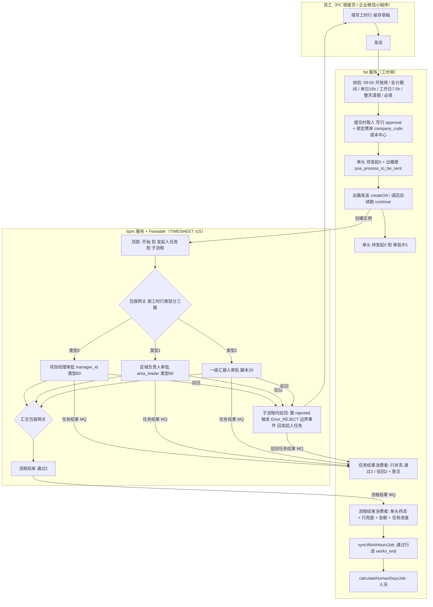
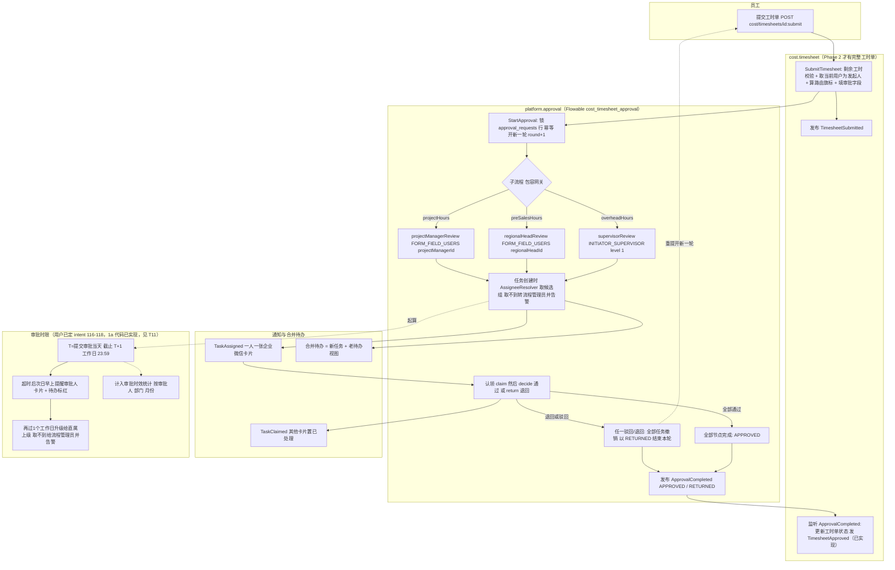
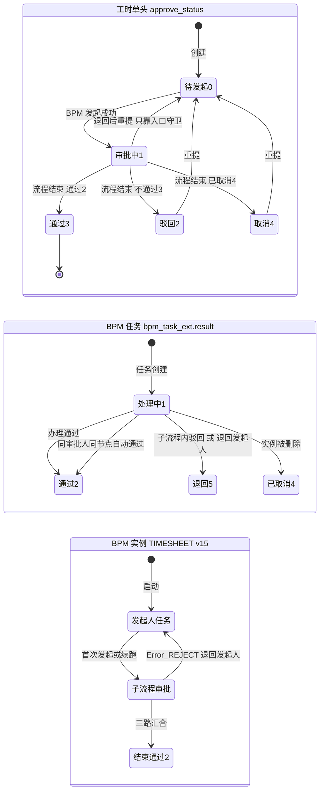
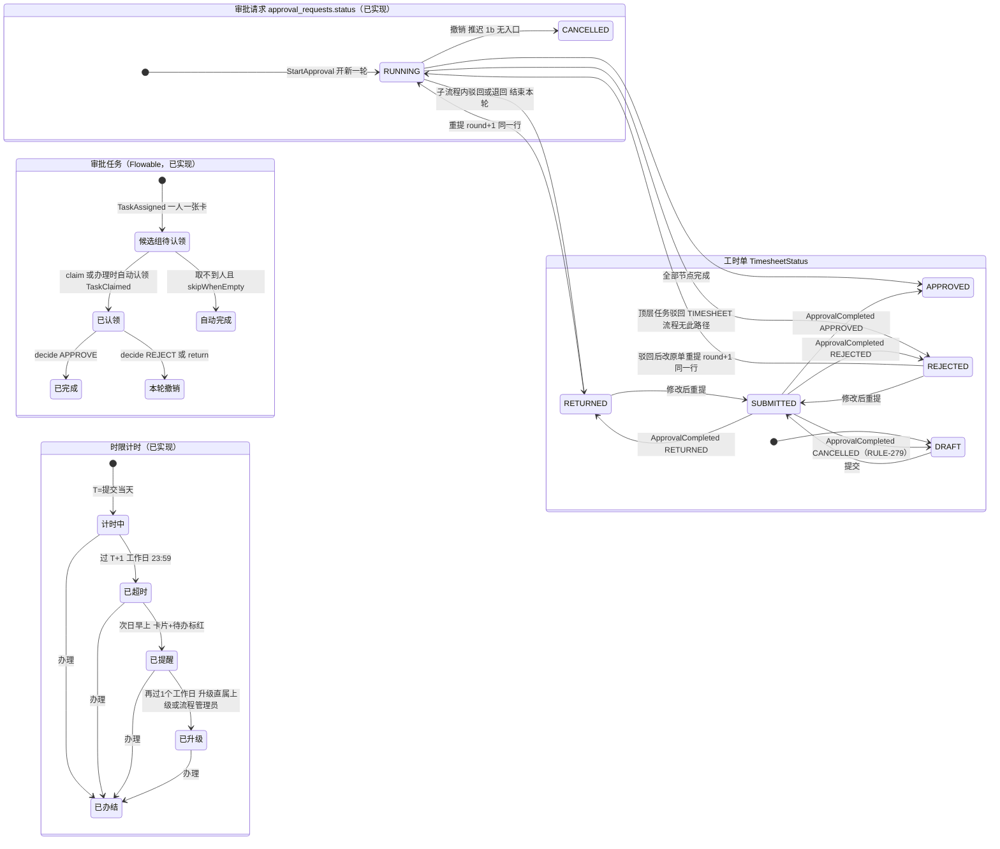

# TIMESHEET 审批（Phase 1a）

- 涉及 BC：`cost.timesheet`（工时单，Phase 2 迁入；1a 只做回放）、`platform.approval`、`organization.workforce`、`organization.attendance`（工作日历）、`platform.integration`
- 涉及的 A8 模板 / 老系统入口：老系统 TIMESHEET 流程 v15（三路并行）；老工时提交与审批页面；A8 工时流程（2026-04-30 停用）
- 证据采集日期：2026-10-14（老代码只读；生产数字为本会话经已授权只读通道采集的计数，或引自已有文档）
- 梳理会话：psa-1a-process-review（现状 / 目标由 sonnet 子代理整理，差异判断与建议由 opus 完成，差异由用户逐条决定）

- 涉及 BC：`cost.timesheet`（工时单，Phase 2 迁入，1a 只有提交入口骨架）、`platform.approval`（审批引擎封装、候选组认领、合并待办）、`organization.workforce`（组织快照、法人）、`platform.integration`（企业微信）
- 1a 用途：「审批人序列回放」（C1a-13，`DOC/AI_NATIVE_SPEC.md:30`）；业务单据本身 Phase 2 迁入
- 证据采集日期：2026-10-14（老代码 psa HEAD 只读；新仓库工作树 xin-7143b1 只读；生产数字只引用文档或会话转述的已核实数字，出处见各处）
- 路径缩写：
  - 老系统 `FST/` = `psa-backend/yudao-module-fst/yudao-module-fst-biz/src/main/java/cn/iocoder/yudao/module/fst/`；`BPM/` = `psa-backend/yudao-module-bpm/yudao-module-bpm-biz/src/main/java/cn/iocoder/yudao/module/bpm/`；`PC/` = `psa-front-desk-pc/src/`；`MINI/` = `psa-mini/src/`
  - 新仓库 `DOC/` = `docs/`；`BE/` = `backend/src/main/java/com/forcitis/one/`；`BER/` = `backend/src/main/resources/`；`BET/` = `backend/src/test/`
- 生产数字出处缩写：
  - 〔P-v15〕= `DOC/phase1a/TIMESHEET_REPLAY.md:149-193`（2026-10-14 用户授权只读核实 v15 流程定义）
  - 〔P-rt〕= `DOC/runtime/prod_bpm.tsv`、`prod_bpm2.tsv`、`README.md`（2026-10-14 只读采集）
  - 〔P-1014〕= 2026-10-14 psa-1a-process-review 经已授权通道只读计数（由本次任务委托方转述，本调查未自行访问生产）

## 现状流程

### 1.1 流程图

### 1.2 步骤表

| # | 步骤 | 角色 | 系统 | 数据 / 状态变化 | 证据 |
|---|---|---|---|---|---|
| 1 | 填写 / 保存草稿：选工作包、按日填工时；保存只存草稿，不跑提交校验 | 员工 | psa-mini 填报页、PC 填报页；fst `/fst/man-hour/add` | 新建 `psa_time_sheet` 单头（编号前缀 TS，`approve_status=0` 待发起，`status=0`）；行 `psa_time_sheet_works` | `MINI/pages/work/project/manhour/addManhour.tsx:332`；`PC/views/project/manhour/fill/index.vue`；`FST/controller/admin/manhour/ManHourController.java:209`；`FST/service/manhour/ManHourServiceImpl.java:826-830`、`:1595-1621`（RULE-050/055） |
| 2 | 发送前校验：当天 09:00 前不开放（Asia/Shanghai，只拦当天）；会计期间须「打开 / 重开」；单日 ≤15h；工作日（工时 + 请假）≥7.5h；同人同日防重复（Redis）；整天请假（≥450 分钟）不得发送；类型 / 工作包类型必填 | 员工（系统校验） | fst | 校验失败 503 / 400，整体回滚；无状态变化 | `ManHourServiceImpl.java:1184-1260`（09:00 闸 `:1186-1191`，期间 `:1193-1196`，15h `:1205-1210`，7.5h `:1215-1225`，防重 `:1226-1246`）；`:858-868`（整天请假）；`:871` 必填；`:790-797` 防重复提交键；`FST/service/accounting/AccountingPeriodServiceImpl.java:38-41, 62-67`（RULE-036/062/065） |
| 3 | 提交时取人：每行按类型写 `approval`——项目行取项目经理（项目 → 任务负责人 → 行 managerId → 按项目编码反查，四级回退）；售前 / 混合行取商机等所属部门（PDC）负责人；OH 行取提交人的直属上级 `leaderUserId`；任何一行取不到则 503 阻断发送 | 系统 | fst | 行 `approval` 字段；发送时 `approval=NULL` 即阻断 | `ManHourServiceImpl.java:1702-1765`（RULE-051）；`:1397-1418`（RULE-029）；`:579-605`、`:1066-1104`（`areaLeader` 变量 = 部门负责人集合） |
| 4 | 提交时锁定费率与归属：每行写标准成本 / 计费费率（方案、明细、费率、单位、可计费标志）、核算组织编码 `company_code`（按工时日期取员工异动区间）、成本中心（员工所属部门）；缺任何一项 503；金额留待审批 | 系统 | fst | 行 9 个费率字段、`company_code`、`cost_center_id`；单头 `company_code`（缺则单头建不成） | `ManHourServiceImpl.java:1607-1617`（单头 company_code）、`:1670-1696`（行费率与归属，RULE-005/058）；`FST/service/manhour/TimeSheetRateServiceImpl.java:84-90` |
| 5 | 写出箱并提交事务：流程变量（整单级扁平变量 + 行审批骨架）连同标题日期写入 `psa_process_to_be_sent`，动作 `CREATE_OA`（首次 / 取消后重提）或 `CONTINUE_AFTER_RETURN`（退回后重提）；单头仍为待发起 | 系统 | fst | 出箱行（状态 0 待发，失败为 2） | `ManHourServiceImpl.java:873-915`（变量与出箱）、`:925-929`（提交后即时异步发起）；RULE-050/315 |
| 6 | 发起 BPM：即时异步发起或 XXL-JOB `asyncCreateProcessJob` 兜底（每 30 秒，批 100，Redisson 锁，最多重试 5 次，之后标失败不再自动重试）；`createOA` 新建实例或 `continueProcessAfterReturn` 续跑退回实例；BPM 返回成功后才把单头改为「审批中」 | 系统 | fst → bpm | 单头 `approve_status` 0 → 1，`status`=1，操作人类型 SYSTEM，写 `psa_time_sheet_approve_status_revision` | `FST/service/bpm/ProcessToBeSentServiceImpl.java:54`（MAX_RETRY）、`:98`、`:111-125`、`:134-204`（`:165` 续跑，`:172` 新建，`:179-188` 置审批中）；`FST/trigger/task/AsyncCreateProcessJob.java:23`；RULE-045/315 |
| 7 | 三路并行取人（v15 结构以 `DOC/phase1a/TIMESHEET_REPLAY.md` 为准）：顶层「开始 → 发起人任务 → 子流程」；子流程内包容网关按工时行类型分三路：类型 0 → 项目经理审批（类型 60，变量 `manager_id`）、类型 1 → 区域负责人审批（类型 60，变量 `area_leader`）、类型 2 → 一级汇报人审批（脚本 20）；三节点 `skip_when_empty=1`、`row_approval=0`；并行多实例会签，每个不同审批人一个任务；任务创建时取人；单实例节点随机取一人（RULE-249）；发起人在审批人之列时按 RULE-307 升级到其直属上级；任务创建时发站内信 + 企业微信 | 系统 / 审批人 | bpm + Flowable | 每任务 `bpm_task_ext`（result=1 处理中）；A8 无关 | 〔P-v15〕；`DOC/runtime/prod_bpm.tsv:203-206`；`DOC/runtime/prod_bpm2.tsv:14`（`containsAny('manHourTypeList.type', 0)`）；`BPM/framework/flowable/core/behavior/BpmParallelMultiInstanceBehavior.java:45-93`；`BpmUserTaskActivityBehavior.java:73-100`；`BPM/service/definition/BpmTaskAssignRuleServiceImpl.java:504-550`；`BPM/service/task/BpmTaskServiceImpl.java:1449`（`跳过发起人审批`属性，v15 发起人节点是否带此属性：未核实）、`:1488-1500`（任务分配通知） |
| 8 | 节点级审批（v15 非行级）：审批人在 PC 待办 / 小程序点通过；校验任务办理人必须是本人；同一审批人在同一节点已通过过则自动通过（除非返工 / 退回重审标志） | 审批人 | PC `views/bpm/task/todo.vue`、`views/bpm/processInstance/detail.vue:65-157`；小程序 `MINI/api/process/index.ts:186`（`/bpm/task/decide`）、`:195`（`/fst/workflow-form/approve`）；bpm | 任务完成；`bpm_task_ext.result`=2 通过；发布「任务结果」MQ | `FST/controller/admin/workflowform/WorkflowApproveController.java:36-48`；`BPM/service/task/BpmTaskServiceImpl.java:1303-1311`（`checkTask`）；`BpmTaskEventListener.java:334-409`（RULE-302） |
| 9 | 任务结果回写行：按消息带的本节点行集写行状态——通过 → 3；驳回时行级意见 JSON 中有意见的行 → 2，其余行 → 3；纯文本驳回 → 整节点行 → 2；单头不变 | 系统 | fst 任务结果消费者 | 行 `approve_status` 3 / 2 + 行意见 | `FST/mq/consumer/approval/timesheet/TimesheetApprovalResultHandler.java:54-139`；`FST/mq/consumer/approval/ApprovalTaskResultConsumer.java:41-75`；RULE-043/311 |
| 10 | 驳回 / 退回：子流程内节点驳回改为「退回发起人」——置流程变量 `rejected`、完成当前任务，由子流程 `Error_REJECT` 错误边界事件回到顶层发起人任务；实例不删；发「REJECT 任务结果」MQ，**无流程结束 MQ**，所以单头仍为「审批中」、其余行留「审批中」；其他分支的任务可继续审，驳回组殿后 | 审批人 | bpm | 实例存活停在发起人任务；单头 `approve_status` 仍 1；行：驳回行 2，通过行 3，其余 1 | `BPM/service/task/BpmTaskServiceImpl.java:800-861`（`:811-816` 子流程判定转退回）、`:1070-1100`（`:1076-1081` 驳回组殿后）、`:1102-1140`（`:1135` 单头留审批中）；`BPM/controller/admin/task/BpmTaskController.java:95-100`（`/bpm/task/return`）；〔P-v15〕「驳回」行 |
| 11 | 发起人重提：入口守卫只允许本人，且单头为驳回 2 / 取消 4，或流程实例当前停在发起人节点（问 bpm）；重置单头 审批中 → 待发起（状态机为此放开 1 → 0 边）；删旧行重插，内容未变且已通过的行保留通过结果并不进新骨架；退回续跑 `CONTINUE_AFTER_RETURN` 沿用同一实例，取消 / 结束后重提 `CREATE_OA` 开新实例；写修订快照 | 员工 | fst + bpm | 单头 1 → 0 → 1；修订表新增行 | `ManHourServiceImpl.java:800-831`、`:953-1003`、`:2815-2827`（`isReturnedToInitiator`）、`:2847-2863`；`FST/service/manhour/ManHourApproveStatusService.java:163-183`；`ManHourController.java:243`（`/edit-detail`）；RULE-023/035/049/054/056 |
| 12 | 流程结束回写：三路都通过后实例结束，发「流程结束」MQ（通过 2 / 不通过 3 / 已取消 4）；单头 → 通过 3 / 驳回 2 / 取消 4；仍在审批中的行兜底改终态；通过时按批准工时 × **提交时锁定**的费率写成本 / 计费金额（HALF_UP 三位）；刷任务实际工时与进度；逻辑删被替换的原单；写状态留痕（from / to / 操作人 / 类型 BPM）；已是目标态则幂等不写 | 系统 | bpm 发 MQ → fst 流程结束消费者 | 单头终态 + `status`（通过时 2 结束，否则 1 进行中）；行 `standard_cost_amount`、`bill_rate_amount`、`approved_time` | `BPM/mq/producer/BpmProcessResultProducer.java:47-88`；`FST/mq/consumer/approval/ProcessResultConsumer.java:43-75`；`TimesheetProcessResultHandler.java:46-93`；`FST/service/manhour/ManHourBpmApplyService.java:54-113`；`ManHourApproveStatusService.java:41-125`、`:185-190`、`:241-271`；RULE-003/044/047/052/060/061 |
| 13 | 成本写入：XXL-JOB `syncWorkHoursJob` 把「通过」且未删除的行同步进 `psa_time_sheet_works_end`；`calculateHumanDaysJob` 算人天；之后进成本归集 / 过账前检查（`TimesheetApprovalCheck` 对「审批中」只给文案催办） | 系统 | fst 定时任务 | `works_end` 行、`human_days` | `FST/service/sync/SyncServiceImpl.java:511-523`；`FST/trigger/task/syncWorkHoursJob.java:16`；`FST/trigger/task/ManHourHumanDaysJob.java:16`；`FST/service/manhour/ManHourEndServiceImpl.java:57-109`；`FST/application/cost/projectcost/prepostingcheck/TimesheetApprovalCheck.java:113`；RULE-004/021 |

### 1.3 生产计数

| 项 | 数值 | 出处 |
|---|---|---|
| TIMESHEET 流程定义版本数 / 当前版本 / 实例数 | 15 / v15 / 34,498 | 〔P-rt〕`prod_bpm.tsv:4`、`README.md:33` |
| 近 180 天 TIMESHEET 任务数 | 66,766（`README.md:33`）；〔P-1014〕分档合计 66,948（时点不同，差 182） | 〔P-rt〕、〔P-1014〕 |
| v15 节点指派规则 | 4 条：发起人（脚本 10）、`manager_id`（60）、`area_leader`（60）、脚本 20 | `prod_bpm.tsv:203-206` |
| v15 边界事件 | 仅 `errorEventDefinition` `Error_REJECT`（驳回捕获），非定时器；`ACT_RU_TIMER_JOB`=0 | 〔P-1014〕 |
| 任务耗时分档（近 180 天，自然时间） | <24h 63,656；24–48h 1,671；2–5 天 1,327；5–10 天 151；≥10 天 28；未完成 115 | 〔P-1014〕 |
| 实例耗时分档 | <24h 31,343；24–48h 1,612；2–5 天 1,304；5–10 天 150；≥10 天 27；未完成 105 | 〔P-1014〕 |
| 填报滞后（2026-05-01 起，创建日减工时日） | 当天 28,144；次日 3,429；≥2 天 114 | 〔P-1014〕 |
| `psa_calendar` | 4,018 行，覆盖 2016-01-01..2026-12-31，2027 年未录入 | 〔P-1014〕；老库 `psa_calendar` 无写入代码（`/Users/yeliang/Projects/FORCITIS/psa/psa-backend/yudao-module-fst/yudao-module-fst-biz/src/main/java/cn/iocoder/yudao/module/fst/dal/mysql/calendar/CalendarMapper.java:12-18`） |
| A8 工时填报单（历史） | 2026-04-30 停用；历史 386,965 单；在途 145 须排空 | `DOC/OA_PROCESS_INVENTORY.md:186` |
| 表头状态 / 行状态的生产分布 | 文档未见，未采集 | — |

读数说明（不是结论）：
- 分档是自然时间。「<24h」之外合计任务 3,177（1,671+1,327+151+28），占 66,948 的约 4.7%；实例 3,093 / 34,541 约 9.0%（实例 = 最慢分支决定）。
- 在 T+1 工作日 23:59 口径下，周一 10:00 提交、周二 20:00 办完（34 小时）仍未超时；周五 15:00 提交、下周一办完（≈ 69 小时）也不超时。所以上表不能直接当「超时件数」。
- 未完成 115 个任务 / 105 个实例未必超时，是当时仍在途的数。

---

## 目标流程

### 2.1 流程图

### 2.2 要点与依据（含 1a 实现状态）

| # | 要点 | 依据 | 1a 实现状态 |
|---|---|---|---|
| T1 | 三路并行：包容网关分叉 / 汇合，三个路由旗标 `projectHours` / `preSalesHours` / `overheadHours` 由业务模块预先算好，BPMN 只读；各路节点键 `projectManagerReview` / `regionalHeadReview` / `supervisorReview` | 〔P-v15〕对照表；RULE-262 | 已实现：`BER/processes/cost_timesheet_approval.bpmn20.xml:18-27, 28-42, 46`；`BE/cost/timesheet/api/TimesheetRoutingFlag.java:4-21` |
| T2 | 无发起人任务；子流程内驳回 / 退回即结束本轮，以 `RETURNED` 通知业务模块，重提开新一轮（`start_rounds`） | 用户 M3「退回即结束本轮，重提开新一轮 (Recommended)」（`DOC/RULE_REVIEWS.md` 实现方式变更 RULE-275/287；`DOC/INTENT.md:124`） | 已实现：`BE/platform/approval/application/DecideTasks.java:124-126`；`ApprovalLifecycle.java:61-67`；`ReturnToInitiator.java:35-51`；`StartApproval.java:36-60`；`BER/db/migration/platform_approval/V20261014132000__platform_approval_create_requests.sql:5-44` |
| T3 | 取人：每节点恰一条指派规则（`FORM_FIELD_USERS` / `INITIATOR_SUPERVISOR`），任务创建时由纯函数 `AssigneeResolver` 解析一次；排除停用 / 离职；汇报线不完整往上推到部门负责人；取不到转流程管理员并告警；防自审只在没有其他候选时升级到发起人直属上级 | RULE-250/253/254/262/307 评审结论（`DOC/RULE_REVIEWS.md`） | 已实现：`BE/platform/approval/domain/AssigneeResolver.java:34-58, 122-137`；`infrastructure/flowable/TaskAssignmentListener.java:56-97` |
| T4 | 取不到人时的跳过仅限节点显式配置 `skipWhenEmpty="true"` | RULE-300 评审（「仅在节点显式配置『允许跳过』且确实无人时跳过；配置错误或脚本异常一律报错告警」） | 部分：BPMN 三节点已配置（`xml:30, 35, 40`）；但「字段缺失」与「确实无人」不可区分（G-1，`DOC/phase1a/TIMESHEET_REPLAY.md:207`） |
| T5 | 单人节点改为候选组 + 认领，认领后只有认领人可办理；通知发候选组全员，认领后其他人的卡片置已处理 | RULE-249「错误，改成候选组认领」；用户 Q-3「收窄；通知发候选组全员 (Recommended)」（`DOC/INTENT.md:91`） | 已实现：`BE/platform/approval/domain/TaskActors.java:11-16`；`application/ClaimTask.java:26-33`；`infrastructure/notification/TaskNotifier.java:39-64` |
| T6 | 会签（每个不同审批人一个任务、全部通过才过）推迟 1b，1a 为「候选人中任一人办理」 | `DOC/phase1a/TIMESHEET_REPLAY.md:165, 190, 208`（G-2）；RULE-248/273 | 按文档推迟：`BET/platform/approval/PendingApprovalRulesTest.java:12-18`（`@Disabled`） |
| T7 | 结果以类型化事件通知业务模块（至少一次，经 Modulith 事件发布登记表），消费方必须幂等；不再有 MQ / 按表名拼 SQL 回写 | RULE-295/303/304/308 评审；`DOC/REIMAGINED_ARCHITECTURE.md:129` | 审批侧已实现：`BE/platform/approval/events/ApprovalCompleted.java:7-9`；`ApprovalLifecycle.java:76-80`；业务侧消费未实现（见 T9） |
| T8 | 合并待办 = 新任务 + 老库视图的老待办（行任务按 RULE-261 合并），不缓存 | `DOC/REIMAGINED_ARCHITECTURE.md:3.6 节`；RULE-261 | 已实现：`BE/platform/approval/application/ListInbox.java:28-44`；`domain/InboxMerger.java` |
| T9 | 工时单状态归各业务 BC；`cost.timesheet` 应监听 `ApprovalCompleted` 改工时单状态并发 `TimesheetApproved` | `DOC/AI_NATIVE_SPEC.md:29`（C1a-12「类型化结果事件」）；ArchUnit 事件命名例 `BET/ArchitectureRulesTest.java:55`；「1a 不接入业务单据」`DOC/REIMAGINED_ARCHITECTURE.md:136` | 已实现：`cost.timesheet` 经 `@ApplicationModuleListener` 监听 `ApprovalCompleted`（`BE/cost/timesheet/application/ApplyApprovalResult.java:41`），按结果调用 `approve` / `reject` / `returnForRevision` / `cancelSubmission` 并发布 `TimesheetApproved` 等事件（`domain/Timesheet.java:149-176`）；已消费事件按 eventId 去重（`ConsumedEvents`），非本轮结果忽略（`isAwaitingResultOfRound`）；工时单有表 `cost_timesheet.timesheets` 与仓储（`BE/cost/timesheet/domain/TimesheetRepository.java`，`BER/db/migration/cost_timesheet/V20261014140000__cost_timesheet_baseline.sql:4`）。`TimesheetStatus` 为 DRAFT、SUBMITTED、RETURNED、APPROVED、REJECTED（`api/TimesheetStatus.java:4-9`）；撤销回到 DRAFT，不记驳回（RULE-279）；`Timesheet` 为 1a 骨架，只有总工时、无工时行 |
| T10 | 回放工具（C1a-13）：老审批人 ∈ 新候选集，节点集合须相等，三路不比较顺序；差异分类 `MATCH` / `REVIEWED_*`（按类别由用户接受）/ `DEFECT`（逐条修，命令行状态码 1） | 用户 Q-4「四项都同意 (Recommended)」；`DOC/phase1a/TIMESHEET_REPLAY.md:5-47` | 工具与合成夹具已实现：`BE/platform/approval/infrastructure/replay/TimesheetApproverReplay.java`、`TimesheetBranches.java:11-14`；`BET/.../TimesheetApproverReplayIT.java`、`BET/resources/replay/synthetic-timesheet-export.json`；真实导出尚未做（`TIMESHEET_REPLAY.md:195-201` 执行步骤） |
| T11 | 审批时限 T+1（见下 (d)） | 用户决定 `DOC/intent/2026-10-14-116…119`；`DOC/INTENT.md:152-155` | 已实现（提醒、升级、逾期标红；审批时效统计未核实）：`BE/platform/approval/application/DeadlinePlanner.java:31`（按工作日历算截止 / 提醒 / 升级时刻）、`TaskRegistrar.java:46`（任务创建时计划）、`TaskDeadline.java:57-96`（到点提醒、升级）、`infrastructure/scheduling/ApprovalDeadlineJob.java:20-21`（定时作业）、`InboxItem.java:12`（`dueAt` / `overdue` 待办标红）、`events/ApprovalTaskBecameOverdue.java`、`events/ApprovalTaskEscalated.java`；日历取自 `organization.attendance` 的 `WorkCalendar` |

### 2.3 (a)–(d)

**(a) 法人维度来源**
- 老系统：员工、部门本身不带法人。工时每次保存 / 提交按工时日期查 `psa_employee_transfer_record` 的 `company_code`（核算组织编码），HR / DBA 按生效区间在该视图上维护；缺则 503；写入单头与每行（`FST/service/manhour/ManHourServiceImpl.java:1607-1617, 1677-1679`；`DOC/phase1a/COLUMN_OWNERSHIP.md:90`）。
- 目标：法人主体是 `organization_workforce.legal_entities` 小表，由新系统管理员维护；用户决定「1a 就建归属」——员工 → 法人生效区间表，由组织数据管理员维护（`DOC/intent/2026-10-14-108`，`DOC/INTENT.md` 对应行）；法人表另加数字「U8C 核算组织编码」，两种代码并存（`DOC/intent/2026-10-14-111`）。
- 1a 代码：只有法人小表与编号使用（`BER/db/migration/organization_workforce/V20261014131500__organization_workforce_create_legal_entities.sql:1-10`，字母码 `CHECK code ~ '^[A-Z]{2,10}$'`；无 U8C 编码列、无员工 → 法人区间表）。审批侧不用法人：`ApprovalRequest` 与任务负载都没有法人字段（`BE/platform/approval/api/ApprovalRequest.java:8`）。`TimesheetSubmitted` 也不带法人（`BE/cost/timesheet/events/TimesheetSubmitted.java:7`）。

**(b) 审批路由是否由 DMN 决策表表达**
- 1a：**不是**。路由由「业务模块算旗标 + BPMN 条件读旗标 + 每节点一条 `forcitis:assignmentRule` + Java `AssigneeResolver`」表达（`DOC/REIMAGINED_ARCHITECTURE.md:127, 213`；评审 #9、#15 记「删除 4 张表与 DMN（已采纳）」「1a 不用 DMN」`:273, 279`）；代码无任何 `.dmn` 资源。
- 规格并存相反表述：`DOC/AI_NATIVE_SPEC.md:29` C1a-12 写「Flowable 8 BPMN + 指派 DMN」；`DOC/GUIDING_PRINCIPLES.md:84-86` 把「工时行由谁审批（项目行 → PM；OH 行 → 直属上级；售前 → 部门负责人）」列为 DMN 示例（输入：行类型；输出：审批人角色）；`DOC/MODERNIZATION_BRIEF.md:60` 写「BPMN + DMN」。
- 若按 `GUIDING_PRINCIPLES.md:84-86` 的示例形态：输入 = 工时行类型（0 / 1 / 2 与「混合」）；输出 = 审批人角色或指派规则。1a 现行等价物：输入 = `cost.timesheet` 的路由旗标，输出 = BPMN 节点键加规则类型（`BE/cost/timesheet/api/TimesheetRoutingFlag.java`、`TimesheetApprovalField.java`）。
- 1a 的旗标计算在 `Timesheet.submit` 中只硬编码 `projectHours`（`BE/cost/timesheet/domain/Timesheet.java:137`），行类型到旗标的转换（含「混合」）尚未实现。1a 只有项目经理一路（另两路旗标随 Phase 2 流程梳理定，见 ARCH-D5）。

**(c) 审批与工时单的状态归属与协作事件**
- 归属：审批请求状态归 `platform.approval`（`approval_requests.status` ∈ RUNNING / RETURNED / APPROVED / REJECTED / CANCELLED，`V20261014132000…sql:12`）；工时单状态归 `cost.timesheet`（`TimesheetStatus` DRAFT / SUBMITTED / RETURNED / APPROVED / REJECTED，撤销回到 DRAFT，RULE-279）。老系统反过来：状态在 fst 头表 `approve_status`，bpm 通过 MQ 通知 fst 回写，且 bpm 也有自己的实例结果。
- 协作事件（新）：`cost.timesheet` → approval：`Timesheet` 提交时记录 `DocumentSubmittedForApproval`，`platform.approval` 订阅后发起一轮审批（`StartApprovalOnSubmission.java:54`）；approval → 业务：`ApprovalCompleted(instanceId, processKey, businessKey, round, outcome, reason)`、`TaskHandled`；approval → 通知：`TaskAssigned`、`TaskClaimed`；`cost.timesheet` 自发：`TimesheetSubmitted`、`TimesheetApproved`、`TimesheetRejected`、`TimesheetReturned`、`TimesheetCancelled`；approval → 业务：`ApprovalCompleted` 由 `ApplyApprovalResult` 消费。
- 业务键：`"timesheet:" + timesheetId`（`SubmitTimesheet.java:46`）；幂等键 `(processKey, businessKey)` 与 `(processKey, businessKey, round)`（`V20261014132000…sql:17, 43`）。
- 映射：`RETURNED` → 工时单 RETURNED（可修改后重提），`CANCELLED` → DRAFT，`REJECTED` → REJECTED（填报人可改原单再提交，仍是同一张单、轮次加一）；`TimesheetSubmitted` 暂无消费方（分析层将订阅，见 `events/timesheet.yaml`）。

**(d) 审批时限（按用户已定口径）**
- 计时起点：T = **提交审批当天**（`DOC/intent/2026-10-14-116`，`DOC/INTENT.md:152`）。1a 实现取任务创建当天为 T（创建日非工作日则取下一工作日，`DeadlinePlanner.java:31-36`）；任务创建时刻 `assignedAtMillis`，存为 Flowable 任务本地变量（`BE/platform/approval/infrastructure/flowable/TaskAssignmentListener.java:88`；`FlowableApprovalEngine.java:40, 164-166`），也是合并待办的 `createdAt`；没有「提交日」字段，`approval_requests` 表的 `created_at` 是该单据首轮创建、不是每轮提交（`V20261014132000…sql:14`），`start_rounds.created_at` 才是每轮（`…sql:41`）。
- 截止：T + 1 个**工作日**的 23:59（`DOC/intent/2026-10-14-116`）。时区在原话中未写；老代码时间闸用 `Asia/Shanghai`（`ManHourServiceImpl.java:119`）。
- 工作日历依赖：+1 与「再过 1 个工作日」、耗时按工作日小时计，都要工作日历。已定：2016–2026 共 4,018 天迁入新默认日历（只取工作日、法定假日、调休）；组织数据管理员每年 12 月 1 日前在页面录入下一年，11 月系统提醒；缺年份报错告警；2027 年须在 1a 上线前录入（`DOC/intent/2026-10-14-117`，`DOC/INTENT.md:153`）。1a 代码已有工作日历模块与维护接口（`organization.attendance`：`WorkCalendarController.java:42-57`，权限 `work-calendar:read` / `update`），角色种子含「组织数据管理员」`org_data_admin` 并授予日历权限（`BER/db/migration/platform_identity/V20261014130000__platform_identity_baseline.sql:322-340`）。
- 提醒触发点：超过截止后**次日早上**，向审批人发企业微信卡片，并在合并待办中标红（`DOC/intent/2026-10-14-116, 118`）。1a 已实现：定时作业 `ApprovalDeadlineJob.java:20-21` 调 `EnforceDeadlines`，`TaskDeadline.java:57-80` 标记逾期并提醒，合并待办带 `dueAt` / `overdue`（`InboxItem.java:12`）。
- 升级触发点：提醒之后**再过 1 个工作日**，升级给直属上级；取不到给流程管理员并告警（同上）。`AssigneeResolver` 的 `INITIATOR_SUPERVISOR` 取的是**发起人**的上级（`:122-137`），升级需要的「审批人的直属上级」只有 `OrgDirectory.findSupervisor` 可用（`:48`、`:127`），升级用例为 `TaskDeadline.escalate`（`TaskDeadline.java:85-106`），取不到人转流程管理员并告警。
- 不自动通过（`DOC/intent/2026-10-14-116`）：1a 代码没有任何超时自动完成路径，一致。
- 统计触发点：计入审批时效统计；耗时按工作日小时计（非工作日不计）；按审批人、部门、月份统计当期办结率与超时件数（`DOC/intent/2026-10-14-118`）。逾期与升级有事件 `ApprovalTaskBecameOverdue`、`ApprovalTaskEscalated`；按审批人、部门、月份的统计载体未核实。
- 范围外：填报截止（COST-R02）留到 Phase 2（`DOC/intent/2026-10-14-119`）。

---

## 涉及的聚合与状态机

### 3.1 聚合

| 聚合 / 实体 | 老系统 | 新系统（1a） |
|---|---|---|
| 工时单 | 头 `psa_time_sheet`（`approve_status` 0–4、`status` 0–2、`company_code`、`origin_id`）；行 `psa_time_sheet_works`（行 `approve_status`、`approval`、9 个费率字段、金额、意见）；`psa_time_sheet_works_end`；`psa_time_sheet_approve_status_revision`（头状态留痕）；修订快照；出箱 `psa_process_to_be_sent`（`FST/dal/dataobject/manhour/ManHourItemDO.java` 等） | `Timesheet` 聚合 + `TimesheetStatus` 枚举，表 `cost_timesheet.timesheets`（`BE/cost/timesheet/domain/`）；老数据 Phase 2 迁入 |
| 审批请求 / 任务 | Flowable `ACT_*` + `bpm_process_instance_ext` + `bpm_task_ext`（`result` 1 处理中 / 2 通过 / 3 不通过 / 4 已取消 / 5 退回 / 6 知会）+ 单据绑定 `paramsId`；`bpm_task_assign_rule` | `platform_approval.approval_requests`（每单据一行）+ `start_rounds`（每轮一行）+ Flowable 实例 / 任务（`ACT_*` 在同 schema，生产 `flowable.database-schema-update=false`） |
| 时限计时 | 无 | 已实现：任务的截止 / 提醒 / 升级时刻（`DeadlinePlan`，随任务存储） |

### 3.2 现状状态机（老系统）

老状态值与字段（枚举 / 编码）：

| 对象 | 值 | 证据 |
|---|---|---|
| 头 `approve_status` | 待发起 0、审批中 1、驳回 2、通过 3、取消 4 | `psa-backend/yudao-framework/yudao-common/src/main/java/cn/iocoder/yudao/framework/common/enums/CommonConstants.java:13-18` |
| 头 `status` | 待发起 0、进行中 1、结束 2（通过 → 2，其余 → 1，首建 0） | `ManHourApproveStatusService.java:185-190`；RULE-052 |
| 行 `approve_status` | 同上 5 值；锁定任务编制的口径取 {0, 1, 3} | `FST/dal/mysql/manhour/ManHourItemMapper.java:50-84`（RULE-059） |
| 允许的头转换 | none → 0；0 → 1；1 → 3 / 2 / 4 / 0；2 → 0；4 → 0；3 无出边 | `ManHourApproveStatusService.java:163-183`（RULE-048） |
| BPM 实例 / 任务结果 | 处理中 1、通过 2、不通过 3、已取消 4、退回 5、知会 6；两套编码的 2 / 3 含义互换（BPM 通过 2 ↔ fst 通过 3） | `psa-backend/yudao-module-bpm/yudao-module-bpm-api/src/main/java/cn/iocoder/yudao/module/bpm/enums/task/BpmProcessInstanceResultEnum.java:16-29`；RULE-044 |
| 出箱 | 状态 0 待发、2 失败；`MAX_RETRY=5` | `ProcessToBeSentServiceImpl.java:54`；RULE-315 |
| 生产分布 | 未见文档，未采集（头 / 行各状态件数） | — |

观察到的现状特点（事实）：
- v15 下驳回不结束实例，所以头不会因驳回进入 2；头 2 只在顶层驳回（`BpmTaskServiceImpl.java:802-861` 的原分支）或老版本流程出现，v15 下头 2 的来源在生产是否仍出现：未核实。
- 退回后头仍是 1，状态机的 1 → 0 边是「为退回重提放开」，防护只在调用方入口（`ManHourApproveStatusService.java:171-174` 注释；RULE-048 疑似缺陷）。

### 3.3 目标状态机（1a 代码）

新状态值与字段（file:line）：

| 对象 | 值 / 字段 | 证据 |
|---|---|---|
| `ApprovalStatus` | RUNNING、RETURNED、APPROVED、REJECTED、CANCELLED；`isLive` 仅 RUNNING | `BE/platform/approval/domain/ApprovalStatus.java:4-13` |
| `TaskOutcome` / `ApprovalOutcome` | APPROVED / REJECTED / RETURNED；APPROVED / REJECTED / RETURNED / CANCELLED | `BE/platform/approval/api/TaskOutcome.java:4-8`、`ApprovalOutcome.java:3-7` |
| 子流程内驳回的归宿 | `insideSubProcess` → `returned()`；顶层才 `reject()`；TIMESHEET 流程无顶层用户任务 | `DecideTasks.java:124-126`；`FlowableApprovalEngine.java:161`（`node.getSubProcess() != null`） |
| 轮次 | `current_round`、`start_rounds(round_number)`，重提 +1，只有该单上一轮发起人能开新一轮 | `StartApproval.java:36-60`；`V20261014132000…sql:10, 38` |
| `TimesheetStatus` | DRAFT、SUBMITTED、RETURNED、APPROVED、REJECTED；撤销回到 DRAFT（RULE-279） | `BE/cost/timesheet/api/TimesheetStatus.java:4-9` |
| 任务时间 | `assignedAtMillis`（任务本地变量） | `TaskAssignmentListener.java:88`；`FlowableApprovalEngine.java:40` |
| 时限计时 | 任务的 `DeadlinePlan`（截止、提醒、升级时刻）、逾期与升级标记 | `BE/platform/approval/domain/DeadlinePlan.java`；`TaskDeadline.java:57-96` |

---

## 发出 / 消费的领域事件

### 4.1 新系统

| 事件 | 触发转换 | 负载要点 | 消费方及反应 | 1a 状态 |
|---|---|---|---|---|
| `TimesheetSubmitted` | `Timesheet.submit` | `document`、`number`、`employee`、`projectManager`、`submittedHours`、`submittedOn`、`round`（`events/TimesheetSubmitted.java:16`） | 无消费方（分析层将订阅） | 发布已实现 `BE/cost/timesheet/domain/Timesheet.java:140` |
| `TaskAssigned` | Flowable 任务创建且取到候选人（跳过的节点不发） | `taskId`、`instanceId`、`processKey`、`businessKey`、`nodeKey`、`nodeName`、`initiator`、`candidates`（排序） | `TaskNotifier.onTaskAssigned`：给每位候选人一张企业微信卡片（无按钮，去重键 `approval-task:{taskId}`）；候选人无企业微信 ID 则告警跳过 | 已实现 `BE/platform/approval/infrastructure/flowable/TaskAssignmentListener.java:94-96`；`infrastructure/notification/TaskNotifier.java:39-58`；`events/TaskAssigned.java:10-11` |
| `TaskClaimed` | 候选人认领 / 办理时自动认领 | `taskId`、`claimedBy` | `TaskNotifier.onTaskClaimed`：其他卡片置「已由 X 处理」 | 已实现 `ApprovalLifecycle.java:44`；`TaskNotifier.java:60-64` |
| `TaskHandled` | 通过 / 驳回 / 退回办理（自动完成不发；`advisory` 恒 false） | `taskId`、`instanceId`、`processKey`、`businessKey`、`nodeKey`、`assignee`、`outcome`、`advisory`、`reason` | 无业务方消费（工时行级回写在 Phase 2） | 发布已实现 `ApprovalLifecycle.java:47-50`；`events/TaskHandled.java:10-12` |
| `ApprovalCompleted` | 全部节点完成（APPROVED）；退回（RETURNED）；顶层驳回（REJECTED）；撤销（CANCELLED） | `instanceId`、`processKey`、`businessKey`、`round`、`outcome`、`reason`；至少一次，消费方按 `(processKey, businessKey, round)` 幂等 | 工时单：`ApplyApprovalResult` 更新状态 | 发布已实现 `ApprovalLifecycle.java:76-80`；`events/ApprovalCompleted.java:7-9` |
| `TimesheetApproved` | 工时单 SUBMITTED → APPROVED | `document`、`employee`、`submittedHours`、`round` | 应由 Phase 2 的成本归集 / 过账管道消费 | 已实现 `BE/cost/timesheet/domain/Timesheet.java:149-153` |
| `ApprovalTaskBecameOverdue` / `ApprovalTaskEscalated` | 任务到点逾期 / 升级（见 2.3 (d)） | 见 `events/approval.yaml` | 企业微信卡片、合并待办标红 | 已实现 `BE/platform/approval/events/ApprovalTaskBecameOverdue.java`、`ApprovalTaskEscalated.java` |

### 4.2 老系统（对照）

| 机制 | 触发 | 内容 | 消费方 / 反应 | 证据 |
|---|---|---|---|---|
| 出箱发起 | 发送工时 | `psa_process_to_be_sent` 行：变量、标题日期、动作 | `asyncCreateProcessJob` / 即时异步发起 → bpm `createOA` 或续跑；成功后头 0 → 1 | `ProcessToBeSentServiceImpl.java:98-204`；`AsyncCreateProcessJob.java:23` |
| `topic-bpm-approval-task-result` | 每次通过 / 驳回 / 退回（有 AFTER 钩子时先入出箱） | 任务结果 + 本节点行集 `rowIds` + 办理人 + 原因 | fst `ApprovalTaskResultConsumer` → `TimesheetApprovalResultHandler` 写行状态；有 AFTER 钩子时钩子替代处理器 | `BPM/mq/producer/BpmApprovalTaskResultProducer.java:71-108`；`FST/mq/consumer/approval/ApprovalTaskResultConsumer.java:41-75`；`FST/src/main/resources/application.yaml:111`；RULE-305/311 |
| `topic-bpm-process-result` | 流程结束（通过 2 / 不通过 3 / 已取消 4），只发给有 `paramsId` 的流程 | 结果、原因、`paramsId`，幂等键 `PE:`+实例号 | fst `ProcessResultConsumer`：先 AFTER 钩子后处理器，处理器幂等（目标态则不写） | `BPM/mq/producer/BpmProcessResultProducer.java:47-88`；`ProcessResultConsumer.java:43-75`；`application.yaml:115`；RULE-306/312 |
| 可靠投递 | 以上两类 | 出箱 + 补偿对账任务 | `BpmApprovalMqReliableSender`；对账任务从 bpm 记录反推重发 | `BPM/mq/producer/BpmApprovalMqReliableSender.java:52-55`；RULE-295/304 |
| 终态副作用 | 头 → 通过 | 刷任务进度、逻辑删原单（尽力而为，不回滚主流转） | `projectTaskApi.updateTaskProgress`；`logicDeleteOrigin` | `TimesheetProcessResultHandler.java:74-91` |
| 状态留痕 | 头每次变动 | from / to / 操作人 / 类型（USER / SYSTEM / BPM / DELETE） | `psa_time_sheet_approve_status_revision`（只追加） | `ManHourApproveStatusService.java:119-125`；RULE-060 |
| 钩子 | 办理前 / 后 | BEFORE 钩子在办理事务内；AFTER 钩子随出箱 | 业务钩子注册表 | RULE-277/283/311 |
| 企业微信待办通知 | 任务分配 | 站内信 + websocket / 企业微信，事务提交后发，发前复查未终态 | 一个受理人一条 | `BpmTaskServiceImpl.java:1488-1500` |

---

## 权限

### 5.1 老系统

| 动作 | 现状规则 | 证据 |
|---|---|---|
| 谁能提交 | 登录用户即提交人（`personId = 登录人`），没有 `@PreAuthorize` 与权限码；重提只能本人（403「只能重新发起本人的工时单」）；动作入口 `/fst/man-hour/add`、`/update`、`/process-edit-submit` | `ManHourServiceImpl.java:787`、`:800-831`；`ManHourController.java:160, 209, 227`；RULE-022/049（「None of the controller methods carry `@PreAuthorize`」`ManHourController.java:124-207`） |
| 谁能看（数据范围） | 列表：非超级管理员只看本人（`FSTConstant.SUPER_ADMIN_ROLE`）；`/get`、`/item/get`、`/item/get-by-instance-id`、`/process-edit-detail`、`/preview-rates` 无归属 / 权限校验（水平越权，RULE-022 疑似缺陷）；已审批列表 / 导出 / 工作包列表带 `@DataPermission` | `ManHourServiceImpl.java:216-222`；`ManHourController.java:114, 133, 142, 151, 169, 179, 263` |
| 谁能审批 | 任务办理人本人：`checkTask` 要求 `assignee == 登录人`；统一审批 `/fst/workflow-form/approve`、`/bpm/task/decide`、`/bpm/task/return` 只要求已登录，授权收敛到服务层办理人校验，**不设菜单权限点**（#1034、#1320） | `BPM/service/task/BpmTaskServiceImpl.java:1303-1311`；`WorkflowApproveController.java:38-42`；`BpmTaskController.java:95-100` |
| 管理员动作 | 转派、加签需 `bpm:task:update`；取消流程需 `bpm:process-instance:cancel`；批量审批曾能以他人名义办理（RULE-270，评审为「错误」） | `BpmTaskController.java:119, 128`；`BpmProcessInstanceController.java:54, 73` |
| 审批期间临时访问 | 有通用旁路 `ApprovalVisibilityGuard`（功能权限**或**流程参与人，失败一律翻成「单据不存在」），已用于报价、项目、预算、收入确认、ETC 详情；**工时详情未接** | `FST/application/platform/workflow/ApprovalVisibilityGuard.java:51-77`；使用方：`QuotationController`、`PmProjectController`、`PmProjectBudgetController`、`PmRevenueConfirmationController`、`GetEtcApprovalViewUseCase`（工时无引用） |
| 前端 | PC 待办 / 流程详情；小程序 `MINI/api/process/index.ts:186, 195, 244` | 见 1.2 步骤 8 |

### 5.2 新系统（1a）

| 动作 | 规格 / 代码 | 证据 |
|---|---|---|
| 谁能提交 | 权限码 `cost.timesheet:timesheet:submit`；发起人取自会话 `CurrentUser`，不取请求（RULE-265「错误」→ 已修）；审批发起不对外暴露 start 端点，只由业务模块调用（I-5：业务模块先校验单据归属） | `BE/cost/timesheet/web/TimesheetController.java:29-31`；`BE/platform/identity/api/Permission.java:32`；`SubmitTimesheet.java:19, 44`；`ApprovalRequest.java:7` |
| 谁能看 | 审批任务详情：仅发起人、办理人、候选人，其余按「不存在」处理（fail closed）；待办列表只列本人；工时单本身无读取接口；`AccessScope`（法人 × 部门子树 × 项目角色）只交付类型，数据范围授权表推迟到 1b | `BE/platform/approval/application/GetTaskDetail.java:25, 34-36`；`ListInbox.java:28-44`；`BE/platform/identity/api/AccessTarget.java`；`DOC/REIMAGINED_ARCHITECTURE.md:103` |
| 谁能审批 | 权限码 `platform.approval:task:approve` + 任务级校验：已认领则只有认领人，否则候选人之一（拒绝时在独立事务里记审计 `platform.approval.task.denied`）；`employee` 角色种子授予 `task:read`、`task:approve`；`cost.timesheet:timesheet:approve` 有定义但无任何 `@PreAuthorize` 使用 | `ApprovalTaskController.java:47-77`；`domain/TaskActors.java:11-16`；`application/TaskGuard.java:36-46`；`V20261014130300…sql:6-10`；`Permission.java:33` |
| 提交权限的授予 | 种子中**没有任何角色**拥有 `cost.timesheet:timesheet:submit` | `V20261014130300__platform_identity_seed_roles_and_navigation.sql:6-10` |
| 审批期间临时访问 | 仅任务详情层面；对照老的「功能权限或流程参与人」旁路，工时单读取接口与旁路尚不存在 | `GetTaskDetail.java:34-36` |
| 管理员动作 | 转交 / 加签 / 撤回 / 撤销推迟 1b；管理员代办须显式「代理」并审计两个 ID（RULE-270 评审），测试骨架 `@Disabled` | `BET/platform/approval/PendingApprovalRulesTest.java:30-62` |
| 时限相关 | 日历录入权限（组织数据管理员）已建：角色 `org_data_admin` 与 `work-calendar:read` / `update`（`V20261014130000__platform_identity_baseline.sql:335-340`）；谁能看审批时效统计：未核实 | `DOC/intent/2026-10-14-104, 117` |

## 差异清单

「已决定」引用用户原话（`intent/` 片段或已有决定的出处）；「需改代码」已报 psa-coordinator 转 1a 会话；「需改文档」由 psa-coordinator 安排。本会话不改代码。工时单业务这一侧（状态、退回映射、费率锁定、行级审批等）按用户决定留到 Phase 2 流程梳理（D-1a-127）。

| 编号 | 现状 | 目标 | 影响 | 建议 | 用户决定 |
|---|---|---|---|---|---|
| D-1a-102 | 子流程内驳回走 `Error_REJECT`，实例存活停在发起人任务 | 任一驳回 / 退回撤销全部任务，以 RETURNED 结束本轮，重提开新一轮 | 历史按轮次保留 | 按已定 | 已决定：M3「退回即结束本轮，重提开新一轮 (Recommended)」（RULE-275/287） |
| D-1a-103 | v15 顶层有发起人任务 | 无发起人节点 | 回放节点数不含发起人节点 | 按已定 | 已决定：M3（`phase1a/TIMESHEET_REPLAY.md`） |
| D-1a-104 | v15 节点为并行会签，多名审批人全部通过才通过 | 候选组，任一人认领办理即完成；回放时把老「全部通过」节点按「任一」比较，差异归为已知变更 | 多项目经理时只需一人审 | 任一人办理 | 已决定：「任一人办理（候选组） (Recommended)」（intent/2026-10-14-140） |
| D-1a-105 | 三节点「为空跳过」，字段缺失与确实无人都跳过 | 取人所需的表单字段未传入视为配置错误，发起失败并告警；仅显式允许且确实无人才跳过 | 不会再无人审批即通过 | 字段缺失即报错 | 已决定：RULE-300；「字段缺失即报错」（intent/2026-10-14-144）；需改代码（`SubmitTimesheet` 不传 `projectManagerId`，按代码推断项目经理节点被跳过、实例立即 APPROVED） |
| D-1a-106 | 两个 RocketMQ 主题 + 出箱 + 补偿对账 | 类型化事件经事件发布登记表，至少一次，消费方幂等 | 不再把自动跳过、加签建议当结果发出 | 按已定 | 已决定：RULE-295/303/304/308 |
| D-1a-107 | 老入口从登录人取 personId，重提校验本人 | 1a 不对外暴露工时提交；TIMESHEET 只用于离线回放；入口、归属校验、结果处理、提交权限随 Phase 2 交付 | 不会出现未校验归属的提交 | 关闭入口 | 已决定：「1a 关闭提交入口 (Recommended)」（intent/2026-10-14-141）；需改代码（关闭 `TimesheetController` 提交） |
| D-1a-108 | 离职者名下待办一直挂着（任务可达 ≥ 10 天：28 个，近 180 天） | 按规则重新取人，取不到转流程管理员并告警 | 见 D-1a-18 | 按已定 | 已决定：「按规则重新取人 (Recommended)」（intent/2026-10-14-107）；需改代码（同 D-1a-18） |
| D-1a-109 | 每个任务一个受理人一条通知 | 候选组全员各一张卡，认领后其余卡片置已处理 | 通知人数 = 候选人数 | 按已定 | 已决定：Q-3「通知发候选组全员 (Recommended)」 |
| D-1a-110 | 老系统无审批时限、提醒、升级、统计；`ACT_RU_TIMER_JOB` = 0；近 180 天任务 4.7% 超过 24 小时、115 个未完成（生产只读，2026-10-14） | 截止为 T+1 工作日 23:59；不自动通过；提醒、升级、统计见下列各条 | 审批及时性可管理 | 按已定 | 已决定：「T+1 工作日 23:59 (Recommended)」（intent/2026-10-14-116）；已实现（见 T11） |
| D-1a-111 | — | 每个任务从创建时起算，重提新一轮重新计时；T = 创建所在工作日，非工作日创建顺延到下一工作日；截止 = T 之后第 1 个工作日 23:59；并行分支各任务各自计时；转流程管理员的任务同样计时 | 每个任务截止日确定 | 计时起点 | 已决定：「计时起点」（intent/2026-10-14-144） |
| D-1a-112 | — | 截止后下一个工作日 09:00 提醒（候选组发全体候选人）；截止后第 2 个工作日 09:00 仍未办理则升级 | 周五超时则周一提醒、周二升级 | 提醒与升级时点 | 已决定：「提醒与升级时点」（intent/2026-10-14-144）；「加入上级、原人保留 (Recommended)」（intent/2026-10-14-133） |
| D-1a-113 | — | 已认领：升级给认领人的直属上级（加入候选、原审批人保留，原卡片改为「已超时，已升级给某人」）；未认领的候选组：升级给流程管理员；取不到上级转流程管理员并告警；只升一次 | 升级对象明确 | 办理人的上级 | 已决定：「办理人的上级，只升一次 (Recommended)」（intent/2026-10-14-142）；intent/2026-10-14-133 |
| D-1a-114 | 老日历只到 2026-12-31，缺年份时多数按工作日处理、成本结转静默丢行 | 一律 Asia/Shanghai；一份默认日历，预留法人专属日历但 1a 不启用；2016–2026 共 4,018 天迁入；缺年份报错告警；2027 年须在 1a 上线前录入 | 日历可维护、缺失可发现 | 迁历史 + 年度录入 | 已决定：「迁历史+组织数据管理员年度录入 (Recommended)」（intent/2026-10-14-117）；「时区与日历范围」（intent/2026-10-14-144）；需改代码（无日历表与录入页） |
| D-1a-115 | 老日历无维护入口 | 组织数据管理员每年 12 月 1 日前录入下一年，11 月系统提醒；在普通会话中操作并审计 | 有人负责 | 按已定 | 已决定：intent/2026-10-14-104、117、157 |
| D-1a-116 | 无时效统计 | 耗时 = 落在工作日内的自然小时；部门取办理时审批人所在部门；当期办结率 = 当月到期任务中按时办结的比例；驳回与退回也算办结；历史不回算；审批请求带法人后（1b）增加法人维度 | 统计口径可复现 | 统计细则 | 已决定：「按工作日+企业微信 (Recommended)」（intent/2026-10-14-118）；「统计细则」（intent/2026-10-14-145）；「时效统计按法人」（intent/2026-10-14-139） |
| D-1a-117 | 老待办来自老库视图，无时限 | 只对新系统任务标红与统计，老待办不标红；提醒与升级用企业微信卡片并在合并待办中标红 | TIMESHEET 切到新引擎（Phase 2）后生效 | 只新系统任务 | 已决定：「只新系统任务 (Recommended)」（intent/2026-10-14-134）；intent/2026-10-14-118 |
| D-1a-118 | A8 历史有超时自动审批（2026-04-30 停用）；老系统无 | 不自动通过 | 无 | 按已定 | 已决定：intent/2026-10-14-116 |
| D-1a-119 | 通用旁路（功能权限或流程参与人）存在，工时详情未使用 | 候选人、办理人、升级上级、流程管理员、加签人、被转交人、知会人可只读查看单据与附件；已办理者、发起人、知会对象办后保留只读，未办理的候选人在任务关闭时收回；业务模块经审批的「是否参与人」端口校验；查看不写审计 | 审批人无需单据菜单权限 | 参与人只读 | 已决定：「参与人只读，办后仍可看 (Recommended)」（intent/2026-10-14-143）；ADR-0026 D-4；需改代码（1b） |
| D-1a-120 | 批量审批能以他人名义办理 | 任务升级或转给流程管理员后，管理员作为候选人以本人名义办理（不算代理）；替别人办理时才走代理 | 审计身份清楚 | 以本人办理 | 已决定：「管理员以本人办理」（intent/2026-10-14-145）；RULE-270 |
| D-1a-121 | 无 | 审批人看自己的时效；部门负责人看本部门；流程管理员与管理层看全部；不公开个人排名 | 时效属绩效相关信息 | 统计查看范围 | 已决定：「统计查看范围」（intent/2026-10-14-145） |
| D-1a-122 | 规则表 + Groovy 脚本 + 条件表达式 | 1a 不用 DMN（BPMN 扩展属性 + `AssigneeResolver`） | 文档统一 | 按已定 | 已决定：intent/2026-10-14-131；检查点 2 评审 #9/#15 |
| D-1a-123 | OH 一级汇报人取不到时提交被 503 阻断 | 汇报线不完整往上推，推不到转流程管理员并告警，不阻断提交 | 提交不再被阻断 | 按已定 | 已决定：RULE-250；「写空+问题清单 (Recommended)」（intent/2026-10-14-106） |
| D-1a-124 | 流程级防自审开关，有其他候选时仍追加上级 | 只有没有其他非发起人候选时才升级 | 回放类别 REVIEWED_SELF_APPROVAL | 按已定 | 已决定：RULE-307 |
| D-1a-125 | `company_code` 为数字核算组织编码 | 法人表另存 U8C 核算组织编码（数字、唯一），老 `company_code` 迁入历史工时单时按此映射 | 历史工时可落法人 | 按已定 | 已决定：「两种代码并存 (Recommended)」（intent/2026-10-14-111）；需改代码 |
| D-1a-126 | 按工时日期取员工异动区间视图的 `company_code` | 法人按 ADR-0026 组合模型（部门 → 法人默认 + 员工单独指定，均带生效区间）按事实发生日取值；工时的取值点在 Phase 2 定 | 工时可按法人归集 | 按已定 | 已决定：ADR-0026 D-1「部门→法人为默认，员工可单独指定并带生效区间 (Recommended)」（intent/2026-10-14-137）；取值点见 D-1a-127 |
| D-1a-127 | 工时单头 5 值 + 次级状态、已通过行保留、已过账、通过后重开、异步发起出箱、行级意见、提交时锁定费率与核算归属、定时拉取成本、混合行与区域负责人、项目经理四级回退、工时可见范围、在途单时限、A8 自动审批历史、早 9 点开放闸 | 留到 Phase 2 流程梳理，由用户逐条决定 | Phase 2 入口前须决定 | 留到 Phase 2 | 已决定：「工时单业务侧留到 Phase 2」（intent/2026-10-14-145）；「留到 Phase 2 流程梳理定 (Recommended)」（intent/2026-10-14-119） |
