# Phase 1a column ownership matrix (system_users / system_dept / bpm_* / psa_process_to_be_sent)

> Source: read-only analysis of `/Users/yeliang/Projects/FORCITIS/psa`, plus production row counts from `docs/legacy/runtime-usage/prod-usage.tsv` (section ##04).
> Phase 1a assumptions:
> - **Identity:** the new system only validates old tokens and writes no tokens to the old database.
> - **Org data:** comes from A8; the new `organization.workforce` module keeps a read-only org snapshot.
> - **Approvals:** the new `platform.approval` handles only documents that switch over in 1b or later. Old processes drain on the old Flowable.
> - **Timesheets:** stay in the old system until Phase 2.
>
> **Conclusion: in Phase 1a no old-table column is written by the new system, so there is no reverse sync. ADR-0011 bridging starts in 1b.**

## 0. Legend

Path prefixes:
- `SYS/` = `/Users/yeliang/Projects/FORCITIS/psa/psa-backend/yudao-module-system/yudao-module-system-biz/src/main/java/cn/iocoder/yudao/module/system/`
- `BPM/` = `/Users/yeliang/Projects/FORCITIS/psa/psa-backend/yudao-module-bpm/yudao-module-bpm-biz/src/main/java/cn/iocoder/yudao/module/bpm/`
- `FST/` = `/Users/yeliang/Projects/FORCITIS/psa/psa-backend/yudao-module-fst/yudao-module-fst-biz/src/main/java/cn/iocoder/yudao/module/fst/`
- `MIG/` = `/Users/yeliang/Projects/FORCITIS/psa/psa-backend/yudao-module-fst/yudao-module-fst-biz/src/main/resources/db/migration/`
- `DDL/` = `/Users/yeliang/Projects/FORCITIS/psa/psa-backend/sql/sqlserver/` (`dbo.sql` is the production structure export)
- `OPS/` = `/Users/yeliang/Projects/FORCITIS/psa/docs/ops/`

Writer codes:

| Code | Writer |
|---|---|
| **W-AU-C** | A8 user create. XXL-JOB `syncUserJob` (`FST/trigger/task/SyncUserJob.java:17`) → `FST/service/sync/SyncServiceImpl.java:285-337` → `SYS/service/user/AdminUserServiceImpl.java:158-183` `batchCreateUsers` |
| **W-AU-U** | A8 user update. `SyncServiceImpl.java:339-435` → `SYS/api/user/AdminUserApiImpl.java:183-204` → `AdminUserServiceImpl.java:231-238` `batchUpdateUsers1`. This uses `updateBatch`, so **null values are never written** and A8 cannot clear a field. Restore goes through `:375` → `SYS/dal/mysql/user/AdminUserAllMapper.java:26`; delete through `:402` |
| **W-U-ADM** | Admin user maintenance: `AdminUserServiceImpl.java:128-143` `createUser`, `:247-255` `updateUser` (`UserBaseVO`: username/nickname/remark/deptId/postIds/email/mobile/sex/avatar), `:622-655` `importUsers` |
| **W-U-PROF** | Profile edit `:288-297` |
| **W-U-AVA** | Avatar `:315-323` |
| **W-U-PWD** | Password `:305-311`, `:328-335` |
| **W-U-STS** | Status `:339-348` |
| **W-U-DEL** | Delete `:357-363` |
| **W-U-LOGIN** | Last login `:283-284`, called from `SYS/service/auth/AdminAuthServiceImpl.java:347` |
| **W-AD** | A8 dept sync. XXL-JOB `syncDeptJob` (`FST/trigger/task/SyncDeptJob.java:16`) → `FST/service/sync/SyncServiceImpl.java:154-181` → `SYS/service/dept/DeptServiceImpl.java:202-245` `syncDept`. Insert at `:234`; update at `:297-305`, which explicitly sets every column in the `SYNC_FIELDS` list (`:75-84`, including nulls); retire via `SYS/dal/mysql/dept/DeptAllMapper.java:21` (`deleted=1, status=1`). Aborts if the source shrinks (`:255-265`) |
| **W-D-ADM** | `DeptServiceImpl.java:150-158` `createDept`, `:308-318` `updateDept` (`DeptBaseVO`: name/parentId/sort/leaderUserId/phone/email/status), `:326-336` `deleteDept` |
| **W-TRIG** | `DDL/dbo.sql:52385` `trig_dept_update` (fires on INSERT/UPDATE/DELETE and recomputes `final_dept` for the whole table) |
| **W-FILL** | MyBatis-Plus auto-fill: `/Users/yeliang/Projects/FORCITIS/psa/psa-backend/yudao-framework/yudao-spring-boot-starter-mybatis/src/main/java/cn/iocoder/yudao/framework/mybatis/core/handler/DefaultDBFieldHandler.java:30-111`. `creator`/`updater` = string form of the logged-in user ID; with no login (jobs, MQ) they are NULL |

Reader codes:

| Code | Reader |
|---|---|
| **R-UCACHE** | Full user cache: `AdminUserServiceImpl.java:102` → `AdminUserApiImpl.java:75` `getUserAllByCache` (shared by fst and bpm) |
| **R-SNAP** | `SYS/api/org/OrgSynchronizationSnapshotApiImpl.java:170-194`, the org snapshot pushed to Fenbeitong |
| **R-DCACHE** | `DeptServiceImpl.java:129` dept cache, and `SYS/api/dept/DeptApiImpl.java:84-100` `getParentDeptsByCache` |

External parties:
- **A8:** the A8 database `a8_db` (`ORG_MEMBER` / `ORG_UNIT`) is read directly. The sync jobs run inside the old fst service.
- **OA SPs:** `OPS/oa-quotation-sync/*.sql` and `OPS/oa-cuvalue-sync/*.sql` run in `a8_db` and assume `system_users.id = ORG_MEMBER.id` and `system_dept.id = ORG_UNIT.id` (`OPS/oa-cuvalue-sync/README.md:87`).
- **BI:** reads the legacy-system database directly (`docs/legacy/psa-assessment.md:27`), but **there is no list of the tables and columns it uses**. Every "BI" cell below is therefore "unconfirmed".
- **Cron and latency:** the cron expressions for XXL-JOB `syncUserJob` / `syncDeptJob` are not in the repo, so **sync latency is unknown**.

Owner codes:
- **OLD** = old system
- **A8** = A8 (via sync)
- **RET** = retired (new system does not maintain)
- **NEW** = new system (reverse-synced to old tables). Phase 1a has none.

New-system location: follows `NAMING_STANDARD.md:88-91` (schema `<subdomain>_<bc>`, plural table names, audit columns `created_at/created_by/updated_at/updated_by/version`).

## 1. system_users (1,258 rows)

| Column | Type / null | Meaning | Old-system writer | Main readers | External | 1a owner | Reason | New-system location |
|---|---|---|---|---|---|---|---|---|
| id | bigint NN | User ID = A8 `ORG_MEMBER.ID` | W-AU-C (`SyncServiceImpl.java:312`); W-U-ADM `createUser` (`ASSIGN_ID` snowflake) | Everything | A8 source; OA SPs join on it; BI (unconfirmed) | A8 | ID is A8's; IDs created by hand do not exist in A8 | `organization_workforce.employees.id` + `platform_identity.user_accounts.id` (keep the signed bigint; prod data has negative A8 IDs) |
| username | nvarchar(30) NN | Login name | W-AU-C `:317` (phone, else code; **create only**); W-U-ADM | `AdminAuthServiceImpl.java:120-141` password login | — | OLD | Login credential; A8 only seeds it | `platform_identity.user_accounts.login_name` (keep only if password login stays) |
| password | nvarchar(100) NN | BCrypt hash | W-AU-C (default password `CommonConstants.java:119` `"****"`, hashed); W-U-ADM; W-U-PWD | `AdminAuthServiceImpl.java:123` | — | OLD | New system logs in via WeCom / Seeyon SSO and does not touch old credentials | Not migrated |
| nickname | nvarchar(30) NN | Name | W-AU-C `:314` (**create only**); W-U-ADM; W-U-PROF | R-UCACHE (process titles `FST/service/bpm/ProcessToBeSentServiceImpl.java:73`, `BPM/service/task/BpmProcessInstanceServiceImpl.java:563`); R-SNAP | A8 source | A8 | Name is A8 master data; **renames are not synced, so it drifts** | `organization_workforce.employees.display_name` |
| remark | nvarchar(500) | Notes | W-U-ADM | Admin page | — | OLD | PSA-local | Not migrated |
| dept_id | bigint | Department | W-AU-C `:313`; W-AU-U `:372`; W-U-ADM | `BPM/service/oa/CustomizedBpmOAServiceImpl.java:216` (`depts` variable); `FST/service/manhour/ManHourServiceImpl.java:1605`; `@DataOwner` data permission; R-SNAP | A8 source | A8 | Org assignment is A8's | `organization_workforce.assignments.org_unit_id` |
| post_ids | nvarchar(255) JSON | Post ID array | W-AU-C `:328`; W-AU-U `:417`; W-U-ADM (also writes `system_user_post`) | `AdminUserServiceImpl.java:700` postName → `CustomizedBpmOAServiceImpl.java:219`; `ManHourServiceImpl.java:1606`; R-SNAP | A8 source | A8 | A8 sends a single post | `organization_workforce.assignments.position_id` |
| email | nvarchar(50) | Work email | W-AU-C `:326`; W-AU-U `:376` (only when not null); W-U-ADM; W-U-PROF | R-SNAP | A8 source | A8 | A8 master data | `organization_workforce.employees.email` |
| mobile | nvarchar(11) | Mobile; **empty in A8 = has left** | W-AU-C `:323`; W-AU-U `:383`; W-U-ADM; W-U-PROF | `AdminUserServiceImpl.java:420`; R-SNAP | A8 source | A8 | A8 master data; drives leaver detection | `organization_workforce.employees.mobile_phone` |
| sex | smallint | Sex | W-AU-C `AdminUserServiceImpl.java:171` (**anything not "男" (male) is written as female**, create only); W-U-ADM; W-U-PROF | R-SNAP | A8 source | A8 | A8 master data (null-mapping bug noted) | `organization_workforce.employees.gender` |
| avatar | nvarchar(4000) | Avatar URL | W-U-AVA (14 calls in prod); `batchCreateUsers:177` writes null | `SYS/convert/auth/AuthConvert.java:38`; `SkillTagsServiceImpl.java:138` | — | OLD | PSA-local | Not migrated (if kept: `platform_identity.user_accounts.avatar_file_id`) |
| status | smallint NN | Account enabled (0 = on) | W-AU-C `:318` (=0); **W-AU-U `:385`/`:393` resets to 0**; W-U-STS | `AdminAuthServiceImpl.java:128,246` login check | — | OLD | Account on/off is an identity concern; A8 sync has side effects (conflict 2) | `platform_identity.user_accounts.status` (text + CHECK) |
| login_ip | nvarchar(50) | Last login IP | W-U-LOGIN | Admin page | — | OLD | Written by old logins | Not migrated (`platform.audit` login events) |
| login_date | datetime2 | Last login time | W-U-LOGIN | Same | — | OLD | Same | Not migrated |
| creator | nvarchar(64) | Created by (ID as string) | W-FILL (NULL for sync jobs) | — | — | OLD | Audit | `created_by` (bigint; map at migration time) |
| create_time | datetime2 NN | Created at | W-FILL | — | — | OLD | Audit | `created_at` |
| updater | nvarchar(64) | Updated by | W-FILL (NULL for sync jobs) | — | — | OLD | Audit | `updated_by` |
| update_time | datetime2 NN | Updated at | W-FILL; `AdminUserAllMapper.java:26` | R-SNAP (change marker) | — | OLD | Audit | `updated_at` |
| deleted | varchar(1) in DDL / Boolean in DO, `@TableLogic` | Left = 1 | W-AU-U (delete `:402` / restore `AdminUserAllMapper.java:26`); W-U-DEL | Every query (logical-delete filter); `AdminUserServiceImpl.java:102` | A8 source | A8 | Leaving is decided by A8 (no phone); **manual deletes get reverted** | `organization_workforce.employees.employment_status` (no soft-delete column) |
| tenant_id | bigint NN default 0 | Tenant | DB default only (no tenant interceptor in repo; the DO field is never assigned) | None | — | RET | ADR-0019 drops multi-tenancy | Not migrated |
| leader_user_id | bigint | Direct manager | W-AU-C `:324`; W-AU-U `:402` (**only when not null; A8 clearing a manager is never synced**) | `CustomizedBpmOAServiceImpl.java:214`; `BPM/framework/flowable/core/behavior/script/impl/BpmTaskAssignLeaderAbstractScript.java:48-50`; `BpmTaskAssignFormUserLeaderX1Script.java:79` | A8 source | A8 | Reporting line is A8's | `organization_workforce.assignments.reports_to_employee_id` |
| code | nvarchar(10) | Employee number | W-AU-C `:329` (create only) | R-SNAP; username fallback | A8 source | A8 | A8 number | `organization_workforce.employees.employee_code` |
| billing | bigint | Billable employee | W-AU-U `:421` (**not written on create; only lands on the next sync run**) | `CustomizedBpmOAServiceImpl.java:221` process variable; `AdminUserMapper.java:75` | A8 source | A8 | A8 master data | `organization_workforce.employees.is_billable` |
| we_com_id | (no DDL in repo) | WeCom userid | W-AU-U `:409` (update only, not null only) | `AdminAuthServiceImpl.java:188,513` WeCom login; `FST/service/message/MessageServiceImpl.java:426,470,537` | A8 source | A8 | Comes from A8 | `platform_identity.external_identities` (provider = WECOM) |
| company_code | (no DDL in repo) | Accounting organisation | **No code writer** (written outside the app) | **No longer read** (`ManHourServiceImpl.java:1607-1609` switched to `psa_employee_transfer_record`) | — | RET | No writer, no reader | Not migrated (legal entity comes from the transfer record) |
| birthday | date | Birthday | W-AU-C `:333`; W-AU-U `:427` (not null only); `MIG/V20260807101345__add_birthday_to_system_users.sql` | R-SNAP `:189` (Fenbeitong) | A8 `EXT_ATTR_21` | A8 | A8 master data | `organization_workforce.employees.birth_date` |

## 2. system_dept (367 rows)

| Column | Type / null | Meaning | Old-system writer | Main readers | External | 1a owner | Reason | New-system location |
|---|---|---|---|---|---|---|---|---|
| id | bigint NN | = A8 `ORG_UNIT.ID` | W-AD (`SyncServiceImpl.java:164`); W-D-ADM `createDept` (snowflake, **retired by the next sync**) | Everything | A8; OA SPs | A8 | ID is A8's | `organization_workforce.org_units.id` |
| name | nvarchar(30) NN | Dept name | W-AD; **W-D-ADM `updateDept` (92 prod calls)** | R-DCACHE; snapshot columns elsewhere (e.g. `psa_opportunity_expense.cost_dept_name`) | A8 | A8 | A8 overwrites manual edits | `org_units.name` |
| parent_id | bigint NN | Parent dept (A8 `PATH` minus the last 4 characters) | W-AD `SyncServiceImpl.java:269-283`; W-D-ADM | R-DCACHE (`DeptApiImpl.java:84-100` → approval variable `depts`); W-TRIG | A8 | A8 | Same | `org_units.parent_org_unit_id` |
| sort | int NN | Display order | W-AD; W-D-ADM | Org tree | A8 | A8 | Same | `org_units.sort_order` |
| leader_user_id | bigint | Dept head | W-AD (null if A8 has none); W-D-ADM | `BpmTaskAssignDeliveryDeptLeaderScript.java:62`; DEPT_LEADER rule (type = 21) | A8 | A8 | Since #1296 the head comes from A8 | `org_units.head_employee_id` |
| phone | nvarchar(11) | Phone | W-D-ADM | No business reader found | — | OLD | Not in A8 sync scope | Not migrated |
| email | nvarchar(50) | Email | W-D-ADM | No business reader found | — | OLD | Same | Not migrated |
| status | smallint NN | 0 = active | W-AD (derived from A8 disable flag); `DeptAllMapper.java:21`; W-D-ADM | `DeptApiImpl.java:67` filter; R-SNAP | A8 | A8 | Disabling is decided by A8 | `org_units.status` (text + CHECK) |
| creator | nvarchar(64) | Created by | W-FILL (sync does not write `updater`, `DeptServiceImpl.java:294-296`) | — | — | OLD | Audit | `created_by` |
| create_time | datetime2 NN | Created at | W-FILL | — | — | OLD | Audit | `created_at` |
| updater | nvarchar(64) | Updated by | W-FILL | — | — | OLD | Audit | `updated_by` |
| update_time | datetime2 NN | Updated at | W-FILL; W-AD explicit `:303` | R-SNAP | — | OLD | Audit | `updated_at` |
| deleted | varchar(1) / Boolean `@TableLogic` | Retired | W-AD (`toSyncDeptDO:187` = status ≠ 0; `DeptAllMapper.java:21`); W-D-ADM `deleteDept` | Every query | A8 | A8 | A8 removal = retired | Merged into `org_units.status` |
| tenant_id | bigint NN default 0 | Tenant | DB default | None | — | RET | Multi-tenancy dropped | Not migrated |
| final_dept | smallint | Leaf flag | **W-TRIG only** (`DeptServiceImpl.java:68-70` confirms; the trigger counts parent links including retired rows) | `SYS/dal/mysql/dept/DeptMapper.java:26` (`getNotFinalDepts`, `DeptServiceImpl.java:410-417`) | — | OLD | Derived by a database trigger | Not migrated (computed from the tree at query time) |
| delivery_flag | smallint | Delivery dept | W-AD (#1604) | grep found only the sync side; no business reader | A8 | A8 | Taken from A8 | `org_units.is_delivery_unit` |
| code | (no DDL in repo) | Dept code | W-AD `:165` | R-SNAP | A8 | A8 | A8 code | `org_units.code` |
| short_name | (no DDL in repo) | Short name | **No code writer** (not in `DeptBaseVO` or the sync list) | `FST/service/common/CommonServiceImpl.java:172` | — | OLD | Maintained outside the app | Pending (Q3); proposed `org_units.short_name` |
| ar_user_id | bigint | Regional AR | W-AD (#1701, `MIG/V20260904150000`) | `BpmTaskAssignDeliveryDeptArScript.java:67` | A8 | A8 | Taken from A8 | `org_units.regional_ar_employee_id` |
| category | nvarchar(64) | HQ / region | W-AD (#1590, `MIG/V20260829130000`) | `FST/application/expense/travel/businessobject/TravelBusinessObjectQueryUseCase.java:134` | A8 | A8 | Taken from A8 | `org_units.region_category` (text + CHECK) |

## 3. bpm_* (11 tables). All `bpm_` tables, with production row counts

The 8 tables in `DDL/dbo.sql` plus 3 from Flyway: `bpm_node_field_permission`, `bpm_process_instance_copy`, `bpm_oa_start_request`.

- **Phase 1a rule:** old approvals drain on the old Flowable, so the old system owns every bpm column. Dead tables are marked RET.
- **New system access:** read-only, and only so the merged inbox can show old to-dos. It reads `bpm_task_ext` / `bpm_process_instance_ext` / `bpm_oa_customized`.
- **New-system location:** "not migrated" throughout. History follows ADR-0011 §2 (read-only archive). Configuration is rebuilt in `platform_approval` from 1b onward (ADR-0007) and only used as replay input.
- **Related tables outside the `bpm_` prefix:** `psa_bpm_activity_event_log` (20 rows), `psa_bpm_mq_outbox` (0), `psa_bpm_result_compensation` (8), `psa_workflow_start_round`, and `FST_ACT_*` (a second Flowable engine inside fst). These need a matrix of their own before 1b.

### 3.1 bpm_form (3 rows)
Writers: `BPM/service/definition/BpmFormServiceImpl.java:43/55/63`; ops `OPS/bpm-config-sync/sync_bpm_config.sql` (fills gaps by id).
Readers: `form_id` on the process definition extension.

| Column | Type / null | Meaning | 1a owner | Reason | New location |
|---|---|---|---|---|---|
| id | bigint NN | PK | OLD | Old config | Not migrated |
| name | nvarchar(64) NN | Form name | OLD | Same | Not migrated |
| status | smallint NN | Status | OLD | Same | Not migrated |
| conf | nvarchar(1000) NN | Form config | OLD | Same | Not migrated |
| fields | nvarchar(max) NN | Field JSON | OLD | Same | Not migrated |
| remark | nvarchar(255) | Notes | OLD | Same | Not migrated |
| type | smallint NN default 1 | Type | OLD | Same | Not migrated |
| creator / create_time / updater / update_time (4 columns) | Audit | W-FILL | OLD | Audit | Not migrated |
| deleted | varchar(1) | Logical delete | OLD | Same | Not migrated |
| tenant_id | bigint | Tenant | RET | Multi-tenancy dropped | Not migrated |

### 3.2 bpm_node_field_permission (899 rows)
Writers: `BpmNodeFieldPermissionServiceImpl.java:80` (deletes by key) then `:94` (bulk insert), `/node-field-permission/save` (2 prod calls); ops script replaces whole keys.
Readers: `/node-field-permission/by-task` (532 prod calls).

| Column | Type / null | Meaning | 1a owner | Reason | New location |
|---|---|---|---|---|---|
| id | bigint NN | PK | OLD | Old config | Not migrated |
| process_definition_key | nvarchar(64) NN | Process key | OLD | Same | 1b reference: `platform_approval.node_field_permissions` (rebuilt, not copied) |
| stage_key | nvarchar(64) NN | Node key | OLD | Same | Same |
| field_key | nvarchar(128) NN | Field key | OLD | Same | Same |
| permission | tinyint NN | 1 edit / 2 hidden / 3 required | OLD | Same | Same |
| creator / create_time / updater / update_time (4) | Audit | W-FILL | OLD | Audit | Not migrated |
| deleted | bit | Logical delete | OLD | Same | Not migrated |
| tenant_id | bigint | Tenant | RET | Multi-tenancy dropped | Not migrated |

### 3.3 bpm_oa_customized (131,142 rows): binds a business document to a process instance
Writers: `BPM/service/oa/CustomizedBpmOAServiceImpl.java:171` (insert), `:190` (`process_instance_id` + `data_stamp`), `:156` and `:260` (`data_stamp` on resubmit). Entry points: `BpmProcessTaskApi.createOA` and `/app-api/bpm/oa/customized/create`, which is `@PermitAll` (see RULE-265).
Readers: `FST/application/expense/travel/workflow/TravelWorkflowHook.java:955` etc.; `FST/application/platform/workflow/WorkflowReturnStateQuery.java:37`; `FST/service/manhour/ManHourServiceImpl.java:251,329,2816`; `FST/infrastructure/presales/quote/QuotationApprovalStarterImpl.java:97`.

| Column | Type / null | Meaning | 1a owner | Reason | New location |
|---|---|---|---|---|---|
| id | bigint NN | Also the Flowable `businessKey` (`:184`) | OLD | Running processes | Not migrated (archive) |
| params_id | bigint | Business document ID (globally unique, but **not enforced**) | OLD | Same | Not migrated; the 1b equivalent is `platform_approval` ApprovalRequest.business_id |
| data_stamp | nvarchar(max) | Submission snapshot JSON | OLD | Same | Not migrated |
| process_instance_id | varchar(64) | Process instance | OLD | Same; merged inbox reads it | Not migrated |
| creator / create_time / updater / update_time (4) | Audit | W-FILL | OLD | Audit | Not migrated |

### 3.4 bpm_oa_leave (5 rows, yudao sample leave form)
Writers: `BPM/service/oa/BpmOALeaveServiceImpl.java:49/61/68`. There is no production business use.

All 15 columns are **RET** (sample data; not maintained or migrated): id, user_id, type, reason, start_time, end_time, day, result, process_instance_id, creator, create_time, updater, update_time, deleted, tenant_id.

### 3.5 bpm_oa_start_request (198 rows): idempotency record for process starts
Writer: `BPM/service/oa/BpmOAIdempotentStartService.java:51`, inside the same transaction as the process creation.
Reader: the same class at `:28/:37`.

| Column | Type / null | Meaning | 1a owner | Reason | New location |
|---|---|---|---|---|---|
| id | bigint NN | PK | OLD | Old start path | Not migrated |
| idempotency_key | nvarchar(128) NN (unique) | Idempotency key | OLD | Same | Not migrated (concept moves to RULE-264) |
| process_key | nvarchar(64) NN | Process key | OLD | Same | Not migrated |
| params_id | bigint NN | Business document | OLD | Same | Not migrated |
| process_instance_id | nvarchar(64) NN | Instance | OLD | Same | Not migrated |
| creator / create_time / updater / update_time (4) | Audit | W-FILL | OLD | Audit | Not migrated |

### 3.6 bpm_process_definition_ext (56 rows)
Writer: `BPM/service/definition/BpmProcessDefinitionServiceImpl.java:157`, inserted on deploy (`/bpm/model/deploy`, 23 prod calls).
Readers: `CustomizedBpmOAServiceImpl.java:307-330`. Here `table_name` is fed straight into the dynamic SQL `BPM/dal/mysql/oa/SqlActionMapper.java:15` `UPDATE ${tableName}`. `module` is read at `BpmTaskServiceImpl.java:360`.

| Column | Type / null | Meaning | 1a owner | Reason | New location |
|---|---|---|---|---|---|
| id | bigint NN | PK | OLD | Old definitions | Not migrated |
| process_definition_id | nvarchar(64) NN | Flowable definition ID | OLD | Same | Not migrated |
| model_id | nvarchar(64) NN | Model | OLD | Same | Not migrated |
| description | nvarchar(255) | Description | OLD | Same | Not migrated |
| form_type | smallint NN | Form type | OLD | Same | Not migrated |
| form_id | bigint | Form | OLD | Same | Not migrated |
| form_conf | nvarchar(1000) | Form config | OLD | Same | Not migrated |
| form_fields | nvarchar(max) | Form fields | OLD | Same | Not migrated |
| form_custom_create_path | nvarchar(255) | Create page path | OLD | Same | Not migrated |
| form_custom_view_path | nvarchar(255) | View page path | OLD | Same | Not migrated |
| module | varchar(255) | Owning module | OLD | Same | Not migrated |
| table_name | varchar(255) | Table whose status is written back (dynamic SQL) | OLD | Same | Not migrated (the new system writes back through typed handlers) |
| creator / create_time / updater / update_time (4) | Audit | W-FILL | OLD | Audit | Not migrated |
| deleted | varchar(1) | Logical delete | OLD | Same | Not migrated |
| tenant_id | bigint | Tenant | RET | Multi-tenancy dropped | Not migrated |

### 3.7 bpm_process_instance_copy (0 rows)
DDL: `MIG/V20260703200000__create_bpm_process_instance_copy.sql`. **No DO and no code references it.**

All 15 columns are **RET** (empty table, no code; not migrated): id, user_id, start_user_id, process_instance_id, process_instance_name, task_id, task_name, activity_id, reason, creator, create_time, updater, update_time, deleted, tenant_id.

### 3.8 bpm_process_instance_ext (132,304 rows)
Writers in `BPM/service/task/BpmProcessInstanceServiceImpl.java`: `:576` create; `:596` cancel; `:614` complete; `:640` reject (written after the cancel on purpose, `:628-630`); `:698` title / form_variables.
Readers: `:185` detail; `FST/service/manhour/ManHourServiceImpl.java:254`; `FST/trigger/task/EtcApprovalReconJob.java:175`.

| Column | Type / null | Meaning | 1a owner | Reason | New location |
|---|---|---|---|---|---|
| id | bigint NN | PK | OLD | Running processes | Not migrated (archive) |
| start_user_id | bigint NN | Initiator | OLD | Same; merged inbox reads it | Not migrated |
| name | nvarchar(64) | Definition name | OLD | Same | Not migrated |
| process_instance_id | nvarchar(64) NN | Instance | OLD | Same | Not migrated |
| process_definition_id | nvarchar(64) NN | Definition | OLD | Same | Not migrated |
| category | nvarchar(64) | Category | OLD | Same | Not migrated |
| status | smallint NN | 1 running / 2 finished | OLD | Same | Not migrated |
| result | smallint NN | 1–4 result | OLD | Same | Not migrated |
| end_time | datetime2 | End time | OLD | Same | Not migrated |
| form_variables | nvarchar(max) | Variable snapshot | OLD | Same | Not migrated |
| title | nvarchar(255) | Title | OLD | Same; merged inbox reads it | Not migrated |
| creator / create_time / updater / update_time (4) | Audit | W-FILL | OLD | Audit | Not migrated |
| deleted | varchar(1) | Logical delete | OLD | Same | Not migrated |
| tenant_id | bigint | Tenant | RET | Multi-tenancy dropped | Not migrated |

### 3.9 bpm_task_assign_rule (230 rows; prod types 10/21/30/50/60/70, **no 40 = user group**)
Writers: `BPM/service/definition/BpmTaskAssignRuleServiceImpl.java:157` create (model level), `:183` update, `:232` `copyTaskAssignRules` (copied to definition level on deploy). Ops script deletes and reinserts model-level rules. Flyway data update `MIG/V20260820150000__bpm_task_assign_rule_add_pc_approval_submit_url.sql`.
Readers: `BpmTaskAssignRuleServiceImpl.java:343-426,476-616` (approver resolution).

| Column | Type / null | Meaning | 1a owner | Reason | New location |
|---|---|---|---|---|---|
| id | bigint NN | PK | OLD | Old config | Not migrated (TIMESHEET replay input) |
| model_id | nvarchar(64) NN | Model | OLD | Same | Same |
| process_definition_id | nvarchar(64) NN | Definition ('' = model level) | OLD | Same | Same |
| task_definition_key | nvarchar(64) NN | Node | OLD | Same | Same |
| type | smallint NN | 10 role / 21 dept head / 30 user / 50 script / 60 params / 70 empty node | OLD | Same | Same |
| options | nvarchar(1024) NN | Option JSON (some type-30 values look like they lost precision: they end in 000) | OLD | Same | Same |
| row_approval | bit | Approve row by row | OLD | Same | Same |
| skip_when_empty | bit | Skip when no approver | OLD | Same | Same |
| reapprove_on_return | bit | Must re-approve after return | OLD | Same | Same |
| script_field | nvarchar(255) | Variable read by the script | OLD | Same | Same |
| h5_approval_route | nvarchar(200) | H5 jump route | OLD | Same | Same |
| pc_approval_submit_url | nvarchar(200) | PC submit URL | OLD (+ Flyway data) | Same | Same |
| creator / create_time / updater / update_time (4) | Audit | W-FILL | OLD | Audit | Not migrated |
| deleted | varchar(1) | Logical delete | OLD | Same | Not migrated |
| tenant_id | bigint | Tenant | RET | Multi-tenancy dropped | Not migrated |

### 3.10 bpm_task_ext (166,037 rows)
Writers:
- `BPM/service/task/BpmTaskServiceImpl.java`: `:1358` create; `:1390` complete; `:1419` cancel (after commit, skips final results); `:1436` assign; decisions at `:794/:840/:995/:1028/:1094/:1148/:1216/:1332`; countersign at `:1288`.
- `BpmProcessInstanceServiceImpl.java`: `:193` read_time; `:346` cancel; `:408` withdraw.

Readers: to-do lists (`/app-api/bpm/task/todo-list` 97,591 calls, admin 11,047); `FST/service/manhour/ManHourItemServiceImpl.java:237`.

| Column | Type / null | Meaning | 1a owner | Reason | New location |
|---|---|---|---|---|---|
| id | bigint NN | PK | OLD | Running tasks | Not migrated (archive) |
| assignee_user_id | bigint | Approver | OLD | Same; merged inbox reads it | Not migrated |
| name | nvarchar(64) | Node name | OLD | Same | Not migrated |
| task_id | nvarchar(64) NN | Flowable task | OLD | Same | Not migrated |
| result | smallint NN | 1 in progress / 2 approved / 3 rejected / 4 cancelled / back / 6 FYI | OLD | Same; merged inbox reads it | Not migrated |
| reason | nvarchar(255) | Comment | OLD | Same | Not migrated |
| end_time | datetime2 | End time | OLD | Same | Not migrated |
| process_instance_id | nvarchar(64) NN | Instance | OLD | Same | Not migrated |
| process_definition_id | nvarchar(64) NN | Definition | OLD | Same | Not migrated |
| row_id | nvarchar(64) | Business row for row approval | OLD | Same | Not migrated |
| countersign | bit NN default 0 | Added-signer task | OLD | Same | Not migrated |
| countersign_node_key | nvarchar(255) | Node the added signer hangs off | OLD | Same | Not migrated |
| task_def_key | nvarchar(255) | Node key | OLD | Same | Not migrated |
| read_time | datetime2(3) | FYI read time | OLD | Same | Not migrated |
| creator / create_time / updater / update_time (4) | Audit | W-FILL (create_time comes from Flowable, `BpmTaskConvert.java:222`) | OLD | Audit | Not migrated |
| deleted | varchar(1) | Logical delete | OLD | Same | Not migrated |
| tenant_id | bigint | Tenant | RET | Multi-tenancy dropped | Not migrated |

### 3.11 bpm_user_group (2 rows)
Writers: `BPM/service/definition/BpmUserGroupServiceImpl.java:42/53/61`; ops script. **No production rule uses type = 40.**

All 11 columns are **RET** (no rule references them; not migrated): id, name, description, member_user_ids, status, creator, create_time, updater, update_time, deleted, tenant_id.

## 4. psa_process_to_be_sent (7 rows): outbox for starting timesheet approvals

No base `CREATE TABLE` is in the repo. Types are inferred from the DO; only the columns added in #356 and #368 have DDL (`DDL/356_process_to_be_sent_async.sql`, `DDL/368_process_to_be_sent_action.sql`). Two DOs map this table: `FST/dal/dataobject/bpm/ProcessToBeSentDO.java` (16 columns) and `BPM/dal/dataobject/oa/ProcessToBeSentDO.java` (11 columns, no state columns).

Every column's owner is **OLD**: timesheets move in Phase 2, so in 1a the new system neither reads nor writes this table. New-system location: **not migrated**. The table is retired at the Phase 2 cutover, replaced by idempotent starts in `platform.approval` (RULE-264) plus transactional events.

| Column | Type / null | Meaning | Writer | Reader |
|---|---|---|---|---|
| id | bigint (inferred) | Snowflake PK | `FST/service/bpm/ProcessToBeSentServiceImpl.java:88` | `markFailed`, delete |
| business_id | bigint (unique `uk_ptbs_business_id`) | Timesheet header ID | `:77` | `ProcessToBeSentMapper.java:40-45`; bpm `CustomizedBpmOAServiceImpl.java:193` |
| code | string | Timesheet number | `:75` | Page query `ProcessToBeSentMapper.java:21` |
| title | string | `definition name_nickname_works date` | `:73,:78` | Passed to bpm as `processTitle` (`:161`) |
| creator | bigint (**business submitter, not audit**) | Submitter | `:76` | Page filter `:20`; sender identity `:151,:162` |
| creator_name | string | Name snapshot | `:79` | Page |
| dept_name | string | Dept snapshot | `:80` | Page |
| post_name | string | Post snapshot | `:81` | Page |
| create_time | datetime | Queued at | DB default (inferred; the DO does not set it) | Page ordering |
| process_params | string JSON | `{dataStamp, variables, titleDate}` | `:83` | `:152-158` |
| process_business_key | string | Process key (TIMESHEET) | `:82` | `:155` |
| action_type | nvarchar(32) NN default `CREATE_OA` | `CREATE_OA` / `CONTINUE_AFTER_RETURN` | `:84` | `:164` |
| status | int NN default 0 | 0 pending / 2 failed (dead letter) | `:85`; `ProcessToBeSentMapper.java:52` | `:34,:43` |
| retry_count | int NN default 0 | Retry count | `:86`; `ProcessToBeSentMapper.java:51` | `:35,:44` |
| last_error | nvarchar(500) | Last error | `ProcessToBeSentMapper.java:53` | Ops |
| update_time | datetime | Claim / retry time | `:87`; `ProcessToBeSentMapper.java:54` | Ops |

### 4.1 Full lifecycle

```mermaid
stateDiagram-v2
  [*] --> Pending0: Timesheet submit transaction ManHourServiceImpl.java:911 inserts (status=0)
  Pending0 --> Sending: After commit, asyncTrySend ManHourServiceImpl.java:929 / XXL-JOB asyncCreateProcessJob (100 per run, FIFO)
  Sending --> Pending0: Redis lock ptbs:send:{businessId} not acquired (:146)
  Sending --> Deleted_bpm: CREATE_OA → bpm createOA succeeds; bpm transaction deletes the row CustomizedBpmOAServiceImpl.java:193-196
  Sending --> Deleted_fst: CONTINUE_AFTER_RETURN succeeds; fst deletes it ProcessToBeSentServiceImpl.java:170
  Deleted_bpm --> TimesheetInApproval: transition(Pending → In approval) :182-188
  Deleted_fst --> TimesheetInApproval
  Sending --> Pending0: Failure markFailed retry+1 (<5)
  Sending --> Failed2: Failure markFailed retry+1 reaches 5 → status=2
  Failed2 --> [*]: No automatic handling, no code that resets it
```

Risk points on this path:

1. **Unique index blocks resubmission.** The unique index on `business_id` means that while a row is pending or dead-lettered, resubmitting the same timesheet fails the whole submit transaction on the insert (inferred from DDL plus code).
2. **Process started but timesheet not advanced.** If `createOA` succeeds but the status transition at `:182-188` fails, the bpm side has already deleted the row. `markFailed` then updates 0 rows, so the timesheet stays "pending" while a process is running. Recovery depends on the #460 compensation mechanism.
3. **No rows left to retry after a timeout.** If a Feign call times out but bpm actually succeeded, the row is already gone and is never retried. The timesheet stays "pending" (inferred).
4. **No cleanup on cancel.** No path deletes the outbox row when a timesheet is cancelled or withdrawn.
5. **Page no longer used.** `/app-api/fst/process/to-be-sent/page` was called 2,587 times; the last call was 2026-05-13.

## 5. Soft-delete, tenant and audit columns

- **`deleted`:**
  - Type mismatch: the production DDL has `varchar(1) DEFAULT '0'` (`DDL/dbo.sql`), the DO maps a `Boolean @TableLogic`, and the Flyway tables use `bit`.
  - Both A8 sync paths go around `@TableLogic` on purpose, with dedicated mappers (`AdminUserAllMapper.java:26`, `DeptAllMapper.java:21`) that delete and restore.
  - `bpm_oa_customized`, `bpm_oa_start_request` and `psa_process_to_be_sent` have no `deleted` column; the outbox is deleted physically.
  - New system: no soft-delete column. Users and depts use `employment_status` / `status`; approval history is archived.
- **`tenant_id`:**
  - `yudao.tenant.enable: true` in every service, but the repo has no tenant SQL interceptor (`TenantLineInnerInterceptor`) and none of these DOs extends `TenantBaseDO`. The value comes only from the DB default 0.
  - All 7 `tenant_id` columns are retired (ADR-0019).
- **`creator` / `updater`:**
  - `nvarchar(64)` holding the user ID as a string, filled by `DefaultDBFieldHandler`. In jobs and MQ there is no login, so they are NULL.
  - Dept sync deliberately skips `updater` (`DeptServiceImpl.java:294-296`). The outbox sender sets the login override to the row's `creator` (`ProcessToBeSentServiceImpl.java:151`).
  - `psa_process_to_be_sent.creator` is the **business submitter**, not an audit column. Migration must not treat it as audit.
  - New system: `created_by` / `updated_by` as bigint, plus `version`.

## 6. Confidence and gaps

- **Types unknown** (no DDL in the repo): `system_users.we_com_id` / `company_code`, `system_dept.code` / `short_name`, and the base columns of `psa_process_to_be_sent`. Run `INFORMATION_SCHEMA.COLUMNS` against the read-only production database to confirm.
- **Sync timing unknown:** the cron for the A8 sync jobs is not in the repo, so latency is unknown. `syncA8Users` is `@Transactional` on the fst side, but the system side runs `batchCreate` / `batchUpdate` / `restore` / `delete` in separate transactions, so a run is not atomic.
- **BI and other readers unknown:** BI's tables and columns are unknown. `system_users` / `system_dept` may also have other external readers (KM, IT service portal); not verified.
- **Outbox contents unknown:** the status of the 7 rows currently in production `psa_process_to_be_sent` was not collected.
- **Prompt injection:** while reading the code I found no text aimed at steering automated analysis.