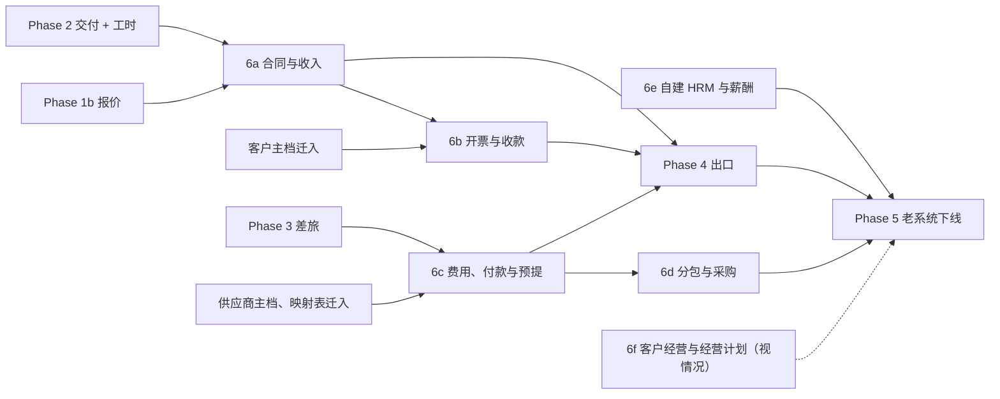

# OA 流程盘点：致远 A8 业务流程迁入 FORCITIS one 的边界与顺序

日期：2026-10-14 · 会话：psa-oa-inventory · 决策记录：ADR-0021（已采纳，用户 2026-10-14：「采纳；6a–6c 并入 Phase 4 前」）· 依据：GUIDING_PRINCIPLES §9a「权责事实全部在新系统」、ADR-0016、ADR-0017、ADR-0018、ADR-0013

起因（用户原话）：「现代化后，我想完善其他子域和 BC，想把 OA 上的业务过程迁到新系统，应该怎么做？」；硬约束（用户 2026-10-14）：「确保权责业务事实全部在新系统」。

## 0. 结论

1. **A8 不只是审批工具，它是今天第二个、也是更大的权责事实来源和过账通道。** 近 180 天 A8 上有 29,056 个模板流程实例。按规则与用户 2026-10-14 的决定，125 个在用模板中 80 个迁入（39 个直接产生权责事实，其余为主数据、非项目采购、HRM），近 180 天实例 20,109 个。
2. **A8 绕过老系统直接给 U8C 生成凭证。** A8 的凭证插件（`LEXMISCIF_*`）按 16 种表单生成凭证，累计 402,285 行、对应 32,339 张 OA 单据，近 180 天 99,179 行，覆盖客户产值确认单（= 收入确认单，方言）、开票、退票、回款、报销、付款、借还款、BU 预提。U8C 2026 年的外部接口凭证（`XX`）在两套账中分别为 8,124 张和 7,962 张。因此 **6a–6c 是 Phase 4 出口的前置条件**（用户已采纳）。
3. **A8 还直接开具销项发票。** 销项开票插件（`LEXMISCIVOUT_*`）累计 5,956 张、近 180 天 1,143 张（以数电专票为主）。开票事实和税务平台对接都在 A8。
4. **合同与收入是行级强耦合，必须同一阶段切换。** 合同和付款条款的唯一来源在 A8，老系统经跨库视图读取；老系统自己的收入确认单又由作业写回 A8 的产值档案和条款累计字段。评估会话建议的顺序（先收入确认单）因此修正为「合同基线 + 收入确认」同为 6a，且**不设双源期**（用户 H-1）。
5. **老系统与 A8 之间约 36 处数据通道**：Java 直查 a8_db 8 处、老系统库内跨库视图 14 个、老系统写入 A8 的作业与脚本 9 个、从 A8 读入老系统的作业与脚本 5 个。其中 26 处承载权责事实（§5），必须在对应阶段改为新系统自有事实；其余组织主数据通道在 6e 自建 HRM 后反转方向。
6. **U8C 自身也产生凭证**：总账手工（`GL`，2026 年两套账 171 + 244 张）、固定资产（`FA`，53 张）、自动转账（`TR`，48 张）。这些是否含业务权责事实，要财务逐类判定（§4 第 19–21 行，§9 待办 1）。
7. 顺序（ADR-0021 已采纳）：**6a 合同与收入 → 6b 开票与收款 → 6c 费用、付款与预提 → 6d 分包与采购 → 6e 自建 HRM 与薪酬 → 6f 客户经营与经营计划（视情况）**。6a–6c 是 Phase 4 出口的前置条件（§6）；客商主档随 6b / 6c 先行迁入。

## 1. 范围、方法与数据来源

- **生产只读**（用户 2026-10-14：「是，同意只读查询」）：经阿里云云助手在老系统应用服务器 `i-bp1b34hcl0g1cnkdtrb9` 上运行单文件 Java 程序，以只读连接 + READ UNCOMMITTED 访问同一 RDS 实例上的 `a8_db`、`u8cloud`、`u8cloud_QZ`；只执行 SELECT（程序内拒绝非 SELECT 语句）。共 7 次轻量查询，单条超时 150 秒。凭据只在服务器进程内使用，没有打印、回传或写入文件；临时目录 `/tmp/psa-oa-ro` 每次执行后删除。
- **只取元数据与计数**：模板名、分类、表单名、主表名、实例数、日期、凭证与发票计数。没有读取单据标题、正文、金额或人员信息。
- **代码**：psa 仓库（只读），用 haiku 子代理逐处列出 A8 集成点；本会话复核关键文件。另参考老仓库 `docs/analysis/OA收入开票回款流程迁移评估.md`（2026-09-04，当时 OA 库无法连接；本次用实时数据复核）。
- **数据文件**（`runtime/`）：`a8_templates.tsv`（全部模板使用量）、`a8_forms.tsv`（表单与档案及行数）、`a8_u8c_vouchers.tsv`（A8 凭证插件与销项开票计数）、`a8_collab_state.tsv`（实例状态、自由协同、集成日志）、`u8c_voucher_sources.tsv`（U8C 凭证来源分布）。

## 2. A8 使用全貌

| 指标 | 数值 |
|---|---|
| 协同实例（`COL_SUMMARY`）累计 | 754,817；近 180 天 29,157 |
| 其中在途（状态 0） | 4,415（近 180 天发起的 848）；另有大量长期在途，见各模板「在途」列 |
| 自由协同（不走模板） | 1,723；近 180 天 101 |
| 近 180 天有实例的模板 | 108 个；近 365 天有实例或有在途的 125 个 |
| 表单定义 | 268 个：流程表单 155、档案 / 底表（无流程）109、公文单 4（未使用） |
| 公文（`EDOC_SUMMARY`） | 0，未使用 |
| A8 凭证插件生成的 U8C 凭证 | 402,285 行 / 32,339 张 OA 单据；近 180 天 99,179 行 |
| A8 销项开票插件开具的发票 | 5,956 张；近 180 天 1,143 张 |
| A8 自建表（`T_FST_*`） | 32 张，如商机快照、项目、预算、工时作废、土拍数据 |
| 对外接口（`CIP_*`） | 单点登录、携程、FORCITIS BI 人员与部门事件、e 签宝、凭证生成（NC / SAP 接口登记） |

最大的档案（无流程表单，A8 作为存放地）：原始打卡记录 794,221 行、工时档案表 676,868 行、外勤申请档案 32,385、工资条 29,139、发票档案 24,544、请假档案 24,240、差旅费用报销单档案 23,679、客户产值确认档案 19,901、日常费用报销单档案 19,381、回款单档案 14,644、项目档案底表 5,432、销售合同档案 5,247。完整清单见 `docs/legacy/runtime-usage/a8-forms.tsv`。

## 3. 模板清单与分类

分类规则（GUIDING_PRINCIPLES §9a）：
- **迁入**：产生、变更或审批权责事实（合同签订与变更、交付与收入确认、工时与成本、费用、收入确认、开票与应收、回款、分包与应付、付款）的流程，一律迁入，不得归「视情况」。另按用户 2026-10-14 的决定迁入：非项目采购、员工借还款、合伙人注资退回（「都算，都进新系统」）；客户、集团、联系人、供应商等主数据（「主数据全部进新系统」）；人事、假勤、绩效与算薪（「新系统要自建整个hrm，算薪要迁入」）。老系统已有同名能力的项目预算、报价也迁入，消除双入口。
- **视情况**：只引用这些事实、不产生事实的流程（商机、线索、拜访、经营目标、交付质量）。是否迁入取决于对应 BC 的建设节奏。
- **留在 OA**：纯行政（用印、合同借阅、IT 需求与 IT 资产、员工活动）。
- **已停用**：已不再发起，只迁历史（只读），在途实例须排空或判定。

「蓝图 BC」按 ADR-0017 对照；标「未覆盖」的是蓝图没有对应的 BC：「应付与付款」已决定新建（编号由 psa-gl-scope 统一），HRM 相关 BC 与非项目采购随 6e、6d 建设。

<!-- BEGIN:templates -->
近 365 天有实例或有在途实例的模板共 **125** 个（数据：`docs/legacy/runtime-usage/a8-templates.tsv`，生成：`build_oa_inventory.py`）。

| 分类 | 模板数 | 近 180 天实例 |
|---|---|---|
| 迁入 | 80 | 20,109 |
| 视情况 | 30 | 7,136 |
| 留在 OA | 12 | 1,533 |
| 已停用 | 3 | 278 |

| # | A8 模板 | A8 分类 | 分类 | 权责事实 | FORCITIS one 模块（BC） | 蓝图 BC | 阶段 | 近 180 天 | 2026 年 | 累计 | 在途 | 最近使用 | 说明 |
|---|---|---|---|---|---|---|---|---|---|---|---|---|---|
| 1 | 客户产值确认单（新） | 项目管理 | **迁入** | 交付与收入确认 | `receivables.wip（收入确认）` | BC-11 | 6a | 940 | 1,377 | 8,540 | 11 | 2026-10-13 | 方言「产值确认单」= 收入确认单；2026 年 1,377 单；A8 凭证插件已据此生成 U8C 凭证 2,520 单 |
| 2 | 项目档案变更 | 项目管理 | **迁入** | 合同变更（条款、金额、交付部门） | `contract.baseline` | BC-02 | 6a | 825 | 875 | 3,700 | 10 | 2026-10-14 | 180 天 825 单，改的是项目与条款主档 |
| 3 | 销售合同归档 | 营销管理 | **迁入** | 合同签订（回签） | `contract.baseline` | BC-02 | 6a | 222 | 315 | 2,636 | 11 | 2026-10-14 | 并入合同生命周期；老系统收入确认要求「合同已回签」 |
| 4 | 销售合同变更 | 营销管理 | **迁入** | 合同变更 | `contract.changeorder` | BC-02 | 6a | 217 | 294 | 1,232 | 5 | 2026-10-12 | 变更不得覆盖原合同事实，按版本追加 |
| 5 | 项目结算申请 | 项目管理 | **迁入** | 合同最终计量（交易价格确定） | `contract.changeorder / receivables.wip` | BC-02、BC-11 | 6a | 214 | 277 | 871 | 4 | 2026-10-14 | 竣工结算；可能触发收入调整 |
| 6 | 项目立项申请 | 项目管理 | **迁入** | 合同签订（项目基线） | `delivery.execution / contract.baseline` | BC-04、BC-02 | 6a | 213 | 334 | 2,987 | 1 | 2026-10-10 | 生成项目档案（formmain_0051），是所有事实的项目坐标 |
| 7 | 销售合同新增 | 营销管理 | **迁入** | 合同签订 | `contract.baseline` | BC-02 | 6a | 206 | 307 | 3,193 | 6 | 2026-10-12 | 合同与付款条款的唯一来源目前在 A8（formmain_0374 / formmain_0051 / formson_0296、0376），老系统经跨库视图读取 |
| 8 | 产值坏账申请 | 项目管理 | **迁入** | 收入调整 / 合同资产减值 | `receivables.wip` | BC-11 | 6a | 200 | 207 | 1,000 | 0 | 2026-10-13 | 会计含义（收入冲减还是合同资产减值）待财务确认 |
| 9 | 项目结项申请 | 项目管理 | **迁入** | 交付终止（关闭后不得再归集成本） | `delivery.execution` | BC-04 | 6a | 177 | 197 | 558 | 15 | 2026-10-14 | 改变成本可归集状态，按交付事实处理；不等于财务结清 |
| 10 | 联系人档案新增 | 营销管理 | **迁入** | —（主数据：客户主档，开票购方信息来源） | `presales.customer` | BC-01 | 6b | 947 | 1,429 | 9,916 | 0 | 2026-10-14 | 用户 2026-10-14：「主数据全部进新系统」；须在 6b 开票前切换 |
| 11 | 项目开票申请 | 项目管理 | **迁入** | 开票与应收 | `receivables.wip` | BC-10 | 6b | 939 | 1,401 | 12,815 | 72 | 2026-10-14 | 开票与 WIP 同一事务边界（ADR-0016 第 5 条）；A8 销项开票插件直连税务数电平台 |
| 12 | 回款单新增 | 营销管理 | **迁入** | 回款 | `receivables.collection` | BC-12 | 6b | 578 | 863 | 8,602 | 0 | 2026-10-14 | A8 凭证插件生成 U8C 凭证 2,839 单 |
| 13 | 客户档案新增 | 营销管理 | **迁入** | —（主数据：客户主档，开票购方信息来源） | `presales.customer` | BC-01 | 6b | 244 | 375 | 5,975 | 2 | 2026-10-14 | 用户 2026-10-14：「主数据全部进新系统」；须在 6b 开票前切换 |
| 14 | 发票退票申请 | 营销管理 | **迁入** | 开票更正（红冲） | `receivables.wip` | BC-10 | 6b | 215 | 304 | 2,629 | 29 | 2026-10-13 | 须保留原票、红字票、重开票的冲销链 |
| 15 | 首付款开票申请 | 营销管理 | **迁入** | 开票与应收（预收） | `receivables.wip` | BC-10 | 6b | 202 | 288 | 3,111 | 16 | 2026-10-14 | 并入统一开票，作为开票原因 / 类型 |
| 16 | 集团档案新增 | 营销管理 | **迁入** | —（主数据：客户主档，开票购方信息来源） | `presales.customer` | BC-01 | 6b | 94 | 175 | 2,307 | 25 | 2026-10-12 | 用户 2026-10-14：「主数据全部进新系统」；须在 6b 开票前切换 |
| 17 | 客户档案变更 | 营销管理 | **迁入** | —（主数据：客户主档，开票购方信息来源） | `presales.customer` | BC-01 | 6b | 85 | 119 | 2,520 | 3 | 2026-10-12 | 用户 2026-10-14：「主数据全部进新系统」；须在 6b 开票前切换 |
| 18 | 联系人档案变更 | 营销管理 | **迁入** | —（主数据：客户主档，开票购方信息来源） | `presales.customer` | BC-01 | 6b | 53 | 80 | 422 | 0 | 2026-10-13 | 用户 2026-10-14：「主数据全部进新系统」；须在 6b 开票前切换 |
| 19 | 应收坏账申请流程 | 营销管理 | **迁入** | 应收减值 / 核销 | `receivables.collection` | BC-12 | 6b | 15 | 26 | 203 | 4 | 2026-10-10 | 计提、转回、核销须分开表达 |
| 20 | 集团档案变更 | 营销管理 | **迁入** | —（主数据：客户主档，开票购方信息来源） | `presales.customer` | BC-01 | 6b | 5 | 6 | 113 | 0 | 2026-10-13 | 用户 2026-10-14：「主数据全部进新系统」；须在 6b 开票前切换 |
| 21 | 客户档案合并 | 营销管理 | **迁入** | —（主数据：客户主档，开票购方信息来源） | `presales.customer` | BC-01 | 6b | 3 | 7 | 417 | 0 | 2026-06-18 | 用户 2026-10-14：「主数据全部进新系统」；须在 6b 开票前切换 |
| 22 | 退款单新增 | 营销管理 | **迁入** | 回款冲销（退款） | `receivables.collection` | BC-12 | 6b | 2 | 3 | 25 | 0 | 2026-10-08 | 低频但财务关键 |
| 23 | 预收款单新增 | 营销管理 | **迁入** | 回款（预收 / 合同负债） | `receivables.collection` | BC-12 | 6b | 0 | 1 | 58 | 0 | 2026-02-06 | 近一年 1 单；并入回款的预收类型 |
| 24 | 集团档案合并 | 营销管理 | **迁入** | —（主数据：客户主档，开票购方信息来源） | `presales.customer` | BC-01 | 6b | 0 | 1 | 21 | 0 | 2026-01-13 | 用户 2026-10-14：「主数据全部进新系统」；须在 6b 开票前切换 |
| 25 | 差旅费用报销单 | 员工自助 | **迁入** | 费用（差旅） | `expense.spend` | BC-06（SD-5b） | 6c | 1,900 | 2,668 | 23,559 | 310 | 2026-10-14 | 老系统已有差旅申请与分贝通（Phase 3），报销仍在 A8 |
| 26 | 日常费用报销单 | 员工自助 | **迁入** | 费用 | `expense.spend` | BC-06（SD-5b） | 6c | 1,490 | 2,006 | 16,696 | 397 | 2026-10-14 | A8 凭证插件生成凭证 5,648 单 |
| 27 | 业务招待申请表 | 费控管理 | **迁入** | 费用（事前审批，决定可报销额度） | `expense.spend` | BC-06（SD-5b） | 6c | 504 | 778 | 4,243 | 6 | 2026-10-14 | 事前申请决定后续费用可否列支，归入费用事实链 |
| 28 | 业务招待费用报销单 | 员工自助 | **迁入** | 费用 | `expense.spend` | BC-06（SD-5b） | 6c | 485 | 707 | 3,830 | 47 | 2026-10-14 |  |
| 29 | 付款申请单-公共 | 费控管理 | **迁入** | 付款 | `应付与付款（新建 BC）` | 未覆盖（编号由 psa-gl-scope 统一） | 6c | 431 | 682 | 6,323 | 54 | 2026-10-14 | 用户 2026-10-14：「新建「应付与付款」BC」 |
| 30 | 付款申请单-人事 | 费控管理 | **迁入** | 付款（薪酬类） | `应付与付款（新建 BC）` | 未覆盖（编号由 psa-gl-scope 统一） | 6c | 166 | 301 | 1,543 | 6 | 2026-10-14 | 老系统视图 psa_oa_payment_detail 已读取 |
| 31 | 预付款核销申请 | 费控管理 | **迁入** | 应付核销 | `应付与付款（新建 BC）` | 未覆盖（编号由 psa-gl-scope 统一） | 6c | 157 | 267 | 1,643 | 1 | 2026-10-12 |  |
| 32 | 供应商档案新增 | 费控管理 | **迁入** | —（主数据：供应商主档，付款对象） | `procurement.subcontracting / 应付与付款（新建 BC）` | BC-07（SD-6c） | 6c | 100 | 149 | 1,340 | 0 | 2026-10-12 | 用户 2026-10-14：「主数据全部进新系统」；须在 6c 付款前切换 |
| 33 | 特殊款项付款申请单 | 费控管理 | **迁入** | 付款 | `应付与付款（新建 BC）` | 未覆盖（编号由 psa-gl-scope 统一） | 6c | 89 | 223 | 977 | 25 | 2026-10-13 |  |
| 34 | BU预提费用明细表 | 费控管理 | **迁入** | 费用预提 | `cost.costing / accounting.ledger` | BC-07、BC-14 | 6c | 45 | 73 | 205 | 0 | 2026-10-10 | A8 直接抛 U8C 凭证；老系统视图 psa_oa_accrual_detail 作人工重分类贷方来源 |
| 35 | 付款申请单_外部代发 | 费控管理 | **迁入** | 付款 | `应付与付款（新建 BC）` | 未覆盖（编号由 psa-gl-scope 统一） | 6c | 20 | 35 | 175 | 0 | 2026-10-10 | 与「付款申请单-公共」共用表单 |
| 36 | 供应商信息变更 | 费控管理 | **迁入** | —（主数据：供应商主档，付款对象） | `procurement.subcontracting / 应付与付款（新建 BC）` | BC-07（SD-6c） | 6c | 13 | 20 | 346 | 0 | 2026-09-28 | 用户 2026-10-14：「主数据全部进新系统」；须在 6c 付款前切换 |
| 37 | 付款申请单-财务 | 费控管理 | **迁入** | 付款 | `应付与付款（新建 BC）` | 未覆盖（编号由 psa-gl-scope 统一） | 6c | 12 | 14 | 34 | 0 | 2026-09-10 |  |
| 38 | 借款申请单新增 | 员工自助 | **迁入** | 付款（员工借款） | `expense.spend` | BC-06（SD-5b） | 6c | 11 | 30 | 216 | 4 | 2026-10-12 | 用户 2026-10-14：员工借还款「都算，都进新系统」；过账类型须补「员工往来」 |
| 39 | 还款申请单新增 | 员工自助 | **迁入** | 回款（员工还款） | `expense.spend` | BC-06（SD-5b） | 6c | 9 | 31 | 164 | 0 | 2026-09-24 | 同上 |
| 40 | 合伙人注资退回申请单 | 员工自助 | **迁入** | 权益（注资退回）与付款 | `应付与付款（新建 BC）/ accounting.ledger` | 未覆盖 | 6c | 2 | 3 | 3 | 0 | 2026-09-29 | 用户 2026-10-14：「都算，都进新系统」；3 单 |
| 41 | 项目委外交付确认单 | 费控管理 | **迁入** | 分包成本确认（应付） | `procurement.subcontracting` | BC-07（SD-6c） | 6d | 53 | 85 | 516 | 3 | 2026-10-09 | 确认即形成分包成本与应付 |
| 42 | IT资产采购申请 | 费控管理 | **迁入** | 非项目采购（资产采购审批） | `procurement（非项目采购扩展）` | 未覆盖 | 6d | 53 | 62 | 109 | 2 | 2026-09-30 | 同上；资产卡片与折旧在 U8C 固定资产（矩阵第 21 行） |
| 43 | 采购合同申请 | 费控管理 | **迁入** | 采购合同签订（应付来源） | `procurement（非项目采购扩展）` | 未覆盖 | 6d | 43 | 72 | 810 | 7 | 2026-10-12 | 用户 2026-10-14：非项目采购「都算，都进新系统」 |
| 44 | 项目委外采购申请 | 费控管理 | **迁入** | 分包（承诺） | `procurement.subcontracting` | BC-07（SD-6c） | 6d | 36 | 39 | 115 | 0 | 2026-09-29 | 方言「委外」= 分包，待确认 |
| 45 | 项目委外采购合同 | 费控管理 | **迁入** | 分包合同签订 | `procurement.subcontracting` | BC-07（SD-6c） | 6d | 33 | 40 | 450 | 11 | 2026-10-14 |  |
| 46 | 采购请购 | 费控管理 | **迁入** | 非项目采购（请购，采购链条起点） | `procurement（非项目采购扩展）` | 未覆盖 | 6d | 7 | 9 | 81 | 1 | 2026-09-28 | 用户 2026-10-14：非项目采购「都算，都进新系统」 |
| 47 | 采购合同变更 | 人力资源 | **迁入** | 采购合同变更 | `procurement（非项目采购扩展）` | 未覆盖 | 6d | 6 | 9 | 23 | 0 | 2026-09-21 | A8 分类挂在「人力资源」下，疑为误挂 |
| 48 | 外勤申请表 | 人力资源 | **迁入** | —（假勤，算薪输入） | `organization.payroll（HRM）` | 未覆盖 | 6e | 3,476 | 4,871 | 37,797 | 123 | 2026-10-14 | 随 HRM 迁入；考勤 |
| 49 | 年假申请表 | 人力资源 | **迁入** | —（假勤，算薪输入） | `organization.payroll（HRM）` | 未覆盖 | 6e | 1,027 | 1,900 | 14,131 | 103 | 2026-10-14 | 随 HRM 迁入；假勤 |
| 50 | 日常请假申请表 | 人力资源 | **迁入** | —（假勤，算薪输入） | `organization.payroll（HRM）` | 未覆盖 | 6e | 804 | 1,081 | 9,904 | 136 | 2026-10-14 | 随 HRM 迁入；假勤 |
| 51 | 补卡申请表 | 人力资源 | **迁入** | —（假勤，算薪输入） | `organization.payroll（HRM）` | 未覆盖 | 6e | 755 | 2,138 | 18,027 | 90 | 2026-06-04 | 随 HRM 迁入；假勤 |
| 52 | 月度评估表-交付人员 | 人力资源 | **迁入** | —（绩效，奖金计提输入） | `organization.incentive（HRM）` | 未覆盖 | 6e | 227 | 338 | 2,516 | 116 | 2026-09-30 | 随 HRM 迁入 |
| 53 | 特殊假别申请表 | 人力资源 | **迁入** | —（假勤，算薪输入） | `organization.payroll（HRM）` | 未覆盖 | 6e | 212 | 322 | 1,472 | 5 | 2026-10-13 | 随 HRM 迁入；假勤 |
| 54 | 月度评估表-BU支持人员 | 人力资源 | **迁入** | —（绩效，奖金计提输入） | `organization.incentive（HRM）` | 未覆盖 | 6e | 114 | 172 | 719 | 20 | 2026-09-30 | 随 HRM 迁入 |
| 55 | 应聘登记表 | 人力资源 | **迁入** | —（人事，员工主档） | `organization.workforce（HRM）` | BC-P8 | 6e | 110 | 156 | 2,360 | 58 | 2026-10-14 | 随 HRM 迁入 |
| 56 | 员工入职 | 人力资源 | **迁入** | —（人事，员工主档） | `organization.workforce（HRM）` | BC-P8 | 6e | 63 | 81 | 754 | 1 | 2026-10-14 | 随 HRM 迁入；6e 切换后员工与组织主数据以新系统为源，A8 改为接收方 |
| 57 | 录用审批表 | 人力资源 | **迁入** | —（人事，员工主档） | `organization.workforce（HRM）` | BC-P8 | 6e | 62 | 88 | 450 | 9 | 2026-10-10 | 随 HRM 迁入 |
| 58 | 月度评估表-总部人员 | 人力资源 | **迁入** | —（绩效，奖金计提输入） | `organization.incentive（HRM）` | 未覆盖 | 6e | 53 | 74 | 244 | 20 | 2026-09-30 | 随 HRM 迁入 |
| 59 | 试用期评估流程(第一个月) | 人力资源 | **迁入** | —（人事，员工主档） | `organization.workforce（HRM）` | BC-P8 | 6e | 51 | 61 | 113 | 6 | 2026-10-10 | 随 HRM 迁入 |
| 60 | 调薪申请单 | 人力资源 | **迁入** | —（薪酬标准，算薪输入） | `organization.payroll（HRM）` | 未覆盖 | 6e | 48 | 115 | 1,070 | 5 | 2026-09-11 | 随 HRM 迁入 |
| 61 | 试用期评估流程(第二个月) | 人力资源 | **迁入** | —（人事，员工主档） | `organization.workforce（HRM）` | BC-P8 | 6e | 39 | 48 | 96 | 8 | 2026-10-11 | 随 HRM 迁入 |
| 62 | 员工离职申请 | 人力资源 | **迁入** | —（人事，员工主档） | `organization.workforce（HRM）` | BC-P8 | 6e | 36 | 66 | 873 | 22 | 2026-10-12 | 随 HRM 迁入 |
| 63 | 试用期员工转正申请 | 人力资源 | **迁入** | —（人事，员工主档） | `organization.workforce（HRM）` | BC-P8 | 6e | 36 | 45 | 99 | 3 | 2026-09-28 | 随 HRM 迁入 |
| 64 | 员工交接表 | 人力资源 | **迁入** | —（人事，员工主档） | `organization.workforce（HRM）` | BC-P8 | 6e | 30 | 56 | 771 | 4 | 2026-09-28 | 随 HRM 迁入 |
| 65 | 人事异动表 | 人力资源 | **迁入** | —（人事，员工主档） | `organization.workforce（HRM）` | BC-P8 | 6e | 23 | 39 | 258 | 1 | 2026-10-09 | 随 HRM 迁入 |
| 66 | 劳动合同续签意向征询单 | 人力资源 | **迁入** | —（人事，员工主档） | `organization.workforce（HRM）` | BC-P8 | 6e | 19 | 38 | 360 | 12 | 2026-08-31 | 随 HRM 迁入 |
| 67 | 用人申请表 | 人力资源 | **迁入** | —（人事，员工主档） | `organization.workforce（HRM）` | BC-P8 | 6e | 17 | 35 | 211 | 5 | 2026-09-21 | 随 HRM 迁入 |
| 68 | 销假申请表 | 人力资源 | **迁入** | —（假勤，算薪输入） | `organization.payroll（HRM）` | 未覆盖 | 6e | 16 | 26 | 174 | 0 | 2026-10-09 | 随 HRM 迁入；假勤 |
| 69 | 薪资计算审核表 | 人力资源 | **迁入** | 人工成本（职工薪酬） | `organization.payroll（HRM）` | 未覆盖（蓝图排除） | 6e | 12 | 19 | 1,106 | 0 | 2026-10-09 | 用户 2026-10-14：「新系统要自建整个hrm，算薪要迁入」；工时成本单价 psa_daily_rate 读它（formmain_0858） |
| 70 | 月度考勤确认表 | 人力资源 | **迁入** | —（考勤结果，算薪输入） | `organization.payroll（HRM）` | 未覆盖 | 6e | 12 | 20 | 1,078 | 0 | 2026-10-08 | 随 HRM 迁入 |
| 71 | 税金计算 | 人力资源 | **迁入** | 人工成本（个税、社保代扣） | `organization.payroll（HRM）` | 未覆盖（蓝图排除） | 6e | 12 | 21 | 167 | 0 | 2026-10-10 | 与算薪同一链条 |
| 72 | 停薪留职申请单 | 人力资源 | **迁入** | —（人事，员工主档） | `organization.workforce（HRM）` | BC-P8 | 6e | 1 | 2 | 14 | 0 | 2026-09-29 | 随 HRM 迁入 |
| 73 | 节前提前下班考勤调整 | 人力资源 | **迁入** | —（假勤，算薪输入） | `organization.payroll（HRM）` | 未覆盖 | 6e | 1 | 1 | 1 | 0 | 2026-10-08 | 随 HRM 迁入 |
| 74 | 面试评估表 | 人力资源 | **迁入** | —（人事，员工主档） | `organization.workforce（HRM）` | BC-P8 | 6e | 0 | 0 | 1,108 | 7 | 2021-12-06 | 随 HRM 迁入；已停用，在途 7 |
| 75 | 转正申请表 | 人力资源 | **迁入** | —（人事，员工主档） | `organization.workforce（HRM）` | BC-P8 | 6e | 0 | 0 | 500 | 7 | 2025-05-20 | 随 HRM 迁入；已停用，在途 7 |
| 76 | 年假延期申请 | 人力资源 | **迁入** | —（假勤，算薪输入） | `organization.payroll（HRM）` | 未覆盖 | 6e | 0 | 0 | 333 | 2 | 2025-01-06 | 随 HRM 迁入；已停用，在途 2 |
| 77 | 成长记录维护 | 人力资源 | **迁入** | —（人事，员工主档） | `organization.workforce（HRM）` | BC-P8 | 6e | 0 | 0 | 23 | 0 | 2025-12-18 | 随 HRM 迁入 |
| 78 | 新增报价 | 营销管理 | **迁入** | —（报价承诺，不过账；老系统已有 OPP_QUOTATION） | `presales.quoting` | BC-01 | Phase 1b | 308 | 513 | 6,936 | 69 | 2026-09-23 | 最后一单 2026-09-23；老系统→A8 报价档案同步在运行，A8 模板应停用 |
| 79 | 项目预算编制 | 项目管理 | **迁入** | —（计划，不过账；老系统已有 PM_BUDGET，双入口须消除） | `delivery.execution` | BC-04 | Phase 2 | 193 | 294 | 2,809 | 14 | 2026-09-22 | 老系统预算审批 180 天 18 单，A8 仍 193 单 |
| 80 | 项目预算变更 | 项目管理 | **迁入** | —（同上） | `delivery.execution` | BC-04 | Phase 2 | 91 | 109 | 2,340 | 51 | 2026-10-08 |  |
| 81 | 信息服务费备案申请 | 费控管理 | **视情况** | —（事前备案，付款另走付款申请） | `expense.spend` | BC-06（SD-5b） | 6c | 114 | 222 | 702 | 3 | 2026-09-22 | 若备案决定可付金额，应改判迁入 |
| 82 | 信息服务费备案变更申请 | 费控管理 | **视情况** | — | `expense.spend` | BC-06（SD-5b） | 6c | 1 | 2 | 3 | 0 | 2026-06-12 |  |
| 83 | 商机跟进 | 营销管理 | **视情况** | — | `presales.customer` | BC-01 | 6f | 2,786 | 3,830 | 23,553 | 44 | 2026-10-14 | 客户经营；建议随 6f 迁入 |
| 84 | 客户拜访结果反馈 | 营销管理 | **视情况** | — | `presales.customer` | BC-01 | 6f | 705 | 899 | 5,643 | 5 | 2026-10-14 |  |
| 85 | 客户拜访计划变更 | 营销管理 | **视情况** | — | `presales.customer` | BC-01 | 6f | 573 | 709 | 2,510 | 0 | 2026-10-13 |  |
| 86 | 新建线索 | 营销管理 | **视情况** | — | `presales.customer` | BC-01 | 6f | 556 | 866 | 9,654 | 1 | 2026-10-13 |  |
| 87 | 线索跟进 | 营销管理 | **视情况** | — | `presales.customer` | BC-01 | 6f | 539 | 734 | 3,718 | 11 | 2026-10-13 |  |
| 88 | 新建商机 | 营销管理 | **视情况** | — | `presales.quoting` | BC-01 | 6f | 401 | 643 | 7,639 | 76 | 2026-10-14 | 商机由 A8 同步进老系统（psa_crm_opportunity） |
| 89 | 客户拜访计划新增 | 营销管理 | **视情况** | — | `presales.customer` | BC-01 | 6f | 307 | 454 | 4,170 | 0 | 2026-10-12 |  |
| 90 | 每周CommitCall承诺单 | 营销管理 | **视情况** | —（销售预测） | `operations.planning` | 未覆盖 | 6f | 271 | 445 | 5,746 | 1,212 | 2026-10-09 | 在途 1,212 单，疑似僵尸 |
| 91 | 项目组承诺目标新增 | 员工自助 | **视情况** | —（经营目标） | `operations.planning` | 未覆盖 | 6f | 150 | 239 | 1,278 | 3 | 2026-10-12 |  |
| 92 | 商机信息变更 | 营销管理 | **视情况** | — | `presales.quoting` | BC-01 | 6f | 130 | 206 | 3,072 | 4 | 2026-10-12 |  |
| 93 | 营销人员承诺目标新增 | 员工自助 | **视情况** | —（经营目标） | `operations.planning` | 未覆盖 | 6f | 53 | 88 | 714 | 7 | 2026-10-09 |  |
| 94 | 交付中心承诺目标新增 | 员工自助 | **视情况** | —（经营目标） | `operations.planning` | 未覆盖 | 6f | 47 | 80 | 1,112 | 2 | 2026-10-12 |  |
| 95 | 客户中心承诺目标新增 | 员工自助 | **视情况** | —（经营目标） | `operations.planning` | 未覆盖 | 6f | 33 | 54 | 103 | 0 | 2026-10-12 |  |
| 96 | 竞争对手档案新增 | 营销管理 | **视情况** | — | `presales.customer` | BC-01 | 6f | 28 | 43 | 48 | 0 | 2026-09-29 |  |
| 97 | 现金流预测 | 费控管理 | **视情况** | —（预测） | `operations.planning` | 未覆盖 | 6f | 11 | 20 | 241 | 1 | 2026-10-10 |  |
| 98 | 商机推荐流程 | 营销管理 | **视情况** | — | `presales.customer` | BC-01 | 6f | 5 | 12 | 269 | 26 | 2026-08-04 |  |
| 99 | 营销人员预算目标新增 | 员工自助 | **视情况** | —（经营预算） | `operations.budgeting` | 未覆盖 | 6f | 4 | 44 | 312 | 7 | 2026-05-12 |  |
| 100 | 项目组预算目标新增 | 员工自助 | **视情况** | —（经营预算） | `operations.budgeting` | 未覆盖 | 6f | 0 | 15 | 364 | 0 | 2026-03-06 |  |
| 101 | 交付中心预算目标新增 | 员工自助 | **视情况** | —（经营预算） | `operations.budgeting` | 未覆盖 | 6f | 0 | 43 | 123 | 0 | 2026-01-20 |  |
| 102 | 客户中心预算目标新增 | 员工自助 | **视情况** | —（经营预算） | `operations.budgeting` | 未覆盖 | 6f | 0 | 24 | 69 | 0 | 2026-02-09 |  |
| 103 | 项目成果内审 | 项目管理 | **视情况** | —（质量） | `delivery.acceptance` | 无直接对应 | Phase 2 | 233 | 352 | 3,416 | 136 | 2026-10-14 |  |
| 104 | 项目满意度调查 | 项目管理 | **视情况** | — | `delivery.acceptance` | 无直接对应 | Phase 2 | 62 | 166 | 1,457 | 1 | 2026-05-06 |  |
| 105 | 项目阶段评审提醒 | 项目管理 | **视情况** | — | `delivery.execution` | BC-04 | Phase 2 | 48 | 69 | 463 | 37 | 2026-10-13 |  |
| 106 | 项目阶段评审 | 项目管理 | **视情况** | — | `delivery.execution` | BC-04 | Phase 2 | 45 | 62 | 1,551 | 42 | 2026-10-14 | 老系统已有 PM_STAGE_REVIEW（0 实例） |
| 107 | 项目启动会 | 项目管理 | **视情况** | — | `delivery.execution` | BC-04 | Phase 2 | 27 | 35 | 2,024 | 18 | 2026-10-10 |  |
| 108 | 项目成果内审提醒 | 项目管理 | **视情况** | — | `delivery.acceptance` | 无直接对应 | Phase 2 | 0 | 0 | 1,677 | 53 | 2025-08-21 | 已停用，在途 53 |
| 109 | 项目成果外发限制申请 | 项目管理 | **视情况** | — | `delivery.execution` | BC-04 | — | 7 | 8 | 144 | 0 | 2026-08-14 |  |
| 110 | 客诉申请单 | 项目管理 | **视情况** | — | `delivery.acceptance` | 无直接对应 | — | 0 | 0 | 13 | 1 | 2023-09-22 | 近一年 0 单，在途 1 |
| 111 | 用印申请 | 员工自助 | **留在 OA** | — | — | — | — | 1,073 | 1,585 | 11,570 | 252 | 2026-10-14 | 行政；报价用印登记与老系统报价同步相关，用印本身不产生事实 |
| 112 | 需求工单 | 员工自助 | **留在 OA** | — | — | — | — | 317 | 343 | 1,622 | 105 | 2026-10-14 | IT 需求 |
| 113 | 周年贺卡 | 人力资源 | **留在 OA** | — | — | — | — | 128 | 219 | 219 | 38 | 2026-10-13 |  |
| 114 | 合同借阅申请 | 营销管理 | **留在 OA** | — | — | — | — | 10 | 21 | 281 | 14 | 2026-09-20 |  |
| 115 | IT资产调拨申请 | 费控管理 | **留在 OA** | — | — | — | — | 2 | 4 | 139 | 0 | 2026-07-21 |  |
| 116 | IT资产报修申请 | 费控管理 | **留在 OA** | — | — | — | — | 2 | 2 | 128 | 2 | 2026-04-29 |  |
| 117 | IT资产内购申请单 | 费控管理 | **留在 OA** | — | — | — | — | 1 | 2 | 3 | 1 | 2026-09-29 |  |
| 118 | 感恩节活动 | 员工自助 | **留在 OA** | — | — | — | — | 0 | 0 | 2,106 | 75 | 2024-11-11 | 已停用，在途 75 |
| 119 | IT资产信息变更 | 费控管理 | **留在 OA** | — | — | — | — | 0 | 6 | 137 | 0 | 2026-03-11 |  |
| 120 | 创新项目发布申请 | 员工自助 | **留在 OA** | — | — | — | — | 0 | 1 | 31 | 4 | 2026-03-25 |  |
| 121 | IT资产领用申请 | 费控管理 | **留在 OA** | — | — | — | — | 0 | 1 | 1 | 0 | 2026-02-11 |  |
| 122 | IT资产报废回收流程 | 费控管理 | **留在 OA** | —（资产处置的会计处理在 U8C 固定资产） | — | — | — | 0 | 0 | 1 | 0 | 2025-12-23 |  |
| 123 | 项目产值确认单（老） | 项目管理 | **已停用** | 收入确认（历史） | `receivables.wip` | BC-11 | 6a | 0 | 0 | 4,583 | 71 | 2022-06-09 | 2022-06 起停用，仍有 71 个在途实例须判定（僵尸 / 待补结论） |
| 124 | 项目工时填报单 | 员工自助 | **已停用** | 工时（历史） | `cost.timesheet` | BC-06（SD-5a） | Phase 2 | 277 | 2,114 | 386,965 | 145 | 2026-04-30 | 2026-04-30 起停用，已由老系统工时取代；历史 386,965 单，在途 145 须排空 |
| 125 | 商机工时填报单 | 员工自助 | **已停用** | 工时（历史） | `cost.timesheet` | BC-06（SD-5a） | Phase 2 | 1 | 3 | 13,274 | 0 | 2026-04-28 | 2026-04-28 起停用；历史 13,274 单 |
<!-- END:templates -->

## 4. 权责事实完整性矩阵

每类权责事实一行。「产生地」= 事实在哪里被发起和批准；「存放地」= 事实的记录系统今天在哪里；「目标」= 新系统中的 BC 与 `operations.facts` 事实类型（ADR-0016）。过账交易类型中 ADR-0016 已列出的有工时成本（TS）、费用、WIP / 开票、收入确认、回款、手工分录；标「须补」的是 ADR-0016 没有列出、需要在相应阶段补进过账管道的类型。

| # | 权责事实 | 产生地（今天） | 存放地（今天） | 进 U8C 的方式（今天） | 目标 BC（蓝图） | `operations.facts` 事实类型 | 阶段 | 缺口 |
|---|---|---|---|---|---|---|---|---|
| 1 | 合同签订、回签与付款条款（交易价格） | A8 流程：销售合同新增 / 归档、项目立项申请 | A8 档案 `formmain_0374`、`formmain_0051`、条款子表 `formson_0296` / `0376`；老系统只读视图 `psa_pm_contract`、`psa_pm_contract_term` | 不直接记账 | `contract.baseline`（BC-02） | 参照事实，不过账：合同基线版本（`ContractSigned`），供收入计量与开票准入引用 | 6a | 条款是多处老系统校验的唯一来源却在 A8；老系统报价条款经作业同步进 A8「付款条件档案」`formmain_1321` |
| 2 | 合同变更、签证、项目档案变更 | A8 流程：销售合同变更、项目档案变更 | 同上（直接改档案字段，无版本） | 不直接记账 | `contract.changeorder`（BC-02） | 参照事实：合同基线新版本，追加不覆盖 | 6a | A8 直接改写档案，没有变更历史；迁入时须重建版本链 |
| 3 | 交付验收与收入确认 | **两处**：A8「客户产值确认单（新）」（2026 年 1,377 单，主渠道）；老系统收入确认单（2026-09-24 上线，18 笔） | A8 档案 `formmain_0581`（19,901 行）；老系统 `psa_pm_cuvalue`（A8 来源每小时导入 `source_system=0`；老系统来源作业写回 A8，并改写 A8 条款累计字段） | **A8 凭证插件**：2,520 张单据生成凭证；老系统推送结转凭证 | `receivables.wip` 收入确认（BC-11）；验收事实来自 `delivery.acceptance` | 收入确认（ADR-0016 已列） | 6a | 双写入方；A8 直接制收入凭证，老系统的过账管道看不到 |
| 4 | 收入调整 / 合同资产减值（方言「产值坏账」） | A8「产值坏账申请」（近一年 1,000 单） | A8 档案 `formmain_1375`；老系统视图 `psa_pm_contract_asset_impairment` | 未见凭证插件记录（凭证另行处理，待核） | `receivables.wip`（BC-11） | 冲销事实或减值（须补：减值类型） | 6a | 会计含义待财务确认（收入冲减 / 合同资产减值） |
| 5 | 竣工结算与项目关闭 | A8「项目结算申请」「项目结项申请」 | A8 项目档案 | 不直接记账 | `contract.changeorder`、`delivery.execution` | 结算：收入调整（如有）；结项：WBS 关闭事件（参照事实） | 6a | 结项后成本仍可能归集，无闸门 |
| 6 | 工时 | 老系统工时（2026-05 起）；A8 工时填报单已停用 | 老系统 `psa_time_sheet*`；A8 历史：工时档案表 676,868 行、`formmain_0554` | 老系统过账引擎结转 | `cost.timesheet`（BC-06 SD-5a） | 工时成本 TS（ADR-0016 已列，第一个事实生产者） | Phase 2 | A8 历史工时只读迁入；在途 145 单须排空 |
| 7 | 人工成本单价与职工薪酬 | A8「薪资计算审核表」「税金计算」、工资补录档案；老系统运维脚本曾向 A8 补录工资 | A8 `formmain_0858` / `formson_0859`（算薪）、`formmain_1318`（补录）、工资条 29,139 行 | U8C 方式未见于凭证插件（待核：可能在 GL 手工） | `organization.payroll`（6e 自建 HRM）→ 产出给 `cost.costing`（BC-07） | 须补：职工薪酬事实；TS 的单价来源 | 6e | 用户决定「算薪要迁入」；6e 前工时成本单价仍经防腐层读 A8 算薪，列为限期遗留 |
| 8 | 奖金计提 | A8 档案（无流程）：组织奖金计提 `formmain_1383`、个人奖金补录 `formmain_1385`；数据由老系统运维脚本从外部导入 A8 | A8 档案 | 待核 | `organization.incentive`（6e 自建 HRM）→ `cost.costing` | 须补：薪酬预提 | 6e | 来源是一次性导入（线下数据），没有流程；6e 须提供录入入口 |
| 9 | 费用（报销、业务招待） | A8：日常费用报销单、差旅费用报销单、业务招待申请 / 报销单 | A8 档案（差旅 23,679、日常 19,381、招待 4,174 行）；老系统成本归集基座视图 `psa_cost_summary` 跨库读取 | **A8 凭证插件**：差旅 8,726、日常 5,648、招待 2,442 张单据 | `expense.spend`（BC-06 SD-5b） | 费用（ADR-0016 已列） | 6c | 老系统差旅只有申请与分贝通（Phase 3），报销与凭证仍在 A8 |
| 10 | 员工借款、还款、预付款核销 | A8：借款申请单、还款申请单、预付款核销申请 | A8 档案（借款单、还款单档案） | **A8 凭证插件**：61 + 63 + 670 张单据 | `expense.spend`（BC-06 SD-5b）；预付款核销归「应付与付款」 | 须补：员工往来 | 6c | 用户决定员工借还款「都进新系统」；过账类型待补 |
| 11 | 费用预提（BU 预提） | A8「BU预提费用明细表」 | A8 `formmain_1338`；老系统视图 `psa_oa_accrual_detail` | **A8 凭证插件**：190 张单据 | `cost.costing`、`accounting.ledger`（BC-07、BC-14） | 手工分录（ADR-0016 已列）或须补：预提 | 6c | 老系统用它做人工重分类贷方来源，事实却在 A8 |
| 12 | 付款与应付（非项目） | A8：付款申请单-公共 / 人事 / 财务 / 外部代发、特殊款项付款申请单 | A8 档案（付款申请单档案 6,371 行等）；老系统视图 `psa_oa_payment_detail` | **A8 凭证插件**：1,972 + 897 + 18 张单据 | 「应付与付款」BC（新建，用户 2026-10-14；蓝图编号由 psa-gl-scope 统一） | 须补：应付、付款 | 6c | 应付与往来明细账由 psa-gl-scope 设计，6c 依赖其结论 |
| 13 | 分包合同与分包成本 | A8：项目委外采购申请 / 采购合同 / 交付确认单 | A8 档案（项目委外交付确认档案 490 行、采购合同档案 1,179 行） | 经付款申请单进 U8C | `procurement.subcontracting`（BC-07 SD-6c） | 分包成本 `SubcontractCost`（须补：交易类型） | 6d | ADR-0016 第 9 条要求「以外部 AP 为准、强契约对账」，外部 AP 今天就是 A8 |
| 14 | 非项目采购合同与请购 | A8：采购请购、采购合同申请 / 变更、IT 资产采购申请 | A8 采购合同档案 | 经付款申请单 | `procurement`（非项目采购扩展，未覆盖） | 须补：应付 | 6d | 用户决定非项目采购「都进新系统」 |
| 15 | 开票（含首付款开票）与应收 | A8：项目开票申请、首付款开票申请；**A8 销项开票插件开具发票**（近 180 天 1,143 张） | A8 发票档案 `formmain_0428`（24,544 行）；老系统视图 `psa_pm_invoicing` | **A8 凭证插件**：4,494 + 971 张单据 | `receivables.wip`（BC-10） | WIP / 开票（ADR-0016 已列） | 6b | 税务数电平台对接在 A8 插件内，新系统须在 `platform.integration` 重建 |
| 16 | 发票红冲、退票、重开 | A8「发票退票申请」 | A8 发票档案（回写状态、红字号） | **A8 凭证插件**：802 张单据 | `receivables.wip`（BC-10） | 冲销事实 | 6b | 冲销链未结构化 |
| 17 | 回款、预收、退款 | A8：回款单新增、预收款单新增、退款单新增 | A8 回款单档案 `formmain_0569`（14,644 行）；老系统视图 `psa_pm_collection` | **A8 凭证插件**：2,839 张单据 | `receivables.collection`（BC-12） | 回款（ADR-0016 已列）；预收为合同负债 | 6b | 无应收开放项与核销分配 |
| 18 | 应收坏账、应收票据、质量保证金 | A8「应收坏账申请流程」；应收票据档案 `formmain_1195`（266 行，无流程）；保证金退回档案（0 行） | A8 档案；老系统视图 `psa_pm_ar_bad_debt` | 未见凭证插件记录（待核） | `receivables.collection`（BC-12），质保金为独立应收类型（ADR-0016 第 9 条） | 须补：应收减值、票据 | 6b | 应收票据只有档案、没有流程，来源可能是线下 |
| 19 | 总账手工凭证 | **U8C 手工录入**（`GL`）：2026 年 u8cloud 171 张、u8cloud_QZ 244 张 | U8C | — | `accounting.ledger`（BC-14）手工分录 | 手工分录（ADR-0016 已列） | Phase 4 | 内容未读；其中是否有收入、成本调整等业务事实，须财务逐类判定 |
| 20 | 期末结转 | **U8C 自动转账**（`TR`，期末结转模板）：2026 年 48 张 | U8C | — | `accounting.ledger`（期末处理） | —（期末结转，非业务权责事实；待财务确认） | G1 | 由新系统总账的期末处理承接（见 GL_RULES.md 结转规则卡）；psa-gl-scope 更正：TR 是自动转账，不是出纳 |
| 21 | 固定资产 | **U8C 固定资产**（`FA`）：2026 年 53 张；A8 IT 资产流程只做事前审批 | U8C | — | 不在老系统权责事实清单内 | — | — | 随 §9 待办 1 由财务判定（建议：资产卡片与折旧留 U8C；资产采购审批已随非项目采购迁入 6d） |
| 22 | 科目与部门映射（口径配置，非事实） | A8 档案：费用与科目对照表new（306 行）、PSA部门账套对照表、银行与科目对照表、`LEXMISCIF_DEPTAUX`（OA→U8C 部门映射） | A8 | 凭证插件按它们映射 | `accounting.ledger` 科目映射 DMN（ADR-0016 第 3 条）；对照表本身归新系统（用户：「主数据全部进新系统」） | — | 6c 前 | 新系统的 DMN 须与这些对照表逐行对齐，否则凭证对不上 |
| 23 | 线下 / Excel 来源（已知线索） | 历史奖金 2020–2025、2026 奖金计提、工资补录、员工异动均由运维 SQL 从外部数据一次性写入 A8；`A8Controller` 的工资 Excel 导入为空操作；成本期初（`views/costopenning`） | A8 档案 / 老系统 | — | 各自目标 BC | 期初余额、补录 | 各阶段 | 每次迁入要识别这类「线下事实」并给出新系统的录入入口，否则会重新长回 Excel |
| 24 | 合伙人注资与退回（权益） | A8「合伙人注资退回申请单」（3 单） | A8 档案 `formmain_1379` | 未见凭证插件记录（待核） | 「应付与付款」BC（付款）+ `accounting.ledger`（权益分录） | 须补：权益 | 6c | 用户决定「都算，都进新系统」 |

**检查结论**：24 行中，今天记录系统在老系统内的只有第 6 行（工时）和第 3 行的一部分；第 1–5、7–18、24 行的记录系统在 A8，第 19–21 行在 U8C，第 23 行在线下。U8C 外部接口凭证同时来自 A8 和老系统，**目前无法从 U8C 侧区分**（`pk_system` 都是 `XX`），切换后须按 `V_FORMID`（A8 侧）与新系统的过账序号（FORCITIS one 侧）双向对账。

**主数据**（不是权责事实，但用户 2026-10-14 决定「主数据全部进新系统」）：客户、集团、联系人主档（6b 前）；供应商主档（6c 前）；OA→U8C 部门映射与科目、银行对照表（6c 前）；员工档案与组织（6e，自建 HRM 后 A8 改为接收方）；员工银行卡（6e；今天由视图 `psa_employee_bank_card` 跨库读取，供分贝通打款）——**敏感个人信息**：字段级加密存储、最小授权（仅付款经办与本人）、访问留痕、不进日志与分析层。

## 5. 与老系统集成点的关系

### 5.1 组织同步、SSO 与对外接口

| 集成 | 方向 | 现状 | 与本盘点的关系 |
|---|---|---|---|
| A8 组织同步（`syncDeptJob`、`syncUserJob`、`syncPostsJob`、生日） | A8 → 老系统 | 直查 `ORG_MEMBER`、`ORG_UNIT`、`ORG_POST`、`ORG_RELATIONSHIP`、员工档案 `formmain_0307` | Phase 1a 至 6e 前组织主数据仍以 A8 为源（`docs/data/column-ownership.md` 不变）；6e 自建 HRM 后方向反转，新系统为源、A8 为接收方，经 `platform.integration` |
| 致远 SSO（`/seeyon-sso`） | A8 → 老系统 | 服务端验票 | ADR-0009 已定；用户从 OA 门户进入新系统仍走它 |
| A8 → BI 事件、携程、e 签宝 | A8 ↔ 第三方 | `CIP_LOG` 有记录 | 与权责事实无关；e 签宝若用于合同签署，6a 须评估是否迁到新系统；HRM 迁入后 BI 的人员事件来源随之改变 |
| U8C 客商推送（`syncCustomerAndSupplierToU8CJob`） | 老系统 → U8C | 读 A8 的 `T_U8C_BD_CUBASDOC` | 客商主档归新系统（用户决定），推送改为从新系统主档出发 |

### 5.2 收入确认单同步（方言「产值确认单」）

用户 2026-10-14 H-1：「迁入新系统，不设双源期」。因此两条同步都不作为过渡期输入保留，而是在 6a 切换日同日停用。

| 通道 | 方向 | 作用 | 处置 |
|---|---|---|---|
| `docs/ops/oa-cuvalue-import`（SQL Agent，每小时） | A8 → 老系统 | `formmain_0581` / `formson_0583` 导入 `psa_pm_cuvalue`（`source_system=0`），排除 `RC%` 防回流 | 6a 切换日停用；历史经一次性迁入进入新系统（带来源标记），不经此作业 |
| `docs/ops/oa-cuvalue-sync`（SQL Agent，10 分钟，生产默认禁用） | 老系统 → A8 | 老系统收入确认写入 A8 产值档案，并回写 A8 条款与合同的累计字段 | 6a 切换日删除；之后 A8 不再保存收入事实 |

ADR-0016 后果中「A8 产值同步在新系统中作为防腐层输入」与 brief Phase 4 入口条件中「停用前新系统如何只读接入」已出修订稿（ADR-0016 修订提议；brief `Proposed revision:`），待用户批准。

### 5.3 跨库读取与写入逐处判定

「权责」列：是 = 读取或写入的是权责事实，必须在对应阶段改为新系统自有事实；否 = 主数据或无关。

| # | 位置（psa 仓库） | 读 / 写的 A8 对象 | 用途 | 权责 | 阶段 |
|---|---|---|---|---|---|
| 1 | `A8UserMapper.selectInternalUsers` | `ORG_MEMBER`、`ORG_PRINCIPAL`、`ORG_UNIT`、`formmain_0307` | 人员同步 | 否 | 6e 前保留（防腐层），6e 后反转 |
| 2 | `A8DeptMapper.selectSyncScopedDepts` | `ORG_UNIT`、`ADDRESSBOOK`、`CTP_ENUM*` | 部门同步 | 否 | 6e 前保留（防腐层），6e 后反转 |
| 3 | `A8DeptMapper.selectDeptLeaders` | `ORG_RELATIONSHIP` | 部门负责人 | 否 | 6e 前保留（防腐层），6e 后反转 |
| 4 | `A8DeptMapper.selectDeptArs` | `ORG_RELATIONSHIP` | 区域 AR | 否 | 6e 前保留（防腐层），6e 后反转 |
| 5 | `A8PostMapper.selectNotDeletedPosts` | `ORG_POST` | 岗位 | 否 | 6e 前保留（防腐层），6e 后反转 |
| 6 | `A8MemberBirthdayMapper` | `ORG_MEMBER.EXT_ATTR_21` | 生日 | 否 | 6e 前保留（防腐层），6e 后反转 |
| 7 | `PrePostingCheckOaMapper.selectSalaryFacts` | 算薪 `formmain_0858/0859`、补录 `1318/1319` | 过账前检查（按人按月薪资） | **是** | 6e |
| 8 | `PrePostingCheckOaMapper.selectMemberCodes` | `ORG_MEMBER` | 工号映射 | 否 | 保留 |
| 9 | 视图 `psa_pm_contract` | `formmain_0051`、`0238`、`0374` | 合同档案 | **是** | 6a |
| 10 | 视图 `psa_pm_contract_term` | `formmain_0051`、`formson_0296`、`0376` | 付款条款（多处校验的唯一来源） | **是** | 6a |
| 11 | 视图 `psa_pm_invoicing` | `formmain_0428`、`formson_0567`、`1033` | 开票 | **是** | 6b |
| 12 | 视图 `psa_pm_collection` | `formmain_0569`、`formson_0601`、`1033` | 回款 | **是** | 6b |
| 13 | 视图 `psa_pm_ar_bad_debt` | `formmain_1104`、`formson_1105` | 应收坏账 | **是** | 6b |
| 14 | 视图 `psa_pm_contract_asset_impairment` | `formmain_0051`、`1375`、`formson_1376` | 合同资产减值 | **是** | 6a |
| 15 | 视图 `monthly_salary_calculation` | 算薪、补录、`ORG_MEMBER` | 月度算薪、期间闸门 | **是** | 6e |
| 16 | 视图 `psa_daily_rate` | 同上 | 工时成本单价 | **是** | 6e（Phase 2 工时成本依赖它） |
| 17 | 视图 `psa_cost_summary_zero_hour_salary` | `formson_0859` | 零工时薪资成本 | **是** | 6e |
| 18 | 视图 `psa_employee_bank_card` | `formmain_0307`、`formson_0478` | 分贝通打款用银行卡 | 否（敏感个人信息主数据） | 6e 归新系统 HRM（加密、最小授权）；Phase 3 分贝通打款期间经防腐层只读 |
| 19 | 视图 `psa_oa_accrual_detail` | `formmain_1338`、`formson_1339`、`0735` | BU 预提（人工重分类贷方） | **是** | 6c |
| 20 | 视图 `psa_oa_payment_detail` | `formmain_0644`、`formson_0645`、`0735` | 付款申请单-人事 | **是** | 6c |
| 21 | 视图 `psa_oa_interface_dept` | `LEXMISCIF_DEPTAUX` | OA→U8C 接口部门映射 | 否（口径配置，见矩阵 22；归新系统） | 6c 前迁入新系统 |
| 22 | 基座视图 `psa_cost_summary`（不在 Flyway） | 报销、付款等 `formmain_0424/0602/0604/0644/1121/1211/1344` | 成本归集的费用来源 | **是** | 6c |
| 23 | 作业 `oa-cuvalue-import` | `formmain_0581`、`formson_0583` | A8 收入 → 老系统 | **是** | 6a |
| 24 | 作业 `oa-opportunity-sync` | `formmain_0238`、`0219` | 商机销售团队 | 否 | 6f |
| 25 | 脚本 `cost-summary-ratify-date/backfill_history_ratify_date.sql` | 报销、付款档案 | 历史确认日期回填 | **是**（历史） | 6c 历史迁入 |
| 26 | 脚本 `fix-cost-summary-history-issue-787.sql` | 同上 | 费用类型修正 | **是**（历史） | 6c 历史迁入 |
| 27 | 脚本 `fix-time-sheet-works-approval-issue-784.sql` | `formmain_0554/0584` | 工时审批状态修正 | **是**（历史） | Phase 2 历史迁入 |
| 28 | 作业 `oa-cuvalue-sync`（写 A8） | 写 `formmain_0581`，回写条款与合同累计字段 | 老系统收入 → A8 | **是** | 6a 删除 |
| 29 | 作业 `oa-quotation-sync`（写 A8） | 写报价档案 `formmain_0366` 等 | 老系统报价 → A8 | 否（报价不过账） | Phase 1b 后评估 |
| 30 | 作业 `oa-quotation-term-sync`（写 A8） | 写付款条件档案 `formmain_1321` | 老系统报价条款 → A8 | **是**（条款进入合同） | 6a 删除 |
| 31 | 脚本 `oa-salary-backfill`（写 A8） | 写工资补录 `formmain_1318` | 一次性工资补录 | **是** | 6e |
| 32 | 脚本 `oa-bonus-accrual-import`（写 A8） | 写 `formmain_1383` | 2026 奖金计提导入 | **是** | 6e |
| 33 | 脚本 `oa-bonus-history-import`（写 A8） | 写 `formmain_1385` | 2020–2025 历史奖金 | **是** | 6e |
| 34 | 脚本 `oa-invoice-term-link-backfill`（写 A8） | 改发票、回款明细的条款关联 | 开票、回款与条款挂钩 | **是** | 6b |
| 35 | 脚本 `oa-project-budget-city-backfill`（写 A8） | 改 `formmain_0051.field0642` | 项目预算所属城市 | 否 | 6a 随项目档案 |
| 36 | 脚本 `import-oa-employee-transfer-*`（写 A8） | 写员工异动 `formson_0812` | 员工异动导入 | 否 | 6e 随 HRM 迁入 |
| 37 | 生产 SQL Agent「同步成本明细到PSA」（无仓库脚本） | 读 `formmain_0051`、`formson_0640`、`formson_1226` 与 BI 视图 `T_FST_PAY`，写 `psa_pm_pay` | 项目已发生成本 | **是** | Phase 4 / 6c |
| 38 | 生产 SQL Agent「同步项目档案到PSA」（无仓库脚本） | 读 `formmain_0051` 等 7 张表与 `T_FST_PROJECT`，写 `psa_pm_project` | 项目档案（合同基线属性） | **是**（参照） | Phase 2 / 6a |
| 39 | 生产 SQL Agent「同步项目预算到PSA」（无仓库脚本） | 读 `formmain_0051`、`formmain_0574` 与 A8 库内 `T_FST_PSA_BUDGET_WORKS*`，写 `psa_pm_budget*` | 项目成本预算（双入口） | 相关（不过账） | Phase 2 |
| 40 | 生产 SQL Agent「同步工时档案」（无仓库脚本） | 读 BI 视图 `T_FST_INVALID_DELIVERY`（A8 派生），写 `psa_time_sheet_works_end` | 无效交付工时归类 | **是** | Phase 2 |

另有 3 处只有实体映射、没有有效查询（`SalaryMapper`、`CustomerAndSupplierMapper`、`UnitPriceOfWorkingHoursDO`），以及 6 个读取上述视图的 Java 读取方（如 `BudgetSourceArchiveTermFinder`、`ManHourPostingCheckServiceImpl`）。合计权责相关 26 处，非权责 10 处（组织主数据 7 处 6e 后反转，其余随主数据迁入）。

**补充（R0 Q11，2026-10-14）**：第 37–40 行是只存在于生产 SQL Agent、仓库里没有脚本的通道，盘点时未覆盖，由 BI 审计元数据查询发现。详见 `docs/legacy/seeyon-oa/access-register.md` #28–#32（含预发布环境的 2 个作业）与 `docs/legacy/bi/bi-usage-summary.md` §3。计入后权责相关为 29 处（另有预算 1 处相关、不过账）。§4 矩阵中「工时与成本」「费用」「合同签订与付款条款」各行的老路径，均须加上这些作业的停用作为阶段出口条件。

**注意**：老系统今天不仅读 A8，还**写** A8（第 28–36 行，含生产 DML）。新系统的规则是：A8 交互只在 `platform.integration` 防腐层，单向所有权；凡写 A8 的权责数据通道，在对应阶段出口前删除。

## 6. 迁移顺序与阶段草案

### 6.1 顺序与依据

- **为什么先合同再收入、且同阶段**：收入确认按「条款 × 客户确认月份」计量，条款今天在 A8；老系统收入确认作业又回写 A8 条款累计字段。拆开切换会出现两个写入方（违反 brief「行级强耦合的 BC 放在同一阶段切换」）。
- **为什么 6a–6c 是 Phase 4 出口的前置条件**（用户 2026-10-14 采纳：「6a–6c 并入 Phase 4 前」，编号保留 6x）：Phase 4 出口要求「U8C 推送权已切换到新系统」，并要证明权责事实无遗留；A8 凭证插件在 6a–6c 完成前一直在推凭证。
- **6e 自建 HRM**（用户 2026-10-14：「新系统要自建整个hrm，算薪要迁入」）：工时成本（Phase 2）的单价来自 A8 算薪，6e 之前经防腐层只读，列为有期限的遗留（矩阵第 7 行）；6e 切换后人工成本由新系统算薪产生并过账，组织主数据源头从 A8 转到新系统。
- 评估会话的初始顺序（收入确认单 → 合同 → 回款与开票 → 分包与付款 → 经营计划、预算、组织人事）经数据修正：合同与收入合并；开票与回款合并；新增「费用、付款与预提」一步（A8 凭证量最大的部分，评估时未计入）；组织人事按用户决定改为 6e 自建 HRM 迁入。

### 6.2 每个流程的迁入流水线

盘点 → 归属子域 / BC → 统一用语（A8 叫法先登记为待确认，ADR-0018）→ 抽规则与评审（审批路由写成 DMN，ADR-0007）→ BC 设计（触账走单一过账管道 ADR-0016；缺界面先补设计正本 ADR-0013）→ 历史只读迁入、在途排空 → 在会计期间边界切换、单向所有权 → A8 模板停用、凭证插件对应表单停用 → 无遗留检查（ADR-0021 第 4 条）。

### 6.3 阶段草案（入口 / 出口条件草稿；ADR-0021 已采纳，并入 brief 时由 psa-coordinator 安排）

#### 6a — 合同与收入

范围：销售合同新增 / 变更 / 归档、项目立项申请、项目档案变更、客户产值确认单（新）、产值坏账申请、项目结算申请、项目结项申请；老产值确认单 71 个在途实例的判定。BC：`contract.baseline`、`contract.changeorder`、`receivables.wip`（收入确认部分）、`delivery.execution`（立项、结项）。

入口条件（草稿）：
- [ ] Phase 2 出口满足（项目与工时在新系统）；Phase 1b 出口满足（报价条款在新系统）
- [ ] `/code-modernization:modernize-extract-rules psa contract` 补抽 A8 合同与收入流程规则（A8 表单字段、触发器、审批节点），评审有结论；审批路由写成 DMN
- [ ] 财务确认：产值坏账的会计含义；PREPAY 无交付确认收入的口径（ADR-0016 已列）
- [ ] A8 档案 `formmain_0051`、`0374`、`0581`、`formson_0296`、`0376` 已有逐列所有权矩阵
- [ ] e 签宝是否随合同迁入已决定
- [ ] 本阶段用语（销售合同、项目立项、项目档案等）在用语确认表中已确认
- [ ] 设计正本已补合同、条款、收入确认页面所需组件（`DS_GAPS.md`）

出口条件（草稿）：
- [ ] A8 上述模板已停用（`CTP_TEMPLATE.STATE` 非启用），切换日后无新实例；在途实例为 0（排空或经确认后关闭）
- [ ] A8 凭证插件对「客户产值确认单」的凭证在切换日后为 0；收入凭证全部来自新系统过账序号
- [ ] `oa-cuvalue-import`、`oa-cuvalue-sync`、`oa-quotation-term-sync` 已停用；`psa_pm_contract`、`psa_pm_contract_term`、`psa_pm_contract_asset_impairment` 改读新系统或下线
- [ ] 历史合同、条款、19,901 行收入档案与 434 行退回已迁入并按 (期间, 法人) 对账：行数与金额一致或差异经财务签字
- [ ] ADR-0021 第 4 条无遗留检查全部通过；回滚演练通过

#### 6b — 开票与收款

范围：项目开票申请、首付款开票申请、发票退票申请、回款单新增、预收款单新增、退款单新增、应收坏账申请流程；应收票据档案、质量保证金。BC：`receivables.wip`（WIP 与开票同一事务）、`receivables.collection`；`platform.integration` 税务数电平台对接（替代 A8 销项开票插件）。

入口条件（草稿）：6a 出口满足；客户、集团、联系人主档已迁入新系统（开票购方信息；A8 客户档案模板停用）；税务数电平台接口与沙箱可用；应收坏账「计提 / 核销」口径与应收票据来源经财务确认；规则抽取与评审完成；用语确认。

出口条件（草稿）：上述 A8 模板停用、在途为 0；`LEXMISCIVOUT_OPENMAIN` 切换日后无新发票；凭证插件对开票、首付款开票、退票、回款的凭证在切换日后为 0；`psa_pm_invoicing`、`psa_pm_collection`、`psa_pm_ar_bad_debt` 下线；历史发票 24,544 行、回款 14,644 行迁入并对账；合同资产滚动恒等式（F113）在新系统成立；回滚演练通过。

#### 6c — 费用、付款与预提

范围：日常费用报销单、差旅费用报销单、业务招待申请表与报销单、借款、还款、预付款核销、付款申请单（公共 / 人事 / 财务 / 外部代发）、特殊款项付款、BU 预提费用明细表；信息服务费备案（视情况）。另含合伙人注资退回。BC：`expense.spend`、「应付与付款」（新建，用户 2026-10-14；模块路径与蓝图编号由 psa-gl-scope 统一）、`cost.costing`。

入口条件（草稿）：Phase 3 出口满足；「应付与付款」BC 与应付、往来明细账设计已由 psa-gl-scope 定稿；科目映射 DMN 已与 A8 对照表（费用与科目对照表new、PSA部门账套对照表、银行与科目对照表）逐行对齐并经财务评审；供应商主档与 OA→U8C 部门映射、科目与银行对照表已迁入新系统；过账交易类型「员工往来、应付、付款、预提、权益」已补进 ADR-0016 的过账管道。

出口条件（草稿）：上述 A8 模板停用、在途为 0；凭证插件对这些表单的凭证在切换日后为 0（此时 `LEXMISCIF_VOUCHER` 应整体无新行）；`psa_cost_summary` 基座视图、`psa_oa_accrual_detail`、`psa_oa_payment_detail` 下线；两个月结期间新旧凭证逐笔一致；回滚演练通过。

#### 6d — 分包与采购

范围：项目委外采购申请、项目委外采购合同、项目委外交付确认单；非项目采购（采购请购、采购合同申请 / 变更、IT 资产采购申请，用户 2026-10-14：「都算，都进新系统」）。BC：`procurement.subcontracting` 及非项目采购扩展（模块路径待定）。入口：6c 出口（付款在新系统）。出口：A8 模板停用、在途为 0；分包成本经过账管道进入 `cost.costing`；历史采购合同 1,179 行、委外交付确认 490 行迁入；回滚演练通过。

#### 6e — 自建 HRM 与薪酬（范围草案）

用户 2026-10-14：「新系统要自建整个hrm，算薪要迁入」。

范围草案（A8 模板 30 个，近 180 天 7,256 个实例）：
- **组织与人事**（`organization.workforce`）：员工主档、组织单元、岗位、汇报线；入职、录用、用人申请、应聘登记、面试评估、试用期评估、转正、人事异动、离职、交接、劳动合同续签、停薪留职、成长记录。员工银行卡等敏感个人信息字段级加密、最小授权、访问留痕。
- **假勤**（新增 BC，建议 `organization.attendance`，待命名评审）：年假、日常请假、特殊假、销假、补卡、外勤、考勤调整、月度考勤确认；原始打卡记录（A8 档案 794,221 行）的来源设备对接。
- **薪酬**（`organization.payroll`）：算薪、个税与社保代扣、工资补录、调薪、工资条；产出职工薪酬事实经过账管道进入 `cost.costing`，并成为工时成本单价的来源。
- **绩效与激励**（`organization.incentive`）：月度评估、奖金计提与补录。

入口条件（草稿）：薪酬与假勤规则补抽并评审（含 A8 表单触发器与 `T_FST_*` 自建表）；个税、社保口径经财务与 HR 确认；敏感个人信息的加密与授权方案经安全评审（`docs/ops/security-invariants.md`）；HRM 用语登记并确认；设计正本补齐 HR 与假勤页面组件。

出口条件（草稿）：上述 A8 模板停用、在途为 0；至少两个月的算薪在新系统与 A8 逐人一致或差异经 HR 与财务签字；`psa_daily_rate`、`monthly_salary_calculation`、`psa_cost_summary_zero_hour_salary`、`PrePostingCheckOaMapper` 改读新系统；组织同步方向反转（新系统 → A8），老库中引用 `a8_db` 的视图与作业为 0；回滚演练通过。

#### 6f — 客户经营与经营计划（视情况）

范围：商机、线索、拜访、CommitCall、竞争对手；承诺目标、预算目标、现金流预测。BC：`presales.customer`、`presales.quoting`、`operations.planning`、`operations.budgeting`。不受「权责事实」约束，按业务价值排期。客户、集团、联系人主档按用户决定先行迁入（6b 入口），不等 6f。

### 6.4 留在 OA 的流程

只剩行政：用印、合同借阅、需求工单、IT 资产领用 / 调拨 / 报修 / 报废 / 内购 / 信息变更、周年贺卡、感恩节、创新项目。这些流程不产生权责事实，也不承载主数据；人事与假勤已按用户决定改为 6e 迁入。

## 7. 统一用语

- **已登记为待确认**（`docs/glossary/oa-aliases.json` → `build_terms.py` → `terms.yaml` 的 `undetermined` 别名 → `glossary/TERM_CONFIRMATION.md` A 组 20 项，建议均为「方言」）：销售合同、销售合同变更、项目立项、项目档案、项目结算、付款条件档案、项目预算编制、项目工时填报单、项目委外、BU岗位人天单价、发票档案、项目开票申请、首付款开票申请、回款单档案、预收款单、应收坏账申请、报价档案、日常费用报销单、业务招待费用报销单、差旅费用报销单。这些叫法在确认前不得进入新代码、界面文案、接口文档、列注释。
- **按已有裁定直接归方言**（用户 2026-10-14：「产值确认单就是收入确认单……现在的叫法可以归为方言」）：客户产值确认单、客户产值确认档案（已列入「收入确认单」的禁用写法）。
- **需新增词条**（词表中没有对应概念，由对应阶段按 ADR-0018 起草、财务或业务 Admin 确认）：产值坏账（6a，会计含义待定）、项目结项 / 项目关闭（6a）、发票退票 / 红冲（6b，参照「冲销」）、退款（6b）、应收票据（6b）、付款申请 / 应付（6c）、员工借款 / 还款 / 预付款核销（6c）、预提费用（6c）、非项目采购合同（6d）、薪资计算、人工成本、奖金计提（6e）、CommitCall 承诺、承诺目标（6f）；HRM 用语——假勤、考勤、工资条、个税代扣、试用期、人事异动等（6e）；应付与付款、权益（注资退回）（6c）。

## 8. 风险与注意

- **在途与僵尸实例**：每周 CommitCall 1,212、老产值确认单 71、感恩节 75、项目成果内审提醒 53、项目开票申请 72、差旅报销 310、日常报销 397。切换前须逐模板判定「排空 / 关闭 / 补结论」。
- **A8 自建表与触发器**：`FORM_TRIGGER_RECORD_*` 有多张百万行级表，A8 表单之间存在触发器回写（例如开票、回款回写合同档案累计值）。规则抽取须覆盖触发器，否则会漏掉隐式规则。
- **U8C 来源不可区分**：`XX` 同时承载 A8 与老系统的推送，只能按单据号双向对账。
- **生产只读通道共用**：本次查询与 psa-1a-platform-bridge-reimagine 共用同一通道，均为轻量查询，未与其并发重查询。

## 9. 用户决定与待办

**已决定**（用户 2026-10-14，原话见 INTENT.md）：

| 问题 | 用户决定 | 落点 |
|---|---|---|
| ADR-0021 是否采纳；阶段编号 | 「采纳；6a–6c 并入 Phase 4 前 (Recommended)」 | ADR-0021 已采纳；6x 编号保留，6a–6c 写成 Phase 4 出口前置（brief `Proposed revision:`） |
| 应付与付款放在哪个 BC | 「新建「应付与付款」BC (Recommended)」 | 矩阵第 12 行、6c；模块路径与蓝图编号由 psa-gl-scope 统一 |
| 非项目采购、员工借还款、合伙人注资退回 | 「都算，都进新系统 (Recommended)」 | 矩阵第 10、14、24 行；6c、6d |
| 薪酬 | 「新系统要自建整个hrm，算薪要迁入」 | 6e 改为自建 HRM（§6.3 范围草案）；人事、假勤模板改为迁入 |
| 客户与供应商主档、部门映射、银行卡 | 「主数据全部进新系统」 | §4 主数据段；6b、6c 入口；银行卡按敏感个人信息处理 |
| 收入确认单（方言「产值确认单」）切换方式（H-1） | 「迁入新系统，不设双源期 (Recommended)」 | §5.2；ADR-0016 修订提议；brief Phase 4 入口 `Proposed revision:` |

**待办**：
1. 请财务按类别判定 U8C 的手工（GL）、自动转账（TR）、固定资产（FA）凭证是否含业务权责事实；含的类别改为在新系统发起。
2. 用语确认表 A 组 20 项（§7），由 psa-coordinator 另行安排给用户。
3. ADR-0016 修订提议与 brief 两条 `Proposed revision:` 待用户批准后改写正文。

## 10. 证据与复现

- 生产只读：`docs/legacy/runtime-usage/a8-templates.tsv`、`a8_forms.tsv`、`a8_u8c_vouchers.tsv`、`a8_collab_state.tsv`、`u8c_voucher_sources.tsv`。
- 无遗留检查查询模板：`oa_residual_check.sql`（只读，按阶段填参数）。
- 模板分类表：`python3 build_oa_inventory.py`（校验活跃模板全部分类）。
- 用语：`python3 glossary/build_terms.py && python3 glossary/build_confirmation.py`。
- 代码集成点：psa 仓库 `yudao-module-fst-biz` 的 `dal/mysql/a8/`、`infrastructure/cost/projectcost/prepostingcheck/`、`db/migration/V2026*`、`docs/ops/oa-*`、`scripts/sql/`；`yudao-module-system-biz` 的 `SeeyonSsoTicketClient`、`AdminAuthServiceImpl`。
- 参考：psa 仓库 `docs/analysis/OA收入开票回款流程迁移评估.md`（2026-09-04，第一轮静态审计）。
- 子代理与模型：A8 调用点逐处列举用 haiku；分类、BC 对照、矩阵判定与 ADR 起草由本会话（opus）完成。
