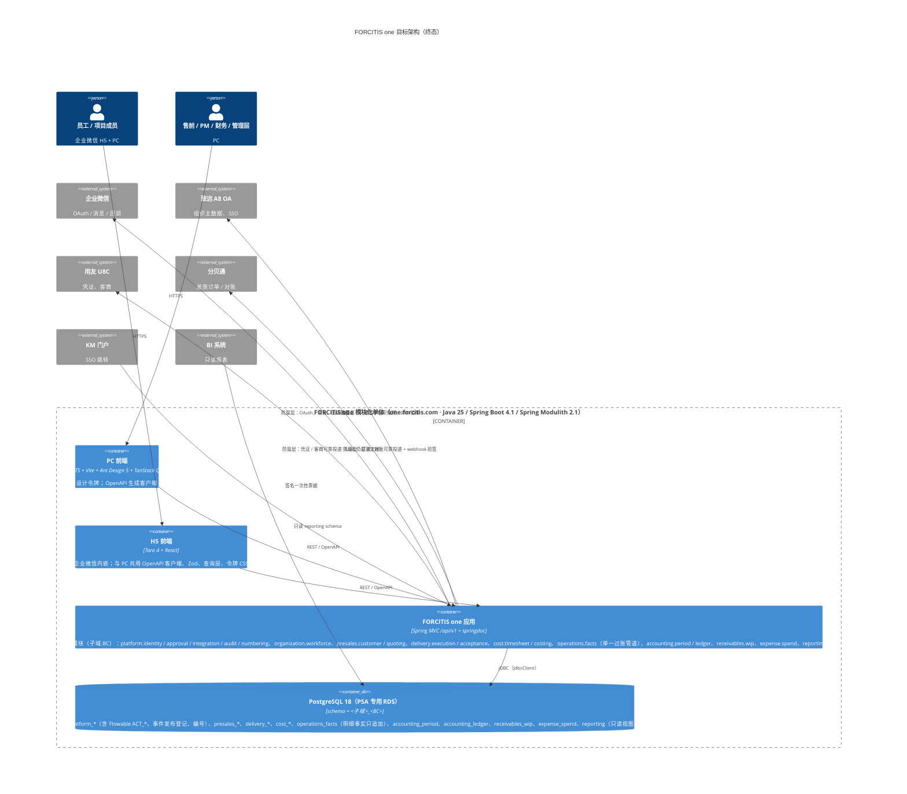
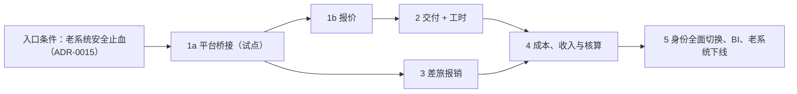

# MODERNIZATION BRIEF — PSA → FORCITIS one

日期：2026-10-14 · 状态：**待审批**

**输入**（均为 2026-10-14 生成）：INTENT、PREFLIGHT、ASSESSMENT、topology.json、SECURITY_FINDINGS（3 轮补丁复审）、BUSINESS_RULES（315 条）、DATA_OBJECTS、GLOSSARY、STACK_DECISION、NAMING_STANDARD、GUIDING_PRINCIPLES、AGENT_FAILURE_MODES、`adr/`（15 篇）、`runtime/`（生产只读采集）、`architecture-guardrails/`（实测模板）。尚无 `RULE_REVIEWS.json`。

## 1. Objective

把 PSA 重建为 **FORCITIS one**（one.forcitis.com，ADR-0001）。

- **从**：yudao 微服务底座 + Java 8 / Spring Boot 2.7 + SQL Server 2016 + Flowable 6.8 + Vue 2。
- **到**：Spring Modulith 模块化单体，Java 25 / Spring Boot 4.1、PostgreSQL 18（schema 为 `<子域>_<BC>`）、JdbcClient、Flyway、Flowable 8（BPMN + DMN）、API 版本化、默认拒绝的鉴权、可配置的业务编号，前端为 React + Taro + 设计系统。定栈见 `STACK_DECISION.md` 和 `adr/`。

迁移期间老系统持续运行，按 BC 绞杀式切换。行为上**功能复刻、行为现代化，顺手修复已知缺陷**（用户原话）。

为什么是现在：
- 技术栈全线过保：Boot 2.7、Vue 2 已 EOL，Boot 3.5 的 OSS 支持也已于 2026-06-30 结束。
- 生产存在可被公网利用的免密登录（SEC-001）和入库的明文密钥（SEC-006 / 012）。
- 5 个微服务和全部中间件挤在一台 15G 内存的 ECS 上，只服务 335 个活跃用户。
- 核心规则锁在没有测试的老 service 层超大类里。

## 2. Target Architecture



| 老组件（topology.json / 运行时） | 目标组件 |
|---|---|
| `yudao-gateway`（gateway:core）、nginx 直连 48080 / 48088 | 删除；nginx → 单体（切换期按路径分流） |
| `yudao-module-system`（system:*）、fst `service/{sync,dept,user,a8}`、企业微信 / A8 / KM 登录 | `identity` + `org` 模块；`integration-acl`（A8、企业微信、KM） |
| `yudao-module-infra`（infra:*：文件、代码生成、配置、API 日志） | `base` 模块（文件存 OSS、审计日志）；代码生成和表单设计器不迁移 |
| `yudao-module-bpm`（bpm:*）+ fst workflowhook / workflowform / 审批消费者 + RocketMQ 审批主题 | `platform.approval` 模块（Flowable 8 BPMN + DMN：步骤、条件、行级分路、会签、催办、转交、退回、撤回、截止点）+ 模块内事件 |
| fst `presales/*`、`controller/admin/{quotation,opportunity}`、`service/customer`、成本模板 / 费率 | `presales` 模块（报价、成本估算树、岗位费率读模型） |
| fst `delivery/*`、`service/{project,budget,contract}`、`pmproject` / `projectplan` / `projecttask` | `delivery` 模块（项目台账、WBS 预算与修订、进度 / ETC、交付物与验收） |
| fst `receivables/*`、收入确认 | `receivables` 模块（收入确认、开票、AR） |
| fst `service/{manhour,calendar,resource}`、工时 MQ 处理器、工时任务 | `timesheet` 模块（填报、行级审批、费率锁定、人天、资源负荷） |
| fst `expense/*`（分贝通防腐层 13.8k 行） | `expense` 模块 + `integration-acl/fenbeitong` |
| fst `cost/*`（归集、OH 分摊、结转 / WIP、过账、期初、修正、劳务重分类、利润报表）、`service/{wip,accounting,cost,costsummaryext}` | `cost.costing`（成本计算与分摊，只提交过账候选）+ `operations.facts`（单一过账管道、冲销）+ `accounting.period`（(期间, 法人) 期间闸门）+ `accounting.ledger`（科目映射 DMN、凭证 → U8C 防腐层）（ADR-0016） |
| fst `platform/*`（可靠投递、枚举注册表） | `base`（Modulith 事件发布登记 + 外部投递作业表）；枚举 → 各模块的 `events` / `api` 契约 |
| XXL-JOB 27 个处理器 | 各模块的 `@Scheduled` + ShedLock |
| Redis（缓存 / 锁 / 编号）、Nacos、RocketMQ | 删除：Caffeine、作业表租约、`platform.numbering`、外部化配置 + KMS |
| PC Vue 2.7 / Element（pc:*） | React 19 + Ant Design 5 PC 应用（`shared/ui` 按设计正本封装），按阶段逐页重建 |
| H5 Taro 4 React（h5:*） | 保留 Taro；接口改用 OpenAPI 生成的客户端，按阶段改造 |
| SQL Server `ruoyi-vue-pro` 库 | PostgreSQL 18：各 BC 的 schema + `reporting` 视图；Flowable `ACT_*` 不迁移，只读归档 |

## 3. Phased Sequence

**本方案是假设，Phase 1a 是试点。** 试点暴露出的问题（漏掉的耦合、改变顺序的前置条件、没写下来的环境事实）都在预期之内，会据此修订 brief，试点之后重新生成 brief 是正常路径。

**排序原则**：绞杀模式，依赖少、风险低的先做；行级强耦合的 BC 放在同一阶段切换。

**过渡期通用机制**（每个阶段都适用，ADR-0011）：
- nginx 按路径把已切换的域分流到 FORCITIS one；
- 老 URL 由兼容门面承接，返回老格式；
- 只按**逐列所有权矩阵**反向同步到老表；
- 在途 Flowable 实例在老引擎上走完；
- 每个阶段都能回滚（恢复 nginx 路由后，老系统从反向同步后的状态继续运行）。
- 会话管理（ADR-0020，`SESSION_PLAYBOOK.md`）：每个阶段的每个工作单元在独立会话中完成，按开场 / 收尾协议更新 `STATUS.md` 与 `SESSION_LOG.md`；用户决定以原话入档。
- 统一语言随阶段登记（ADR-0018）：阶段开始时，本阶段涉及的术语在 `glossary/terms.yaml` 中全部为「已批准」，或「提议中」的已列明并排定评审；阶段结束时没有「提议中」的会计类术语。
- 设计正本随阶段完善（ADR-0013 第 7 条）：阶段开始时在 `DS_GAPS.md` 列出本阶段所需而正本缺失的组件，**先补正本、再写页面**；阶段结束时该阶段的差距清零或注明延后原因。



#### Phase 1a — 平台桥接（试点）
Command: /code-modernization:modernize-reimagine
Modules: system:service/auth, system:controller/admin/auth, system:service/permission, system:service/dept, system:service/user, fst:service/sync, fst:util/wx, fst:service/message, bpm:service/task, bpm:service/definition, bpm:service/oa, bpm:framework/flowable, bpm:mq/producer, fst:framework/workflowhook, fst:service/workflowform, fst:application/platform, fst:infrastructure/platform, pc:views/bpm/processInstance, pc:views/bpm/task, h5:pages/work/process, pc:layout, pc:router, pc:views/login
Scale: L
Risk: 高。
- 风险一：身份桥接出错会影响所有人登录。缓解：新系统只读校验老令牌，不向老库写令牌；会话失败时退回老系统登录页；登录失败率进入告警。
- 风险二：两套审批引擎并存，待办需要合并。缓解：外壳合并展示新旧待办；新流程只承接 1b 及之后切换的单据；老流程在老 Flowable 上排空。
Entry criteria:
- [ ] 本 brief 获批（至少覆盖 Phase 1a 和 1b）
- [ ] SEC-001 至 SEC-006、SEC-107 已在老系统止血（`security_remediation.patch` 已部署，或网络层止血已生效：48088 不再对 0.0.0.0/0 开放、`/other-api/admin-api/system/auth/` 返回 403），且 `~/.modernize/psa/SECRETS.local.md` 中列出的凭据已全部轮换
- [x] 仓库已创建：https://github.com/FORCITIS/forcitis-one-psa（私有，2026-10-14，空仓库）
- [ ] 骨架已推入 `forcitis-one-psa`，分支保护、CI（verify + 守护 + gitleaks）已配置
- [ ] 骨架采用 `architecture-guardrails/backend` 和 `frontend`，在 Mac 本机执行 `./mvnw verify` 和 `pnpm verify` 均全绿
- [ ] FORCITIS one 专用主机和 PSA 专用 RDS PostgreSQL 实例已开通
- [ ] `shared/design-system/tokens.css` 与设计正本「Forcitis One Design System」的 `tokens/palette.css`、`tokens/semantic.css` 逐项一致（正本有更新时重新同步）
- [ ] 设计正本已完整备份到本地；正本现有组件已取下并作为 `shared/ui`（React）的起点（ADR-0013 第 7 条，代码为源）
- [ ] 内核值对象 `Money`、`AccountingPeriod`、`ProjectCoordinate`、`LegalEntityId` 已就位（ADR-0016）
- [ ] 已对 identity、org 两个域补抽规则并完成评审（`RULE_REVIEWS.json` 中有对应记录）
- [ ] 本阶段涉及的老表（`system_users`、`system_dept`、`bpm_*`、`psa_process_to_be_sent`）已有逐列所有权矩阵
Exit criteria:
- [ ] one.forcitis.com 上线：用企业微信 OAuth 和致远 SSO 登录都能成功；遍历全部接口的匿名访问测试返回 401
- [ ] 组织快照与 A8 的对账查询结果为零差异（人员数、部门数、上级关系）
- [ ] 回放从生产导出的 TIMESHEET 流程实例，`platform.approval` 解析出的审批人序列与老系统一致；每条差异都在 `RULE_REVIEWS.json` 中被接受
- [ ] 合并待办中，同一用户在新旧系统中的待办数量与老系统一致
- [ ] 业务编号规则已配置；QUOTE 的起始值等于老系统当年的最大流水号 + 1
- [ ] 同步延迟、未完成的事件发布、作业失败、登录失败率四类告警已接入，并在 dev 上演练触发
- [ ] 回滚演练：撤销 nginx 路由后，老系统登录和审批不受影响
- [ ] 首次 `/design-sync` 完成：正本由 `shared/ui` 同步生成，原有全部组件逐个比对预览无缺失，`_ds_sync.json` 锚点已写入；1a 的差距（合并待办收件箱、登录页、权限不足 / 会话过期页）已补入正本

#### Phase 1b — 报价
Command: /code-modernization:modernize-reimagine
Modules: fst:domain/presales, fst:application/presales, fst:infrastructure/presales, fst:controller/admin/quotation, fst:controller/admin/opportunity, fst:service/customer, pc:views/project/quotation, pc:views/project/costTemplate, pc:views/project/opportunity, pc:views/project/price
Scale: M
Risk: 中。
- 风险一：报价是交付预算的基线，交付仍在老系统。缓解：报价批准后，按所有权矩阵把可交付的列写回 `psa_quotation*`。
- 风险二：老页面仍在调用 `fst/opportunity/*` 等接口。缓解：提供兼容门面。
Entry criteria:
- [ ] Phase 1a 的出口条件全部满足，且本 brief 已按试点结果重新生成
- [ ] 售前与报价域被标记的 P0 规则已在 `RULE_REVIEWS.json` 中有结论
- [ ] 已列出所有调用 `/admin-api/fst/quotation/**`、`/admin-api/fst/opportunity/**` 的老调用方（PC、H5、外部系统），并为每个调用方注明：经兼容门面测试通过，或本阶段一并迁移
- [ ] `psa_quotation*`、`psa_cost_template*`、`psa_crm_opportunity` 已有逐列所有权矩阵
- [ ] 特征基线已录制：用 dev 库数据回放报价的保存、提交、审批，请求与结果记录在 `analysis/psa/BASELINE.md`
Exit criteria:
- [ ] 售前与报价的 P0 规则全部有以规则 ID 命名的测试，且测试通过
- [ ] 同一组输入在新旧系统上的最终报价、毛利、条款拆分、状态完全一致，或差异已在 `RULE_REVIEWS.json` 中被接受
- [ ] 反向同步之后，老系统交付预算读取的报价基线与切换前一致（契约测试）
- [ ] BI 查询清单中涉及报价的查询，在反向同步后的 SQL Server 上结果不变
- [ ] 回滚演练通过

#### Phase 2 — 交付与工时（同一阶段切换）
Command: /code-modernization:modernize-reimagine
Modules: fst:domain/delivery, fst:application/delivery, fst:infrastructure/delivery, fst:controller/admin/pmproject, fst:controller/admin/project, fst:controller/admin/projectplan, fst:controller/admin/projecttask, fst:service/project, fst:service/budget, fst:service/contract, fst:service/manhour, fst:controller/admin/manhour, fst:service/resource, fst:controller/admin/resource, fst:dal/mysql/manhour, fst:dal/dataobject/manhour, pc:views/project/pmList, pc:views/project/lists, pc:views/project/planning, pc:views/project/deliverable, pc:views/project/weeklyMeeting, pc:views/project/budget, pc:views/project/forecast, pc:views/project/taskLists, pc:views/project/myTaskLists, pc:views/project/manhour, pc:views/project/timesheet, h5:pages/work/project, h5:pages/index
Scale: XL
Risk: 很高。
- 风险一：用户量最大的路径（180 天 37.6 万次调用、34,498 个审批实例）。缓解：先做影子计算，新系统用老系统的输入计算并比对结果；在会计期间边界一次性全员切换。
- 风险二：任务包的实际工时由工时审批回写，交付与工时在行级强耦合。缓解：两个 BC 在同一阶段切换，避免出现两个写入方。
Entry criteria:
- [ ] Phase 1b 的出口条件满足
- [ ] 交付、工时、收入确认的 P0 规则中被标记的条目已在 `RULE_REVIEWS.json` 中有结论（例如：撤回后已审批行是否保留、09:00 是开放时间还是截止时间、过账校验用行状态还是表头状态、人天口径）
- [ ] 工时类 XXL-JOB 的耗时基线已从作业日志导出
- [ ] `psa_task_package`、`psa_time_sheet*`、`psa_pm_project`、`psa_budget_*` 已有逐列所有权矩阵
- [ ] `operations.facts` 过账管道和 `accounting.period` 已可用（ADR-0016）：明细事实表拒绝 UPDATE / DELETE 的测试通过；向已关闭的 (期间, 法人) 过账被拒绝的测试通过；工时成本（交易类型 TS）是第一个事实生产者
- [ ] 老过账引擎最近一个已结期间的工时成本过账结果已导出，作为影子比对基线
Exit criteria:
- [ ] 影子计算结果：一个完整会计期间内，新旧系统逐行的审批状态、锁定费率、标准成本金额、计费金额、人天、任务包实际工时完全一致，或差异已被接受
- [ ] 切换发生在会计期间边界；老系统中切换前发起的工时审批实例已全部结束
- [ ] 工时保存和提交的 p95 延迟不高于基线
- [ ] 老成本归集读取反向同步后的 `psa_time_sheet_works_end` 时，结果与切换前一致
- [ ] 回滚演练通过

#### Phase 3 — 差旅报销（分贝通）
Command: /code-modernization:modernize-reimagine
Modules: fst:domain/expense, fst:application/expense, fst:infrastructure/expense, fst:controller/admin/expense, fst:expense/travel, h5:pages/work/travel, pc:views/accounting/travel
Scale: L
Risk: 中。
- 风险：外部集成状态机复杂（订单、对账、组织同步、可靠投递）。缓解：用分贝通沙箱做契约测试；保留现有防腐层设计。
Entry criteria:
- [ ] Phase 1a 的出口条件满足
- [ ] 已执行 `/code-modernization:modernize-extract-rules psa expense` 补抽差旅规则，并在 `RULE_REVIEWS.json` 中有结论
- [ ] 分贝通沙箱可用，签名密钥存放在 KMS
- [ ] 分贝通回调地址 `/app-api/fst/fenbeitong/events/*` 的切换方式已与分贝通确认：改为新地址，或由兼容门面转发
Exit criteria:
- [ ] 差旅 P0 规则全部有测试，且测试通过
- [ ] 一个完整月度周期（申请、订票、对账、分摊、月结审批）在新系统跑通，与老系统的对账单逐笔一致
- [ ] 回滚演练通过

#### Phase 4 — 成本、收入与核算
Command: /code-modernization:modernize-reimagine
Modules: fst:domain/cost, fst:application/cost, fst:infrastructure/cost, fst:controller/admin/cost, fst:controller/admin/accounting, fst:service/wip, fst:service/accounting, fst:service/cost, fst:service/costsummaryext, fst:domain/receivables, fst:application/receivables, fst:infrastructure/receivables, pc:views/accounting/costCollection, pc:views/accounting/costCarry, pc:views/accounting/costAllocation, pc:views/accounting/projectProfitL3, pc:views/accounting/revenueRedReversal, pc:views/accounting/voucherManage, pc:views/accounting/accountingPeriod, pc:views/costopenning, pc:views/project/revenue, pc:api/accounting
Scale: XL
Risk: 很高。
- 风险一：直接产生推送 U8C 的凭证，错误不可逆。缓解：至少两个月结期间影子计算；凭证只出草稿、不推送，人工对账一致后再切换推送权。
- 风险二：老结转路径（`/fst/accounting/wip`）与新结转引擎并存。缓解：切换前由业务确认下线老路径。
Entry criteria:
- [ ] Phase 2 和 Phase 3 的出口条件满足
- [ ] 成本域被标记的 P0 规则已有结论（分摊余数归属、负成本进入 WIP 后的余额符号、红冲是部分还是全额、核销按数量配对还是按金额配对）
- [ ] 收入确认按 ACC-R01「产出法 · 客户价值确认」实现，老文档中 EAC / POC 驱动收入的过期表述已更正；财务已确认期间重开政策、质保金条款（ADR-0016）
- [ ] 收入两条来源的切换方案已确认：A8 产值确认单同步（2026 年仍为主渠道）何时停用、停用前新系统如何只读接入且不覆盖 PSA 自己确认的收入；财务已确认预付款条款（PREPAY）无交付即确认收入的口径
- [ ] 词表中会计口径相关的改名（G-8 至 G-13、G-16、G-17、G-20、G-21、G-27）已于 2026-10-14 由业务 Admin 确认；财务在本阶段开始前复核这些用语在凭证与报表中的口径（ADR-0018）
- [ ] 科目映射 DMN 表已由财务评审，版本号已登记
- [ ] 最近两个已结期间的老系统归集、分摊、结转、凭证结果已导出，作为黄金基线
- [ ] 月结批处理的耗时基线已导出
Exit criteria:
- [ ] 两个月结期间，新旧系统的分摊行、WIP 余额、凭证分录逐笔一致，或差异已由财务在 `RULE_REVIEWS.json` 中签字接受
- [ ] 对账等式全部成立：归集守恒、合同资产滚动恒等式（F113）、凭证借贷平衡；老系统的红冲记录已按冲销关系迁移，原行与反向行双向关联
- [ ] 月结批处理在生产规模数据上的耗时不高于基线
- [ ] U8C 推送权已切换到新系统，老成本页面和 `/fst/accounting/wip` 已下线
- [ ] 回滚演练通过（推送权切回老系统）

#### Phase 5 — 身份全面切换、BI 与老系统下线
Command: /code-modernization:modernize-reimagine
Modules: system:service/oauth2, system:controller/admin/permission, gateway:core, infra:controller/admin/file, pc:views/system/user, pc:views/system/role, pc:views/system/menu, h5:pages/qyLogin, h5:pages/mine
Scale: M
Risk: 中。
- 风险：BI、KM、A8 等外部系统依赖老库和 SSO 端点。缓解：提供与老表同形状的 `reporting` 视图；外部 SSO 调用方迁移到签名票据。
Entry criteria:
- [ ] Phase 4 的出口条件满足
- [ ] 外部调用方清单（BI、KM、A8、IT 服务门户）中，每一方都已有确认的切换步骤
Exit criteria:
- [ ] BI 查询清单中的每条查询在 PostgreSQL `reporting` 上的结果，与切换前在 SQL Server 上的结果一致
- [ ] 安全组已移除 48080 和 48088 规则，老服务进程已停止
- [ ] SQL Server 库已转为只读归档；Flowable 历史和 API 日志已按保留期归档

## 4. Business Walkthroughs

| 人物 | 业务过程 | 老系统实现模块 | 由哪个阶段替换 |
|---|---|---|---|
| 项目成员 / 部门经理 | 每天在手机或电脑上把当天工时分配到工作包，提交后由项目经理或直属领导逐行审批，通过后锁定费率、计入项目人工成本 | h5:pages/work/project、pc:views/project/manhour → fst:service/manhour → bpm:service/task → fst:mq/consumer → fst:trigger/task → fst:application/cost | 填报和审批：Phase 2；审批引擎：Phase 1a；计入成本：Phase 4 |
| 售前经理 / 项目经理 | 售前为商机编制成本估算树和报价并送审（低于 50% 毛利需说明理由）；赢单后 PM 以报价为基线编制 WBS 预算，毛利低于报价时需 CEO 终审 | pc:views/project/quotation → fst:application/presales → fst:domain/presales → bpm:service/task；fst:controller/admin/pmproject → fst:domain/delivery | 报价：Phase 1b；预算：Phase 2 |
| 出差员工 / 财务 | 员工在手机上提交出差申请，审批后在分贝通订票；月底财务把账单和发票分摊到项目或商机，并审批月度对账单 | h5:pages/work/travel → fst:application/expense → fst:infrastructure/expense（分贝通）→ pc:views/accounting/travel | Phase 3 |
| 成本会计 | 月末归集直接和间接成本、按人工成本占比分摊 OH、结转 WIP、核销并生成凭证推送用友 U8C | pc:views/accounting/costCollection、costCarry → fst:application/cost → fst:domain/cost → fst:infrastructure/cost → U8C | Phase 4 |

## 5. Behavior Contract

行为契约取自 `BUSINESS_RULES.md` 的 **189 条 P0 规则**（全部 315 条）。它们构成回归测试集：每条在其所属阶段上线前，都必须证明等价，或以 `RULE_REVIEWS.json` 中的业务决定为准证明「按决定修正」。

- **已定行为（97 条）**：置信度 High 且无疑似缺陷，按老系统行为复刻。
- **阻塞项（92 条）**：置信度低于 High，或抽取时发现疑似缺陷（老行为看起来有误，或与文档不一致）。按用户要求「顺手修已知 bug、行为现代化」，这些规则**在所属阶段开工前必须经 `/code-modernization:modernize-review psa` 由业务逐条决定**：保持原行为、按修正行为实现，或列入讨论。未决定的规则阻塞该阶段的入口条件。

| 域 | 阶段 | 已定（P0） | 阻塞（P0，需评审） |
|---|---|---|---|
| 工时与资源 | Phase 2 | 21 | 9 |
| 项目成本与核算 | Phase 4 | 29 | 23 |
| 售前与报价 | Phase 1b | 8 | 14 |
| 交付、预算与收入 | Phase 2（收入确认部分在 Phase 4） | 19 | 18 |
| 审批（platform.approval） | Phase 1a | 20 | 28 |

### 工时与资源（Phase 2）

**已定：** RULE-001 Task package actual hours = total approved hours (recalculated in full)、RULE-003 Approval writes the cost and bill amounts (approved hours × locked rate)、RULE-005 Rates, company code and cost centre are fixed at submission、RULE-007 Rate lookup by employee grade, salary band and city on the work date、RULE-020 Approval status transition rules; approvers act only on their own lines、RULE-021 Conditions for a timesheet line to be postable to cost、RULE-024 On a workday, booked hours plus leave must be at least 7.5h、RULE-025 One timesheet per employee per calendar day、RULE-026 The remaining-hours (ETC) gate on project-task packages、RULE-028 Fields required to send, by work-package type (drafts exempt)、RULE-029 Every line must have an approver before it can be sent、RULE-031 Every line must match exactly one standard-cost rate and one billing rate、RULE-032 Which project-task packages are bookable、RULE-044 End-of-process result decides the header outcome、RULE-045 Pending becomes In-approval only after BPM has actually started or resumed the process、RULE-046 An approver's personal decision only touches that approver's own rows、RULE-047 How row statuses follow a header change、RULE-049 Who may re-initiate (edit and resubmit) a timesheet、RULE-050 "Save" keeps a draft; "Send" queues the approval process、RULE-051 Row approver is assigned at submit by work-category type、RULE-058 Cost and bill rates are locked at submit, not at approval

**阻塞，需评审：**
- [ ] RULE-002 Which daily wage is used (before 2020 vs from 2020 on)（`HourlyRateServiceImpl.java:329-348`，置信度 Medium） — `Integer.parseInt(postCode.substring(1))` throws if the post code has a non-numeric suffix.
- [ ] RULE-004 Human-days split of a person's approved day across projects（`ManHourEndServiceImpl.java:57-109`，置信度 Medium） — (1) If a null `approval_hours` row follows a non-null row on the same day, `hoursValue.add(null)` throws an NPE. That aborts the run for every remaining user, because the job catches the exception and only logs it. (2) T
- [ ] RULE-006 Project labour cost = daily wage × human days, excluding admin/support posts（`ManHourServiceImpl.java:2090-2128`，置信度 Medium） — `contains("A")`/`contains("S")` matches the letter anywhere in the post code, not just as a prefix. Rest-day human days for A/S posts are still added to non-chargeable days, because the rest-day check runs first. RULE-24
- [ ] RULE-022 Who can see whose timesheets（`ManHourServiceImpl.java:216-222`，置信度 High） — Several read endpoints have no ownership or permission check:
- [ ] RULE-023 Only the owner can edit or resubmit, and only when rejected, cancelled or returned（`ManHourServiceImpl.java:800-818`，置信度 High） — Doc TS-R-003/008 says approved sheets can be reopened by configuration. No reopen path exists in this code.
- [ ] RULE-027 The three org fields are mandatory on every line（`ManHourServiceImpl.java:1327-1351`，置信度 High） — The values come from the client and are not compared with the server's work-package list. The intended source rules are: project or project task → the project's delivery dept; opportunity or opportunity task → the opport
- [ ] RULE-030 Timesheets can only be booked to a work package the employee is allowed to use right now（`ManHourServiceImpl.java:1434-1469`，置信度 High） — Only type and id are compared. The three org fields (costOrgId/projectOrgId/profitCenterId), termNumber, stageId and managerId sent by the client are not checked against the server's list, so a crafted payload can book a
- [ ] RULE-043 Row decisions from BPM task-completion messages（`TimesheetApprovalResultHandler.java:54-139`，置信度 High） — The legacy fallback path (no rowIds, lines 122-135) rejects every id in the opinion JSON, even ids with a blank opinion and ids belonging to other approvers. That contradicts the "blank means agree" rule of the node path
- [ ] RULE-048 Timesheet header approval-status state machine (allowed transitions)（`ManHourApproveStatusService.java:163-183`，置信度 High） — The state-machine doc (05-工时域-状态机.md §5.3, §3.8) lists a `通过 → 取消` edge and an "admin revoke to DRAFT". The global rule list COST-R09 says approved sheets can be reopened back to 审批中. In code, Approved has no outgoing ed

### 项目成本与核算（Phase 4）

**已定：** RULE-067 Three-tier project profit and rates、RULE-068 OH tier routing and carry-forward when the labour base is zero、RULE-071 WIP stage on entry and stage advance (POC exactly 100 and contract returned)、RULE-073 Year-end bonus is split to project terms by the person's annual hours (cent-exact largest remainder)、RULE-074 Cost routing chain and how expense nature is set、RULE-075 Timesheet three-element (salary/social/fund) cent rounding anchored to the rounded total、RULE-076 Labour reclass – U8C credit vs PSA landed cost, by department, with tolerance、RULE-077 Labour reclass voucher – reverse U8C credit in full, debit PSA buckets, absorb small differences、RULE-078 Vouchers are aggregated per company × voucher word × department、RULE-081 Write-off voucher amounts and credit account derivation、RULE-091 Period open/close preconditions (sequential opening, month-end done, reconciled)、RULE-092 Full OH allocation: one effective full run per period, never concurrent、RULE-093 Carry draft gate order, and the red-reversal exception、RULE-094 Carry confirm re-checks the gates and dry-runs the vouchers、RULE-098 Labor reclass confirm and deliver must be fresh and follow period order、RULE-100 Landing conservation must balance exactly (zero tolerance)、RULE-101 Collection confirmation gate、RULE-103 Project fees without a contract term never go to the OH pool、RULE-105 Labor reclass differences over ¥1.00 block the voucher、RULE-106 Re-running collection reverses a prior confirmation; it is blocked once allocation is confirmed、RULE-107 Collection cannot start until payroll is complete for everyone who filed timesheets、RULE-116 Full allocation takes effect atomically with pool write-back and step advance、RULE-117 A batch becomes POSTED only when U8C has confirmed every voucher; then the step advances、RULE-118 Creating a carry draft (asynchronous)、RULE-119 Posting phases and the completion condition、RULE-123 WIP stage assignment and advancement、RULE-125 Carry steps are strictly serial: occupy on draft, advance on POSTED, release on cancel、RULE-126 WIP write-off flips the entry from in-WIP to relieved and books a P&L line、RULE-134 A cost dated in a closed period lands in the earliest later open period

**阻塞，需评审：**
- [ ] RULE-066 OH basis is timesheet (source_type 0) not-tax cost; period 13 uses the full-year base（`AllocationOrchestrator.java:108-146`，置信度 High） — Docs COST-R39/R40 still say "wpt0/1 work-package hours". Code uses source_type = 0 because work_package_type is never populated (#875).
- [ ] RULE-069 OH allocation – share each overhead pot by direct-labour cost share, with rounding remainder on the largest line（`OhAllocationCalculator.java:196-352`，置信度 High） — Docs (09 rules list COST-R45) call this the "largest remainder method". The code does not do that: it puts the whole remainder on the largest-amount line.
- [ ] RULE-070 Reversing an OH accrual mirrors the original allocation in proportion（`ReversalMirrorCalculator.java:31-90`，置信度 High） — Docs COST-R44 say "分摊无独立红冲入口" (allocation has no separate reversal). The code does have this reversal-mirror path.
- [ ] RULE-072 WIP write-off selection – one revenue confirmation releases one whole WIP entry; leftovers go cost-only or wait（`CarrySelectorImpl.java:126-237`，置信度 Medium） — Docs COST-R60 (write-off cutoff by business_date ≤ latest confirmation date) are not implemented. Pairing is by count, so one confirmation of any size releases a whole entry and pulls every other entry on the term into c
- [ ] RULE-079 Posting rule matching and voucher-line rendering（`PostingRuleEngine.java:185-286`，置信度 High） — Docs COST-R54 describe 3-level matching on (carry_type, source_type, company). The code matches on carry_type → trigger condition → company. Docs also say "同一 carry_type 应唯一" (one rule per carry_type, design doc line 205
- [ ] RULE-080 Revenue-return red reversal – reverse the whole original cost, re-render the voucher and negate it（`PostingVoucherDrafterImpl.java:125-209`，置信度 Medium） — - The return's own amount is never used: a partial return reverses the entire cost.
- [ ] RULE-082 WIP period balance and report increase/decrease use the absolute movement amount（`WipPeriodSnapshotMapper.java:53-113`，置信度 Medium） — ABS() turns negative WIP entries into positive balances. WipReportMapper.java:52-61 (increase/decrease) does the same, so WIP balance and the report overstate WIP by twice any negative cost entered.
- [ ] RULE-095 Red reversal confirm requires a valid reason and a successful red-voucher preview（`RevenueRedReversalCommandUseCase.java:42-55`，置信度 Medium） — The seed spec requires the "财务主管" (finance supervisor) role. The controller only checks the generic permission `cost:carry-batch:confirm` (RevenueRedReversalController:149), which is the same one used for normal carry co
- [ ] RULE-096 Collection start preconditions and order of side effects（`ExecuteCollectionUseCase.java:82-128`，置信度 Medium）
- [ ] RULE-097 Exempting a collection error needs a reason and only works on OPEN errors（`ExemptEntryErrorUseCase.java:28-40`，置信度 Medium） — There is no check on issue type, so a technical SYSTEM_PROCESS_FAILED error can be exempted too, and that unblocks the confirmation gate. The spec (`cost-exception-workbench` "技术异常必阻断确认、业务异常…可豁免") says only business erro
- [ ] RULE-099 Unreconciled expense lines block carry and period close（`ReconciledClosingGate.java:20-32`，置信度 High） — Period close reuses the carry-specific error code COST_CARRY_HAS_UNRECONCILED, so the close screen will show a carry message. A non-zero threshold would let close/carry proceed with known unreconciled rows; the spec has 
- [ ] RULE-102 Ingest pre-routing guards: duplicates, exempt flag, department bonus（`CostRoutingService.java:101-125`，置信度 High） — Finance can set flag_exempt in bulk through the cost-correction Excel import ("是 / 否 / 豁免", CostCorrectionImportService.java:425-441). That bypasses every validation and exception-workbench control with no reason and no 
- [ ] RULE-104 Mandatory dimensions depend on where the cost will land（`CostValidationService.java:76-146`，置信度 High） — The read-only posting pre-check (RULE-20) checks the OH mapping only for cost_org_id, not for the cost centre. A row can pass the pre-check and still fail ingest with DEPT_NOT_MAPPED on its cost centre.
- [ ] RULE-108 Month-end cost processing only runs while the period is Pre-closed or Reopened（`AccountingPeriodServiceImpl.java:43-48`，置信度 High） — The 重开 branch looks unreachable through the normal UI. `AccountingPeriodManagementService.transition` rejects the REOPEN action outright, and 已关账 has no available actions (`AccountingPeriodStatusEnum` CLOSED_BOOKS = empt
- [ ] RULE-120 Allocation batch lifecycle（`CostAllocationBatch.java:69-134`，置信度 High） — `DeleteTrialAllocationUseCase:23-30` deletes a trial batch without checking its status, so a QUEUED or RUNNING trial can be deleted while the worker is still writing it.
- [ ] RULE-121 Collection batch status and phase lifecycle（`CostCollectionBatch.java:122-191`，置信度 High） — `fail()` has no guard. Its comment says "non-terminal only", but it would overwrite a COMPLETED batch if called.
- [ ] RULE-122 Carry batch status and phase state machine（`CarryBatch.java:98-283`，置信度 High） — REVERSED (4) is never assigned by any code; only OpeningEventCarryBridge:275 reads it. Batch-level reversal is not implemented, and red reversal works line by line through carry_type=3.
- [ ] RULE-124 Period month-end step gate: collection lock, confirm, and re-collection rollback（`PeriodProgress.java:71-117`，置信度 High） — Nothing reverses an effective full allocation, so a collection error found after step 2 cannot be fixed through re-collection.
- [ ] RULE-127 Red reversal returns a relieved WIP entry to in-WIP and books one negative P&L line per positive line（`WipLedgerPosterImpl.java:435-502`，置信度 High） — Seed doc 09 rule PLT-R02 says "红冲无人工入口" (no manual entry for red reversal). In code, red reversal is a manual draft-and-confirm flow (RULE-21).
- [ ] RULE-128 Legacy carry-forward lifecycle (待结转 → 结转中 → 已结转), still exposed by controllers（`CostCarryForwardServiceImpl.java:109-157`，置信度 Medium） — 1. In `F/service/wip/CarryForwardServiceImpl.java:219-222` the U8C call is commented out. updateResult is hard-coded SUCCESS, and the 2nd company processed always gets the fake error "U8C错误信息:XXXXXXXXXX", so no real vouc
- [ ] RULE-132 U8C voucher delivery and the opening-year local bypass（`U8cVoucherPostHandler.java:88-140`，置信度 High） — The voucher status only ever moves DRAFT(0) → CONFIRMED(2). SENT(1) and FAILED(3) are never written, even though VoucherWriterImpl:69 says "回写 SENT/CONFIRMED", so delivery state only exists on the delivery task.
- [ ] RULE-133 Opening-period collection confirm can bulk-exempt all open errors（`OpeningMonthExecuteUseCase.java:115-129`，置信度 Medium） — This bypasses the normal-flow rule that technical errors "must be resolved by IT" (CostCollectionBatch:381-383). The exemptions are permanent.
- [ ] RULE-135 Month-end cost processing only runs while the period is pre-closed or reopened（`AccountingPeriodServiceImpl.java:43-56`，置信度 High） — The status checks use `FSTConstant` integer constants, not the `AccountingPeriodStatusEnum` single source of truth (CLAUDE.md forbids new FSTConstant status usage). Seed spec cost-revenue-red-reversal says red reversal n

### 售前与报价（Phase 1b）

**已定：** RULE-143 BU estimated cost = labour cost (whole tree) + the 8 fixed other-cost categories、RULE-146 Line amount: a hand-entered discounted total overrides quantity × unit price、RULE-156 Contract clauses are locked during approval、RULE-157 Server master data is the only source of position rates; strict check at submit、RULE-160 Approval-time adoption recalculates final amount and margin; quotation must stay PENDING、RULE-161 Server-side checks on monetary inputs、RULE-166 Approve/reject decisions are idempotent and ignore stale messages、RULE-167 Submission order: refresh costs, check all gates, compare-and-set, then start OPP_QUOTATION as one transaction

**阻塞，需评审：**
- [ ] RULE-139 Server rates always overwrite client rates; at submission every work package must have a fully priced role（`QuotationCostRateResolver.java:38-103`，置信度 High） — (1) PRE-R02 ("billing rates may be discounted, hours may not be changed") is not implemented: there is no rate discount, any client rate is overwritten, and hours are freely editable by cost editors. (2) The duplicate-ra
- [ ] RULE-140 At submit, cost and margin are recalculated from the current rates before approval starts（`SubmitQuotationUseCase.java:51-81`，置信度 High） — A sales submission can therefore go to approval with labour cost understated (unpriced work packages count as 0) and margin overstated. The safeguards are the approval cost-required check (RULE-15) and the BU approver's 
- [ ] RULE-141 Cost-tree work package value = hours × billing rate; labour cost = hours × cost rate（`CostEstimateNode.java:74-102`，置信度 Medium） — (1) The multiplication is not rounded; for example 12.5 h × ¥833.33 = ¥10,416.625, so the value saved depends on the DB column scale. (2) The seed docs (Q5 "逐层向上汇总", PRE-R04 "自底向上汇总标价") say the tree rolls up into the pri
- [ ] RULE-142 Final quote equals the sum of line amounts plus the tail adjustment（`Quotation.java:237-246`，置信度 High） — Nothing stops the tail adjustment from wiping out most of the line total. The only limits are finalAmount > 0 at submit and clause-sum equality (RULE-10).
- [ ] RULE-144 Gross margin is calculated on the ex-tax final quote using the header tax rate, to 4 decimals（`Quotation.java:252-259`，置信度 High） — (1) The seed doc (Q6) says to divide by a fixed 1.06; the code uses the quotation's own tax rate. (2) The margin always uses the header rate even when lines carry different rates. Example: one line of ¥113,000 at 13% has
- [ ] RULE-145 Approval-time edits recalculate the final quote from the stored line total plus the new tail adjustment（`Quotation.java:367-410`，置信度 High） — (1) A tax-rate change during approval does not re-derive the stored lines' tax splits, so line amountNotax and taxAmount no longer match the header rate. (2) If a legacy row has labor_cost NULL and the approver adopts on
- [ ] RULE-147 Role rates come from the master-data schemes in effect today, by role and city, newest scheme first（`PositionRateQueryImpl.java:50-92`，置信度 High） — Rates are taken as of the server's current date (`LocalDate.now()`), not the quotation's creation or submit date. Every save, submit or approval adoption re-prices the tree at that day's rates. Two schemes with the same 
- [ ] RULE-155 During approval clauses are locked, so the tail adjustment is effectively frozen, and BU cost must be > 0 when required（`ApplyQuotationApprovalUseCase.java:65-101`，置信度 High） — Tail adjustment and tax/price changes are offered to approvers as adoptable fields, but whenever clauses exist any change to the final quote is guaranteed to fail.
- [ ] RULE-158 Conditions for submitting a quotation for approval（`Quotation.java:265-279`，置信度 High） — The aggregate's comment says the new instance id is "由终态消息补写" (written back by the final-result message). The code actually binds it straight after the workflow starts (see RULE-03), so the comment is out of date.
- [ ] RULE-159 Clause amounts must each be greater than 0 and add up exactly to the final quote（`Quotation.java:334-356`，置信度 High） — The comment at `SubmitQuotationUseCase.java:60` says "合计 ≤ 最终报价", but the code requires equality. The front end warns only when the total exceeds the final quote (+0.005 tolerance), so an under-allocated split gives no w
- [ ] RULE-168 Only DRAFT or REJECTED quotations can be edited, submitted or deleted（`Quotation.java:532-540`，置信度 High） — The save path writes to the database with no status condition (`QuotationRepositoryImpl.saveEditorContent`, lines 89-150, plain `updateById` plus delete-and-reinsert of child rows). Submit (`updateStatusIf`), delete and 
- [ ] RULE-169 How BPM final results map to quotation outcomes（`QuotationProcessResultHandler.java:34-52`，置信度 Medium） — A cancellation (e.g. the initiator withdraws) is stored as REJECTED, labelled "OA 驳回", and, if no comment was given, with reason "审批未通过". Users and reports cannot tell a withdrawal from a real rejection.
- [ ] RULE-172 Only the applicant can save, submit or delete a quotation（`QuotationAccessGuard.java:66-71`，置信度 High） — The delete endpoint requires only the `fst:quotation:query` permission (`QuotationController.java:212-222`, by design per refs #1509), so any query-role user who owns a draft can delete it. Note this when mapping roles.
- [ ] RULE-173 Users without cost-edit permission cannot change cost inputs; work-package cost fields are kept from the database（`SaveQuotationUseCase.java:51-164`，置信度 Medium） — New clauses (those without a code) carry the hours and roles sent by the client, so sales can set labour hours by deleting a clause and re-adding it.

### 交付、预算与收入（Phase 2（收入确认部分在 Phase 4））

**已定：** RULE-184 A clause's revenue is capped at the clause amount; pending requests reserve quota、RULE-200 A revision cannot be submitted if the archive clauses changed after the revision started、RULE-201 Execution-side structure is frozen during budget approval, and planned hours are frozen after lock、RULE-203 Only one active submission per deliverable、RULE-204 At final approval the quota is re-checked; an over-cap request is auto-rejected、RULE-206 Once hours are logged, the assignee is fixed and the task cannot be deleted、RULE-207 Submitting a deliverable requires all its tasks to be finished, then locks them、RULE-208 Rules for registering customer acceptance、RULE-211 Normal cost items are edited during budgeting; sensitive items need a permission、RULE-219 On budget approval, role rates are frozen and cost snapshots are written、RULE-220 ETC approval outcome — approved promotes the pending value; rejected or cancelled unfreezes and keeps the old value、RULE-221 A budget revision can only start from a locked budget; it snapshots, unlocks and re-baselines the clause layer、RULE-228 Budget editing is blocked while the budget is locked or awaiting approval、RULE-229 On revision, clauses are re-matched to the archive; vanished clauses with history become obsolete, others are removed、RULE-239 Budget margin vs quotation margin decides whether CEO approval is needed、RULE-240 The quota is checked again at final approval, and an over-quota approval is turned into a rejection、RULE-242 Raising ETC needs PM_ETC approval only if it pushes project forecast labour cost above budget labour cost、RULE-243 Archive reconciliation keeps clauses that have data and removes those that do not、RULE-244 Budget approval routing — the CEO step is skipped only if budget gross margin ≥ quote gross margin

**阻塞，需评审：**
- [ ] RULE-181 WBS budget cost is task hours × role cost rate, summed up the tree, plus non-labour cost categories（`ProjectBudget.java:733-767`，置信度 High） — The task-level product (`TaskPackage.budgetCost`) is never rounded to cents, but the progress page rounds each task to 2 dp (`ExecutionCostBook.money`). So the budget page total and the sum of progress-tree rows can diff
- [ ] RULE-182 Budget gross margin uses ex-tax contract amount at the source quotation's tax rate (default 6%)（`ProjectBudget.java:769-792`，置信度 High） — The legacy performance margins (RULE-20) hard-code 1.06 no matter what the quotation's tax rate is, so the two screens can disagree for 13%-tax contracts.
- [ ] RULE-183 Task ETC, EAC and POC（`TaskPackage.java:264-311`，置信度 High） — Rule DLV-R08 (09-业务规则清单) says "ETC empty ⇒ EAC = AC (treated as complete)". The code instead defaults an empty ETC to remaining budget hours.
- [ ] RULE-185 Revenue confirmation needs a positive amount and complete evidence; the period is the sign-date month（`RevenueConfirmation.java:64-125`，置信度 High） — The docs disagree with the code on three points:
- [ ] RULE-202 Only the project's PM can change execution-side structure（`OperateProgressTaskUseCase.java:504-510`，置信度 High） — `delete()` (lines 440-453) does not call `requireProjectManager`. Any holder of `fst:pm-project:progress` can delete another project's task packages, as long as no hours are logged. Also, `/task/update`, `/task/create` a
- [ ] RULE-205 Revenue confirmation submit gates — clause exists, clause not obsolete, contract signed back（`SubmitRevenueConfirmationUseCase.java:44-90`，置信度 High） — Seed doc DLV-R18 lists three preconditions: work package POC 100%, internal review passed, and customer confirmation. The code dropped the deliverable gate (#1524), and `allDeliverablesAccepted` / `allDeliverablesInterna
- [ ] RULE-209 Every task package must be complete before a budget can be submitted（`ProjectBudget.java:326-377`，置信度 High） — The class comment says the role "must be in the static rate-table domain", but `validateTask` (lines 802-808) only checks that hours are not negative. The role value domain is never checked on the server. The `TASK_ROLE_
- [ ] RULE-210 Budget can only be edited while it is unlocked and not awaiting approval（`ProjectBudget.java:438-446`，置信度 High） — The budget write endpoints (`PmProjectBudgetController` `/import`, `/task/*`, `/lock`, `/deliverable*`, `/cost-items`) check only the permission `fst:pm-project:budget` and turn off `@DataPermission`. No use case checks 
- [ ] RULE-212 Rules for an approver changing the budget tree during approval（`ProjectBudget.java:639-723`，置信度 High） — This path does not run the RULE-02 rate-missing check. An approver can add a task package with hours but no matching rate, and it is locked into the baseline at cost 0.
- [ ] RULE-213 Total confirmed revenue cannot exceed the clause amount（`RevenueConfirmation.java:64-87`，置信度 High） — Unlike deliverable acceptance (RULE-21), the sign date is not checked against today. A future date is accepted and gives a future revenue period.
- [ ] RULE-222 Approved revenue writes an append-only revenue fact, after a second quota check（`DecideRevenueConfirmationUseCase.java:36-68`，置信度 High） — When the auto-reject happens, BPM shows the instance as approved while PSA shows it rejected. No notification or BPM correction is visible in the code.
- [ ] RULE-223 Task package execution states — DOING/REWORK → DONE, DONE → DOING (reopen), LOCKED → REWORK（`DeliverableProgress.java:47-84`，置信度 High） — `FSTConstant.TaskStatus` (0 进行中 / in progress, 1 已保存 / saved, 2 已完成 / completed, 3 已逾期 / overdue, with the comment "TODO 其他两个状态需要完善" / "the other two states need completing") is a separate legacy integer vocabulary. It i
- [ ] RULE-224 Submitting a deliverable requires all its task packages to be done, and locks them（`DeliverableProgress.java:403-423`，置信度 High） — If the submission is rejected (DRAFT), the packages stay LOCKED. Nothing unlocks them. Resubmission still works because LOCKED is accepted.
- [ ] RULE-225 Deliverable approval outcome — approved → awaiting customer acceptance; rejected or cancelled → DRAFT（`DeliverableSubmission.java:588-613`，置信度 Medium） — The `StageReviewProcessResultHandler.java:16-17` comment says that when a meeting fails, the director-node handler already set the submission to DRAFT, so a later "approved" end is a no-op. But `recordDirectorReview` (li
- [ ] RULE-226 Deliverable submission states, and which states hold the deliverable's single "submission slot"（`DeliverableSubmissionStatus.java:43-64`，置信度 High） — `DLV_CONVERTED` has no writer anywhere in the codebase, although it is listed as a state.
- [ ] RULE-227 A budget can only be locked through an approved PM_BUDGET approval, and only when it is complete（`ProjectBudget.java:326-377`，置信度 High） — `requireAllRolesSelected` does NOT skip obsolete packages, unlike `requireAllTasksComplete`. An obsolete package with no role is read-only, so it would block every future submit. Seed doc OPS-R01 says "预算保存即锁定" (saving t
- [ ] RULE-241 An ETC increase needs PM_ETC approval only if it pushes forecast labour cost over budget labour cost（`DeliverableProgress.java:110-136`，置信度 High） — Seed DLV-R08 says "ETC 为空时 EAC = AC → 视同完工" (empty ETC means EAC = actual, treated as complete). The code treats empty ETC as max(0, planned − actual) (`TaskPackage.java:276-286`).
- [ ] RULE-245 Which role cost rate applies: project city, then quotation city, then unfiltered; latest active scheme wins（`ProjectBudgetRepositoryImpl.java:150-222`，置信度 Medium） — `PositionRateQueryImpl.build` turns a missing cost rate into ¥0 (not null) when the role has only a bill rate. Such tasks pass the "rate missing" gate (RULE-05) and silently cost ¥0.

### 审批（platform.approval）（Phase 1a）

**已定：** RULE-251 Row reachability: a row reaches a node if its routing value activates a path to it、RULE-262 Each node must have exactly one assignment rule、RULE-263 A row-approval node requires row units, and the row set is narrowed by routing、RULE-264 Idempotent process start by idempotency key、RULE-268 Only the initiator may cancel, before any cutoff node, with a reason、RULE-271 A reject inside a subprocess returns to the initiator; a top-level reject terminates the process、RULE-272 Validation for the unified "decide" action、RULE-273 A reject from an added countersigner is advisory only、RULE-274 Row-by-row approval must cover every pending row, and any rejected row rejects the node、RULE-275 Return to initiator requires a reason and passes the node's BEFORE hook、RULE-277 BEFORE-hook commit gate、RULE-287 Resubmission chooses between continuing the same instance, blocking, and starting a new instance、RULE-290 A top-level rejection ends the whole process; a rejection inside a sub-process sends it back to the initiator、RULE-294 Task result lifecycle (bpm_task_ext)、RULE-301 Auto-complete cascade order after each task creation、RULE-305 Task-result messages (topic-bpm-approval-task-result)、RULE-306 Which process endings reach business modules、RULE-309 Withdraw/cancel cutoff = any marked node with a completed task、RULE-310 Document detail is visible to holders of the function permission or to process participants (fail-closed)、RULE-312 The process-end consumer runs the hook and then the handler, and must be idempotent

**阻塞，需评审：**
- [ ] RULE-248 Countersign/or-sign nodes create one task per distinct approver（`BpmParallelMultiInstanceBehavior.java:45-93`，置信度 Medium）
- [ ] RULE-249 A single-approver node picks one candidate at random（`BpmUserTaskActivityBehavior.java:73-100`，置信度 High） — Routing is non-deterministic. If a role or department is configured on a single-instance node, an arbitrary member becomes the sole approver.
- [ ] RULE-250 Initiator-leader scripts pick the 1st or 2nd reporting-line leader（`BpmTaskAssignLeaderAbstractScript.java:39-73`，置信度 High） — If the initiator has no leader, there is a NullPointerException at line 50, even for level 1. If the leader has no leader, level 2 throws an NPE at line 72. Combined with RULE-05, a skip-when-empty node is then silently 
- [ ] RULE-252 Per-row approver resolution（`BpmTaskAssignRuleServiceImpl.java:343-426`，置信度 High） — For non-row-specific types the "first" element of a HashSet is taken, so the choice is arbitrary but deterministic per JVM. This differs from the single-instance random pick (RULE-03).
- [ ] RULE-253 Approvers are resolved from the node's assignment-rule type（`BpmTaskAssignRuleServiceImpl.java:476-616`，置信度 High） — `removeDisableUsers` (lines 692-701) exists but nothing calls it, so disabled or deleted users can still be made approvers. For DEPT_LEADER, a department with no leader adds `null` to the candidate set. If the random pic
- [ ] RULE-254 "Custom data" approvers come from form fields, with a hard-coded fallback person（`BpmTaskAssignRuleServiceImpl.java:665-689`，置信度 High） — The hard-coded personal fallback silently routes business approvals to one IT person. There is also a leftover `System.out.println` that dumps all process variables to stdout (line 673).
- [ ] RULE-265 The initiator of a customized OA process is the caller-supplied `creator`, otherwise the logged-in user（`CustomizedBpmOAServiceImpl.java:105-110`，置信度 High） — The HTTP endpoint is `@PermitAll` with `@DataPermission(enable=false)` (CustomizedBpmController.java:29-38) and accepts `creator` from the request body. An unauthenticated caller could therefore start, or resume (see RUL
- [ ] RULE-266 Duplicate-start guard: one live process per business document, reused on resubmission（`CustomizedBpmOAServiceImpl.java:135-198`，置信度 High） — The lookup is by `params_id` alone, not (params_id, processKey). The comment in WorkflowReturnStateQuery.java:17 says paramsIds are 16-digit snowflakes that are unique across tables, but no code enforces that. Two proces
- [ ] RULE-267 A resubmission after a return must belong to the current return round（`CustomizedBpmOAServiceImpl.java:229-283`，置信度 High） — RULE-03's resume branch inside createOA performs the same resume without this round check, and it accepts any caller (see RULE-02).
- [ ] RULE-269 Withdraw to initiator: initiator only, before cutoff, single-instance current node, not already at initiator（`BpmProcessInstanceServiceImpl.java:360-420`，置信度 High） — `getWithdrawable` can show "allow" when the actual withdraw will fail (MI node or already at initiator).
- [ ] RULE-270 Batch approve acts on every user's pending tasks in each assignee's name（`BpmTaskServiceImpl.java:430-466`，置信度 High） — - This bypasses RULE-01. The audit trail shows the assignee, not the operator.
- [ ] RULE-276 Only the assigned approver may act on a task（`BpmTaskServiceImpl.java:1303-1312`，置信度 High） — The fst unified-approve gate accepts unclaimed candidates (`taskCandidateOrAssigned`), but this check and `validateApprovalTaskFacts` (BpmProcessTaskApiImpl.java:494-497) require the exact assignee. See RULE-25.
- [ ] RULE-278 Approval start rounds: a monotonic round number per (processKey, businessId) defines the idempotency key（`WorkflowStartRoundService.java:20-55`，置信度 Medium） — `selectMaxRound` followed by insert is not locked. Two concurrent submissions could compute the same round. Whether a unique index exists is not visible here.
- [ ] RULE-279 Process-result handling is idempotent per instance and status (reference: quotation)（`DecideQuotationUseCase.java:32-75`，置信度 Medium） — - Cancelled (4) is mapped to a quotation reject, which conflates initiator withdrawal with an approver rejection.
- [ ] RULE-280 Unified approve: ownership gate before any field write, fail-closed field permission, default reasons（`WorkflowApproveServiceImpl.java:52-174`，置信度 High） — - `handler.applyApproved` commits on its own before `completeApprovalTask`. The fst gate accepts candidates, but BPM then requires the exact assignee and taskDefinitionKey (BpmProcessTaskApiImpl.java:494-506). An unclaim
- [ ] RULE-288 Initiator cancels the whole process（`BpmProcessInstanceServiceImpl.java:237-356`，置信度 High） — Deleting history removes approval participation, so former approvers lose their participant visibility of the document (see RULE-12).
- [ ] RULE-289 Process-instance status and result lifecycle（`BpmProcessInstanceServiceImpl.java:555-650`，置信度 High） — Telling a rejection apart from a cancellation depends only on the prefix of a Chinese reason string (`BpmProcessInstanceDeleteReasonEnum.isRejectReason`). If that wording changes, rejected instances would be recorded and
- [ ] RULE-291 A rejection by an added co-signer is advisory only（`BpmTaskServiceImpl.java:982-1006`，置信度 High） — The task-level reconcile job (RULE-20) re-sends every bpm_task_ext row with result in {2,3} that has no sent marker. So this "advisory" REJECT would be published to the business module 2 minutes to 24 hours later. That d
- [ ] RULE-292 Row approval: any rejected row rejects the whole submission, but all rows still finish（`BpmTaskServiceImpl.java:1068-1098`，置信度 Medium） — Unlike the per-person path (`dispatchSingleDecision`, lines 982-1006), this path does not check whether a row task was added by countersign. A countersign participant's rejection on a row node would set `rejected=true` a
- [ ] RULE-293 Return to initiator using the `rejected` flag（`BpmTaskServiceImpl.java:1107-1152`，置信度 Medium） — A comment at lines 1134-1135 says the remaining rows staying "in approval" after a return is still waiting for business confirmation (都业梁) on whether they should revert to "rejected".
- [ ] RULE-295 Reliable delivery task lifecycle (psa_reliable_delivery_task)（`ReliableDeliveryDispatcher.java:127-251`，置信度 High） — A null maxRetryCount is treated as 0, so the first failure goes straight to DEAD.
- [ ] RULE-300 "Skip when empty" bypasses a node that has no approver（`BpmUserTaskActivityBehavior.java:40-60`，置信度 High） — Swallowing exceptions means a misconfiguration (missing rule, or a leader-script NPE per RULE-09) is skipped silently. The approval is effectively waived without any error.
- [ ] RULE-302 Repeat approver on the same node is auto-approved, except on rework or "reapprove on return"（`BpmTaskEventListener.java:334-409`，置信度 High） — Row data changes are not detected. A row that was edited but kept its row id is auto-approved after resubmission.
- [ ] RULE-303 Outbox redelivery, backoff and dead-letter（`BpmApprovalMqReliableSender.java:355-398`，置信度 High） — Rows written by persistTaskResult or persistProcessResult also go through asyncSend after commit. The drainer can pick a row up before markSent, so duplicate delivery is possible. Consumers must be idempotent.
- [ ] RULE-304 Reconcile job re-sends missed results from the bpm records（`BpmApprovalMqReliableSender.java:402-485`，置信度 Medium） — (a) Any task completed by the engine gets result=2 from RULE-02, even when nothing was published: initiator auto-skip, resubmit completion, same-approver auto-approve. The same applies to advisory co-sign rejections (RUL
- [ ] RULE-307 Anti-self-approval escalates to the initiator's direct leader（`BpmTaskAssignRuleServiceImpl.java:504-550`，置信度 High） — When other non-initiator candidates exist, the leader is still added. Combined with the random pick (RULE-03), the leader may become the approver even though a peer was available.
- [ ] RULE-308 End-of-process write-back of approve_status to the business table（`CustomizedBpmOAServiceImpl.java:303-337`，置信度 Medium） — - The table name is interpolated as `${tableName}` (SqlActionMapper.java:15), so it relies on trusted definition configuration.
- [ ] RULE-311 The task-result consumer routes by business key, and a hook replaces the handler（`ApprovalTaskResultConsumer.java:41-75`，置信度 Medium） — This is inconsistent with the process consumer (RULE-22), which runs both the hook and the handler.

## 6. Validation Strategy

| 阶段 | 特征测试（老系统录制） | 契约测试 | 双跑比对 | 属性测试 | 人工 UAT |
|---|---|---|---|---|---|
| 1a 平台桥接 | ✔ 回放生产 TIMESHEET 实例的审批人序列 | ✔ 老令牌校验；组织快照与 A8 对账 | ✔ 待办数量比对 | — | ✔ 登录冒烟 |
| 1b 报价 | ✔ 用 dev 库回放保存、提交、审批 | ✔ 反向同步写入老表的结构；OpenAPI 契约 | ✔ 金额、毛利、条款拆分 | ✔ 条款合计 = 最终报价；税率边界 | ✔ 业务 Admin |
| 2 交付 + 工时 | ✔ 预算、修订、ETC、交付物、收入 | ✔ 任务包同步、收入事实 `events` | ✔ 预算毛利、CEO 路由、收入额度 | ✔ 收入额度不超过条款金额 | ✔ PM 抽样 |
| 2（工时部分） | ✔ 填报和行级审批状态机 | ✔ 工时事实同步；过账候选结构 | ✔ 影子计算，逐行比对一个完整期间，期间边界一次性切换 | ✔ 每日 7.5 / 15 小时边界、人天合计；事实只追加 | ✔ PM 与部门抽样 |
| 3 差旅 | ✔ 申请到月结 | ✔ 分贝通沙箱契约 | ✔ 一个完整月度周期 | — | ✔ 财务 |
| 4 成本、收入与核算 | ✔ 最近两个已结期间的黄金基线 | ✔ U8C 凭证结构 | ✔ 两个月结期间并行计算，凭证只出草稿 | ✔ 分摊守恒（各池合计 = 池额）、凭证借贷平衡 | ✔ 财务签字 |
| 5 下线 | — | ✔ reporting 视图与 BI 查询 | ✔ 报表对数 | — | ✔ BI 使用方 |

通用要求：
- 每个阶段的 Modulith `ApplicationModules.verify()` 和 ArchUnit 守护 G1–G36、依赖图 D1、DDL D2–D3（深模块、窄接口、分层、命名、禁止项、事实只追加，见 `NAMING_STANDARD.md` §4 与 ADR-0016）；前端 F1–F14进入 CI，违规即失败。
- Playwright E2E 套件（仓库 `e2e/`）作为端到端回归。

## 7. Open Questions

Phase 1a 开始前需要决定的事项（逐项勾选）：

- [x] **代码仓库**：新建 `forcitis-one-psa`（用户 2026-10-14 决定）
- [ ] **SEC-001 的止血方式**：先做网络层止血，还是直接部署签名补丁并协调 A8、YD、BI 调用方同步改造（`security_remediation.notes.md`）
- [ ] **SEC-003 的角色授权**：确认新增的 `cost:opening:*`、`cost:correction:*` 权限点按「已有页面权限」自动授权的范围
- [x] **前端栈**：PC 采用 React 19 + TS + Vite + Ant Design 5 + TanStack Query + Zod，与 H5 统一为 React（ADR-0013，用户 2026-10-14 决定：「前端就用 React」）
- [x] **设计正本**：「Forcitis One Design System」（用户 2026-10-14 决定）；「FORCITIS one（Storm）」只作交互参考
- [x] **权责发生制主干**：已采纳 ADR-0016（用户 2026-10-14）（单一过账管道、事实只追加、(期间, 法人) 期间闸门、新增 `accounting.period`、U8C 本期仍为法定账）
- [x] **与边界蓝图的关系**：已采纳 ADR-0017（用户 2026-10-14）（模块沿用 PSA 子域划分并登记蓝图 BC 编号；蓝图的财务不变量作为硬约束；技术栈按本项目评估确定、不沿用 DD-8；D11 / D12 / DD-6 不在本 brief 范围）
- [ ] **SEC-107**：删除生产 nginx 的 `/other-api` location（发布阻断项，见 SECURITY_FINDINGS.md）
- [x] **用语确认**：2026-10-14 业务 Admin 在用语确认页确认全部 197 项（A 组 4 项为方言、B 组 59 项同意改为标准用语、C 组 134 项确认为正式用语），`terms.yaml` 293 条全部已批准（ADR-0018）
- [ ] **BC slug**：批准 GLOSSARY §1 中的 BC 英文 slug（例如 `cost.timesheet`、`presales.quoting`）
- [x] **数据库版本**：PostgreSQL 18（用户 2026-10-14 决定：「就用 PG 18」）
- [ ] **数据迁移工具**：确认阿里云 DTS 是否支持 SQL Server → PG 18，不支持则用自建 ETL
- [x] **脚手架退出**：已采纳 ADR-0019（用户 2026-10-14）
- [x] **短信**：不迁移，审批通知统一走企业微信（用户 2026-10-14 决定；生产核实短信从未真正发出）
- [ ] **会话管理**：批准 ADR-0020；确认是否把 `analysis/psa/` 移入 `forcitis-one-psa/docs/modernization/` 并按会话提交
- [ ] **基础设施**：开通 FORCITIS one 专用主机和 PSA 专用 RDS PG 18；选定可观测性后端（ARMS / SLS 或 Prometheus）
- [ ] **规则评审**：按阶段分批执行 `/code-modernization:modernize-review psa`（行为契约中有 92 条 P0 阻塞项）
- [ ] **业务编号**：确认各单据类型的编号模板和起始值（当前预置了 QUOTE、TIMESHEET、JOURNAL_VOUCHER）
- [ ] **BI 负责人**：指定 BI 用表和用列清单的负责人

## 8. Approval Block

```
Approved by: ________________  Date: __________
Approval covers: Phase 1 only | Full plan
```

审批人通过编辑本文件来调控执行：被修改的入口 / 出口条件会被执行命令遵守，聊天消息不会。执行命令只会勾选条件或追加 `Proposed revision:` 行，不会改写条件。
