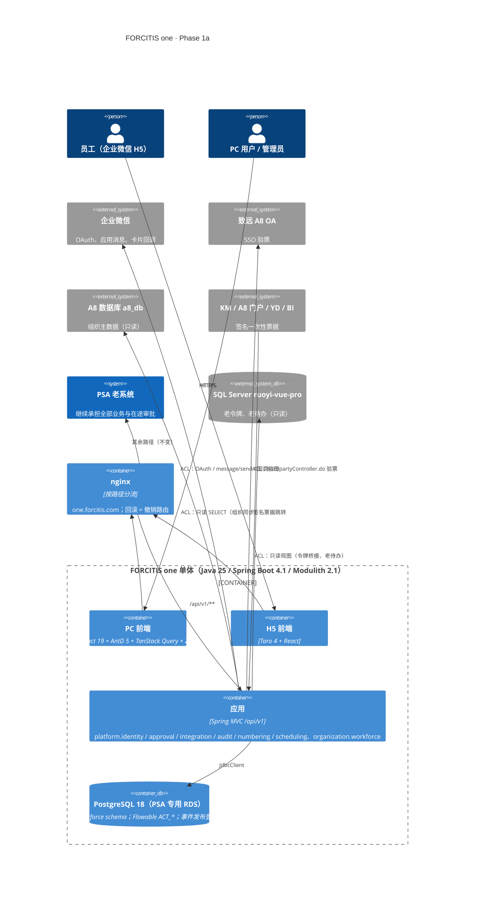

# REIMAGINED_ARCHITECTURE — FORCITIS one · Phase 1a 平台桥接（试点）

日期：2026-10-14 · 会话：psa-1a-platform-bridge-reimagine · 状态：**草案，待 architecture-critic 评审与检查点 2**

约束来源（不在此重新决定）：brief §2 终态架构、`STACK_DECISION.md`、ADR-0002..0020、`architecture-guardrails/`（已实测的骨架与 68 项守护测试）。本文只为 Phase 1a 的范围细化：模块边界、规则归属、依赖图、数据与切换方式。规格见 `AI_NATIVE_SPEC.md`（检查点 1 已批准）。

## 1. C4 Container（Phase 1a 终点）



## 2. 模块边界与规则归属

包结构 `com.forcitis.one.<子域>.<bc>.{api,events,application,domain,infrastructure,web}`（ADR-0003、守护 G1–G48）。

| 模块 | 职责（Phase 1a） | 规则 / 能力 | 自有 schema 与主要表 |
|---|---|---|---|
| `platform.identity` | 登录（企业微信、致远、签名票据、应急管理员）、服务端会话与吊销、老令牌桥接、`CurrentUser`、RBAC（`Permission`、角色、导航）、`AccessScope` 模型；**唯一**配置 Spring Security 的模块（G33） | C1a-01..09；RULE-316..353、374（评审后定稿） | `platform_identity`：`user_accounts`、`external_identities`、`roles`、`role_permissions`、`account_roles`、`data_scope_grants`、`navigation_items`、`sso_ticket_uses`、`emergency_admins`；Spring Session 表 |
| `organization.workforce` | A8 组织快照（部门、人员、岗位、任职、汇报线、负责人 / 区域 AR / 类别 / 交付标识）；同步运行与差异；缩水保护；对账查询；`OrgChanged` 事件；`LegalEntity` 读模型 | C1a-10、11；RULE-354..373；RULE-250/255/256/257/307 的数据前提 | `organization_workforce`：`org_units`、`employees`、`positions`、`assignments`、`legal_entities`、`sync_runs`、`sync_diffs` |
| `platform.approval` | Flowable 8 引擎封装；指派规则（DMN）；任务生命周期；行级审批；加签 / 转交 / 退回 / 撤回 / 撤销；截止点；BEFORE 钩子 SPI；幂等发起与轮次；类型化结果事件；**合并待办读模型**；TIMESHEET 回放工具；通知意图（`TaskAssigned` → 企业微信） | C1a-12..15；RULE-248..314（已评审） | `platform_approval`：`approval_requests`、`approval_rows`、`approval_tasks_view`、`assignment_rules`、`hook_registrations`、`start_rounds`、`legacy_inbox_cache`；Flowable `ACT_*` |
| `platform.integration` | 纯防腐层，不依赖任何业务模块：`WecomClient`（token 缓存、OAuth、消息、卡片回调验签解密）、`SeeyonTicketVerifier`、`A8OrgSource`（只读 SQL）、`LegacyPsaReader`（老令牌、老待办只读）、`ExternalTicketVerifier`（HMAC 票据）；超时、熔断、重试 | C1a-03、06、14、15 的出站部分 | `platform_integration`：`outbound_deliveries`（重试、死信） |
| `platform.audit` | 审计事件写入与查询：登录、会话吊销、权限变更、代理操作 | C1a-17；RULE-330、270 修正 | `platform_audit`：`audit_events`（只追加） |
| `platform.numbering` | 已在守护模板中实现；1a 增加编号规则页、原编号对照表 | C1a-16；ADR-0010 | `platform_numbering`：`numbering_rules`、`numbering_counters`、`legacy_numbers` |
| `platform.scheduling` | ShedLock 与作业运行记录（模板已有） | C1a-18 作业失败告警的数据源 | `platform_scheduling` |
| `kernel` | `Money`、`AccountingPeriod`、`ProjectCoordinate`、`LegalEntityId` 及基础类型 | ADR-0016（入口条件） | — |

**依赖图**（`architecture/module-dependencies.txt` 提议新增行；`kernel` 总是允许）：

```
platform.integration ->
platform.audit ->
platform.scheduling ->
organization.workforce -> platform.integration, platform.audit
platform.identity -> organization.workforce, platform.integration, platform.audit
platform.numbering -> platform.identity
platform.approval -> platform.identity, organization.workforce, platform.integration, platform.audit
```

无环的关键取舍：
- `platform.integration` 只处理外部标识（企业微信 userid、致远登录名），**不**认识 PSA 用户；身份映射（`external_identities`）归 identity。通知时由 approval 向 identity 查 `wecomUserId`，再调 integration 发送。
- identity 监听 `organization.workforce.OrgChanged`（离职、停用 → 立即吊销会话，RULE-338 修正），因此 identity → workforce，反向不依赖。
- 审计由各模块调用 `platform.audit` 的 api，不由 audit 监听各模块事件（避免 audit 依赖所有模块）。

## 3. 关键设计

### 3.1 登录与会话
- **企业微信**：H5 内嵌静默授权（`snsapi_base`）；PC 用企业微信扫码登录（`wwlogin`）。回调 → integration 换 userid → identity 按 `external_identities(provider=WECOM)` 精确匹配 → 校验账号启用且员工在职 → 建会话（Spring Session JDBC，Cookie `SESSION`，HttpOnly、Secure、SameSite=Lax），空闲 2 h、绝对 12 h（可配置，取代 RULE-332 的滑动 10 h）。
- **致远 SSO**：服务端验票，`sso_ticket_uses` 唯一约束防重放（取代 Redis SETNX）。
- **外部签名票据**：`HMAC-SHA256(${SSO_TICKET_SIGNING_KEY}, issuer|subject|exp|nonce)`，≤ 60 s、nonce 一次性；KM / A8 门户 / YD / BI 各分配 issuer。**调用方须改造**，在改造完成前老系统免密端点不关（由老系统止血处理，ADR-0015）。
- **应急管理员**：独立表、Argon2id、TOTP、5 次失败锁 15 分钟、仅从内网段可用。
- **老令牌桥接**：`POST /platform/identity/legacy-bridge`，请求体携带老 access token；integration 只读查询老库 `system_oauth2_access_token`（未过期、用户启用）→ 建新会话；不写老库。用途：老 PC 页面跳到新页面时免二次登录。
- **CSRF**：Cookie 会话 + CSRF token（SPA 读 `XSRF-TOKEN` Cookie 回写请求头）。

### 3.2 授权
- `Permission` 为枚举式类型（`<子域>.<bc>:<资源>:<动作>`，G43），注解 `@PreAuthorize("@perm.has('platform.approval:task:decide')")`；角色—权限、账号—角色存库，变更即时生效（无本地缓存或 ≤ 30 s Caffeine 并在变更时失效）。
- 入职授权显式化：同步出现新员工时，授予配置项 `identity.default-role`（默认「员工」，权限最小），并写审计；不再「缓存刷新时偷偷补角色 2」（RULE-344，待评审确认）。
- `AccessScope`（法人 × 部门子树 × 项目角色）只建模与单测；1a 无业务仓储使用，1b 报价首个使用者。
- 初始数据：从老库只读导出 `system_role`、`system_user_role`、`system_role_menu` → 映射表（老菜单权限码 → 新 `Permission`）→ 生成授权；无对应的不授予。映射表需用户确认（检查点 2 问题 Q-A）。

### 3.3 组织快照
- 数据源：**直接只读 A8 库**（与老同步相同的 SQL 口径，前缀匹配修正 RULE-361），不从老 `system_users` / `system_dept` 读取 → 出口条件「与 A8 零差异」以 A8 为基准。
- 每 15 分钟一次（ShedLock），全量拉取 → 差异计算 → 单事务写入 + `sync_runs` / `sync_diffs`；源缩水 > 20 % 中止并告警（RULE-358）；离开结果集的人员作为离职候选同样受缩水保护（RULE-366 修正，待评审）。
- PSA 独有属性（`short_name`）：一次性从老 `system_dept` 复制，此后在新系统维护（P1 管理页，1a 只读展示）。`company_code` 不迁移。
- 老系统的手工组织编辑：新系统不读取；是否在老系统关闭这些菜单属老系统变更，由用户决定（Q-B）。

### 3.4 审批引擎
- Flowable 8 嵌入同一数据源（`ACT_*` 在 `platform_approval` schema）；BPMN 文件进版本库（`resources/processes/`），部署由 Flyway 之后的启动任务完成；不提供设计器 UI（D-05）。
- 指派：每节点恰一条规则（RULE-262）；类型 = 角色 / 部门负责人 / 指定人 / 脚本（汇报线、区域 AR、BU-002 总监、表单字段人及其领导）/ 流程变量；单人节点改为**候选组 + 认领**（RULE-249 修正）；排除停用 / 离职（RULE-253 修正）；取不到人 → 流程管理员 + 告警（RULE-250/254 修正）；防自审（RULE-307 修正）。规则用 DMN 表达条件分支，脚本型规则用 Java `AssigneeResolver` 实现（可测试），不使用 Groovy。
- 行级审批：`approval_rows` 记录行与路由值；节点可达性（RULE-251）由网关条件计算；任一行驳回则节点驳回、其余行完成（RULE-274/292）；退回发起人后未审行统一「已退回」（RULE-293 用户决定）。
- 加签（建议性驳回，RULE-273/291）、转交仅当前处理人（RULE-285）、退回到指定节点仅单实例（RULE-284）、撤回 / 撤销截止点（RULE-268/269/309）、撤销不删历史（RULE-288 修正）。
- 幂等：`approval_requests` 唯一（process_type, business_id）+ `start_rounds` 唯一（process_type, business_id, round）（RULE-264/266/278）。
- BEFORE 钩子 SPI：业务模块实现 `ApprovalHook`（在 approval 的 `api` 中定义），在办理事务内调用；字段写入与任务完成同一事务（RULE-280 修正）。
- 结果事件：`ApprovalCompleted`、`TaskResulted` 经 Modulith 事件发布登记表（至少一次，消费方幂等），取代 RocketMQ 与 outbox / 对账任务（RULE-295/303/304）。
- **1a 不接入任何业务单据**（风险二缓解）；用内置演示流程 + TIMESHEET 定义做回放验证。

### 3.5 TIMESHEET 审批人序列回放
- 输入：生产只读导出（按样本期间）：`bpm_task_assign_rule`（TIMESHEET 定义级）、实例的流程变量快照（`bpm_process_instance_ext.form_variables`、`bpm_oa_customized.data_stamp`）、实际审批人序列（`bpm_task_ext` 按实例与节点）、当期组织快照（A8）。
- 工具：测试源集中的回放器（`TimesheetApproverReplayIT` + 命令行入口），在新引擎上以「只解析不落任务」的模式逐节点计算候选集，与老序列比对，输出差异 CSV；差异分类（组织变化、已评审修正、真缺陷），每条差异在 `RULE_REVIEWS.json` 中由用户接受（出口条件）。
- 导出属生产只读查询，执行前请用户确认（Q-C）；导出文件不进仓库（含人员姓名），只存本机 `~/.modernize/psa/`。

### 3.6 合并待办
- 新待办：`platform_approval` 查询 Flowable 任务 + 候选组。
- 老待办：integration `LegacyPsaReader` 通过**只读账号**查询老库视图（`bpm_task_ext` result=1 + `ACT_RU_TASK` + `bpm_process_instance_ext` 标题），按 RULE-261 合并行任务为（实例, 节点）一项；结果缓存 30 s（`legacy_inbox_cache` 或 Caffeine），点击跳转老系统详情 URL。不走老系统 API（需要以他人身份调用）。
- 一致性测试：同一用户新旧待办计数 = 老系统 `todo-list` 计数（出口条件）。

### 3.7 企业微信通知
- `TaskAssigned` / `ApprovalCompleted` / 知会 → approval 的通知监听器（`@ApplicationModuleListener`，事务提交后、事件登记表保证）→ identity 查 `wecomUserId` → integration `WecomClient.sendTemplateCard`（`touser` 精确；**不带 `@all`**）。失败进 `outbound_deliveries`，退避重试，死信告警。
- 卡片按钮回调（P1）：验签解密 → 以 `FromUserName` 映射用户 → 校验为任务处理人 → 调 approval 办理（RULE-376 修正）。
- 非生产环境：收件人白名单（配置），不改写收件人为固定个人（RULE-375 修正）。

### 3.8 可观测性与告警
- Micrometer → ARMS（Prometheus 协议）；结构化日志 → SLS。
- 四类告警：组织同步延迟（`last_success_age > 2 × 周期`）、未完成事件发布（`event_publication` 未完成 > 10 分钟）、作业失败（`platform_scheduling` 失败计数）、登录失败率（5 分钟窗口 > 20 % 且 ≥ 20 次）。dev 上用故障注入演练。

### 3.9 前端
- 单仓 `frontend/`（pnpm workspace）：`apps/web`（React 19 + Vite + AntD 5）、`apps/h5`（Taro 4 + React）、`packages/api`（OpenAPI 生成客户端 + Zod）、`packages/design-system`（`tokens.css` 与正本逐项一致）、`packages/ui`（`shared/ui`，正本组件起点）。守护 F1–F14 用 `architecture-guardrails/frontend` 的配置。
- 1a 页面：登录（企业微信扫码 / 致远跳转 / 应急管理员）、布局与导航（来自 `/me`）、合并待办收件箱、审批详情（新引擎）、编号规则页、组织浏览（只读）、同步记录、权限不足 / 会话过期页。H5：静默登录、待办、审批详情。
- 先补正本：`DS_GAPS.md` 中 1a 差距（收件箱、登录页、权限不足 / 会话过期页）先在正本补齐再写页面（ADR-0013 第 7 条）。

### 3.10 切换与回滚
- nginx：`one.forcitis.com` 新域名整体指向单体（不与老域名共享 Cookie）；老系统域名与路由不变。1a 没有「老 URL 改路由」，回滚 = 关闭新域名入口 + 停止通知发送开关（防止新旧双发）。
- 通知双发风险：1a 新引擎不承接业务单据，老系统继续发老待办通知；新系统只为新引擎任务发通知 → 无重复。

## 4. 技术选择（一行理由）

| 选择 | 理由 |
|---|---|
| Spring Modulith 单体 + 单库 | 335 个活跃用户、单 ECS；模块边界由 verify() 与 ArchUnit 守护（ADR-0003/0004） |
| Spring Session JDBC | 服务端可吊销会话，无需 Redis（ADR-0009、去 Redis） |
| Flowable 8 嵌入 | 用户已定引入；与业务同库同事务，满足 RULE-280 修正 |
| DMN 表达条件、Java 实现脚本型解析 | 可测试、可审查，去掉 Groovy 与 HashSet「第一个」 |
| Modulith 事件发布登记表 | 取代 RocketMQ + outbox + 对账三件套（RULE-295/303/304 评审结论） |
| JdbcClient + Flyway（每模块 schema 目录） | 定栈（ADR-0002/0011），模板已实测 |
| ShedLock | 单实例作业，取代 XXL-JOB（STACK_DECISION） |
| Caffeine | 企业微信 access_token、权限缓存，去 Redis |
| springdoc + OpenAPI 生成前端客户端 | 契约单一来源（ADR-0008、ADR-0013） |
| WireMock + Testcontainers PG 18 | 外部系统契约测试、集成测试为主（ADR-0012） |

## 5. 数据迁移方式

| 数据 | 方式 |
|---|---|
| 组织（部门、人员、岗位、任职、汇报线） | 不迁移老表；首次同步直接从 A8 全量建立快照 |
| `short_name` | 一次性 ETL 从老 `system_dept` 复制 |
| 账号外部标识（`we_com_id`） | 来自 A8 `ORG_MEMBER`（与老同步同源）写入 `external_identities` |
| 角色与授权 | 一次性 ETL（老角色 / 菜单权限 → 新 `Permission` 映射表，Q-A） |
| 老令牌 | 不迁移；过渡期只读校验 |
| 老审批数据（`bpm_*`、`ACT_*`） | 不迁移；在老 Flowable 上排空；合并待办只读；归档在 Phase 5 |
| `psa_process_to_be_sent` | 1a 不涉及（Phase 2） |
| 业务编号 | 1a 只配置规则与 `legacy_numbers` 结构；各单据的原编号在其切换阶段导入 |

ETL 为自建（用户已定），JdbcClient 编写、可重跑、可对账，凭据走环境变量。

## 6. 需用户在检查点 2 决定的问题

- **Q-A** 老角色 / 菜单权限 → 新 `Permission` 的映射与「员工」默认角色：是否按「有对应就授予、无对应不授予」+ 默认角色最小权限？
- **Q-B** 老系统手工改组织（部门 / 人员编辑）：1a 是否在老系统收回这些菜单权限（运维动作）？
- **Q-C** TIMESHEET 回放所需的生产只读导出：是否授权（同评估期的只读方式，导出不进仓库）？
- **Q-D** 外部系统（KM、A8 门户、YD、BI）改用签名票据：由谁对接各调用方、何时完成？
- 另：老库只读账号、A8 库只读账号的开通（运维）。

## 7. architecture-critic 评审与处理

（待评审后填写）
