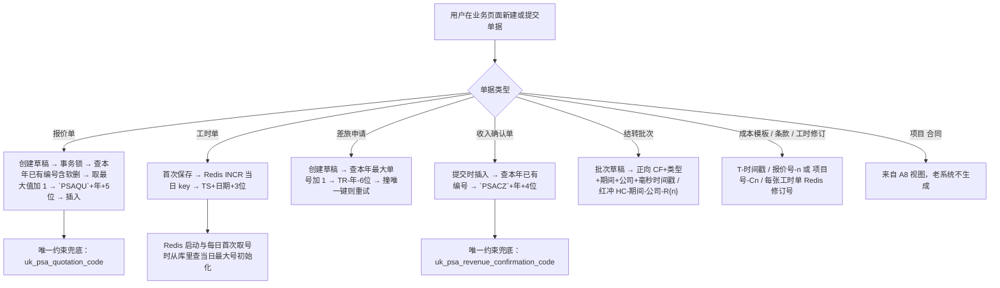
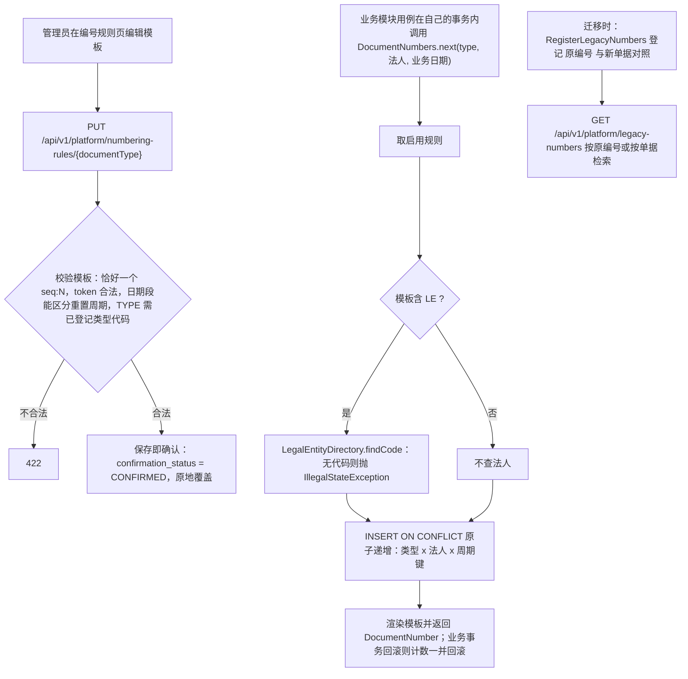
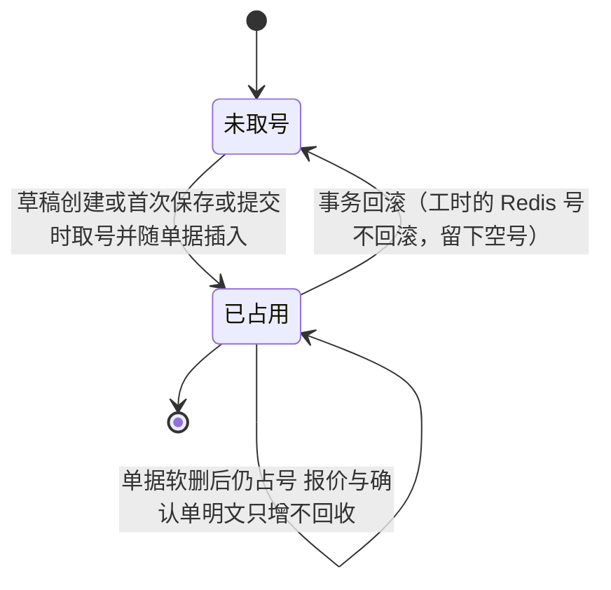
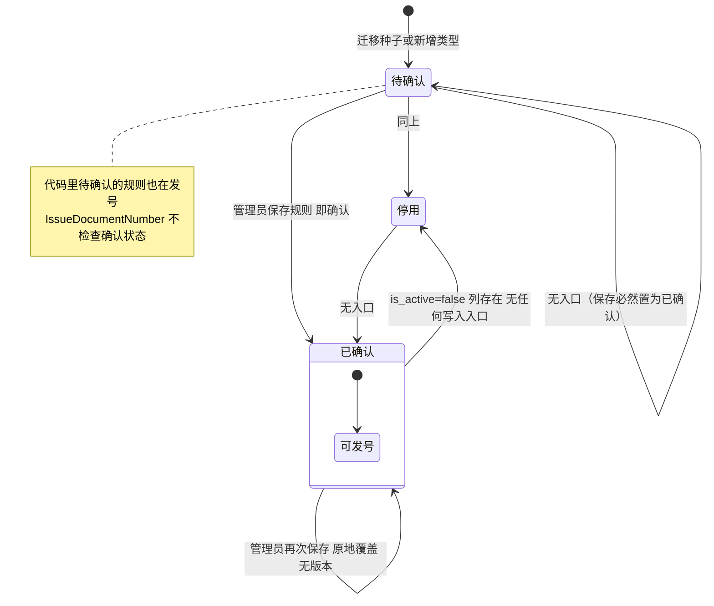

# 业务编号（Phase 1a）

- 涉及 BC：`platform.numbering`（编号规则、计数器、原编号对照）、`organization.workforce`（法人）
- 涉及的 A8 模板 / 老系统入口：老系统写死在代码中的 9 类编号；项目号、合同号来自 A8
- 证据采集日期：2026-10-14（老代码只读；未引用生产数字）
- 梳理会话：psa-1a-process-review（现状 / 目标由 sonnet 子代理整理，差异判断与建议由 opus 完成，差异由用户逐条决定）

路径缩写：`OLD/` = `/Users/yeliang/Projects/FORCITIS/psa/psa-backend/yudao-module-fst/yudao-module-fst-biz/src/main/java/cn/iocoder/yudao/module/fst/`；`OLDR/` = 同模块 `src/main/resources/`；`BE/` = 新仓库 `backend/src/main/java/com/forcitis/one/`；`BER/` = `backend/src/main/resources/`；`BET/` = `backend/src/test/java/com/forcitis/one/`；`FE/` = `frontend/apps/web/src/`；`DOC/` = `docs/modernization/`。新仓库根为 `/Users/yeliang/Projects/FORCITIS/forcitis-one-psa/.claude/worktrees/xin-7143b1`。

生产数字：本次未引用任何生产数字。老系统未发现任何编号规则配置表或界面，所有格式写死在代码里。

范围说明：老系统里「生成编号」的地方一共 9 处（见 §1 表），其中项目编号、合同编号来自 A8，商机编号的来源未核实。新代码 1a 只有 3 个 `DocumentType`（报价 QUOTE、工时 TIMESHEET、会计凭证 JOURNAL_VOUCHER），而且模块内没有任何业务模块调用 `DocumentNumbers.next`（只有测试调用）。

## 现状流程

| # | 步骤 | 角色 | 系统 | 数据 / 状态变化 | 证据 |
|---|---|---|---|---|---|
| 1 | 报价单取号：用户点「发起报价」。先拿 SQL Server 事务锁（拿不到报「正忙」），本人该商机已有草稿则复用，否则取号并插入草稿 | 有 `fst:quotation:create` 的用户 | 老 fst | 格式 `PSAQU{yyyy}{5 位}`，每年从 00103 起；取号 = 查本年前缀下所有已有编号（含软删行）取数值最大者加 1，没有则取起始值；跨年自然归零；编号写入 `psa_quotation.code`，草稿创建即占号 | `OLD/infrastructure/presales/quote/QuotationCodeGeneratorImpl.java:19-33`；`OLD/application/presales/quote/CreateQuotationDraftUseCase.java:46-48`、`:57-58`；`OLD/util/SerialCodeUtil.java:34-52`；`OLD/controller/admin/quotation/QuotationController.java:96-99`；RULE-178（`DOC/BUSINESS_RULES.md` 约 2975-2985 行） |
| 2 | 报价单号防撞与不回收：取号查询刻意绕开逻辑删除；删掉本年最大号的报价后不会算出已占用的号；「编号可能已同步 OA/合同，回收会跨系统撞号」 | 系统 | 老 fst | 号只增不回收；全表唯一约束 `uk_psa_quotation_code`（不带 deleted 过滤）为最终兜底 | `OLD/dal/mysql/quotation/QuotationMapper.java:120-129`；`OLDR/db/migration/V20260701100000__create_quotation_tables.sql:39` |
| 3 | 工时单取号：用户首次保存或发送工时。`RedisBizCodeService.nextCode("TS")`：Redis 键 `psa:code:seq:TS:{yyyyMMdd}`，INCR，过期 3 天；键不存在时从库里 `MAX(code)` 取当日最大号初始化（SETNX）；启动时初始化当天键 | 员工（工时填报端点无 `@PreAuthorize`，只限流） | 老 fst + Redis | 格式 `TS{yyyyMMdd}{3 位}`，按「服务器当天日期」（不是工时日期）每天归零；Redis 自增不随业务事务回滚，回滚会留下空号；单据状态「待发起」，编号随主表插入 | `OLD/service/manhour/ManHourServiceImpl.java:826-830`；`OLD/service/common/RedisBizCodeService.java:17`、`:23`、`:29-33`、`:35-47`、`:49-62`、`:99-111`；`OLD/controller/admin/manhour/ManHourController.java:160-163`；RULE-03（`DOC/rules/raw/timesheet-lifecycle.md:30-39`） |
| 4 | 工时单号不含法人段；法人信息另存：提交时按工时日期查员工异动档案 `psa_employee_transfer_record.company_code`，缺失则整单报 503，写入 `psa_time_sheet.company_code` | 系统 | 老 fst | 编号与法人分离；法人（核算组织编码）是单据的另一列 | `OLD/service/manhour/ManHourServiceImpl.java:1607-1616`；RULE-03；`DOC/process/1a/组织与人员同步.md:62`、`:131` |
| 5 | 工时修订号：每张工时单一个 Redis 计数键 `psa:revno:seq:{sheetId}`，库里取 `MAX(revision_no)` 初始化，INCR | 系统 | 老 fst + Redis | 单据内子序号，不是业务单据编号 | `OLD/service/common/RedisBizCodeService.java:24`、`:64-97`；`OLD/service/manhour/ManHourRevisionService.java:95` |
| 6 | 差旅申请取号：创建草稿事务内循环（最多 N 次）：`TR-{年}-` 前缀下取最大单号加 1，6 位；撞 `uk_psa_travel_application_doc_no` 则重试，超 999999 抛「年度差旅单号已耗尽」 | 有 `fst:travel-application:create` 的用户 | 老 fst | 格式 `TR-{yyyy}-{6 位}`，按年归零；草稿创建即占号（注意 ADR-0010 背景没有列出 `TR-`） | `OLD/infrastructure/expense/travel/application/TravelApplicationDocumentNumberGeneratorImpl.java:11-29`；`OLD/infrastructure/expense/travel/application/TravelApplicationMapper.java:74-76`；`OLD/application/expense/travel/application/TravelApplicationUseCase.java:165-196`；`OLD/controller/admin/expense/travel/application/TravelApplicationController.java:92`；`OLDR/db/migration/V20260622100100__create_travel_business_tables.sql:41` |
| 7 | 收入确认单取号：提交确认时在仓储 `insert` 内取号：`PSACZ{yyyy}{4 位}`，每年从 0001 起，只增不回收（含软删），旧的 `RC+雪花` 编号前缀不同不参与 | 有 `fst:pm-project:revenue` 的用户 | 老 fst | 编号随「审批中」单据一起插入（提交时才取号，不是草稿）；唯一索引兜底 | `OLD/infrastructure/receivables/revenue/RevenueConfirmationRepositoryImpl.java:51-53`、`:143-163`、`:168-177`；`OLD/controller/admin/pmproject/PmRevenueConfirmationController.java:67-69`；`OLDR/db/migration/V20260917140000__revenue_confirmation_code_unique.sql:10-21` |
| 8 | 成本结转批次号：草稿时生成。正向 `CF{结转类型}-{期间}-{公司编码}-{毫秒时间戳}`；红冲 `HC-{期间}-{公司编码}-R{n}`，n = 该期该公司已有红冲批次数 + 1（在途唯一索引兜底） | 有 `cost:carry-batch:draft` 的用户 | 老 fst | 正向批次号靠毫秒时间戳，不是流水；红冲号靠计数（含「数量+1」），不是计数器 | `OLD/application/cost/projectcost/carry/CarryBatchService.java:111`、`:373-383`；`OLD/controller/admin/cost/projectcost/CarryBatchController.java:123` |
| 9 | 其他自动编码：成本模板 `T-{时间戳}`；报价条款 `{报价号}-{历史最大序号+1}`（含软删，终身不变）；项目预算条款 `{项目编码}-C{n}` | 系统 | 老 fst | 子级编号，同一套「取已用最大值 +1」做法 | `OLD/domain/presales/quote/costestimate/CostTemplate.java:59-61`；`OLD/infrastructure/presales/quote/QuotationRepositoryImpl.java:374-416`；`OLD/domain/delivery/project/ProjectBudget.java:515-517` |
| 10 | 项目、合同编号：老系统不生成。合同表 `psa_pm_contract` 是直读 A8 `formmain_0051` 的视图；项目表被其他视图按 `field0226 = psa_pm_project.code` 关联。商机编号 `psa_crm_opportunity.code` 的来源未核实 | A8 / OA | A8 | 老系统只读取 | `OLDR/db/migration/V20260920190100__rebuild_psa_pm_contract_a8_by_db_name.sql:1-12`；`OLDR/db/migration/V20260903113100__create_psa_pm_collection_view.sql:53`；`OLD/dal/dataobject/contract/ContractDO.java:13`、`:37` |
| 11 | 下游使用旧号：报价号同步到 OA（`field0029 = q.code`），工时单号用于检索，差旅单号支持 `LIKE %单号%` 检索 | 系统 | 老 fst → OA | 编号格式被 OA 同步脚本依赖 | `/Users/yeliang/Projects/FORCITIS/psa/docs/ops/oa-quotation-sync/sp_sync_quotation_to_oa_prod.sql:39`；`OLD/infrastructure/expense/travel/application/TravelApplicationMapper.java:84-88` |
| 12 | 并发与重置总结：报价靠事务锁 + 唯一约束；工时靠 Redis 原子自增；差旅靠唯一约束 + 重试；确认单靠唯一索引；重置周期全部写死（报价 / 确认单 / 差旅按年，工时按日） | — | 老 fst | 没有序列表、没有管理员可改的规则；工时 `MAX(code)` 取最后 3 位，单日超 999 张后初始化会算错（`code.substring(len-3)`） | `OLD/service/common/RedisBizCodeService.java:99-111`；`OLD/util/SerialCodeUtil.java:9-14` |
| 13 | 老编号在新系统的去向（设计）：迁移为只读的「原编号」，可检索，提供新旧对照 | — | 设计 | 见 §2 | `DOC/adr/src/ADR-0010.md`（决定 5）；`DOC/MODERNIZATION_BRIEF.md:128-129` |

---

## 目标流程

要点与依据：

1. 模块与接口：`platform.numbering`；对外 `DocumentNumbers.next(DocumentType, LegalEntityId, LocalDate)`，注释要求在调用方的单据插入事务里执行，回滚则计数一并回滚（不跳号不重号）。`BE/platform/numbering/api/DocumentNumbers.java:6-9`；`BE/platform/numbering/application/IssueDocumentNumber.java:28-38`（`@Transactional(propagation = MANDATORY)`）。
2. 原子递增：`INSERT … ON CONFLICT (document_type, legal_entity_id, period_key) DO UPDATE … RETURNING last_value`，首条取 `start_value`，行锁持有到事务结束。`BE/platform/numbering/infrastructure/persistence/JdbcNumberingRuleRepository.java:82-97`；表 `BER/db/migration/platform_numbering/V20261014100100__platform_numbering_create_numbering.sql:19-24`。依据 ADR-0010 决定 4、ADR-0002「不保留 Redis」（`DOC/adr/src/ADR-0002.md:24`）。
3. 模板语法：`{TYPE}`、`{LE}`、`{yyyy}` `{yy}` `{MM}` `{dd}` `{yyyyMM}` `{yyyyMMdd}` `{yyMMdd}`、`{seq:N}`（N 为 1 到 12）；重置周期 NEVER / YEARLY / MONTHLY / DAILY；校验必须恰好一个 `{seq:N}`，日期段必须能区分周期。`BE/platform/numbering/domain/NumberingPattern.java:14-61`。序号溢出时发号失败（`:96-98`）；每天 06:00 按 0.9 比例检查容量并给出指标（`BER/application.properties:13-14`；`BE/platform/numbering/application/CheckCounterCapacity.java:17-27`）。
4. 统一新格式：默认模板 `{TYPE}-{LE}-{yyyyMM}-{seq:4}`，按月归零，例如 `QT-FST-202610-0001`；单据类型代码在词表登记（G45）；老编号作「原编号」。ADR-0010 决定 5；`DOC/MODERNIZATION_BRIEF.md:456`；`DOC/AI_NATIVE_SPEC.md:33`（C1a-16，P0 出口条件）。1a 代码里只有 QUOTE 登记了代码 `QT`，且迁移把 QUOTE 改成了默认模板并置为「待确认」（`BE/platform/numbering/api/DocumentType.java:6-9`；`BER/db/migration/platform_numbering/V20261014135200__platform_numbering_add_confirmation_status.sql:8-11`）。
5. 各单据最终模板「在 Phase 1a 由管理员在编号规则页确认」：ADR-0010 决定 5；`DOC/STATUS.md:36`；`DOC/status/blockers/040-业务编号新格式的各单据模板-在.md`。编号规则页：列表、编辑、确认（`FE/modules/numbering/pages/numbering-rules-page.tsx:45-71`、`:80-99`）；保存即确认（`BE/platform/numbering/application/ConfigureNumberingRule.java:19-24`）。
6. 原编号：1a 只交付规则与原编号检索结构，各单据老编号的导入与新旧对照随该单据切换阶段（1b 报价起）。`DOC/MODERNIZATION_BRIEF.md:129`（用户检查点 2「两条都按建议修订」，`DOC/REIMAGINED_ARCHITECTURE.md:250`）。代码：表 `legacy_numbers`（类型 + 原编号唯一）、`RegisterLegacyNumber`（同一单据重复登记幂等，属于别的单据则抛错）、检索 API（按原编号、按单据），独立权限 `platform.numbering:legacy-number:read`（`BER/db/migration/platform_numbering/V20261014135100__platform_numbering_create_legacy_numbers.sql`；`BE/platform/numbering/application/RegisterLegacyNumber.java:18-29`；`BE/platform/numbering/web/LegacyNumberController.java:27-40`；`DOC/REIMAGINED_ARCHITECTURE.md:79`）。
7. 各业务单据尚未接入：`DocumentNumbers` 在 main 代码里没有调用方（仅 `BET/platform/numbering/NumberingRulesIT.java` 与 `BET/ApplicationIntegrationTest.java`），DocumentType 没有差旅申请、收入确认单、结转批次等。

**(a) 法人维度来源**

- {LE} 取法人小表的字母代码：`LegalEntityDirectory.findCode(LegalEntityId)`，代码格式 2 到 10 位大写字母，全表唯一，创建后不改（`BE/organization/workforce/api/LegalEntityCode.java:10-18`；`BER/db/migration/organization_workforce/V20261014131500__organization_workforce_create_legal_entities.sql`）。法人小表由新系统管理员维护，不从外部同步（用户「新系统维护法人小表 (Recommended)」，`DOC/INTENT.md:127`；`DOC/REIMAGINED_ARCHITECTURE.md:78`；`DOC/process/1a/contract.md:32`）。
- 用户已定：字母代码继续用于业务编号，另加 U8C 数字核算组织编码字段（`DOC/intent/2026-10-14-111-1a流程-组织-法人代码格式.md`；`DOC/process/1a/contract.md:34`）。1a 代码里还没有这个字段。
- 单据的法人从哪来：用户已定「1a 就建归属」，即员工到法人的生效区间表（`DOC/intent/2026-10-14-108-1a流程-组织-法人归属.md`）；代码里还没有这张表（`DOC/process/1a/组织与人员同步.md:132-133`，我复核了新仓库 `legal_entity` 只出现在 numbering 与法人小表）。调用方必须把 `LegalEntityId` 传给 `next(...)`。老系统的对应物是工时提交时按工时日期查异动档案得到的 `company_code`（§1 第 4 行）。
- 单据没有法人怎么办：接口参数 `LegalEntityId` 是必填；模板含 `{LE}` 而法人没有代码时抛 `IllegalStateException`（`IssueDocumentNumber.java:32-34`）；模板不含 `{LE}` 时不查法人，但计数器仍按传入的 `legal_entity_id` 分桶（测试里 99 号法人不存在也能发 `TS…` 号，`BET/platform/numbering/NumberingRulesIT.java:153-160`）。没有规格说明法人未知的单据传什么。
- 法人停用：已有决定「停用后不能用于新单据编号，历史单据保留原法人」（`DOC/process/1a/contract.md:32`），代码与测试相反（见差异 7）。

**(b) 是否涉及 DMN**

不适用。编号模板按「单据类型」直接查一条规则，没有多维决策表；用户已定「出现真正的多维决策表时在该阶段引入 DMN」（`DOC/intent/2026-10-14-131-1a流程-审批-事件法人DMN.md`）。编号规则属于「配置类」，另有版本与生效日期的约定（见差异 5）。

**(c) 编号与业务单据的状态归属**

- 新规格：取号与业务写入在同一事务（ADR-0010 决定 4；`DocumentNumbers.java:7`）。具体在草稿、提交还是审批通过时取号，规格未规定（无单据接入）。
- 老系统：报价单、差旅申请、结转批次在建草稿时取号；工时单在首次保存（「待发起」）时取号；收入确认单在提交（插入审批中单据）时取号；审批通过时没有任何单据才取号（§1 第 1、3、6、7、8 行）。
- 审批状态归属：审批请求拥有审批状态，业务模块拥有单据状态（`DOC/process/1a/contract.md:112`，D-1a-101）；编号属于业务模块的单据，不属于审批请求。
- 作废的号是否回收：老系统明确「只增不回收」（报价、确认单；软删仍占号，`QuotationMapper.java:120-129`、`V20260917140000…sql:10-12`），工时靠 Redis 自增、回滚留空号。新规格只写「不重号、不跳号」，计数器没有回收或回退入口（只有 `reserveNext`，`NumberingRuleRepository.java`）。回滚事务的号随事务撤销；已提交单据后来作废，号不回收是实现的结果，规格没有明文（差异 13）。

---

## 涉及的聚合与状态机

聚合与表：

| 聚合 / 实体 | 老系统 | 新系统 |
|---|---|---|
| 编号规则 `NumberingRule`（类型、模板、重置周期、起始值、确认状态） | 无（硬编码） | `platform_numbering.numbering_rules`，主键 `document_type`；`BE/platform/numbering/domain/NumberingRule.java:7`；词表 `DOC/glossary/terms.yaml`（`numbering_rule`） |
| 编号计数器 `NumberingCounter`（类型 x 法人 x 周期键） | Redis 键 / 库里 `MAX(code)` / 无 | `numbering_counters`，主键 `(document_type, legal_entity_id, period_key)` |
| 已发号 | 单据表的 `code` 列 + 唯一约束 | 单据表的编号列（业务模块拥有），`DocumentNumber` 值对象 1 到 64 字符（`BE/platform/numbering/api/DocumentNumber.java`） |
| 原编号 `legacy_numbers` | 无 | 类型 + 原编号唯一，`document_id`、`legal_entity_id`、`import_batch`（落点已由 ADR-0033 第 2 项第 7 条改写：加来源系统列，唯一键含来源系统；`import_batch` 改为必填的迁入批次 ID `migration_batch_id`） |

### 现状状态机（老系统：只有「号」的占用，没有规则状态）

### 目标状态机（新系统：规则 + 号）

号的状态（新）：`next()` 在调用方事务内递增计数器，提交即「已发出」，回滚即撤销；没有「作废 / 回收 / 保留」的显式状态。

---

## 发出 / 消费的领域事件

| 方向 | 老系统 | 新系统 | 证据 |
|---|---|---|---|
| 发出 | 无。取号不发事件，不记审计 | 无。`platform.numbering` 没有任何事件类、没有 `publishEvent`；容量检查只给指标（`CounterCapacityJob`）；规则修改不写审计 | `BE/platform/numbering/` 全目录；`BE/platform/numbering/application/ConfigureNumberingRule.java:19-24`（无 `AuditLog`）；对比法人小表增改写审计 `BE/organization/workforce/application/CreateLegalEntity.java:41-43`、`UpdateLegalEntity.java:44-46` |
| 消费 | 无 | 无 | 同上 |
| 相关事件（不属于本模块） | 报价号经 OA 同步脚本推给 OA | 组织快照事件 `OrgSnapshotChanged` 只含员工与部门，不含法人变更（`DOC/process/1a/组织与人员同步.md:287`） | `BE/organization/workforce/events/OrgSnapshotChanged.java` |

---

## 权限

| 动作 | 老系统 | 新系统 | 证据 |
|---|---|---|---|
| 改模板 / 规则 | 没有配置界面和接口，只能改代码发版 | `platform.numbering:numbering-rule:update`（`PUT`） | `BE/platform/numbering/web/NumberingRuleController.java:48-50`；`BE/platform/identity/api/Permission.java:35` |
| 确认模板 | 不存在 | 没有独立的确认权限：保存 = 确认，同一个 update 权限；页面上「确认」按钮只对有 update 权限的人显示 | `FE/modules/numbering/pages/numbering-rules-page.tsx:31`、`:60-68`；`ConfigureNumberingRule.java:21` |
| 查看规则 | 不存在 | `platform.numbering:numbering-rule:read`，导航项「编号规则」`/admin/numbering-rules` | `NumberingRuleController.java:33-46`；`BER/db/migration/platform_identity/V20261014130300__platform_identity_seed_roles_and_navigation.sql:25` |
| 取号 | 取号权限 = 创建该单据的业务权限：报价 `fst:quotation:create`，差旅 `fst:travel-application:create`，收入确认 `fst:pm-project:revenue`，结转批次 `cost:carry-batch:draft`；工时保存端点没有 `@PreAuthorize` | 无权限点：`DocumentNumbers.next` 不是 HTTP 接口，只能在业务用例事务内调用（`MANDATORY`），由业务用例的权限把关 | `QuotationController.java:99`；`TravelApplicationController.java:92`；`PmRevenueConfirmationController.java:67`；`CarryBatchController.java:123`；`ManHourController.java:160-163`；`IssueDocumentNumber.java:28` |
| 检索原编号 | 不存在 | `platform.numbering:legacy-number:read`（单独授权，用户「单独设 legacy-number:read (Recommended)」） | `LegacyNumberController.java:28`、`:37`；`DOC/REIMAGINED_ARCHITECTURE.md:79`；`DOC/INTENT.md:127` |
| 登记原编号 | 不存在 | 内部接口，无 HTTP 入口 | `BE/platform/numbering/api/RegisterLegacyNumbers.java` |
| 谁持有这些权限 | — | 种子只给 `employee` 角色两个审批权限；`super_admin` 持有全部权限；没有专门的「编号管理员」角色。法人小表增改是另一个权限 `WorkforcePermissions.LEGAL_ENTITY_UPDATE`（用户已定「组织数据管理员」负责法人维护） | `BER/db/migration/platform_identity/V20261014130300…sql:2-10`；`BE/platform/identity/domain/AccessProfile.java:13`；`DOC/intent/2026-10-14-104-1a流程-组织-放行与告警.md` |

## 差异清单

「已决定」引用用户原话；「需改代码」已报 psa-coordinator 转 1a 会话；「需改文档」由 psa-coordinator 安排。本会话不改代码。

| 编号 | 现状 | 目标 | 影响 | 建议 | 用户决定 |
|---|---|---|---|---|---|
| D-1a-144 | 老系统 9 类自动编号（报价 `PSAQU`、工时 `TS`、差旅 `TR-`、收入确认 `PSACZ`、结转批次 CF/HC、成本模板 T- 等），项目号与合同号来自 A8 | 主单据（报价、工时单、差旅、收入确认单、结转批次、凭证）进统一编号，随各自迁入阶段加入；项目号、合同号继续用 A8 的号；条款、修订等子级序号保留「父号-序号」，不进规则模型 | 单据清单明确 | 按清单 | 已决定：「统一编号的单据清单」（intent/2026-10-14-150）；需改文档（ADR-0010 背景漏列 TR-、PSACZ 等） |
| D-1a-145 | 各单据格式不同 | 统一新格式 `{TYPE}-{LE}-{yyyyMM}-{seq:4}`，各单据模板由管理员确认；TIMESHEET 1a 即用统一新格式（intent 100）；凭证号模板须财务确认（ADR-0027） | 统一格式 | 按已定 | 已决定：「业务编号统一新格式」（INTENT）；ADR-0010 决定 5；需改代码（工时、凭证模板与类型代码） |
| D-1a-146 | — | 规格占位符清单补 `{TYPE}` 等，与代码一致 | 文档一致 | 文档更正 | 不涉及业务决定（文档更正）；需改文档（ADR-0010 决定 2、5，词表 `numbering_pattern`） |
| D-1a-147 | 无「确认」概念 | 未确认或已停用的规则不发号，取号失败并告警；修改已确认的模板生成新版本，须重新确认后按生效日期启用 | 确认前不会发出正式号 | 不能发号 | 已决定：「不能，报错并告警 (Recommended)」（intent/2026-10-14-146）；配置按版本与生效日期（METHODS M3）；需改代码（`IssueDocumentNumber` 不查确认状态；模板原地覆盖无版本） |
| D-1a-148 | — | 规则状态为待确认 / 已确认 / 停用，不设草稿；停用与启用有入口并审计；停用后该类单据取号失败并告警 | 状态完整 | 按勾选 | 已决定：「规则状态」（intent/2026-10-14-150）；需改代码 |
| D-1a-149 | 老系统无法人 | 法人停用后不能用于新单据编号，历史单据保留原法人 | 停用法人不再发号 | 按已定 | 已决定：「法人停用规则」（intent/2026-10-14-110）；需改代码（`IssueDocumentNumber` 不检查法人状态，测试断言相反） |
| D-1a-150 | 老单据号不含法人 | 新单据一律按 ADR-0026 取法人后再取号；模板不含法人段时计数不分法人 | 取号时法人有来源 | 按勾选 | 已决定：「每张单都有法人」（intent/2026-10-14-150）；ADR-0026 D-1（intent/2026-10-14-137）；需改代码（归属表与按日期解析） |
| D-1a-151 | 结转批次用数字公司编码 | 法人表另存 U8C 核算组织编码，字母代码用于编号 | 两种代码各司其职 | 按已定 | 已决定：「两种代码并存 (Recommended)」（intent/2026-10-14-111）；需改代码 |
| D-1a-152 | 老报价、差旅单无法人 | 原编号导入时：工时按单上核算组织编码、其余按 ADR-0026 在单据日期推算；推不出的法人留空（对照表法人列改为可空），原编号仍可检索 | 老号都能导入 | 能定就定 | 已决定：「能定就定，定不了留空 (Recommended)」（intent/2026-10-14-149）；需改代码（`legacy_numbers.legal_entity_id` 现为 NOT NULL） |
| D-1a-153 | 报价、差旅建草稿即取号，收入确认单提交时取号 | 草稿无正式号（界面显示「草稿」），首次提交审批时在同一事务内取号；退回重提沿用原号；不走审批的单据在生效时取号 | 放弃的草稿不占号 | 首次提交取号 | 已决定：「首次提交时取号 (Recommended)」（intent/2026-10-14-147） |
| D-1a-154 | 报价与确认单软删仍占号；工时回滚留空号 | 作废单据保留号码并可查；「不跳号」指计数器不跳，不承诺有效单据号码连续 | 对外表述一致 | 不回收 | 已决定：「作废不回收号码」（intent/2026-10-14-150） |
| D-1a-155 | 工时取服务器当天，报价取当前年 | 编号日期段与计数周期取单据业务日期；各单据业务日期字段在其迁入阶段定 | 补录单据号码日期正确 | 业务日期 | 已决定：「取单据业务日期」（intent/2026-10-14-151） |
| D-1a-156 | 取号无事件无审计 | 模板修改、确认、停用、启用都写审计（前后值与操作人）并登记 CONFIG_CHANGELOG | 可追溯 | 写审计 | 已决定：「规则变更写审计」（intent/2026-10-14-151）；需改代码（`ConfigureNumberingRule` 不审计） |
| D-1a-157 | 改格式靠发版 | 组织数据管理员维护模板，在普通会话中操作并审计；确认为独立权限，由业务 Admin 确认（与修改人不同）；涉及凭证号的模板另须财务确认 | 修改与确认分离 | 分权 | 已决定：「组织数据管理员改、业务 Admin 确认 (Recommended)」（intent/2026-10-14-148）；「归组织数据管理员 (Recommended)」（intent/2026-10-14-157，修订 ADR-0026 第 5 项第 2 条）；需改代码（确认独立权限、角色种子） |
| D-1a-158 | Redis 自增 / 查最大值加 1 / 时间戳；重置周期写死 | PG 原子递增，行锁至事务结束；重置周期可配；起始值可配 | 并发安全 | 按已定 | 已决定：ADR-0010 决定 3、4；ADR-0002 |
| D-1a-159 | 工时 3 位、超 999 变 4 位；差旅超 999999 报错 | 序号用到 90% 时企业微信预警组织数据管理员；确认模板时位数按历史峰值 2 倍以上设定；超限取号失败 | 容量可预见 | 容量预警 | 已决定：「容量预警」（intent/2026-10-14-151）；需改代码（预警接收人） |
| D-1a-160 | 报价号同步 OA，差旅号可模糊检索 | OA 字段长度、合同引用报价号、检索等下游适配在各单据迁入阶段核对；原编号检索增加前缀模糊匹配 | 新旧号共存可用 | 各阶段核对 | 已决定：「下游在各阶段核对」（intent/2026-10-14-151）；需改代码（前缀匹配） |
| D-1a-161 | 无原编号概念 | 老编号作「原编号」可检索、新旧对照可查；导入随各单据切换阶段 | 无 | 按已定 | 已决定：检查点 2「两条都按建议修订」（Q-2） |
