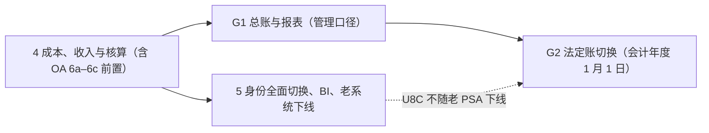

# 修订提议：总账纳入新系统（ADR-0016 第 6 条、ADR-0017 第 4 条、brief 新增阶段）

日期：2026-10-14 · 会话：psa-gl-scope · 依据：ADR-0022（提议）、`U8C_GL_PRACTICE.md`、`U8C_CAPABILITY_MAP.md`、`GL_COMPLIANCE_CHECKLIST.md`

> **全部是提议。** 用户批准前不改 ADR 原文和 brief 模板；批准后由执行会话按本文改 `adr/build_adrs.py` 与 `MODERNIZATION_BRIEF.template.md` 并重新生成。阶段编号 G1、G2 是占位，与 OA 盘点的 6a–6f 一起由 psa-coordinator 统一。ADR-0016 中 A8 产值只读接入的表述由 psa-oa-inventory 另出修订稿，本文不涉及。

## A. ADR-0016 第 6 条

**现文**

> 6. **法定总账**：本次现代化期间 U8C 仍是法定账（权责发生制、收付实现制两套），`accounting.ledger` 负责生成凭证、可靠投递和对账。蓝图 DD-6（FORCITIS one 自任法定账、U8C 退役）不在本 brief 范围，作为后续单独决策。

**修订为**

> 6. **总账与法定账**（修订：用户 2026-10-14「我要财务总账集成到新系统，通过新系统直接可以出权责口径的三大报表」，路线「两步：先管理口径，再年度切换法定账（推荐）」；见 ADR-0022）：
>    - **第一步（阶段 G1）**：`accounting.ledger` 是新系统的完整总账（科目、凭证、期间余额、辅助核算含项目），新系统按月出权责口径三大报表（`accounting.reporting`）；U8C 仍是法定账，`accounting.ledger` 负责把凭证推送到 U8C、可靠投递，并每月按 法人 × 科目 对账，差异为零或经财务签字。U8C 中哪一套账是法定账（收付账套或权责账套）由财务在 G1 开始前明确。
>    - **第二步（阶段 G2）**：满足 ADR-0022 第 9 条的入口条件后，在会计年度 1 月 1 日把法定账切到 FORCITIS one（蓝图 DD-6），U8C 转只读历史账。
>    - 新系统与 U8C 之间的接口必须自带认证、走内网或专线，推送幂等。

后果一节相应增加一句：「Phase 4 的『U8C 推送权切换到新系统』是 G1 的前提；G1 之后凭证由新系统总账推送，不再由各业务 BC 或 A8 插件直接推送。」

## B. ADR-0017 第 4 条与对照表

**现文**

> 4. 蓝图中超出 PSA 现有功能的范围（D11 跨法人结算、D12 集团合并、DD-6 自任法定账、自建轻量 CRM 的全部能力）不在本 brief 内，列为后续路线。

**修订为**

> 4. 蓝图中超出 PSA 现有功能的范围：**DD-6 自任法定账纳入路线**，按 ADR-0022 两步走（G1 管理口径总账与报表、G2 年度切换法定账）；D11 跨法人结算、D12 集团合并、自建轻量 CRM 的全部能力仍不在本 brief 内，列为后续路线（G2 之后再评估合并报表）。

**对照表修订**（替换 `accounting.ledger` 一行，并新增几行；新模块路径与编号待用户在用语确认页确认，psa-terms-review 的 N2 命名建议与此一致）：

| PSA BC（模块） | 蓝图 BC |
|---|---|
| `accounting.ledger` | BC-14 GL & R2R（总账部分；G1 起为完整总账，G2 起为法定账） |
| `accounting.reporting`（新增） | BC-14 GL & R2R（报表部分，只读） |
| `payables.payment`（新增子域 `payables`，应付与付款 BC） | 蓝图未覆盖，提议 BC-16 AP & Payments |
| `accounting.cashbank`（新增，银行与现金） | 提议 BC-17 |
| `accounting.tax`（新增，税费） | 提议 BC-18 |
| `accounting.fixedasset`（新增，固定资产） | 提议 BC-19 |

## C. brief 修订稿：新增阶段 G1、G2

### C.1 §3 依赖图



说明：Phase 5 下线的是老 PSA；U8C 在 G2 之前仍是法定账，不随 Phase 5 下线。

### C.2 Phase G1 — 总账与报表（管理口径）

```
#### Phase G1 — 总账与报表（管理口径，编号待统一）
Command: /code-modernization:modernize-reimagine
Modules: accounting.ledger（升级）、accounting.reporting（新增）、accounting.period、accounting.cashbank / tax / fixedasset（导入通道与最小明细账）、payables.payment（随 OA 6c）
Scale: XL
Risk: 很高。
- 风险一：新总账与 U8C 两边并行，科目对照或推送出错会让两边都不可信。缓解：每月按 法人 × 科目 对账，差异必须为零或签字；对账不收敛不出对外报表。
- 风险二：PSA 以外的凭证来源（银行、薪酬、固定资产、税费）先以导入和手工承接，容易绕过控制。缓解：控制科目只接受指定 BC 过账；手工凭证必须有理由、附件、双人复核；导入凭证保留原始文件与校验和。
- 风险三：U8C 现状长期不结账，新系统的期间闸门会改变财务的月结节奏。缓解：G1 开始前与财务约定月结日程；关账检查项写入 accounting.period。
Entry criteria:
- [ ] Phase 4 的出口条件满足（含 ADR-0021 的 OA 6a–6c；U8C 推送权已在新系统）
- [ ] ADR-0022 已采纳；ADR-0016 第 6 条、ADR-0017 第 4 条的修订已采纳
- [ ] 财务已明确：U8C 中哪一套是法定账；收付账套是否保留；新系统科目表以哪套为准、编码方案（`proposals/GL_SCOPE_REVISIONS.md` §D 第 1–3 项）
- [ ] 新系统科目表、辅助核算维度、现金流量项目、新旧科目对照表已由财务评审并登记版本
- [ ] `rules/GL_FINANCE_REVIEW.md` 中标为「G1 开始前必须答」的规则卡已有财务结论
- [ ] 报表行项目 → 科目 / 现金流量项目映射表（财会〔2019〕6 号格式，合同资产、合同负债单列）已由财务评审
- [ ] 黄金基线已导出：两套账 × 各法人最近两个已结期间的科目余额表与三大报表（本机 `~/.modernize/psa/u8c-baseline/`，清单与校验和见 `U8C_GL_PRACTICE.md`）
- [ ] 期初余额来源与起始月已确定（某个 U8C 已结期间的期末余额，按 法人 × 科目 × 辅助维度）
- [ ] 本阶段会计术语在 `terms.yaml` 中为「已批准」，或「提议中」的已排定财务评审（ADR-0018）
- [ ] 与 U8C 的推送与对账通道自带认证、走内网或专线
Exit criteria:
- [ ] 以黄金基线回放：新总账对基线期间重算的科目余额表（含辅助核算）与 U8C 逐行一致到分；三大报表与基线一致，或差异已由财务在 `RULE_REVIEWS.json` 中签字接受（如 U8C 模板缺陷导致的差异）
- [ ] 连续两个月，五家法人的新系统月结完成：试算平衡、明细账与控制科目一致、损益结转完成、现金流量标注完整
- [ ] 连续两个月，新总账与 U8C 法定账按 法人 × 科目 对账差异为零，或逐项经财务负责人签字
- [ ] 新系统按月出五家法人的资产负债表、利润表、现金流量表（直接法）及补充资料（间接法）；直接法与间接法的经营活动现金流量净额相等；现金流量表期末现金等于资产负债表现金及现金等价物
- [ ] 手工凭证不能借贷控制科目、触及现金科目必须标注现金流量项目、报表只读的守护测试通过
- [ ] `GL_COMPLIANCE_CHECKLIST.md` 中标为「第一步需要」的条目全部满足
- [ ] 回滚演练：停止新系统推送后，U8C 侧凭证可由原通道补齐（或新系统重推），对账恢复一致
```

### C.3 Phase G2 — 法定账切换

```
#### Phase G2 — 法定账切换（编号待统一）
Command: /code-modernization:modernize-verify
Modules: accounting.ledger、accounting.reporting、accounting.period、会计档案输出、数据接口（GB/T 24589）
Scale: L
Risk: 很高。
- 风险一：切换后法定账错误影响对外报送、纳税和审计，不可逆。缓解：只在会计年度 1 月 1 日切换；入口要求连续三个月（含一个季末）对账一致与审计师书面认可；U8C 保留只读，可随时比对。
- 风险二：税务申报、银行、审计等外部方依赖 U8C 的输出格式。缓解：切换前逐方确认过渡方案；提供 GB/T 24589 数据接口输出。
Entry criteria:
- [ ] Phase G1 的出口条件满足
- [ ] 切换前连续三个月（含一个季末）新总账与 U8C 法定账对账一致
- [ ] 按财政部《会计软件基本功能和服务规范》逐条验收，`GL_COMPLIANCE_CHECKLIST.md` 中「第二步前必须」的条目全部满足（含 GB/T 24589 数据接口）
- [ ] 审计师书面认可新系统作为法定账，以及期初余额迁移方案
- [ ] 期初余额迁移方案经财务确认：法人 × 科目 × 辅助维度的期末余额、未核销往来明细、固定资产卡片、在途事项；迁移结果与 U8C 上年末余额逐项一致
- [ ] 电子会计档案归档方式符合《会计档案管理办法》，保管期限已配置
- [ ] 税务申报、银行、外部审计的过渡方案已逐方确认
- [ ] 财务负责人签字确认切换日期（会计年度 1 月 1 日）
Exit criteria:
- [ ] 切换后首个季度的法定报表由新系统出具，外部报送与纳税申报正常完成
- [ ] U8C 已转为只读，历史账可查询、可输出，保管期限内不删除
- [ ] 新系统的会计档案（凭证、账簿、报表）按期归档，审计轨迹完整可查
```

### C.4 §7 Open Questions 增补

在 Open Questions 末尾增加一组「G1 / G2 前需要决定的事项」，内容即本文 §D。

## D. 需要用户 / 财务决定的事项

| # | 问题 | 选项与建议 | 何时必须答 | 依据 |
|---|---|---|---|---|
| 1 | U8C 两套账中**哪一套是法定账**（对外报送、纳税申报、审计所依据）？ | 数据显示收付账套 2025 年 12 月已结账、权责账套 2026 年凭证全部未审核；请财务明确 | G1 开始前 | `U8C_GL_PRACTICE.md` §1.2、§6 |
| 2 | **收付账套是否保留**？ | 建议：新系统只保留一套准则口径的账；收付账套「项目成本当期费用化」的口径如仍需要，用报表口径映射或调整分录层提供，不另设一套账 | G1 开始前 | ADR-0022 第 2 条 |
| 3 | **科目表以哪套为准、编码方案**？ | 建议：科目名称按准则（合同资产、合同负债、合同履约成本、销售费用等）；编码二选一：沿用 U8C 数字编码（便于与 U8C、税务对照）或新编码（与 Q 科目的要素首字母一致）；不复制「一张凭证两套科目」 | G1 开始前 | §2、ADR-0018 |
| 4 | **辅助核算维度** | 建议：法人（账簿）、部门、项目（新增）、往来单位（客户、供应商、员工、合伙人）、人员、研发项目、增值税进项类型；是否增加合同、业务线（事业部 / 运营中心） | G1 开始前 | §2.5 |
| 5 | **期初切换时点** | G1：从哪个 U8C 已结期间的期末余额起步；G2：哪个会计年度的 1 月 1 日 | G1 开始前 / G2 入口 | ADR-0022 第 9 条 |
| 6 | **税务接口** | 纳税申报、数电发票、进项认证在 G1 / G2 期间怎么做（U8C 内没有申报数据） | G2 入口 | §7 |
| 7 | **对账容差与签字人** | 建议差异为零；如需容差，请给出金额与签字人（财务负责人） | G1 开始前 | ADR-0022 第 8 条 |
| 8 | **月结节奏** | 建议每月次月第 N 个工作日关账；U8C 现状长期不结账 | G1 开始前 | §6 |
| 9 | 损益结转模板漏了 6115 / 6901（E115 / E901）、两模板名称对调、权责资产负债表缺合同资产 / 合同负债、开发支出取 E301 等缺陷 | 是否先在 U8C 侧修正（影响黄金基线的可比性） | G1 开始前 | §4.2、§5.2；`rules/GL_FINANCE_REVIEW.md` |
| 10 | 权责账套一张凭证记两套科目的用途 | 请财务说明数字科目在权责账套中的作用 | G1 开始前 | §2.2 |
| 11 | 「收付账套」「权责账套」等叫法的正式用语 | 登记为待确认用语，由业务 Admin / 财务确认 | 本阶段用语评审 | §8 |
| 12 | 新 BC 的模块路径与蓝图编号（`payables.payment` BC-16 等） | 等用户在用语确认页确认（psa-terms-review N2） | G1 开始前 | ADR-0022 第 7 条 |
| 13 | 合伙人注资与退回的归属 | 建议：资金收付在 `payables.payment` / `receivables.collection`，权益科目由总账映射 | 6c 开始前 | 用户决定「都算，都进新系统」 |
| 14 | 审计师与认可方式 | 谁出具书面认可、需要哪些材料 | G2 入口前一年 | ADR-0022 第 9 条 |
| 15 | 电子会计档案 | 归档方式（系统内归档还是外部档案系统）、是否保留纸质 | G2 入口 | 《会计档案管理办法》 |
| 16 | G1 期间新系统推送 U8C 的范围 | 推一套还是两套账（取决于第 1、2 项）；替代 A8 插件与 PSA 老推送的顺序 | Phase 4 | ADR-0022 第 8 条 |
