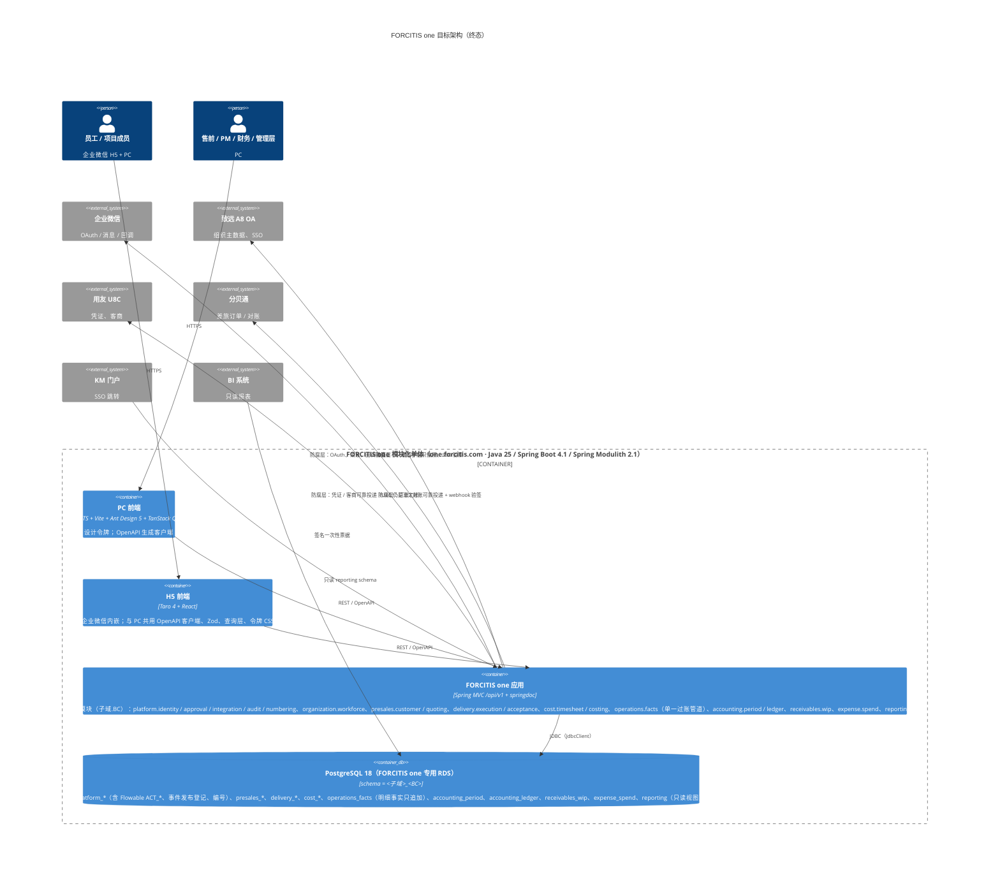
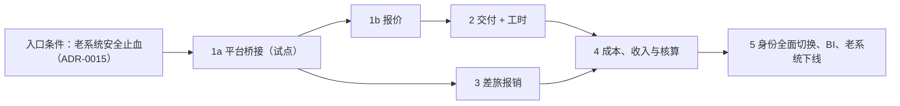

# MODERNIZATION BRIEF — 老系统 → FORCITIS one

日期：2026-10-14 · 状态：**待审批**

**输入**（均为 2026-10-14 生成）：INTENT、ASSESSMENT、topology.json、SECURITY_FINDINGS（3 轮补丁复审）、BUSINESS_RULES（315 条）、DATA_OBJECTS、GLOSSARY、STACK_DECISION、NAMING_STANDARD、GUIDING_PRINCIPLES、`adr/`（15 篇）、`runtime/`（生产只读采集）、`architecture-guardrails/`（实测模板）。尚无 `RULE_REVIEWS.json`。

## 1. Objective

把老系统重建为 **FORCITIS one**（one.forcitis.com，ADR-0001）。

- **从**：yudao 微服务底座 + Java 8 / Spring Boot 2.7 + SQL Server 2016 + Flowable 6.8 + Vue 2。
- **到**：Spring Modulith 模块化单体，Java 25 / Spring Boot 4.1、PostgreSQL 18（schema 为 `<子域>_<BC>`）、JdbcClient、Flyway、Flowable 8（BPMN + DMN）、API 版本化、默认拒绝的鉴权、可配置的业务编号，前端为 React + Taro + 设计系统。定栈见 `STACK_DECISION.md` 和 `adr/`。

迁移期间老系统持续运行，按 BC 绞杀式切换。行为上**功能复刻、行为现代化，顺手修复已知缺陷**（用户原话）。

为什么是现在：
- 技术栈全线过保：Boot 2.7、Vue 2 已 EOL，Boot 3.5 的 OSS 支持也已于 2026-06-30 结束。
- 生产存在可被公网利用的免密登录（SEC-001）和入库的明文密钥（SEC-006 / 012）。
- 5 个微服务和全部中间件挤在一台 15G 内存的 ECS 上，只服务 335 个活跃用户。
- 核心规则锁在没有测试的老 service 层超大类里。

## 2. Target Architecture



| 老组件（topology.json / 运行时） | 目标组件 |
|---|---|
| `yudao-gateway`（gateway:core）、nginx 直连 48080 / 48088 | 删除；nginx → 单体（切换期按路径分流） |
| `yudao-module-system`（system:*）、fst `service/{sync,dept,user,a8}`、企业微信 / A8 / KM 登录 | `identity` + `org` 模块；`integration-acl`（A8、企业微信、KM） |
| ↳ Proposed revision:（用户 2026-10-14：「两条都同意 (Recommended)」）按已批准架构（REIMAGINED_ARCHITECTURE §2）：A8 只读视图防腐层归 `organization.workforce`，致远验票归 `platform.identity`，`platform.integration` 只含共用企业微信客户端与出站投递；KM 等外部系统走签名票据（`platform.identity`）。 | |
| `yudao-module-infra`（infra:*：文件、代码生成、配置、API 日志） | `base` 模块（文件存 OSS、审计日志）；代码生成和表单设计器不迁移 |
| `yudao-module-bpm`（bpm:*）+ fst workflowhook / workflowform / 审批消费者 + RocketMQ 审批主题 | `platform.approval` 模块（Flowable 8 BPMN + DMN：步骤、条件、行级分路、会签、催办、转交、退回、撤回、截止点）+ 模块内事件 |
| fst `presales/*`、`controller/admin/{quotation,opportunity}`、`service/customer`、成本模板 / 费率 | `presales` 模块（报价、成本估算树、岗位费率读模型） |
| fst `delivery/*`、`service/{project,budget,contract}`、`pmproject` / `projectplan` / `projecttask` | `delivery` 模块（项目台账、WBS 预算与修订、进度 / ETC、交付物与验收） |
| fst `receivables/*`、收入确认 | `receivables` 模块（收入确认、开票、AR） |
| fst `service/{manhour,calendar,resource}`、工时 MQ 处理器、工时任务 | `timesheet` 模块（填报、行级审批、费率锁定、人天、资源负荷） |
| fst `expense/*`（分贝通防腐层 13.8k 行） | `expense` 模块 + `integration-acl/fenbeitong` |
| fst `cost/*`（归集、OH 分摊、结转 / WIP、过账、期初、修正、劳务重分类、利润报表）、`service/{wip,accounting,cost,costsummaryext}` | `cost.costing`（成本计算与分摊，只提交过账候选）+ `operations.facts`（单一过账管道、冲销）+ `accounting.period`（(期间, 法人) 期间闸门）+ `accounting.ledger`（科目映射 DMN、凭证 → U8C 防腐层）（ADR-0016） |
| fst `platform/*`（可靠投递、枚举注册表） | `base`（Modulith 事件发布登记 + 外部投递作业表）；枚举 → 各模块的 `events` / `api` 契约 |
| XXL-JOB 27 个处理器 | 各模块的 `@Scheduled` + ShedLock |
| Redis（缓存 / 锁 / 编号）、Nacos、RocketMQ | 删除：Caffeine、作业表租约、`platform.numbering`、外部化配置 + KMS |
| PC Vue 2.7 / Element（pc:*） | React 19 + Ant Design 5 PC 应用（`shared/ui` 按设计正本封装），按阶段逐页重建 |
| H5 Taro 4 React（h5:*） | 保留 Taro；接口改用 OpenAPI 生成的客户端，按阶段改造 |
| SQL Server `ruoyi-vue-pro` 库 | PostgreSQL 18：各 BC 的 schema + `reporting` 视图；Flowable `ACT_*` 不迁移，只读归档 |

## 3. Phased Sequence

**本方案是假设，Phase 1a 是试点。** 试点暴露出的问题（漏掉的耦合、改变顺序的前置条件、没写下来的环境事实）都在预期之内，会据此修订 brief，试点之后重新生成 brief 是正常路径。

**排序原则**：绞杀模式，依赖少、风险低的先做；行级强耦合的 BC 放在同一阶段切换。

**过渡期通用机制**（每个阶段都适用，ADR-0011）：
- nginx 按路径把已切换的域分流到 FORCITIS one；
- 老 URL 由兼容门面承接，返回老格式；
- 只按**逐列所有权矩阵**反向同步到老表；
- 在途 Flowable 实例在老引擎上走完；
- 每个阶段都能回滚（恢复 nginx 路由后，老系统从反向同步后的状态继续运行）。
- 会话管理（ADR-0020，`METHODS.md`）：每个阶段的每个工作单元在独立会话中完成，按开场 / 收尾协议更新 `STATUS.md` 与 `SESSION_LOG.md`；用户决定以原话入档。
- 统一语言随阶段登记（ADR-0018）：阶段开始时，本阶段涉及的术语在 `glossary/terms.yaml` 中全部为「已批准」，或「提议中」的已列明并排定评审；阶段结束时没有「提议中」的会计类术语。
- 设计正本随阶段完善（ADR-0013 第 7 条）：阶段开始时在 `DS_GAPS.md` 列出本阶段所需而正本缺失的组件，**先补正本、再写页面**；阶段结束时该阶段的差距清零或注明延后原因。



#### Phase 1a — 平台桥接（试点）
Command: /code-modernization:modernize-reimagine
Modules: system:service/auth, system:controller/admin/auth, system:service/permission, system:service/dept, system:service/user, fst:service/sync, fst:util/wx, fst:service/message, bpm:service/task, bpm:service/definition, bpm:service/oa, bpm:framework/flowable, bpm:mq/producer, fst:framework/workflowhook, fst:service/workflowform, fst:application/platform, fst:infrastructure/platform, pc:views/bpm/processInstance, pc:views/bpm/task, h5:pages/work/process, pc:layout, pc:router, pc:views/login
Scale: L
Risk: 高。
- 风险一：身份桥接出错会影响所有人登录。缓解：1a 已取消桥接——新系统不读、不写、不校验老令牌表（用户：「1a 删除桥接」），也不信任老系统签发的任何身份；会话失败时退回老系统登录页；登录失败率进入告警。
- 风险二：两套审批引擎并存，待办需要合并。缓解：外壳合并展示新旧待办；新流程只承接 1b 及之后切换的单据；老流程在老 Flowable 上排空。
Entry criteria:
- [x] 本 brief 获批（至少覆盖 Phase 1a 和 1b）——证据：§8 审批块（用户 2026-10-14「批准 Phase 1a 和 1b」）（psa-coordinator 2026-10-14 核对）
- [ ] SEC-001 至 SEC-006、SEC-107 已在老系统止血（`security_remediation.patch` 已部署，或网络层止血已生效：48088 不再对 0.0.0.0/0 开放、`/other-api/admin-api/system/auth/` 返回 403），且 `~/.modernize/psa/SECRETS.local.md` 中列出的凭据已全部轮换
  Proposed revision:（用户 2026-10-14：「老系统先不管，确保新系统没有这些缺陷」；SEC-116「仍然完全不处理」）本条不再阻塞 Phase 1a：新系统不信任老系统签发的任何身份，由 `phase1a/SECURITY_INVARIANTS.md` I-1..I-9 及其验收测试保障；老系统缺陷影响的是老系统自身数据，按用户决定暂不处理。
- [x] 仓库已创建：https://github.com/FORCITIS/forcitis-one-psa（私有，2026-10-14，空仓库）
- [x] 骨架已推入 `forcitis-one-psa`，分支保护、CI（verify + 守护 + gitleaks）已配置——证据：PR #9 骨架与 ci.yml；main 分支保护要求 backend / frontend / gitleaks 三项（用户「只要求 CI 三项通过」）（psa-coordinator 2026-10-14 核对）
- [x] 骨架采用 `architecture-guardrails/backend` 和 `frontend`，在 Mac 本机执行 `./mvnw verify` 和 `pnpm verify` 均全绿——证据：PR #9 起各 PR 的 CI 全绿，1a 会话本机 `./mvnw verify`、`pnpm verify` 报告全绿（psa-coordinator 2026-10-14 核对）
- [ ] FORCITIS one 专用主机和 FORCITIS one 专用 RDS PostgreSQL 实例已开通
- [ ] `shared/design-system/tokens.css` 与设计正本「Forcitis One Design System」的 `tokens/palette.css`、`tokens/semantic.css` 逐项一致（正本有更新时重新同步）
- [ ] 设计正本已完整备份到本地；正本现有组件已取下并作为 `shared/ui`（React）的起点（ADR-0013 第 7 条，代码为源）
- [x] 内核值对象 `Money`、`AccountingPeriod`、`ProjectCoordinate`、`LegalEntityId` 已就位（ADR-0016）——证据：backend kernel 包（PR #21）（psa-coordinator 2026-10-14 核对）
- [x] 已对 identity、org 两个域补抽规则并完成评审（`RULE_REVIEWS.json` 中有对应记录）——61 条见 `rules/IDENTITY_ORG_RULES.md`，标记的 45 条已评审（正确 16、错误 29，2026-10-14，见 RULE_REVIEWS.md 第三批）
- [x] 本阶段涉及的老表（`system_users`、`system_dept`、`bpm_*`、`psa_process_to_be_sent`）已有逐列所有权矩阵——证据：phase1a/COLUMN_OWNERSHIP.md（PR #3，14 表 217 列）（psa-coordinator 2026-10-14 核对）
- [x] 本阶段涉及流程的流程梳理已完成（`process/1a/`，METHODS M4），差异清单逐条有用户决定，并已写入 §5「流程梳理结论」（用户 2026-10-14：「每个阶段实施前增加「流程梳理」步骤……先把这一步写进 METHODS.md 和 brief 的阶段入口条件」）（Phase 1a 已在实施中，本条为补做；2026-10-14 完成：7 个流程、D-1a-01..181 全部有用户决定，178 条写入 §5，另 3 条为文档更正）
Exit criteria:
- [ ] one.forcitis.com 上线：用企业微信 OAuth 和致远 SSO 登录都能成功；遍历全部接口的匿名访问测试返回 401
  Proposed revision:（检查点 2，用户 2026-10-14：「两条都按建议修订」）匿名访问测试改为「非 `@PublicEndpoint` 的接口一律返回 401，且 `@PublicEndpoint` 集合等于经 CODEOWNERS 评审的白名单快照」；另加无 CSRF 写操作返回 403，上线前从 nginx 外侧黑盒遍历。
- [ ] 组织快照与 A8 的对账查询结果为零差异（人员数、部门数、上级关系）
  Proposed revision:（用户 2026-10-14：「两条都同意 (Recommended)」）追加 §9a 证明项：新系统对 A8 的全部访问 = 视图列白名单（启动时列集合完全相等）+ 致远服务端验票；白名单中没有权责列；不存在写 A8 的路径（DBA 授权只含视图 SELECT，集成测试断言写被拒绝）；`phase1a/A8_ACCESS_REGISTER.md` 中 1a 行状态已更新。
- [ ] 回放从生产导出的 TIMESHEET 流程实例，`platform.approval` 解析出的审批人序列与老系统一致；每条差异都在 `RULE_REVIEWS.json` 中被接受
- [ ] 合并待办中，同一用户在新旧系统中的待办数量与老系统一致
- [ ] 业务编号规则已按统一新格式配置并经管理员确认；老编号作为「原编号」可检索，新旧编号对照可查
  Proposed revision:（检查点 2，用户 2026-10-14：「两条都按建议修订」）1a 交付编号规则与「原编号」检索结构；各单据老编号的导入与新旧对照随该单据的切换阶段完成（1b 报价起）。
- [ ] 同步延迟、未完成的事件发布、作业失败、登录失败率四类告警已接入，并在 dev 上演练触发
- [ ] 回滚演练：撤销 nginx 路由后，老系统登录和审批不受影响
- [ ] 首次 `/design-sync` 完成：正本由 `shared/ui` 同步生成，原有全部组件逐个比对预览无缺失，`_ds_sync.json` 锚点已写入；1a 的差距（合并待办收件箱、登录页、权限不足 / 会话过期页）已补入正本
- [ ] 「在职但无企业微信 ID」清单为 0（确无企业微信的人逐个登记原因）（用户 2026-10-14：「加 (Recommended)」，D-1a-35）
  Proposed revision（草稿，待用户随统一编排路线审批；one-coordinator 2026-10-15 业财核查清单，Phase 1a 会话起草）：追加出口条件「平台穿刺：在 dev 上端到端走通一条——企业微信登录 → 发起并办理一条审批 → 领域事件进入事件发布登记并被消费 → 审计条目可查 → 取得一个业务编号 → 企业微信通知送达；每一环有可复查的证据（审计条目、事件记录、编号、投递记录）」。

#### Phase 1b — 报价
Command: /code-modernization:modernize-reimagine
Modules: fst:domain/presales, fst:application/presales, fst:infrastructure/presales, fst:controller/admin/quotation, fst:controller/admin/opportunity, fst:service/customer, pc:views/project/quotation, pc:views/project/costTemplate, pc:views/project/opportunity, pc:views/project/price
Scale: M
Risk: 中。
- 风险一：报价是交付预算的基线，交付仍在老系统。缓解：报价批准后，按所有权矩阵把可交付的列写回 `psa_quotation*`。
- 风险二：老页面仍在调用 `fst/opportunity/*` 等接口。缓解：提供兼容门面。
Entry criteria:
- [ ] Phase 1a 的出口条件全部满足，且本 brief 已按试点结果重新生成
- [x] 售前与报价域被标记的 P0 规则已在 `RULE_REVIEWS.json` 中有结论
- [ ] 已列出所有调用 `/admin-api/fst/quotation/**`、`/admin-api/fst/opportunity/**` 的老调用方（PC、H5、外部系统），并为每个调用方注明：经兼容门面测试通过，或本阶段一并迁移
- [ ] `psa_quotation*`、`psa_cost_template*`、`psa_crm_opportunity` 已有逐列所有权矩阵
- [ ] 特征基线已录制：用 dev 库数据回放报价的保存、提交、审批，请求与结果记录在 `analysis/psa/BASELINE.md`
- [ ] 本阶段涉及流程的流程梳理已完成（`process/1b/`，METHODS M4），差异清单逐条有用户决定，并已写入 §5「流程梳理结论」（用户 2026-10-14：「每个阶段实施前增加「流程梳理」步骤……先把这一步写进 METHODS.md 和 brief 的阶段入口条件」）
  Proposed revision:（用户 2026-10-15：XD-10「采纳 (Recommended)」，intent 2026-10-15-214100-one-coordinator-横切决定单-XD-10）追加入口条件「横切关注点矩阵（`CROSS_CUTTING_MATRIX.md`）已按本阶段更新；本阶段需要的待决题（`CROSS_CUTTING_DECISIONS.md`）已有答复；本阶段用到的地基行已做进 kernel / platform 并冻结（METHODS M4）」
  Proposed revision:（用户 2026-10-15：XD-09「提前到 1b (Recommended)」，intent 2026-10-15-214100-one-coordinator-横切决定单-XD-09）追加入口条件「舍入差归属已有结论（财务 FQ-24；答复前按 XD-08「先按建议建」用最大余数法），金额舍入口径（FQ-23、FQ-25、FQ-26、FQ-27）已有财务答复或按建议口径登记；kernel 的按权重拆分原语与不舍入计算类型已冻结」——由 Phase 4 入口「分摊余数归属」移来，首个拆分场景是报价条款拆分（RULE-159）
Exit criteria:
- [ ] 售前与报价的 P0 规则全部有以规则 ID 命名的测试，且测试通过
- [ ] 同一组输入在新旧系统上的最终报价、毛利、条款拆分、状态完全一致，或差异已在 `RULE_REVIEWS.json` 中被接受
- [ ] 反向同步之后，老系统交付预算读取的报价基线与切换前一致（契约测试）
- [ ] BI 查询清单中涉及报价的查询，在反向同步后的 SQL Server 上结果不变
- [ ] 回滚演练通过

#### Phase 2 — 交付与工时（同一阶段切换）
Command: /code-modernization:modernize-reimagine
Modules: fst:domain/delivery, fst:application/delivery, fst:infrastructure/delivery, fst:controller/admin/pmproject, fst:controller/admin/project, fst:controller/admin/projectplan, fst:controller/admin/projecttask, fst:service/project, fst:service/budget, fst:service/contract, fst:service/manhour, fst:controller/admin/manhour, fst:service/resource, fst:controller/admin/resource, fst:dal/mysql/manhour, fst:dal/dataobject/manhour, pc:views/project/pmList, pc:views/project/lists, pc:views/project/planning, pc:views/project/deliverable, pc:views/project/weeklyMeeting, pc:views/project/budget, pc:views/project/forecast, pc:views/project/taskLists, pc:views/project/myTaskLists, pc:views/project/manhour, pc:views/project/timesheet, h5:pages/work/project, h5:pages/index
Scale: XL
Risk: 很高。
- 风险一：用户量最大的路径（180 天 37.6 万次调用、34,498 个审批实例）。缓解：先做影子计算，新系统用老系统的输入计算并比对结果；在会计期间边界一次性全员切换。
- 风险二：任务包的实际工时由工时审批回写，交付与工时在行级强耦合。缓解：两个 BC 在同一阶段切换，避免出现两个写入方。
Entry criteria:
- [ ] Phase 1b 的出口条件满足
- [ ] 交付、工时、收入确认的 P0 规则中被标记的条目已在 `RULE_REVIEWS.json` 中有结论（例如：撤回后已审批行是否保留、09:00 是开放时间还是截止时间、过账校验用行状态还是表头状态、人天口径）
- [ ] 工时类 XXL-JOB 的耗时基线已从作业日志导出
- [ ] `psa_task_package`、`psa_time_sheet*`、`psa_pm_project`、`psa_budget_*` 已有逐列所有权矩阵
- [ ] `operations.facts` 过账管道和 `accounting.period` 已可用（ADR-0016）：明细事实表拒绝 UPDATE / DELETE 的测试通过；向已关闭的 (期间, 法人) 过账被拒绝的测试通过；工时成本（交易类型 TS）是第一个事实生产者
- [ ] 老过账引擎最近一个已结期间的工时成本过账结果已导出，作为影子比对基线
  Proposed revision（草稿，待用户决定；Phase 1a 会话 2026-10-14）：追加入口条件「工时审批所需的流程字段已有来源：项目经理（`projectManagerId`）、区域负责人（`regionalHeadId`）与工时行类型路由标记（项目 / 售前 / OH）由哪个模块提供已决定（候选：delivery.execution 提供项目经理，organization.workforce 提供区域负责人）」。1a 中 TIMESHEET 只用于回放，不实际发起，取不到人时落流程管理员兜底。
  Proposed revision（草稿，待用户决定；Phase 1a 会话 2026-10-14，依据 R0 登记的 A8_ACCESS_REGISTER #29–#31）：追加入口条件「无效交付工时规则（生产 SQL Agent 作业第 4 步经 BI 视图 T_FST_INVALID_DELIVERY 回写，#31）已抽取为规则卡并评审；项目档案（#29）与项目预算（#30，与 PSA 预算双入口，RULE-182/239）的 A8 → 老 PSA 通道已在规则卡中登记」。
- [ ] 本阶段涉及流程的流程梳理已完成（`process/2/`，METHODS M4），差异清单逐条有用户决定，并已写入 §5「流程梳理结论」（用户 2026-10-14：「每个阶段实施前增加「流程梳理」步骤……先把这一步写进 METHODS.md 和 brief 的阶段入口条件」）
  Proposed revision:（用户 2026-10-15：XD-10「采纳 (Recommended)」，intent 2026-10-15-214100-one-coordinator-横切决定单-XD-10）追加入口条件「横切关注点矩阵（`CROSS_CUTTING_MATRIX.md`）已按本阶段更新；本阶段需要的待决题（`CROSS_CUTTING_DECISIONS.md`）已有答复；本阶段用到的地基行已做进 kernel / platform 并冻结（METHODS M4）」
Exit criteria:
- [ ] 影子计算结果：一个完整会计期间内，新旧系统逐行的审批状态、锁定费率、标准成本金额、计费金额、人天、任务包实际工时完全一致，或差异已被接受
- [ ] 切换发生在会计期间边界；老系统中切换前发起的工时审批实例已全部结束
- [ ] 工时保存和提交的 p95 延迟不高于基线
- [ ] 老成本归集读取反向同步后的 `psa_time_sheet_works_end` 时，结果与切换前一致
- [ ] 回滚演练通过
  Proposed revision（草稿，待用户决定；同上）：追加出口条件「生产 SQL Agent 中对应的 A8 / BI → 老 PSA 作业（A8_ACCESS_REGISTER #29、#30、#31）已停用，并在登记表中改为『已停用 / 已迁入』；切换完成前 BI 视图 T_FST_PROJECT、T_FST_INVALID_DELIVERY 不改为过渡镜像、不废弃」。
  Proposed revision（草稿，待用户随统一编排路线审批；one-coordinator 2026-10-15 业财核查清单，Phase 1a 会话起草）：追加出口条件「1 小时工时业财穿刺：一条 1 小时工时走通——填报 → 审批 → 事件 → 费率与会计期间校验 → 项目子账本生成工时成本与未开票产值 → 关账后拒绝直接改写，只能红冲修正；每一环有可复查的证据。过账事实带法人、期间、利润中心、项目、专业，项目成本、利润中心损益与 L2 期间快照三处金额逐分一致；红冲一次后三处同步归零」（矩阵 CC-B11）。

#### Phase 3 — 差旅报销（分贝通）
Command: /code-modernization:modernize-reimagine
Modules: fst:domain/expense, fst:application/expense, fst:infrastructure/expense, fst:controller/admin/expense, fst:expense/travel, h5:pages/work/travel, pc:views/accounting/travel
Scale: L
Risk: 中。
- 风险：外部集成状态机复杂（订单、对账、组织同步、可靠投递）。缓解：用分贝通沙箱做契约测试；保留现有防腐层设计。
Entry criteria:
- [ ] Phase 1a 的出口条件满足
- [ ] 已执行 `/code-modernization:modernize-extract-rules psa expense` 补抽差旅规则，并在 `RULE_REVIEWS.json` 中有结论
- [ ] 分贝通沙箱可用，签名密钥存放在 KMS
- [ ] 分贝通回调地址 `/app-api/fst/fenbeitong/events/*` 的切换方式已与分贝通确认：改为新地址，或由兼容门面转发
- [ ] 本阶段涉及流程的流程梳理已完成（`process/3/`，METHODS M4），差异清单逐条有用户决定，并已写入 §5「流程梳理结论」（用户 2026-10-14：「每个阶段实施前增加「流程梳理」步骤……先把这一步写进 METHODS.md 和 brief 的阶段入口条件」）
  Proposed revision:（用户 2026-10-15：XD-10「采纳 (Recommended)」，intent 2026-10-15-214100-one-coordinator-横切决定单-XD-10）追加入口条件「横切关注点矩阵（`CROSS_CUTTING_MATRIX.md`）已按本阶段更新；本阶段需要的待决题（`CROSS_CUTTING_DECISIONS.md`）已有答复；本阶段用到的地基行已做进 kernel / platform 并冻结（METHODS M4）」
Exit criteria:
- [ ] 差旅 P0 规则全部有测试，且测试通过
- [ ] 一个完整月度周期（申请、订票、对账、分摊、月结审批）在新系统跑通，与老系统的对账单逐笔一致
- [ ] 回滚演练通过

#### Phase 4 — 成本、收入与核算
Command: /code-modernization:modernize-reimagine
Modules: fst:domain/cost, fst:application/cost, fst:infrastructure/cost, fst:controller/admin/cost, fst:controller/admin/accounting, fst:service/wip, fst:service/accounting, fst:service/cost, fst:service/costsummaryext, fst:domain/receivables, fst:application/receivables, fst:infrastructure/receivables, pc:views/accounting/costCollection, pc:views/accounting/costCarry, pc:views/accounting/costAllocation, pc:views/accounting/projectProfitL3, pc:views/accounting/revenueRedReversal, pc:views/accounting/voucherManage, pc:views/accounting/accountingPeriod, pc:views/costopenning, pc:views/project/revenue, pc:api/accounting
Scale: XL
Risk: 很高。
- 风险一：直接产生推送 U8C 的凭证，错误不可逆。缓解：至少两个月结期间影子计算；凭证只出草稿、不推送，人工对账一致后再切换推送权。
- 风险二：老结转路径（`/fst/accounting/wip`）与新结转引擎并存。缓解：切换前由业务确认下线老路径。
Entry criteria:
- [ ] Phase 2 和 Phase 3 的出口条件满足
- [ ] 成本域被标记的 P0 规则已有结论（分摊余数归属、负成本进入 WIP 后的余额符号、红冲是部分还是全额、核销按数量配对还是按金额配对）
  Proposed revision:（用户 2026-10-15：XD-09「提前到 1b (Recommended)」）本条中的「分摊余数归属」移到 Phase 1b 入口（见该处），其余三项（负成本进入 WIP 后的余额符号、红冲是部分还是全额、核销按数量配对还是按金额配对）不变
- [ ] 收入确认按 ACC-R01「产出法 · 客户价值确认」实现，老文档中 EAC / POC 驱动收入的过期表述已更正；财务已确认期间重开政策、质保金条款（ADR-0016）
- [ ] A8 客户产值确认单（方言，= 收入确认单）随 6a 迁入新系统，不设 A8 只读接入的双源期：在会计期间边界停用 A8 模板与 `oa-cuvalue-import` / `oa-cuvalue-sync`，同日起收入确认只在新系统发起；历史 19,869 行与 434 行退回按冲销关系迁入。本条改为「6a 出口条件满足（收入确认单已迁入新系统，A8 不再产生收入事实）；财务已确认预付款条款（PREPAY）无交付即确认收入的口径」。（ADR-0024 已采纳，2026-10-14）
- [ ] 词表中会计口径相关的改名（G-8 至 G-13、G-16、G-17、G-20、G-21、G-27）已于 2026-10-14 由业务 Admin 确认；财务在本阶段开始前复核这些用语在凭证与报表中的口径（ADR-0018）
- [ ] 科目映射 DMN 表已由财务评审，版本号已登记
  Proposed revision:（ADR-0022 评审 C-1，用户 2026-10-14：「收付推送前移到 6a (Recommended)」；草稿，路线整体编排由 psa-coordinator 统一处理）6a 入口增加：`accounting.ledger` 收付口径推送通道就绪——收付科目表与映射表首版、6a 表单对应的口径转换规则（D17）、主数据单向同步、幂等推送、死信与对账，经财务确认；自 6a 切换日起已迁入表单的凭证由新系统推送 U8C 收付账套，A8 制证插件同日停用。
- [ ] 最近两个已结期间的老系统归集、分摊、结转、凭证结果已导出，作为黄金基线
- [ ] 月结批处理的耗时基线已导出
  Proposed revision（草稿，待用户决定；Phase 1a 会话 2026-10-14，依据 R0 登记的 A8_ACCESS_REGISTER #28）：追加入口条件「成本明细 → psa_pm_pay 通道（生产 SQL Agent 作业，#28）承载的成本明细规则已抽取为规则卡并评审，含隐含规则『委外和居间付款申请不结转』」。
- [ ] 本阶段涉及流程的流程梳理已完成（`process/4/`，METHODS M4），差异清单逐条有用户决定，并已写入 §5「流程梳理结论」（用户 2026-10-14：「每个阶段实施前增加「流程梳理」步骤……先把这一步写进 METHODS.md 和 brief 的阶段入口条件」）
  Proposed revision:（用户 2026-10-15：XD-10「采纳 (Recommended)」，intent 2026-10-15-214100-one-coordinator-横切决定单-XD-10）追加入口条件「横切关注点矩阵（`CROSS_CUTTING_MATRIX.md`）已按本阶段更新；本阶段需要的待决题（`CROSS_CUTTING_DECISIONS.md`）已有答复；本阶段用到的地基行已做进 kernel / platform 并冻结（METHODS M4）」
Exit criteria:
- [ ] 两个月结期间，新旧系统的分摊行、WIP 余额、凭证分录逐笔一致，或差异已由财务在 `RULE_REVIEWS.json` 中签字接受
- [ ] 对账等式全部成立：归集守恒、合同资产滚动恒等式（F113）、凭证借贷平衡；老系统的红冲记录已按冲销关系迁移，原行与反向行双向关联
- [ ] 月结批处理在生产规模数据上的耗时不高于基线
- [ ] U8C 推送权已切换到新系统，老成本页面和 `/fst/accounting/wip` 已下线
  Proposed revision:（OA 流程盘点，用户 2026-10-14：ADR-0021「采纳；6a–6c 并入 Phase 4 前」）增加前置：6a 合同与收入、6b 开票与收款、6c 费用、付款与预提的出口条件均已满足，且 A8 凭证插件（`LEXMISCIF_VOUCHER`）与销项开票插件在切换日后无新记录；本阶段权责事实按 ADR-0021 第 4 条完成无遗留检查。阶段草案见 OA_PROCESS_INVENTORY.md §6.3。
- [ ] 回滚演练通过（推送权切回老系统）
  Proposed revision（草稿，待用户决定；同上）：追加出口条件「#28 对应的生产 SQL Agent 作业已停用，并在 A8_ACCESS_REGISTER 中改为『已停用 / 已迁入』；切换完成前 BI 视图 T_FST_PAY 不改为过渡镜像、不废弃」。

#### Phase 5 — 身份全面切换、BI 与老系统下线
Command: /code-modernization:modernize-reimagine
Modules: system:service/oauth2, system:controller/admin/permission, gateway:core, infra:controller/admin/file, pc:views/system/user, pc:views/system/role, pc:views/system/menu, h5:pages/qyLogin, h5:pages/mine
Scale: M
Risk: 中。
- 风险：BI、KM、A8 等外部系统依赖老库和 SSO 端点。缓解：提供与老表同形状的 `reporting` 视图；外部 SSO 调用方迁移到签名票据。
Entry criteria:
- [ ] Phase 4 的出口条件满足
- [ ] 外部调用方清单（BI、KM、A8、IT 服务门户）中，每一方都已有确认的切换步骤
- [ ] 本阶段涉及流程的流程梳理已完成（`process/5/`，METHODS M4），差异清单逐条有用户决定，并已写入 §5「流程梳理结论」（用户 2026-10-14：「每个阶段实施前增加「流程梳理」步骤……先把这一步写进 METHODS.md 和 brief 的阶段入口条件」）
  Proposed revision:（用户 2026-10-15：XD-10「采纳 (Recommended)」，intent 2026-10-15-214100-one-coordinator-横切决定单-XD-10）追加入口条件「横切关注点矩阵（`CROSS_CUTTING_MATRIX.md`）已按本阶段更新；本阶段需要的待决题（`CROSS_CUTTING_DECISIONS.md`）已有答复；本阶段用到的地基行已做进 kernel / platform 并冻结（METHODS M4）」
Exit criteria:
- [ ] BI 查询清单中的每条查询在 PostgreSQL `reporting` 上的结果，与切换前在 SQL Server 上的结果一致
- [ ] 安全组已移除 48080 和 48088 规则，老服务进程已停止
- [ ] SQL Server 库已转为只读归档；Flowable 历史和 API 日志已按保留期归档

## 4. Business Walkthroughs

| 人物 | 业务过程 | 老系统实现模块 | 由哪个阶段替换 |
|---|---|---|---|
| 项目成员 / 部门经理 | 每天在手机或电脑上把当天工时分配到工作包，提交后由项目经理或直属领导逐行审批，通过后锁定费率、计入项目人工成本 | h5:pages/work/project、pc:views/project/manhour → fst:service/manhour → bpm:service/task → fst:mq/consumer → fst:trigger/task → fst:application/cost | 填报和审批：Phase 2；审批引擎：Phase 1a；计入成本：Phase 4 |
| 售前经理 / 项目经理 | 售前为商机编制成本估算树和报价并送审（低于 50% 毛利需说明理由）；赢单后 PM 以报价为基线编制 WBS 预算，毛利低于报价时需 CEO 终审 | pc:views/project/quotation → fst:application/presales → fst:domain/presales → bpm:service/task；fst:controller/admin/pmproject → fst:domain/delivery | 报价：Phase 1b；预算：Phase 2 |
| 出差员工 / 财务 | 员工在手机上提交出差申请，审批后在分贝通订票；月底财务把账单和发票分摊到项目或商机，并审批月度对账单 | h5:pages/work/travel → fst:application/expense → fst:infrastructure/expense（分贝通）→ pc:views/accounting/travel | Phase 3 |
| 成本会计 | 月末归集直接和间接成本、按人工成本占比分摊 OH、结转 WIP、核销并生成凭证推送用友 U8C | pc:views/accounting/costCollection、costCarry → fst:application/cost → fst:domain/cost → fst:infrastructure/cost → U8C | Phase 4 |

## 5. Behavior Contract

{{BEHAVIOR_CONTRACT}}

{{PROCESS_CONTRACT}}

## 6. Validation Strategy

| 阶段 | 特征测试（老系统录制） | 契约测试 | 双跑比对 | 属性测试 | 人工 UAT |
|---|---|---|---|---|---|
| 1a 平台桥接 | ✔ 回放生产 TIMESHEET 实例的审批人序列 | ✔ 新系统不访问老令牌表（守护测试）；组织快照与 A8 对账 | ✔ 待办数量比对 | — | ✔ 登录冒烟 |
| 1b 报价 | ✔ 用 dev 库回放保存、提交、审批 | ✔ 反向同步写入老表的结构；OpenAPI 契约 | ✔ 金额、毛利、条款拆分 | ✔ 条款合计 = 最终报价；税率边界 | ✔ 业务 Admin |
| 2 交付 + 工时 | ✔ 预算、修订、ETC、交付物、收入 | ✔ 任务包同步、收入事实 `events` | ✔ 预算毛利、CEO 路由、收入额度 | ✔ 收入额度不超过条款金额 | ✔ PM 抽样 |
| 2（工时部分） | ✔ 填报和行级审批状态机 | ✔ 工时事实同步；过账候选结构 | ✔ 影子计算，逐行比对一个完整期间，期间边界一次性切换 | ✔ 每日 7.5 / 15 小时边界、人天合计；事实只追加 | ✔ PM 与部门抽样 |
| 3 差旅 | ✔ 申请到月结 | ✔ 分贝通沙箱契约 | ✔ 一个完整月度周期 | — | ✔ 财务 |
| 4 成本、收入与核算 | ✔ 最近两个已结期间的黄金基线 | ✔ U8C 凭证结构 | ✔ 两个月结期间并行计算，凭证只出草稿 | ✔ 分摊守恒（各池合计 = 池额）、凭证借贷平衡 | ✔ 财务签字 |
| 5 下线 | — | ✔ reporting 视图与 BI 查询 | ✔ 报表对数 | — | ✔ BI 使用方 |

通用要求：
- 每个阶段的 Modulith `ApplicationModules.verify()` 和 ArchUnit 守护 G1–G36、依赖图 D1、DDL D2–D3（深模块、窄接口、分层、命名、禁止项、事实只追加，见 `NAMING_STANDARD.md` §4 与 ADR-0016）；前端 F1–F14进入 CI，违规即失败。
- Playwright E2E 套件（仓库 `e2e/`）作为端到端回归。

## 7. Open Questions

Phase 1a 开始前需要决定的事项（逐项勾选）：

- [x] **代码仓库**：新建 `forcitis-one-psa`（用户 2026-10-14 决定）
- [x] **SEC-001 的止血方式**：先网络层止血（收窄 48088 安全组、nginx 拒绝免密端点），签名补丁在 dev 实测通过并与 A8、YD、BI 协调后再部署（用户 2026-10-14 决定）
- [x] **SEC-003 的角色授权**：按已有页面权限自动授权（迁移脚本已实现）（用户 2026-10-14 决定）
- [x] **前端栈**：PC 采用 React 19 + TS + Vite + Ant Design 5 + TanStack Query + Zod，与 H5 统一为 React（ADR-0013，用户 2026-10-14 决定：「前端就用 React」）
- [x] **设计正本**：「Forcitis One Design System」（用户 2026-10-14 决定）；「FORCITIS one（Storm）」只作交互参考
- [x] **权责发生制主干**：已采纳 ADR-0016（用户 2026-10-14）（单一过账管道、事实只追加、(期间, 法人) 期间闸门、新增 `accounting.period`、U8C 本期仍为法定账）
- [x] **与边界蓝图的关系**：已采纳 ADR-0017（用户 2026-10-14）（模块沿用老系统子域划分并登记蓝图 BC 编号；蓝图的财务不变量作为硬约束；技术栈按本项目评估确定、不沿用 DD-8；D11 / D12 / DD-6 不在本 brief 范围）
- [x] **SEC-107**：立即删除生产 nginx 的 `/other-api` location（由运维执行后 reload）（用户 2026-10-14 决定）
- [x] **用语确认**：2026-10-14 业务 Admin 在用语确认页确认全部 197 项（A 组 4 项为方言、B 组 59 项同意改为标准用语、C 组 134 项确认为正式用语），`terms.yaml` 293 条全部已批准（ADR-0018）
- [x] **BC slug**：批准 GLOSSARY §1 的现有 slug，含新增 `accounting.period`（用户 2026-10-14 决定）
- [x] **数据库版本**：PostgreSQL 18（用户 2026-10-14 决定：「就用 PG 18」）
- [x] **数据迁移工具**：自建 ETL（JdbcClient 编写、可重跑、可对账，承载逐列所有权映射、翻译表与冲销关系重建），不依赖 DTS（用户 2026-10-14 决定）
- [x] **脚手架退出**：已采纳 ADR-0019（用户 2026-10-14）
- [x] **短信**：不迁移，审批通知统一走企业微信（用户 2026-10-14 决定；生产核实短信从未真正发出）
- [x] **会话管理**：采纳 ADR-0020；`analysis/psa/`（不含任何凭据）移入 `forcitis-one-psa/docs/`，每个会话收尾时提交；首次提交与推送前列出范围待用户确认（用户 2026-10-14 决定）
- [x] **基础设施**：杭州独立 ECS（4 核 16G）部署新单体；RDS PostgreSQL 18 高可用版（2 核 8G 起）；可观测性接 ARMS 与 SLS（用户 2026-10-14 决定）；开通由运维执行
- [x] **规则评审**：按阶段分批——Phase 1a 前评审审批 28 条，1b 前评审售前报价 14 条，其余在对应阶段前评审，每批一个会话（用户 2026-10-14 决定）
- [x] **业务编号**：**统一新格式**（用户 2026-10-14 决定）。默认模板提议 `{单据类型代码}-{法人代码}-{yyyyMM}-{流水 4 位}`（例如 `QT-FST-202610-0001`），按法人与月份计数、不重号不跳号；老编号作为「原编号」只读保留并可检索。具体模板在 Phase 1a 由管理员在编号规则页确认
- [x] **BI 负责人**：业务 Admin 都业梁（用户 2026-10-14 决定）

## 8. Approval Block

```
Approved by: 用户（业务侧，会话内明确批准：「待决问题给我建议选项，批准」，审批范围选「批准 Phase 1a 和 1b」）  Date: 2026-10-14
Approval covers: Phase 1 only（Phase 1a 与 1b；试点后按结果重新生成 brief，再审批后续阶段）
```

审批人通过编辑本文件来调控执行：被修改的入口 / 出口条件会被执行命令遵守，聊天消息不会。执行命令只会勾选条件或追加 `Proposed revision:` 行，不会改写条件。
